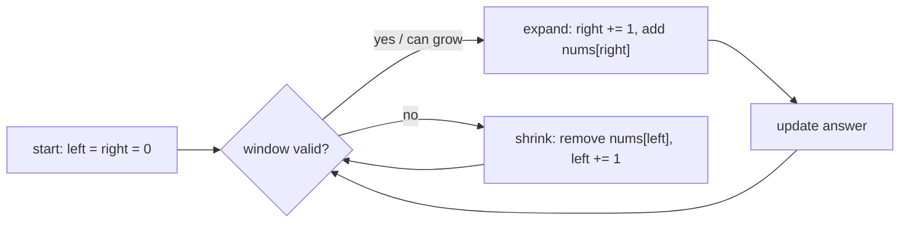

# Sliding windows: fixed vs variable

## Before this lesson

You should be comfortable with:

- Python lists and strings, `for` loops, and indexing such as `nums[i]` and slices such as `nums[i:j]`.
- Sets and dictionaries (a *dictionary*, or `dict`, stores key → value pairs and finds a key in roughly constant time).
- **Big-O notation** — a way to describe how the running time grows as the input grows. `O(n)` means "proportional
  to the input size `n`"; `O(n²)` means "proportional to `n × n`". If this is new, read [Big-O, Big-Omega and Big-Theta](#/lesson/dsa-foundations/asymptotic-notation) first.

No earlier lesson of this track is required; this is the first one.

## In plain words

Imagine reading a long line of text through a cardboard frame that shows only a few letters at a time. To see
the next part you do not pick the frame up and start again from the beginning — you **slide** it one letter to
the right. One letter disappears on the left, one new letter appears on the right, and everything in between
stays where it was.

A **sliding window** in programming is that frame. It is a stretch of neighbouring items in a list or string,
described by two positions: where it starts (`left`) and where it ends (`right`). Instead of re-examining
everything inside the frame after each move, the program keeps a small running summary (for example the sum of
the visible numbers) and adjusts it for the one item that left and the one that arrived.

Why it matters for a job: questions such as "the busiest 5 minutes in this log", "the longest stretch without a
repeated value" or "the shortest run of purchases that reaches 100 euros" appear constantly in data processing,
monitoring and interviews. The slow way looks at every possible stretch; the window way looks at each item
about twice. On a million items that is the difference between hours and a fraction of a second.

A few words used throughout:

- **Contiguous** means "next to each other with no gaps". A **subarray** is a contiguous piece of a list; a
  **substring** is a contiguous piece of a string.
- An **index** is the position number of an item; Python counts from 0.
- A **pointer** here is nothing more than a variable holding an index.

Many interview problems ask about a **contiguous** piece of an array or string: the longest substring
with some property, the shortest subarray reaching a sum, the maximum of every block of `k` values. The
naive approach examines every possible piece — and there are about $n^2/2$ of them. The **sliding window**
technique examines them *implicitly*, moving two indices only forward, and usually brings the cost down to
**O(n)**.

This lesson builds the technique from first principles: what a window is, why two forward-only pointers
can be enough, the two templates (fixed and variable size), and the single idea that makes them correct — the
**window invariant**.

## 1. Motivation: from O(n·k) to O(n)

Suppose you want the maximum sum of any `k` consecutive values of `nums`. The direct method sums each block:

```python-run
def max_block_sum_naive(nums, k):
    best = float("-inf")
    for i in range(len(nums) - k + 1):
        best = max(best, sum(nums[i:i + k]))      # O(k) work per start
    return best

print(max_block_sum_naive([2, 1, 5, 1, 3, 2], 3))   # 9  (5 + 1 + 3)
```

That is $O(n \cdot k)$. But neighbouring blocks overlap in `k - 1` elements! Going from block `[i, i+k-1]`
to block `[i+1, i+k]` only **adds** `nums[i+k]` and **removes** `nums[i]`. So:

```python-run
def max_block_sum(nums, k):
    window = sum(nums[:k])          # first window
    best = window
    for right in range(k, len(nums)):
        window += nums[right]       # element entering
        window -= nums[right - k]   # element leaving
        best = max(best, window)
    return best

print(max_block_sum([2, 1, 5, 1, 3, 2], 3))   # 9
import random, time
big = [random.randint(-100, 100) for _ in range(200_000)]
t = time.time(); max_block_sum(big, 5000); print(f"sliding: {time.time() - t:.3f}s")
```

That is the whole trick in miniature: **maintain an aggregate for the current window and update it
incrementally** as the window slides, instead of recomputing it from scratch.

## 2. Vocabulary

A window is a pair of indices `left` and `right` describing `nums[left..right]` (inclusive), with length
`right - left + 1`. Some people prefer the half-open `[left, right)` with length `right - left`; either is fine
as long as you are consistent.

The window has some **state** — a running sum, a dict of character counts, a set of seen values, a deque of
candidates. Two operations change it:

- **expand**: `right += 1`, add `nums[right]` to the state;
- **shrink**: remove `nums[left]` from the state, `left += 1`.

Both pointers only ever move **forward**. Since each can move at most `n` times, the total number of
expand/shrink operations is at most `2n`. If each update costs O(1), the algorithm is O(n). This simple
counting argument is the heart of every sliding-window complexity proof.



## 3. Fixed-size windows

When the problem says "every block of length `k`", "every substring of length `len(p)`", or "within `k`
indices", the window size is fixed. Template:

```python
def fixed_window(nums, k):
    state = init()
    for right, x in enumerate(nums):
        add(state, x)                    # x enters
        if right >= k:
            remove(state, nums[right - k])   # the element k steps back leaves
        if right >= k - 1:               # window [right-k+1, right] is complete
            record(state)
```

Three details matter:

1. **When does an element leave?** When `right` reaches `k`, index `0` must leave; in general index
   `right - k` leaves. Off-by-one errors here are the most common bug.
2. **When is the first window complete?** At `right = k - 1`. Before that, do not record answers.
3. **What does `record` need?** Often a comparison between the state and a target state (e.g. letter
   counts equal to the counts of `p` in *Find All Anagrams*), or an aggregate (a sum, a max).

Typical fixed-window problems in this module: *Permutation in String*, *Find All Anagrams in a String*,
*Contains Duplicate II* (window of the last `k` indices), *Sliding Window Maximum*.

> [!TIP]
> For fixed windows you can also write the loop over the **start** index; but looping over `right` and
> letting the left side be implied (`right - k + 1`) generalises better to the variable template below.

### Example: Contains Duplicate II

"Are there equal values at most `k` apart?" At index `i`, the only possible partners are the previous `k`
indices. Keep exactly their values in a set:

```python-run
def contains_nearby_duplicate(nums, k):
    window = set()
    for i, x in enumerate(nums):
        if x in window:
            return True
        window.add(x)
        if len(window) > k:
            window.remove(nums[i - k])
    return False

print(contains_nearby_duplicate([1, 2, 3, 1], 3))       # True
print(contains_nearby_duplicate([1, 2, 3, 1, 2, 3], 2)) # False
```

## 4. Variable-size windows

When the problem asks for the **longest** or **shortest** contiguous piece satisfying a condition, the window
size is part of the answer. The window grows and shrinks. There are two flavours.

### 4.1 Longest valid window ("shrink while invalid")

```python
def longest(nums):
    left = 0
    best = 0
    for right, x in enumerate(nums):
        add(state, x)
        while not valid(state):        # repair the invariant
            remove(state, nums[left])
            left += 1
        best = max(best, right - left + 1)   # window is valid here
    return best
```

**Invariant:** after the `while` loop, `nums[left..right]` is valid, and `left` is the *smallest* index for
which it is valid (given this `right`). So `right - left + 1` is the longest valid window *ending at* `right`,
and the best over all `right` is the answer.

Example — *Longest Substring Without Repeating Characters*: valid = "no character appears twice".

```python-run
def length_of_longest_substring(s):
    seen = set()
    left = best = 0
    for right, ch in enumerate(s):
        while ch in seen:              # adding ch would break the invariant
            seen.remove(s[left])
            left += 1
        seen.add(ch)
        best = max(best, right - left + 1)
    return best

for s in ["abcabcbb", "bbbbb", "pwwkew", "", "abba"]:
    print(repr(s), length_of_longest_substring(s))
```

### 4.2 Shortest valid window ("shrink while valid")

```python
def shortest(nums):
    left = 0
    best = INF
    for right, x in enumerate(nums):
        add(state, x)
        while valid(state):            # squeeze while still valid
            best = min(best, right - left + 1)
            remove(state, nums[left])
            left += 1
    return best
```

Here the answer is recorded **inside** the loop, because every window we pass through while shrinking is a
valid candidate, and we want the smallest.

Example — *Minimum Size Subarray Sum*: shortest subarray with sum `>= target` (all numbers positive).

```python-run
def min_sub_array_len(target, nums):
    best = float("inf")
    total = left = 0
    for right, x in enumerate(nums):
        total += x
        while total >= target:
            best = min(best, right - left + 1)
            total -= nums[left]
            left += 1
    return 0 if best == float("inf") else best

print(min_sub_array_len(7, [2, 3, 1, 2, 4, 3]))    # 2
print(min_sub_array_len(11, [1, 1, 1, 1, 1]))      # 0
```

## 5. Why is it correct? The monotonicity requirement

Two forward-only pointers skip most of the $n^2$ windows. Why are we allowed to skip them? Because of a
**monotonicity** property of the condition:

- For "longest valid" problems: if a window is **invalid**, every window that contains it is invalid too.
  (A substring with a duplicate character stays duplicated if you extend it.) So once `[left, right]` is
  invalid, no window `[left', right']` with `left' <= left` and `right' >= right` can be the answer, and it
  is safe to advance `left`.
- For "shortest valid" problems: if a window is **valid**, every window containing it is valid too (with
  positive numbers, extending the window only increases the sum). So once `[left, right]` is valid, larger
  windows with the same `left` are worse candidates, and we can advance `left`.

Phrased as one rule: **validity must change in one direction when the window grows**. If it doesn't, the
two-pointer window is wrong.

> [!WARNING]
> *Minimum Size Subarray Sum* with **negative** numbers breaks the monotonicity: extending a window can
> decrease its sum. The two-pointer template then gives wrong answers. The fix uses prefix sums with a
> monotonic deque (LeetCode 862) — see the deque lesson.

```python-run
# A counterexample: with negatives the window misses the answer.
def window_version(target, nums):
    best, total, left = float("inf"), 0, 0
    for right, x in enumerate(nums):
        total += x
        while total >= target and left <= right:
            best = min(best, right - left + 1)
            total -= nums[left]; left += 1
    return best

def brute(target, nums):
    n = len(nums)
    return min((j - i + 1 for i in range(n) for j in range(i, n) if sum(nums[i:j + 1]) >= target), default=float("inf"))

nums = [84, -37, 32, 40, 95]
print(window_version(167, nums), brute(167, nums))   # window says 5, truth is 3 ([32, 40, 95])
```

## 6. Choosing the state

The template is always the same; the creativity is in the **state** and the **validity test**, which must
both be updatable in O(1) (or O(alphabet)) per step.

| Problem | State | Valid when |
|---|---|---|
| Max sum of `k` consecutive | running sum | (fixed size) |
| Longest substring w/o repeats | set or `last_index` dict | no duplicate |
| Longest repeating char replacement | counts[26], `maxf` | `len - maxf <= k` |
| At most 2 distinct (Fruit Into Baskets) | dict value → count | `len(dict) <= 2` |
| Min subarray sum ≥ target | running sum | `sum >= target` |
| Minimum window substring | need-counts, `missing` | `missing == 0` |
| Sliding window maximum | monotonic deque | (fixed size) |

### The `last_index` jump

Sometimes you can shrink in **one jump** instead of a loop. For distinct characters, store the last index of
each char; when `ch` repeats inside the window, set `left = last[ch] + 1`. Careful: the stored index may be
**to the left of the window** already (stale), so use `left = max(left, last[ch] + 1)`. The string `"abba"`
is the classic test: at the final `a`, `last['a'] = 0` is stale and must not pull `left` back from 2 to 1.

### The "never shrink" trick

In *Longest Repeating Character Replacement* there is an elegant twist: instead of a `while`, use an `if` and
move `left` by exactly one. The window then never gets *smaller*; it slides at its maximum size so far, and only
grows when a strictly better window appears. When the loop finishes, the window size *is* the answer. This
works because we only care about the maximum length, and a window that is too large by one is shifted right
rather than shrunk. It also lets `maxf` stay stale (never decremented) — a stale `maxf` can only make an
invalid window look valid *at a size we already achieved*, which never changes the final answer.

## 7. Worked example: Best Time to Buy and Sell Stock as a window

The stock problem looks like "pick `i < j` maximising `prices[j] - prices[i]`". Treat `left` as the buy day
and `right` as the sell day. If `prices[right] < prices[left]`, the window is "invalid" in the sense that a
cheaper buy day has appeared: any future sale is better paired with `right` than with `left`. So jump
`left = right`. Otherwise record `prices[right] - prices[left]`.

```python-run
def max_profit(prices):
    left, best = 0, 0
    for right in range(1, len(prices)):
        if prices[right] < prices[left]:
            left = right
        else:
            best = max(best, prices[right] - prices[left])
    return best

print(max_profit([7, 1, 5, 3, 6, 4]), max_profit([7, 6, 4, 3, 1]))
```

Dry run on `[7,1,5,3,6,4]`:

| right | price | left (day, price) | profit | best |
|---|---|---|---|---|
| 1 | 1 | jump → (1, 1) | — | 0 |
| 2 | 5 | (1, 1) | 4 | 4 |
| 3 | 3 | (1, 1) | 2 | 4 |
| 4 | 6 | (1, 1) | 5 | 5 |
| 5 | 4 | (1, 1) | 3 | 5 |

## 8. Off-by-one checklist for windows

Before you submit, walk through this list:

1. **Length formula.** Inclusive window: `right - left + 1`. Half-open: `right - left`.
2. **Leaving element in fixed windows** is `nums[right - k]`, and the first complete window is at
   `right == k - 1`.
3. **Record position.** Longest: after the shrink loop. Shortest: inside the shrink loop, *before* removing.
4. **`while`, not `if`** when one new element can require several removals (unless you are deliberately
   using the never-shrink trick).
5. **Stale indices.** When jumping `left` from a stored index, take `max(left, …)`.
6. **Empty input** and **window larger than input** (`k > n`, `len(s1) > len(s2)`).
7. **Delete zero counts** from dicts if you use `len(dict)` as "number of distinct values".
8. **Monotonicity.** Is validity really monotone? Negative numbers often break it.

## 9. Summary

- A sliding window maintains an aggregate over `nums[left..right]` and updates it in O(1) as either pointer
  advances. Both pointers only move forward, so there are at most `2n` updates: **O(n)**.
- **Fixed** windows: add the right element, remove `nums[right - k]`, record once `right >= k - 1`.
- **Variable** windows: *longest* → shrink while invalid, record after; *shortest* → shrink while valid,
  record inside.
- Correctness depends on monotonicity: validity must only change one way as the window grows.
- Most of the design work is choosing a state (sum, set, counts, deque) that updates in O(1).

## Glossary

- **Window** — the stretch of neighbouring items `nums[left..right]` currently being examined.
- **Contiguous** — adjacent, with no gaps.
- **Subarray / substring** — a contiguous piece of a list / of a string.
- **Fixed-size window** — a window whose length never changes (given as `k`).
- **Variable-size window** — a window that grows and shrinks; its length is part of the answer.
- **State** — the summary kept for the window (a sum, a set, counts…), updated when items enter or leave.
- **Expand / shrink** — move `right` forward to take in an item / move `left` forward to drop one.
- **Invariant** — a statement that is true every time the loop reaches a certain line (e.g. "the window has no repeated character").
- **Valid window** — a window that satisfies the problem's condition.
- **Monotonicity** — validity changes in only one direction as the window grows; required for the technique to be correct.
- **Amortized cost** — average cost per step over the whole run, even if single steps vary.
- **Brute force** — the direct method that tries every possibility.

```quiz
[
  {"q": "In a fixed window of size k processed with `for right in range(n)`, which index leaves the window when `right` arrives?",
   "options": ["right - k + 1", "right - k", "right - 1", "left + k"], "answer": 1,
   "explain": "The window after adding `right` must be [right-k+1, right], so index right-k is the one that just fell out."},
  {"q": "Why is a variable sliding window O(n) even though it has a nested while loop?",
   "options": ["The while loop runs at most once per iteration", "Both pointers only move forward, so total pointer moves are at most 2n", "Python optimises nested loops", "It is actually O(n log n)"], "answer": 1,
   "explain": "Amortized argument: `left` can advance at most n times over the whole run, no matter how the advances are distributed among iterations."},
  {"q": "For a 'longest valid window' problem, where should you update the answer?",
   "options": ["Inside the shrink loop", "After the shrink loop, when the window is valid again", "Only at the end", "Before adding nums[right]"], "answer": 1,
   "explain": "After repairing the invariant the window [left, right] is the longest valid window ending at right."},
  {"q": "Which property makes the two-pointer approach correct for 'shortest subarray with sum >= target'?",
   "options": ["The array is sorted", "All numbers are positive, so growing a window never decreases its sum", "The target is small", "The answer is unique"], "answer": 1,
   "explain": "Positivity gives monotonicity: once valid, every superset window is valid, so advancing left loses nothing."},
  {"q": "Using `left = last[ch] + 1` without `max(left, ...)` fails on which input for longest substring without repeats?",
   "options": ["\"abcabcbb\"", "\"bbbbb\"", "\"abba\"", "\"\""], "answer": 2,
   "explain": "At the last 'a', last['a'] = 0 is outside the window [2, 2]; the jump would move left backwards to 1 and count 'bba'."},
  {"q": "In Longest Repeating Character Replacement, a window can be made uniform with k replacements iff:",
   "options": ["len(window) <= k", "number of distinct letters <= k", "len(window) - maxFreq <= k", "maxFreq >= k"], "answer": 2,
   "explain": "Keep the most frequent letter and overwrite all the others: that needs len - maxFreq replacements."}
]
```

> **Source:** Original exposition; amortized-analysis framing follows Goodrich, Tamassia & Goldwasser,
> *Data Structures and Algorithms in Python*, §5.3 (amortization). Problem ordering follows the NeetCode 150 roadmap.
