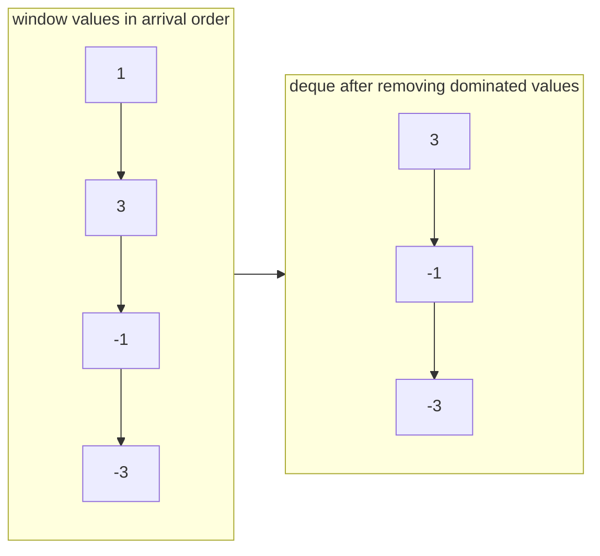

# The monotonic deque: window maximum in O(n)

## Before this lesson

- [Sliding windows: fixed vs variable](#/lesson/neet-window-stack/window-fundamentals) — the fixed-size window template.
- Python lists and the cost of their operations; if "amortized O(1)" is unfamiliar, read
  [Dynamic arrays and amortised analysis](#/lesson/dsa-foundations/dynamic-arrays).
- Helpful but optional: [Queues, circular arrays and deques](#/lesson/dsa-foundations/queues-deques).

## In plain words

Picture a queue of people waiting to be "the tallest person in the room". A new person walks in. Everyone
already waiting who is **shorter (or the same height)** can go home: the newcomer is at least as tall and will
be staying in the room longer than they will, so they will never get their turn. After they leave, the people
still waiting are in order from tallest (at the front) to shortest (at the back), and the person at the front is
the tallest in the room right now.

That waiting line is a **monotonic deque**:

- a **queue** is a line where you join at the back and leave from the front (first in, first out);
- a **deque** (pronounced "deck", short for *double-ended queue*) lets you add and remove at **both** ends;
- **monotonic** means "always going one way" — here, the stored values only decrease from front to back.

Why it matters: a sum can be updated when an item leaves the window by subtracting it, but a **maximum** cannot
— if the largest item leaves, you no longer know the next largest. Dashboards that show "the peak load over the
last 60 seconds", trading systems tracking "the highest price in the last 100 ticks" and many interview problems
need exactly this, and the monotonic deque answers it with a constant amount of work per item on average.

Sums and counts are easy to maintain in a sliding window because they are **invertible**: when an element
leaves, you subtract it. The **maximum** is not invertible. If the current maximum leaves the window, what is
the new maximum? You cannot "subtract" your way to it — you would have to rescan the window, costing O(k).

This lesson introduces the data structure that solves this: a **double-ended queue (deque) whose contents
are kept monotonic**. It answers "max of the current window" in O(1) and supports sliding in amortized O(1),
giving an O(n) algorithm for *Sliding Window Maximum* — and it is the tool behind several hard problems.

## 1. The deque ADT

A **deque** ("deck", double-ended queue) supports insertion and removal at **both** ends. Goodrich et al.
(§6.3) present it as a generalisation of both the stack and the queue; Python provides it as
`collections.deque`, implemented as a doubly linked list of fixed-size blocks, so all four end operations are
O(1):

| Operation | `collections.deque` | Cost |
|---|---|---|
| add to back | `dq.append(x)` | O(1) |
| add to front | `dq.appendleft(x)` | O(1) |
| remove from back | `dq.pop()` | O(1) |
| remove from front | `dq.popleft()` | O(1) |
| peek back / front | `dq[-1]`, `dq[0]` | O(1) |
| index into the middle | `dq[i]` | O(n) |

> [!WARNING]
> A Python `list` is a fine stack, but a poor queue: `lst.pop(0)` and `lst.insert(0, x)` shift every element
> and cost O(n). Whenever you remove from the front, use `deque.popleft()`.

```python-run
from collections import deque
import time

n = 40_000
lst = list(range(n))
t = time.time()
while lst: lst.pop(0)
print(f"list.pop(0):      {time.time() - t:.3f}s")

dq = deque(range(n))
t = time.time()
while dq: dq.popleft()
print(f"deque.popleft():  {time.time() - t:.3f}s")
```

## 2. The key observation: dominated elements

Consider a window and a new element `x` arriving at index `i`. Take any older element `y` in the window with
`y <= x`. Compare their futures:

- `x` will stay in the window **at least as long** as `y` (it arrived later, so it leaves later);
- `x >= y`.

So in every future window that contains `y`, `x` is also present and at least as large. **`y` can never again
be the maximum.** We say `y` is *dominated* by `x`, and we can throw it away immediately.

If we discard every dominated element, what remains? Read the survivors in arrival order: each one must be
**strictly greater** than everything after it (otherwise it would be dominated). So the survivors form a
**strictly decreasing** sequence, and the first survivor is the maximum of the window.



## 3. The algorithm

Store **indices** in the deque (we need them to know when the front has left the window). Maintain:

> **Invariant:** the deque holds indices `i1 < i2 < … < im` of the current window, with
> `nums[i1] > nums[i2] > … > nums[im]`, and every index of the window that is *not* in the deque is
> dominated by some later index that is.

For each new index `i`:

1. **Pop dominated elements from the back**: while `nums[dq[-1]] <= nums[i]`, `dq.pop()`.
2. **Append** `i`.
3. **Expire the front**: if `dq[0] <= i - k`, `dq.popleft()`. (Only the front can be expired, because indices
   are increasing; and at most one index expires per step.)
4. Once `i >= k - 1`, the answer for the window ending at `i` is `nums[dq[0]]`.

```python-run
from collections import deque

def max_sliding_window(nums, k, trace=False):
    dq, out = deque(), []
    for i, x in enumerate(nums):
        while dq and nums[dq[-1]] <= x:
            dq.pop()
        dq.append(i)
        if dq[0] <= i - k:
            dq.popleft()
        if i >= k - 1:
            out.append(nums[dq[0]])
        if trace:
            print(f"i={i} x={x:>2}  deque values={[nums[j] for j in dq]}")
    return out

print(max_sliding_window([1, 3, -1, -3, 5, 3, 6, 7], 3, trace=True))
```

### 3.1 Dry run

`nums = [1,3,-1,-3,5,3,6,7]`, `k = 3`:

| i | x | popped from back | expired | deque (values) | output |
|---|---|---|---|---|---|
| 0 | 1 | | | [1] | |
| 1 | 3 | 1 | | [3] | |
| 2 | −1 | | | [3, −1] | 3 |
| 3 | −3 | | | [3, −1, −3] | 3 |
| 4 | 5 | −3, −1, 3 | | [5] | 5 |
| 5 | 3 | | | [5, 3] | 5 |
| 6 | 6 | 3, 5 | | [6] | 6 |
| 7 | 7 | 6 | | [7] | 7 |

Here no front ever expires by age (it was always popped from the back first). Try
`[9, 1, 1, 1, 1]` with `k = 2` to see an expiry: 9 sits at the front until `i = 2` makes index 0 too old.

## 4. Proof of amortized O(n)

The inner `while` can pop many elements in one iteration, so a single step can cost O(k). But consider the
whole run:

- every index is **appended exactly once**;
- an index can be removed **at most once** — either from the back (dominated) or from the front (expired),
  never both, because once removed it is gone.

So the total number of pops over the entire algorithm is at most `n`, and the total work is
O(n appends + n pops + n loop iterations) = **O(n)**. The average (amortized) cost per element is O(1), even
though an individual step can be expensive. This is the same accounting argument Goodrich et al. use for
dynamic arrays in §5.3: charge each expensive operation to the cheap operations that "paid for" it in advance.
Here, each `append` pre-pays for its own future `pop`.

```python-run
# Count total pops to see the amortized bound in action.
import random
from collections import deque

def count_ops(nums, k):
    dq, pops = deque(), 0
    for i, x in enumerate(nums):
        while dq and nums[dq[-1]] <= x:
            dq.pop(); pops += 1
        dq.append(i)
        if dq[0] <= i - k:
            dq.popleft(); pops += 1
    return pops

for name, arr in [("random", [random.randint(0, 10**6) for _ in range(10**5)]),
                  ("increasing", list(range(10**5))),
                  ("decreasing", list(range(10**5, 0, -1)))]:
    print(f"{name:>10}: n = {len(arr)}, total pops = {count_ops(arr, 1000)}")
```

Every line prints a pop count `<= n`, no matter the input or `k`.

## 5. Alternatives and why the deque wins

| Approach | Time | Notes |
|---|---|---|
| Recompute `max(window)` | O(n·k) | simple; too slow when `k` is large |
| Max-heap of `(−value, index)` with lazy deletion | O(n log n) | pop the top while its index is expired |
| Balanced BST / sorted list | O(n log k) | supports deletion of arbitrary values |
| Block decomposition (prefix/suffix max per block of k) | O(n) | elegant, two extra arrays |
| **Monotonic deque** | **O(n)** | simplest O(n), O(k) memory |

The heap version is worth knowing as a fallback:

```python-run
import heapq

def max_sliding_window_heap(nums, k):
    heap, out = [], []
    for i, x in enumerate(nums):
        heapq.heappush(heap, (-x, i))
        if i >= k - 1:
            while heap[0][1] <= i - k:   # lazily discard expired maxima
                heapq.heappop(heap)
            out.append(-heap[0][0])
    return out

print(max_sliding_window_heap([1, 3, -1, -3, 5, 3, 6, 7], 3))
```

## 6. Variations

### 6.1 Window minimum

Flip the comparison: pop from the back while `nums[dq[-1]] >= x`. The deque is then increasing.

### 6.2 Strict vs non-strict popping

Popping on `<=` keeps the deque *strictly* decreasing; popping on `<` keeps equal values (non-increasing).
Both give correct maxima. With `<`, the deque may hold duplicates, which matters if you need to count
occurrences or if the expiry check compares *values* instead of indices — another reason to store indices.

### 6.3 Monotonic deque over prefix sums

*Shortest Subarray with Sum at Least K* (LeetCode 862) allows **negative** numbers, so lesson 1's window
fails. With prefix sums `P`, we want the shortest `j - i` with `P[j] - P[i] >= K`. Keep a deque of indices
with **increasing** `P`:

- from the **front**: while `P[j] - P[dq[0]] >= K`, record `j - dq[0]` and pop — the front can never give a
  shorter answer for a later `j`;
- from the **back**: while `P[dq[-1]] >= P[j]`, pop — a later, smaller prefix is a strictly better start.

```python-run
from collections import deque

def shortest_subarray(nums, K):
    P = [0]
    for x in nums:
        P.append(P[-1] + x)
    dq, best = deque(), float("inf")
    for j, pj in enumerate(P):
        while dq and pj - P[dq[0]] >= K:
            best = min(best, j - dq.popleft())
        while dq and P[dq[-1]] >= pj:
            dq.pop()
        dq.append(j)
    return -1 if best == float("inf") else best

print(shortest_subarray([84, -37, 32, 40, 95], 167))   # 3
print(shortest_subarray([2, -1, 2], 3))                 # 3
```

This is the fix promised in lesson 1 for windows with negative numbers.

### 6.4 Deques as plain queues

Outside monotonic tricks, `deque` is *the* queue for breadth-first search and for "keep the last k items"
(`deque(maxlen=k)` automatically drops from the opposite end when full).

```python-run
from collections import deque
last3 = deque(maxlen=3)
for x in range(6):
    last3.append(x)
    print(list(last3))
```

## 7. Pitfalls checklist

1. **Store indices, not values** — you need them for expiry (and values can repeat).
2. **Expiry condition**: the window ending at `i` is `[i-k+1, i]`; expire when `dq[0] <= i - k`.
3. **Order of operations**: pop dominated → append → expire → record. Expiring before appending also works
   if you are careful, but recording must come last.
4. **Record only once the first window is complete** (`i >= k - 1`).
5. **Use `deque`**, not `list.pop(0)`.
6. The deque's front is the maximum only *because of the invariant* — if you skip the back-popping step even
   once, the front may not be the max.

## 8. Summary

- A deque gives O(1) push/pop at both ends; use `collections.deque`.
- For window maxima, discard *dominated* elements (older and not larger). The survivors are strictly
  decreasing, so the front is the maximum.
- Each index is appended once and popped at most once: **amortized O(1) per step, O(n) total**.
- The same idea on prefix sums handles shortest-subarray problems with negative numbers.

## Glossary

- **Queue** — a first-in-first-out line: add at the back, remove from the front.
- **Deque** — double-ended queue: add or remove at either end in O(1); `collections.deque` in Python.
- **Monotonic** — always increasing, or always decreasing.
- **Monotonic deque** — a deque whose stored values are kept in sorted order by discarding useless items.
- **Dominated element** — an older item that is not larger than a newer one, so it can never be a future maximum.
- **Expired index** — an index that has slid out of the left side of the window.
- **Amortized O(1)** — constant cost per item on average over the whole run.
- **Aggregate / accounting argument** — bounding the total cost of all steps together (each item is added once and removed at most once).
- **Lazy deletion** — leaving outdated items in a structure and discarding them only when they reach the top.
- **Prefix sum** — `P[i]` = sum of the first `i` items; the sum of any stretch is a difference of two prefix sums.

```quiz
[
  {"q": "Why can an older element y be discarded when a new x >= y arrives in a sliding-window maximum?",
   "options": ["Because y is smaller than the current maximum", "Because x stays in the window at least as long as y and is at least as large, so y can never be a future maximum", "Because the deque has limited capacity", "Because y is at the back"], "answer": 1,
   "explain": "x arrived later, so it leaves later; whenever y is in the window, x is too and dominates it."},
  {"q": "The values in the deque (front to back) for sliding-window MAXIMUM are:",
   "options": ["increasing", "strictly decreasing (if popping on <=)", "sorted by index descending", "arbitrary"], "answer": 1,
   "explain": "Every survivor is greater than all elements after it, so the sequence decreases; the front is the max."},
  {"q": "What is the total number of pop operations over the whole run on an array of length n?",
   "options": ["At most n", "At most n*k", "Exactly n - k + 1", "O(n log n)"], "answer": 0,
   "explain": "Each index is appended once and can be removed at most once (from either end)."},
  {"q": "Which condition expires the front index for a window of size k ending at i?",
   "options": ["dq[0] < i - k", "dq[0] <= i - k", "dq[0] == i", "len(dq) > k"], "answer": 1,
   "explain": "The window is [i-k+1, i]; index i-k (or anything smaller) is outside it."},
  {"q": "Which Python operation is O(n) and should be avoided when using a list as a queue?",
   "options": ["lst.append(x)", "lst.pop()", "lst.pop(0)", "lst[-1]"], "answer": 2,
   "explain": "Removing from the front of a list shifts every remaining element; use deque.popleft()."},
  {"q": "A max-heap with lazy deletion solves Sliding Window Maximum in:",
   "options": ["O(n)", "O(n log n)", "O(n k)", "O(k log n)"], "answer": 1,
   "explain": "Each element is pushed and popped from the heap at most once, each operation O(log n)."}
]
```

> **Source:** Goodrich, Tamassia & Goldwasser, *Data Structures and Algorithms in Python*, §6.3 (double-ended
> queues, `collections.deque`) and §5.3 (amortized analysis); Python `collections.deque` documentation.
