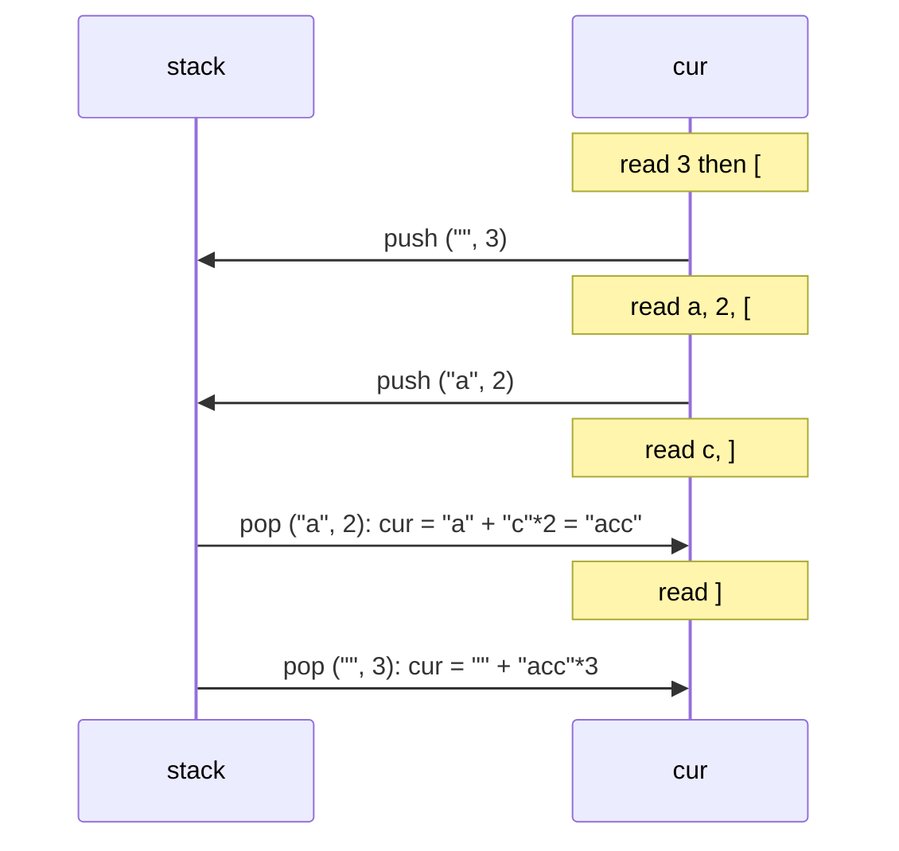

# Stacks: the LIFO toolkit

A **stack** is the simplest data structure with a real personality: the last thing you put in is the first
thing you get out (**LIFO**, last-in first-out). That one rule makes it the natural tool whenever a problem
has *nesting*, *undo*, or *"the most recent unresolved thing"*: matching brackets, evaluating expressions,
decoding nested encodings, backtracking, function calls themselves.

This lesson covers the stack ADT and its Python implementation, then works through the classic stack
applications that appear in interviews: bracket matching, postfix evaluation, infix evaluation with
precedence, nested decoding, design stacks that carry extra information (Min Stack), and simulation
problems (Baseball Game, Asteroid Collision). The next lesson adds the *monotonic* stack.

## 1. The stack ADT

Goodrich, Tamassia & Goldwasser (§6.1.1) define a stack by its operations:

| Operation | Meaning | Python `list` | Cost |
|---|---|---|---|
| `push(e)` | add `e` on top | `st.append(e)` | O(1) amortized |
| `pop()` | remove and return the top | `st.pop()` | O(1) |
| `top()` / peek | return the top without removing | `st[-1]` | O(1) |
| `is_empty()` | is it empty? | `not st` | O(1) |
| `len()` | number of elements | `len(st)` | O(1) |

Python's list already behaves as a stack **if you only touch its end**. The book's `ArrayStack` (§6.1.2) is a
thin *adapter* around a list that hides the other list methods and raises a clear `Empty` exception on popping
an empty stack. In interviews just use a list, but remember the adapter's lesson: **guard every `pop`/peek**
against an empty stack.

```python-run
class Empty(Exception):
    pass

class ArrayStack:
    """LIFO stack backed by a Python list (adapter pattern)."""
    def __init__(self):
        self._data = []
    def __len__(self):
        return len(self._data)
    def is_empty(self):
        return not self._data
    def push(self, e):
        self._data.append(e)
    def top(self):
        if self.is_empty():
            raise Empty("stack is empty")
        return self._data[-1]
    def pop(self):
        if self.is_empty():
            raise Empty("stack is empty")
        return self._data.pop()

S = ArrayStack()
for x in [5, 3, 7]:
    S.push(x)
print(len(S), S.pop(), S.top(), S.is_empty())
try:
    ArrayStack().pop()
except Empty as e:
    print("caught:", e)
```

Why is `append` "amortized" O(1)? A Python list is a dynamic array: when its capacity runs out it allocates a
bigger array (growing geometrically) and copies everything. A single append can cost O(n), but the copies are
rare enough that **n appends cost O(n) total** — the amortization argument of §5.3, which we will reuse for
monotonic stacks.

> [!TIP]
> Never implement a stack by inserting/removing at index 0 of a list. `insert(0, x)` and `pop(0)` are O(n).

## 2. Reversal: the simplest application

Push everything, then pop everything, and you get the reverse order (§6.1.3). That is all a stack does — but
"reverse the order of the pending things" is exactly what nesting requires: the most recently opened thing must
be closed first.

```python-run
def reverse(seq):
    st = []
    for x in seq:
        st.append(x)
    return [st.pop() for _ in range(len(st))]

print(reverse([1, 2, 3, 4]))
```

## 3. Matching brackets

The textbook's flagship application (§6.1.4) is checking that delimiters are properly matched.

**Rule:** scan left to right; push every opener; on a closer, the top of the stack must be the matching opener
— pop it; at the end the stack must be empty.

```python-run
def is_valid(s):
    match = {")": "(", "]": "[", "}": "{"}
    st = []
    for ch in s:
        if ch in match:                         # closer
            if not st or st[-1] != match[ch]:
                return False
            st.pop()
        else:                                   # opener
            st.append(ch)
    return not st

for s in ["()[]{}", "([)]", "{[]}", "((", "]"]:
    print(f"{s!r:10} {is_valid(s)}")
```

Three distinct failure modes, each a test case you should always try:

1. wrong kind of closer (`"(]"`, `"([)]"`),
2. closer with an empty stack (`"]"`),
3. leftover openers (`"(("`).

> [!NOTE]
> The textbook extends the same algorithm to **HTML tags**: `<body>` pushes the tag name and `</body>` must
> match the top. Any well-nested language (XML, LaTeX environments, code blocks) is checked the same way.

### 3.1 Brackets without a stack?

For a *single* bracket type a counter suffices: `+1` on `(`, `−1` on `)`, never negative, zero at the end.
That counter is a stack of identical items — its height. With several types the counter fails on `"([)]"`
because it cannot remember *which* opener is on top. *Generate Parentheses* uses exactly the counter view:
`open - close` is the stack height, and a `)` is allowed only while it is positive.

## 4. Postfix (Reverse Polish) evaluation

In **postfix** notation operators follow their operands: `3 4 + 2 *` means `(3 + 4) * 2`. No parentheses
and no precedence rules are needed, because an operator always applies to the **two most recent values** —
the top two of a stack.

```python-run
def eval_rpn(tokens):
    st = []
    for t in tokens:
        if t in {"+", "-", "*", "/"}:
            b = st.pop()            # right operand is on top!
            a = st.pop()
            if t == "+": st.append(a + b)
            elif t == "-": st.append(a - b)
            elif t == "*": st.append(a * b)
            else: st.append(int(a / b))      # truncate toward zero
        else:
            st.append(int(t))
    return st[-1]

print(eval_rpn(["2", "1", "+", "3", "*"]))                  # 9
print(eval_rpn(["4", "13", "5", "/", "+"]))                 # 6
print(eval_rpn(["-7", "2", "/"]), -7 // 2, int(-7 / 2))     # -3 -4 -3
```

> [!WARNING]
> **Python's `//` floors** toward −∞; most interview problems (and C/Java) **truncate toward zero**.
> `-7 // 2 == -4` but `int(-7 / 2) == -3`. For huge integers, float division loses precision; use
> `q = abs(a) // abs(b)` and fix the sign.

**Operand order:** the first pop is the *right* operand. Swapping them silently breaks `-` and `/`.

## 5. Infix evaluation with precedence

*Basic Calculator II* evaluates `3+2*2` directly (no parentheses). The trick is to treat the expression as a
**sum of terms**, where a term is a run of `*` and `/`:

- remember the operator **before** the current number;
- when the number is complete (next operator or end of string), apply that previous operator:
  `+n` → push `n`; `-n` → push `-n`; `*n` → replace top with `top * n`; `/n` → replace top with
  `trunc(top / n)`;
- the answer is `sum(stack)`.

```python-run
def calculate(s):
    st, num, op = [], 0, "+"
    for i, ch in enumerate(s):
        if ch.isdigit():
            num = num * 10 + int(ch)
        if (not ch.isdigit() and ch != " ") or i == len(s) - 1:
            if op == "+": st.append(num)
            elif op == "-": st.append(-num)
            elif op == "*": st.append(st.pop() * num)
            else:
                t = st.pop()
                st.append(int(t / num))
            op, num = ch, 0
    return sum(st)

for e in ["3+2*2", " 3/2 ", " 3+5 / 2 ", "14-3/2"]:
    print(repr(e), calculate(e))
```

`*` and `/` bind tighter because they act **immediately** on the previous term, whereas `+` and `-` are
deferred to the final sum. With parentheses (*Basic Calculator I/III*), you additionally push the running
state on `(` and pop it on `)` — nesting again. The general solution is Dijkstra's *shunting-yard* algorithm,
which uses one stack for operators and one for values.

## 6. Nested decoding

*Decode String* expands `3[a2[c]]` → `accaccacc`. Each `[` starts a new nested context; each `]` finishes it
and pastes the result into the enclosing context. Save the enclosing context on a stack:

```python-run
def decode_string(s):
    st = []                 # (text before '[', repeat count)
    cur, num = "", 0
    for ch in s:
        if ch.isdigit():
            num = num * 10 + int(ch)          # multi-digit counts!
        elif ch == "[":
            st.append((cur, num))
            cur, num = "", 0
        elif ch == "]":
            prev, k = st.pop()
            cur = prev + cur * k
        else:
            cur += ch
    return cur

for s in ["3[a]2[bc]", "3[a2[c]]", "2[abc]3[cd]ef", "10[a]"]:
    print(s, "->", decode_string(s))
```

The pattern — *"on open, push the current state and start fresh; on close, pop and combine"* — is the
iterative form of recursion. Any recursive descent parser can be rewritten with an explicit stack, which is
handy when recursion depth would exceed Python's limit (~1000 by default).



## 7. Stacks that carry extra state: Min Stack

*Min Stack* asks for `push`, `pop`, `top`, and `getMin` all in O(1). A single `min` variable fails: after
popping the minimum, you don't know the previous minimum. The fix: **store, with every element, the minimum of
the stack up to and including it**.

```python-run
class MinStack:
    def __init__(self):
        self.st = []                       # (value, min so far)
    def push(self, val):
        m = val if not self.st else min(val, self.st[-1][1])
        self.st.append((val, m))
    def pop(self):
        self.st.pop()
    def top(self):
        return self.st[-1][0]
    def getMin(self):
        return self.st[-1][1]

ms = MinStack()
for v in [-2, 0, -3]:
    ms.push(v)
print(ms.getMin()); ms.pop(); print(ms.top(), ms.getMin())
```

Why does this work? A stack only changes at the top, so the minimum of the elements *below* any element never
changes while that element is in the stack. Recording it at push time is therefore always accurate. This
"augment each element with a summary of everything below it" idea also gives max stacks, and — with two
stacks — a **min queue** with amortized O(1) operations.

## 8. Simulation with a stack

Some problems are literally "process events, where each event interacts with the most recent survivors":

- **Baseball Game**: `"+"` uses the last two scores, `"D"` the last one, `"C"` deletes the last one.
- **Asteroid Collision**: a left-moving asteroid collides with right-moving survivors on top of the stack,
  possibly destroying several. Only `top > 0` and `new < 0` collide.

```python-run
def asteroid_collision(asteroids):
    st = []
    for a in asteroids:
        alive = True
        while alive and a < 0 and st and st[-1] > 0:
            if st[-1] < -a:
                st.pop()            # top explodes, a keeps going
                continue
            if st[-1] == -a:
                st.pop()            # both explode
            alive = False           # a explodes (or both did)
        if alive:
            st.append(a)
    return st

for row in [[5, 10, -5], [8, -8], [10, 2, -5], [-2, -1, 1, 2]]:
    print(row, "->", asteroid_collision(row))
```

Even though one asteroid can destroy many, each asteroid is pushed once and popped at most once, so the whole
simulation is O(n). Keep that argument in mind — the next lesson makes it the centrepiece.

## 9. Backtracking is a stack

*Generate Parentheses* builds strings character by character and **undoes** choices when returning — the call
stack is a stack of partial solutions. Writing it with an explicit `path` list makes the push/pop visible:

```python-run
def generate(n):
    out, path = [], []
    def go(opened, closed):
        if closed == n:
            out.append("".join(path)); return
        if opened < n:
            path.append("("); go(opened + 1, closed); path.pop()
        if closed < opened:
            path.append(")"); go(opened, closed + 1); path.pop()
    go(0, 0)
    return out

print(generate(3))
```

## 10. Recognising a stack problem

Reach for a stack when you see:

- **nesting** — brackets, tags, `k[...]`, parentheses in expressions;
- **"most recent"** — the last unmatched item, the previous score, the nearest element to the left with some
  property;
- **undo** — deleting the last action, backtracking;
- **postfix / prefix** expressions;
- an **explicit replacement for recursion**.

## 11. Pitfalls checklist

1. Popping or peeking an **empty** stack.
2. Forgetting the **final check** (stack empty / leftover state).
3. **Operand order** in binary operators (`b = pop(); a = pop()`).
4. **Floor vs truncation** for negative division.
5. **Multi-digit numbers** when scanning character by character (`num = num*10 + d`).
6. Using `list.insert(0, x)` / `pop(0)` (O(n)) instead of the list end.
7. In design problems, storing too little per element (a single global min).

## 12. Summary

- A stack is LIFO; a Python list used at its end gives O(1) push/pop/peek.
- Nesting ⇒ stack: matching, decoding, parsing, backtracking.
- Postfix evaluation pops two operands per operator; infix with precedence becomes "sum of terms".
- Augmenting each element with a summary of the stack below it (Min Stack) keeps queries O(1).
- Simulations where each element is pushed once and popped at most once run in O(n) overall.

```quiz
[
  {"q": "Which Python list operations give an O(1) stack?",
   "options": ["insert(0, x) and pop(0)", "append(x) and pop()", "append(x) and pop(0)", "insert(0, x) and pop()"], "answer": 1,
   "explain": "Only the end of a dynamic array can be modified in O(1) (amortized for append)."},
  {"q": "Processing tokens [\"5\", \"3\", \"-\"] in RPN, which subtraction is performed?",
   "options": ["3 - 5", "5 - 3", "Either; subtraction is symmetric", "Error"], "answer": 1,
   "explain": "The first pop gives the right operand (3), the second gives the left operand (5): 5 - 3 = 2."},
  {"q": "In Python, what is -7 // 2?",
   "options": ["-3", "-4", "-3.5", "3"], "answer": 1,
   "explain": "Floor division rounds toward negative infinity. Use int(-7 / 2) == -3 for truncation toward zero."},
  {"q": "Which string does a single counter (+1 for opener, -1 for closer) wrongly accept?",
   "options": ["\"(]\" counting both kinds together", "\"((\"", "\"]\"", "\"()\""], "answer": 0,
   "explain": "A single counter cannot remember which kind of opener is pending, so mismatched kinds slip through."},
  {"q": "Min Stack stores (value, min_so_far) pairs. Why is min_so_far always correct for the top element?",
   "options": ["Because values are sorted", "Because elements below an item never change while that item is on the stack", "Because pop recomputes it", "Because Python caches min"], "answer": 1,
   "explain": "A stack only changes at the top, so the minimum of everything at or below an element is fixed while it stays."},
  {"q": "In Basic Calculator II, why do * and / get higher precedence automatically?",
   "options": ["They are evaluated last", "They combine immediately with the previous term on the stack, while + and - are deferred to the final sum", "The string is reversed", "They are pushed as negative numbers"], "answer": 1,
   "explain": "The stack holds signed terms; * and / modify the most recent term in place, then everything is summed."},
  {"q": "Asteroid Collision can destroy many asteroids per step. Why is it still O(n)?",
   "options": ["Collisions are rare", "Each asteroid is pushed once and popped at most once", "The while loop has a fixed bound of 2", "It isn't; it's O(n^2)"], "answer": 1,
   "explain": "Total pops are bounded by total pushes, which is n — the amortized argument."}
]
```

> **Source:** Goodrich, Tamassia & Goldwasser, *Data Structures and Algorithms in Python*, §6.1 (stack ADT,
> array-based stack, reversing data, matching parentheses and HTML tags) and §5.3 (amortized dynamic arrays).
> Problem ordering follows the NeetCode 150 roadmap.
