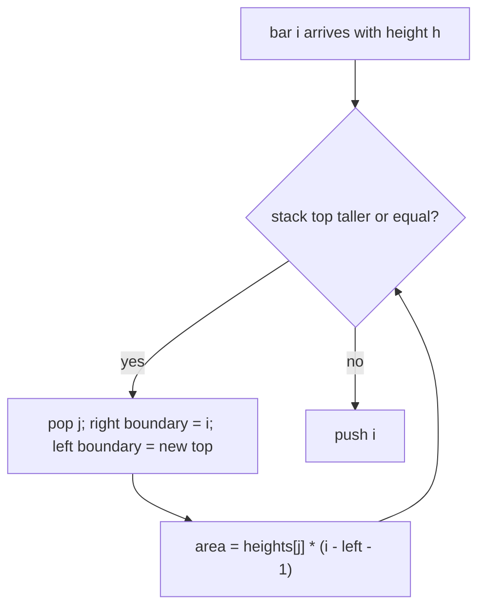

# Monotonic stacks and amortized O(n)

## Before this lesson

- [Stacks: the LIFO toolkit](#/lesson/neet-window-stack/stack-basics) — push, pop, peek, and using a Python list as a stack.
- The idea of amortized cost: [Dynamic arrays and amortised analysis](#/lesson/dsa-foundations/dynamic-arrays) (optional; the proof
  is repeated here from scratch).
- [The monotonic deque](#/lesson/neet-window-stack/monotonic-deque) is a close relative; reading it first helps but is not required.

## In plain words

People stand in a row, all facing right, and each one wonders: "who is the first person in front of me who is
taller than I am?" Walk along the row from left to right carrying a notepad of people who are **still waiting
for an answer**. Each time you reach a new person, compare them with the most recent name on the notepad: if the
new person is taller, that waiting person has their answer — cross them off, and check the next most recent
name. When the new person is not taller than the latest name, add the new person to the notepad.

Notice two things. First, you always look at the **most recent** name — so the notepad is a stack. Second, the
people left on the notepad are always in order of decreasing height (if a later one were taller, the earlier
one would have been crossed off). A stack whose contents are always sorted like that is called a
**monotonic stack** (*monotonic* = always going in one direction).

Why it matters: "how many days until a warmer day?", "when does this stock price next exceed today's?", "how
far can this bar of a chart stretch sideways before hitting a shorter bar?" are all "nearest bigger/smaller
neighbour" questions. The naive method compares every pair; the monotonic stack handles each item about twice in
total. It is one of the highest-value patterns for medium and hard interview questions.

"For every element, find the **next greater** element to its right." The obvious solution scans right from
each element — O(n²) in the worst case. A **monotonic stack** answers the question for *all* elements in a
single pass, O(n) total. The same structure solves *Daily Temperatures*, *Next Greater Element*, *Online Stock
Span*, *Car Fleet* and the famous *Largest Rectangle in Histogram*.

This lesson derives the technique, proves its O(n) running time with an amortized argument, and catalogues
the four variants (next/previous × greater/smaller) so you can write any of them on demand.

## 1. From "waiting room" to monotonic stack

Think of each array element as a person asking: *"who is the first person to my right taller than me?"* We
walk left to right. When we meet a new person `x`, some earlier people get their answer **now** — exactly
those still waiting who are shorter than `x`.

Which earlier people are still waiting? Suppose waiting persons `a` (earlier) and `b` (later) with `a < b`.
Then `b` would have answered `a` when `b` arrived. So no waiting person is shorter than a later waiting person:
the waiting room, read from oldest to newest, is **non-increasing**. And the people `x` answers are the
shortest ones — the most recent arrivals. They sit at the **top** of a stack.

> The set of elements still waiting for their next-greater element forms a **monotonic (non-increasing) stack**.

```python-run
def next_greater(nums):
    ans = [-1] * len(nums)
    st = []                                 # indices; nums[st] non-increasing
    for i, x in enumerate(nums):
        while st and nums[st[-1]] < x:      # x answers everyone shorter on top
            ans[st.pop()] = x
        st.append(i)                        # x now waits for its own answer
    return ans

print(next_greater([2, 1, 2, 4, 3]))        # [4, 2, 4, -1, -1]
```

### 1.1 Dry run

`nums = [2, 1, 2, 4, 3]` (stack shows `index:value`):

| i | x | popped (answer = x) | stack after |
|---|---|---|---|
| 0 | 2 | | 0:2 |
| 1 | 1 | | 0:2, 1:1 |
| 2 | 2 | 1:1 | 0:2, 2:2 |
| 3 | 4 | 2:2, 0:2 | 3:4 |
| 4 | 3 | | 3:4, 4:3 |

Indices 3 and 4 are never popped: they have no greater element (`-1`).

## 2. Amortized O(n): the proof

The `while` loop inside the `for` loop looks quadratic. It is not.

**Claim.** The total number of iterations of the `while` loop, over the entire run, is at most `n`.

**Proof.** Each iteration pops one index. Every index is pushed exactly once (at its own step), and an index
that has been popped is never pushed again. So the number of pops cannot exceed the number of pushes, which is
`n`. ∎

Therefore total time = O(n) for the `for` loop + O(n) for all `while` iterations combined = **O(n)**.

This is the **aggregate method** of amortized analysis: bound the *total* cost of a sequence of operations,
then divide by the number of operations. Goodrich et al. use the same reasoning (§5.3) to show that appending
to a dynamic array costs O(1) amortized even though an individual append may copy the whole array. An
equivalent **accounting** view: give every element 2 "coins" when it is pushed — one pays for the push, one is
saved for its future pop. No step ever runs out of coins, so the total cost is at most `2n`.

```python-run
import random
def count_pops(nums):
    st, pops = [], 0
    for x in nums:
        while st and st[-1] < x:
            st.pop(); pops += 1
        st.append(x)
    return pops

n = 100_000
for name, arr in [("random", [random.random() for _ in range(n)]),
                  ("increasing", list(range(n))),
                  ("decreasing", list(range(n, 0, -1))),
                  ("zigzag", [i % 100 for i in range(n)])]:
    print(f"{name:>10}: pops = {count_pops(arr):>6}  (n = {n})")
```

> [!NOTE]
> "Amortized O(1) per element" is a statement about the whole sequence, not each step. A single step can pop
> O(n) elements (the last element of a decreasing array that is larger than everything). That is fine for
> batch algorithms. For *online* problems with strict per-operation latency requirements, amortized bounds
> may not be good enough — but interview problems like *Online Stock Span* only ask for amortized O(1).

## 3. The four variants

| Want, for each element | Scan | Stack keeps | Pop while |
|---|---|---|---|
| next **greater** (to the right) | left → right | non-increasing values | `nums[top] < x` (answer for top = x) |
| next **smaller** | left → right | non-decreasing values | `nums[top] > x` |
| previous **greater** (to the left) | left → right | strictly decreasing | `nums[top] <= x`; then answer for x = top |
| previous **smaller** | left → right | strictly increasing | `nums[top] >= x`; then answer for x = top |

Two ways to produce answers:

- **Answers on pop** ("next" problems): when `x` pops `top`, `x` is `top`'s next greater/smaller.
- **Answers on push** ("previous" problems): after popping, the element left on top (if any) is `x`'s
  previous greater/smaller.

A single pass often gives **both**: in *Largest Rectangle in Histogram*, when bar `i` pops bar `j`, `i` is
`j`'s next smaller and the new top is `j`'s previous smaller.

### 3.1 Strict vs non-strict

Read the problem: *Daily Temperatures* wants a **strictly** warmer day, so equal temperatures must keep
waiting — pop on `<`, not `<=`. *Online Stock Span* counts days with price **less than or equal** — pop on
`<=`. One character, different answer: always test with duplicates.

## 4. Distances instead of values: Daily Temperatures

Store indices; the answer for popped `j` is `i - j`:

```python-run
def daily_temperatures(T):
    ans = [0] * len(T)
    st = []
    for i, t in enumerate(T):
        while st and T[st[-1]] < t:
            j = st.pop()
            ans[j] = i - j
        st.append(i)
    return ans

print(daily_temperatures([73, 74, 75, 71, 69, 72, 76, 73]))   # [1,1,4,2,1,1,0,0]
```

## 5. Online and merged: Stock Span

*Online Stock Span* needs, for each new price, how many consecutive previous days (including today) had a price
`<=` today's. That is "distance to the previous strictly greater price". Online, we don't keep the whole array —
we keep `(price, span)` pairs on the stack, and a new price **absorbs** the spans of everything it pops:

```python-run
class StockSpanner:
    def __init__(self):
        self.st = []                        # (price, span), prices strictly decreasing
    def next(self, price):
        span = 1
        while self.st and self.st[-1][0] <= price:
            span += self.st.pop()[1]
        self.st.append((price, span))
        return span

s = StockSpanner()
print([s.next(p) for p in [100, 80, 60, 70, 60, 75, 85]])   # [1,1,1,2,1,4,6]
```

Each stack entry represents a **block** of consecutive days that it dominates. Merging blocks is a common
monotonic-stack upgrade (*Sum of Subarray Minimums* uses it too).

## 6. The hard one: Largest Rectangle in Histogram

Given bar heights, find the largest rectangle under the histogram.

**Key insight.** Look at an optimal rectangle. Its height equals the height of its **shortest bar** `j`
(otherwise you could make it taller). And it extends as wide as possible — until a bar strictly shorter than
`heights[j]` on each side. So:

$$\text{area}(j) = \text{heights}[j] \times (\text{nextSmaller}(j) - \text{prevSmaller}(j) - 1)$$

and the answer is the maximum over `j`. Both neighbours come from **one** increasing stack:

```python-run
def largest_rectangle(heights):
    st, best = [], 0                        # indices; heights increasing
    for i, h in enumerate(heights + [0]):   # sentinel 0 flushes the stack
        while st and heights[st[-1]] >= h:
            j = st.pop()                    # i is j's next smaller (or equal)
            left = st[-1] if st else -1     # new top is j's previous smaller
            best = max(best, heights[j] * (i - left - 1))
        st.append(i)
    return best

print(largest_rectangle([2, 1, 5, 6, 2, 3]))   # 10
print(largest_rectangle([2, 4]))               # 4
print(largest_rectangle([1, 2, 3, 4, 5]))      # 9 — needs the sentinel
```



**Dry run** `[2,1,5,6,2,3]` + sentinel 0:

| i | h | pops → area | stack after |
|---|---|---|---|
| 0 | 2 | | [0] |
| 1 | 1 | j=0: 2 × (1 − (−1) − 1) = 2 | [1] |
| 2 | 5 | | [1, 2] |
| 3 | 6 | | [1, 2, 3] |
| 4 | 2 | j=3: 6 × (4 − 2 − 1) = 6; j=2: 5 × (4 − 1 − 1) = **10** | [1, 4] |
| 5 | 3 | | [1, 4, 5] |
| 6 | 0 | j=5: 3 × 1 = 3; j=4: 2 × (6 − 1 − 1) = 8; j=1: 1 × 6 = 6 | [6] |

**Equal heights.** We pop on `>=`, so among equal bars the earlier one is popped by the later one with a
too-small width. That's harmless: the *last* of the equal bars will later be popped with the full width.

**The sentinel.** Bars still on the stack at the end have no next-smaller element; their rectangles reach the
right edge. Appending a height-0 bar forces them all out with `i = n`. Without it, `[1,2,3,4,5]` returns 0.

## 7. Stack-shaped thinking without explicit pops: Car Fleet

*Car Fleet* sorts cars by position (closest to target first) and computes each car's solo arrival time. A car
joins the fleet in front if it would arrive no later; otherwise it starts a new fleet. Conceptually the fleets'
arrival times form a **strictly increasing stack**, and since a car only interacts with the fleet directly
ahead, we only ever need the top:

```python-run
def car_fleet(target, position, speed):
    fleets = []                              # arrival times, increasing
    for p, s in sorted(zip(position, speed), reverse=True):
        t = (target - p) / s
        if not fleets or t > fleets[-1]:
            fleets.append(t)                 # can't catch the fleet ahead: new fleet
    return len(fleets)

print(car_fleet(12, [10, 8, 0, 5, 3], [2, 4, 1, 1, 3]))   # 3
```

## 8. Recognising monotonic-stack problems

- "next / previous **greater / smaller** element"
- "how many days until…", "how far can this extend…", "span"
- "for each element, the nearest element to the left/right with property P", where P is a comparison
- "largest rectangle", "maximal area", "trapped water" (another classic: *Trapping Rain Water* can be solved
  with a decreasing stack, popping to fill "basins")
- "remove k digits to make the smallest number" (*Remove K Digits*, LeetCode 402: keep an increasing stack,
  popping larger digits while you still have removals)

```python-run
def remove_k_digits(num, k):
    st = []
    for d in num:
        while k and st and st[-1] > d:
            st.pop(); k -= 1
        st.append(d)
    st = st[:len(st) - k] if k else st
    return "".join(st).lstrip("0") or "0"

print(remove_k_digits("1432219", 3), remove_k_digits("10200", 1), remove_k_digits("10", 2))
```

## 9. Pitfalls checklist

1. **Indices vs values** — store indices whenever you need distances or widths.
2. **Strict vs non-strict comparisons** — decide using the problem's wording and test with duplicates.
3. **Leftover elements** — they have no answer (`-1`/`0`) or need a sentinel flush.
4. **Width formula** in histogram problems uses the **new** top after popping: `i - st[-1] - 1`, or `i` if the
   stack is empty.
5. **Direction** — "next" problems resolve on pop; "previous" problems read the top after popping.
6. **Circular arrays** (*Next Greater Element II*) — iterate `2n` indices using `i % n`, pushing only during
   the first pass.

## 10. Summary

- Elements waiting for a "next greater" answer always form a monotonic stack; a new element resolves the
  waiting ones it beats, from the top.
- Every element is pushed once and popped at most once ⇒ **O(n) total**, amortized O(1) per element.
- Four variants (next/previous × greater/smaller); one pass can give both neighbours.
- Largest Rectangle = for each bar, height × (next smaller − previous smaller − 1), computed with an
  increasing stack and a 0-height sentinel.

## Glossary

- **Monotonic stack** — a stack whose values, bottom to top, are always sorted (increasing or decreasing).
- **Next greater element** — the first larger value to the right of an item; *previous greater* looks left; *smaller* variants flip the comparison.
- **Strict / non-strict** — `<` versus `<=`; decides how equal values are treated.
- **Resolve on pop** — an item receives its answer at the moment it is popped.
- **Amortized analysis** — bounding the total cost of a sequence of operations.
- **Aggregate method** — counting all operations together (total pops ≤ total pushes).
- **Accounting method** — pre-paying for a future cheap operation at the time of an earlier one.
- **Sentinel** — an extra artificial value (such as a bar of height 0) added to force clean-up at the end.
- **Histogram** — a bar chart; here a list of bar heights with width 1 each.
- **Span** — the number of consecutive earlier items (including the current one) that satisfy a comparison.
- **Online algorithm** — one that must answer after each new item, without seeing the future.
- **Contribution technique** — counting how much each item contributes to the total instead of examining every subarray.

```quiz
[
  {"q": "In the next-greater-element algorithm, the values on the stack (bottom to top) are:",
   "options": ["increasing", "non-increasing", "sorted by index descending", "random"], "answer": 1,
   "explain": "If a later waiting element were larger than an earlier one, it would already have answered (popped) it."},
  {"q": "Why does the monotonic-stack algorithm run in O(n) despite the nested while loop?",
   "options": ["The while loop runs at most once per element", "Each index is pushed once and popped at most once, so total pops <= n", "Python stacks are O(1)", "Because the input is sorted"], "answer": 1,
   "explain": "Aggregate amortized analysis: total work of all while iterations is bounded by the number of pushes."},
  {"q": "Daily Temperatures wants a strictly warmer day. Which pop condition is correct?",
   "options": ["while T[top] <= t", "while T[top] < t", "while T[top] > t", "while T[top] >= t"], "answer": 1,
   "explain": "An equal temperature is not warmer, so equal elements must keep waiting."},
  {"q": "In Largest Rectangle in Histogram, when bar i pops bar j, the width of j's rectangle is:",
   "options": ["i - j", "i - j + 1", "i - (new top) - 1, or i if the stack is empty", "j - (new top)"], "answer": 2,
   "explain": "The rectangle spans strictly between j's previous smaller (new top) and next smaller (i)."},
  {"q": "What does the height-0 sentinel at the end of the histogram do?",
   "options": ["Avoids division by zero", "Forces every remaining bar to be popped so rectangles reaching the right edge are measured", "Handles empty input only", "Makes heights strictly increasing"], "answer": 1,
   "explain": "Without it, bars that never meet a smaller bar (e.g. an increasing histogram) are never evaluated."},
  {"q": "Online Stock Span keeps (price, span) pairs. What does a new price do with popped pairs?",
   "options": ["Discards their spans", "Adds their spans to its own", "Pushes them back", "Takes the maximum span"], "answer": 1,
   "explain": "Each popped entry represents a block of days with price <= the new price; their union is contiguous and adjacent."},
  {"q": "To find the PREVIOUS smaller element for each x, you scan left to right and after popping, the answer is:",
   "options": ["the popped element", "the element now on top (if any)", "x itself", "the bottom of the stack"], "answer": 1,
   "explain": "After removing everything >= x, the remaining top is the nearest earlier element smaller than x."}
]
```

> **Source:** Original exposition; amortized-analysis framing from Goodrich, Tamassia & Goldwasser,
> *Data Structures and Algorithms in Python*, §5.3 and stack ADT from §6.1. Problem ordering follows the
> NeetCode 150 roadmap.
