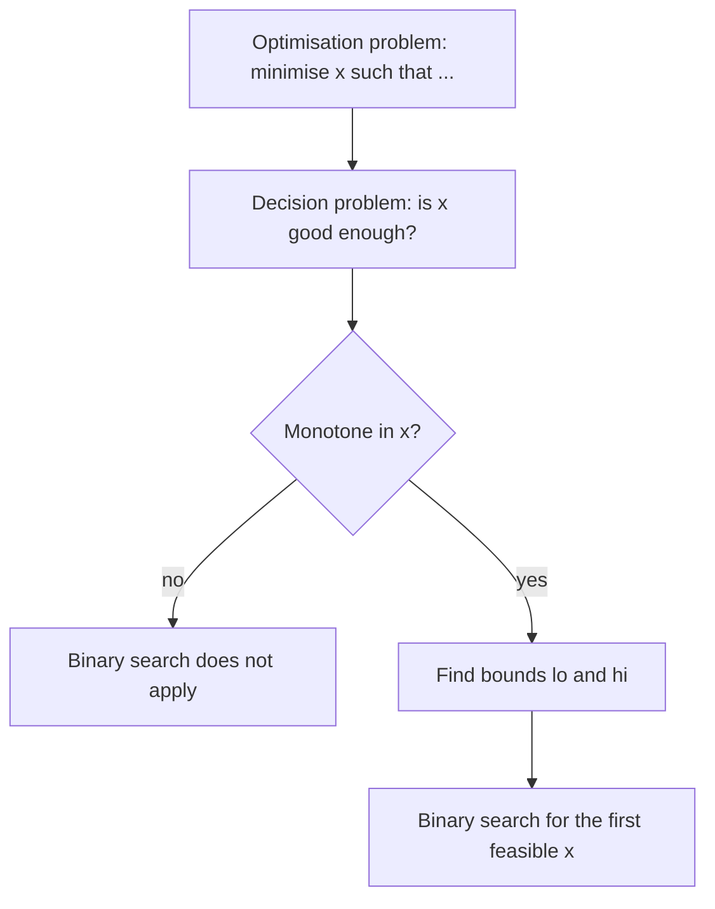

# Binary search on the answer

The previous lesson searched *positions in a sorted array*. This lesson makes a leap that surprises most
people the first time: you can binary-search **the answer itself**, even when there is no array to search.

The pattern appears whenever a problem says "find the **minimum** speed / capacity / time / largest sum such
that something is possible" (or the maximum such that something still works). *Koko Eating Bananas*,
*Capacity To Ship Packages Within D Days*, *Split Array Largest Sum* and *Sqrt(x)* are all the same algorithm
wearing different clothes.

## 1. The idea in one paragraph

Suppose the answer is an integer in a known range `[lo, hi]`, and suppose you can write a function
`feasible(x)` that answers "would `x` be good enough?". If `feasible` is **monotone** — once it becomes true
it stays true as `x` grows — then the values of `feasible` over the range look like

```
x:          lo  ...                         hi
feasible:   F   F   F   F   T   T   T   T   T
                            ^ the answer: the first T
```

That is exactly the "first True" problem from the last lesson. The "array" is virtual: its `x`-th entry is
`feasible(x)`, computed on demand. We need only about $\log_2(hi - lo)$ evaluations.

```python
def first_feasible(lo, hi, feasible):      # smallest x in [lo, hi] with feasible(x); hi must be feasible
    while lo < hi:
        mid = (lo + hi) // 2
        if feasible(mid):
            hi = mid            # mid works: the answer is mid or smaller
        else:
            lo = mid + 1        # mid fails: the answer is larger
    return lo
```

Total cost: **O(cost of `feasible` × log(range))**.



## 2. The four-step recipe

1. **Identify the answer variable** and what "feasible" means for a candidate value.
2. **Prove monotonicity** in one sentence ("a faster speed never needs more hours").
3. **Choose bounds**: `lo` = smallest conceivable answer, `hi` = a value that is certainly feasible.
4. **Write `feasible(x)`**, usually a greedy O(n) simulation, and plug it into the template.

The creative work is steps 1 and 4; the binary search is boilerplate.

## 3. Worked example: Koko Eating Bananas

Piles `[3, 6, 7, 11]`, `h = 8` hours. At speed `k`, a pile of `p` bananas takes $\lceil p / k \rceil$ hours
(she cannot start another pile within the same hour). Find the minimum `k` that finishes within `h` hours.

1. **Answer variable:** the speed `k`. Feasible ⇔ `hours(k) <= h`.
2. **Monotone:** raising `k` cannot increase any $\lceil p/k \rceil$, so if `k` works, `k + 1` works.
3. **Bounds:** `lo = 1` (speed 0 is meaningless). `hi = max(piles)`: every pile takes one hour, and the
   problem guarantees `h >= len(piles)`.
4. **Feasibility:** `sum(ceil(p / k)) <= h`.

```python-run
def min_eating_speed(piles, h, trace=False):
    def hours(k):
        return sum((p + k - 1) // k for p in piles)     # integer ceiling division

    lo, hi = 1, max(piles)
    while lo < hi:
        mid = (lo + hi) // 2
        ok = hours(mid) <= h
        if trace:
            print(f"lo={lo:>2} hi={hi:>2} mid={mid:>2} hours={hours(mid):>2} feasible={ok}")
        if ok:
            hi = mid
        else:
            lo = mid + 1
    return lo

print(min_eating_speed([3, 6, 7, 11], 8, trace=True))
print(min_eating_speed([30, 11, 23, 4, 20], 5), min_eating_speed([30, 11, 23, 4, 20], 6))
```

Complexity: `feasible` is O(n); the range is up to $10^9$, so about 30 iterations:
$O(n \log \max(\text{piles}))$. A linear search over `k` would be up to $10^9 \times n$ steps.

> [!TIP]
> **Ceiling division** without floats: `(p + k - 1) // k`, or `-(-p // k)`. Avoid `math.ceil(p / k)` for huge
> integers — float division can round incorrectly beyond $2^{53}$.

## 4. Worked example: Capacity To Ship Packages

Packages must ship **in order**; each day's load is a consecutive run with total weight at most the capacity.
Minimise the capacity so that everything ships within `days` days.

1. **Answer variable:** capacity `c`. Feasible ⇔ `days_needed(c) <= days`.
2. **Monotone:** a bigger ship can copy the smaller ship's schedule.
3. **Bounds:** `lo = max(weights)` — the ship must carry the heaviest single package. `hi = sum(weights)` —
   everything in one day.
4. **Feasibility (greedy):** load packages while they fit; when the next one does not fit, start a new day.

Why is greedy optimal for the check? Loading as much as possible each day never hurts: any other schedule
that ships fewer packages on day 1 leaves a superset of work for later days. So greedy uses the minimum
number of days for a given capacity.

```python-run
def ship_within_days(weights, days):
    def need(cap):
        d, load = 1, 0
        for w in weights:
            if load + w > cap:
                d += 1
                load = 0
            load += w
        return d

    lo, hi = max(weights), sum(weights)
    while lo < hi:
        mid = (lo + hi) // 2
        if need(mid) <= days:
            hi = mid
        else:
            lo = mid + 1
    return lo

print(ship_within_days([1, 2, 3, 4, 5, 6, 7, 8, 9, 10], 5))   # 15
print(ship_within_days([3, 2, 2, 4, 1, 4], 3))                # 6
```

> [!WARNING]
> **Bounds are part of correctness, not just speed.** With `lo = 1`, the greedy check above would happily
> "ship" a package heavier than the capacity (it starts a new day, then loads it anyway) and the search would
> return a capacity that is too small. Either set `lo = max(weights)` or make `feasible` reject `w > cap`.

## 5. Split Array Largest Sum = the same problem

"Split `nums` into `k` contiguous parts minimising the largest part sum" — replace *packages* by *numbers*,
*days* by *parts*, *capacity* by *largest allowed sum*. The code is identical. This Hard-rated problem also
has an $O(k n^2)$ dynamic-programming solution, but the binary search is shorter, faster, and far easier to get
right.

One subtlety: the problem says **exactly** `k` parts, the check asks for **at most** `k`. That's fine: a split
into fewer parts can always be refined by cutting some part in two (there are at least `k` elements), and
cutting never increases the largest sum.

Recognising that two differently-worded problems are the same decision problem is the real skill here.
"Minimise the maximum" and "maximise the minimum" are the tell-tale phrases.

## 6. Maximise instead of minimise: the last True

Sometimes feasibility is true for **small** values and false for large ones, and you want the largest feasible
value: `T T T T F F F`. Use the mirrored template with the **upper midpoint**:

```python
def last_feasible(lo, hi, feasible):       # largest x in [lo, hi] with feasible(x); lo must be feasible
    while lo < hi:
        mid = (lo + hi + 1) // 2            # round UP because we assign lo = mid
        if feasible(mid):
            lo = mid
        else:
            hi = mid - 1
    return lo
```

*Sqrt(x)* is the smallest example: the largest `k` with `k * k <= x`.

A classic "maximise the minimum": place `m` balls into sorted positions so that the minimum gap between any
two balls is as large as possible (LeetCode 1552). `feasible(d)` = "can we place `m` balls at least `d` apart?"
(greedy: put each ball at the first position at least `d` after the previous one). Larger `d` is harder, so
feasibility is `T…T F…F`.

```python-run
def max_min_distance(position, m):
    position = sorted(position)
    def can(d):
        count, last = 1, position[0]
        for p in position[1:]:
            if p - last >= d:
                count += 1
                last = p
        return count >= m

    lo, hi = 1, position[-1] - position[0]
    while lo < hi:
        mid = (lo + hi + 1) // 2
        if can(mid):
            lo = mid
        else:
            hi = mid - 1
    return lo

print(max_min_distance([1, 2, 3, 4, 7], 3))   # 3  (balls at 1, 4, 7)
```

## 7. Real-valued answers

When the answer is a real number (e.g. "minimise the maximum distance between gas stations"), the same idea
works but the loop runs a fixed number of iterations or until `hi - lo < eps`:

```python-run
def sqrt_real(x, iters=60):
    lo, hi = 0.0, max(1.0, x)
    for _ in range(iters):              # each iteration halves the interval
        mid = (lo + hi) / 2
        if mid * mid <= x:
            lo = mid
        else:
            hi = mid
    return lo

print(sqrt_real(2), 2 ** 0.5)
```

With floats there is no `mid + 1`; both branches assign `mid`. A fixed iteration count (60–100) is more robust
than an epsilon test, which can loop forever when `eps` is below the floating-point resolution.

## 8. How to spot the pattern

Ask these questions when you read a problem:

- Is the answer a **number** (speed, capacity, time, distance, size) rather than a structure?
- Does the statement say **minimum … such that** / **maximum … such that** / *minimise the maximum* /
  *maximise the minimum*?
- If someone **gave** you the answer, could you **verify** it quickly (usually greedily in O(n))?
- Is "works" **monotone** in the answer?
- Are the constraints large on the *value* ($10^9$) but moderate on the *count* ($10^4$–$10^5$)? That
  combination practically announces $O(n \log V)$.

If all are yes: binary search on the answer.

| Problem | Answer variable | `feasible(x)` | Bounds |
|---|---|---|---|
| Koko Eating Bananas | speed | `sum(ceil(p/x)) <= h` | `1 .. max(piles)` |
| Ship Packages in D Days | capacity | greedy days `<= D` | `max(w) .. sum(w)` |
| Split Array Largest Sum | largest part sum | greedy parts `<= k` | `max(nums) .. sum(nums)` |
| Sqrt(x) | root | `x*x <= target` (last True) | `0 .. target` |
| Min Days to Make m Bouquets (1482) | day | bouquets by day `>= m` | `min(days) .. max(days)` |
| Magnetic Force (1552) | min gap | greedy placement `>= m` (last True) | `1 .. span` |

## 9. Pitfalls checklist

1. **Monotonicity not checked.** If `feasible` flips back and forth, binary search returns garbage.
2. **Bounds too tight or too loose.** `hi` must be feasible (first-True template) or `lo` must be feasible
   (last-True template). `lo` must not admit values the check mishandles (zero speed, capacity below the
   heaviest item).
3. **Wrong midpoint rounding** for the template in use → infinite loop on two-element ranges.
4. **Floor instead of ceiling** in rate computations.
5. **Off-by-one inside the greedy check**: day/part counters start at 1, not 0.
6. **`<=` vs `<`** in the feasibility comparison — re-read "within h hours" (inclusive).
7. **Returning `mid`** instead of `lo` after the loop.

## 10. Summary

- Convert "find the optimal value" into "is this value good enough?" and binary-search the first (or last)
  value for which the answer is yes.
- Requirements: a bounded answer range, a monotone feasibility predicate, and a fast check.
- Cost: O(check × log(range)) — typically $O(n \log V)$.
- Minimising ⇒ first True, lower midpoint, `hi = mid`. Maximising ⇒ last True, upper midpoint, `lo = mid`.
- Bounds and the greedy check deserve as much care as the search loop.

```quiz
[
  {"q": "What property must feasible(x) have for binary search on the answer to work?",
   "options": ["It must be O(1)", "It must be monotone in x", "It must be linear", "It must return an integer"], "answer": 1,
   "explain": "The predicate must look like F...F T...T (or the reverse) so a boundary exists to search for."},
  {"q": "In Koko Eating Bananas, how many hours does a pile of 7 take at speed 4?",
   "options": ["1", "1.75", "2", "3"], "answer": 2,
   "explain": "ceil(7 / 4) = 2: she eats 4 in the first hour and the remaining 3 in the second."},
  {"q": "Why must the lower bound for Capacity To Ship Packages be max(weights)?",
   "options": ["To make the search faster only", "Because no smaller capacity can carry the heaviest package, and the usual greedy check does not detect that", "Because weights are sorted", "Because days >= 1"], "answer": 1,
   "explain": "A capacity below the heaviest package is infeasible, but the simple greedy would still count days and may report it feasible."},
  {"q": "Time complexity of Koko Eating Bananas with n piles and max pile M?",
   "options": ["O(n)", "O(n log M)", "O(n M)", "O(M log n)"], "answer": 1,
   "explain": "About log2(M) candidate speeds are tested, each with an O(n) feasibility check."},
  {"q": "You want the LARGEST feasible x and write `if feasible(mid): lo = mid else: hi = mid - 1`. Which midpoint?",
   "options": ["(lo + hi) // 2", "(lo + hi + 1) // 2", "lo", "hi"], "answer": 1,
   "explain": "Assigning lo = mid requires rounding up, otherwise lo = mid makes no progress when hi = lo + 1."},
  {"q": "Split Array Largest Sum asks for exactly k parts but the check tests 'at most k parts'. Why is that valid?",
   "options": ["It is not valid", "A split into fewer parts can be refined into exactly k parts without increasing the largest sum", "Because k is always 1", "Because nums is sorted"], "answer": 1,
   "explain": "Cutting a part in two never increases the maximum, and k <= len(nums) guarantees enough elements to cut."},
  {"q": "Which phrase most strongly suggests binary search on the answer?",
   "options": ["'return all permutations'", "'minimise the maximum ...'", "'in-place'", "'sorted in non-decreasing order'"], "answer": 1,
   "explain": "Min-max and max-min objectives usually have a monotone decision version that is easy to check greedily."}
]
```

> **Source:** Technique built on the binary search of Goodrich, Tamassia & Goldwasser, *Data Structures and
> Algorithms in Python*, §4.1.3; examples follow the NeetCode 150 roadmap (Koko Eating Bananas) and related
> LeetCode problems.
