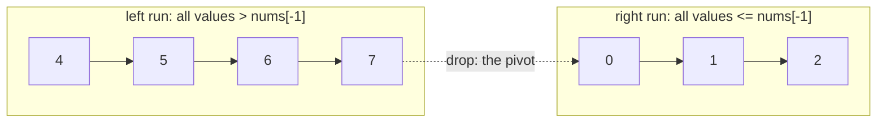

# Rotated arrays, 2-D matrices and partitions

Binary search does not actually need a *sorted array*. It needs a question whose answer lets you **discard
half of the search space**. This lesson covers three situations where the data is not plainly sorted, yet a
halving argument still exists:

1. a sorted array that has been **rotated** (*Find Minimum in Rotated Sorted Array*, *Search in Rotated
   Sorted Array*);
2. data indexed by **time** where you need the latest entry not after `t` (*Time Based Key-Value Store*);
3. two sorted arrays where you search for a **partition** rather than a value (*Median of Two Sorted Arrays*).

Each one is solved by finding the right predicate and keeping the invariants from lesson 6.

## 1. Rotated sorted arrays

Rotating a sorted array moves a suffix to the front: `[0,1,2,4,5,6,7]` → `[4,5,6,7,0,1,2]`. The result is two
increasing runs, and **every element of the first run is greater than every element of the second run** (values
are distinct).



### 1.1 Finding the minimum (the pivot)

Look for a monotone predicate. Compare each element with the **last** element:

| index | 0 | 1 | 2 | 3 | 4 | 5 | 6 |
|---|---|---|---|---|---|---|---|
| value | 4 | 5 | 6 | 7 | 0 | 1 | 2 |
| `nums[i] <= nums[-1]` | F | F | F | F | **T** | T | T |

False on the left run, True on the right run: a perfect `F…F T…T`. The first True is the minimum. Plug into
the first-True template:

```python-run
def find_min(nums):
    lo, hi = 0, len(nums) - 1
    while lo < hi:
        mid = (lo + hi) // 2
        if nums[mid] > nums[hi]:        # mid is in the left (high) run
            lo = mid + 1                # minimum is strictly right of mid
        else:                           # mid is in the right run (or array is sorted)
            hi = mid                    # minimum is mid or left of it
    return nums[lo]

for a in [[3, 4, 5, 1, 2], [4, 5, 6, 7, 0, 1, 2], [11, 13, 15, 17], [2, 1], [1]]:
    print(a, "->", find_min(a))
```

The code compares with `nums[hi]` instead of the fixed `nums[-1]`; this is equivalent, because the invariant
keeps the minimum inside `[lo, hi]`, so `nums[hi]` is always in the right run (or the range is fully sorted).

**Dry run** `[4,5,6,7,0,1,2]`:

| lo | hi | mid | nums[mid] vs nums[hi] | action |
|---|---|---|---|---|
| 0 | 6 | 3 | 7 > 2 | lo = 4 |
| 4 | 6 | 5 | 1 ≤ 2 | hi = 5 |
| 4 | 5 | 4 | 0 ≤ 1 | hi = 4 |

`lo == hi == 4` → minimum `0`.

> [!WARNING]
> **Why not compare with `nums[lo]`?** In an unrotated array `[1,2,3,4,5]`, `nums[mid] >= nums[lo]` is true,
> which looks like "mid is in the left run, go right" — and you walk away from the minimum at index 0.
> Comparing with the right end has no such ambiguity: `nums[mid] > nums[hi]` is impossible in a sorted range.

### 1.2 Searching for a target: one pass

Split the range `[lo, hi]` at `mid`. The pivot (the drop) can be in at most one half, so **at least one half
is sorted**. A sorted half is easy to reason about: the target is inside it iff it lies between the half's end
values.

```python-run
def search_rotated(nums, target):
    lo, hi = 0, len(nums) - 1
    while lo <= hi:
        mid = (lo + hi) // 2
        if nums[mid] == target:
            return mid
        if nums[lo] <= nums[mid]:                    # left half [lo..mid] is sorted
            if nums[lo] <= target < nums[mid]:
                hi = mid - 1                         # target inside the sorted left half
            else:
                lo = mid + 1
        else:                                        # right half [mid..hi] is sorted
            if nums[mid] < target <= nums[hi]:
                lo = mid + 1                         # target inside the sorted right half
            else:
                hi = mid - 1
    return -1

a = [4, 5, 6, 7, 0, 1, 2]
print([search_rotated(a, t) for t in [0, 3, 4, 2, 7]])
print(search_rotated([3, 1], 1), search_rotated([1], 0))
```

Details that matter:

- `nums[lo] <= nums[mid]` uses `<=` because when `lo == mid` (range of one or two elements) the "left half" is
  a single element, which is sorted. With `<`, the input `[3, 1]`, target `1` goes the wrong way.
- The range checks exclude `mid` (`< nums[mid]`, `nums[mid] <`) because `mid` was already tested.
- This is template A (closed interval, exact match, `mid ± 1`).

### 1.3 Searching for a target: two passes

An alternative that many find easier to get right under pressure:

1. find the pivot index `p` with `find_min` (returning the index);
2. the array is sorted on `[0, p-1]` and on `[p, n-1]`; choose the run that could contain the target (compare
   with `nums[-1]`) and run a normal binary search on it.

```python-run
import bisect

def search_rotated_two_pass(nums, target):
    lo, hi = 0, len(nums) - 1
    while lo < hi:
        mid = (lo + hi) // 2
        if nums[mid] > nums[hi]: lo = mid + 1
        else: hi = mid
    p = lo                                           # index of the minimum
    if target <= nums[-1]:
        i = bisect.bisect_left(nums, target, p, len(nums))
    else:
        i = bisect.bisect_left(nums, target, 0, p)
    return i if i < len(nums) and nums[i] == target else -1

print([search_rotated_two_pass([4, 5, 6, 7, 0, 1, 2], t) for t in [0, 3, 4, 2, 7]])
```

Both are O(log n).

### 1.4 Duplicates

With duplicates (LeetCode 81 / 154) the comparison can be inconclusive: in `[1, 0, 1, 1, 1]`,
`nums[mid] == nums[hi]` tells you nothing about which side holds the minimum. The standard fix is
`hi -= 1` in that case — still correct, but the worst case degrades to O(n) (e.g. all elements equal except
one). No algorithm can do better in the worst case: you must inspect almost every element.

## 2. Time-indexed data: floor search

*Time Based Key-Value Store* stores `(timestamp, value)` pairs per key and asks for the value at the largest
timestamp `<= t`. Because timestamps arrive in increasing order, each key's list is sorted for free, and the
query is the **floor** operation from lesson 6:

$$\text{index} = \text{upper\_bound}(t) - 1 = \texttt{bisect\_right(times, t)} - 1.$$

```python-run
import bisect
from collections import defaultdict

class TimeMap:
    def __init__(self):
        self.times = defaultdict(list)
        self.values = defaultdict(list)
    def set(self, key, value, timestamp):
        self.times[key].append(timestamp)       # already sorted: timestamps only increase
        self.values[key].append(value)
    def get(self, key, timestamp):
        i = bisect.bisect_right(self.times[key], timestamp) - 1
        return self.values[key][i] if i >= 0 else ""

tm = TimeMap()
tm.set("foo", "bar", 1); tm.set("foo", "bar2", 4)
print([tm.get("foo", t) for t in [0, 1, 3, 4, 5]], repr(tm.get("nope", 9)))
```

Design notes:

- Keep **parallel lists** (times, values). Storing tuples and building `[t for t, _ in pairs]` inside `get`
  would cost O(n) per query and destroy the point of the binary search. (With tuples you can instead search
  for `(timestamp, chr(0x10FFFF))`-style sentinels or use `key=` in Python 3.10+.)
- `i = -1` means every stored timestamp is later than `t` → return `""`.
- `set` is O(1) amortized, `get` is O(log n).

The pattern "append-only sorted log + bisect" shows up in snapshot arrays, versioned stores, rate limiters and
event scheduling.

## 3. Partition search: Median of Two Sorted Arrays

This is the hardest binary search in the standard interview canon. The goal: the median of the union of two
sorted arrays `A` (length `m`) and `B` (length `n`) in $O(\log \min(m, n))$.

### 3.1 Reframe: choose a cut, not a value

The median divides the merged array into a left half and a right half. Let the left half contain
`half = (m + n + 1) // 2` elements. Those elements are some prefix of `A` and some prefix of `B`: if `i`
elements come from `A`, then `j = half - i` come from `B`.

```
A:  a0 ... a(i-1)  |  a(i) ... a(m-1)
B:  b0 ... b(j-1)  |  b(j) ... b(n-1)
        left half  |  right half
```

The cut is **correct** when every left element is `<=` every right element. Within each array that is automatic
(they are sorted), so only the two **cross** conditions matter:

$$A[i-1] \le B[j] \qquad\text{and}\qquad B[j-1] \le A[i].$$

### 3.2 Why binary search applies

As `i` increases, `A[i-1]` increases and `B[j]` (with `j = half - i`) decreases. So the condition
`A[i-1] > B[j]` ("took too many from A") is **monotone** in `i`: False for small `i`, True for large `i`.
The correct `i` is the largest one where it is False. That's a boundary search over `i ∈ [0, m]`.

- If `A[i-1] > B[j]`: `i` is too big → `hi = i - 1`.
- Else if `B[j-1] > A[i]`: `i` is too small → `lo = i + 1`.
- Else: correct cut.

Out-of-range neighbours are treated as $-\infty$ (nothing on the left) or $+\infty$ (nothing on the right).

### 3.3 Reading off the median

- Odd total: the left half has one extra element; the median is `max(A[i-1], B[j-1])`.
- Even total: the average of `max(A[i-1], B[j-1])` and `min(A[i], B[j])`.

```python-run
def find_median_sorted_arrays(A, B, trace=False):
    if len(A) > len(B):
        A, B = B, A                      # binary-search the shorter array
    m, n = len(A), len(B)
    half = (m + n + 1) // 2
    lo, hi = 0, m
    INF = float("inf")
    while True:
        i = (lo + hi) // 2
        j = half - i
        a_left = A[i - 1] if i > 0 else -INF
        a_right = A[i] if i < m else INF
        b_left = B[j - 1] if j > 0 else -INF
        b_right = B[j] if j < n else INF
        if trace:
            print(f"i={i} j={j}  A: {a_left} | {a_right}   B: {b_left} | {b_right}")
        if a_left > b_right:
            hi = i - 1
        elif b_left > a_right:
            lo = i + 1
        else:
            if (m + n) % 2:
                return float(max(a_left, b_left))
            return (max(a_left, b_left) + min(a_right, b_right)) / 2

print(find_median_sorted_arrays([1, 3, 8, 9, 15], [7, 11, 18, 19, 21, 25], trace=True))
print(find_median_sorted_arrays([1, 3], [2]), find_median_sorted_arrays([1, 2], [3, 4]),
      find_median_sorted_arrays([], [1]))
```

### 3.4 Why search the shorter array?

`j = half - i` must stay in `[0, n]`. If `A` is the shorter array (`m <= n`), then for any `i ∈ [0, m]`:
`j = half - i >= (m + n + 1)//2 - m >= 0` and `j <= half <= n`. If you searched the longer array, `j` could go
negative. It also gives the better bound $O(\log \min(m, n))$.

### 3.5 Sanity check against a brute force

```python-run
import random

def median_brute(A, B):
    c = sorted(A + B)
    k = len(c)
    return float(c[k // 2]) if k % 2 else (c[k // 2 - 1] + c[k // 2]) / 2

def find_median_sorted_arrays(A, B):
    if len(A) > len(B): A, B = B, A
    m, n = len(A), len(B); half = (m + n + 1) // 2; lo, hi = 0, m; INF = float("inf")
    while True:
        i = (lo + hi) // 2; j = half - i
        al = A[i - 1] if i > 0 else -INF; ar = A[i] if i < m else INF
        bl = B[j - 1] if j > 0 else -INF; br = B[j] if j < n else INF
        if al > br: hi = i - 1
        elif bl > ar: lo = i + 1
        else:
            return float(max(al, bl)) if (m + n) % 2 else (max(al, bl) + min(ar, br)) / 2

for _ in range(3000):
    A = sorted(random.randint(-5, 5) for _ in range(random.randint(0, 5)))
    B = sorted(random.randint(-5, 5) for _ in range(random.randint(0 if A else 1, 5)))
    assert find_median_sorted_arrays(A, B) == median_brute(A, B), (A, B)
print("3000 random cases agree with the brute force")
```

> [!INTERVIEW]
> If you blank on the partition method, say so and present the O(m + n) merge first — it is correct and
> simple. Then derive the partition idea aloud: "the left half takes i from A and half − i from B; I need
> A[i−1] ≤ B[j] and B[j−1] ≤ A[i]; that is monotone in i". Interviewers reward the derivation more than a
> memorised solution.

## 4. A unifying view

| Problem | Search space | Predicate (monotone) | Template |
|---|---|---|---|
| Find Minimum in Rotated Array | indices | `nums[i] <= nums[hi]` | first True |
| Search in Rotated Array | indices | "target is in the sorted half" decides the side | exact match |
| Time-based store | positions in a sorted time list | `time > t` | first True, minus 1 |
| Search a 2D Matrix | virtual indices `0..mn-1` | `value >= target` | exact / first True |
| Median of Two Sorted Arrays | cut position `i` in the shorter array | `A[i-1] > B[half-i]` | boundary |

In every case the work is the same: **define the search space, find a monotone yes/no question, keep an
invariant about `lo` and `hi`**.

## 5. Pitfalls checklist

1. Rotated minimum: compare with the **right** end; loop `lo < hi`; `hi = mid` (not `mid - 1`).
2. Rotated search: `nums[lo] <= nums[mid]` with `<=`; half-open range checks around `mid`.
3. Duplicates break rotated-array logic — know the `hi -= 1` fallback and its O(n) worst case.
4. Floor queries: `bisect_right(...) - 1`, then check `>= 0`.
5. Don't rebuild lists inside a query; it silently costs O(n).
6. Median: search the **shorter** array; use ±∞ sentinels; `half = (m + n + 1) // 2`; return a float.
7. Always test: one element, two elements, not rotated, rotated by one, one array empty.

## 6. Summary

- A rotated sorted array is two increasing runs; comparing with the right end yields a monotone predicate
  whose first True is the minimum.
- Searching a rotated array: one half is always sorted — test whether the target lies in it.
- "Latest entry not after t" is `bisect_right - 1` on an append-only sorted list.
- The median of two sorted arrays is found by binary-searching the *cut* in the shorter array until the
  cross conditions `A[i-1] <= B[j]` and `B[j-1] <= A[i]` hold.

```quiz
[
  {"q": "In Find Minimum in Rotated Sorted Array, if nums[mid] > nums[hi], where is the minimum?",
   "options": ["At mid", "Strictly to the right of mid", "Strictly to the left of mid", "Cannot tell"], "answer": 1,
   "explain": "mid lies in the left (larger) run, and it is not the minimum because nums[hi] is smaller; so the minimum is in (mid, hi]."},
  {"q": "Why does comparing nums[mid] with nums[lo] fail for finding the minimum?",
   "options": ["It is slower", "For an unrotated array it wrongly suggests moving right, away from the minimum at index 0", "nums[lo] may be out of range", "It only fails with negatives"], "answer": 1,
   "explain": "nums[mid] >= nums[lo] holds both when mid is in the left run of a rotated array and when the array is not rotated at all."},
  {"q": "In Search in Rotated Sorted Array, why is the test `nums[lo] <= nums[mid]` and not `<`?",
   "options": ["Style only", "When lo == mid the left half is one element and must count as sorted", "To handle duplicates", "To avoid overflow"], "answer": 1,
   "explain": "With two elements, mid == lo; using < would misclassify the left half and send the search the wrong way (e.g. [3, 1], target 1)."},
  {"q": "TimeMap.get(key, t) should use which expression for the index?",
   "options": ["bisect_left(times, t)", "bisect_left(times, t) - 1", "bisect_right(times, t) - 1", "bisect_right(times, t)"], "answer": 2,
   "explain": "bisect_right gives the first timestamp > t; the one before it is the largest timestamp <= t."},
  {"q": "In the median partition, i elements come from A and j from B. Which conditions make the cut correct?",
   "options": ["A[i] <= B[j]", "A[i-1] <= B[j] and B[j-1] <= A[i]", "A[i-1] <= A[i] and B[j-1] <= B[j]", "i == j"], "answer": 1,
   "explain": "Within-array order is automatic; only the cross comparisons between the two arrays need checking."},
  {"q": "If A[i-1] > B[j] in the median search, what should happen?",
   "options": ["Increase i", "Decrease i", "Swap the arrays", "Return A[i-1]"], "answer": 1,
   "explain": "Too many elements were taken from A; moving the cut left in A (and right in B) reduces A[i-1] and raises B[j]."},
  {"q": "Why binary-search the shorter of the two arrays for the median?",
   "options": ["It keeps j = half - i within [0, n] and gives O(log min(m, n))", "The longer one may be unsorted", "It avoids floats", "No reason"], "answer": 0,
   "explain": "With m <= n every i in [0, m] yields a valid j; searching the longer array could make j negative."},
  {"q": "What is the worst-case complexity of finding the minimum in a rotated array WITH duplicates?",
   "options": ["O(1)", "O(log n)", "O(n)", "O(n log n)"], "answer": 2,
   "explain": "When nums[mid] == nums[hi] you can only shrink by one; arrays like [1,1,1,0,1] force a near-linear scan."}
]
```

> **Source:** Binary search foundations from Goodrich, Tamassia & Goldwasser, *Data Structures and Algorithms
> in Python*, §4.1.3; Python `bisect` documentation; problem selection follows the NeetCode 150 roadmap.
