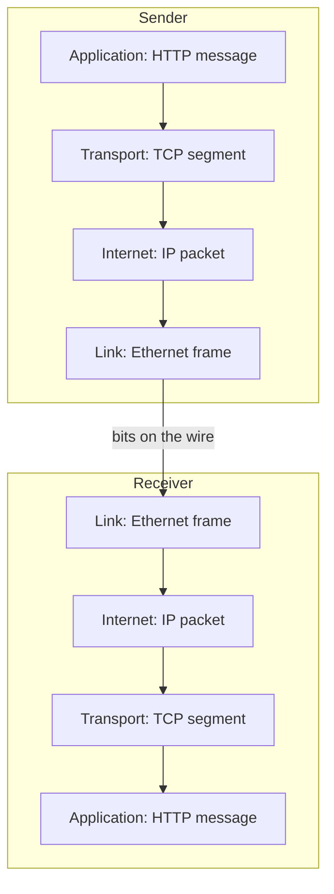
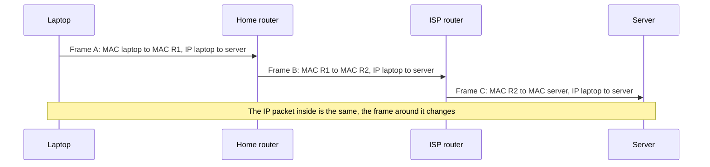

# Layers and encapsulation: how networks are organised

> **Before this lesson:** nothing about networks is assumed. It helps to know that computers store everything as bytes (a byte is a number from 0 to 255) and to be able to read a few lines of Python. This is the first lesson of the track.

## In plain words

A computer network is a set of machines that can send bytes to each other. That sounds like one job, but it is really a pile of very different jobs: pushing electrical or radio signals down a wire or through the air, finding a path across the planet, making sure nothing was lost on the way, and finally agreeing on what the bytes mean (a web page, an email, a video call).

Nobody could design all of that as one piece. So networking is built as **layers**: each layer does one job, uses the layer below it as a service, and offers a slightly nicer service to the layer above.

An everyday picture: you write a letter to a friend abroad. You think only about the words (top layer). You put the letter in an envelope and write an address on it (next layer). The post office puts your envelope in a sack labelled with a city (next layer). The sack goes into a truck, then a plane, then another truck (bottom layer). Each stage wraps what it was given in its own container and reads only its own label. The truck driver never opens the sack; the sorting office never opens your envelope. At the far end, the wrappers come off in reverse order.

That wrapping is called **encapsulation**, and it is the single most important idea in networking.

Why this matters for a job: every debugging session, every design discussion and almost every interview question about networks starts with "which layer is the problem in?". An engineer who can place DNS, TCP, TLS, an IP address and a Wi-Fi signal on the right layer can reason about failures instead of guessing.

## The problem layers solve

Imagine writing a chat program with no layers at all. Your code would have to know the voltage levels of the cable, how to share that cable with other machines, the route to the other continent, what to do when a message is damaged, and how to draw text on a screen. If you then moved from a cable to Wi-Fi you would rewrite everything.

Layering gives three benefits:

1. **Separation of concerns.** A web developer does not think about radio frequencies. A Wi-Fi chip designer does not think about web pages.
2. **Replaceability.** You can swap one layer's technology (cable for Wi-Fi, one kind of address for another) without touching the layers above, as long as the service it offers stays the same.
3. **Reuse.** One delivery layer serves the web, email, games and video at the same time.

A **protocol** is the agreed set of rules for one layer: the format of its messages and what each side must do when it receives one. The word comes from diplomacy, where a protocol is the agreed etiquette for a meeting. A set of protocols stacked on top of each other is called a **protocol stack**.

## The TCP/IP model: four layers that run the Internet

The Internet is built on a family of protocols named after its two most famous members, TCP and IP (both defined below). It is usually described with four layers. Read the table from the bottom up: each row uses the row beneath it.

| Layer | Its one job | Unit of data | Examples |
|---|---|---|---|
| 4. Application | Give meaning to the bytes for a specific use | message | HTTP (web), DNS (names), SMTP (email) |
| 3. Transport | Deliver data between two *programs*, optionally reliably | segment or datagram | TCP, UDP |
| 2. Internet | Deliver a packet between two *machines* anywhere in the world | packet | IP (version 4 and version 6) |
| 1. Link | Deliver a frame between two machines on the *same* local network | frame | Ethernet, Wi-Fi |

Each term, in one sentence:

- **Link layer.** Moves a chunk of bytes, called a **frame**, between two devices that are directly connected, for example your laptop and your home router. Ethernet (the cable standard) and Wi-Fi (the radio standard) live here.
- **Internet layer.** Moves a **packet** from any machine to any other machine on the planet by passing it from one network to the next. The protocol is **IP**, the Internet Protocol. Every machine gets an **IP address**, a number that says where it is, like a postal address.
- **Transport layer.** A machine runs many programs at once. The transport layer delivers data to the right program using a **port**, a number from 0 to 65535 that identifies one conversation endpoint on a machine, like an apartment number inside a building. **TCP** (Transmission Control Protocol) also guarantees that bytes arrive complete and in order. **UDP** (User Datagram Protocol) delivers individual messages with no such guarantee, which is faster to start and good for live audio or quick lookups.
- **Application layer.** The rules a particular kind of program speaks. **HTTP** (Hypertext Transfer Protocol) is the language of the web: "please give me this page", "here it is".

Notice how each layer narrows the target: the link layer reaches a neighbour, the internet layer reaches a machine, the transport layer reaches a program, the application layer reaches a meaning.

## The OSI model: seven layers that people talk in

Before the Internet's design won, an international standards body published a more detailed reference model called **OSI** (Open Systems Interconnection). Its own protocols are mostly gone, but its seven layer *numbers* became the vocabulary engineers use every day. When someone says "a layer 4 load balancer" or "that is a layer 2 problem", they mean OSI numbers.

| OSI no. | OSI name | What it covers | TCP/IP layer |
|---|---|---|---|
| 7 | Application | The program's protocol: HTTP, DNS | Application |
| 6 | Presentation | Encoding, compression, encryption of the data | Application |
| 5 | Session | Opening, keeping and closing a dialogue | Application |
| 4 | Transport | Program-to-program delivery: TCP, UDP | Transport |
| 3 | Network | Machine-to-machine delivery across networks: IP | Internet |
| 2 | Data link | Delivery between neighbours: Ethernet, Wi-Fi frames | Link |
| 1 | Physical | Voltages, light pulses, radio waves, connectors | Link |

Two things confuse newcomers here, so let us answer them directly.

**"Which model is right?"** Neither is a law of nature. TCP/IP describes what was built; OSI is a finer-grained map. Real protocols do not always fit one box. **TLS** (Transport Layer Security, the encryption behind `https`) sits between TCP and HTTP: some people call it layer 6, some call it "layer 4.5". In an interview, say where it sits (above TCP, below HTTP) rather than arguing about a number.

**"Do I need to memorise seven names?"** The numbers that come up constantly are 2 (frames, MAC addresses, switches), 3 (IP, routers), 4 (TCP/UDP, ports) and 7 (HTTP and friends). A classic mnemonic for all seven, from bottom to top, is "Please Do Not Throw Sausage Pizza Away".

> [!TIP]
> Attach one address type to each layer and the model becomes easy to remember: layer 2 uses a **MAC address** (a hardware address burned into a network card), layer 3 uses an **IP address**, layer 4 uses a **port number**, and layer 7 uses names such as a URL.



## Encapsulation, step by step

Now the central mechanism. When data travels **down** the stack on the sending machine, each layer adds its own **header**: a small block of bytes placed in front of the data, holding the information that layer needs (addresses, lengths, checks). What a layer receives from above, it treats as an opaque blob called the **payload**. It does not look inside.

Start with the simplest possible example. Your browser wants to send the 16 characters `GET / HTTP/1.1\r\n` (plus a little more) to a web server.

1. **Application.** The browser produces the HTTP message. Say it is 80 bytes in total.
2. **Transport.** TCP puts a header in front: at least 20 bytes holding the source port, the destination port (443 or 80 for the web), a sequence number used to keep bytes in order, and a checksum. Result: a 100-byte **segment**.
3. **Internet.** IP puts its header in front: 20 bytes for IP version 4, holding the source and destination IP addresses and a counter called TTL that prevents packets circling forever. Result: a 120-byte **packet**.
4. **Link.** Ethernet puts a 14-byte header in front (destination MAC address, source MAC address, a type code saying "the payload is IP") and a 4-byte check value at the end called a **trailer**. Result: a 138-byte **frame**.
5. **Physical.** The frame is turned into signals.

So 80 bytes of "what I wanted to say" became 138 bytes on the wire. The extra 58 bytes are **overhead**: the cost of addressing and checking.

A byte layout of that frame (not to scale):

```
+----------------+-------------+--------------+----------------------+---------+
| Ethernet header|  IP header  |  TCP header  |   HTTP message       | Eth FCS |
|    14 bytes    |  20 bytes   |   20 bytes   |   80 bytes           | 4 bytes |
+----------------+-------------+--------------+----------------------+---------+
 dst MAC, src MAC  src IP,       src port,      GET / HTTP/1.1 ...     checksum
 type = IPv4       dst IP, TTL   dst port,                             of frame
                                 seq number
```

On the receiving machine the process runs in reverse and is called **decapsulation**. The link layer checks and removes its header and trailer, reads the type code, and hands the payload up to IP. IP checks that the destination address is its own, reads a field that says "the payload is TCP", and hands it up. TCP reads the destination port, finds the program listening on that port, and hands over the bytes. Each layer needs one small field telling it *who is next above*: Ethernet's type code, IP's protocol number, TCP's port. This "who is next" step is called **demultiplexing**.

### Try it: build and unwrap a frame

The following program models each layer as a function that puts a labelled header in front of whatever it is given. Real headers are binary; here they are readable text so you can see the nesting. Run it, then change the message and run it again.

```python-run
# Each function below plays the role of one layer.
# It receives a payload (bytes) from the layer above and returns header + payload.

def tcp_wrap(payload, src_port, dst_port):
    header = f"[TCP {src_port}->{dst_port} len={len(payload)}]".encode()
    return header + payload          # header goes in FRONT of the payload

def ip_wrap(payload, src_ip, dst_ip):
    header = f"[IP {src_ip}->{dst_ip} ttl=64]".encode()
    return header + payload

def eth_wrap(payload, src_mac, dst_mac):
    header = f"[ETH {src_mac}->{dst_mac}]".encode()
    trailer = b"[FCS]"                # the link layer also adds a trailer
    return header + payload + trailer

message = b"GET / HTTP/1.1"          # what the application wants to say

segment = tcp_wrap(message, 51000, 443)
packet  = ip_wrap(segment, "192.168.1.20", "203.0.113.9")
frame   = eth_wrap(packet, "aa:aa", "bb:bb")

print("application:", len(message), "bytes")
print("segment    :", len(segment), "bytes")
print("packet     :", len(packet), "bytes")
print("frame      :", len(frame), "bytes")
print()
print(frame.decode())

# Decapsulation: each layer strips ONLY its own wrapper.
def strip(data, opener=b"["):
    end = data.index(b"]") + 1       # find the end of the first [...] header
    return data[:end], data[end:]

rest = frame[:-len(b"[FCS]")]        # link layer removes its trailer
for layer in ("link", "internet", "transport"):
    header, rest = strip(rest)
    print(f"{layer:9} removed {header.decode()}")
print("delivered to the application:", rest.decode())
```

The output shows the length growing at each step and the three headers nested like Russian dolls. When the receiver unwraps, the outermost header (Ethernet) comes off first, which is why it was added last.

## Hop by hop versus end to end

Here is a fact that surprises many people and that interviewers like to probe.

A **router** is a device that connects different networks and forwards packets between them. A packet from your laptop to a server usually crosses ten to twenty routers. Each router along the way:

- receives a frame, removes the link-layer header (decapsulates up to layer 3),
- looks at the destination IP address to decide where to send the packet next,
- wraps the packet in a **new** link-layer frame suitable for the next cable or radio link.

So the Ethernet header is rewritten at **every hop**, while the IP addresses stay the same from the original sender to the final receiver. The link layer is *hop by hop*; the internet layer and everything above it are *end to end*.



Routers therefore only need to understand layers 1 to 3. They do not open the TCP header or the HTTP message. This is a deliberate design choice often called the **end-to-end principle**: keep the middle of the network as plain as possible and put the intelligence (reliability, encryption, meaning) in the machines at the two ends. It is the reason a new application such as video calling could be invented without upgrading every router on Earth.

A common device vocabulary follows from this:

| Device | Highest layer it reads | What it uses to decide |
|---|---|---|
| Hub or repeater | 1 | nothing, it copies signals |
| Switch | 2 | destination MAC address |
| Router | 3 | destination IP address |
| Layer 4 load balancer, classic firewall | 4 | IP addresses and ports |
| Layer 7 load balancer, web proxy | 7 | URL, HTTP headers |

## Size limits: MTU, MSS and fragmentation

A link cannot carry a frame of unlimited size. The largest payload a link-layer frame can carry is its **MTU** (Maximum Transmission Unit). For Ethernet it is 1500 bytes, and that number shows up everywhere.

Work downward from 1500:

- An IP version 4 header takes 20 bytes, leaving 1480 for the transport layer.
- A TCP header takes 20 bytes, leaving **1460** for application data. This is the **MSS** (Maximum Segment Size) that TCP announces when a connection opens.

If an application gives TCP 10,000 bytes, TCP cuts them into pieces of at most 1460 bytes and sends seven segments. This cutting is called **segmentation**, and TCP puts the pieces back in order at the far end.

What if a packet meets a link with a smaller MTU on the way? IP version 4 routers may split the packet into **fragments**, which the destination reassembles. Fragmentation is slow and fragile (lose one fragment and the whole packet is lost), so modern systems avoid it: they mark packets "do not fragment" and learn the smallest MTU on the path instead, a technique called path MTU discovery.

> [!WARNING]
> A classic outage: a tunnel or VPN adds its own header, shrinking the usable MTU to perhaps 1400 bytes, and a firewall blocks the error messages that announce this. Small requests work, large responses hang forever. If "it connects but big downloads stall", think MTU.

## Worked example: where does each thing live?

Place each item on a layer. Cover the right column and try first.

| Item | Layer (OSI number) | Why |
|---|---|---|
| A Wi-Fi signal that is too weak | 1 | It is about radio waves |
| A MAC address such as `3c:22:fb:10:9a:01` | 2 | Identifies a network card on the local network |
| An IP address such as `203.0.113.9` | 3 | Identifies a machine across networks |
| "Connection refused" on port 5432 | 4 | Nothing is listening on that TCP port |
| A certificate that has expired | 5–6 (TLS) | Encryption sits above TCP |
| A `404 Not Found` response | 7 | The web server understood and answered |
| A name such as `example.com` not resolving | 7 (DNS) | DNS is an application protocol |

Use this as a debugging ladder. If a `404` comes back, layers 1 to 4 are all working: bytes reached a program that answered. If a ping to an IP address works but the web page does not load, layers 1 to 3 are fine and the fault is higher.

> [!INTERVIEW]
> **"Explain the OSI model and why it matters."** A strong answer in four sentences: networking is split into layers so each can evolve independently; going down the stack each layer adds a header (encapsulation), going up each layer strips its own (decapsulation); in practice the Internet uses four layers (link, internet, transport, application) while engineers use OSI numbers 2, 3, 4 and 7 as shorthand; knowing the layer tells you which device and which tool to look at, for example a switch and MAC addresses at layer 2, a router and IP at layer 3.

## Pitfalls

- **Thinking the models are strict.** TLS, tunnels and protocols such as QUIC (a newer transport that runs on top of UDP, covered later) deliberately blur the lines. Use layers as a map, not a rulebook.
- **Believing MAC addresses travel across the Internet.** They do not; they are replaced at every router. Only IP addresses are end to end (and even those can be rewritten by a technique called NAT, covered in the IPv4 lesson).
- **Mixing up segment, packet and frame.** Transport = segment (TCP) or datagram (UDP); internet = packet; link = frame. People say "packet" loosely for all three, but precise wording impresses in interviews.
- **Forgetting overhead.** Each layer costs bytes and processing. Tiny messages can be mostly header: a 1-byte keystroke sent over TCP, IP and Ethernet travels with at least 58 bytes of wrapping.
- **Assuming the receiver sees the same chunks the sender wrote.** TCP delivers a stream of bytes, not messages. One `send` of 3000 bytes may arrive as three reads; two small sends may arrive as one. Applications must mark their own message boundaries.

## Summary

- Networks are built in layers; each does one job and hides its details from the layer above.
- The TCP/IP model has four layers: link (neighbour to neighbour), internet (machine to machine, IP), transport (program to program, TCP or UDP with ports), application (meaning, such as HTTP and DNS).
- OSI has seven; the numbers 2, 3, 4 and 7 are everyday vocabulary.
- Encapsulation: going down, each layer adds its header in front of the payload. Decapsulation: going up, each layer removes its own header and uses one field to pick the next layer up.
- Frames are rebuilt at every hop; IP packets travel end to end; routers look no higher than layer 3.
- Ethernet's MTU of 1500 bytes leaves 1460 bytes of data per TCP segment.

## Glossary

- **Protocol**: an agreed set of message formats and rules for one layer.
- **Layer**: one level of the stack with a single responsibility.
- **Header / trailer**: bytes a layer adds before / after its payload.
- **Payload**: the data a layer carries without interpreting it.
- **Encapsulation / decapsulation**: wrapping on the way down, unwrapping on the way up.
- **Frame, packet, segment, datagram**: the units of the link, internet, and transport layers (segment for TCP, datagram for UDP).
- **MAC address**: a hardware address used on the local network (layer 2).
- **IP address**: a network address used across the Internet (layer 3).
- **Port**: a 16-bit number identifying a program's endpoint on a machine (layer 4).
- **Router / switch**: devices that forward by IP address / by MAC address.
- **MTU / MSS**: the largest link payload / the largest TCP data per segment.
- **Demultiplexing**: using a header field to decide which upper-layer protocol or program gets the payload.

## Check yourself

```quiz
[
  {"q": "Which layer of the TCP/IP model is responsible for delivering data to the correct program on a machine?",
   "options": ["Link", "Internet", "Transport", "Application"], "answer": 2,
   "explain": "The transport layer (TCP or UDP) uses port numbers to choose the program. The internet layer only gets the packet to the right machine."},
  {"q": "An 80-byte HTTP message is sent over TCP (20-byte header), IPv4 (20-byte header) and Ethernet (14-byte header plus 4-byte trailer). How large is the frame?",
   "options": ["98 bytes", "120 bytes", "134 bytes", "138 bytes"], "answer": 3,
   "explain": "80 + 20 + 20 + 14 + 4 = 138. Every layer adds its own wrapping around what it was given."},
  {"q": "A packet crosses three routers on its way to a server. Which statement is true?",
   "options": ["The MAC addresses stay the same and the IP addresses change at each router", "The IP addresses stay the same and the frame with its MAC addresses is rebuilt at each router", "Both stay the same end to end", "Routers rewrite the TCP ports at every hop"], "answer": 1,
   "explain": "The link layer is hop by hop: each router strips the old frame and builds a new one. The IP packet inside keeps its source and destination addresses."},
  {"q": "In everyday engineering speech, a 'layer 3 device' is one that makes decisions using:",
   "options": ["Radio signal strength", "MAC addresses", "IP addresses", "URLs and HTTP headers"], "answer": 2,
   "explain": "OSI layer 3 is the network layer, where IP lives. Routers are the typical layer 3 devices."},
  {"q": "With a 1500-byte Ethernet MTU and no header options, what is the usual TCP maximum segment size (MSS)?",
   "options": ["1500", "1480", "1460", "1400"], "answer": 2,
   "explain": "1500 minus 20 bytes of IPv4 header minus 20 bytes of TCP header leaves 1460 bytes for application data."},
  {"q": "A web request returns '404 Not Found'. What does this tell you about the lower layers?",
   "options": ["The link layer is broken", "DNS failed", "Layers 1 to 4 worked: a server program received the request and replied", "The TCP connection was refused"], "answer": 2,
   "explain": "A 404 is an application-layer answer. For it to arrive, signals, frames, IP routing and the TCP connection all had to work."},
  {"q": "Why do routers not need to understand HTTP?",
   "options": ["HTTP is encrypted so they cannot", "They forward using only the IP header, treating everything inside as payload", "HTTP does not use IP", "Routers convert HTTP into Ethernet"], "answer": 1,
   "explain": "Encapsulation means a layer treats what it carries as an opaque payload. Routers read up to the IP header and no further, which keeps the core of the network general-purpose."}
]
```

> **Source:** written from general networking knowledge; background reading in Grigorik, *High Performance Browser Networking*, ch. 1–2 (https://hpbn.co). Layer definitions checked against RFC 1122 (https://www.rfc-editor.org/rfc/rfc1122) and the MDN glossary (https://developer.mozilla.org/en-US/docs/Glossary/TCP).
