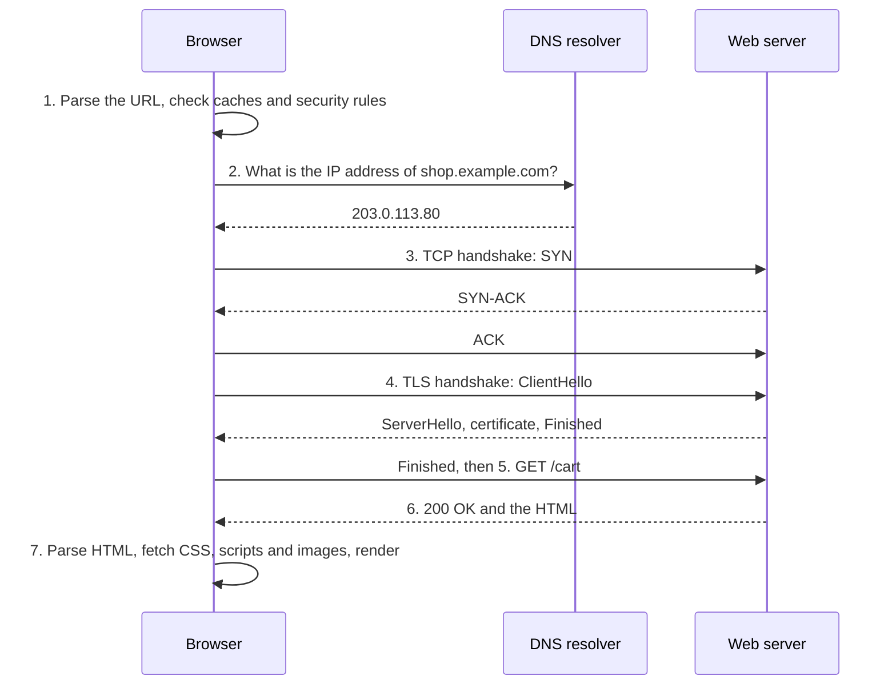
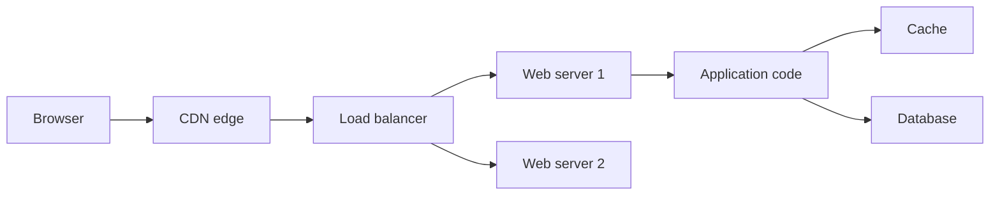

# What happens when you type a URL and press Enter

> **Before this lesson:** read [Layers and encapsulation](#/lesson/networking/layers-encapsulation) (layers, IP addresses, ports) and [Latency and bandwidth](#/lesson/networking/latency-bandwidth) (round trips). Every protocol met here gets its own lesson later; this one is the map that shows how they fit together.

## In plain words

You type `https://shop.example.com/cart` into a browser and a page appears about a second later. In that second, your computer has looked up a name in a worldwide directory, opened a conversation with a machine it has never met, proved that machine is who it claims to be, agreed on secret keys, asked for a document, received it in pieces, and drawn it on the screen, usually asking for dozens more files along the way.

An everyday comparison: ordering a parcel from a shop you only know by name. You look up the shop's street address in a directory (name lookup). You phone them and both say hello (opening a connection). You check you are really talking to the shop and switch to a private line (encryption). You place your order (the request). They pack it and send it in several boxes (the response). You unpack and assemble it (rendering).

Why this matters for a job: this is the most famous interview question in web engineering, because a good answer touches every layer. It is also the mental checklist used in real incidents. "The site is down" always means one of these steps failed, and knowing the order tells you where to look first.

## The big picture

Here is the whole journey in one diagram. Do not try to absorb every arrow yet; each numbered stage is explained below.



## Stage 1: the browser reads the URL

**URL** stands for Uniform Resource Locator: a text address for something on the web. It has named parts. Take a fuller example:

```
https://shop.example.com:443/cart/items?sort=price#reviews
\___/   \______________/ \_/\_________/ \________/ \_____/
scheme        host       port   path      query    fragment
```

- **Scheme**: which protocol to speak. `https` means HTTP carried inside an encrypted channel; `http` means unencrypted.
- **Host**: the name of the machine to contact.
- **Port**: which numbered door on that machine. If omitted, the scheme decides: 443 for `https`, 80 for `http`.
- **Path**: which resource on that server.
- **Query**: extra parameters after a `?`, written as `name=value` pairs joined by `&`.
- **Fragment**: a position inside the page, after `#`. The browser keeps this for itself and never sends it to the server.

If you typed plain words rather than something shaped like a URL, the browser treats them as a search and builds a search-engine URL instead.

### Try it: take a URL apart

Python's standard library can split a URL the same way a browser does. Each printed field corresponds to a part named above.

```python-run
from urllib.parse import urlsplit, parse_qs

url = "https://shop.example.com:443/cart/items?sort=price&page=2#reviews"
parts = urlsplit(url)          # returns an object with one attribute per URL part

print("scheme  :", parts.scheme)
print("host    :", parts.hostname)
print("port    :", parts.port)
print("path    :", parts.path)
print("query   :", parts.query)
print("fragment:", parts.fragment)

# parse_qs turns the query string into a dictionary of lists
print("query as a dict:", parse_qs(parts.query))

# When the port is missing, the scheme supplies the default.
DEFAULT_PORTS = {"http": 80, "https": 443}
for u in ("http://example.com/a", "https://example.com/a"):
    p = urlsplit(u)
    print(u, "-> port", p.port or DEFAULT_PORTS[p.scheme])
```

Before any network traffic, the browser performs three quick checks:

1. **Should this be HTTPS?** Browsers keep a list of sites that have declared "only ever contact me over HTTPS". This mechanism is called **HSTS** (HTTP Strict Transport Security). If the host is on that list and you typed `http://`, the browser silently rewrites it to `https://`.
2. **Do I already have this page?** The browser's **HTTP cache** stores earlier responses. If a stored copy is still marked as fresh, the page can be shown with no network at all.
3. **Do I already have a connection?** If a connection to this host is open from a previous page, stages 2 to 4 are skipped entirely.

## Stage 2: turning the name into an address (DNS)

Machines on the Internet find each other by IP address, a number such as `203.0.113.80`. People prefer names. **DNS**, the Domain Name System, is the worldwide directory that converts one into the other.

The lookup passes through several caches, nearest first:

1. the browser's own memory of recent lookups;
2. the operating system's cache (and a local file called `hosts` that can override names);
3. a **recursive resolver**: a server, usually run by your Internet provider or a public service, whose job is to find answers on your behalf.

If the resolver does not have the answer stored, it asks a chain of servers: a **root server** ("who handles `.com`?"), then a **TLD server** for the top-level domain `.com` ("who handles `example.com`?"), then the domain's own **authoritative server**, which holds the real answer. The resolver returns the address to your machine and remembers it for a period set by the domain owner, called the **TTL** (time to live).

A question newcomers often ask: "is DNS slow?" The first lookup of an unfamiliar name can take 20 to 120 ms. After that it is cached at several levels and costs almost nothing, until the TTL runs out.

DNS queries normally travel over UDP to port 53, because a single small question and answer does not need the setup cost of TCP.

## Stage 2½: reaching the first hop

Your computer now has the server's IP address. It compares that address with its own network settings and sees the server is not on the local network, so the packet must go to the **default gateway**: the router that connects your local network to everything else (at home, your Wi-Fi box).

To hand a frame to the gateway, the link layer needs the gateway's MAC address. If it is not already known, the computer broadcasts a question to the whole local network, "who has IP 192.168.1.1?", using **ARP** (Address Resolution Protocol), and the router replies with its MAC address. From here on, every outgoing packet is wrapped in a frame addressed to the router, which forwards it toward your provider and onward, hop by hop.

On a home network one more thing happens at the router: **NAT** (Network Address Translation) replaces your private address (such as `192.168.1.20`) with the router's single public address, and remembers the swap so replies find their way back.

## Stage 3: opening a TCP connection

HTTP needs a reliable channel, and TCP provides one. Before any data flows, the two sides exchange three small messages called the **three-way handshake**:

1. **SYN** (synchronise): the browser says "I would like to talk; my byte numbering starts at X".
2. **SYN-ACK**: the server says "agreed; my numbering starts at Y, and I acknowledge X".
3. **ACK**: the browser acknowledges Y.

This costs one full round trip before the browser may send anything useful. The connection is identified by four values together: source IP, source port, destination IP, destination port. The browser's source port is a temporary number picked by the operating system, called an **ephemeral port**.

## Stage 4: making it private (TLS)

Because the scheme is `https`, the browser now runs a **TLS** handshake over the new TCP connection. TLS (Transport Layer Security) provides three guarantees: nobody on the path can read the data (**confidentiality**), nobody can alter it unnoticed (**integrity**), and the server is the genuine owner of the name (**authentication**).

In the current version, TLS 1.3, the handshake takes one more round trip:

- The browser sends a **ClientHello** containing the TLS versions and encryption methods it supports, the host name it wants (a field called **SNI**, Server Name Indication, so that one server holding many sites knows which is wanted), and the application protocols it can speak (a field called **ALPN**, used to choose between HTTP/1.1 and HTTP/2).
- The server replies with its choices and its **certificate**: a signed document stating "the holder of this key is shop.example.com". The browser checks the signature leads back to a **certificate authority** it already trusts, that the name matches, and that the date is valid.
- Both sides derive the same secret keys, and everything afterwards is encrypted.

If the certificate check fails, you see the full-page browser warning, and nothing further is sent.

## Stage 5: the HTTP request

At last the browser asks for the page. In the older text format (HTTP/1.1) the request looks like this:

```
GET /cart/items?sort=price HTTP/1.1
Host: shop.example.com
User-Agent: Mozilla/5.0 ...
Accept: text/html,application/xhtml+xml
Accept-Encoding: gzip, br
Cookie: session=8f2c1e
```

Line by line: `GET` is the **method** (fetch something); next comes the path and query; then the protocol version. Each following line is a **header**, a `Name: value` pair giving extra information. `Host` repeats the site name. `Accept-Encoding` says which compression formats the browser understands. `Cookie` carries a small token the server issued earlier so that it can recognise the same visitor. A blank line ends the request.

## Stage 6: what the server does

"The server" is rarely one machine. A typical path inside a company:



- A **CDN edge** near the user may answer immediately from its stored copy.
- A **load balancer** spreads requests over several identical servers and stops sending to ones that fail health checks.
- A **reverse proxy** or web server (for example nginx) ends the TLS connection, serves static files and passes other requests to application code.
- The **application** checks the session cookie, reads from a cache or database, and produces HTML.

The reply begins with a **status line** and headers, then a blank line, then the body:

```
HTTP/1.1 200 OK
Content-Type: text/html; charset=utf-8
Content-Encoding: br
Cache-Control: private, max-age=0
Set-Cookie: session=8f2c1e; Secure; HttpOnly

<!doctype html> ...
```

`200` is the **status code** for success. Others worth knowing now: `301` and `302` (moved, go to another URL), `304` (your cached copy is still good), `404` (no such resource), `500` (the server failed), `503` (temporarily unavailable).

### An annotated real exchange

The command-line tool `curl` with the `-v` (verbose) flag prints each stage. Lines starting with `*` are curl's notes, `>` is what was sent, `<` is what came back. The output below is trimmed and annotated on the right.

```
$ curl -v https://shop.example.com/cart
* Host shop.example.com:443 was resolved.        <- stage 2: DNS done
* IPv4: 203.0.113.80
*   Trying 203.0.113.80:443...
* Connected to shop.example.com (203.0.113.80) port 443   <- stage 3: TCP open
* ALPN: curl offers h2,http/1.1                  <- stage 4 begins
* TLSv1.3 (OUT), TLS handshake, Client hello (1):
* TLSv1.3 (IN), TLS handshake, Server hello (2):
* TLSv1.3 (IN), TLS handshake, Certificate (11):
* TLSv1.3 (IN), TLS handshake, Finished (20):
* SSL connection using TLSv1.3 / TLS_AES_128_GCM_SHA256
* ALPN: server accepted h2                       <- HTTP/2 was chosen
*  subject: CN=shop.example.com                  <- certificate name matches
*  SSL certificate verify ok.
> GET /cart HTTP/2                               <- stage 5: the request
> Host: shop.example.com
> Accept: */*
>
< HTTP/2 200                                     <- stage 6: the response
< content-type: text/html; charset=utf-8
< cache-control: private, max-age=0
<
<!doctype html>...
```

## Stage 7: from bytes to pixels

Receiving the HTML is the start of the browser's work, not the end.

1. The browser reads the HTML as it arrives and builds a tree of elements called the **DOM** (Document Object Model).
2. Whenever it meets a reference to another file, such as a stylesheet, a script, an image or a font, it starts fetching that too. Each fetch repeats stages 1 to 6, though for the same host the existing connection is reused, and with HTTP/2 many requests share one connection at once.
3. Stylesheets (CSS) are parsed into a second tree, the **CSSOM**. The page cannot be drawn until the CSS needed for it has arrived, so CSS is called **render-blocking**.
4. Scripts (JavaScript) can change the page, so by default the browser stops parsing HTML while a script downloads and runs.
5. DOM and CSSOM are combined; the browser computes the size and position of every box (**layout**) and fills in the pixels (**paint**).

A typical page triggers 50 to 100 requests to a dozen different hosts. That is why the cost of name lookups and handshakes, multiplied by the number of hosts, shapes how fast a page feels.

## Counting the round trips

For the very first visit, before the first byte of HTML:

| Step | Round trips | At 80 ms RTT |
|---|---|---|
| DNS lookup (not cached) | 1 to the resolver | ~30 ms |
| TCP handshake | 1 | 80 ms |
| TLS 1.3 handshake | 1 | 80 ms |
| HTTP request and first response bytes | 1 | 80 ms + server time |
| **Total** | **about 4** | **~270 ms + server time** |

On a repeat visit with cached DNS and a reused connection, only the last row remains. With the newest protocol, HTTP/3, the TCP and TLS rows merge into one. Each technique in the later lessons removes one of these rows.

> [!INTERVIEW]
> **How to answer the question in two minutes.** Give the stages in order, one sentence each, then offer depth: "The browser parses the URL and checks its cache and HSTS list. It resolves the host name through DNS, cache first, then a recursive resolver that walks root, TLD and authoritative servers. It opens a TCP connection with a three-way handshake, then a TLS handshake that verifies the certificate and derives keys, choosing HTTP/2 through ALPN. It sends the HTTP request; the request passes a CDN, load balancer and web server to application code, which answers with a status, headers and body. The browser parses the HTML, fetches sub-resources in parallel, builds the DOM and CSSOM, then lays out and paints. I can go deeper on any layer: ARP and NAT on the local network, congestion control in TCP, or caching." Ending with that offer lets the interviewer steer toward what they care about.

## Where it breaks: a debugging map

| Symptom | Stage that failed | First tool to reach for |
|---|---|---|
| "Server not found" / `NXDOMAIN` | 2, DNS | `dig shop.example.com` |
| Hangs, then "timed out" | 3, TCP (packets dropped, firewall) | `ping`, `traceroute` |
| "Connection refused" | 3, TCP (nothing listening on the port) | `curl -v`, check the service |
| Certificate warning | 4, TLS (expired or wrong name) | `curl -v`, check dates |
| `502` or `503` | 6, the server side (backend down) | load balancer and application logs |
| Blank page but `200` | 7, rendering (script error) | browser developer tools |

"Timed out" and "refused" are different failures. A refusal is an immediate, explicit "no" from the machine: it is reachable but no program is listening. A timeout is silence: the packets or the replies are being lost or dropped somewhere.

> [!WARNING]
> The fragment (the part after `#`) is never sent to the server. If server logs seem to be "missing" part of a URL, or a login flow that carries data in the fragment behaves oddly behind a proxy, this is why.

## Pitfalls

- **Skipping the caches.** The best answers mention that the browser may avoid the network entirely, and that DNS has several cache levels.
- **Saying "the browser connects to the domain".** Connections are made to IP addresses; the name is only used for the lookup, for SNI in TLS, and in the `Host` header.
- **Forgetting that one page is many requests.** The HTML is the first of dozens of fetches.
- **Placing TLS before TCP.** TLS runs inside an established TCP connection (with HTTP/3 the two are merged, over UDP).
- **Ignoring the server side.** Mention load balancers and backends; backend engineers are usually hired to work on exactly that part.
- **Treating redirects as free.** A `301` from `http://` to `https://`, then another to `www.`, can add two or more complete round-trip sequences before the real page begins.

## Summary

- URL parts: scheme, host, port, path, query, fragment. The fragment stays in the browser.
- Order of events: caches and HSTS, DNS, (ARP and NAT locally), TCP handshake, TLS handshake, HTTP request, server-side processing, response, rendering with many sub-requests.
- A cold first request costs about four round trips before content arrives; reuse and caching remove most of them.
- Each failure message points to one stage, which tells you which tool to use.

## Glossary

- **URL**: a text address for a web resource, with scheme, host, port, path, query and fragment.
- **DNS**: the system that translates host names into IP addresses.
- **Recursive resolver**: the server that performs a DNS lookup on your behalf and caches the result.
- **TTL (in DNS)**: how long an answer may be cached.
- **Default gateway**: the router a machine sends packets to when the destination is not local.
- **ARP**: the protocol that finds the MAC address for a local IP address.
- **NAT**: rewriting private addresses to a shared public one at a router.
- **Three-way handshake**: SYN, SYN-ACK, ACK; how a TCP connection opens.
- **Ephemeral port**: a temporary source port chosen by the operating system.
- **TLS**: the protocol that encrypts and authenticates a connection.
- **Certificate / certificate authority**: a signed proof of a site's identity / an organisation trusted to sign them.
- **SNI / ALPN**: TLS fields naming the wanted host / negotiating the application protocol.
- **HSTS**: a site's instruction that browsers must use HTTPS only.
- **Method, header, status code**: the action of an HTTP request, a name-value line of metadata, the three-digit result of a response.
- **DOM / CSSOM**: the browser's tree of page elements / of style rules.
- **Load balancer / reverse proxy / CDN**: components that spread, front, and geographically cache traffic.

## Check yourself

```quiz
[
  {"q": "In https://shop.example.com/cart?id=7#top, which part is never sent to the server?",
   "options": ["/cart", "id=7", "top", "shop.example.com"], "answer": 2,
   "explain": "The fragment after # is used only by the browser, for example to scroll to a section."},
  {"q": "What is the correct order for a first visit to an https URL?",
   "options": ["TLS handshake, DNS lookup, TCP handshake, HTTP request", "DNS lookup, TCP handshake, TLS handshake, HTTP request", "TCP handshake, DNS lookup, HTTP request, TLS handshake", "DNS lookup, TLS handshake, TCP handshake, HTTP request"], "answer": 1,
   "explain": "The name must be resolved to an address first, TCP provides the channel, TLS secures that channel, and only then is the HTTP request sent."},
  {"q": "Why does the browser send the host name in the TLS ClientHello (the SNI field)?",
   "options": ["To speed up DNS", "So a server hosting many sites on one IP address can present the right certificate", "To encrypt the URL path", "Because TCP requires it"], "answer": 1,
   "explain": "Many sites share one IP address. The server needs to know which name is wanted before it can choose the matching certificate."},
  {"q": "A request fails instantly with 'connection refused'. What is the most likely situation?",
   "options": ["DNS could not find the name", "The machine is reachable but no program is listening on that port", "A firewall is silently dropping packets", "The certificate has expired"], "answer": 1,
   "explain": "A refusal is an explicit rejection from the target machine. Silent dropping would produce a timeout instead."},
  {"q": "With an 80 ms RTT, cached DNS, and TLS 1.3 over a new TCP connection, roughly how long until the first response byte, ignoring server time?",
   "options": ["80 ms", "160 ms", "240 ms", "400 ms"], "answer": 2,
   "explain": "One round trip for TCP, one for TLS 1.3, one for the request and response: three round trips, 240 ms."},
  {"q": "Why is CSS described as render-blocking?",
   "options": ["It is always larger than HTML", "The browser will not draw the page until it has the style rules needed to draw it correctly", "It blocks the DNS lookup", "It prevents TLS from completing"], "answer": 1,
   "explain": "Drawing without the styles would show unstyled content and then redraw, so browsers wait for the CSSOM before the first paint."},
  {"q": "Your laptop (192.168.1.20) sends a packet to a server on the Internet. Which MAC address is the destination of the first frame?",
   "options": ["The web server's MAC address", "The DNS server's MAC address", "The default gateway's MAC address", "The broadcast address"], "answer": 2,
   "explain": "MAC addresses only work on the local network. The frame goes to the router, which forwards the IP packet onward in a new frame."},
  {"q": "What does HSTS do?",
   "options": ["Compresses HTTP headers", "Tells the browser to always use HTTPS for a site, even if the user types http", "Caches DNS answers", "Chooses between HTTP/1.1 and HTTP/2"], "answer": 1,
   "explain": "HTTP Strict Transport Security makes the browser upgrade requests to HTTPS before any insecure request leaves the machine."}
]
```

> **Source:** Grigorik, *High Performance Browser Networking*, ch. 9–10 (HTTP history and web performance primer; topic coverage only), https://hpbn.co . Facts checked against MDN "How the web works" (https://developer.mozilla.org/en-US/docs/Learn_web_development/Getting_started/Web_standards/How_the_web_works) and RFC 9110 (https://www.rfc-editor.org/rfc/rfc9110).
