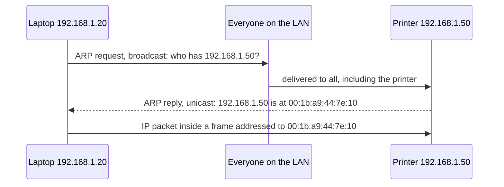

# Ethernet, MAC addresses, ARP and switching

> **Before this lesson:** you need the idea of layers, frames and encapsulation from [Layers and encapsulation](#/lesson/networking/layers-encapsulation). Hexadecimal notation (digits 0–9 and a–f, where `ff` means 255) appears here; each use is explained.

## In plain words

Before data can cross the world it has to cross the room. The **link layer** handles that first short step: getting a chunk of bytes from one device to another device on the same local network, for example from your laptop to the router on the shelf.

Think of an office building with internal mail. Every desk has a desk number that is only meaningful inside this building. To send a memo to a colleague you write their desk number on it and drop it in the internal tray; the mail room delivers it. To send something to another city you still use the internal mail first, but you address it to the building's post room, and the post room deals with the outside world.

On a local network the desk number is a **MAC address**, the mail room is a **switch**, the memo is a **frame**, and the post room is the **router**. The technology that defines the frame format and the cables is **Ethernet**; Wi-Fi plays the same role over radio.

Why this matters for a job: cloud networks, container networks and office networks are all built from these pieces. When two machines "on the same network" cannot talk, the cause is very often at this layer: a wrong address mapping, a virtual network split, or a duplicate address. Interviewers also love the question "what is the difference between a switch and a router?", which this lesson answers properly.

## MAC addresses

Every network interface (the part of a computer that connects to a network, such as an Ethernet port or a Wi-Fi chip) has a **MAC address**. MAC stands for Media Access Control. It is 48 bits long, which is 6 bytes, and is written as six pairs of hexadecimal digits:

```
3c:22:fb:10:9a:01
\______/ \______/
   OUI    device part
```

- The first three bytes are the **OUI** (Organisationally Unique Identifier), a number assigned to the manufacturer. Tools can tell you "this address belongs to a card made by such-and-such company".
- The last three bytes are chosen by the manufacturer so that each card differs.

Three things to know about MAC addresses:

1. **They are local.** A MAC address is only used to deliver frames within one local network. It never travels across the Internet; routers replace it at every hop.
2. **They are flat.** Unlike an IP address, a MAC address says nothing about *where* a device is. Knowing it does not help you find a route to it, in the same way that knowing a person's passport number does not tell you which country they are in.
3. **They can be changed.** Software can override the built-in value. Phones now use random MAC addresses per Wi-Fi network for privacy, and virtual machines have invented ones.

One special address: `ff:ff:ff:ff:ff:ff` (all 48 bits set to one) is the **broadcast address**. A frame sent to it is delivered to every device on the local network.

> [!TIP]
> Newcomers often ask why we need both MAC and IP addresses. The MAC address answers "which device on this cable or Wi-Fi?", the IP address answers "which machine anywhere in the world, and how do I route toward it?". Keeping them separate lets the same IP layer run over Ethernet, Wi-Fi, mobile networks and fibre without change.

## The Ethernet frame

An Ethernet frame is a short header, a payload, and a check value at the end.

```
+-------------------+-------------------+-----------+---------------------+---------+
| Destination MAC   | Source MAC        | EtherType |      Payload        |   FCS   |
|     6 bytes       |     6 bytes       |  2 bytes  |   46 - 1500 bytes   | 4 bytes |
+-------------------+-------------------+-----------+---------------------+---------+
```

- **Destination MAC** comes first, so a device can decide after only six bytes whether the frame is for it.
- **Source MAC** says who sent it.
- **EtherType** is a two-byte code saying what the payload is, so the receiver knows which layer-3 protocol to hand it to. `0x0800` means IP version 4, `0x86DD` means IP version 6, `0x0806` means ARP (explained below). The prefix `0x` marks a hexadecimal number.
- **Payload** is the data being carried, at most 1500 bytes. That limit is the MTU from the first lesson. If the payload is shorter than 46 bytes it is padded.
- **FCS** (frame check sequence) is a 32-bit **CRC** (cyclic redundancy check): a number computed from all the other bytes. The receiver recomputes it; if the two differ, a bit was flipped in transit and the frame is silently thrown away. Ethernet detects errors but does not resend. Recovery is left to higher layers such as TCP.

## From shared cable to switch

Early Ethernet connected every computer to one shared cable. Everyone heard everything, and if two machines talked at once their signals collided and both had to retry. A device called a **hub** kept that behaviour in a box: whatever arrived on one socket was repeated out of all the others.

Modern networks use a **switch** instead. A switch is a box with many sockets, called **ports** (note: a physical socket here, not the TCP port numbers from the first lesson; the word is unfortunately reused). A switch reads the destination MAC address of each frame and sends the frame out of only the port where that device lives. Two pairs of devices can therefore talk at the same time without interfering.

How does the switch know which device is on which port? Nobody tells it. It learns by watching.

### How a switch learns

A switch keeps a **MAC address table** (also called a forwarding table or CAM table): a list of "MAC address X was last seen on port N". For each frame that arrives it does two things, in this order:

1. **Learn.** Look at the *source* MAC address and record "this address is reachable through the port the frame came in on".
2. **Forward.** Look at the *destination* MAC address:
   - if it is the broadcast address, or it is not in the table yet, send the frame out of every port except the one it came in on. This is called **flooding**;
   - if it is in the table and points to a different port, send the frame out of that one port;
   - if it points to the same port the frame arrived on, do nothing (the destination is on the same side as the sender and has already seen it). This is called **filtering**.

Entries are forgotten after a few minutes of silence, typically 300 seconds, so the table follows devices that are unplugged or moved.

Let us step through the smallest example: a switch with three ports and three computers A, B and C on ports 0, 1 and 2. The table starts empty.

| Step | Frame | Table after learning | Action |
|---|---|---|---|
| 1 | A → B, arrives on port 0 | A:0 | B unknown, flood to ports 1 and 2 |
| 2 | B → A, arrives on port 1 | A:0, B:1 | A known, send to port 0 only |
| 3 | A → B, arrives on port 0 | A:0, B:1 | B known, send to port 1 only |

After one exchange, C no longer sees traffic between A and B.

### Try it: a learning switch in a few lines

The program below implements exactly the two rules. The table is a Python dictionary, which maps a key (the MAC address) to a value (the port number).

```python-run
BROADCAST = "ff:ff:ff:ff:ff:ff"

def run_switch(num_ports, frames):
    table = {}                                   # MAC address -> port number
    for in_port, src, dst in frames:
        table[src] = in_port                     # rule 1: learn the sender's location
        if dst == BROADCAST or dst not in table:
            out = [p for p in range(num_ports) if p != in_port]   # flood
            action = "flood"
        elif table[dst] == in_port:
            out = []                             # destination is on the same port
            action = "filter"
        else:
            out = [table[dst]]                   # send to exactly one port
            action = "forward"
        print(f"port {in_port}: {src} -> {dst:17}  {action:7} out={out}  table={table}")

frames = [
    (0, "A", "B"),          # A speaks first: B is unknown
    (1, "B", "A"),          # B answers: A is known
    (0, "A", "B"),          # now both are known
    (2, "C", BROADCAST),    # a broadcast always floods
    (1, "A", "C"),          # A has moved to port 1: the table is updated
]
run_switch(3, frames)
```

Read the last line of output: the entry for A changes from port 0 to port 1 because learning overwrites the old value. That is how a laptop can move between sockets, or a virtual machine between hosts, without anyone reconfiguring the switch.

## ARP: finding the MAC address for an IP address

Programs deal in IP addresses. Frames need MAC addresses. Something has to translate one to the other on the local network, and that is **ARP**, the Address Resolution Protocol.

Suppose your laptop `192.168.1.20` wants to send a packet to the printer at `192.168.1.50`, and they are on the same local network.

1. The laptop checks its **ARP cache**, a small table of recent IP-to-MAC answers. Nothing there.
2. It sends an **ARP request** as a broadcast frame: "Who has 192.168.1.50? Tell 192.168.1.20." Every device on the local network receives it.
3. Only the printer recognises its own IP address. It sends an **ARP reply** directly back: "192.168.1.50 is at 00:1b:a9:44:7e:10."
4. The laptop stores the answer in its ARP cache for a while (from tens of seconds to minutes) and sends the real packet in a frame addressed to that MAC.



You can look at the cache on your own machine. Typical output, annotated:

```
$ arp -a
? (192.168.1.1)  at 9c:c9:eb:21:05:f0 on en0 ifscope [ethernet]   <- the router (gateway)
? (192.168.1.50) at 00:1b:a9:44:7e:10 on en0 ifscope [ethernet]   <- the printer
? (192.168.1.77) at (incomplete)      on en0 ifscope [ethernet]   <- asked, nobody answered
```

An `(incomplete)` entry is a useful clue: the machine asked for that address and received no reply, so the device is off, unplugged, or on a different network segment.

### What if the destination is not local?

This is the step people most often get wrong. If the destination IP address is **outside** the local network, the laptop does not ARP for the destination at all, because a broadcast cannot leave the local network. Instead it ARPs for the IP address of its **default gateway**, the router, and sends the frame there. The IP packet inside still carries the far-away destination IP address.

So for a packet to a web server on the Internet:

- destination **IP** = the web server;
- destination **MAC** = the local router.

How does the laptop decide whether an address is local? By comparing it with its own address and subnet mask, which is the subject of the next lesson.

IP version 6 does not use ARP. It performs the same job with a mechanism called **Neighbor Discovery**, which uses ICMPv6 messages sent to a targeted multicast group rather than a broadcast to everyone.

> [!WARNING]
> ARP has no authentication. Any device on the local network can send a reply claiming "the router's IP is at *my* MAC address", and other machines will believe it. This is **ARP spoofing** (or ARP poisoning), and it lets an attacker on the same network intercept traffic. It is one reason untrusted Wi-Fi is risky, and one reason TLS matters even on a "private" network.

## Switch versus router

Now the classic comparison.

| | Switch | Router |
|---|---|---|
| OSI layer | 2 (data link) | 3 (network) |
| Decides using | destination MAC address | destination IP address |
| Table | MAC table, learned automatically | routing table, configured or learned by routing protocols |
| Scope | within one local network | between different networks |
| Unknown destination | floods to all ports | drops the packet (or uses a default route) |
| Broadcast frames | forwards them to all ports | does not forward them |
| Changes the frame? | no, passes it unchanged | yes: removes the frame, lowers the IP TTL, builds a new frame |

Two terms follow from the broadcast row:

- A **broadcast domain** is the set of devices that receive each other's broadcast frames. A switch extends a broadcast domain; a router is the boundary of one.
- A **LAN** (local area network) in the strict sense is one broadcast domain.

Why not build the whole Internet from switches? Because flooding and broadcasts do not scale: every ARP request would reach every device on Earth, and every switch would need a table entry for every device. Routers break the world into many small broadcast domains and use the structure inside IP addresses to keep their tables manageable.

The box in your home is three devices in one case: a small switch (the wired sockets), a Wi-Fi access point, and a router that joins your local network to your provider.

## VLANs: several networks on one switch

A **VLAN** (virtual LAN) lets one physical switch behave like several separate switches. Each port is assigned a VLAN number; frames are flooded and forwarded only among ports with the same number. A company might put staff computers on VLAN 10, phones on VLAN 20 and guests on VLAN 30, all plugged into the same hardware, yet unable to reach each other without passing through a router where rules can be applied.

When a link between two switches must carry several VLANs, each frame gets an extra 4-byte **802.1Q tag** containing a 12-bit VLAN number (so up to 4094 usable VLANs). Cloud providers use related but larger-scale techniques, for example VXLAN with 24-bit identifiers, to give every customer a private virtual network on shared hardware.

## Loops and the spanning tree

Network designers add spare cables between switches so that one failure does not cut the network. But a loop of switches is dangerous: a flooded broadcast would be forwarded round and round for ever, multiplying each time, because Ethernet frames have no hop counter to stop them. This is called a **broadcast storm** and can freeze a network within seconds.

Switches prevent it by running the **Spanning Tree Protocol** (STP): they talk to each other, agree on a loop-free tree of links, and block the spare links until one of the active ones fails.

## Worked example: a ping across the room

Laptop `192.168.1.20` (MAC `aa`) runs `ping 192.168.1.50` to reach the printer (MAC `pp`). Both are plugged into one switch; all caches and tables are empty.

1. The laptop sees the printer is on its own network and needs its MAC. It sends an ARP request: source `aa`, destination broadcast.
2. The switch learns `aa` is on the laptop's port and floods the request.
3. The printer replies: source `pp`, destination `aa`. The switch learns `pp` and, since `aa` is known, forwards to the laptop's port only.
4. The laptop caches the mapping and sends the ping (an ICMP echo request inside an IP packet inside a frame to `pp`). The switch forwards it to one port.
5. The printer replies the same way. From now on nothing is flooded.

The first ping of a session is often noticeably slower than the rest. Step 1 to 3 is the reason.

> [!INTERVIEW]
> **"Two servers in the same subnet cannot reach each other. What do you check?"** Work up the layers: is the link up (layer 1)? Does each machine have an ARP entry for the other, or is it `incomplete` (layer 2)? Are they really in the same VLAN and subnet, with matching masks? Is there a duplicate IP address (two MACs answering for one IP shows up as an ARP entry that keeps changing)? Then host firewalls or cloud security rules. Naming ARP and VLANs shows you understand what "same network" means.

## Pitfalls

- **Thinking the destination MAC is the final server's.** For anything beyond the local network it is the gateway's.
- **Believing a switch needs configuring to forward.** Basic switching is self-learning; configuration is for VLANs, security and management.
- **Confusing switch ports with TCP ports.** One is a socket on a box, the other a number in a transport header.
- **Assuming ARP answers are trustworthy.** They can be forged; duplicates cause intermittent, confusing failures.
- **Forgetting stale caches.** After replacing a device but keeping its IP address, neighbours may send to the old MAC until their ARP entry expires. Failover systems send an unsolicited "gratuitous ARP" to update everyone at once.
- **Treating Ethernet as reliable.** A frame with a bad FCS is dropped silently. Nothing at layer 2 resends it.

## Summary

- A MAC address is a 48-bit, locally meaningful hardware address; `ff:ff:ff:ff:ff:ff` is broadcast.
- An Ethernet frame is destination MAC, source MAC, EtherType, up to 1500 bytes of payload, and a CRC check.
- A switch learns from source addresses and forwards by destination address: flood if unknown, filter if same port, otherwise send to one port.
- ARP maps a local IP address to a MAC address by broadcasting a question; for non-local destinations a host ARPs for its gateway.
- Switches forward within a broadcast domain using MAC addresses; routers connect broadcast domains using IP addresses.
- VLANs split one switch into isolated networks; spanning tree prevents loops.

## Glossary

- **Network interface**: the hardware or virtual component connecting a machine to a network.
- **MAC address**: the 48-bit link-layer address of an interface.
- **OUI**: the manufacturer part of a MAC address.
- **Broadcast**: a frame addressed to every device on the local network.
- **Frame**: the link-layer unit of data.
- **EtherType**: the header field naming the protocol carried in the payload.
- **FCS / CRC**: the error-detecting check value at the end of a frame.
- **Hub**: a device that repeats signals to all ports.
- **Switch**: a device that forwards frames by MAC address.
- **MAC address table**: the switch's learned map from address to port.
- **Flooding / filtering**: sending to all other ports / deliberately not forwarding.
- **ARP**: the protocol that finds the MAC address for a local IPv4 address.
- **ARP cache**: a host's table of recent ARP answers.
- **Default gateway**: the router used for destinations outside the local network.
- **Broadcast domain**: the set of devices reached by one broadcast.
- **VLAN**: a logically separate network on shared switches.
- **Spanning Tree Protocol**: the protocol that disables redundant links to avoid loops.

## Check yourself

```quiz
[
  {"q": "A switch receives a frame whose destination MAC address is not in its table. What does it do?",
   "options": ["Drops the frame", "Sends an ARP request", "Sends it out of every port except the one it arrived on", "Sends it back to the sender"], "answer": 2,
   "explain": "Unknown destinations are flooded. The reply from the real destination lets the switch learn where it is."},
  {"q": "Which field does a switch use to fill in its MAC address table?",
   "options": ["Destination MAC address", "Source MAC address", "EtherType", "Destination IP address"], "answer": 1,
   "explain": "Learning uses the source address: a frame from X arriving on port N proves X is reachable through port N."},
  {"q": "Your laptop 192.168.1.20 sends a packet to 8.8.8.8 on the Internet. For which IP address does it send an ARP request?",
   "options": ["8.8.8.8", "Its own address", "Its default gateway", "The broadcast address 255.255.255.255"], "answer": 2,
   "explain": "ARP only works on the local network. For a remote destination the host needs the MAC address of the router that will forward the packet."},
  {"q": "What happens to a frame that arrives with an incorrect FCS?",
   "options": ["The switch asks the sender to retransmit", "It is discarded silently", "It is forwarded with a warning flag", "The router repairs it"], "answer": 1,
   "explain": "Ethernet detects corruption and drops the frame. Retransmission, if any, is the job of a higher layer such as TCP."},
  {"q": "Which device marks the edge of a broadcast domain?",
   "options": ["A hub", "A switch", "A router", "A network cable"], "answer": 2,
   "explain": "Routers do not forward link-layer broadcasts, so each router interface is a separate broadcast domain."},
  {"q": "An arp -a listing shows '(incomplete)' next to an IP address. What does that mean?",
   "options": ["The MAC address is a broadcast address", "A request was sent for that address and no reply has arrived", "The entry is permanent", "The device uses IPv6"], "answer": 1,
   "explain": "The host asked who owns that IP address and nobody answered: the device is down, absent, or not on this network segment."},
  {"q": "Why can a loop of switches without spanning tree bring down a network?",
   "options": ["MAC addresses run out", "Flooded frames circulate and multiply for ever because frames have no hop limit", "ARP stops working", "Routers refuse loops"], "answer": 1,
   "explain": "Ethernet frames carry no TTL. A broadcast in a loop is re-flooded endlessly, creating a broadcast storm."},
  {"q": "Two staff computers are plugged into the same physical switch but are in different VLANs. How can they communicate?",
   "options": ["Directly, since they share a switch", "Only through a router or layer 3 device", "Only by sharing a MAC address", "They cannot under any circumstances"], "answer": 1,
   "explain": "VLANs are separate broadcast domains. Traffic between them must be routed at layer 3, which is also where access rules can be enforced."}
]
```

> **Source:** written from general networking knowledge (this topic is outside the chapters of Grigorik, *High Performance Browser Networking*, https://hpbn.co). Facts checked against RFC 826 (ARP, https://www.rfc-editor.org/rfc/rfc826) and the IEEE 802.3 and 802.1Q summaries on Wikipedia (https://en.wikipedia.org/wiki/Ethernet_frame).
