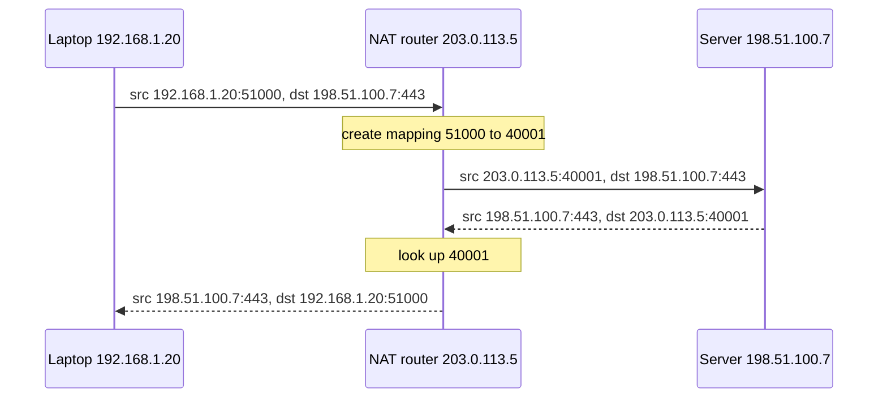

# IPv4 addressing, subnets, CIDR and NAT

> **Before this lesson:** you should know what an IP address and a router are ([Layers and encapsulation](#/lesson/networking/layers-encapsulation)) and how a host uses ARP and a default gateway ([Ethernet, MAC addresses, ARP and switching](#/lesson/networking/ethernet-arp-switching)). Binary numbers are used heavily; a two-minute refresher is included below.

## In plain words

An **IP address** is the number that identifies a machine on a network so that packets can be delivered to it. Version 4 of the Internet Protocol, **IPv4**, is the one you see most: four numbers separated by dots, such as `192.168.1.20`.

A postal address works in two parts: the town tells the postal service which sorting office to send the letter to, and the street and house number matter only once it gets there. An IP address has the same two parts. The front part names a **network** (the town), and the back part names one **host** on that network (the house). A host is any device with an address: a laptop, a phone, a server.

The dividing line between the two parts is not fixed. A small number called the **prefix length** says where it falls, and the practice of carving address space into networks of chosen sizes is called **subnetting**.

Why this matters for a job: every cloud deployment starts with choosing address ranges. Firewall rules, security groups and routing tables are all written as address blocks such as `10.0.0.0/16`. Being able to say at a glance how many addresses a block holds and whether one address is inside it is a daily skill, and a very common interview exercise.

## A two-minute binary refresher

Computers store numbers in **binary**: digits that are only 0 or 1, called **bits**. Eight bits make a byte. Each position is worth twice the one to its right:

```
position value:  128  64  32  16   8   4   2   1
bits:              1   1   0   0   0   0   0   0     = 128 + 64 = 192
bits:              0   0   0   1   0   1   0   0     = 16 + 4   = 20
```

So one byte holds values from 0 (`00000000`) to 255 (`11111111`). That is why each of the four numbers in an IPv4 address is between 0 and 255.

## The address is one 32-bit number

An IPv4 address is 32 bits. The **dotted decimal** form writes each of its four bytes as a decimal number:

```
192      .168      .1        .20
11000000  10101000  00000001  00010100
```

As a single number, that is $192 \times 2^{24} + 168 \times 2^{16} + 1 \times 2^{8} + 20 = 3{,}232{,}235{,}796$. Routers and firewalls treat addresses as plain 32-bit integers; the dots are for humans.

With 32 bits there are $2^{32}$, about 4.3 billion, possible addresses. That seemed endless in the 1980s. It is fewer than the number of phones in the world today, which is why address sharing (NAT, later in this lesson) and a larger address format (IPv6, next lesson) exist.

## Network part and host part

Take `192.168.1.20` with a prefix length of 24, written **`192.168.1.20/24`**. The `/24` says: the first 24 bits are the network part, the remaining 8 bits are the host part.

```
11000000 10101000 00000001 | 00010100
\________ network _______/   \ host /
        192.168.1               20
```

This slash form is called **CIDR notation** (Classless Inter-Domain Routing, pronounced "cider"). "Classless" refers to history: originally the split could only fall after 8, 16 or 24 bits (classes A, B and C). CIDR, introduced in 1993, lets it fall anywhere.

An older way to state the same split is a **subnet mask**: a 32-bit number with ones over the network part and zeros over the host part. For `/24`:

```
11111111 11111111 11111111 00000000   =  255.255.255.0
```

Mask and prefix length are two spellings of one fact. Common ones:

| Prefix | Mask | Host bits | Addresses in the block |
|---|---|---|---|
| /8 | 255.0.0.0 | 24 | 16,777,216 |
| /16 | 255.255.0.0 | 16 | 65,536 |
| /24 | 255.255.255.0 | 8 | 256 |
| /26 | 255.255.255.192 | 6 | 64 |
| /30 | 255.255.255.252 | 2 | 4 |
| /32 | 255.255.255.255 | 0 | 1 (a single host) |

The rule: a `/p` block contains $2^{32-p}$ addresses. Each extra prefix bit halves the block.

## Three special values in every subnet

A **subnet** is the set of all addresses sharing one network part. Within it:

- The **network address** has all host bits set to 0. It names the subnet itself and is not given to a host. For `192.168.1.20/24` it is `192.168.1.0`.
- The **broadcast address** has all host bits set to 1. A packet sent to it goes to every host on the subnet. Here it is `192.168.1.255`.
- Everything in between can be assigned to hosts: `192.168.1.1` to `192.168.1.254`.

So the number of **usable host addresses** is $2^{32-p} - 2$. A `/24` gives 254. (Two exceptions for completeness: a `/31` is allowed on a link between exactly two routers and uses both addresses; a `/32` denotes one specific host.)

### The calculation, one step at a time

The computer finds these values with two bitwise operations. **AND** compares two bits and gives 1 only if both are 1. **OR** gives 1 if either is 1.

- network address = address AND mask (clears the host bits);
- broadcast address = network address OR inverted mask (sets the host bits).

Now a case where the split does not fall on a dot, which is where people stumble: **`192.168.10.77/26`**.

A `/26` leaves 6 host bits, so the first three bytes are entirely network and the action is all in the last byte. Mask's last byte: `11000000` = 192.

```
last byte of the address:  77  = 0 1 | 0 0 1 1 0 1
last byte of the mask:    192  = 1 1 | 0 0 0 0 0 0
AND  (network):                  0 1 | 0 0 0 0 0 0  = 64
OR with 00111111 (broadcast):    0 1 | 1 1 1 1 1 1  = 127
```

Result: network `192.168.10.64`, broadcast `192.168.10.127`, usable hosts `.65` to `.126`, which is $2^6 - 2 = 62$ hosts.

A shortcut that works in your head: the block size is $2^{\text{host bits}}$, here 64. Blocks therefore start at multiples of 64: `.0`, `.64`, `.128`, `.192`. The address `.77` falls in the block starting at `.64`, and that block ends one before the next start: `.127`.

### Try it: a subnet calculator

The first half does the arithmetic by hand so you can see each step. The second half uses Python's built-in `ipaddress` module, which you would use in real code.

```python-run
def to_int(dotted):
    """'192.168.10.77' -> one 32-bit integer."""
    n = 0
    for part in dotted.split("."):
        n = (n << 8) | int(part)      # shift left one byte, then add the next byte
    return n

def to_dotted(n):
    """32-bit integer -> dotted decimal."""
    return ".".join(str((n >> shift) & 255) for shift in (24, 16, 8, 0))

def describe(cidr):
    address, prefix = cidr.split("/")
    prefix = int(prefix)
    mask = ((1 << prefix) - 1) << (32 - prefix)   # 'prefix' ones, then zeros
    network = to_int(address) & mask              # AND clears the host bits
    broadcast = network | (mask ^ 0xFFFFFFFF)     # OR sets the host bits
    print(cidr)
    print("  mask     ", to_dotted(mask))
    print("  network  ", to_dotted(network))
    print("  broadcast", to_dotted(broadcast))
    print("  usable   ", (1 << (32 - prefix)) - 2)

describe("192.168.10.77/26")
describe("10.20.30.40/22")

# The standard library does the same work:
import ipaddress
net = ipaddress.ip_network("192.168.10.77/26", strict=False)   # strict=False allows host bits
print(net, net.netmask, net.broadcast_address, net.num_addresses)
print(ipaddress.ip_address("192.168.10.100") in net)           # membership test -> True
print(ipaddress.ip_address("192.168.10.130") in net)           # -> False
```

The line `mask ^ 0xFFFFFFFF` flips all 32 bits of the mask (`^` is XOR; XOR with all ones inverts). `0xFFFFFFFF` is hexadecimal for 32 one bits.

## "Is this destination on my network?"

Every time a host sends a packet it asks one question: is the destination in my own subnet?

- Apply my mask to my address and to the destination address.
- If the two results are equal, the destination is local: use ARP to find it and send directly.
- Otherwise, send the packet to the default gateway.

Example: I am `192.168.1.20/24`. Destination `192.168.1.200` masks to `192.168.1.0`, same as mine: local. Destination `192.168.2.5` masks to `192.168.2.0`: not local, goes to the router.

This is why a wrong mask causes strange partial failures. With a mask that is too wide, a host believes remote machines are local, sends ARP requests nobody answers, and cannot reach them, while everything truly local still works.

## Reserved and private ranges

Not all addresses are for the public Internet. Memorise the first three rows; they come up constantly.

| Block | Purpose |
|---|---|
| `10.0.0.0/8` | private (16.7 million addresses) |
| `172.16.0.0/12` | private (`172.16.0.0` to `172.31.255.255`) |
| `192.168.0.0/16` | private (home routers usually use a /24 from here) |
| `127.0.0.0/8` | **loopback**: the machine talking to itself; `127.0.0.1` is "localhost" |
| `169.254.0.0/16` | link-local: self-assigned when no address could be obtained |
| `100.64.0.0/10` | shared space used by providers for carrier-grade NAT |
| `0.0.0.0/0` | "everything": the default route, or "any address" in a rule |

**Private** addresses can be used by anyone inside their own network, and are never routed on the public Internet. Millions of homes use `192.168.1.x` at the same time without conflict, because those addresses are invisible outside each home.

How does a machine get its address? Usually automatically, through **DHCP** (Dynamic Host Configuration Protocol): on joining a network the device broadcasts a request, and a DHCP server (at home, the router) leases it an address, the mask, the gateway and the DNS resolver to use. An address in `169.254.x.x` is the tell-tale sign that DHCP failed.

## Splitting a network into subnets

Suppose you are given `192.168.0.0/24` and need four separate networks (web servers, application servers, databases, management). Borrow bits from the host part to extend the network part.

- 4 subnets need 2 extra bits, because $2^2 = 4$.
- New prefix: /24 + 2 = **/26**. Each subnet has $2^6 = 64$ addresses, 62 usable.

| Subnet | Network | Usable range | Broadcast |
|---|---|---|---|
| 1 | 192.168.0.0/26 | .1 – .62 | .63 |
| 2 | 192.168.0.64/26 | .65 – .126 | .127 |
| 3 | 192.168.0.128/26 | .129 – .190 | .191 |
| 4 | 192.168.0.192/26 | .193 – .254 | .255 |

Needing 5 subnets would require 3 bits (8 subnets of /27, 30 hosts each), because 2 bits only give 4. Subnets also need not be equal: you can cut a /24 into one /25, one /26 and two /27s. That is **variable-length subnet masking** (VLSM); allocate the largest block first so that the pieces stay aligned.

The reverse operation is **aggregation** (or supernetting): the four /26 blocks above can be announced to the rest of the world as the single route `192.168.0.0/24`. Aggregation is what keeps Internet routing tables from exploding.

> [!INTERVIEW]
> **"How many hosts fit in a /20, and is 10.1.19.200 inside 10.1.16.0/20?"** A /20 has 12 host bits: $2^{12} = 4096$ addresses, 4094 usable. For membership, the block size in the third byte is $2^{4} = 16$, so blocks start at 0, 16, 32, … The block starting at 16 covers third-byte values 16 to 31; 19 is inside, so yes. Say the method aloud: count host bits, find the block size, find the multiple.

> [!TIP]
> In cloud networks, plan generously and avoid overlaps. A common layout is a `/16` for a whole virtual network and a `/24` per subnet per availability zone. Two networks whose ranges overlap cannot be connected to each other later without renumbering, which is painful.

## NAT: many machines behind one address

There are not enough public IPv4 addresses for every device. **NAT**, Network Address Translation, lets a whole private network share one public address. The form everyone uses rewrites ports as well as addresses and is properly called **NAPT** (network address and port translation) or PAT.

How it works on a home router whose public address is `203.0.113.5`:

1. Laptop `192.168.1.20` opens a connection from its port 51000 to a web server `198.51.100.7:443`.
2. The router rewrites the packet's **source** to its own public address and a free port, say `203.0.113.5:40001`, and records the pairing in a **translation table**.
3. The server sees a request from `203.0.113.5:40001` and replies there.
4. The router looks up port 40001 in its table, rewrites the **destination** back to `192.168.1.20:51000`, and delivers the packet inside.

| Inside (private) | Outside (public) | Remote peer |
|---|---|---|
| 192.168.1.20:51000 | 203.0.113.5:40001 | 198.51.100.7:443 |
| 192.168.1.31:51000 | 203.0.113.5:40002 | 198.51.100.7:443 |

Two inside machines happened to pick the same source port; the router gives them different public ports, so replies can be told apart.



### Consequences every engineer should know

- **Connections can only start from the inside.** An unsolicited packet from the Internet matches no table entry and is dropped. This protects home devices by accident, and it is why hosting a server at home needs **port forwarding**: a permanent, manually configured table entry.
- **Mappings expire.** To free ports, routers delete idle entries, often after 30 to 120 seconds for UDP and some minutes for TCP. A connection that stays silent longer than the timeout is forgotten by the NAT and dies without either end being told. Long-lived connections therefore send periodic **keep-alive** messages.
- **Peer-to-peer is hard.** Two devices that are both behind NAT cannot reach each other directly. Video calling uses helper protocols (STUN to discover one's public mapping, TURN to relay when all else fails), covered in the WebRTC lesson.
- **The server does not see the real client address.** Many users can appear as one IP address. Rate limiting or blocking "per IP" can punish a whole office or mobile network.
- **Carrier-grade NAT** (CGNAT) adds a second layer inside the provider, using the `100.64.0.0/10` block, so that thousands of customers share one public address.

NAT also breaks the neat layering from the first lesson: a layer 3 device is rewriting layer 4 port numbers and must recompute checksums. It is a pragmatic workaround, not an elegant design.

## A look at a real interface

Annotated output from a Linux machine:

```
$ ip addr show eth0
2: eth0: <BROADCAST,MULTICAST,UP,LOWER_UP> mtu 1500 ...     <- link is up, MTU 1500
    link/ether 3c:22:fb:10:9a:01 brd ff:ff:ff:ff:ff:ff      <- MAC and broadcast MAC
    inet 192.168.10.77/26 brd 192.168.10.127 scope global   <- IPv4, prefix, broadcast
$ ip route
default via 192.168.10.65 dev eth0                          <- the default gateway
192.168.10.64/26 dev eth0 scope link                        <- the local subnet: send directly
```

Everything computed earlier is visible: the `/26`, the broadcast `.127`, the local network `.64/26`, and a gateway that lies inside the usable range.

## Pitfalls

- **Assuming the network address ends in .0 and the broadcast in .255.** True only for /24 and shorter prefixes on byte boundaries.
- **Forgetting the minus two.** A /24 holds 256 addresses but 254 hosts. Cloud providers reserve a few more per subnet for their own use.
- **Thinking `172.16.0.0/12` ends at 172.16.255.255.** It runs to `172.31.255.255`.
- **Overlapping ranges.** Using `192.168.1.0/24` both at home and at the office breaks VPN access to the office devices with the same addresses.
- **Trusting the source IP as an identity.** Behind NAT, one address may be thousands of people.
- **Letting idle connections sit behind NAT.** They are dropped silently; use keep-alives shorter than the timeout.

## Summary

- An IPv4 address is a 32-bit number written as four bytes; a prefix length splits it into network and host parts.
- A /p block has $2^{32-p}$ addresses; network = address AND mask; broadcast = network OR inverted mask; usable hosts = block size minus 2.
- A host sends directly if the destination shares its network part, otherwise to the default gateway.
- Private ranges: `10/8`, `172.16/12`, `192.168/16`. Loopback is `127.0.0.1`.
- Subnetting borrows host bits; aggregation merges adjacent blocks into one shorter prefix.
- NAT maps many private endpoints onto ports of one public address, allowing outbound connections and blocking unsolicited inbound ones.

## Glossary

- **IPv4 address**: a 32-bit network-layer address.
- **Host**: any device with an IP address.
- **Prefix length / CIDR notation**: the number of network bits, written after a slash.
- **Subnet mask**: the same split written as a 32-bit pattern of ones then zeros.
- **Subnet**: all addresses that share a network part.
- **Network address / broadcast address**: the first / last address of a subnet, reserved.
- **Private address**: an address from ranges not routed on the public Internet.
- **Loopback**: an address that refers to the local machine itself.
- **DHCP**: the protocol that hands out addresses and settings automatically.
- **VLSM**: using subnets of different sizes within one block.
- **Aggregation**: advertising several adjacent blocks as one larger block.
- **NAT / NAPT**: rewriting addresses (and ports) so many hosts share one public address.
- **Translation table**: the NAT's record of which inside endpoint owns which public port.
- **Port forwarding**: a fixed NAT entry that admits inbound connections.
- **Keep-alive**: a small periodic message that stops idle state from expiring.

## Check yourself

```quiz
[
  {"q": "How many usable host addresses does a /27 subnet provide?",
   "options": ["27", "30", "32", "62"], "answer": 1,
   "explain": "A /27 leaves 5 host bits: 2^5 = 32 addresses, minus the network and broadcast addresses gives 30."},
  {"q": "What is the network address of 172.20.45.200/20?",
   "options": ["172.20.0.0", "172.20.32.0", "172.20.40.0", "172.20.45.0"], "answer": 1,
   "explain": "A /20 has a block size of 16 in the third byte. Multiples of 16 are 0, 16, 32, 48; 45 falls in the block starting at 32."},
  {"q": "A host is 10.0.5.9/24. Which destination will it send to its default gateway rather than directly?",
   "options": ["10.0.5.200", "10.0.5.1", "10.0.6.9", "10.0.5.254"], "answer": 2,
   "explain": "With a /24, the first three bytes are the network. 10.0.6.9 has a different network part, so it is not local."},
  {"q": "Which of these addresses is NOT in a private range?",
   "options": ["10.200.1.1", "172.31.9.9", "172.32.0.1", "192.168.250.3"], "answer": 2,
   "explain": "The 172.16.0.0/12 block covers 172.16.x.x to 172.31.x.x. 172.32.0.1 is a public address."},
  {"q": "You must split 10.1.0.0/24 into at least 6 equal subnets. What prefix length do the subnets have?",
   "options": ["/26", "/27", "/28", "/30"], "answer": 1,
   "explain": "Six subnets need 3 borrowed bits because 2^2 = 4 is too few and 2^3 = 8 is enough. 24 + 3 = 27."},
  {"q": "Two laptops behind the same home NAT both connect from source port 50000 to the same web server. How does the router tell the replies apart?",
   "options": ["By MAC address of the server", "It cannot, one connection fails", "It assigns each connection a different public source port and records the mapping", "The server adds the private address to the reply"], "answer": 2,
   "explain": "NAPT rewrites the source port as well as the address, and its translation table maps each public port back to one private endpoint."},
  {"q": "Why might a long idle TCP connection through a NAT stop working without any error at first?",
   "options": ["The IP address was reassigned by DHCP", "The NAT removed the idle mapping, so later packets no longer match any entry", "TCP connections expire after 60 seconds", "The subnet mask changed"], "answer": 1,
   "explain": "NAT devices delete idle entries to reclaim ports. Neither end is informed, so the failure is only discovered when data is next sent. Keep-alives prevent it."},
  {"q": "A machine shows the address 169.254.17.3. What is the most likely explanation?",
   "options": ["It is a public server", "It could not obtain an address from DHCP and assigned itself a link-local one", "It is the loopback address", "It is behind carrier-grade NAT"], "answer": 1,
   "explain": "169.254.0.0/16 is the link-local range used for self-assignment when no DHCP server answers."}
]
```

> **Source:** written from general networking knowledge (outside the chapters of Grigorik, *High Performance Browser Networking*, https://hpbn.co, which touches NAT only in its transport chapters). Facts checked against RFC 1918 (private addresses, https://www.rfc-editor.org/rfc/rfc1918), RFC 4632 (CIDR, https://www.rfc-editor.org/rfc/rfc4632), RFC 3021 (/31 links) and RFC 6598 (shared address space).
