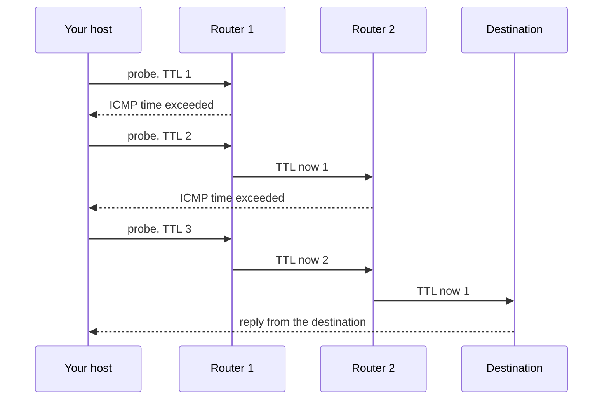
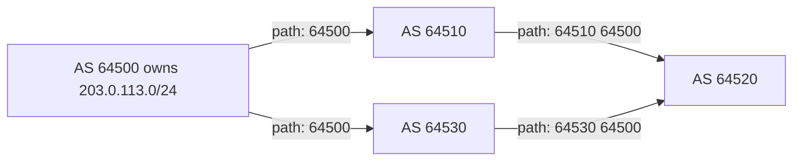

# The IP packet, IPv6, ICMP, routing and BGP

> **Before this lesson:** you should be comfortable with IPv4 addresses, prefixes and the "is it local?" decision from [IPv4 addressing, subnets, CIDR and NAT](#/lesson/networking/ipv4-subnets-nat). Hexadecimal digits (0–9, a–f) are used for IPv6 addresses and are explained where they appear.

## In plain words

The previous lesson explained how machines are numbered. This one explains how a packet finds its way between them.

Think about how a parcel crosses a country. No single person knows the whole route. Each sorting office looks at the destination postcode, consults its own list ("postcodes starting with 9 go on the northbound truck"), and passes the parcel one step closer. The next office repeats the process. Nobody plans the full journey in advance, yet parcels arrive.

Packets travel the same way. Each **router** holds a **routing table**, a list of address ranges and which neighbour to hand packets to for each. Forwarding a packet is one table lookup. The hard part is filling in those tables correctly across tens of thousands of independent networks, and that is the job of **routing protocols**. The protocol that ties the whole Internet together is called **BGP**.

Along the way you will also meet **IPv6**, the newer and far larger address format, and **ICMP**, the Internet's error-reporting channel, which powers the two most used diagnostic tools: `ping` and `traceroute`.

Why this matters for a job: cloud route tables, VPN setups and "why can region A not reach region B" incidents all come down to the ideas here. Several famous global outages were BGP mistakes. An engineer who understands longest-prefix matching and TTL can read a traceroute and say where a path breaks.

## Inside an IPv4 packet

Every IP packet starts with a header. You do not need to memorise the layout, but five fields are worth knowing by name because they explain real behaviour.

```
 0        8        16       24       32 bits
+--------+--------+--------+--------+
|Ver|IHL |  DSCP  |   Total length  |
+--------+--------+--------+--------+
| Identification  |Flags| Frag offs |
+--------+--------+--------+--------+
|  TTL   |Protocol| Header checksum |
+--------+--------+--------+--------+
|        Source IP address          |
+--------+--------+--------+--------+
|      Destination IP address       |
+--------+--------+--------+--------+
```

- **Source and destination address**: 32 bits each. Who sent it, who should get it.
- **TTL** (time to live): despite the name it is a hop counter, not a clock. The sender sets it (commonly to 64 or 128). Every router subtracts 1 before forwarding. A router that reduces it to 0 discards the packet and tells the sender. This stops a packet circling for ever if routing tables accidentally form a loop.
- **Protocol**: a number naming what is inside the payload so the receiver knows which module gets it: 6 for TCP, 17 for UDP, 1 for ICMP.
- **Header checksum**: a 16-bit value that lets each router detect a damaged header.
- **Flags and fragment offset**: used when a packet is split into fragments. The "do not fragment" flag lives here.

### The Internet checksum

The checksum used by IPv4, ICMP, UDP and TCP is the same small algorithm: treat the data as a list of 16-bit numbers, add them, wrap any overflow back around into the low 16 bits, and flip all the bits of the result. The receiver adds everything including the checksum; an undamaged header gives all ones.

```python-run
def internet_checksum(data):
    """data: a list of byte values (0-255). Returns the 16-bit checksum."""
    if len(data) % 2 == 1:
        data = data + [0]                       # pad to an even number of bytes
    total = 0
    for i in range(0, len(data), 2):
        word = (data[i] << 8) | data[i + 1]     # two bytes -> one 16-bit number
        total += word
    while total >> 16:                          # while anything overflowed 16 bits...
        total = (total & 0xFFFF) + (total >> 16)   # ...add the overflow back in
    return total ^ 0xFFFF                       # flip all 16 bits

# A 20-byte IPv4 header with the checksum field (bytes 10 and 11) set to zero:
header = [0x45, 0x00, 0x00, 0x73, 0x00, 0x00, 0x40, 0x00, 0x40, 0x11,
          0x00, 0x00,                            # <- checksum goes here
          0xC0, 0xA8, 0x00, 0x01, 0xC0, 0xA8, 0x00, 0xC7]
c = internet_checksum(header)
print("checksum:", hex(c))

# The sender writes the checksum into the header...
header[10], header[11] = c >> 8, c & 0xFF
# ...and the receiver recomputes over the whole header. Zero means "no damage".
print("verification:", internet_checksum(header))

# Flip one bit to simulate damage:
header[8] ^= 0x01
print("after damage:", internet_checksum(header), "(non-zero, so the packet is dropped)")
```

The printed checksum is `0xb861`. Because a router changes the TTL, it must also update this checksum at every hop. IPv6 removed the header checksum entirely to make routers faster, relying on the checks done by the link layer below and by TCP or UDP above.

## How a router forwards a packet

A **routing table** is a list of rows. Each row says: "for destinations in this address block, send the packet to this **next hop** (a neighbouring router) through this interface".

```
$ ip route
default via 10.0.0.1 dev eth0                  <- 0.0.0.0/0, the catch-all
10.0.0.0/24 dev eth0 scope link                <- directly connected, no next hop needed
10.8.0.0/16 via 10.0.0.254 dev eth0            <- reach this block through a VPN router
10.8.5.0/24 via 10.0.0.253 dev eth0            <- a more specific exception
```

Several rows can match the same destination. `10.8.5.9` is inside `10.8.5.0/24`, inside `10.8.0.0/16`, and inside the default `0.0.0.0/0`. The rule that breaks the tie is the most important one in routing:

> **Longest-prefix match:** among all matching rows, the one with the longest prefix (the most specific block) wins.

So `10.8.5.9` goes to `10.0.0.253`; `10.8.7.7` matches only the /16 and the default, so it goes to `10.0.0.254`; `8.8.8.8` matches only the default. The **default route** `0.0.0.0/0` matches everything and has the shortest possible prefix, so it is used only when nothing more specific exists.

For each packet a router then: checks the header checksum, finds the best row, subtracts 1 from the TTL (dropping the packet if it reaches 0), recomputes the checksum, finds the next hop's MAC address (with ARP if needed), and sends the packet in a fresh frame.

### Try it: longest-prefix match

```python-run
import ipaddress

routes = [                      # (address block, next hop)
    ("0.0.0.0/0",    "isp-gateway"),
    ("10.8.0.0/16",  "vpn-router"),
    ("10.8.5.0/24",  "lab-router"),
    ("10.0.0.0/24",  "direct"),
]
table = [(ipaddress.ip_network(block), hop) for block, hop in routes]

def lookup(destination):
    address = ipaddress.ip_address(destination)
    best = None
    for network, hop in table:
        if address in network:                                  # does this row match?
            if best is None or network.prefixlen > best[0].prefixlen:
                best = (network, hop)                           # keep the most specific
    return best

for dest in ("10.8.5.9", "10.8.7.7", "10.0.0.42", "8.8.8.8"):
    network, hop = lookup(dest)
    print(f"{dest:10} -> {hop:12} (matched {network})")
```

This loop checks every row, which is fine for a handful of routes. Real routers hold around a million rows and use tree structures or special memory chips to find the longest match in a fixed, tiny amount of time.

## ICMP: the network's error messages

**ICMP** (Internet Control Message Protocol) is how routers and hosts report problems and answer diagnostic probes. It rides directly inside IP packets. The messages you will meet:

| Message | Sent when | Used by |
|---|---|---|
| Echo request / echo reply | A host is asked "are you there?" and answers | `ping` |
| Time exceeded | A router reduced a packet's TTL to 0 | `traceroute` |
| Destination unreachable | No route, host down, port closed, or blocked by a filter | error reporting |
| Fragmentation needed | A packet marked "do not fragment" is too big for the next link | path MTU discovery |

**Ping** sends an echo request and times the reply. It tells you whether a machine is reachable at layer 3 and what the round-trip time is.

```
$ ping -c 3 203.0.113.80
64 bytes from 203.0.113.80: icmp_seq=1 ttl=52 time=31.4 ms   <- ttl 52: about 12 hops if it started at 64
64 bytes from 203.0.113.80: icmp_seq=2 ttl=52 time=30.9 ms
64 bytes from 203.0.113.80: icmp_seq=3 ttl=52 time=47.2 ms   <- one slower reply: some queuing
3 packets transmitted, 3 received, 0% packet loss
```

**Traceroute** uses TTL in a clever way to list the routers on a path. It sends a probe with TTL 1; the first router reduces it to 0, drops it, and returns a "time exceeded" message, which reveals that router's address. Then TTL 2 reveals the second router, and so on until the destination itself answers.



> [!WARNING]
> Blocking all ICMP "for security" is a common misconfiguration. It breaks path MTU discovery: large packets vanish because the "fragmentation needed" message never returns, so connections open but stall when sending bulk data. Rate-limit ICMP if you must, but let the error types through.

## IPv6

IPv4's 4.3 billion addresses ran out. **IPv6** uses **128-bit** addresses: $2^{128}$, about $3.4 \times 10^{38}$, enough to give every grain of sand on Earth its own network.

### Reading an IPv6 address

An address is written as eight groups of four hexadecimal digits separated by colons. Each group is 16 bits.

```
2001:0db8:0000:0000:0000:ff00:0042:8329
```

Two shortening rules make this bearable:

1. Leading zeros within a group may be dropped: `0db8` becomes `db8`, `0042` becomes `42`, `0000` becomes `0`.
2. **One** run of consecutive all-zero groups may be replaced by `::`.

Applying both: `2001:db8::ff00:42:8329`. The `::` may appear only once, otherwise you could not tell how many zero groups each one stands for.

```python-run
import ipaddress

full = "2001:0db8:0000:0000:0000:ff00:0042:8329"
a = ipaddress.ip_address(full)
print("compressed:", a.compressed)       # the short form
print("exploded  :", a.exploded)         # back to the full form

net = ipaddress.ip_network("2001:db8:abcd:12::/64")
print("addresses in a /64:", net.num_addresses)
print("loopback  :", ipaddress.ip_address("::1").is_loopback)
print("link-local:", ipaddress.ip_address("fe80::1c2b:3aff:fe4d:5e6f").is_link_local)
```

### What changes, and what does not

Prefixes work exactly as in IPv4: `2001:db8:abcd:12::/64` means the first 64 bits are the network part. Longest-prefix match, routing tables and TTL (renamed **hop limit**) are the same ideas. The practical differences:

| | IPv4 | IPv6 |
|---|---|---|
| Address size | 32 bits | 128 bits |
| Typical subnet | /24 (254 hosts) | /64 ($1.8 \times 10^{19}$ addresses) |
| Finding a neighbour's MAC | ARP, by broadcast | Neighbor Discovery, by multicast (ICMPv6) |
| Broadcast | yes | none; multicast instead |
| NAT | needed to share addresses | not needed; every device can have a public address |
| Fragmentation by routers | allowed | never; only the sender may fragment |
| Header checksum | yes | removed |
| Automatic addressing | DHCP | SLAAC (the host builds its own address from the router's prefix), or DHCPv6 |
| Loopback | 127.0.0.1 | `::1` |

Address ranges to recognise: `2000::/3` is public (**global unicast**); `fe80::/10` is **link-local**, valid only on one link and present on every interface; `fc00::/7` is private-style **unique local**; `2001:db8::/32` is reserved for documentation.

Removing NAT restores the property that any machine can address any other. It does not remove the need for protection: an IPv6 network still needs a **firewall**, a filter that decides which packets may pass.

### Living with both

IPv4 and IPv6 are not compatible on the wire, so most systems run both at once, called **dual stack**. A name can have both kinds of address in DNS. Which one does a browser use? An approach called **Happy Eyeballs** starts an IPv6 connection first, and if it has not succeeded after a short head start (a fraction of a second) starts IPv4 in parallel and uses whichever connects first. This prevents a broken IPv6 path from making sites feel slow.

## How routing tables get filled

Routes can be typed in by an administrator (**static routing**), which suits small networks, or learned automatically with a **routing protocol** (**dynamic routing**), where routers tell each other what they can reach and recompute when links fail.

The Internet is a network of networks. Each independently operated network (a provider, a cloud, a university) is an **autonomous system**, abbreviated **AS**, and has a number, such as AS15169. Routing happens at two levels.

**Inside one AS**, an **interior gateway protocol** finds shortest paths. The widely used ones are *link-state* protocols such as OSPF: every router floods a description of its own links, so all routers end up with the same map and each runs a shortest-path calculation on it. The older *distance-vector* style (RIP) has each router tell its neighbours only "I can reach X at cost N"; it is simpler but slower to recover from failures.

**Between ASes**, there is one protocol: **BGP**, the Border Gateway Protocol.

## BGP at a high level

BGP routers in neighbouring ASes keep a long-lived TCP connection (port 179) and exchange **announcements**: "I can reach the block `203.0.113.0/24`, and the path goes through these ASes". The list of ASes is the **AS path**. As an announcement spreads, each AS adds its own number to the front.



Three things to understand:

1. **Loops are avoided by inspection.** If a router sees its own AS number already in a path, it rejects the announcement. A protocol that carries the whole path like this is called a *path-vector* protocol.
2. **Policy beats distance.** BGP does not pick the fastest path. It picks the path the operator prefers, usually for business reasons: routes through paying customers are preferred over free exchange (**peering**), which is preferred over routes the operator must pay for (**transit**). Only among equally preferred routes does the shorter AS path win.
3. **Trust is the weak point.** Historically an AS could announce any block and neighbours would believe it. Announcing someone else's addresses, by mistake or malice, is a **route hijack**; accidentally re-announcing routes learned from one provider to another is a **route leak**. Because of longest-prefix match, a bogus *more specific* announcement (a /24 inside someone's /22) attracts the traffic everywhere it spreads. A cryptographic system called RPKI now lets networks check that an AS is authorised to announce a block.

BGP also enables **anycast**: the same block is announced from many locations, and each user's packets flow to the nearest one in routing terms. Large DNS services and CDNs use it to bring one IP address close to everyone.

> [!INTERVIEW]
> **"How does a packet get from my laptop to a server in another country?"** The laptop decides the destination is not local and sends to its default gateway. Each router performs a longest-prefix match on the destination address, decrements the TTL and forwards to the next hop. Within a provider, routes come from an interior protocol such as OSPF; between providers, BGP announcements carrying AS paths decide which neighbouring network to hand the packet to. Mention TTL as loop protection and ICMP "time exceeded" as the basis of traceroute.

> [!TIP]
> When a service is unreachable "from some places only", suspect routing rather than the server. Compare traceroutes from a working and a failing location: the hop where they diverge or stop is where to look.

## Pitfalls

- **Reading TTL as seconds.** It counts hops.
- **Picking the first matching route.** The most specific match wins regardless of order.
- **Assuming the forward and return paths are the same.** Each direction is routed independently; asymmetric paths are normal and make traceroute timings look odd.
- **Using `::` twice in an IPv6 address.** Only one run of zeros may be collapsed.
- **Believing IPv6 without NAT is unprotected.** NAT was never a security feature; a firewall is.
- **Blaming a slow traceroute hop.** Routers answer ICMP at low priority. A hop that looks slow while later hops look fine is not the problem.
- **Thinking BGP finds the shortest path.** It follows policy first.

## Summary

- The IPv4 header carries addresses, a TTL hop counter, a protocol number and a checksum.
- Routers forward by longest-prefix match and decrement TTL; the default route catches everything else.
- ICMP reports errors; ping uses echo, traceroute uses "time exceeded" from increasing TTLs.
- IPv6 has 128-bit addresses written in hexadecimal with `::` compression, /64 subnets, no broadcast, no NAT requirement and no router fragmentation.
- Inside an AS, interior protocols compute shortest paths; between ASes, BGP exchanges prefixes with AS paths and applies policy.
- Anycast announces one address from many places; hijacks and leaks are BGP's characteristic failures.

## Glossary

- **Routing table**: the list of address blocks and next hops a router uses.
- **Next hop**: the neighbouring router a packet is handed to.
- **Longest-prefix match**: choosing the most specific matching route.
- **Default route**: `0.0.0.0/0` (or `::/0`), used when nothing else matches.
- **TTL / hop limit**: a counter decreased by each router; the packet dies at zero.
- **ICMP**: the protocol for network error and diagnostic messages.
- **Ping / traceroute**: tools that test reachability / list the routers on a path.
- **IPv6**: the 128-bit version of the Internet Protocol.
- **Link-local address**: an address valid only on one link (`fe80::/10`).
- **SLAAC**: automatic IPv6 address configuration by the host itself.
- **Dual stack**: running IPv4 and IPv6 side by side.
- **Firewall**: a filter deciding which packets may pass.
- **Autonomous system (AS)**: one independently run network with its own number.
- **OSPF**: a link-state routing protocol used inside an AS.
- **BGP**: the path-vector protocol that exchanges routes between ASes.
- **AS path**: the list of ASes an announcement has passed through.
- **Peering / transit**: free exchange between networks / paid carriage to the whole Internet.
- **Anycast**: one address announced from many locations.

## Check yourself

```quiz
[
  {"q": "A routing table contains 0.0.0.0/0, 172.16.0.0/12 and 172.16.4.0/22. Which route is used for 172.16.5.9?",
   "options": ["0.0.0.0/0, because it is listed first", "172.16.0.0/12", "172.16.4.0/22", "None, the packet is dropped"], "answer": 2,
   "explain": "All three match, and the longest prefix wins. The /22 covers 172.16.4.0 to 172.16.7.255, which includes 172.16.5.9."},
  {"q": "What is the purpose of the TTL field in an IP packet?",
   "options": ["To measure how many seconds the packet has existed", "To stop packets circulating for ever by limiting the number of hops", "To choose between TCP and UDP", "To carry the path MTU"], "answer": 1,
   "explain": "Each router decrements TTL by one and discards the packet at zero, so a routing loop cannot trap packets indefinitely."},
  {"q": "How does traceroute discover the routers along a path?",
   "options": ["It asks DNS for the route", "It sends probes with TTL 1, 2, 3 and so on, and reads the ICMP time exceeded replies", "It reads the destination's routing table", "It uses ARP at each hop"], "answer": 1,
   "explain": "A probe with TTL n expires at the nth router, which reports back with its own address."},
  {"q": "Which is a valid shortened form of 2001:0db8:0000:0000:0000:0000:0000:0001?",
   "options": ["2001:db8::1", "2001:db8:::1", "2001:db8::0::1", "2001:db8:1"], "answer": 0,
   "explain": "Leading zeros are dropped and one run of zero groups becomes ::. The other options use :: incorrectly or omit groups without it."},
  {"q": "Which statement about IPv6 is true?",
   "options": ["Routers fragment packets that are too large", "It uses ARP broadcasts to find neighbours", "It has no broadcast; multicast and Neighbor Discovery replace it", "It requires NAT for home networks"], "answer": 2,
   "explain": "IPv6 removed broadcast and router fragmentation, uses ICMPv6 Neighbor Discovery, and has enough addresses that NAT is unnecessary."},
  {"q": "In BGP, what does a router do when it receives an announcement whose AS path already contains its own AS number?",
   "options": ["Prefers it, because it is familiar", "Rejects it, because accepting it would create a loop", "Shortens the path", "Forwards it unchanged"], "answer": 1,
   "explain": "Carrying the full AS path lets each AS detect and discard routes that have already passed through it."},
  {"q": "Why can announcing a more specific prefix (a /24 inside someone else's /22) divert traffic?",
   "options": ["Longer AS paths are preferred", "Routers everywhere prefer the longest matching prefix", "ICMP redirects the packets", "DNS caches the new route"], "answer": 1,
   "explain": "Longest-prefix match applies before anything else, so a more specific announcement wins wherever it is accepted. This is how many route hijacks work."},
  {"q": "A firewall drops every ICMP message. Which symptom is most likely?",
   "options": ["DNS stops resolving", "Connections open, but transfers of large data hang", "TCP handshakes are refused", "IPv6 addresses stop compressing"], "answer": 1,
   "explain": "Path MTU discovery depends on the ICMP fragmentation needed message. Without it, oversized packets are dropped silently while small ones pass."}
]
```

> **Source:** written from general networking knowledge (outside the chapters of Grigorik, *High Performance Browser Networking*, https://hpbn.co). Facts checked against RFC 791 (IPv4), RFC 1071 (checksum), RFC 792 (ICMP), RFC 8200 and RFC 5952 (IPv6 and its text form), RFC 8305 (Happy Eyeballs) and RFC 4271 (BGP), all at https://www.rfc-editor.org/ .
