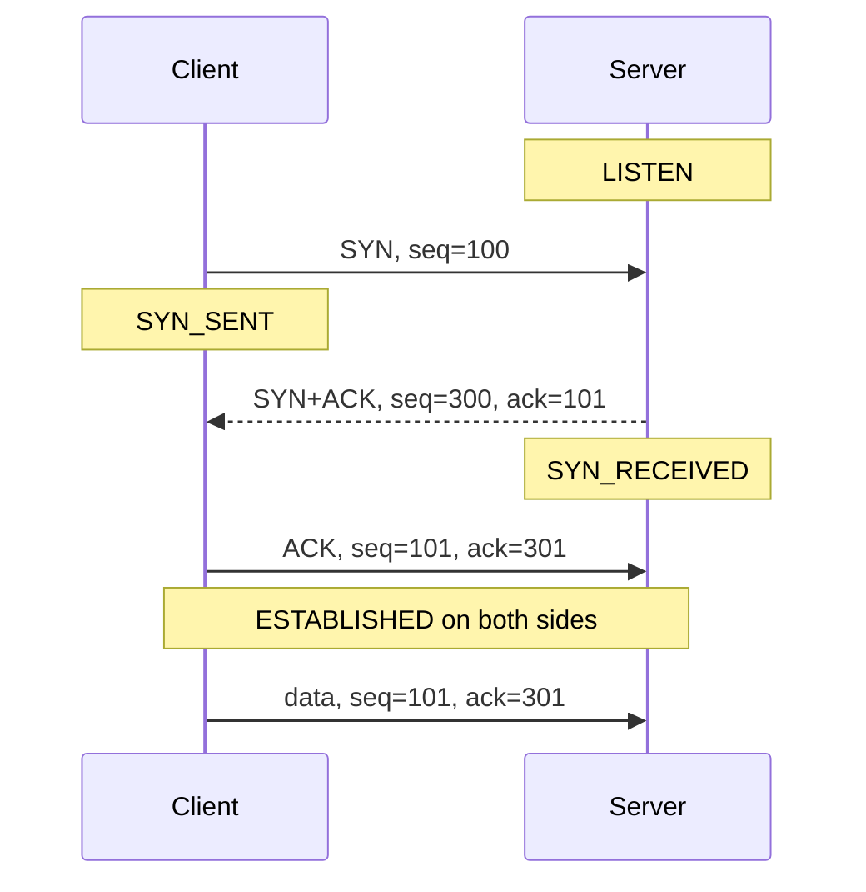
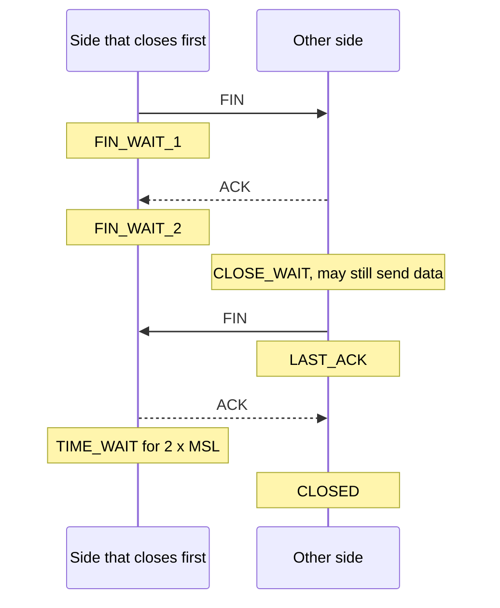

# UDP and the TCP connection lifecycle

> **Before this lesson:** you need IP packets, ports and encapsulation from [Layers and encapsulation](#/lesson/networking/layers-encapsulation), and round-trip time from [Latency and bandwidth](#/lesson/networking/latency-bandwidth).

## In plain words

The IP layer delivers packets between machines, but it makes no promises. A packet may be lost, arrive twice, arrive damaged, or arrive after a packet that was sent later. IP also delivers to a machine, not to a particular program on it.

The **transport layer** fixes those gaps, and it offers two very different services.

**UDP** (User Datagram Protocol) is like dropping postcards in a letterbox. Each postcard is addressed and sent on its own. It is quick, there is no setup, and nobody tells you whether it arrived.

**TCP** (Transmission Control Protocol) is like a phone call. First both sides say hello and confirm they can hear each other. Then everything said is heard in order; if a word is missed, it is repeated. At the end both sides say goodbye. This takes more effort, but the conversation is dependable.

Why this matters for a job: almost everything you build sits on TCP: web requests, database connections, message queues. Its opening handshake costs a round trip, its states show up in monitoring tools, and its closing rules explain puzzling errors such as "address already in use" and "connection reset by peer". The three-way handshake is among the most frequently asked interview questions in all of networking.

## Ports and sockets

A machine runs many programs that use the network at once. A **port** is a 16-bit number (0 to 65535) that identifies one endpoint on a machine. The transport header carries a source port and a destination port, and the operating system uses the destination port to hand incoming data to the right program.

- **Well-known ports** (0–1023) are conventions for servers: 80 for HTTP, 443 for HTTPS, 22 for SSH, 53 for DNS, 5432 for PostgreSQL.
- **Ephemeral ports** (commonly 32768–60999 on Linux) are temporary numbers the operating system gives to a client for one outgoing connection.

A **socket** is the object a program uses to send and receive on the network; think of it as the program's end of the wire. A TCP connection is identified by four values, plus the protocol, often called the **5-tuple**:

```
(protocol, source IP, source port, destination IP, destination port)
(TCP,      192.168.1.20, 51000,     203.0.113.80,    443)
```

This answers a common beginner question: "how can a web server handle thousands of clients on the single port 443?" Each connection differs in the *client's* address or port, so every 5-tuple is unique even though the server side is always `203.0.113.80:443`.

## UDP: the minimal transport

UDP adds almost nothing to IP. Its header is 8 bytes:

```
+---------------------+---------------------+
|   Source port (16)  | Destination port(16)|
+---------------------+---------------------+
|     Length (16)     |    Checksum (16)    |
+---------------------+---------------------+
|                 payload ...               |
```

What UDP gives you: ports, so the message reaches the right program, and a checksum, so damaged messages are discarded. What it does not give you:

- **No connection.** There is no handshake; the first packet carries data.
- **No reliability.** Lost messages are not resent.
- **No ordering.** Messages can arrive in any order.
- **No pacing.** UDP will send as fast as the program asks, even into a congested network.
- **Message boundaries are kept.** One send produces one **datagram**, and the receiver gets that datagram whole or not at all. (TCP, by contrast, delivers a stream of bytes with no boundaries.)

Why would anyone choose that? Three good reasons:

1. **A single question and answer.** DNS sends one small query and gets one small reply. A handshake would double the time.
2. **Fresh beats complete.** In a voice call or a fast-paced game, a sound or position that arrives late is useless. Resending it would only delay newer data.
3. **Building your own transport.** QUIC, the protocol under HTTP/3, runs over UDP and implements reliability itself, in a way that avoids some of TCP's limits.

## TCP: what it promises

TCP turns unreliable packets into a **reliable, ordered byte stream**. Concretely:

- **Connection-oriented**: both sides set up shared state before data flows.
- **Reliable**: every byte is acknowledged; unacknowledged bytes are sent again.
- **Ordered**: bytes are delivered to the program in the order they were sent.
- **Flow-controlled**: the sender does not overwhelm the receiver.
- **Congestion-controlled**: the sender does not overwhelm the network.

The last two are the subject of the next lesson. This one covers how a connection opens, numbers its bytes, and closes.

### The TCP header

At least 20 bytes. The fields that matter here:

```
+---------------------+---------------------+
|   Source port (16)  | Destination port(16)|
+---------------------+---------------------+
|            Sequence number (32)           |
+-------------------------------------------+
|         Acknowledgement number (32)       |
+------+------+-------+---------------------+
|Offset| Rsvd | Flags |   Window size (16)  |
+------+------+-------+---------------------+
|    Checksum (16)    |  Urgent pointer (16)|
+---------------------+---------------------+
|        Options (MSS, window scale, SACK, timestamps) ...
```

The **flags** are single bits that mark special segments:

| Flag | Meaning |
|---|---|
| SYN | "synchronise": start a connection and announce my starting sequence number |
| ACK | the acknowledgement number field is valid (set on every segment after the first) |
| FIN | "finish": I have no more data to send |
| RST | "reset": abort this connection immediately |
| PSH | deliver this data to the program promptly |

## Sequence and acknowledgement numbers

This is the heart of TCP, so take it slowly.

TCP numbers **bytes**, not packets. Each direction of a connection has its own independent numbering.

- The **sequence number** in a segment is the number of the first data byte that segment carries.
- The **acknowledgement number** says "I have received every byte before this number; the next byte I expect is this one". It is **cumulative**: one number confirms everything up to that point.

Smallest example. Suppose the client's numbering has reached 1000, and it sends 300 bytes.

| Direction | seq | length | ack | Meaning |
|---|---|---|---|---|
| client → server | 1000 | 300 | … | bytes 1000 to 1299 |
| server → client | … | 0 | 1300 | "got everything up to 1299, send 1300 next" |
| client → server | 1300 | 200 | … | bytes 1300 to 1499 |
| server → client | … | 0 | 1500 | "send 1500 next" |

If the second data segment were lost, the server would keep answering `ack 1300`, and the client would eventually send bytes 1300–1499 again.

The numbering does not start at zero. Each side picks a random 32-bit **initial sequence number** (ISN) for every new connection. Random starting points make it hard for an attacker to forge segments, and stop stray segments from an old connection being mistaken for part of a new one.

## Opening: the three-way handshake

Before data flows, each side must tell the other its ISN and get it acknowledged. That takes three segments.



Step by step, with the client ISN 100 and server ISN 300:

1. **SYN.** Client → server: "I want to connect. My numbering starts at 100."
2. **SYN+ACK.** Server → client: "Agreed. My numbering starts at 300. I acknowledge yours: I expect 101 next."
3. **ACK.** Client → server: "I acknowledge yours: I expect 301 next."

Notice `ack=101`, not 100. A SYN carries no data, yet it **consumes one sequence number**, as if it were one invisible byte. The same is true of FIN. This is what lets SYN and FIN be acknowledged and retransmitted like data.

**Why three messages, not two?** Each side must send its own starting number *and* receive confirmation that the other side heard it. That is two numbers and two confirmations; the server combines its confirmation and its own number into one segment, leaving three. With only two messages the server could never be sure the client had received its ISN, and a delayed old SYN could trick a server into opening a connection nobody wants.

The handshake also carries **options** that can only be negotiated at the start: the maximum segment size (MSS), window scaling and selective acknowledgements (explained in the next lessons).

**The cost.** The client may send data along with the third segment, so a new TCP connection costs **one round trip** before the first request can leave. At 100 ms RTT that is 100 ms of pure waiting, which is why reusing connections matters so much.

### Try it: follow the numbers

The program below simulates both endpoints with a counter each and prints every segment. No real network is involved; it shows how the numbers move.

```python-run
def show(sender, flags, seq, ack, length=0):
    print(f"{sender:6} -> {flags:8} seq={seq:<5} ack={ack:<5} len={length}")

client_next = 100        # client's initial sequence number
server_next = 300        # server's initial sequence number

# --- three-way handshake ---
show("client", "SYN", client_next, 0)
client_next += 1                         # SYN consumes one sequence number
show("server", "SYN+ACK", server_next, client_next)
server_next += 1                         # so does the server's SYN
show("client", "ACK", client_next, server_next)

# --- data: client sends 120 bytes, server replies with 500 bytes ---
show("client", "ACK", client_next, server_next, 120)
client_next += 120                       # data consumes one number per byte
show("server", "ACK", server_next, client_next, 500)
server_next += 500
show("client", "ACK", client_next, server_next)        # a pure acknowledgement

# --- close: each side sends FIN, each FIN is acknowledged ---
show("client", "FIN+ACK", client_next, server_next)
client_next += 1                         # FIN consumes one number too
show("server", "ACK", server_next, client_next)
show("server", "FIN+ACK", server_next, client_next)
server_next += 1
show("client", "ACK", client_next, server_next)
```

Read down the `ack` column: every value equals the *other* side's next expected byte. That single rule explains every line.

## Closing: four segments and a wait

A TCP connection is two one-way streams, and each is closed separately. A side that has finished sending sends a **FIN**; the other side acknowledges it. Because the other side may still have data to send, its own FIN can come later.



The state in which one direction is closed and the other still open is called **half-closed**. It is legitimate and useful: a client can say "that is all of my request" while still reading the reply.

### TIME_WAIT

After sending the final ACK, the side that closed first does not forget the connection immediately. It stays in a state called **TIME_WAIT** (written `TIME-WAIT` in the specification, `TIME_WAIT` in tools) for twice the **maximum segment lifetime** (MSL), commonly 60 seconds in total on Linux. Two reasons:

1. **The last ACK might be lost.** The other side would then resend its FIN. Someone has to be there to acknowledge it again, or the other side would be left hanging.
2. **Old segments must die out.** A delayed segment from this connection could otherwise arrive after a *new* connection with the same 5-tuple has started, and be mistaken for its data.

Practical effects worth remembering:

- A busy client or proxy that opens and closes thousands of short connections per second to the same server can run out of ephemeral ports, because each closed connection holds its port for the TIME_WAIT period. The cure is to reuse connections (pooling), not to shorten the timer.
- Restarting a server may fail with "address already in use" while old connections linger. Servers set the socket option `SO_REUSEADDR` so they can bind to the port again straight away.
- The state lands on whichever side closes first. Protocol designers sometimes arrange for the client to close first so that busy servers do not accumulate it.

### RST: the abrupt ending

A **reset** (RST) segment aborts a connection at once, with no orderly close. You see resets when:

- a SYN arrives at a port where nothing is listening (the caller sees "connection refused");
- a segment arrives for a connection the receiver has no record of, for example after a crash and restart, or after a NAT or firewall dropped its state (the caller sees "connection reset by peer");
- a program closes a socket while unread data is still waiting in it.

## The connection queue and SYN floods

When a server receives a SYN, it must remember the half-open connection until the final ACK arrives. These wait in a **SYN queue**; fully established connections wait in an **accept queue** (the **backlog**) until the program collects them.

An attacker can send huge numbers of SYNs from fake addresses and never complete the handshake, filling the queue so that real clients are turned away. This is a **SYN flood**. The standard defence is **SYN cookies**: the server stores nothing on receiving a SYN, and instead encodes the needed details into the ISN it sends back. Only when a valid ACK returns, proving the client exists, does it create the connection.

A related everyday problem: if the accept queue is too small or the program is too slow to accept connections, new clients experience slow or failed connects even though the server "is up".

## Seeing the states on a real machine

```
$ ss -tan
State      Recv-Q Send-Q  Local Address:Port   Peer Address:Port
LISTEN     0      511     0.0.0.0:443          0.0.0.0:*          <- waiting for clients, backlog 511
ESTAB      0      0       10.0.0.5:443         198.51.100.9:51822 <- an open connection
ESTAB      0      36      10.0.0.5:443         198.51.100.9:51823 <- 36 bytes sent, not yet acknowledged
TIME-WAIT  0      0       10.0.0.5:44120       10.0.0.9:5432      <- we closed this one first
CLOSE-WAIT 1      0       10.0.0.5:44121       10.0.0.9:5432      <- peer closed, our program has not
SYN-SENT   0      1       10.0.0.5:44122       10.0.9.9:6379      <- SYN sent, no answer yet
```

Two of these are diagnostic gold. Many sockets stuck in `CLOSE-WAIT` mean your program is not closing connections after the other side hung up: a resource leak in your code. Sockets stuck in `SYN-SENT` mean SYNs are leaving and nothing is coming back: a firewall, a wrong address, or a dead host.

## TCP or UDP?

| | TCP | UDP |
|---|---|---|
| Setup | three-way handshake, 1 RTT | none |
| Delivery | reliable, ordered | best effort, any order |
| Unit | byte stream, no boundaries | datagrams with boundaries |
| Header | 20 bytes or more | 8 bytes |
| Flow and congestion control | built in | none (the application must behave) |
| Typical uses | web, APIs, databases, email, file transfer | DNS queries, voice and video, games, QUIC |

> [!INTERVIEW]
> **"Walk me through the TCP three-way handshake and why it is three steps."** Client sends SYN with its initial sequence number x. Server replies SYN+ACK with its own number y and ack x+1. Client replies ACK with ack y+1. Three steps are the minimum for both sides to announce a starting number and have it confirmed, which also protects against stale duplicate SYNs. Add that SYN consumes one sequence number, that options such as MSS are exchanged here, and that it costs one round trip before data. If asked about closing: FIN and ACK in each direction, and TIME_WAIT for 2×MSL on the side that closes first, to re-acknowledge a resent FIN and let old segments expire.

> [!TIP]
> "Connection refused" (an RST came back: the host is alive, nothing listens on that port) and "connection timed out" (silence: packets are being dropped) point to different causes. Always note which one you got.

## Pitfalls

- **Thinking TCP preserves messages.** It is a byte stream. Two sends may arrive as one read, or one send as several. Protocols on top must frame their own messages, for example with a length prefix.
- **Forgetting SYN and FIN consume a sequence number.** Acknowledgements then look off by one.
- **Believing a successful send means delivery.** The data is only queued in the operating system. The far side may never read it.
- **Assuming a closed peer is noticed immediately.** If the other machine vanishes without sending FIN or RST (power loss, cable pulled), an idle connection looks perfectly healthy until you try to send. Keep-alives and timeouts exist for this.
- **"Fixing" TIME_WAIT by turning it off.** It protects correctness. Reuse connections instead.
- **Calling UDP unreliable and therefore useless.** It is the right base when the application wants control over what gets resent.

## Summary

- Ports identify programs; a connection is identified by the 5-tuple.
- UDP: 8-byte header, no handshake, no guarantees, keeps message boundaries.
- TCP: a reliable, ordered byte stream; sequence numbers count bytes; acknowledgements are cumulative and name the next expected byte.
- Opening takes SYN, SYN+ACK, ACK and one round trip. SYN and FIN each consume one sequence number.
- Closing takes a FIN and an ACK in each direction; the first closer waits in TIME_WAIT for 2×MSL.
- RST aborts; refused and timed out are different failures; SYN cookies defend against SYN floods.

## Glossary

- **Port**: a 16-bit number identifying an endpoint on a machine.
- **Ephemeral port**: a temporary client-side port chosen by the operating system.
- **Socket**: the programming object for one network endpoint.
- **5-tuple**: protocol, source address and port, destination address and port.
- **Datagram**: a self-contained UDP message.
- **Byte stream**: data delivered as a continuous run of bytes without message boundaries.
- **Sequence number**: the number of the first byte in a segment.
- **Acknowledgement number**: the next byte the receiver expects.
- **ISN**: the random initial sequence number of a connection.
- **SYN / ACK / FIN / RST**: flags that start, acknowledge, finish and abort.
- **Three-way handshake**: the SYN, SYN+ACK, ACK exchange that opens a connection.
- **Half-closed**: one direction finished, the other still open.
- **TIME_WAIT**: the waiting state after closing first; lasts 2×MSL.
- **MSL**: maximum segment lifetime, the longest a segment is assumed to survive in the network.
- **Backlog**: the queue of connections waiting for the program to accept them.
- **SYN flood / SYN cookies**: an attack that fills the handshake queue / the stateless defence.

## Check yourself

```quiz
[
  {"q": "A client sends SYN with seq=5000. The server replies with SYN+ACK, seq=9000. What acknowledgement number does the server's segment carry?",
   "options": ["5000", "5001", "9000", "9001"], "answer": 1,
   "explain": "A SYN consumes one sequence number, so the server expects byte 5001 next and acknowledges with 5001."},
  {"q": "The receiver has received bytes 1 to 2000 and 3001 to 4000, but bytes 2001 to 3000 were lost. What cumulative acknowledgement number does it send?",
   "options": ["2000", "2001", "3001", "4001"], "answer": 1,
   "explain": "A cumulative acknowledgement names the next byte expected in order. The gap starts at 2001, so that is what it keeps acknowledging."},
  {"q": "Why does a web server on port 443 not confuse two different clients?",
   "options": ["Each client is given a different server port", "Connections are identified by the full 5-tuple, and the client address or port differs", "TCP encrypts the client identity", "Only one client may connect at a time"], "answer": 1,
   "explain": "The server side of every connection is the same address and port, but the combination with each client's address and ephemeral port is unique."},
  {"q": "How many round trips does a new TCP connection cost before the client can send its first request?",
   "options": ["Zero", "One", "Two", "Three"], "answer": 1,
   "explain": "SYN goes out and SYN+ACK comes back: one round trip. The client's ACK can travel together with its first data."},
  {"q": "Which side of a TCP connection enters TIME_WAIT?",
   "options": ["Always the server", "Always the client", "The side that sends the first FIN", "Both sides, for 2 x MSL"], "answer": 2,
   "explain": "The side that closes first sends the final ACK and must stay around in case that ACK is lost and the peer's FIN is retransmitted."},
  {"q": "Which application is the best fit for UDP?",
   "options": ["Downloading a software update", "A live voice call", "A database transaction", "Sending an email"], "answer": 1,
   "explain": "In live audio, a late packet is worthless, so retransmission only adds delay. The other examples need every byte delivered correctly."},
  {"q": "A monitoring tool shows thousands of sockets in CLOSE-WAIT on your server. What does this suggest?",
   "options": ["A SYN flood attack", "The peers closed their side but your application is not closing its sockets", "The network is dropping packets", "TIME_WAIT is set too long"], "answer": 1,
   "explain": "CLOSE-WAIT means the peer's FIN arrived and the local program has not yet called close. A pile of them is a leak in the application."},
  {"q": "A client gets 'connection refused' immediately. What happened at the TCP level?",
   "options": ["The SYN was silently dropped", "An RST came back because nothing is listening on that port", "The three-way handshake completed and then TLS failed", "The server was in TIME_WAIT"], "answer": 1,
   "explain": "A reachable host with no listener answers a SYN with RST, which the client reports as refused. Silent dropping would cause a timeout."}
]
```

> **Source:** Grigorik, *High Performance Browser Networking*, ch. 2 "Building Blocks of TCP" and ch. 3 "Building Blocks of UDP" (topic coverage only), https://hpbn.co/building-blocks-of-tcp/ . Facts checked against RFC 9293 (TCP, https://www.rfc-editor.org/rfc/rfc9293), RFC 768 (UDP) and RFC 4987 (SYN flooding and cookies).
