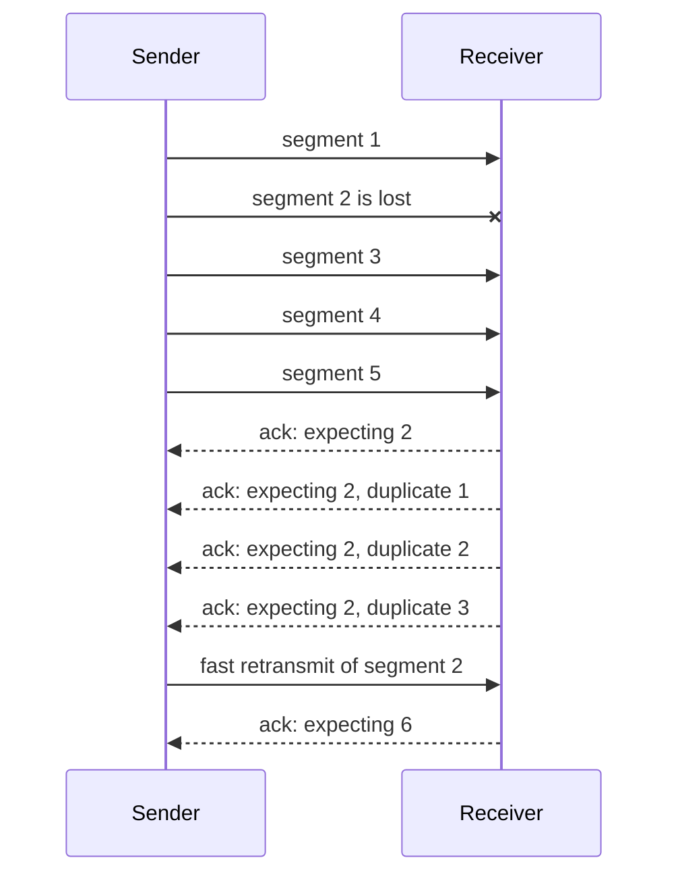
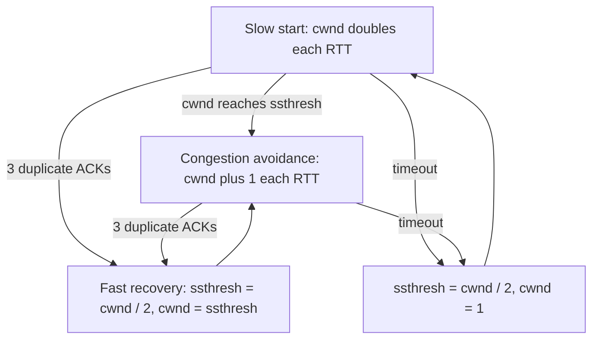

# Flow control and congestion control

> **Before this lesson:** you need sequence numbers, cumulative acknowledgements and the handshake from [UDP and the TCP connection lifecycle](#/lesson/networking/udp-tcp-lifecycle), and the ideas of RTT, buffers and packet loss from [Latency and bandwidth](#/lesson/networking/latency-bandwidth).

## In plain words

Once a TCP connection is open, the sender faces a question with no obvious answer: **how fast should I send?**

Send too slowly and the transfer takes for ever. Send too fast and one of two things goes wrong. Either the *receiver* cannot keep up, like pouring water into a glass faster than someone can drink it. Or the *network in between* cannot keep up, like too many cars entering a motorway at once: traffic does not merely slow down, it jams, and everyone gets through more slowly than if fewer cars had entered.

TCP has a separate mechanism for each danger:

- **Flow control** protects the receiver. The receiver tells the sender how much room it has.
- **Congestion control** protects the network. Nobody tells the sender how much room the network has, so the sender has to work it out by experiment: speed up carefully, and back off when packets go missing.

Underneath both sits the machinery of **reliability**: noticing that something was lost and sending it again.

Why this matters for a job: these mechanisms decide how fast every download, API call and database query can go. "Slow start" explains why the first response on a new connection is slower than later ones, why a 1% packet loss rate can halve throughput, and why reusing connections is the single most effective performance habit. Interviewers ask for slow start, congestion avoidance and fast retransmit by name.

## The sliding window

Sending one segment and waiting for its acknowledgement before sending the next would be painfully slow: one segment per round trip. Instead TCP keeps several segments "in flight" at once. The number of unacknowledged bytes the sender allows itself is called the **window**.

Picture the bytes to be sent laid out in a row, with a frame over part of it:

```
 acknowledged   | sent, not yet acked | may send now  | not allowed yet
 1 2 3 4 5 6 7  | 8 9 10 11 12        | 13 14 15      | 16 17 18 ...
                ^ base                 ^ next          ^ base + window
```

- Everything left of the frame is finished.
- Inside the frame, bytes are either in flight or allowed to go.
- When an acknowledgement arrives, the left edge moves right, the frame *slides*, and new bytes become eligible.

That is the **sliding window**. The remaining question is how wide the frame should be. TCP uses the smaller of two limits:

$$\text{window} = \min(\text{rwnd}, \text{cwnd})$$

where **rwnd** comes from flow control and **cwnd** from congestion control. The next sections take them in turn.

### Try it: a sliding-window sender

This simulation uses packet numbers instead of bytes to keep the output short. The sender has 10 packets and a window of 4. Each event is either a cumulative acknowledgement ("I have everything below n") or a timeout.

```python-run
def simulate(total, window, events):
    base = 0          # oldest packet not yet acknowledged
    next_new = 0      # next packet that has never been sent

    def send_new():
        nonlocal next_new
        sent = []
        while next_new < base + window and next_new < total:   # room in the window?
            sent.append(next_new)
            next_new += 1
        return sent

    print("start          -> send", send_new())
    for event in events:
        if event == "timeout":
            resend = list(range(base, next_new))     # everything still unacknowledged
            print(f"timeout        -> resend {resend}")
        else:
            if base < event <= next_new:             # ignore old or impossible acks
                base = event
            print(f"ack {event:<2}         -> window starts at {base}, send {send_new()}")

simulate(total=10, window=4, events=[1, 2, 4, "timeout", 8, 10])
```

Watch how `ack 4` releases two new packets at once (it acknowledged two), and how the timeout resends only what is inside the window.

## Flow control: do not overwhelm the receiver

Each side of a connection has a **receive buffer**: memory where arriving bytes wait until the program reads them. If the program is slow, the buffer fills.

Every TCP segment carries a **window size** field (you saw it in the header diagram last lesson). It announces the **receive window**, **rwnd**: "I have this many bytes of free buffer space right now". The sender never has more unacknowledged data in flight than that.

Small example: the receiver announces `rwnd = 4000`. The sender sends 4000 bytes and must stop. The program on the receiving side reads 1500 bytes; the next acknowledgement announces `rwnd = 1500`, and the sender may send 1500 more.

If the buffer is completely full the receiver announces a **zero window**, and the sender pauses. To avoid waiting for ever if the "window reopened" message is lost, the sender periodically sends a tiny **window probe**.

**Window scaling.** The window field is 16 bits, so it can express at most 65,535 bytes. On a fast long-distance link that is far too small. A handshake option called **window scaling** lets both sides multiply the field by a power of two (up to $2^{14}$), allowing windows of up to about a gigabyte. It is enabled by default on modern systems.

> [!TIP]
> In a packet capture, a connection that keeps announcing a tiny or zero window is telling you the *receiving application* is the bottleneck, not the network. That one observation ends many "the network is slow" arguments.

## Detecting loss and retransmitting

TCP learns about loss in two ways.

### The retransmission timer

When a segment is sent, a timer starts. If no acknowledgement arrives before it expires, the segment is sent again. The timer length is the **RTO** (retransmission timeout).

Choosing the RTO is delicate: too short and TCP resends data that was merely slow; too long and it sits idle after a real loss. So TCP measures the round-trip time continuously and keeps two running estimates:

- **SRTT**, the smoothed RTT: a moving average of the measurements;
- **RTTVAR**, the RTT variation: a moving average of how far measurements stray from SRTT.

With each new sample $R$ (the standard algorithm, from RFC 6298):

$$\text{RTTVAR} \leftarrow \tfrac{3}{4}\,\text{RTTVAR} + \tfrac{1}{4}\,|\text{SRTT} - R|$$
$$\text{SRTT} \leftarrow \tfrac{7}{8}\,\text{SRTT} + \tfrac{1}{8}\,R$$
$$\text{RTO} = \text{SRTT} + 4 \times \text{RTTVAR}$$

In words: the timeout is the typical round trip plus a safety margin that grows when the path is jittery. An average that gives recent samples a fixed fraction of the weight like this is called an **exponentially weighted moving average** (EWMA). Each time the timer does expire, the RTO is doubled (**exponential backoff**) so that a struggling network is not hammered with retries.

```python-run
def rto_trace(samples, min_rto=200):
    srtt = rttvar = None
    for r in samples:
        if srtt is None:                 # the very first measurement
            srtt, rttvar = r, r / 2
        else:
            rttvar = 0.75 * rttvar + 0.25 * abs(srtt - r)   # uses the OLD srtt
            srtt = 0.875 * srtt + 0.125 * r
        rto = max(min_rto, srtt + 4 * rttvar)
        print(f"sample {r:4} ms  srtt {srtt:6.1f}  rttvar {rttvar:6.1f}  rto {rto:6.1f}")

# A steady path, then one slow round trip, then steady again.
rto_trace([100, 102, 98, 101, 400, 100, 99, 101])
```

Look at the row for the 400 ms sample: SRTT rises only a little, but RTTVAR jumps, so the RTO grows sharply and then relaxes over the following samples.

### Duplicate acknowledgements and fast retransmit

Waiting for a timer is slow: the RTO is often several hundred milliseconds. There is a quicker signal.

Suppose segments 1, 2, 3, 4, 5 are sent and segment 2 is lost. The receiver gets 1 and acknowledges it. Then 3 arrives: out of order. The receiver cannot acknowledge 3 (acknowledgements are cumulative), so it repeats "I am still waiting for 2". The same happens for 4 and for 5. The sender sees the same acknowledgement again and again: **duplicate ACKs**.

One duplicate could mean packets were reordered. Three in a row almost certainly mean a loss, with later data still getting through. So on the **third duplicate ACK** the sender resends the missing segment immediately, without waiting for the timer. This is **fast retransmit**.



Notice the last line: because the receiver had kept 3, 4 and 5 in its buffer, one retransmission lets it acknowledge everything at once.

**Selective acknowledgement (SACK)** improves on this. With plain cumulative ACKs the sender knows only "something after 1 is missing". With the SACK option the receiver adds "…and I do have 3 to 5", so when several segments are lost the sender can resend exactly the holes. SACK is negotiated in the handshake and is on by default nearly everywhere.

## Congestion control: do not overwhelm the network

In the mid-1980s the early Internet suffered **congestion collapse**: links were saturated with retransmissions of packets that had been dropped because links were saturated, and useful throughput fell by a factor of a thousand. The fix was to make every TCP sender regulate itself.

The sender keeps a private variable, the **congestion window**, **cwnd**: its current estimate of how much the network can take. It is not sent on the wire. It is measured in segments (each of one MSS, about 1460 bytes) in the explanations below.

The algorithm has four parts. Together they are known as TCP Reno; newer variants change the growth curves but keep the structure.

### 1. Slow start

A new connection knows nothing about the path, so it starts small and probes. The window begins at the **initial window** (10 segments on modern systems, roughly 14 kB) and grows by one segment for **every acknowledgement received**. Since each acknowledged segment allows two to go out, the window **doubles every round trip**: 10, 20, 40, 80…

The name is misleading: growth is exponential. It is "slow" only compared with the older behaviour of blasting a full window immediately.

### 2. Congestion avoidance

Doubling cannot continue for ever. The sender keeps a threshold, **ssthresh** (slow-start threshold). Once cwnd reaches ssthresh, growth switches to a cautious **one segment per round trip**: 40, 41, 42…

### 3. Reacting to loss

Packet loss is taken as the sign that the network is full.

- **Loss found by three duplicate ACKs** (mild: later packets are still arriving): set ssthresh to half of cwnd, and cut cwnd to that value. Then continue in congestion avoidance. Skipping slow start here is called **fast recovery**.
- **Loss found by timeout** (severe: nothing is getting through): set ssthresh to half of cwnd, drop cwnd all the way to 1 segment, and begin slow start again.

The pattern "add a little each round, multiply by one half on loss" is called **AIMD**: additive increase, multiplicative decrease. It gives the classic sawtooth, and it has a valuable property: several connections sharing one bottleneck drift toward equal shares.



### Try it: watch the sawtooth

```python-run
def trace(ssthresh, events):
    cwnd = 1
    history = [cwnd]
    for event in events:
        if event == "ok":
            if cwnd < ssthresh:
                cwnd = min(cwnd * 2, ssthresh)     # slow start: double, up to ssthresh
            else:
                cwnd += 1                          # congestion avoidance: add one
        elif event == "3dup":
            ssthresh = max(cwnd // 2, 2)           # halve...
            cwnd = ssthresh                        # ...and continue from there
        elif event == "timeout":
            ssthresh = max(cwnd // 2, 2)
            cwnd = 1                               # start over
        history.append(cwnd)
    return history

events = ["ok"] * 8 + ["3dup"] + ["ok"] * 6 + ["timeout"] + ["ok"] * 8
history = trace(ssthresh=16, events=events)
for rtt, cwnd in enumerate(history):
    print(f"RTT {rtt:2}  cwnd {cwnd:3}  " + "#" * cwnd)
```

The bars show three shapes: a steep exponential climb, a gentle straight slope, and two kinds of drop (to half after duplicate ACKs, to one after the timeout). The simulation starts from 1 segment to make the doubling easy to see; real connections start at 10.

## What slow start costs you

Here is why this matters to anyone building for the web. Take a new connection with an initial window of 10 segments (about 14,600 bytes) and a 100 ms RTT. How long to deliver a 100 kB response, after the request has arrived?

| Round trip | cwnd (segments) | Bytes sent this round | Total delivered |
|---|---|---|---|
| 1 | 10 | 14,600 | 14,600 |
| 2 | 20 | 29,200 | 43,800 |
| 3 | 40 | 58,400 | 102,200 |

Three round trips, 300 ms, on a link that could have carried 100 kB in a few milliseconds. Bandwidth is irrelevant; the connection has not yet earned the right to use it. Consequences:

- **Reuse connections.** An existing connection already has a large cwnd. The same response might need a single round trip.
- **Keep the first response small.** If the essential part of a page fits in the first 14 kB, it arrives in the first round of data.
- **Idle connections forget.** By default, after an idle period TCP shrinks cwnd back to the initial value (slow-start restart), so a long-lived but quiet connection behaves like a new one.

## Newer algorithms in one paragraph each

**CUBIC**, the default on Linux, replaces the straight-line growth of congestion avoidance with a cubic curve based on time since the last loss: it climbs quickly back toward the previous maximum, lingers near it, then probes beyond. It uses fast, long-distance links much better than Reno.

**BBR**, developed at Google, does not treat loss as the main signal. It measures the path's bottleneck bandwidth and minimum RTT and paces packets at that rate, which avoids filling buffers and copes far better with links that lose packets for reasons other than congestion, such as radio noise.

**ECN** (explicit congestion notification) lets a router that is getting busy *mark* packets instead of dropping them; the receiver echoes the mark and the sender slows down without any loss.

> [!INTERVIEW]
> **"Explain TCP congestion control."** The sender keeps a congestion window and sends at most min(cwnd, rwnd). It starts in slow start, doubling cwnd every RTT from an initial window of about 10 segments, until it reaches ssthresh; then congestion avoidance adds one segment per RTT. Three duplicate ACKs trigger fast retransmit and halve the window (fast recovery); a timeout resets cwnd to one segment and restarts slow start. That is AIMD. Then show judgement: mention that CUBIC is today's default, that BBR is model-based rather than loss-based, and that the practical lesson is to reuse connections because new ones start slow.

> [!WARNING]
> Flow control and congestion control are often mixed up. Flow control is about the **receiver's** buffer and uses a value the receiver **advertises** (rwnd). Congestion control is about the **network** and uses a value the sender **infers** (cwnd). An interviewer who asks for the difference wants exactly that sentence.

## Pitfalls

- **Thinking slow start is slow.** It is exponential; it is the starting point that is small.
- **Believing loss always means congestion.** On wireless links loss can be noise. Loss-based algorithms then slow down for no reason, which is one motivation for BBR.
- **Ignoring loss rates that look small.** Throughput of Reno-style TCP is roughly proportional to $1/\sqrt{p}$ for loss rate $p$: going from 0.01% to 1% loss cuts throughput about tenfold.
- **Opening many parallel connections to "go faster".** Each one starts its own slow start and competes with the others. It can help a little and hurt a lot.
- **Measuring RTT on retransmitted segments.** You cannot tell which transmission the acknowledgement answers. TCP skips those samples (Karn's algorithm).
- **Assuming a large advertised window means fast transfer.** The smaller of rwnd and cwnd governs.

## Summary

- The sender may have at most min(rwnd, cwnd) unacknowledged bytes in flight; acknowledgements slide the window forward.
- Flow control: the receiver advertises its free buffer space (rwnd); window scaling extends it beyond 64 kB.
- Loss is detected by the retransmission timer (RTO = SRTT + 4·RTTVAR, doubled on each expiry) or sooner by three duplicate ACKs (fast retransmit). SACK reports exactly which data arrived.
- Congestion control: slow start doubles cwnd each RTT up to ssthresh; congestion avoidance adds one segment per RTT; duplicate ACKs halve the window; a timeout resets it to one.
- New connections are limited by slow start, not bandwidth: about 14 kB in the first round trip.

## Glossary

- **Window**: the amount of unacknowledged data the sender may have outstanding.
- **Sliding window**: the window advancing as acknowledgements arrive.
- **Receive buffer**: memory holding received bytes until the program reads them.
- **rwnd (receive window)**: free buffer space advertised by the receiver.
- **Zero window**: an advertisement of no free space; the sender pauses.
- **Window scaling**: a handshake option multiplying the 16-bit window field.
- **RTO**: retransmission timeout.
- **SRTT / RTTVAR**: smoothed round-trip time / its smoothed variation.
- **EWMA**: an average that weights recent samples by a fixed fraction.
- **Duplicate ACK**: a repeated acknowledgement caused by out-of-order arrival.
- **Fast retransmit**: resending after three duplicate ACKs without waiting for the timer.
- **SACK**: an option listing received blocks beyond the cumulative acknowledgement.
- **cwnd (congestion window)**: the sender's estimate of what the network can carry.
- **ssthresh**: the cwnd value at which slow start gives way to congestion avoidance.
- **Slow start / congestion avoidance / fast recovery**: the doubling phase / the add-one phase / halving after duplicate ACKs without restarting.
- **AIMD**: additive increase, multiplicative decrease.
- **CUBIC / BBR**: modern congestion control algorithms (loss-based with cubic growth / model-based).
- **ECN**: congestion signalled by marking packets instead of dropping them.

## Check yourself

```quiz
[
  {"q": "The receiver advertises rwnd = 30,000 bytes and the sender's cwnd is 12,000 bytes. How much unacknowledged data may the sender have in flight?",
   "options": ["12,000 bytes", "21,000 bytes", "30,000 bytes", "42,000 bytes"], "answer": 0,
   "explain": "The effective window is the minimum of rwnd and cwnd, here 12,000 bytes."},
  {"q": "Which statement correctly distinguishes flow control from congestion control?",
   "options": ["Flow control protects the network; congestion control protects the receiver", "Flow control uses a window advertised by the receiver; congestion control uses a window the sender estimates", "Both use the same window field in the header", "Flow control only applies to UDP"], "answer": 1,
   "explain": "rwnd is advertised by the receiver to protect its buffer. cwnd is inferred by the sender to protect the network."},
  {"q": "During slow start with no loss, how does cwnd change from one round trip to the next?",
   "options": ["It increases by one segment", "It doubles", "It stays constant", "It halves"], "answer": 1,
   "explain": "cwnd grows by one segment per acknowledgement, which doubles it every round trip."},
  {"q": "cwnd is 24 segments when three duplicate ACKs arrive. In TCP Reno, what are the new values?",
   "options": ["ssthresh 24, cwnd 1", "ssthresh 12, cwnd 1", "ssthresh 12, cwnd 12", "ssthresh 24, cwnd 12"], "answer": 2,
   "explain": "Fast recovery sets ssthresh to half the window and continues from that value in congestion avoidance."},
  {"q": "cwnd is 24 segments when the retransmission timer expires. What happens?",
   "options": ["ssthresh 12, cwnd 12, congestion avoidance", "ssthresh 12, cwnd 1, slow start", "ssthresh 24, cwnd 24, no change", "The connection is reset"], "answer": 1,
   "explain": "A timeout is treated as severe congestion: ssthresh becomes half the window and cwnd restarts from one segment in slow start."},
  {"q": "Why does TCP wait for three duplicate ACKs before fast retransmit instead of one?",
   "options": ["To save bandwidth on acknowledgements", "Because a single duplicate may be caused by harmless packet reordering", "Because the RTO must expire first", "Because SACK requires three blocks"], "answer": 1,
   "explain": "Packets can arrive slightly out of order without any loss. Three duplicates make a real loss much more likely."},
  {"q": "With an initial window of 10 segments of 1,460 bytes and no loss, how many round trips of data does a new connection need to deliver a 40 kB response?",
   "options": ["1", "2", "3", "4"], "answer": 1,
   "explain": "Round one carries 14,600 bytes, round two 29,200 more, a total of 43,800 bytes, which covers 40 kB."},
  {"q": "With SRTT = 80 ms and RTTVAR = 10 ms, what RTO does the standard formula give (ignoring minimums)?",
   "options": ["90 ms", "100 ms", "120 ms", "160 ms"], "answer": 2,
   "explain": "RTO = SRTT + 4 x RTTVAR = 80 + 40 = 120 ms."}
]
```

> **Source:** Grigorik, *High Performance Browser Networking*, ch. 2 "Building Blocks of TCP" (topic coverage only; examples and numbers are original), https://hpbn.co/building-blocks-of-tcp/ . Facts checked against RFC 5681 (congestion control), RFC 6298 (RTO), RFC 6928 (initial window of 10), RFC 2018 (SACK) and RFC 7323 (window scaling), at https://www.rfc-editor.org/ .
