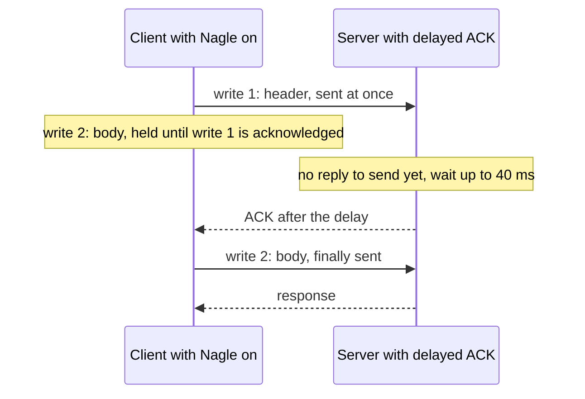

# TCP in practice: head-of-line blocking, Nagle, keep-alive and tuning

> **Before this lesson:** you need the TCP lifecycle from [UDP and the TCP connection lifecycle](#/lesson/networking/udp-tcp-lifecycle) and windows, retransmission and slow start from [Flow control and congestion control](#/lesson/networking/tcp-flow-congestion).

## In plain words

The last two lessons described how TCP is designed. This one is about how it behaves when you build real systems on it: the surprises, the settings worth knowing, and the habits that make applications fast.

TCP made one big promise: bytes arrive complete and in order. Every promise has a price. Picture a supermarket with a single checkout queue. If the customer at the front has a problem with their card, everyone behind waits, even people whose shopping is ready to go. TCP's in-order promise creates exactly this situation when one packet is lost, and it is called **head-of-line blocking**.

TCP also contains well-meant optimisations that save bandwidth by waiting a little before sending. Two of them, when combined, can add 40 milliseconds of delay to a tiny message for no visible reason. And TCP has no built-in way to notice that the other end has silently disappeared, which is why **keep-alives** and **timeouts** exist.

Why this matters for a job: these are the causes behind real tickets. "Our service has a mysterious 40 ms latency floor." "Connections die after exactly 350 seconds of silence." "The server runs out of ports under load." Recognising the pattern turns a week of confusion into a five-minute fix, and each one is a known interview topic.

## Head-of-line blocking

Recall how the receiver works: it may only hand bytes to the application in order. If segment 2 of 5 is lost, segments 3, 4 and 5 arrive and sit in the receive buffer. The application sees nothing new until segment 2 has been retransmitted and received, which takes at least one extra round trip.

For a single file download this hardly matters: the total time is what counts. It matters a great deal in two situations:

- **Several independent messages share one connection.** If a connection carries ten separate responses and a packet belonging to response A is lost, the already-arrived bytes of responses B to J are stuck behind it. They are unrelated to A, yet they wait. This is the weakness of HTTP/2 over TCP and the main reason HTTP/3 moved to a new transport (QUIC), as later lessons explain.
- **Fresh data matters more than old data.** In a call or a game, TCP holds back new audio or positions while it recovers something that is no longer useful. Such applications choose UDP.

The effect on the application is **jitter**: data that was sent at an even pace arrives in bursts.

### Try it: one lost packet, many delayed messages

The simulation sends one packet every 10 ms over a path with a 50 ms one-way delay. Packet 3 is lost and its retransmission arrives 200 ms late. Compare when each packet reaches the *application* with in-order delivery (TCP-like) and without it (UDP-like).

```python-run
ONE_WAY = 50            # milliseconds for a packet to cross the network
INTERVAL = 10           # one packet sent every 10 ms
RETRANSMIT_DELAY = 200  # extra time before the lost packet arrives again
LOST = 3

arrival = {}                                    # packet number -> arrival time
for n in range(8):
    arrival[n] = n * INTERVAL + ONE_WAY
arrival[LOST] += RETRANSMIT_DELAY               # the lost packet shows up late

print("pkt  arrives  delivered(in-order)  delivered(any order)  waited")
released = 0                                    # time at which everything so far was delivered
for n in range(8):
    released = max(released, arrival[n])        # cannot be delivered before earlier packets
    print(f"{n:3}  {arrival[n]:7}  {released:19}  {arrival[n]:20}  {released - arrival[n]:6}")
```

Packets 4 to 7 arrived on time but were delivered up to 190 ms late, all at the same instant as packet 3. Nothing was wrong with them. That waiting column is head-of-line blocking.

> [!INTERVIEW]
> **"What is head-of-line blocking, and where does it appear?"** It is one stalled item delaying everything queued behind it. In networking it appears at three levels: in HTTP/1.1, where a slow response blocks later requests on the same connection; in TCP, where a lost segment blocks delivery of all later bytes; and in switches, where a packet waiting for a busy output port blocks packets behind it bound for free ports. HTTP/2 removed the first by multiplexing but still suffers the second; QUIC removes the second by giving each stream independent ordering.

## Nagle's algorithm and delayed acknowledgements

### The problem Nagle solved

Imagine a remote terminal session where each keystroke is sent as it is typed. One byte of data travels inside 40 bytes of TCP and IP headers. On a slow link, a flood of such tiny packets wastes almost all the capacity.

**Nagle's algorithm** reduces this. The rule, in plain terms:

> If there is data already sent and not yet acknowledged, hold small new pieces of data in a buffer. Send them when the acknowledgement arrives, or when enough has accumulated to fill a full segment.

So the first small write goes out immediately. Later small writes are gathered and sent together. It is on by default.

### Delayed acknowledgements

A separate optimisation works on the receiving side. Sending an acknowledgement for every single segment doubles the packet count. So receivers practise **delayed ACK**: wait briefly (commonly up to 40 ms on Linux, up to 200 ms on some systems) in the hope that the application will produce a reply, so the acknowledgement can ride along with that data for free; or acknowledge every second full-sized segment.

### How the two collide

Each is sensible alone. Together they can deadlock briefly. Suppose an application sends a request as **two small writes**: first a header, then a body.

1. Write 1 (header) is sent at once: nothing is outstanding.
2. Write 2 (body) is held by Nagle: write 1 has not been acknowledged yet.
3. The server received only the header. It cannot respond without the body, so it has no data to send. Its delayed-ACK timer runs.
4. After about 40 ms the timer fires and a bare acknowledgement is sent.
5. Nagle releases the body. The server responds.



The result is a fixed 40 ms added to an exchange that should take one round trip. The pattern "write, write, read" is the trigger.

### The fixes

- **Write once.** Assemble the whole message in memory and hand it to the socket in one call. Then nothing small is left behind for Nagle to hold. This is the proper fix.
- **Disable Nagle** with the socket option **`TCP_NODELAY`**. Every write is sent immediately. Latency-sensitive software (interactive protocols, RPC frameworks, most HTTP clients and servers) sets it by default. The price is more small packets if the application writes carelessly.
- For the opposite need, sending many pieces as few packets as possible, Linux offers `TCP_CORK`: hold everything until uncorked.

### Try it: Nagle's decision rule

```python-run
MSS = 1460

def nagle(events):
    """events: ('write', n_bytes) or ('ack',). Prints what is sent and when."""
    buffered = 0          # bytes waiting in the send buffer
    unacked = False       # is there sent data that has not been acknowledged?
    for event in events:
        if event[0] == "write":
            buffered += event[1]
            print(f"write {event[1]:5} bytes", end="  -> ")
        else:
            unacked = False
            print("ack arrives      ", end="  -> ")
        sent = []
        while buffered >= MSS:                 # full segments always go
            sent.append(MSS)
            buffered -= MSS
            unacked = True
        if buffered > 0 and not unacked:       # a small piece goes only if nothing is outstanding
            sent.append(buffered)
            buffered = 0
            unacked = True
        print(f"sent {sent}, still buffered {buffered}")

nagle([("write", 200), ("write", 300), ("write", 100), ("ack",), ("write", 3000), ("ack",)])
```

The second and third writes produce `sent []`: they wait. When the acknowledgement arrives they leave together as one 400-byte segment. The 3000-byte write sends two full segments at once and holds the 80-byte tail.

## Keep-alive: is anyone still there?

A TCP connection with no data flowing exchanges **no packets at all**. That is efficient, but it means that if the other machine loses power, or a cable is cut, or a NAT device or firewall in the middle forgets the connection, neither end finds out. The connection looks healthy until someone tries to send, and then the write hangs or fails minutes later.

Three layers of defence exist.

**TCP keep-alive.** With the socket option `SO_KEEPALIVE`, the operating system sends an empty probe segment after the connection has been idle for a while. If several probes go unanswered the connection is declared dead and the application gets an error. The Linux defaults are very conservative:

| Setting | Default | Meaning |
|---|---|---|
| `tcp_keepalive_time` | 7200 s | idle time before the first probe (two hours) |
| `tcp_keepalive_intvl` | 75 s | time between probes |
| `tcp_keepalive_probes` | 9 | unanswered probes before giving up |

Two hours is far longer than most middleboxes are willing to remember an idle connection, so services lower these values per socket, for example to 60 s idle, 10 s interval, 3 probes.

**Application heartbeats.** Many protocols define their own periodic "ping" and "pong" messages: WebSocket, HTTP/2, gRPC, database drivers. These are better than TCP keep-alive because they prove the *application* at the far end is alive and responsive, not merely its operating system.

**Idle timeouts in the middle.** Devices between the two ends drop state for quiet connections. Typical values: home NAT, 30 seconds to a few minutes for UDP and longer for TCP; cloud load balancers, 60 to 350 seconds by default; cloud NAT gateways, a few minutes.

> [!WARNING]
> The classic bug: a client keeps a pooled connection idle for 5 minutes, a load balancer silently drops it after 60 seconds, and the next request on that connection fails with a reset or a hang. The rule is that **the client's idle timeout must be shorter than every idle timeout on the path**, or the keep-alive interval must be shorter than all of them. When a failure appears "only on the first request after a quiet period", look here.

Do not confuse this with *HTTP keep-alive*, an older name for reusing one TCP connection for several HTTP requests. Same words, different mechanism.

## Timeouts you must set yourself

TCP will wait a very long time by default. A connection attempt to a host that silently drops packets retries the SYN with a doubling timer (1 s, 2 s, 4 s, …) and may take over two minutes to fail. A read on an established connection can wait for ever. Production code should always set at least:

- a **connect timeout**: how long to wait for the handshake (short, perhaps 1 to 5 seconds);
- a **read timeout**: how long to wait for a response once the request is sent (set according to how long the operation legitimately takes).

Later lessons on backend networking build on this with retries and backoff.

## Tuning: what is worth doing

Most "TCP tuning" advice from old blog posts is obsolete: modern kernels choose good values automatically. The short list that still matters is below. On Linux these settings are read and changed with the `sysctl` command.

```
$ sysctl net.ipv4.tcp_congestion_control net.ipv4.tcp_slow_start_after_idle \
         net.core.somaxconn net.ipv4.ip_local_port_range net.ipv4.tcp_window_scaling
net.ipv4.tcp_congestion_control = cubic     <- the algorithm in use (bbr is the common alternative)
net.ipv4.tcp_slow_start_after_idle = 1      <- 1: an idle connection falls back to the initial window
net.core.somaxconn = 4096                   <- upper limit for a listening socket's accept queue
net.ipv4.ip_local_port_range = 32768 60999  <- ephemeral ports: about 28,000 available
net.ipv4.tcp_window_scaling = 1             <- large receive windows enabled
```

| Item | Why it matters | Guidance |
|---|---|---|
| Kernel version | Improvements arrive as defaults (initial window of 10, better loss recovery) | Keep servers reasonably current |
| Slow start after idle | Long-lived connections lose their large cwnd when quiet | Set to 0 on servers that hold persistent connections |
| Window scaling and buffer limits | A small maximum buffer caps throughput on fast long paths | Leave auto-tuning on; raise the maximums if needed |
| Accept queue (`somaxconn`, backlog) | A full queue drops or delays new connections under bursts | Raise it and make the application accept promptly |
| Ephemeral port range | Limits concurrent outgoing connections to one destination | Widen it; above all, pool connections |
| Congestion control algorithm | BBR copes better with lossy or long paths | Test it for services with distant users |

### How big should a buffer be? The bandwidth-delay product

To keep a link full, the sender needs a window as large as the amount of data that can be "in flight" on the path at once. That amount is the **bandwidth-delay product** (BDP):

$$\text{BDP} = \text{bandwidth} \times \text{RTT}$$

Example: a 100 Mbps path with an 80 ms RTT. In bytes, 100 Mbps is 12.5 million bytes per second; multiplied by 0.08 s that gives 1,000,000 bytes. A receive buffer limited to the classic 65,535 bytes would cap throughput at 65,535 ÷ 0.08 s ≈ 819,000 bytes per second, about 6.5 Mbps, on a 100 Mbps line. This is why window scaling exists.

```python-run
def bdp_bytes(mbps, rtt_ms):
    return mbps * 1_000_000 / 8 * (rtt_ms / 1000)     # bits/s -> bytes/s, times seconds

def max_throughput_mbps(window_bytes, rtt_ms):
    # one window per round trip is the most a sender can deliver
    return window_bytes / (rtt_ms / 1000) * 8 / 1_000_000

for mbps, rtt in ((100, 80), (1000, 1), (1000, 150), (20, 600)):
    print(f"{mbps:5} Mbps, RTT {rtt:3} ms: BDP = {bdp_bytes(mbps, rtt):>12,.0f} bytes")

print()
for window in (65_535, 1_000_000, 16_000_000):
    print(f"window {window:>10,} bytes at 80 ms RTT -> at most {max_throughput_mbps(window, 80):7.1f} Mbps")
```

### The tuning that matters most is in your application

No kernel setting beats these four habits:

1. **Reuse connections.** A warm connection skips the handshake and slow start. Use connection pools and persistent connections everywhere.
2. **Send less.** Compress, cache, and remove unnecessary data. Bytes that are not sent need no window.
3. **Move the endpoints closer.** Shorter RTT speeds up the handshake, slow start, and loss recovery all at once. This is what CDNs and regional deployments are for.
4. **Write in sensible units.** Hand the socket whole messages rather than fragments, and batch small messages where latency allows.

> [!TIP]
> One more optimisation exists for the handshake itself: **TCP Fast Open** lets a client that has connected before include data in its SYN, saving a round trip. It is rarely usable in practice because many middleboxes mishandle it. The idea survived in QUIC and TLS 1.3 as "0-RTT" connection resumption.

## Pitfalls

- **Blaming the network for a 40 ms floor.** Check for write-write-read patterns and whether `TCP_NODELAY` is set.
- **Relying on default keep-alive.** Two hours of idle time is too long to protect against any middlebox.
- **Setting the client idle timeout longer than the load balancer's.** The client will reuse connections that no longer exist.
- **No timeouts at all.** A single unresponsive dependency can then tie up every worker in your service.
- **Copying sysctl recipes from old articles.** Some (such as the removed `tcp_tw_recycle`) break clients behind NAT. Measure before and after any change.
- **Expecting HTTP/2 to remove all head-of-line blocking.** It removes the application-level kind; the TCP kind remains.
- **Opening a new connection per request "to be safe".** It pays the handshake and slow start every time and exhausts ephemeral ports under load.

## Summary

- TCP's in-order delivery means one lost segment delays everything after it: head-of-line blocking.
- Nagle's algorithm holds small writes while data is unacknowledged; delayed ACK holds acknowledgements for up to about 40 ms. Write-write-read triggers both. Write whole messages or set `TCP_NODELAY`.
- Idle TCP connections exchange nothing; dead peers and forgetful middleboxes go unnoticed. Use keep-alives or heartbeats with intervals shorter than every idle timeout on the path.
- Always set connect and read timeouts.
- A full-speed transfer needs a window of at least bandwidth × RTT.
- The best tuning is reuse, send less, be closer.

## Glossary

- **Head-of-line blocking**: one delayed item holding up everything queued behind it.
- **Nagle's algorithm**: holding small writes while earlier data is unacknowledged.
- **Delayed ACK**: briefly postponing an acknowledgement in the hope of combining it with data.
- **`TCP_NODELAY`**: the socket option that disables Nagle's algorithm.
- **`TCP_CORK`**: a Linux option that holds data until a full segment or an explicit release.
- **Keep-alive (TCP)**: empty probe segments that test an idle connection.
- **Heartbeat**: an application-level periodic message that proves the peer is responsive.
- **Idle timeout**: how long a device remembers a connection that carries no traffic.
- **Middlebox**: any device on the path that inspects or alters traffic: NAT, firewall, load balancer.
- **Connect timeout / read timeout**: limits on waiting for the handshake / for a response.
- **sysctl**: the Linux tool for reading and setting kernel parameters.
- **Accept queue (backlog)**: established connections waiting for the application.
- **Bandwidth-delay product**: bandwidth × RTT, the data in flight on a full path.
- **TCP Fast Open**: sending data in the SYN on repeat connections.

## Check yourself

```quiz
[
  {"q": "Segments 1 to 6 are sent; segment 2 is lost while 3 to 6 arrive. When can the application read the data from segments 3 to 6?",
   "options": ["Immediately on arrival", "Only after segment 2 has been retransmitted and received", "After the delayed ACK timer fires", "Never, they are discarded"], "answer": 1,
   "explain": "TCP delivers bytes strictly in order. Later segments wait in the receive buffer until the gap is filled: head-of-line blocking."},
  {"q": "A client sends each request as two small writes followed by a read, and sees a steady 40 ms of extra latency. What is the most likely cause?",
   "options": ["Slow start", "Nagle's algorithm on the client interacting with delayed ACK on the server", "TIME_WAIT on the server", "A DNS cache miss"], "answer": 1,
   "explain": "The second write is held until the first is acknowledged, and the server delays that acknowledgement because it has nothing to send yet."},
  {"q": "What does setting TCP_NODELAY do?",
   "options": ["Disables delayed ACKs on the receiver", "Disables Nagle's algorithm so small writes are sent immediately", "Removes the three-way handshake", "Turns off congestion control"], "answer": 1,
   "explain": "TCP_NODELAY applies to the sending side: writes are no longer held while earlier data is unacknowledged."},
  {"q": "A load balancer drops connections idle for 60 seconds. Which client configuration avoids failures on reused connections?",
   "options": ["Client idle timeout of 300 seconds", "Client idle timeout of 45 seconds, or keep-alives every 30 seconds", "Disabling TCP_NODELAY", "Raising the ephemeral port range"], "answer": 1,
   "explain": "The client must stop using, or refresh, a connection before any device on the path forgets it."},
  {"q": "Why is the default Linux TCP keep-alive often ineffective against middlebox timeouts?",
   "options": ["It is disabled by the three-way handshake", "It waits two hours of idleness before the first probe", "It only works over IPv6", "It sends too many probes"], "answer": 1,
   "explain": "The default tcp_keepalive_time is 7200 seconds, far longer than typical NAT and load balancer idle timeouts."},
  {"q": "A path has 50 Mbps of bandwidth and a 200 ms RTT. What is its bandwidth-delay product?",
   "options": ["125,000 bytes", "1,250,000 bytes", "10,000,000 bytes", "250,000 bytes"], "answer": 1,
   "explain": "50 Mbps is 6,250,000 bytes per second. Multiplied by 0.2 seconds gives 1,250,000 bytes."},
  {"q": "Which change usually gives the largest latency improvement for a service making many short requests to a backend?",
   "options": ["Doubling the receive buffer", "Reusing connections through a pool", "Shortening TIME_WAIT", "Disabling window scaling"], "answer": 1,
   "explain": "A reused connection avoids the handshake round trip and starts with an already-grown congestion window."},
  {"q": "A connect call to a host behind a firewall that silently drops packets, with no timeout configured, will typically:",
   "options": ["Fail instantly with connection refused", "Retry the SYN with growing delays and fail only after a minute or more", "Succeed after one retry", "Switch to UDP"], "answer": 1,
   "explain": "With no reply at all, TCP retransmits the SYN with exponential backoff. Without an explicit connect timeout this can take minutes."}
]
```

> **Source:** Grigorik, *High Performance Browser Networking*, ch. 2 "Building Blocks of TCP" (head-of-line blocking and optimisation checklist; topic coverage only), https://hpbn.co/building-blocks-of-tcp/ . Facts checked against RFC 896 (Nagle), RFC 1122 §4.2.3 (delayed ACK and keep-alive), RFC 7413 (TCP Fast Open) and the Linux `tcp(7)` manual page (https://man7.org/linux/man-pages/man7/tcp.7.html).
