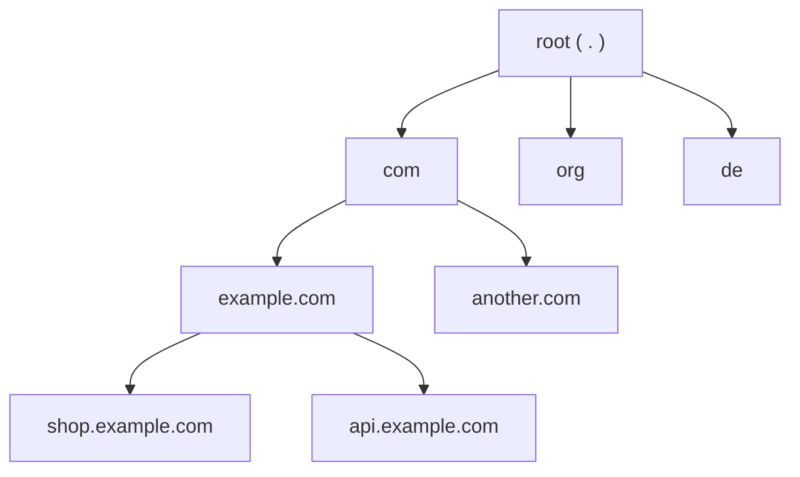
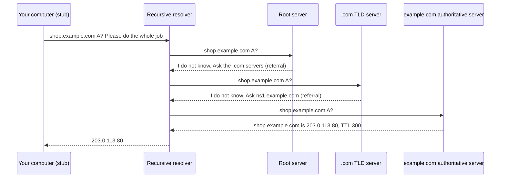

# How DNS resolution works

> **Before this lesson:** you should know what an IP address is ([IPv4 addressing, subnets, CIDR and NAT](#/lesson/networking/ipv4-subnets-nat)) and the difference between UDP and TCP ([UDP and the TCP connection lifecycle](#/lesson/networking/udp-tcp-lifecycle)). The overview in [What happens when you type a URL](#/lesson/networking/url-walkthrough) shows where DNS fits.

## In plain words

Computers reach each other by number: `203.0.113.80`. People remember names: `shop.example.com`. The **Domain Name System**, DNS, is the service that translates names into numbers. It is often called the phone book of the Internet, but a better picture is a chain of receptionists.

You walk into a huge organisation and ask for "Maria in accounts at the Lisbon office". The front desk does not know Maria, but knows who runs the Lisbon office and sends you there. The Lisbon reception does not know Maria either, but knows where accounts is. The accounts desk knows Maria's room number. Nobody holds the full directory; each desk knows only the next level down. That is how DNS answers billions of questions a day with no central database.

Why this matters for a job: every request your software makes begins with a name lookup. A wrong record sends users nowhere. A slow lookup delays everything. When engineers say "it is always DNS", they mean that a surprising share of outages start here. Being able to read the output of the `dig` tool and to explain the path from root to answer is a core operations skill and a standard interview question.

## Names are a tree

A domain name is read **right to left**, from general to specific. Each dot-separated part is a **label**.

```
shop . example . com .
 ^        ^       ^  ^
 |        |       |  the root (usually not written)
 |        |       top-level domain (TLD)
 |        second-level domain
 host or subdomain
```

- The **root** is the top of the tree, written as a single dot. A name that ends with the root dot, such as `shop.example.com.`, is a **fully qualified domain name** (FQDN): it leaves no doubt about where it sits in the tree.
- **Top-level domains** (TLDs) hang off the root: `com`, `org`, `net`, country codes such as `de` and `jp`, and newer ones such as `dev`.
- Below a TLD are the names people register, such as `example.com`. The owner may create anything underneath: `shop.example.com`, `api.eu.example.com`.



### Zones and delegation

Nobody administers the whole tree. It is split into **zones**: portions managed by one organisation. The operators of `com` manage the list of who holds each `.com` name. The owner of `example.com` manages everything below it.

The link from a parent zone to a child zone is a **delegation**: the parent stores a note saying "for anything under `example.com`, ask these servers". The servers that hold the real data for a zone are its **authoritative name servers**. "Authoritative" means they answer from their own records rather than from something they heard elsewhere.

## Who takes part in a lookup

Four kinds of participant:

1. The **stub resolver**: a small piece of your operating system. It does no searching itself; it passes the question to a recursive resolver and waits.
2. The **recursive resolver** (also called a recursor or caching resolver): a server that does the legwork on your behalf and remembers answers. Your Internet provider runs one; public ones include `1.1.1.1` and `8.8.8.8`; in a cloud network one is provided for you.
3. The **root servers**: thirteen named server groups (`a.root-servers.net` to `m.root-servers.net`), each actually hundreds of machines worldwide. They know only which servers handle each TLD.
4. The **TLD servers** and the domain's **authoritative servers**.

## A lookup, step by step

Your browser needs the address of `shop.example.com`. Assume every cache is empty.



Two styles of query appear here, and interviewers ask for the names:

- The stub sends a **recursive query**: "give me the final answer". It sets a flag called *recursion desired*.
- The resolver sends **iterative queries**: it asks each server in turn and accepts either an answer or a **referral**, a pointer to servers one level closer.

The resolver knew where to start because the addresses of the root servers are built into it (a small file called the root hints).

Every answer comes with a **TTL** (time to live): a number of seconds for which it may be remembered. The resolver stores the final answer and also the referrals. The next question for anything under `.com` skips the root; the next for anything under `example.com` goes straight to its authoritative server. In practice resolvers almost never talk to the root. Caching is the subject of the next lesson.

### Try it: iterative resolution on a toy Internet

The program models three levels of servers as dictionaries and resolves a name by following referrals, as a recursive resolver does. It counts the queries so you can see the effect of remembering referrals.

```python-run
# Each "server" maps a name suffix to either a referral or a final answer.
SERVERS = {
    "root":            {"com": ("referral", "tld-com"), "org": ("referral", "tld-org")},
    "tld-com":         {"example.com": ("referral", "ns-example")},
    "tld-org":         {},
    "ns-example":      {"shop.example.com": ("answer", "203.0.113.80"),
                        "api.example.com":  ("answer", "203.0.113.81")},
}

known_servers = {}          # the resolver's memory of referrals: suffix -> server

def best_starting_point(name):
    """Use the most specific referral we remember, else start at the root."""
    labels = name.split(".")
    for i in range(len(labels)):
        suffix = ".".join(labels[i:])            # shop.example.com, example.com, com
        if suffix in known_servers:
            return known_servers[suffix]
    return "root"

def resolve(name):
    server = best_starting_point(name)
    queries = 0
    while True:
        queries += 1
        labels = name.split(".")
        reply = None
        for i in range(len(labels)):             # longest matching suffix on this server
            suffix = ".".join(labels[i:])
            if suffix in SERVERS[server]:
                reply = (suffix, SERVERS[server][suffix])
                break
        if reply is None:
            return "NXDOMAIN (no such name)", queries
        suffix, (kind, value) = reply
        print(f"   asked {server:11} -> {kind}: {value}")
        if kind == "answer":
            return value, queries
        known_servers[suffix] = value            # remember the referral
        server = value

for name in ("shop.example.com", "api.example.com", "missing.example.com", "nothing.org"):
    print(name)
    result, n = resolve(name)
    print(f"   => {result}  ({n} queries)\n")
```

The first lookup takes three queries. The second takes one, because the resolver remembered that `ns-example` is responsible for `example.com`. `NXDOMAIN` is the real DNS response code meaning "this name does not exist".

## Record types

A zone is a list of **resource records**. Each has a name, a type, a TTL and a value. The types you must know:

| Type | Value | Example | Purpose |
|---|---|---|---|
| **A** | an IPv4 address | `shop.example.com. 300 IN A 203.0.113.80` | name to IPv4 |
| **AAAA** | an IPv6 address | `shop.example.com. 300 IN AAAA 2001:db8::80` | name to IPv6 ("quad A") |
| **CNAME** | another name | `www.example.com. 3600 IN CNAME shop.example.com.` | alias: "look up that name instead" |
| **NS** | a name server's name | `example.com. 86400 IN NS ns1.example.com.` | who is authoritative for this zone |
| **MX** | priority and mail server | `example.com. 3600 IN MX 10 mail.example.com.` | where email for the domain goes |
| **TXT** | free text | `example.com. 300 IN TXT "v=spf1 -all"` | verification strings, email policy |
| **SOA** | zone metadata | serial number, timers, admin contact | start of authority; one per zone |
| **PTR** | a name | `80.113.0.203.in-addr.arpa. IN PTR shop.example.com.` | reverse lookup: address to name |
| **SRV** | priority, weight, port, target | `_sip._tcp.example.com. IN SRV 10 5 5060 sip.example.com.` | locate a service including its port |
| **CAA** | a certificate authority | `example.com. IN CAA 0 issue "letsencrypt.org"` | who may issue certificates for the domain |

(`IN` means the Internet class; it is always there and can be ignored.)

One name can have several records of the same type. Three `A` records for `shop.example.com` mean three servers; resolvers return all of them, usually in rotating order, which spreads clients across servers. This crude load distribution is called **round-robin DNS**.

### CNAME: the rules that trip people up

A `CNAME` (canonical name) record says "this name is an alias; the real records are under that other name". The resolver then looks up the target, which may itself be a CNAME, forming a chain. CDNs depend on this: you point `www.example.com` at `example.cdn-provider.net`, and the provider controls the final addresses.

Two rules:

1. **A name with a CNAME may have no other records.** Not an `A`, not an `MX`, nothing.
2. Consequently, **the zone apex cannot be a CNAME.** The apex is the bare domain itself, `example.com`, and it must hold `NS` and `SOA` records. So `example.com CNAME something` is illegal even though `www.example.com CNAME something` is fine.

Since people want their bare domain to point at a CDN or load balancer, providers offer non-standard workarounds named ALIAS, ANAME or "CNAME flattening": the DNS provider resolves the target itself and serves the result as ordinary `A` records. A newer standard record type, `HTTPS`, solves the same problem properly and can also tell browsers which HTTP versions a site supports.

### Glue records

A subtle chicken-and-egg problem: the `.com` servers say "for `example.com`, ask `ns1.example.com`". But to find the address of `ns1.example.com` you would need to ask… the server for `example.com`. To break the loop the parent zone also stores the address of that name server. These extra address records are **glue records**.

## Reading `dig` output

`dig` is the standard tool for asking DNS questions by hand. Here is a typical answer with every section explained.

```
$ dig www.example.com

;; ->>HEADER<<- opcode: QUERY, status: NOERROR, id: 41872     <- status: NOERROR = success
;; flags: qr rd ra; QUERY: 1, ANSWER: 2, AUTHORITY: 0, ADDITIONAL: 1
;;        ^  ^  ^
;;        |  |  ra = recursion available (this server is a recursive resolver)
;;        |  rd = recursion desired (we asked for the full job)
;;        qr = this is a response

;; QUESTION SECTION:
;www.example.com.            IN    A                           <- what we asked

;; ANSWER SECTION:
www.example.com.     3412    IN    CNAME   shop.example.com.   <- an alias, 3412 s left to live
shop.example.com.    187     IN    A       203.0.113.80        <- the address, 187 s left

;; Query time: 23 msec                                         <- how long the resolver took
;; SERVER: 192.168.1.1#53(192.168.1.1) (UDP)                   <- which resolver answered
;; MSG SIZE  rcvd: 91
```

Things to notice:

- **Status.** `NOERROR` is success. `NXDOMAIN` means the name does not exist. `SERVFAIL` means the resolver could not get an answer (broken or unreachable authoritative servers, or a failed security check). `REFUSED` means the server will not answer you.
- **The TTL counts down.** 187 is what remains of the original 300 in this resolver's cache. Run the command again and it will be lower. A TTL showing its full original value suggests the answer was fetched fresh.
- **The `aa` flag** (not present above) appears when the answer comes directly from an authoritative server.

Useful variations:

```
dig +short www.example.com          # only the values
dig example.com MX                  # ask for a specific record type
dig @1.1.1.1 www.example.com        # ask a specific resolver
dig @ns1.example.com www.example.com   # ask the authoritative server directly (bypasses caches)
dig +trace www.example.com          # perform the iterative walk yourself: root, TLD, authoritative
dig -x 203.0.113.80                 # reverse lookup (PTR)
```

Asking the authoritative server directly is the first step in almost every DNS investigation: it tells you what the truth is, as opposed to what some cache currently believes.

## The DNS message on the wire

- DNS traditionally uses **UDP port 53**: one small datagram for the question, one for the answer, no handshake.
- A plain UDP answer was limited to 512 bytes. An extension called **EDNS** lets the client announce that it accepts larger answers (commonly around 1232 bytes).
- If an answer still does not fit, the server sets the **truncated** flag and the client repeats the question over **TCP port 53**.
- Classic DNS is unencrypted: anyone on the path can see which names you look up. **DNS over TLS** (DoT, port 853) and **DNS over HTTPS** (DoH, port 443) encrypt the conversation between your device and the resolver.
- **DNSSEC** is a different thing: it adds digital signatures to records so that a resolver can verify an answer was not forged. It provides authenticity, not privacy.

> [!INTERVIEW]
> **"What is the difference between a recursive and an iterative DNS query?"** In a recursive query the client asks a resolver to return the final answer and the resolver does all the work. In an iterative query the server replies with the best information it has, usually a referral to servers closer to the answer, and the asker continues the chase. Stub resolvers send recursive queries to a recursive resolver; that resolver sends iterative queries to root, TLD and authoritative servers. Add that results are cached at each step according to their TTLs, so the full walk is rare.

> [!TIP]
> Typing a trailing dot (`shop.example.com.`) forces a name to be treated as fully qualified. Without it, the operating system may first try appending configured search suffixes (for example `shop.example.com.corp.internal`), which causes slow or surprising lookups, particularly inside container platforms.

## Pitfalls

- **Putting a CNAME on the bare domain**, or next to other records for the same name. It is invalid and behaves unpredictably.
- **Forgetting the trailing dot in zone files.** Inside a zone file, a name without the final dot is treated as relative, so `mail.example.com` becomes `mail.example.com.example.com.`.
- **Confusing the resolver with the authoritative server.** One finds and caches; the other holds the truth. Always check which one you are asking.
- **Assuming one name gives one address.** Several records, different answers for different regions, and both IPv4 and IPv6 are all normal.
- **Thinking DNS is only UDP.** Large answers and zone transfers use TCP; blocking TCP port 53 breaks them.
- **Treating `SERVFAIL` and `NXDOMAIN` alike.** The first means "could not find out", the second "definitely does not exist".

## Summary

- Names form a tree read right to left: root, TLD, registered domain, subdomains. The tree is divided into zones linked by delegations.
- A stub resolver asks a recursive resolver, which sends iterative queries to root, TLD and authoritative servers, following referrals.
- Records to know: A, AAAA, CNAME, NS, MX, TXT, SOA, PTR, SRV, CAA.
- A CNAME excludes all other records at the same name and cannot sit at the zone apex.
- `dig` shows status, flags, the answer with remaining TTL, and which server replied; `+trace` and `@server` are the key options.
- DNS uses UDP port 53, falls back to TCP for large answers, and can be encrypted with DoT or DoH and authenticated with DNSSEC.

## Glossary

- **DNS**: the system mapping names to records such as addresses.
- **Label**: one dot-separated part of a name.
- **Root / TLD**: the top of the name tree / the level directly under it.
- **FQDN**: a complete name ending at the root.
- **Zone**: a part of the tree administered as one unit.
- **Delegation**: a parent zone pointing to the servers of a child zone.
- **Authoritative server**: a server holding a zone's actual records.
- **Stub resolver**: the client-side component that forwards queries.
- **Recursive resolver**: a server that resolves names on behalf of clients and caches.
- **Recursive / iterative query**: "give me the final answer" / "give me your best answer or a referral".
- **Referral**: a reply pointing to servers closer to the answer.
- **Resource record**: one entry in a zone: name, type, TTL, value.
- **TTL**: seconds for which a record may be cached.
- **Zone apex**: the bare domain name at the top of a zone.
- **Glue record**: an address record in the parent zone for a child's name server.
- **NXDOMAIN / SERVFAIL**: "no such name" / "resolution failed".
- **EDNS**: an extension allowing larger UDP answers and extra options.
- **DoT / DoH**: DNS encrypted with TLS / carried over HTTPS.
- **DNSSEC**: signatures that let resolvers verify records.

## Check yourself

```quiz
[
  {"q": "In the name api.eu.example.com, which part is the top-level domain?",
   "options": ["api", "eu", "example", "com"], "answer": 3,
   "explain": "Names are read right to left. The rightmost label, directly under the root, is the TLD."},
  {"q": "With empty caches, in what order does a recursive resolver contact servers to resolve shop.example.com?",
   "options": ["Authoritative, TLD, root", "Root, TLD, authoritative", "TLD, root, authoritative", "Root, authoritative, TLD"], "answer": 1,
   "explain": "It starts from the root, which refers it to the .com servers, which refer it to the servers for example.com."},
  {"q": "What does a root server return when asked for shop.example.com?",
   "options": ["The final IP address", "A referral to the servers for .com", "NXDOMAIN", "A CNAME record"], "answer": 1,
   "explain": "Root servers only know which servers handle each top-level domain, so they answer with a referral."},
  {"q": "Which record type maps a name to an IPv6 address?",
   "options": ["A", "AAAA", "PTR", "MX"], "answer": 1,
   "explain": "AAAA holds a 128-bit IPv6 address. A holds an IPv4 address, PTR maps an address back to a name, MX names mail servers."},
  {"q": "Why can example.com (the zone apex) not have a CNAME record?",
   "options": ["CNAME records are only allowed for mail", "A CNAME may not coexist with other records, and the apex must have NS and SOA records", "The root servers reject it", "CNAME targets must be IP addresses"], "answer": 1,
   "explain": "The apex always carries NS and SOA records, and a name holding a CNAME may hold nothing else."},
  {"q": "A dig answer shows 'shop.example.com. 42 IN A 203.0.113.80'. What does 42 mean here?",
   "options": ["The record's priority", "The number of seconds this answer may still be cached", "The port number", "The query time in milliseconds"], "answer": 1,
   "explain": "The second column is the remaining TTL in the resolver's cache. It counts down until the record is fetched again."},
  {"q": "A query returns status SERVFAIL. What is the best interpretation?",
   "options": ["The name definitely does not exist", "The resolver could not obtain a valid answer, for example because the authoritative servers are unreachable", "The answer was truncated", "The record type is unknown"], "answer": 1,
   "explain": "SERVFAIL signals a failure to resolve. NXDOMAIN is the code for a name that does not exist."},
  {"q": "Which command asks the domain's own authoritative server, bypassing resolver caches?",
   "options": ["dig +short www.example.com", "dig @ns1.example.com www.example.com", "dig -x www.example.com", "dig www.example.com MX"], "answer": 1,
   "explain": "The @server option directs the query to a chosen server. Asking the authoritative server shows the current truth rather than a cached copy."}
]
```

> **Source:** written from general networking knowledge (DNS is mentioned only briefly in Grigorik, *High Performance Browser Networking*, ch. 4 and 10, https://hpbn.co). Facts checked against RFC 1034 and RFC 1035 (DNS concepts and format), RFC 2181 (CNAME rules), RFC 6891 (EDNS) and RFC 9460 (HTTPS records), at https://www.rfc-editor.org/ , and the Cloudflare learning pages on DNS (https://www.cloudflare.com/learning/dns/what-is-dns/).
