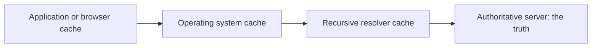
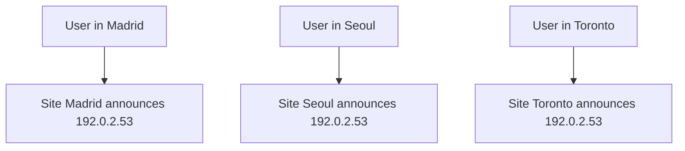

# DNS caching, TTLs, anycast and failures

> **Before this lesson:** read [How DNS resolution works](#/lesson/networking/dns-resolution) for resolvers, authoritative servers, record types and `dig`. The idea of BGP announcing routes, from [The IP packet, IPv6, ICMP, routing and BGP](#/lesson/networking/ipv6-icmp-routing), is used for anycast.

## In plain words

The previous lesson showed a full name lookup: root, then TLD, then the domain's own server. If that happened for every request, the Internet would crawl and the root servers would melt. It does not happen, because everybody along the way **remembers answers for a while**.

Remembering is called **caching**. Think of asking a colleague for the Wi-Fi password. The first time, they walk to the office manager to find out. For the rest of the day they answer from memory. That is fast, but if the password changes at noon, they will keep handing out the old one until they check again. How long they trust their memory is the whole trade-off: a long memory is fast and can be wrong for longer; a short memory is accurate and asks more often.

In DNS, that "how long" is the **TTL** (time to live), a number of seconds attached to every record by the domain's owner.

Why this matters for a job: you will change DNS records: to move a service, to fail over to a backup, to add a CDN. Whether that change takes effect in one minute or two days depends on TTL decisions made *before* the change. And when a DNS provider or resolver fails, the caches decide who notices and when. This lesson gives you the mental model to plan changes and to diagnose the classic failures.

## The layers of cache

A lookup passes through several caches, nearest first. Each one may answer without asking further.



1. **Application.** Browsers keep their own short-lived cache. Some language runtimes do too, and some ignore TTLs: older Java versions cached successful lookups for ever by default, and long-running programs that resolve a name once at start-up and never again behave the same way.
2. **Operating system.** A local service (`systemd-resolved`, `mDNSResponder`, the Windows DNS Client) caches for all programs on the machine.
3. **Recursive resolver.** Shared by all customers of a provider or all machines in a network. This is the big one: a popular name is almost always already there.

A record is fetched once and its TTL starts counting down in the resolver. Machines that ask later receive the *remaining* TTL, so every layer below expires the record at about the same moment.

## How a TTL plays out

Take `shop.example.com A 203.0.113.80` with a TTL of 300 seconds, and a resolver that first fetches it at 12:00:00.

| Time | Event | Resolver's reply |
|---|---|---|
| 12:00:00 | first query, cache empty | asks the authoritative server; returns TTL 300 |
| 12:01:40 | another client asks | from cache; returns TTL 200 |
| 12:04:59 | another client asks | from cache; returns TTL 1 |
| 12:05:00 | record expires | |
| 12:05:10 | another client asks | asks the authoritative server again; TTL 300 |

Now suppose the owner changes the address at 12:02:00. Clients of this resolver keep getting the old address until 12:05:00. A different resolver that first fetched the record at 11:58:30 switches at 12:03:30. One that had nothing cached switches immediately.

This is what people mean by "DNS propagation". Nothing is being pushed outward. Old copies are **expiring** at different moments in thousands of independent caches, and the worst-case wait is one full TTL (plus any cache that misbehaves).

### Try it: a resolver cache with TTLs and CNAME chains

The program implements a small caching resolver. Each cached entry stores when it expires. A `CNAME` and the `A` record it points to have separate TTLs, so they expire separately.

```python-run
AUTHORITATIVE = {                       # name -> (type, ttl_seconds, value)
    "www.shop.test":  ("CNAME", 3600, "shop.cdn.test"),
    "shop.cdn.test":  ("A",       30, "203.0.113.7"),
}

cache = {}                              # name -> (type, value, expires_at)

def resolve(name, now):
    upstream = 0                        # how many times we had to ask the authoritative side
    current = name
    while True:
        entry = cache.get(current)
        if entry and now < entry[2]:                    # cached and not yet expired
            rtype, value = entry[0], entry[1]
        else:
            upstream += 1
            if current not in AUTHORITATIVE:
                return "NXDOMAIN", upstream
            rtype, ttl, value = AUTHORITATIVE[current]
            cache[current] = (rtype, value, now + ttl)  # remember until now + ttl
        if rtype == "A":
            return value, upstream
        current = value                                 # CNAME: follow the alias

for t in (0, 10, 29, 30, 45, 61, 4000):
    answer, asked = resolve("www.shop.test", t)
    print(f"t={t:4}s  answer={answer:12}  upstream queries={asked}")
```

Read the output: at 0 s both records are fetched (2 queries). At 10 s and 29 s everything is cached (0). At 30 s the short-lived `A` record has expired but the hour-long `CNAME` has not, so only 1 query is needed. At 4000 s both have expired. A CDN typically wants exactly this arrangement: a long-lived alias pointing at a short-lived address it can change quickly.

## Negative caching

"That name does not exist" is also an answer, and it is cached too. This is **negative caching**. How long? The zone's `SOA` record contains a value (its last field, often called *minimum*) that sets the TTL for negative answers, commonly between 5 minutes and an hour.

The trap: you check whether `new-service.example.com` resolves, get `NXDOMAIN`, *then* create the record, and are puzzled when it still does not resolve. Your resolver cached the "does not exist". The habit to adopt: create the record first, then test; or test against the authoritative server directly with `dig @ns1.example.com`.

## Choosing TTLs

| TTL | Good for | Cost |
|---|---|---|
| 30–60 s | records used for failover or traffic steering | more queries; more exposure if your DNS provider is unreachable |
| 300 s (5 min) | most service records | a reasonable middle |
| 3600 s (1 h) | stable records | changes take up to an hour |
| 86400 s (1 day) | `NS` records, mail records, things that almost never change | slow to correct mistakes |

Two effects pull in opposite directions. A **short** TTL lets you move traffic quickly and limits how long a mistake lives. A **long** TTL gives faster lookups for users (more cache hits) and resilience: if your authoritative servers go down for ten minutes, clients with a cached answer never notice.

### The migration recipe

Moving a service to a new address with minimal disruption is a planned, three-step procedure. Suppose the record currently has a TTL of 86400 s (one day).

1. **At least one old TTL before the move**, lower the TTL to something short, such as 60 s. You must wait a full day here, because caches are still holding the record with the old one-day lifetime.
2. **Change the address.** Within about a minute nearly everyone follows. Keep the old server running during this period and for a while after: some clients will be late.
3. **When things are stable, raise the TTL again.**

If something goes wrong after step 2, you can switch back and be recovered within a minute, which is the real purpose of step 1.

> [!WARNING]
> Lowering the TTL at the same moment as changing the address achieves nothing: caches already hold the old record with the old, long TTL. The lowering must happen one old-TTL period in advance.

## Steering traffic with DNS

Because the authoritative server decides what to answer, it can give different answers to different askers. Managed DNS services offer several policies:

- **Round robin**: several addresses, order rotated. Spreads load roughly; no awareness of failures.
- **Weighted**: 90% of answers point to the current version, 10% to the new one, for a gradual rollout.
- **Geographic or latency-based**: answer with the data centre nearest to the asker.
- **Health-checked failover**: the provider probes your servers and stops handing out addresses that fail.

Limits to keep in mind. DNS steering is coarse: the authoritative server sees the *resolver's* address, not the user's, so a user of a faraway public resolver may be sent to the wrong region (an extension called EDNS Client Subnet lets resolvers pass along part of the user's address to reduce this). And it is slow to react: a failed server keeps receiving traffic until cached answers expire, and a few clients hold on much longer. DNS is good for choosing a region; within a region, load balancers do the precise work.

## Anycast: one address, many places

Root servers, public resolvers and big authoritative DNS providers must answer quickly from everywhere and survive attacks. They use **anycast**.

Normally one IP address belongs to one machine in one place; this is **unicast**. With anycast, the *same* address block is announced with BGP from many locations at once. Routers everywhere pick the route that looks best to them, which is usually the nearest site. A query to `1.1.1.1` from Madrid lands in a Spanish data centre; the same address queried from Seoul lands in Korea.



What anycast provides:

- **Low latency**: each user reaches a nearby site.
- **Automatic failover**: if a site fails it stops announcing the route, and within seconds BGP sends its users to the next nearest site. No DNS change is needed.
- **Attack absorption**: a flood of traffic from many sources is split among all sites instead of concentrating on one.

Anycast suits DNS especially well because a UDP query and its reply are one packet each. Long TCP connections work too, but a route change in the middle of a connection can send later packets to a different site that knows nothing about it; large CDNs engineer around that.

The "thirteen root servers" are thirteen anycast addresses served from well over a thousand sites.

## Common failures and how to recognise them

| What went wrong | What you observe | How to confirm |
|---|---|---|
| **Domain registration expired** | whole domain stops resolving, or resolves to a parking page | `whois`; `dig NS example.com` returns the registrar's servers |
| **Wrong or broken delegation** (parent's `NS` records point to servers that do not serve the zone; a "lame" delegation) | intermittent `SERVFAIL`, depending on which name server a resolver picks | `dig +trace`; compare `NS` at the parent with `NS` at the child |
| **Record deleted or mistyped** | `NXDOMAIN`, or traffic going to the wrong address | `dig @authoritative-server name` |
| **Stale cache after a change** | some users see the old address, some the new | compare `dig @1.1.1.1`, `dig @8.8.8.8` and the authoritative answer; look at remaining TTLs |
| **Negative cache** | a newly created name keeps returning `NXDOMAIN` for some users | the authoritative server answers correctly; wait out the negative TTL |
| **Authoritative provider outage or attack** | names fail progressively as caches expire; long-TTL names survive longer | `dig @ns…` times out |
| **Recursive resolver outage** | "the Internet is down" for one network; reaching sites by IP address still works | `dig @another-resolver name` succeeds |
| **Client never re-resolves** | one long-running service keeps calling an address that was retired | restart fixes it; check the runtime's DNS cache settings |
| **DNSSEC misconfiguration** | validating resolvers return `SERVFAIL`, non-validating ones work | `dig +cd name` (checking disabled) succeeds |

A sample investigation of "the site is down for some users":

```
$ dig +short shop.example.com @ns1.example.com     <- the truth
203.0.113.90
$ dig shop.example.com @8.8.8.8 | grep -A1 "ANSWER SECTION"
shop.example.com.   2811   IN   A   203.0.113.80    <- an old address, 2811 s still to live
```

The public resolver holds the previous address for another 47 minutes. Nothing is broken; a record with a one-hour TTL was changed without lowering it first. The remedy for next time is the migration recipe. For now: keep the old address serving, or wait.

### Security problems to know by name

- **Cache poisoning.** An attacker tricks a resolver into caching a forged answer, redirecting everyone who uses that resolver. Defences: randomised query identifiers and source ports, which make forged replies hard to match, and DNSSEC, which makes them detectable.
- **Amplification attacks.** DNS over UDP answers whoever the source address claims to be. An attacker sends small queries with the victim's address forged as the source; servers send large answers to the victim. This is why resolvers should not answer the whole Internet and why providers filter forged source addresses.
- **Subdomain takeover.** A `CNAME` still points at a cloud resource that was deleted, for example `promo.example.com CNAME old-campaign.some-host.net`. Someone else registers that resource name and now controls content served under your domain. Remove DNS records when you remove what they point to.

### A note on container platforms

Inside Kubernetes, the resolver configuration usually contains several search suffixes and a setting called `ndots:5`. It means: a name with fewer than five dots is first tried with each suffix appended. A lookup of `api.example.com` may therefore produce four or five failed queries (`api.example.com.default.svc.cluster.local`, and so on) before the real one. Writing the name with a trailing dot, or lowering `ndots`, removes that hidden latency.

> [!INTERVIEW]
> **"You changed a DNS record an hour ago and some users still reach the old server. Why, and what would you do differently?"** Resolvers and clients cached the old record and will keep it until its TTL expires; each cache expires at a different moment, and some clients ignore TTLs or resolve only at start-up. Verify by comparing the authoritative answer with public resolvers and reading the remaining TTL. Next time: lower the TTL at least one old-TTL period in advance, make the change, keep the old endpoint alive during the overlap, then raise the TTL. Mention negative caching if the record was newly created.

> [!TIP]
> When you suspect DNS, ask three questions in order: what does the **authoritative** server say, what does **my resolver** say, and what address is **my application** actually connecting to? A difference between any two tells you which cache is responsible.

## Pitfalls

- **Talking about "propagation" as something that spreads.** Plan in terms of expiry of the old TTL.
- **Lowering the TTL too late.** It must be lowered one old-TTL period before the change.
- **Switching off the old server at the moment of the change.** Late clients will fail; overlap for at least several TTLs.
- **Very low TTLs everywhere.** They increase lookup latency and make every user dependent on your DNS provider being reachable at all times.
- **Testing before creating a record.** The negative answer gets cached.
- **Assuming DNS failover is instant or complete.** It is bounded by TTLs and by clients that do not honour them.
- **Leaving dangling CNAME records.** They are a security hole, not merely clutter.

## Summary

- Answers are cached in the application, the operating system and the recursive resolver, each for at most the record's TTL.
- A change becomes visible as old cached copies expire; the worst case is one full old TTL, longer for clients that ignore TTLs.
- Non-existence is cached as well, for a time set in the zone's SOA record.
- Lower TTLs ahead of a migration, overlap old and new, then raise them again.
- DNS can steer traffic by weight, location and health, but coarsely and with delay.
- Anycast announces one address from many sites, giving nearby answers, fast failover and resistance to floods.
- Most DNS incidents are stale caches, broken delegations, expired registrations, provider outages, or clients that never re-resolve.

## Glossary

- **Cache**: stored copies of earlier answers.
- **TTL**: seconds a record may be kept in a cache.
- **Negative caching**: remembering that a name does not exist.
- **SOA minimum**: the zone value that sets the negative-cache TTL.
- **Propagation**: informal term for old cached records expiring over time.
- **Round-robin DNS**: returning several addresses in rotating order.
- **Weighted / geographic / latency-based routing**: DNS answers chosen by ratio, by asker location, by measured delay.
- **Health-checked failover**: withdrawing addresses of servers that fail probes.
- **EDNS Client Subnet**: an option passing part of the user's address to the authoritative server.
- **Unicast / anycast**: one address in one place / one address announced from many places.
- **Lame delegation**: a delegation to servers that do not serve the zone.
- **Cache poisoning**: planting a forged record in a resolver's cache.
- **Amplification attack**: abusing servers to send large replies to a forged victim address.
- **Subdomain takeover**: gaining control of a name through a dangling record.
- **Search suffix / ndots**: resolver settings that append domains to short names.

## Check yourself

```quiz
[
  {"q": "A record with TTL 600 is fetched by a resolver at 10:00:00. A client asks the same resolver at 10:04:00. What TTL does the client receive?",
   "options": ["600", "360", "240", "0"], "answer": 1,
   "explain": "240 seconds have passed, so 360 remain. Resolvers hand out the remaining lifetime, not the original value."},
  {"q": "You plan to move a service whose A record has a TTL of 86400 seconds. When should you lower the TTL to 60 seconds?",
   "options": ["At the same moment as changing the address", "Immediately after changing the address", "At least 24 hours before changing the address", "It does not matter"], "answer": 2,
   "explain": "Caches already hold the record for up to a day. Only after that day has passed are all cached copies carrying the short TTL."},
  {"q": "You query a name, get NXDOMAIN, then create the record. Your resolver still returns NXDOMAIN. Why?",
   "options": ["The record needs 48 hours to propagate", "The resolver cached the negative answer", "DNSSEC is rejecting it", "The root servers have not been updated"], "answer": 1,
   "explain": "Negative answers are cached for a period defined by the zone's SOA record. Querying the authoritative server directly would show the new record."},
  {"q": "What is the main benefit of a long TTL?",
   "options": ["Changes take effect faster", "More cache hits, faster lookups and resilience if authoritative servers are briefly unavailable", "It prevents cache poisoning", "It enables anycast"], "answer": 1,
   "explain": "Cached answers avoid upstream queries and keep working during short outages. The price is slow change."},
  {"q": "How does anycast direct a user to a nearby server?",
   "options": ["The DNS server measures the user's ping", "The same IP prefix is announced from many sites and routing delivers packets to the closest one", "The browser picks from a list of addresses", "A load balancer redirects with HTTP 302"], "answer": 1,
   "explain": "Anycast relies on BGP: each network forwards toward the announcement it considers best, usually the nearest site."},
  {"q": "The authoritative server returns the new address, but a public resolver returns the old one with 1,900 seconds of TTL left. What is happening?",
   "options": ["The public resolver is broken", "The resolver holds a cached copy that has not expired yet", "The zone delegation is lame", "The domain has expired"], "answer": 1,
   "explain": "This is ordinary caching. The resolver will fetch the new record when the remaining TTL reaches zero."},
  {"q": "A long-running service keeps sending requests to an address that was removed from DNS days ago. The most likely cause is:",
   "options": ["Anycast routing", "The application resolved the name once at start-up or caches lookups indefinitely", "A negative cache entry", "A CNAME at the zone apex"], "answer": 1,
   "explain": "Some runtimes and connection pools never re-resolve. The TTL is honoured by resolvers but ignored by the program."},
  {"q": "What is a subdomain takeover?",
   "options": ["An attacker guessing the DNS provider's password", "An attacker claiming a deleted external resource that one of your CNAME records still points to", "A resolver returning SERVFAIL", "Two A records for the same name"], "answer": 1,
   "explain": "A dangling CNAME delegates part of your namespace to a resource name that anyone can now register."}
]
```

> **Source:** written from general networking knowledge (outside the chapters of Grigorik, *High Performance Browser Networking*, https://hpbn.co). Facts checked against RFC 2308 (negative caching), RFC 1034 (caching and TTLs), RFC 4786 (anycast operation) and RFC 7871 (EDNS Client Subnet), at https://www.rfc-editor.org/ , and the Kubernetes DNS documentation (https://kubernetes.io/docs/concepts/services-networking/dns-pod-service/).
