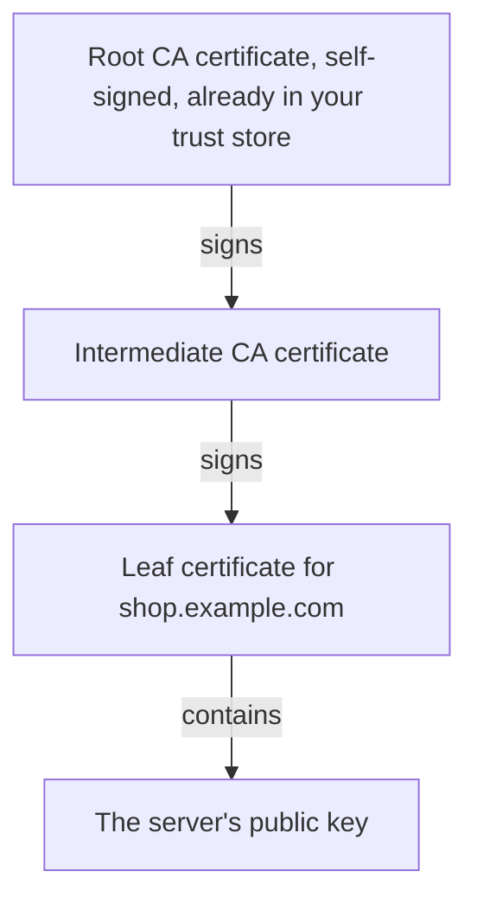
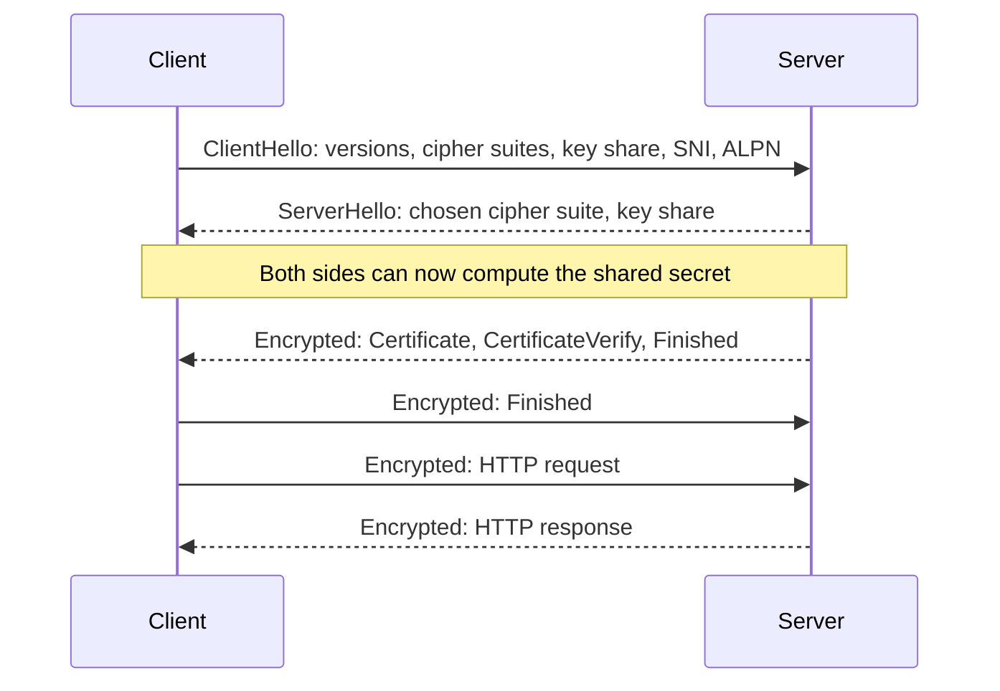
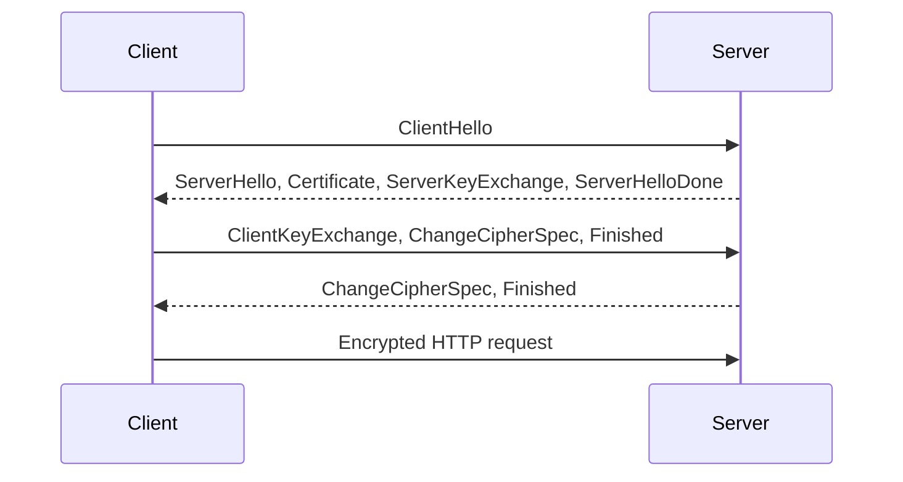

# TLS: the handshake, certificates and chains of trust

> **Before this lesson:** you need the TCP handshake and the idea of a round trip from [UDP and the TCP connection lifecycle](#/lesson/networking/udp-tcp-lifecycle), and the overall request flow from [What happens when you type a URL](#/lesson/networking/url-walkthrough). No cryptography background is assumed; every concept is built from the ground up.

## In plain words

Data on the Internet passes through many machines you do not control: the café's Wi-Fi router, your provider, several other providers, the data centre's network. Without protection, any of them could read your password, change the page you receive, or pretend to be your bank.

**TLS** (Transport Layer Security) is the protocol that prevents this. It is the "S" in HTTPS and the padlock in the address bar. An older name, SSL, is still used loosely for the same thing.

An everyday picture: you want to send valuables to someone in another city by courier, and you do not trust the courier. You need three things. A locked box so the courier cannot look inside. A tamper-evident seal so that you would know if the box had been opened or its contents swapped. And proof that the person who collects it at the other end is the intended recipient and not an impostor. TLS provides exactly these three:

- **Confidentiality**: outsiders cannot read the data (the locked box).
- **Integrity**: outsiders cannot change the data without detection (the seal).
- **Authentication**: you know who you are talking to (the identity check).

Why this matters for a job: every service you deploy will need a certificate, and certificates expire, get misconfigured and break in recognisable ways. "Certificate expired", "name mismatch" and "unable to verify the first certificate" are among the most common production errors there are. Interviewers expect you to describe the handshake and explain how a browser decides to trust a server.

## Four building blocks

TLS combines four cryptographic tools. You do not need the mathematics, only what each tool does.

### 1. Symmetric encryption: one shared key

**Encryption** scrambles data so that only someone with the right **key** (a secret number) can unscramble it. In **symmetric** encryption the same key locks and unlocks. It is very fast, which makes it right for bulk data. The common algorithm is AES.

The catch: both sides must already share the key. How do two strangers agree on a secret while an eavesdropper hears every word? That is the problem the next two tools solve.

### 2. Asymmetric cryptography: a key pair

In **asymmetric** (or **public-key**) cryptography each party has two mathematically linked keys:

- a **private key**, kept secret and never sent anywhere;
- a **public key**, which can be given to everyone.

What one key does, only the other can undo. This allows two things: anyone can encrypt something that only the private-key holder can read, and the private-key holder can produce a **digital signature** that anyone can check with the public key. Asymmetric operations are thousands of times slower than symmetric ones, so TLS uses them only briefly at the start.

### 3. Key exchange: agreeing on a secret in public

**Diffie-Hellman key exchange** lets two parties each choose a private number, swap values derived from those numbers in full view of an eavesdropper, and both arrive at the same shared secret, which the eavesdropper cannot compute.

A common explanation uses paint. Both sides start with the same public colour. Each mixes in a secret colour of their own and sends the mixture across. Each then adds their own secret colour to the mixture they received. Both end up with the same final colour (public + secret A + secret B), but someone who saw only the two intermediate mixtures cannot unmix them to get it.

```python-run
# Toy Diffie-Hellman with tiny numbers so you can follow the arithmetic.
# Real TLS uses numbers hundreds of digits long, or elliptic curves.
p = 23          # a public prime number
g = 5           # a public base

a = 6           # the client's PRIVATE number (never sent)
b = 15          # the server's PRIVATE number (never sent)

A = pow(g, a, p)      # client sends A = g^a mod p  (pow with 3 arguments = modular power)
B = pow(g, b, p)      # server sends B = g^b mod p
print("sent in public:  A =", A, " B =", B)

client_secret = pow(B, a, p)    # client computes B^a mod p
server_secret = pow(A, b, p)    # server computes A^b mod p
print("client computes:", client_secret)
print("server computes:", server_secret)

# An eavesdropper knows p, g, A and B, and must find a or b by trying every value.
# With numbers this small that is easy; with real sizes it would take longer than the age of the universe.
cracked = next(x for x in range(1, p) if pow(g, x, p) == A)
print("eavesdropper brute-forces the client's private number:", cracked)
```

Both sides print the same number (2), although it never crossed the network. When fresh private numbers are generated for every connection and thrown away afterwards, the scheme is called **ephemeral**, and it gives **forward secrecy**: if the server's long-term private key is stolen next year, recordings of today's traffic still cannot be decrypted, because the key that protected it no longer exists anywhere.

### 4. Hashes and authenticated encryption

A **hash function** turns any amount of data into a short fixed-size fingerprint (SHA-256 gives 256 bits). Changing a single bit of the input changes the fingerprint completely, and it is infeasible to find two inputs with the same fingerprint. Signatures are made over hashes, and hashes are how TLS detects tampering.

Modern TLS encrypts with **AEAD** ciphers (authenticated encryption with associated data, for example AES-GCM or ChaCha20-Poly1305). They encrypt and attach an integrity tag in one step; if any bit is altered in transit, decryption fails outright.

## Certificates: proving who you are

Key exchange protects against someone who only listens. It does nothing against someone who actively sits in the middle and performs one key exchange with you and another with the real server: a **man-in-the-middle** attack. To stop that, the server must prove its identity, and it does so with a **certificate**.

A certificate is a small document in a standard format called X.509. The fields that matter:

| Field | Example | Meaning |
|---|---|---|
| Subject / Subject Alternative Names (SAN) | `shop.example.com`, `*.example.com` | the names this certificate is valid for |
| Public key | (a long number) | the public half of the server's key pair |
| Issuer | `Example Trust CA R3` | who vouches for this binding |
| Validity | 2 March 2026 to 31 May 2026 | not valid before or after these dates |
| Signature | (a long number) | the issuer's signature over all of the above |

In one sentence: *the issuer certifies that the holder of this public key is entitled to the name `shop.example.com` during this period.* Browsers check names against the SAN list. A leading `*.` is a **wildcard** that matches exactly one label: `*.example.com` covers `shop.example.com` but neither `example.com` nor `a.b.example.com`.

### Certificate authorities and the chain of trust

Why believe the issuer? Because your device already trusts it, directly or indirectly.

A **certificate authority** (CA) is an organisation whose business is checking that an applicant controls a domain and then signing a certificate for it. Your operating system and browser ship with a **trust store**: roughly 100 to 150 **root certificates** belonging to CAs that passed audits.

Root keys are extremely valuable, so they are kept offline and used rarely. A root signs an **intermediate certificate**, and the intermediate signs the certificates for websites, called **leaf** or end-entity certificates. The result is a **chain of trust**:



During the handshake the server sends its leaf certificate **and the intermediates**. The client supplies the root from its own store. Validation works upward from the leaf:

1. Is the leaf's signature valid according to the intermediate's public key?
2. Is the intermediate's signature valid according to the root's public key?
3. Is that root in my trust store?
4. Is every certificate within its validity dates?
5. Does the name I asked for appear in the leaf's SAN list?
6. Has any certificate been revoked?

If every answer is yes, the public key in the leaf really belongs to `shop.example.com`. One last step ties it to the live connection: the server signs part of the handshake with its private key, proving it holds the private key that matches the certificate. Copying someone's certificate is useless without it.

### Try it: validate a chain

Real signatures need big-number arithmetic. The model below replaces them with something that has the same shape: a "signature" is a hash of the certificate contents combined with the signer's secret. It is only a teaching model (the checker is handed the secrets, which a real verifier never needs), but the validation logic is the real logic.

```python-run
import hashlib

def sign(text, signer_secret):
    return hashlib.sha256((text + signer_secret).encode()).hexdigest()[:16]

SECRETS = {"Root CA": "root-secret", "Intermediate CA": "inter-secret"}   # stand-ins for private keys

def make_cert(subject, issuer, not_before, not_after):
    body = f"{subject}|{issuer}|{not_before}|{not_after}"
    return {"subject": subject, "issuer": issuer, "not_before": not_before,
            "not_after": not_after, "body": body, "signature": sign(body, SECRETS[issuer])}

root  = make_cert("Root CA", "Root CA", 2015, 2040)                 # self-signed
inter = make_cert("Intermediate CA", "Root CA", 2024, 2030)
leaf  = make_cert("shop.example.com", "Intermediate CA", 2026, 2026)

TRUST_STORE = {"Root CA": root}

def validate(chain, hostname, year):
    """chain: leaf first, then intermediates. Returns 'ok' or the reason for failure."""
    if chain[0]["subject"] != hostname:
        return "name mismatch"
    for i, cert in enumerate(chain):
        if not (cert["not_before"] <= year <= cert["not_after"]):
            return f"expired or not yet valid: {cert['subject']}"
        issuer_name = cert["issuer"]
        if i + 1 < len(chain) and chain[i + 1]["subject"] == issuer_name:
            pass                                   # the issuer is the next certificate in the chain
        elif issuer_name not in TRUST_STORE:
            return f"unknown issuer: {issuer_name}"
        if sign(cert["body"], SECRETS[issuer_name]) != cert["signature"]:
            return f"bad signature on {cert['subject']}"
    last_issuer = chain[-1]["issuer"]
    return "ok" if last_issuer in TRUST_STORE else f"chain does not reach a trusted root ({last_issuer})"

print("full chain            :", validate([leaf, inter], "shop.example.com", 2026))
print("wrong host name       :", validate([leaf, inter], "bank.example.com", 2026))
print("one year later        :", validate([leaf, inter], "shop.example.com", 2027))
print("intermediate not sent :", validate([leaf], "shop.example.com", 2026))
tampered = dict(leaf, body=leaf["body"].replace("shop", "evil"))
print("tampered certificate  :", validate([tampered, inter], "shop.example.com", 2026))
```

Each failing line corresponds to a browser error you will meet in real life. The fourth, a server that forgets to send its intermediate, deserves attention: desktop browsers often hide it by fetching or remembering the missing certificate, while command-line tools, mobile apps and other servers fail with "unable to verify the first certificate".

### Getting and losing a certificate

- **Issuance.** To get a certificate you prove control of the domain, typically by publishing a value the CA chooses in a DNS record or at a URL on the site. The **ACME** protocol automates the proof and the renewal; it is what Let's Encrypt and most cloud providers use. Certificates checked only for domain control are **DV** (domain validated). OV and EV certificates involve checks on the organisation; browsers no longer show them differently.
- **Lifetime.** Public certificates may be valid for at most 398 days, and the industry is moving to much shorter periods; Let's Encrypt issues 90-day certificates. Short lifetimes limit the damage of a stolen key and make automated renewal a necessity.
- **Revocation.** If a private key leaks, the certificate must be cancelled before it expires. Mechanisms: **CRLs** (published lists of revoked serial numbers), **OCSP** (asking the CA about one certificate in real time), and **OCSP stapling** (the server fetches a signed, timestamped "still good" statement and includes it in the handshake, sparing the client a slow and privacy-leaking extra request). Revocation is the weakest part of the system in practice, another reason lifetimes keep shrinking.
- **Certificate Transparency.** Every publicly trusted certificate must be recorded in public append-only logs, so domain owners can discover certificates issued for their names without their knowledge.

## The handshake

The handshake is where the tools come together. It takes place immediately after the TCP handshake.

### TLS 1.3: one round trip



What each message is for:

1. **ClientHello.** The client lists the TLS versions and **cipher suites** it supports (a cipher suite is a named combination of algorithms, such as `TLS_AES_128_GCM_SHA256`), and includes a **key share**: its public value for the key exchange. It also names the site it wants (SNI) and the application protocols it speaks (ALPN); both are covered next lesson.
2. **ServerHello.** The server picks one version and one cipher suite and sends its own key share. From this moment both sides can compute the same secret, and everything that follows is encrypted.
3. **Certificate** and **CertificateVerify.** The server sends its certificate chain and a signature over the handshake so far, made with its private key. This is the proof of identity.
4. **Finished** (each direction). A check value computed over the entire handshake. If an attacker altered any earlier message, for instance to remove strong cipher suites from the client's list, the values disagree and the connection is aborted.

The client can send its request together with its Finished message. Total cost: **one round trip** on top of TCP's one.

### TLS 1.2: two round trips

The previous version, still widely supported, needs two. The client's first message cannot contain a key share because the key exchange method has not been agreed yet:



At a 100 ms RTT, a new HTTPS connection costs 100 ms (TCP) + 100 ms (TLS 1.3) = 200 ms before the request, or 300 ms with TLS 1.2.

### Seeing it for real

```
$ openssl s_client -connect shop.example.com:443 -servername shop.example.com
CONNECTED(00000003)
depth=2 C=US, O=Example Trust, CN=Example Trust Root X1         <- the root (from the local trust store)
depth=1 C=US, O=Example Trust, CN=Example Trust CA R3           <- the intermediate (sent by the server)
depth=0 CN=shop.example.com                                     <- the leaf
verify return:1                                                 <- 1 = this level verified
---
Certificate chain
 0 s:CN=shop.example.com                                        <- s: subject
   i:C=US, O=Example Trust, CN=Example Trust CA R3              <- i: issuer
   v:NotBefore: Mar  2 00:00:00 2026 GMT; NotAfter: May 31 23:59:59 2026 GMT
 1 s:C=US, O=Example Trust, CN=Example Trust CA R3
   i:C=US, O=Example Trust, CN=Example Trust Root X1
---
New, TLSv1.3, Cipher is TLS_AES_256_GCM_SHA384                  <- version and cipher suite
Verify return code: 0 (ok)                                      <- the overall verdict
```

Read it from the bottom: `Verify return code: 0 (ok)` is the answer to "is this chain trusted?". If the chain section listed only certificate `0`, the server would be failing to send its intermediate.

> [!INTERVIEW]
> **"How does HTTPS make sure I am talking to the real server?"** The server presents a certificate binding its public key to its domain name, signed by a CA. The client builds a chain from that leaf through intermediates to a root it already trusts, checking each signature, the validity dates, revocation, and that the requested host name is in the certificate. The server then proves it holds the matching private key by signing the handshake transcript. Meanwhile an ephemeral Diffie-Hellman exchange produces session keys, giving forward secrecy, and all application data is protected with an AEAD cipher. In TLS 1.3 this costs one round trip.

> [!WARNING]
> Never "fix" a certificate error by turning verification off (`curl -k`, `verify=False`, a trust-everything setting). Encryption without authentication protects you only from passive listeners; an active attacker in the middle can read and change everything. The right fix is to repair the chain, the name or the clock.

## Common certificate failures

| Error message (typical) | Cause | Fix |
|---|---|---|
| certificate has expired | renewal did not happen | automate renewal; alert well before expiry |
| hostname mismatch | the name used is not in the SAN list | reissue with the right names; check for `www` versus bare domain |
| unable to get local issuer certificate / unable to verify the first certificate | server does not send the intermediate | configure the full chain file |
| self-signed certificate | not issued by a trusted CA | use a real CA, or install your private CA's root on clients |
| certificate is not yet valid | the client's clock is wrong | fix time synchronisation |
| handshake failure / no shared cipher | no TLS version or cipher suite in common | update the older side |

## Pitfalls

- **Believing TLS hides everything.** It hides content. The server's IP address, the timing and sizes of packets, and usually the host name (through SNI) remain visible.
- **Sending only the leaf certificate.** Always serve the leaf plus intermediates. Do not send the root; clients already have it.
- **Confusing encryption with trust.** A self-signed certificate encrypts perfectly well; it proves nothing about identity.
- **Assuming a wildcard covers everything.** `*.example.com` matches one label only, and not the bare domain.
- **Letting certificates expire.** It is the most common self-inflicted outage in the industry. Monitor expiry dates.
- **Protecting only the login page.** Any unencrypted page lets an attacker alter links and scripts. Use HTTPS everywhere.
- **Ignoring private keys.** A certificate is public; the private key is the secret. Restrict access to it and rotate it when people or systems that could read it change.

## Summary

- TLS provides confidentiality, integrity and authentication on top of TCP.
- Asymmetric cryptography is used briefly to authenticate and agree on keys; fast symmetric AEAD encryption protects the data.
- Ephemeral Diffie-Hellman produces a shared secret in public and gives forward secrecy.
- A certificate binds a public key to names, with validity dates and an issuer's signature. Trust flows from a root in the client's trust store through intermediates to the leaf.
- Validation checks signatures, dates, the host name against the SAN list, and revocation; the server also proves possession of the private key.
- TLS 1.3 completes in one round trip; TLS 1.2 needs two.

## Glossary

- **TLS / SSL**: the protocol securing connections / its obsolete predecessor's name.
- **Confidentiality, integrity, authentication**: nobody can read, nobody can alter undetected, you know who the peer is.
- **Key**: a secret number used by a cryptographic algorithm.
- **Symmetric encryption**: the same key encrypts and decrypts.
- **Asymmetric (public-key) cryptography**: a public key and a private key with opposite roles.
- **Digital signature**: a value made with a private key that anyone can verify with the public key.
- **Diffie-Hellman**: a method for agreeing on a shared secret over a public channel.
- **Forward secrecy**: past sessions stay safe even if a long-term key leaks later.
- **Hash function**: a fixed-size fingerprint of data.
- **AEAD**: encryption that also guarantees integrity.
- **Man-in-the-middle**: an attacker relaying and possibly altering traffic between two parties.
- **Certificate (X.509)**: a signed binding of names to a public key.
- **SAN**: the list of names a certificate is valid for.
- **Certificate authority (CA)**: an organisation that issues certificates.
- **Root / intermediate / leaf certificate**: the trusted anchor / a CA certificate signed by the root / the site's certificate.
- **Trust store**: the set of root certificates a device trusts.
- **Cipher suite**: a named set of algorithms for a connection.
- **ACME**: the protocol for automated issuance and renewal.
- **CRL / OCSP / OCSP stapling**: ways of learning that a certificate was revoked.
- **Certificate Transparency**: public logs of all issued certificates.

## Check yourself

```quiz
[
  {"q": "Which three guarantees does TLS provide?",
   "options": ["Speed, compression, caching", "Confidentiality, integrity, authentication", "Routing, addressing, fragmentation", "Anonymity, availability, authorisation"], "answer": 1,
   "explain": "TLS keeps data secret, detects modification, and verifies the identity of the server (and optionally the client)."},
  {"q": "Why does TLS use symmetric encryption for application data instead of public-key encryption?",
   "options": ["Symmetric encryption is far faster", "Public-key encryption is insecure", "Symmetric keys never need to be exchanged", "Certificates require it"], "answer": 0,
   "explain": "Asymmetric operations are orders of magnitude slower, so they are used only to authenticate and establish keys."},
  {"q": "A server sends its leaf certificate but not the intermediate. What is the typical result?",
   "options": ["Nothing, intermediates are optional", "Some clients cannot build a chain to a trusted root and reject the connection", "The connection falls back to plain HTTP", "The root certificate is sent instead"], "answer": 1,
   "explain": "Clients hold roots, not intermediates. Without the intermediate, strict clients cannot link the leaf to a trusted root."},
  {"q": "Which host names does a certificate for *.example.com cover?",
   "options": ["example.com and all subdomains at any depth", "shop.example.com but not example.com or a.b.example.com", "Only www.example.com", "Any name ending in .com"], "answer": 1,
   "explain": "A wildcard matches exactly one label in that position."},
  {"q": "What does forward secrecy guarantee?",
   "options": ["Certificates renew automatically", "Recorded past traffic cannot be decrypted even if the server's private key is stolen later", "The handshake needs no round trips", "The client is authenticated"], "answer": 1,
   "explain": "Ephemeral key exchange uses fresh keys per connection that are discarded afterwards, so a later key compromise does not expose old sessions."},
  {"q": "How many round trips does a full TLS 1.3 handshake add after the TCP handshake?",
   "options": ["Zero", "One", "Two", "Three"], "answer": 1,
   "explain": "The client sends its key share in the first message, so keys are agreed after one exchange. TLS 1.2 needs two."},
  {"q": "A stolen copy of a site's certificate (without the private key) lets an attacker:",
   "options": ["Impersonate the site", "Decrypt all traffic to the site", "Do nothing useful, since the server must prove possession of the private key during the handshake", "Revoke the certificate"], "answer": 2,
   "explain": "Certificates are public. The CertificateVerify step requires a signature that only the private key can produce."},
  {"q": "What is the purpose of the Finished messages?",
   "options": ["To close the TCP connection", "To confirm that both sides saw the same handshake, detecting any tampering", "To send the certificate", "To choose the cipher suite"], "answer": 1,
   "explain": "Each side sends a check value over the full handshake transcript. A mismatch reveals that an attacker modified a message, for example to force weaker algorithms."}
]
```

> **Source:** Grigorik, *High Performance Browser Networking*, ch. 4 "Transport Layer Security" (topic coverage only), https://hpbn.co/transport-layer-security-tls/ . Facts checked against RFC 8446 (TLS 1.3), RFC 5246 (TLS 1.2), RFC 5280 (X.509 certificates), RFC 6125 (name matching), RFC 8555 (ACME) and RFC 6962 (Certificate Transparency), at https://www.rfc-editor.org/ .
