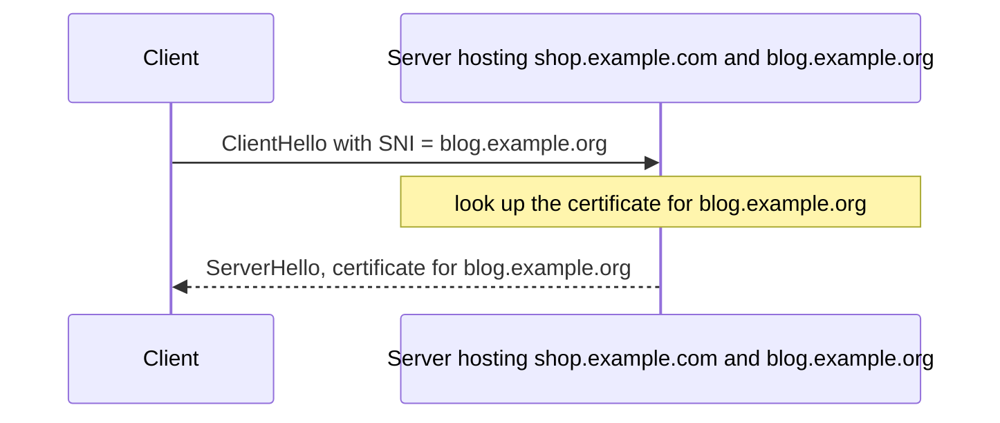
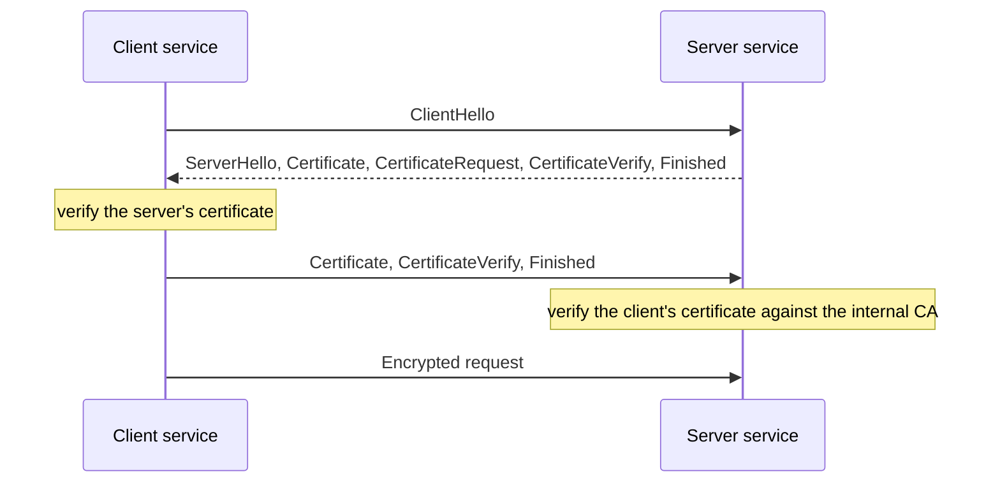

# TLS in practice: SNI, ALPN, resumption, HSTS, TLS 1.3 and mutual TLS

> **Before this lesson:** read [TLS: the handshake, certificates and chains of trust](#/lesson/networking/tls-handshake-certificates). You should know what a certificate, a key share and a round trip are.

## In plain words

The previous lesson covered the core of TLS: agree on keys, prove identity, encrypt. Real deployments add several practical features around that core, and each one answers a concrete question.

- One building, many companies: a visitor must tell reception which company they are visiting. Likewise one server address hosts many websites, so the client must say which one it wants. That is **SNI**.
- Two people meeting for the first time agree on a language before talking. Client and server agree on which version of HTTP to speak. That is **ALPN**.
- A hotel gives you a key card at check-in so you do not show your passport every time you come back. A returning client can skip most of the handshake. That is **session resumption**.
- A shop puts up a sign: "we only accept card payments, never cash". A site can tell browsers "only ever contact me over HTTPS". That is **HSTS**.
- At some doors both people show identification. When both the client and the server present certificates, that is **mutual TLS**.

Why this matters for a job: these are the names in configuration files, load-balancer settings and security reviews. You will choose where TLS is terminated, turn on HSTS, debug "wrong certificate served" problems (almost always SNI), and probably meet mutual TLS in any system built from many small services.

## SNI: which site do you want?

In the early web, one IP address meant one website. Today thousands of sites share an address at a hosting provider or CDN. That creates a puzzle: the server must send a certificate during the handshake, before any HTTP request (and therefore before the `Host` header) has been sent. Which certificate should it choose?

**SNI**, Server Name Indication, is a field in the ClientHello where the client writes the host name it is trying to reach. The server reads it and selects the matching certificate and configuration.



Two consequences:

- **A missing or wrong SNI gives you the wrong certificate.** If a client connects by IP address or a tool does not send SNI, the server falls back to a default certificate and the client reports a name mismatch. This is why `openssl s_client` needs `-servername`, and why testing a specific backend with curl uses `--resolve shop.example.com:443:203.0.113.80` rather than putting the IP address in the URL.
- **SNI is sent unencrypted.** The ClientHello comes before any keys exist, so an observer on the network can see which host name you are visiting even though everything after is hidden. A newer extension, **Encrypted Client Hello** (ECH), encrypts it using a public key that the site publishes in DNS; deployment is growing but not universal.

## ALPN: which protocol shall we speak?

Port 443 can carry HTTP/1.1 or HTTP/2 (and other protocols). Finding out which one the server supports by trying and failing would waste round trips.

**ALPN**, Application-Layer Protocol Negotiation, piggybacks on the handshake. The client lists the protocols it speaks in its ClientHello, as short identifiers; the server picks one and says so in its reply.

| Identifier | Protocol |
|---|---|
| `http/1.1` | HTTP/1.1 |
| `h2` | HTTP/2 |
| `h3` | HTTP/3 (negotiated inside QUIC's own TLS handshake) |

You saw this in an earlier `curl -v` trace:

```
* ALPN: curl offers h2,http/1.1        <- client's list, in order of preference
* ALPN: server accepted h2             <- server's choice
```

By the time the handshake ends, both sides know which protocol follows, at no extra cost. HTTP/3 runs over UDP rather than TCP, so a browser cannot discover it this way on the first visit; servers advertise it with an `Alt-Svc` response header or a DNS `HTTPS` record, and the browser uses it from the next connection on.

## Session resumption: skipping work on return visits

A full handshake involves public-key operations and a certificate chain of several kilobytes. A client that reconnects to the same server a minute later should not have to repeat all of it.

**Session resumption** lets the two sides reuse secrets from an earlier connection.

- In TLS 1.2 there were two mechanisms. With **session IDs** the server keeps a table of past sessions and the client quotes an identifier. With **session tickets** the server encrypts the session state with a key only it knows and hands the resulting blob (the ticket) to the client to store; the server keeps nothing per client, which suits large fleets of servers, provided they all share the ticket key.
- In TLS 1.3 the two are unified. After the handshake the server sends a ticket; on the next connection the client presents it as a **pre-shared key** (PSK). The certificate is not sent again and no signature is needed, saving CPU time and bytes. The round-trip count stays at one.

### 0-RTT: sending data immediately

TLS 1.3 goes a step further. A resuming client may encrypt its first request with a key derived from the ticket and send it **in the very first flight**, alongside the ClientHello. The server can answer without waiting. This is **0-RTT** or **early data**.

| Connection type | Round trips before the request can be sent |
|---|---|
| TLS 1.2, full handshake | 2 |
| TLS 1.2, resumed | 1 |
| TLS 1.3, full handshake | 1 |
| TLS 1.3, resumed | 1 (less CPU, fewer bytes) |
| TLS 1.3, resumed with 0-RTT | 0 |

There is a real danger. Early data is not protected against **replay**: an attacker who records that first flight can send it again, and the server may process the request twice. That is harmless for fetching a page and disastrous for "transfer 100 euros". The rule: allow 0-RTT only for requests that are safe to repeat (such requests are called **idempotent**, a term defined properly in the backend lessons), and reject or delay anything else. Servers and CDNs usually enforce this by permitting early data only for `GET` requests without side effects.

### Try it: what resumption saves

```python-run
def time_to_first_byte(rtt_ms, tls, resumed, zero_rtt=False, server_ms=20):
    tcp = 1                                   # the TCP handshake always costs one round trip
    if tls == "1.2":
        handshake = 1 if resumed else 2
    else:                                     # TLS 1.3
        handshake = 0 if (resumed and zero_rtt) else 1
    request = 1                               # request out, first response byte back
    return (tcp + handshake + request) * rtt_ms + server_ms

cases = [
    ("TLS 1.2 full",            "1.2", False, False),
    ("TLS 1.2 resumed",         "1.2", True,  False),
    ("TLS 1.3 full",            "1.3", False, False),
    ("TLS 1.3 resumed",         "1.3", True,  False),
    ("TLS 1.3 resumed + 0-RTT", "1.3", True,  True),
]
for rtt in (30, 150):
    print(f"RTT {rtt} ms")
    for label, version, resumed, zero in cases:
        print(f"   {label:26} {time_to_first_byte(rtt, version, resumed, zero):5} ms")
```

At 150 ms RTT (an ordinary mobile figure) the gap between the first and last row is 300 ms. Even better than any of these is not opening a new connection at all: a request on an already open connection costs one round trip.

## What TLS 1.3 changed

TLS 1.3 (2018) was a clean-up as much as an upgrade. The main points to be able to list:

1. **Faster.** One round trip for a full handshake instead of two; optional 0-RTT on resumption.
2. **Forward secrecy is mandatory.** Key exchange is always ephemeral Diffie-Hellman. The old method, in which the client encrypted a secret with the server's RSA public key, is gone, because with it one stolen server key decrypted all recorded past traffic.
3. **Weak algorithms removed.** RC4, 3DES, CBC-mode ciphers, MD5 and SHA-1 in the handshake, compression and renegotiation were all dropped. Only AEAD ciphers remain, and the list of cipher suites shrank from dozens to five.
4. **More of the handshake is encrypted.** Everything after ServerHello, including the server's certificate, is hidden from observers.
5. **Simpler negotiation.** A cipher suite now names only the encryption algorithm and hash; key exchange and signature algorithms are negotiated separately.
6. **Downgrade protection.** The handshake includes signals that reveal an attacker's attempt to force both sides back to an older version.

TLS 1.0 and 1.1 are obsolete and disabled in modern browsers. A reasonable server policy today is TLS 1.3 with TLS 1.2 as fallback.

## HSTS: never fall back to HTTP

Typing `shop.example.com` into a browser has traditionally meant a first request over plain `http://`, answered by a redirect to `https://`. That first request is unprotected. An attacker on the same network can intercept it and keep the victim on an unencrypted connection while talking HTTPS to the real site, an attack called **SSL stripping**. The user sees a working site and no warning.

**HSTS**, HTTP Strict Transport Security, closes the gap. The site sends a response header over HTTPS:

```
Strict-Transport-Security: max-age=31536000; includeSubDomains; preload
```

- `max-age=31536000`: for this many seconds (one year), the browser must use HTTPS for this host. Any `http://` URL is rewritten to `https://` inside the browser before a single packet leaves.
- `includeSubDomains`: apply the rule to every subdomain as well.
- `preload`: the owner's consent to be included in the **preload list**, a list of HSTS sites built into browsers themselves.

While the policy is active the browser also refuses to let the user click through certificate warnings for that host.

The remaining weakness is the very first visit, before the browser has ever seen the header. The preload list removes that: a preloaded site is HTTPS-only from the first request ever made.

```python-run
class Browser:
    """A tiny model of a browser's HSTS memory."""
    def __init__(self, preload=()):
        self.hsts = {host: float("inf") for host in preload}   # host -> expiry time

    def navigate(self, url, now):
        scheme, host = url.split("://")
        if scheme == "http" and self.hsts.get(host, 0) > now:
            return f"https://{host}  (upgraded inside the browser, nothing sent in clear)"
        if scheme == "http":
            return f"http://{host}   (sent in clear text: can be intercepted)"
        return f"https://{host}"

    def receive_header(self, host, max_age, now):
        self.hsts[host] = now + max_age        # remember the policy until now + max-age

b = Browser(preload=["bank.example"])
print("first visit       :", b.navigate("http://shop.example", now=0))
b.receive_header("shop.example", max_age=3600, now=0)       # header seen over HTTPS
print("later that hour   :", b.navigate("http://shop.example", now=1800))
print("after it expired  :", b.navigate("http://shop.example", now=7200))
print("preloaded site    :", b.navigate("http://bank.example", now=0))
```

> [!WARNING]
> Roll HSTS out gradually. Start with a short `max-age` such as 300 seconds, confirm that every subdomain really works over HTTPS, then raise it. A one-year policy with `includeSubDomains` cannot be withdrawn from browsers that already stored it; if a forgotten internal subdomain only speaks HTTP, those users are locked out of it. Removal from the preload list takes months.

Related browser behaviour: an HTTPS page that loads a script or stylesheet over `http://` has **mixed content**, and browsers block it, because one unencrypted script can take over the whole page.

## Mutual TLS: both sides prove who they are

In ordinary TLS only the server presents a certificate; the user proves identity later with a password or token. In **mutual TLS** (mTLS) the client presents a certificate too.



The additions: the server sends a **CertificateRequest**; the client replies with its own certificate and a signature made with its private key; the server validates that chain against a CA it trusts, which is usually a private CA run by the organisation, not a public one.

Where it is used:

- **Service-to-service traffic inside a company.** In a system of many small services (a microservice architecture), each service gets its own certificate. A service then knows cryptographically which other service is calling it, and access rules can say "only the orders service may call the payments service". This is the basis of **zero-trust** networking: nothing is trusted merely for being on the internal network. A **service mesh** (such as Istio or Linkerd) automates it by placing a small proxy next to every service that handles certificates and mTLS transparently.
- **Business-to-business APIs**, payment networks and device fleets, where each partner or device is issued a certificate.

Compared with an API key, a client certificate has two advantages: the secret (the private key) is never transmitted, and it cannot be replayed by someone who merely observed a request. The cost is operational: certificates must be issued, distributed, rotated and revoked for every client, which is only practical with automation and short lifetimes (hours or days).

## Where TLS ends: termination

Decrypting TLS is called **termination**. In an architecture with load balancers and proxies, you choose where it happens.

| Pattern | How it works | Trade-off |
|---|---|---|
| **Terminate at the edge** | The load balancer or CDN decrypts and forwards plain HTTP to backends | Simplest; certificates in one place; traffic inside the network is unencrypted |
| **Re-encrypt** | The edge decrypts, inspects, then opens a new TLS connection to the backend | Encrypted end to end between hops; the edge can still route by URL; more CPU |
| **Passthrough** | The load balancer forwards the encrypted bytes untouched, routing only by IP, port or SNI | Backend holds the keys; the balancer cannot see or modify HTTP |

The edge must decrypt if it is to do anything at the HTTP level: route by path, add headers, cache, compress. When it terminates TLS, the backend no longer sees the client's address or the original scheme, so the proxy passes them along in headers such as `X-Forwarded-For` and `X-Forwarded-Proto`.

## Making TLS fast

TLS is not the performance problem it once was; the encryption itself costs little on modern processors. What remains worth doing:

1. **Use TLS 1.3**: one round trip saved on every new connection.
2. **Enable resumption** and make sure all servers behind a load balancer share ticket keys, rotated regularly.
3. **Reuse connections**: keep-alive and HTTP/2 make most handshakes unnecessary.
4. **Terminate close to the user**: a handshake with a CDN node 15 ms away costs far less than one with an origin 150 ms away.
5. **Enable OCSP stapling** so clients need not contact the CA.
6. **Keep the certificate chain short and complete**: a chain that overflows the initial congestion window (about 14 kB) adds a round trip.
7. **Send HSTS** to eliminate the HTTP-to-HTTPS redirect on return visits.

> [!INTERVIEW]
> **"What are SNI and ALPN, and why are both in the ClientHello?"** SNI carries the host name so that a server with many sites on one address can choose the right certificate; ALPN carries the list of application protocols so that HTTP/2 or HTTP/1.1 is chosen during the handshake instead of afterwards. Both must be in the first message because the server needs them to compose its reply, and putting them there costs no extra round trip. Follow-ups to be ready for: SNI is visible to observers (ECH addresses this), and 0-RTT data can be replayed, so it is restricted to idempotent requests.

> [!TIP]
> A quick health check for any HTTPS endpoint: `curl -sv https://host/ -o /dev/null` and read four lines: the TLS version and cipher, the ALPN result, the certificate subject and expiry date, and whether `strict-transport-security` appears among the response headers.

## Pitfalls

- **Testing a server by IP address and blaming its certificate.** Without the right SNI you see the default certificate. Use `--resolve` or `-servername`.
- **Enabling 0-RTT for everything.** Replayable requests with side effects are a vulnerability.
- **Ticket keys that never rotate, or are not shared.** The first weakens forward secrecy; the second makes resumption fail whenever a client lands on a different server.
- **A long HSTS `max-age` on day one.** Mistakes cannot be recalled.
- **Assuming TLS termination at the edge means "encrypted end to end".** Check what happens between the edge and the backends.
- **Hard-coding ("pinning") a certificate in a client.** When the certificate is renewed, every client breaks. If pinning is truly required, pin a CA or a public key with a backup, and have a way to update it.
- **Treating mTLS as authorisation.** It tells you *who* is calling. You still need rules for *what* they may do.

## Summary

- SNI names the wanted host in the ClientHello so the right certificate can be served; it is visible on the network unless ECH is used.
- ALPN selects the application protocol (`h2`, `http/1.1`) during the handshake.
- Resumption reuses earlier secrets through tickets (a pre-shared key in TLS 1.3); 0-RTT sends data in the first flight but is replayable.
- TLS 1.3 is faster, always forward-secret, AEAD-only, and encrypts most of the handshake.
- HSTS makes browsers use HTTPS exclusively for a host; preload covers the first visit.
- Mutual TLS authenticates the client with a certificate and underpins zero-trust service communication.
- TLS can be terminated at the edge, re-encrypted to backends, or passed through.

## Glossary

- **SNI**: the ClientHello field naming the requested host.
- **ECH**: an extension that encrypts the ClientHello, including SNI.
- **ALPN**: the handshake extension for choosing the application protocol.
- **Alt-Svc**: a response header advertising another way to reach the same service, such as HTTP/3.
- **Session resumption**: reusing secrets from a previous connection.
- **Session ticket**: encrypted session state stored by the client.
- **Pre-shared key (PSK)**: a secret both sides already hold, used to resume.
- **0-RTT / early data**: application data sent in the first handshake flight.
- **Replay**: an attacker re-sending captured data to have it processed again.
- **HSTS**: a policy forcing browsers to use HTTPS for a host.
- **Preload list**: HSTS hosts built into browsers.
- **SSL stripping**: keeping a victim on HTTP by intercepting the first insecure request.
- **Mixed content**: insecure sub-resources on a secure page.
- **Mutual TLS (mTLS)**: TLS in which the client also presents a certificate.
- **Zero trust**: authenticating every connection instead of trusting the internal network.
- **Service mesh**: infrastructure that handles service-to-service traffic, often with automatic mTLS.
- **TLS termination / passthrough**: decrypting at a proxy / forwarding encrypted traffic untouched.

## Check yourself

```quiz
[
  {"q": "A server hosts 200 sites on one IP address. How does it know which certificate to present?",
   "options": ["From the HTTP Host header", "From the SNI field in the ClientHello", "From the client's IP address", "It sends all 200 certificates"], "answer": 1,
   "explain": "The certificate is needed before any HTTP is exchanged, so the host name is carried in the TLS ClientHello as SNI."},
  {"q": "What does ALPN negotiate?",
   "options": ["The TLS version", "The application protocol, such as HTTP/2 or HTTP/1.1", "The certificate authority", "The session ticket lifetime"], "answer": 1,
   "explain": "The client offers protocol identifiers such as h2 and http/1.1 and the server selects one during the handshake."},
  {"q": "Why must 0-RTT early data be limited to idempotent requests?",
   "options": ["It is not encrypted", "An attacker can capture and replay it, causing the request to be processed again", "It bypasses certificate validation", "It only works over UDP"], "answer": 1,
   "explain": "Early data lacks replay protection. Repeating a safe read is harmless; repeating a payment is not."},
  {"q": "Which statement about TLS 1.3 is true?",
   "options": ["It still allows RSA key exchange without forward secrecy", "It requires two round trips for a full handshake", "Key exchange is always ephemeral, so forward secrecy is mandatory", "The server certificate is sent in clear text"], "answer": 2,
   "explain": "TLS 1.3 removed static RSA key exchange, completes in one round trip, and encrypts the certificate."},
  {"q": "A browser has stored an HSTS policy for shop.example. The user types http://shop.example. What happens?",
   "options": ["An HTTP request is sent and the server redirects", "The browser rewrites the URL to https before sending anything", "The browser shows an error page", "The DNS lookup is skipped"], "answer": 1,
   "explain": "With an active HSTS policy the upgrade happens inside the browser, so no unencrypted request ever leaves the machine."},
  {"q": "What problem does the HSTS preload list solve?",
   "options": ["Expired certificates", "The unprotected first visit before the browser has seen the HSTS header", "Slow DNS lookups", "Missing intermediates"], "answer": 1,
   "explain": "A preloaded host is treated as HTTPS-only from the very first request, removing the window for SSL stripping."},
  {"q": "In mutual TLS, what extra step occurs compared with ordinary TLS?",
   "options": ["The server sends two certificates", "The client presents its own certificate and proves possession of its private key", "The handshake runs over UDP", "The cipher suite is negotiated twice"], "answer": 1,
   "explain": "The server sends a CertificateRequest and the client answers with a certificate and a signature, which the server validates against a trusted CA."},
  {"q": "A load balancer must route requests by URL path. Which TLS arrangement makes that impossible?",
   "options": ["Terminating TLS at the load balancer", "Re-encrypting to the backends", "TLS passthrough", "Using TLS 1.3"], "answer": 2,
   "explain": "With passthrough the balancer forwards encrypted bytes and cannot read the HTTP request, so it can route only by address, port or SNI."}
]
```

> **Source:** Grigorik, *High Performance Browser Networking*, ch. 4 "Transport Layer Security" (SNI, ALPN, resumption, HSTS and optimisation topics; coverage only), https://hpbn.co/transport-layer-security-tls/ . Facts checked against RFC 8446 (TLS 1.3 and 0-RTT), RFC 6066 (SNI), RFC 7301 (ALPN), RFC 6797 (HSTS) and MDN's Strict-Transport-Security page (https://developer.mozilla.org/en-US/docs/Web/HTTP/Reference/Headers/Strict-Transport-Security).
