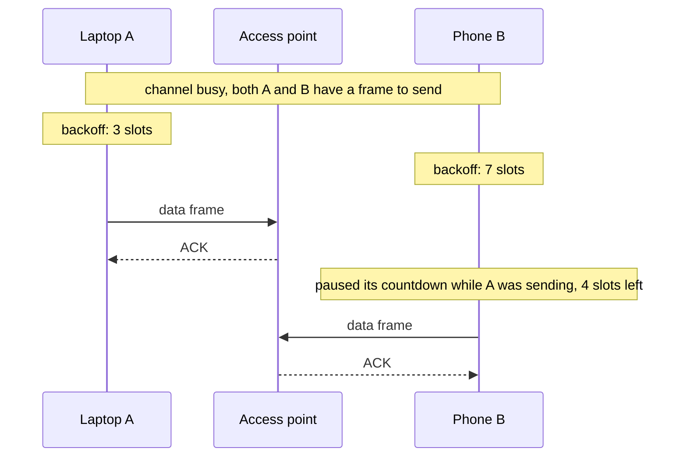

# Wireless fundamentals and Wi-Fi

> **Before this lesson:** you need frames, MAC addresses and switches from [Ethernet, MAC addresses, ARP and switching](#/lesson/networking/ethernet-arp-switching), and latency, jitter and packet loss from [Latency and bandwidth](#/lesson/networking/latency-bandwidth). The TCP reaction to loss from [Flow control and congestion control](#/lesson/networking/tcp-flow-congestion) helps for the last sections.

## In plain words

A network cable is a private corridor between two devices: whatever one end says, only the other end hears, clearly. Radio is nothing like that. **Wireless** networking means sending data as radio waves through open air, and the air is shared by everyone nearby.

Picture a crowded room where people are trying to hold conversations. Everyone shares the same air. If two people speak at once, a listener between them understands neither. The further away the speaker, the fainter the voice. Background noise forces everybody to talk slower and repeat themselves. And politeness rules are needed: wait for a pause before speaking, and if you start at the same moment as someone else, both stop and try again a little later.

Every one of those observations has an exact counterpart in Wi-Fi: a **shared medium**, **collisions**, **signal strength** that falls with distance, **noise** that lowers the data rate, and a turn-taking rule called **CSMA/CA**.

Why this matters for a job: most users reach your product over Wi-Fi or a mobile network, not over a cable. The figures you measure from a wired office or a data centre are the best case. Understanding why wireless latency is variable, why packets are lost, and why "five bars" does not mean "fast" lets you design applications that stay usable in a café, on a train, or in a flat with twenty neighbouring networks.

## Radio in five ideas

### 1. Frequency and bands

Radio waves are described by their **frequency**: how many times per second the wave oscillates, measured in hertz (Hz). A gigahertz (GHz) is a billion per second. Governments divide the range of frequencies, the **spectrum**, into **bands** and decide who may use each. Most bands are licensed to a specific operator. A few are **unlicensed**: anyone may transmit there at low power. Wi-Fi lives in three unlicensed bands.

| Band | Reach and wall penetration | Capacity | Crowding |
|---|---|---|---|
| 2.4 GHz | longest range, passes walls best | lowest | heavy: also used by Bluetooth, microwave ovens, baby monitors |
| 5 GHz | shorter range | high | moderate |
| 6 GHz (Wi-Fi 6E and later) | shortest range | highest | light, for now |

The rule of thumb: lower frequencies travel further and through obstacles; higher frequencies carry more data but fade faster.

### 2. Channels and channel width

Each band is cut into **channels**: slices of frequency a network can occupy. A wider channel carries more data per second, as a wider road carries more cars. Wi-Fi channels are 20, 40, 80 or 160 megahertz (MHz) wide.

The 2.4 GHz band is narrow: in most countries only three 20 MHz channels (numbered 1, 6 and 11) fit without overlapping. In a block of flats, dozens of networks share those three. The 5 GHz and 6 GHz bands have many more, which is the main reason they perform better in cities.

### 3. Signal strength

The power of a received signal is measured in **dBm** (decibels relative to one milliwatt). The numbers are negative, and closer to zero is stronger. The scale is logarithmic: every drop of 3 dB halves the power, every drop of 10 dB divides it by ten.

| Received signal | Quality |
|---|---|
| −30 to −50 dBm | excellent (near the access point) |
| −60 dBm | good |
| −70 dBm | usable; rates start to fall |
| −80 dBm | poor; frequent retransmission |
| −90 dBm | barely distinguishable from noise |

Signal weakens rapidly with distance and with every wall, floor, mirror or body of water (including people) in the way.

### 4. Noise and the signal-to-noise ratio

What matters is not the signal alone but how far it stands above the background **noise**: other transmitters, electrical equipment, natural radio noise. The **signal-to-noise ratio** (SNR) is the gap between the two, in decibels. A signal of −60 dBm with a noise floor of −90 dBm has an SNR of 30 dB.

### 5. The capacity limit

A formula by Claude Shannon gives the maximum rate at which data can be sent reliably over a channel:

$$C = B \times \log_2(1 + \text{SNR})$$

where $C$ is the capacity in bits per second, $B$ is the channel width in hertz, and SNR is the signal-to-noise ratio as a plain ratio (not in decibels). You do not need to compute it by hand. The message is that there are only two ways to go faster: **use a wider channel** or **improve the signal-to-noise ratio**. Everything in wireless engineering, from better antennas to moving closer to the router, pulls one of those two levers.

```python-run
import math

def capacity_mbps(width_mhz, snr_db):
    snr_ratio = 10 ** (snr_db / 10)                 # decibels -> plain ratio
    bits_per_second = width_mhz * 1_000_000 * math.log2(1 + snr_ratio)
    return bits_per_second / 1_000_000

print("width   SNR    theoretical maximum")
for width in (20, 80, 160):
    for snr in (10, 20, 30):
        print(f"{width:3} MHz  {snr:2} dB  {capacity_mbps(width, snr):8.0f} Mbps")
```

Read across the output: quadrupling the width (20 to 80 MHz) quadruples the limit, while adding 10 dB of SNR adds a fixed amount each time. Real equipment achieves a fraction of these figures, but the shape of the relationship is what counts.

How does a radio actually use a better SNR? Through **modulation**: the way bits are encoded into the wave. With a clean signal, the radio packs many bits into each transmitted symbol; with a noisy one it must use a simpler, slower encoding that is easier to tell apart. Wi-Fi devices continuously pick the fastest encoding the current conditions allow. This is **rate adaptation**, and it is why the link speed shown by your laptop changes as you walk around.

## How Wi-Fi shares the air

**Wi-Fi** is the family of standards known formally as IEEE 802.11. A typical network has an **access point** (AP), a device that bridges wireless clients to a wired network, and a number of client devices (called stations). The network's name is its **SSID** (service set identifier). A client joins by **associating** with an AP. Wi-Fi frames resemble Ethernet frames, with MAC addresses, and to the IP layer above a Wi-Fi network looks the same as Ethernet.

| Marketing name | Standard | Year | Bands | Headline feature |
|---|---|---|---|---|
| Wi-Fi 4 | 802.11n | 2009 | 2.4 and 5 GHz | several antennas at once (MIMO) |
| Wi-Fi 5 | 802.11ac | 2013 | 5 GHz | wider channels |
| Wi-Fi 6 / 6E | 802.11ax | 2019 / 2020 | 2.4, 5 (and 6) GHz | efficient sharing among many devices (OFDMA) |
| Wi-Fi 7 | 802.11be | 2024 | 2.4, 5, 6 GHz | 320 MHz channels, several links at once |

The advertised rates ("1200 Mbps") are theoretical link rates under ideal conditions with the widest channel and several antennas. Real throughput is commonly well under half of that.

### CSMA/CA: listen before talking

On a shared channel only one device can transmit usefully at a time; simultaneous transmissions garble each other, a **collision**. Wi-Fi's turn-taking rule is **CSMA/CA**: carrier sense multiple access with collision avoidance. In steps:

1. **Listen.** Before sending, a device checks whether the channel is busy.
2. **Wait if busy.** It waits until the channel has been idle for a short fixed gap.
3. **Back off randomly.** It then waits an additional random number of time slots. This is the key trick: if several devices were all waiting for the same transmission to end, random delays make it unlikely that two start at the same instant.
4. **Send.**
5. **Wait for an acknowledgement.** The receiver immediately answers every data frame with a link-layer ACK.
6. **No ACK? Assume a collision.** Double the range of the random wait and try again, up to a retry limit, after which the frame is dropped.

Wired Ethernet's old scheme (CSMA/CD) could *detect* collisions while transmitting. A radio cannot: its own transmission drowns out anything it might hear. So Wi-Fi works to *avoid* collisions and relies on acknowledgements to find out whether a frame got through.



### Try it: contention grows with the crowd

The simulation below models rounds of contention: each device that has something to send picks a random backoff. If exactly one device has the smallest value, it transmits successfully. If two or more tie, they collide and that airtime is wasted. Watch the collision rate climb as devices are added.

```python-run
import random

def simulate(devices, rounds=20000, slots=16, seed=7):
    rng = random.Random(seed)              # fixed seed so the output is repeatable
    success = collisions = 0
    for _ in range(rounds):
        picks = [rng.randrange(slots) for _ in range(devices)]   # each device picks a backoff
        smallest = min(picks)
        if picks.count(smallest) == 1:     # one clear winner
            success += 1
        else:                              # two or more chose the same slot
            collisions += 1
    return success / rounds, collisions / rounds

print("devices  successful  collided")
for n in (1, 2, 5, 10, 20, 40):
    ok, bad = simulate(n)
    print(f"{n:7}  {ok:9.1%}  {bad:8.1%}")
```

With two devices about 6% of attempts collide; with forty, most do. Real Wi-Fi widens the backoff range after each collision, which helps, but the lesson stands: **a channel's capacity is shared by every device on it, including devices on neighbouring networks using the same channel**, and efficiency falls as the crowd grows.

### The hidden node problem

Listening first only works if you can hear the other transmitters. Suppose laptop A and phone B are at opposite ends of a house, each within range of the access point in the middle but out of range of each other. Each hears a quiet channel and transmits; their frames collide at the access point. This is the **hidden node** problem. Wi-Fi offers an optional handshake to mitigate it: a device sends a short "request to send" (RTS), the access point answers with "clear to send" (CTS), and every device that hears the CTS stays silent for the announced duration.

## What this does to your packets

Here is the part that matters to application developers.

**Loss becomes delay.** The link layer retransmits unacknowledged frames several times before giving up. From the viewpoint of IP and TCP above, most radio-level losses are therefore not losses at all: the packet arrives, late. A frame that needed four attempts might take 20 ms instead of 1 ms.

**Latency is variable.** Waiting for a clear channel, random backoff, retransmissions and rate changes all add unpredictable delay. A wired link might show a steady 1 ms to the router; a busy Wi-Fi link shows 2 ms, then 40 ms, then 5 ms. This is jitter at the first hop, before the Internet is even involved.

**Throughput has no guarantee.** Your share depends on signal quality, on how many others are active on the channel, and on what they are doing. A slow, distant device hurts everyone: it occupies the channel for a long time to send each frame at its low rate.

**Residual loss confuses TCP.** When retries are exhausted the packet is dropped. Classic TCP congestion control reads that as "the network is congested" and halves its window, even though the cause was a burst of radio noise. This mismatch is one motivation for newer algorithms such as BBR.

A ping to the local router makes the first-hop behaviour visible:

```
$ ping -c 6 192.168.1.1
64 bytes from 192.168.1.1: icmp_seq=1 ttl=64 time=2.1 ms
64 bytes from 192.168.1.1: icmp_seq=2 ttl=64 time=3.4 ms
64 bytes from 192.168.1.1: icmp_seq=3 ttl=64 time=48.9 ms    <- waited for the channel or was retransmitted
64 bytes from 192.168.1.1: icmp_seq=4 ttl=64 time=2.6 ms
64 bytes from 192.168.1.1: icmp_seq=6 ttl=64 time=117.3 ms   <- seq 5 never arrived: retries exhausted
6 packets transmitted, 5 received, 16% packet loss, min/avg/max = 2.1/34.9/117.3 ms
```

On a wired connection the same test would show well under 1 ms every time. When diagnosing "the Internet is slow", pinging the local router first separates a Wi-Fi problem from everything beyond it.

## Roaming and security in brief

**Roaming.** Larger sites use many access points with the same SSID. A client decides for itself when to move to a stronger one. Clients often cling to a weak access point too long (a "sticky client"), giving poor performance while standing next to a better one. During a hand-over, packets are delayed or lost for a fraction of a second.

**Security.** Radio travels through walls, so anyone nearby can capture the frames. Encryption at the link layer is essential:

- **WPA2** has been the baseline since the mid-2000s. In its home form everyone shares one passphrase.
- **WPA3** is its successor; it resists offline password guessing and gives each session forward secrecy.
- **Open networks** (no password) historically encrypted nothing. Treat them as hostile.

Wi-Fi encryption protects only the hop between your device and the access point. Whoever runs the network, and everyone beyond it, sees the traffic as usual. That is why TLS is needed regardless of how the Wi-Fi is secured.

## Designing applications for Wi-Fi

- **Expect variability.** Do not base timeouts or quality settings on a single good measurement. Measure continuously and adapt.
- **Adapt the bitrate.** Video and audio services encode content at several quality levels and switch between them as measured throughput changes (**adaptive bitrate streaming**).
- **Tolerate jitter.** Real-time applications use a small **jitter buffer**: they hold incoming audio or video for a few tens of milliseconds so that playback can stay smooth when packets arrive unevenly.
- **Use Wi-Fi for heavy lifting.** Wi-Fi is usually **unmetered** (no charge per megabyte) and costs a phone much less battery per megabyte than a cellular connection. Mobile apps schedule large uploads, backups and updates for when Wi-Fi is available.
- **Make requests resumable and retryable.** Connections drop when users walk out of range or roam. A large download should be able to continue from where it stopped (HTTP range requests), and requests should be safe to repeat.
- **Reduce round trips.** Every round trip is exposed to first-hop jitter; fewer of them means fewer chances to hit a slow one.

> [!INTERVIEW]
> **"Why is Wi-Fi slower and less predictable than Ethernet, even with a strong signal?"** The medium is shared: every device on the channel, including neighbours' networks, takes turns under CSMA/CA, and time spent waiting or colliding is lost. The radio cannot detect collisions, so each frame needs an acknowledgement and failed frames are retransmitted at the link layer, which turns loss into variable delay. The data rate adapts to the signal-to-noise ratio, so distance and interference lower it. Signal strength alone says nothing about contention.

> [!TIP]
> "Full bars" measures signal strength only. A strong signal on a channel shared with thirty busy devices can be much slower than a modest signal on a quiet one. For a quick diagnosis compare ping times to the router, then to a public address.

> [!WARNING]
> Do not conclude from office tests that your application is fast. Test on a congested 2.4 GHz network and on a throttled, lossy profile (browser developer tools and operating systems provide network conditioners). Problems that never appear on a wired desk appear at once.

## Pitfalls

- **Equating link rate with throughput.** The rate shown by the operating system is the current modulation rate, before contention, overhead and retransmission.
- **Assuming packet loss is absent on Wi-Fi.** It is mostly hidden as delay, and partly passed up as real loss.
- **Using wide channels in crowded areas.** A 160 MHz channel overlaps more neighbours; a narrower one can perform better.
- **Adding access points on the same channel.** They contend with each other. Extra access points help only on different channels.
- **Thinking the Wi-Fi password protects your traffic from the network's operator.** It protects one hop.
- **Ignoring the slowest device.** One old or distant device lowers the capacity available to all.

## Summary

- Radio is a shared, noisy medium. Capacity depends on channel width and signal-to-noise ratio.
- Wi-Fi uses unlicensed bands at 2.4, 5 and 6 GHz: lower frequencies reach further, higher ones carry more and are less crowded.
- CSMA/CA: listen, wait, back off randomly, send, expect an ACK, retry with a longer backoff.
- Contention, hidden nodes, interference and rate adaptation make throughput and latency variable; link-layer retransmission converts loss into jitter.
- Applications should measure and adapt, buffer against jitter, prefer Wi-Fi for bulk transfers, and survive drops.

## Glossary

- **Wireless / radio**: communication by electromagnetic waves through the air.
- **Frequency, spectrum, band**: oscillations per second; the full range of frequencies; a regulated slice of it.
- **Unlicensed band**: frequencies anyone may use at low power.
- **Channel / channel width**: the slice of a band a network occupies / its size in MHz.
- **dBm**: a logarithmic unit of signal power.
- **Noise / SNR**: unwanted radio energy / the gap between signal and noise.
- **Modulation**: how bits are encoded onto a radio wave.
- **Rate adaptation**: choosing the fastest encoding current conditions permit.
- **Wi-Fi (802.11)**: the family of wireless LAN standards.
- **Access point (AP)**: the device connecting wireless clients to a wired network.
- **SSID**: a Wi-Fi network's name.
- **Collision**: overlapping transmissions that destroy each other.
- **CSMA/CA**: listen-before-talk access with random backoff and acknowledgements.
- **Backoff**: a random wait before transmitting.
- **Hidden node**: two devices that cannot hear each other but share a receiver.
- **RTS/CTS**: an optional reservation handshake.
- **Roaming**: a client moving between access points.
- **WPA2 / WPA3**: Wi-Fi link encryption standards.
- **Adaptive bitrate streaming**: switching media quality to match throughput.
- **Jitter buffer**: a short delay that smooths uneven arrival.
- **Unmetered**: not charged by data volume.

## Check yourself

```quiz
[
  {"q": "According to Shannon's formula, which two factors determine the maximum data rate of a radio channel?",
   "options": ["Number of devices and distance", "Channel width and signal-to-noise ratio", "Frequency band and encryption", "MTU and TTL"], "answer": 1,
   "explain": "Capacity equals bandwidth times log2(1 + SNR). Wider channels or a cleaner signal are the only ways to raise it."},
  {"q": "Why does Wi-Fi use collision avoidance (CSMA/CA) instead of collision detection?",
   "options": ["Detection is patented", "A transmitting radio cannot hear other signals over its own transmission", "Collisions do not happen on radio", "Wi-Fi frames have no addresses"], "answer": 1,
   "explain": "A radio's own signal overwhelms its receiver, so it cannot notice a collision while sending. It relies on listening first, random backoff and acknowledgements."},
  {"q": "What is the purpose of the random backoff in CSMA/CA?",
   "options": ["To save battery", "To make it unlikely that several waiting devices start transmitting at the same instant", "To encrypt the frame", "To measure the signal strength"], "answer": 1,
   "explain": "Devices that were all waiting for the channel would otherwise transmit together the moment it became free."},
  {"q": "A packet over Wi-Fi takes 45 ms to reach the router instead of the usual 2 ms, but is not lost. What most likely happened?",
   "options": ["The TTL expired", "The frame waited for the channel or was retransmitted at the link layer", "DNS was slow", "The MTU was exceeded"], "answer": 1,
   "explain": "Wi-Fi retries unacknowledged frames, so radio-level loss usually appears to upper layers as extra delay."},
  {"q": "Which band generally offers the longest range and best wall penetration?",
   "options": ["2.4 GHz", "5 GHz", "6 GHz", "They are identical"], "answer": 0,
   "explain": "Lower frequencies propagate further and pass through obstacles better, at the cost of less capacity and more crowding."},
  {"q": "Two laptops are each in range of the access point but not of each other, and their frames keep colliding. What is this called?",
   "options": ["Bufferbloat", "The hidden node problem", "Rate adaptation", "A broadcast storm"], "answer": 1,
   "explain": "Neither can sense the other's transmission, so listening first does not help. RTS/CTS is the optional remedy."},
  {"q": "Your phone shows a very strong Wi-Fi signal, yet downloads are slow. Which explanation fits best?",
   "options": ["Strong signals reduce throughput", "The channel is shared with many active devices, so little airtime is left", "The SSID is too long", "IPv6 is disabled"], "answer": 1,
   "explain": "Signal strength does not measure contention. Airtime is divided among all transmitters on the channel."},
  {"q": "Why should a mobile app prefer Wi-Fi for large background uploads?",
   "options": ["Wi-Fi never loses packets", "It is usually unmetered and uses less energy per megabyte than cellular", "Wi-Fi has a larger MTU", "Cellular networks block uploads"], "answer": 1,
   "explain": "Wi-Fi is typically free of data charges and cheaper in battery terms, so deferring bulk transfers to Wi-Fi is standard practice."}
]
```

> **Source:** Grigorik, *High Performance Browser Networking*, ch. 5 "Introduction to Wireless Networks" and ch. 6 "WiFi" (online edition, topic coverage only; these chapters are not in the extracted special edition), https://hpbn.co/wifi/ . Facts checked against the IEEE 802.11 overview on Wikipedia (https://en.wikipedia.org/wiki/IEEE_802.11) and the Wi-Fi Alliance generation descriptions (https://www.wi-fi.org/discover-wi-fi).
