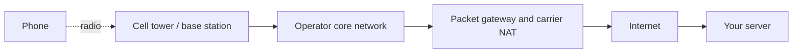
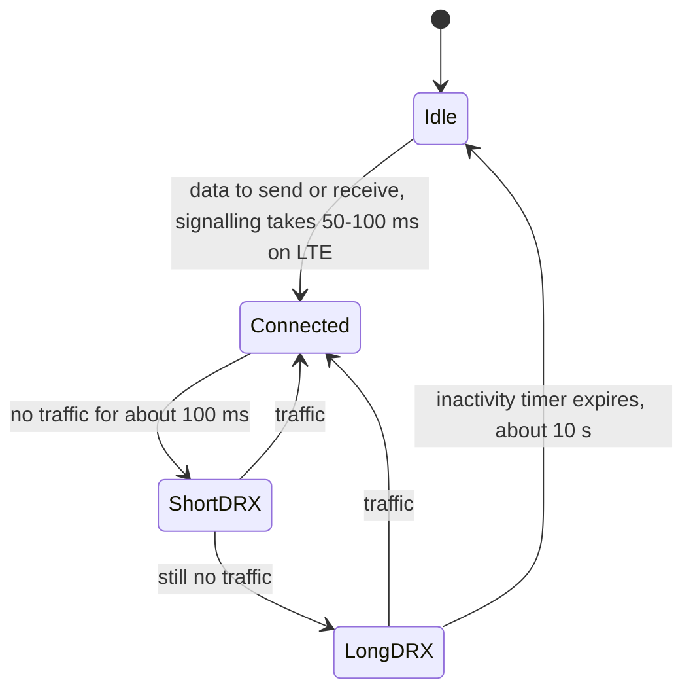
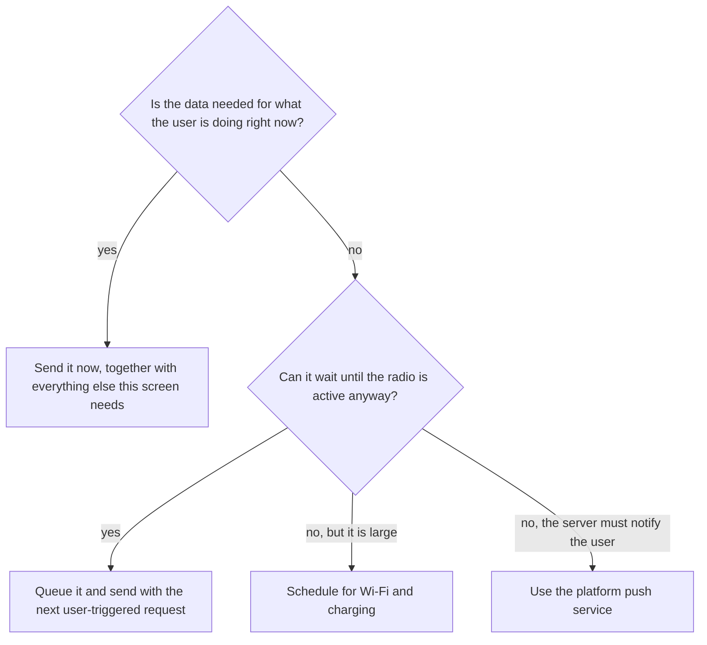

# Mobile networks: radio states, battery and latency

> **Before this lesson:** read [Wireless fundamentals and Wi-Fi](#/lesson/networking/wifi) for spectrum, signal quality and why radio links vary. NAT and idle timeouts from [IPv4 addressing, subnets, CIDR and NAT](#/lesson/networking/ipv4-subnets-nat) and connection setup costs from [What happens when you type a URL](#/lesson/networking/url-walkthrough) are also used.

## In plain words

A phone is connected to the Internet almost anywhere, through **cellular** (mobile) networks: 3G, 4G, 5G. From an application's point of view it looks like any other connection. Underneath, it behaves very differently from Wi-Fi, for one reason: **the battery**.

A phone's radio transmitter is one of its most power-hungry parts. Kept fully on, it would empty the battery in a few hours. So the phone and the network cooperate to switch the radio into a low-power sleep whenever there is nothing to send, and to wake it when needed.

Think of a car engine with automatic stop-start. Stopping at lights saves fuel, but pulling away takes a moment longer because the engine must restart. And if the system keeps the engine running for 10 seconds after each stop "in case you move again", then a driver who creeps forward a metre every 9 seconds never lets it switch off at all.

That is exactly the situation of a mobile app. Waking the radio costs time (extra latency on the first request). After the last packet the radio stays in a high-power state for several seconds (wasted energy called the **tail**). And an app that sends a tiny message every few seconds keeps the radio awake permanently and ruins the battery, while transferring almost nothing.

Why this matters for a job: anyone building a mobile app, or a backend that serves one, needs this model. It explains why the first request after a pause is slow, why periodic polling is harmful, and why "batch your requests" is the central rule of mobile networking. It is also a well-liked interview topic for mobile and full-stack roles because few candidates can explain it.

## The generations

Each generation of cellular technology (the "G") brought higher rates and lower delay. The figures below are typical real-world values, not advertised peaks, and vary widely with signal and load.

| Generation | Common names | Typical download | Typical added latency | Notes |
|---|---|---|---|---|
| 2G | GSM, EDGE | 0.1–0.4 Mbps | 300–1000 ms | voice first; data painfully slow |
| 3G | UMTS, HSPA | 0.5–5 Mbps | 100–500 ms | first usable mobile Internet |
| 4G | LTE, LTE-Advanced | 5–100 Mbps | 30–100 ms | all traffic is IP packets, including voice |
| 5G | NR | 50–1000+ Mbps | 10–40 ms | new bands; much lower delay possible |

Two cautions. First, a "5G" icon tells you little: 5G on low frequencies behaves like good 4G with wide coverage, while 5G on very high frequencies (**millimetre wave**) is extremely fast but reaches only a few hundred metres and is blocked by walls and even rain. Second, users in much of the world, and all users at the edge of coverage, are still on slower connections. Design for the slow case and treat the fast case as a bonus.

## How a mobile network is put together



- The area served by one antenna site is a **cell**; the equipment is a **base station** (cell tower). All phones in the cell share its radio capacity. The collection of towers is the **radio access network** (RAN).
- Towers connect back to the operator's **core network**, which authenticates subscribers, tracks which cell each phone is in, and applies policy and billing.
- Traffic leaves the operator through a **packet gateway**. The phone's IP address is assigned here, and almost always it is a private address behind **carrier-grade NAT**: thousands of phones share each public address.

Consequences for engineers:

- **Your server sees the gateway, not the phone.** Many unrelated users appear from one IP address, so per-address rate limits and blocks hit innocent people. The phone's apparent location is where the gateway is, which may be a different city.
- **Inbound connections to a phone are impossible.** To reach an app, a server uses the platform's push service (Apple's APNs, Google's FCM), which the operating system keeps reachable over one shared, carefully managed connection.
- **The path may be indirect.** Packets travel from the tower to the core and gateway, wherever those are, before reaching the Internet. A server next door to the user can still be 50 ms away.
- **Idle connections are forgotten.** Carrier NATs drop idle mappings, sometimes after only a minute or two.
- **The address changes** when a phone moves between Wi-Fi and cellular. TCP connections are tied to addresses, so they break. QUIC connections can survive (see the HTTP/3 lesson).

Unlike Wi-Fi's free-for-all, a cellular base station **schedules** every transmission: it tells each phone exactly when and on which frequencies to send and receive. This uses the spectrum efficiently and avoids collisions, but it means a phone must be in contact with the tower and hold an allocation before it can send anything. That requirement leads to the state machine at the heart of this lesson.

## The radio state machine

The component in charge is the **Radio Resource Controller** (RRC), a protocol between phone and tower. It keeps the radio in one of a small number of states. In 4G/LTE, simplified:

| State | Radio | Power | Can data flow? |
|---|---|---|---|
| **Idle** | asleep; wakes briefly at intervals to check for incoming notifications | very low | no; must first be promoted |
| **Connected** (active) | fully on, resources allocated | high | yes, immediately |
| **Connected, discontinuous reception** (DRX) | sleeps in short cycles, still registered with the tower | medium | yes, after a short wake-up |

Transitions:



Three numbers govern everything:

1. **Promotion delay.** Going from idle to connected needs an exchange of control messages with the tower before the first data packet can leave. On LTE this takes roughly 50 to 100 ms. On 3G it was 1 to 2 seconds. On 5G it is designed to be under 10 ms. This delay is added *before* the DNS lookup, TCP handshake and TLS handshake you already know.
2. **Inactivity timer.** After the last packet, the network keeps the phone in a connected state for a while, typically around 10 seconds on LTE, betting that more traffic will follow soon and wanting to avoid the cost of another promotion.
3. **Tail energy.** During that timer the radio burns power while transferring nothing. For a short exchange, the tail consumes far more energy than the transfer itself.

### What one small request really costs

Suppose an app sends a 1 kB analytics ping.

| Phase | Duration | Radio power |
|---|---|---|
| Promotion: idle to connected | ~0.1 s | high |
| Transfer of the request and response | ~0.2 s | high |
| Tail: waiting for the inactivity timer | ~10 s | high, then medium |
| Back to idle | | very low |

About 0.3 seconds of useful activity cost more than 10 seconds of elevated power. Now repeat that every 15 seconds, which a naive "keep the dashboard fresh" timer does. The radio never reaches idle. The phone gets warm and the battery drains several times faster than it should, for a trickle of data.

### Try it: polling versus batching

The simulation walks through a 10-minute period one tenth of a second at a time, tracking the radio state, and adds up the energy used. The power figures are illustrative round numbers in milliwatts, in a realistic proportion to each other.

```python-run
POWER = {"idle": 10, "connected": 1200, "tail": 600}   # milliwatts, illustrative
TAIL_SECONDS = 10.0          # the inactivity timer
TRANSFER_SECONDS = 0.5       # promotion + a small request and response

def energy_joules(request_times, total_seconds=600):
    """Total radio energy for a list of request start times (in seconds)."""
    step = 0.1
    busy_until = -1.0        # end of the current transfer
    tail_until = -1.0        # end of the current tail
    pending = sorted(request_times)
    energy_mj = 0.0
    connected_time = 0.0
    t = 0.0
    while t < total_seconds:
        while pending and pending[0] <= t:          # a request starts now
            pending.pop(0)
            busy_until = max(busy_until, t) + TRANSFER_SECONDS
        if t < busy_until:
            state = "connected"
            tail_until = busy_until + TAIL_SECONDS  # the tail restarts after every transfer
        elif t < tail_until:
            state = "tail"
        else:
            state = "idle"
        if state != "idle":
            connected_time += step
        energy_mj += POWER[state] * step
        t += step
    return energy_mj / 1000, connected_time

polling  = [i * 15 for i in range(40)]                 # one small request every 15 s
batched  = [i * 150 for i in range(4) for _ in range(10)]   # the same 40 requests, sent 10 at a time

for name, plan in (("poll every 15 s", polling), ("batch every 150 s", batched)):
    joules, awake = energy_joules(plan)
    print(f"{name:18}  energy {joules:6.1f} J   radio awake {awake:5.0f} s of 600 s")
```

Both plans send the same forty requests. The polling plan keeps the radio out of idle for most of the ten minutes; the batched plan wakes it four times. The energy differs by several times. The exact ratio depends on the assumed figures, but the conclusion does not: **what costs energy is the number of times the radio wakes, not the number of bytes**.

## Latency: adding it all up

For the first request after a quiet period, on LTE with an 80 ms round trip to the server:

| Step | Cost |
|---|---|
| Radio promotion (idle → connected) | ~100 ms |
| DNS lookup | ~80 ms |
| TCP handshake | 80 ms |
| TLS 1.3 handshake | 80 ms |
| HTTP request and first byte | 80 ms + server time |
| **Total** | **~420 ms + server time** |

On a 3G connection with a 300 ms round trip and a 1.5 s promotion, the same sequence is around 2.7 seconds before the first byte. On top of this, mobile latency is highly variable: signal strength changes as the user moves, the cell's capacity is shared with everyone nearby, and **hand-overs** between cells pause traffic briefly.

Each row suggests its own remedy: keep the radio warm when a burst of work is coming, cache DNS answers, reuse connections, resume TLS sessions, and put servers or a CDN near users.

## Rules for mobile-friendly networking

**1. Batch and coalesce.** Group requests so that the radio wakes once and does everything. Non-urgent items (analytics, logs, read receipts) should be queued and sent together with the next request the user actually triggers.

**2. Never poll on a timer for things that rarely change.** Use **push**: the server sends a notification through the platform push service only when there is news. One shared connection, maintained by the operating system for all apps, replaces a private timer in every app.

**3. Finish in one burst.** If the user opens a screen, fetch everything it will need now while the radio is already on, including likely next steps (**prefetching**), instead of dribbling requests out over the next thirty seconds and extending the tail each time.

**4. Do not defeat the idle timer with keep-alives.** A keep-alive every 20 seconds holds the radio in a high-power state for ever. If a persistent connection is truly needed, use the longest interval the network tolerates, or rely on the system push channel.

**5. Defer heavy work.** Large uploads, backups and updates should wait for Wi-Fi and, ideally, for charging. Mobile platforms provide job schedulers (WorkManager on Android, background tasks on iOS) that run deferred work when conditions are right and batch it across apps.

**6. Design for failure and absence.** Requests will time out in lifts and tunnels. Show cached content at once, queue the user's actions locally and synchronise when a connection returns (**offline-first** design), and make every request safe to retry.

**7. Send fewer and smaller bytes.** Mobile data is often **metered**: the user pays per megabyte or has a monthly cap. Compress, cache aggressively, choose image sizes that fit the screen, and respect signals that the user wants to save data. Browsers expose a `Save-Data: on` request header and a network information API for this purpose.

**8. Reuse connections and keep them few.** One HTTP/2 or HTTP/3 connection carrying everything is far better than many, each needing its own handshake.



> [!INTERVIEW]
> **"Why is polling a server every few seconds bad on mobile, and what would you do instead?"** Each request promotes the radio from idle to a high-power connected state, and the network keeps it there for an inactivity timer of roughly ten seconds afterwards. Polling more often than that keeps the radio on permanently, draining the battery for very little data, and each poll after a pause also pays the promotion delay. Alternatives: push notifications through the platform service, batching non-urgent requests onto user-triggered ones, and scheduling bulk work for Wi-Fi. Mention carrier NAT as the reason the server cannot connect to the phone directly.

> [!TIP]
> Mobile operating systems report the energy and network activity of an app (Android Studio's profiler, Xcode's energy gauge). Look at the *pattern* of radio wake-ups over time. Many small, evenly spaced spikes are the signature of a polling problem.

> [!WARNING]
> A phone on a weak signal uses *more* power, not less: it raises its transmit power and retransmits more. An app that retries failed requests in a tight loop in a low-signal area can exhaust a battery remarkably quickly. Always back off between retries, with increasing delays.

## 5G in brief

5G changes the numbers more than the principles. It adds new spectrum (including millimetre wave), shortens the radio's time slots, introduces an extra RRC state ("inactive") that makes waking much faster, and lets operators place computing close to the towers (**edge computing**) so that the indirect path through a distant core shrinks. First-hop delay can fall to a few milliseconds in good conditions. The radio is still a scheduled, shared, battery-limited resource, so batching, pushing instead of polling, and designing for variability remain the right habits.

## Pitfalls

- **Developing only on office Wi-Fi.** Test on throttled profiles and on real cellular connections with poor signal.
- **Assuming the first request is like the rest.** After idle periods it also pays the radio promotion.
- **Spreading requests out "to be gentle on the network".** On mobile, bursts are cheap and trickles are expensive.
- **Treating one IP address as one user.** Carrier-grade NAT puts thousands behind each address.
- **Holding long-lived TCP connections with no plan for address changes.** Moving between Wi-Fi and cellular breaks them; detect it and reconnect quickly.
- **Ignoring data cost.** A background sync that is free on Wi-Fi may cost the user money on cellular.
- **Trusting the "G".** The label does not guarantee speed; measure what you actually get.

## Summary

- Cellular networks are scheduled, shared radio systems behind carrier-grade NAT; servers cannot open connections to phones.
- To save battery the radio sleeps. The RRC state machine promotes it from idle to connected on demand (tens of milliseconds on LTE, seconds on 3G) and keeps it connected for an inactivity timer of about ten seconds afterwards.
- Tail energy makes many small, spaced-out transfers far more expensive than one burst.
- The first request after a pause pays promotion, DNS, TCP and TLS before any data arrives.
- Batch, push instead of poll, prefetch in one burst, avoid frequent keep-alives, defer bulk work to Wi-Fi, design for offline, and minimise bytes.

## Glossary

- **Cellular network**: a mobile network made of radio cells run by an operator.
- **Cell / base station**: the area served by one site / the radio equipment serving it.
- **RAN**: the radio access network, the towers and their links.
- **Core network**: the operator's central systems for subscribers, mobility and policy.
- **Packet gateway**: the point where mobile traffic enters the Internet.
- **Carrier-grade NAT**: operator-level address sharing among many subscribers.
- **LTE / NR**: the radio technologies of 4G / 5G.
- **Millimetre wave**: very high-frequency 5G spectrum with huge capacity and tiny range.
- **Scheduling**: the base station assigning transmission times and frequencies to phones.
- **RRC**: the Radio Resource Controller protocol and its states.
- **Idle / connected**: radio asleep with no allocation / radio active with resources.
- **DRX**: discontinuous reception, sleeping in short cycles while connected.
- **Promotion delay**: time to move from idle to connected.
- **Inactivity timer**: how long the radio stays connected after the last packet.
- **Tail energy**: energy spent during that timer.
- **Hand-over**: moving a phone's connection from one cell to another.
- **Push notification**: a server-initiated message delivered through the platform's shared channel.
- **Prefetching**: fetching data before it is requested, while the radio is on.
- **Offline-first**: designing an app to work from local data and synchronise later.
- **Metered connection**: one charged or capped by data volume.
- **Edge computing**: running services physically close to users, for example at the operator's sites.

## Check yourself

```quiz
[
  {"q": "Why does a phone's cellular radio not stay fully on all the time?",
   "options": ["Operators charge per second of radio use", "It would drain the battery in a few hours", "The radio overheats the antenna tower", "TCP requires idle periods"], "answer": 1,
   "explain": "The radio is among the most power-hungry components, so the network and phone put it to sleep whenever possible."},
  {"q": "What is 'tail energy'?",
   "options": ["Energy used to send the last packet", "Energy spent keeping the radio in a high-power state after a transfer, until the inactivity timer expires", "Energy used by the screen", "Energy saved by batching"], "answer": 1,
   "explain": "After the last packet the radio stays connected for several seconds in case more traffic follows. For small transfers this dominates the cost."},
  {"q": "An app sends a 500-byte heartbeat every 8 seconds on LTE, where the inactivity timer is about 10 seconds. What is the effect?",
   "options": ["Negligible, the messages are tiny", "The radio never returns to idle, causing heavy battery drain", "The carrier blocks the app", "Latency improves for other apps"], "answer": 1,
   "explain": "Each heartbeat restarts the timer before it expires, so the radio stays in a high-power state continuously."},
  {"q": "Forty small requests must be sent over ten minutes. Which plan uses the least radio energy?",
   "options": ["One request every 15 seconds", "Four bursts of ten requests", "Two requests every 30 seconds", "They are all the same, since the byte count is equal"], "answer": 1,
   "explain": "Energy depends mainly on how often the radio wakes and pays the tail, not on bytes. Four wake-ups beat forty."},
  {"q": "Why can a server not open a TCP connection directly to an app on a phone?",
   "options": ["Phones do not support TCP", "The phone sits behind carrier-grade NAT with no inbound mapping", "5G forbids it", "The phone has no IP address"], "answer": 1,
   "explain": "The phone has a private address shared behind the operator's NAT. Servers reach apps through the platform push service instead."},
  {"q": "The first request after a minute of inactivity is noticeably slower than the ones that follow. Which cost applies only to the first?",
   "options": ["Server processing time", "Radio promotion from idle, plus possibly new DNS, TCP and TLS setup", "Carrier billing", "Compression"], "answer": 1,
   "explain": "Waking the radio takes signalling time, and idle connections may have been closed, so setup round trips are paid again."},
  {"q": "What happens to an established TCP connection when a phone switches from Wi-Fi to cellular?",
   "options": ["It continues unchanged", "It breaks, because the phone's IP address changes and TCP connections are bound to addresses", "It becomes UDP", "It is paused until Wi-Fi returns"], "answer": 1,
   "explain": "A TCP connection is identified by its addresses and ports. A new address means a new connection is needed."},
  {"q": "Which is the best way to deliver occasional server-side updates, such as a new message, to a mobile app?",
   "options": ["Poll every 5 seconds", "Keep a dedicated socket open with 10-second keep-alives", "Use the platform's push notification service", "Ask the user to refresh"], "answer": 2,
   "explain": "The operating system maintains one shared, optimised connection for all apps. The radio wakes only when there is something to deliver."}
]
```

> **Source:** Grigorik, *High Performance Browser Networking*, ch. 7 "Mobile Networks" and ch. 8 "Optimizing for Mobile Networks" (online edition, topic coverage only; not in the extracted special edition), https://hpbn.co/mobile-networks/ . Facts checked against the 3GPP overview of RRC states (https://www.3gpp.org/technologies/lte) and Android's guidance on optimising network access (https://developer.android.com/develop/connectivity/network-ops/network-access-optimization).
