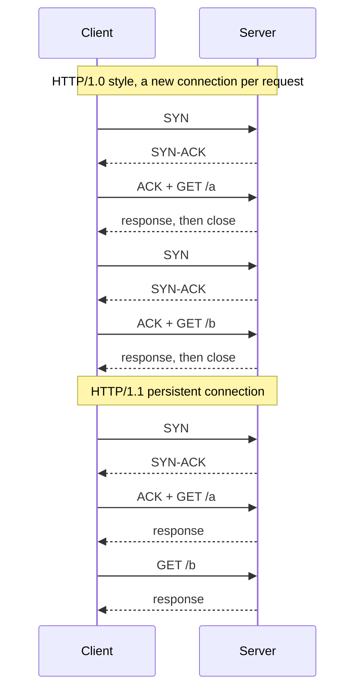
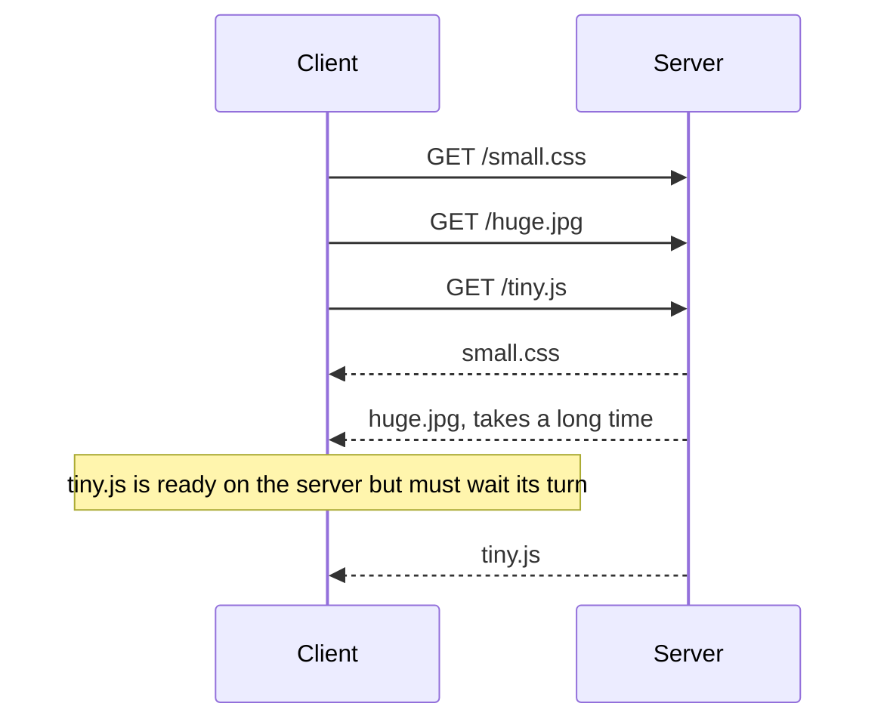

# From HTTP/0.9 to HTTP/1.1

> **Before this lesson:** you need TCP connections and their one-round-trip setup cost from [UDP and the TCP connection lifecycle](#/lesson/networking/udp-tcp-lifecycle), slow start from [Flow control and congestion control](#/lesson/networking/tcp-flow-congestion), and the overview in [What happens when you type a URL](#/lesson/networking/url-walkthrough).

## In plain words

**HTTP**, the Hypertext Transfer Protocol, is the language browsers and servers use to talk. It is a conversation with one fixed shape: the **client** (the side that asks, usually a browser or an app) sends a **request**, and the **server** (the side that answers) sends back one **response**. Nothing else. The server never speaks first.

It works like ordering at a counter. You say what you want in a fixed form ("one coffee, to take away"). The person behind the counter replies with a result code ("coming up", "we are out of that", "we do not sell that here") and, if all goes well, the item. Each order stands on its own: the counter does not remember your previous one unless you show a loyalty card.

HTTP began as a one-line protocol for fetching documents and grew, version by version, as the web's needs outran it. Knowing that history is the quickest way to understand why HTTP looks the way it does, and why its successors (HTTP/2 and HTTP/3) were needed.

Why this matters for a job: every web API, every microservice call and every browser request is HTTP. You will read and write its headers daily, choose methods and status codes when designing an API, and debug it with `curl`. Interviewers ask about methods, status codes, persistent connections and the limits of HTTP/1.1 all the time.

## Four versions in four paragraphs

**HTTP/0.9 (1991): the one-liner.** The client opened a TCP connection, sent a single line such as `GET /page.html`, and the server replied with the raw contents of an HTML file and closed the connection. No headers, no status codes, no way to send anything but HTML.

**HTTP/1.0 (1996): metadata arrives.** Requests and responses gained a version number and **headers** (lines of `Name: value` metadata). Responses gained a **status line** with a numeric code. A `Content-Type` header meant a response could be an image or anything else, not only HTML. But every request still used its own TCP connection: connect, ask, receive, close.

**HTTP/1.1 (1997, refined several times since): the workhorse.** Connections stay open by default and are reused for further requests. A mandatory `Host` header lets many sites share one address. It added chunked transfer, byte ranges, caching controls and content negotiation. It remained a plain-text protocol and carried the web for two decades.

**HTTP/2 (2015) and HTTP/3 (2022): same meaning, new transport.** Methods, status codes and headers are unchanged. What changed is how messages are packed and carried, to remove the performance limits described at the end of this lesson. They have their own lessons.

## Anatomy of a message

An HTTP/1.1 message is lines of text. Every line of the head ends with the two characters carriage return and line feed, written `\r\n` (CRLF).

A **request**:

```
POST /api/orders HTTP/1.1          <- request line: method, target, version
Host: shop.example.com             <- headers start here
Content-Type: application/json
Content-Length: 27
Accept: application/json
                                   <- an empty line ends the head
{"item": 42, "quantity": 1}        <- the body (27 bytes)
```

A **response**:

```
HTTP/1.1 201 Created               <- status line: version, status code, reason phrase
Content-Type: application/json
Content-Length: 12
Location: /api/orders/9001

{"id": 9001}
```

The pieces:

- **Method**: the action requested (`GET`, `POST`, …).
- **Target**: usually the path and query of the URL.
- **Headers**: metadata. Names are case-insensitive (`content-type` and `Content-Type` are the same header).
- **Empty line**: marks the end of the head.
- **Body**: optional payload. Its length must be discoverable, as the framing section below explains.

### Try it: parse a message

The program splits a raw request into its parts with ordinary string operations. Each step is commented.

```python-run
raw = ("POST /api/orders?debug=1 HTTP/1.1\r\n"
       "Host: shop.example.com:8443\r\n"
       "Content-Type: application/json\r\n"
       "Content-Length: 27\r\n"
       "\r\n"
       '{"item": 42, "quantity": 1}')

head, _, body = raw.partition("\r\n\r\n")     # split at the FIRST empty line
lines = head.split("\r\n")                     # the head is CRLF-separated lines

method, target, version = lines[0].split(" ")  # the request line has three parts
print("method :", method)
print("target :", target)
print("version:", version)

headers = {}
for line in lines[1:]:
    name, _, value = line.partition(":")       # split at the FIRST colon only
    headers[name.strip().lower()] = value.strip()   # names are case-insensitive
print("headers:", headers)

length = int(headers["content-length"])        # the body is exactly this many bytes
print("body   :", body[:length])
```

Notice the `Host` header value `shop.example.com:8443`. It contains a colon. That is why the code splits each header line at the *first* colon only; splitting at every colon would cut off the port.

## Methods

| Method | Meaning | Request body | Safe | Idempotent |
|---|---|---|---|---|
| `GET` | fetch a representation of the resource | no | yes | yes |
| `HEAD` | like GET, but return only the headers | no | yes | yes |
| `POST` | submit data; create something or trigger an action | yes | no | no |
| `PUT` | replace the resource at this URL with the body | yes | no | yes |
| `PATCH` | modify part of the resource | yes | no | not necessarily |
| `DELETE` | remove the resource | rarely | no | yes |
| `OPTIONS` | ask what is allowed (used by browser cross-origin checks) | no | yes | yes |

Two words in that table are interview favourites:

- A **safe** method does not change anything on the server. It only reads. Browsers, crawlers and caches feel free to issue safe requests without asking.
- An **idempotent** method has the same effect whether it is performed once or several times. `PUT /users/7` with the same body twice leaves the same result. `DELETE /users/7` twice still leaves user 7 gone (the second reply may be `404`, but the state is the same). `POST /orders` twice creates two orders: not idempotent.

Idempotence matters because networks fail in an awkward way: a client that sends a request and gets no reply cannot know whether the server acted on it. Retrying is harmless for idempotent methods and dangerous for others.

## Status codes

The first digit gives the class:

| Class | Meaning | Ones to know |
|---|---|---|
| **1xx** informational | "keep going" | `100 Continue`, `101 Switching Protocols` |
| **2xx** success | it worked | `200 OK`, `201 Created`, `204 No Content`, `206 Partial Content` |
| **3xx** redirection | look elsewhere, or use what you have | `301 Moved Permanently`, `302 Found`, `304 Not Modified`, `307`/`308` (redirects that keep the method) |
| **4xx** client error | the request was wrong | `400 Bad Request`, `401 Unauthorized` (not logged in), `403 Forbidden` (logged in, not allowed), `404 Not Found`, `409 Conflict`, `429 Too Many Requests` |
| **5xx** server error | the server failed | `500 Internal Server Error`, `502 Bad Gateway`, `503 Service Unavailable`, `504 Gateway Timeout` |

A quick way to remember who is at fault: 4xx means "you asked wrongly; repeating the same request will not help", 5xx means "we failed; trying again later might work". Among the 5xx codes, `502` and `504` come from a proxy or load balancer reporting on a backend: `502` means the backend gave an invalid answer or refused the connection, `504` means it did not answer in time.

## HTTP is stateless

Each request is self-contained. The protocol itself keeps no memory of earlier requests, a property called **statelessness**. It is a strength: any server in a pool can handle any request, which makes scaling out easy. When an application needs continuity (a login, a shopping basket), the client sends something that identifies it with every request, typically a cookie or a token. The next lesson covers cookies.

## Persistent connections

Here is the first great performance improvement, and the numbers show why it mattered.

In HTTP/1.0, fetching a page with ten images meant eleven TCP connections, each with its own three-way handshake and each starting in slow start. HTTP/1.1 keeps the connection open after a response so that the next request can reuse it. This is a **persistent connection**, also called **keep-alive**.



Each reused request saves one round trip of TCP handshake, one or two more of TLS handshake when HTTPS is used, and inherits a congestion window that has already grown.

```python-run
def total_ms(requests, rtt, tls_round_trips, persistent, server_ms=20):
    setup = (1 + tls_round_trips) * rtt            # TCP handshake + TLS handshake
    per_request = rtt + server_ms                  # request out, response back
    if persistent:
        return setup + requests * per_request      # pay setup once
    return requests * (setup + per_request)        # pay setup every time

for rtt in (20, 100):
    for n in (1, 10, 50):
        new = total_ms(n, rtt, tls_round_trips=1, persistent=False)
        reuse = total_ms(n, rtt, tls_round_trips=1, persistent=True)
        print(f"RTT {rtt:3} ms, {n:2} requests: new connection each time {new:6} ms, "
              f"one persistent connection {reuse:6} ms")
```

For 50 sequential requests at 100 ms RTT, the difference is 16 seconds against 6. (This simple model fetches one at a time; real browsers also use several connections in parallel, discussed below.)

In HTTP/1.1 persistence is the default. Either side can end it by sending the header `Connection: close`. Servers also close idle connections after a timeout, which is the source of the "idle timeout mismatch" problem from the TCP lesson.

## Framing: where does a body end?

With connections that close after every response, the end of the body was obvious: the connection closed. On a persistent connection the receiver must know exactly where one message ends and the next begins. Deciding that is called **framing**. HTTP/1.1 has two ways.

**`Content-Length`.** The header states the body's size in bytes. The receiver reads exactly that many.

**Chunked transfer encoding.** Sometimes the server does not know the total size when it starts sending: a page generated on the fly, a stream of results. With `Transfer-Encoding: chunked` the body is sent as a series of **chunks**, each preceded by its own size written in hexadecimal, and finished by a chunk of size zero.

```
HTTP/1.1 200 OK
Content-Type: text/plain
Transfer-Encoding: chunked

7\r\n                 <- the next chunk is 7 bytes
Hello, \r\n
6\r\n                 <- the next chunk is 6 bytes
world!\r\n
0\r\n                 <- a zero-size chunk: the end
\r\n
```

```python-run
def decode_chunked(data):
    position = 0
    pieces = []
    while True:
        line_end = data.index("\r\n", position)          # find the end of the size line
        size = int(data[position:line_end], 16)          # sizes are hexadecimal
        position = line_end + 2                          # skip past the CRLF
        if size == 0:
            break                                        # the last chunk
        pieces.append(data[position:position + size])    # take exactly 'size' characters
        position += size + 2                             # skip the data and its CRLF
    return "".join(pieces)

encoded = "7\r\nHello, \r\n6\r\nworld!\r\n1a\r\n and 26 more characters...\r\n0\r\n\r\n"
print(repr(decode_chunked(encoded)))
```

The third chunk's size is `1a`, which is hexadecimal for 26. Reading sizes as decimal is the classic mistake. Also note that the decoder never searches the *data* for line breaks: only the declared size says where a chunk ends, so a chunk may safely contain `\r\n`.

> [!WARNING]
> If a request carries both `Content-Length` and `Transfer-Encoding`, or if a proxy and the server behind it disagree about where a request ends, an attacker can hide a second request inside the first. This is **HTTP request smuggling**, and it is a consequence of text-based framing. Modern servers reject ambiguous messages.

## The limits of HTTP/1.1

### One request at a time per connection

On an HTTP/1.1 connection, the client sends a request and must wait for the complete response before the connection is usable again. Responses carry no label saying which request they answer; order is the only link. If one response is slow, everything queued behind it on that connection waits. This is **head-of-line blocking** at the HTTP level.

### Pipelining: a fix that failed

HTTP/1.1 allowed **pipelining**: send several requests one after another without waiting, and receive the responses in the same order. It saved round trips in theory.



In practice it failed. Responses still had to come back in order, so one slow response blocked the rest. Many proxies and servers handled it incorrectly. A failure in the middle left the client unsure which requests had been processed. Browsers shipped with pipelining turned off, and it is now treated as a historical dead end.

### The workaround: several connections, and the hacks around them

To fetch things in parallel, browsers open several connections to each host, with a limit of **six per host** in practice. A page with 80 resources on one host is fetched six at a time while the others queue.

Web developers invented workarounds for that limit, which you will still find in older codebases:

| Technique | Idea | Cost |
|---|---|---|
| **Domain sharding** | spread files over `img1.example.com`, `img2.example.com`… to get six connections each | extra DNS lookups, handshakes and slow starts; connections compete with each other |
| **Concatenation** | merge many scripts or stylesheets into one file | one changed line invalidates the whole cached bundle |
| **Image sprites** | pack many small images into one and show parts with CSS | awkward to maintain; all are downloaded even if one is needed |
| **Inlining** | embed small files directly in the HTML | cannot be cached separately |

Each trades one cost for another, and each exists only because HTTP/1.1 cannot carry many exchanges on one connection at once. HTTP/2 removes the cause, and with it these become unnecessary or harmful.

### Verbose, repeated headers

Headers are uncompressed text, and many are sent identically on every request: `User-Agent`, `Accept`, cookies. Several hundred bytes to a few kilobytes of repeated metadata per request is common, which matters on slow uplinks and wastes the first, precious congestion window.

## A full exchange under the microscope

```
$ curl -v http://shop.example.com/api/items/42
*   Trying 203.0.113.80:80...
* Connected to shop.example.com (203.0.113.80) port 80
> GET /api/items/42 HTTP/1.1                 <- request line
> Host: shop.example.com                     <- mandatory in HTTP/1.1
> User-Agent: curl/8.7.1
> Accept: */*                                <- "any content type is fine"
>
< HTTP/1.1 200 OK                            <- status line
< Date: Mon, 02 Mar 2026 10:15:00 GMT
< Content-Type: application/json
< Content-Length: 58                         <- framing by length
< Connection: keep-alive                     <- the server will keep the connection open
<
{"id": 42, "name": "desk lamp", "price": 1900, "stock": 7}
* Connection #0 to host shop.example.com left intact      <- available for reuse
```

The last line is curl telling you that the TCP connection is still open and would be reused by a second URL on the same command line.

> [!INTERVIEW]
> **"What did HTTP/1.1 improve over 1.0, and what problems remained?"** Improvements: persistent connections by default, the mandatory `Host` header enabling many sites per address, chunked transfer for bodies of unknown length, range requests, and richer caching. Remaining problems: one outstanding request per connection, so head-of-line blocking; pipelining that never worked in practice; browsers opening up to six connections per host as a workaround; and large uncompressed headers repeated on every request. Those limits led to sharding, bundling and spriting, and are what HTTP/2's multiplexing and header compression address.

> [!TIP]
> When designing an API, make the method and status code tell the truth: `GET` never changes state, `PUT` and `DELETE` are idempotent, failures are 4xx or 5xx (never `200` with an error message in the body). Clients, caches, proxies and retry logic all rely on those meanings.

## Pitfalls

- **Using `GET` for actions that change data.** Browsers prefetch links, crawlers follow them and caches replay them.
- **Treating `401` and `403` as the same.** `401` means "authenticate first"; `403` means "authenticated, and still not allowed".
- **Returning `200` for errors.** Monitoring, caches and clients then treat failures as successes.
- **Assuming one request per connection.** Persistent connections mean a server must find message boundaries correctly; a wrong `Content-Length` corrupts the *next* message.
- **Reading chunk sizes as decimal**, or searching chunk data for delimiters.
- **Keeping HTTP/1.1 workarounds after moving to HTTP/2.** Sharding and heavy bundling can make things slower there.
- **Forgetting that header names are case-insensitive.** Compare them in lower case.

## Summary

- HTTP is a request/response protocol; the client always speaks first, and each exchange is independent (stateless).
- HTTP/0.9 fetched HTML with one line; 1.0 added headers, status codes and content types; 1.1 added persistent connections, `Host`, chunked transfer, ranges and caching.
- A message is a start line, headers, an empty line and an optional body, framed by `Content-Length` or chunked encoding.
- Safe methods only read; idempotent methods can be repeated without changing the outcome.
- Status classes: 2xx success, 3xx redirect, 4xx client error, 5xx server error.
- HTTP/1.1 handles one exchange at a time per connection; browsers compensate with up to six connections per host, and developers with sharding, bundling and sprites.

## Glossary

- **HTTP**: the request/response protocol of the web.
- **Client / server**: the side that sends requests / the side that answers.
- **Request line / status line**: the first line of a request / of a response.
- **Method**: the action a request asks for.
- **Header**: a `Name: value` line of metadata.
- **Body**: the payload of a message.
- **CRLF**: carriage return and line feed, the line ending in HTTP/1.x.
- **Status code**: a three-digit result of a request.
- **Safe**: does not modify server state.
- **Idempotent**: repeating it has the same effect as doing it once.
- **Stateless**: the protocol keeps no memory between requests.
- **Persistent connection (keep-alive)**: one TCP connection reused for many requests.
- **Framing**: determining where a message ends.
- **Chunked transfer encoding**: sending a body in size-prefixed pieces.
- **Head-of-line blocking**: one slow response delaying those queued behind it.
- **Pipelining**: sending several requests without waiting; responses return in order.
- **Domain sharding, concatenation, spriting, inlining**: HTTP/1.1-era tricks to reduce or parallelise requests.
- **Request smuggling**: an attack exploiting disagreement about message boundaries.

## Check yourself

```quiz
[
  {"q": "Which feature was introduced as the default in HTTP/1.1?",
   "options": ["Binary framing", "Persistent connections", "Header compression", "Server push"], "answer": 1,
   "explain": "HTTP/1.1 keeps the TCP connection open for further requests unless Connection: close is sent. The other features belong to HTTP/2."},
  {"q": "Why is the Host header mandatory in HTTP/1.1?",
   "options": ["To encrypt the request", "So that one IP address can serve many different sites", "To enable caching", "To choose the TCP port"], "answer": 1,
   "explain": "The connection is made to an IP address. The Host header tells the server which of its sites the request is for."},
  {"q": "Which method is idempotent but not safe?",
   "options": ["GET", "POST", "PUT", "HEAD"], "answer": 2,
   "explain": "PUT changes state, so it is not safe, but sending the same PUT again leaves the same result, so it is idempotent."},
  {"q": "A load balancer returns 504. What does that indicate?",
   "options": ["The client sent a malformed request", "The resource does not exist", "The backend did not respond in time", "The client must authenticate"], "answer": 2,
   "explain": "504 Gateway Timeout is reported by an intermediary that waited too long for the server behind it."},
  {"q": "In chunked transfer encoding, a chunk begins with the line '1f'. How many bytes of data follow?",
   "options": ["1", "15", "31", "1f is invalid"], "answer": 2,
   "explain": "Chunk sizes are hexadecimal. 1f is 16 + 15 = 31."},
  {"q": "Why did HTTP/1.1 pipelining fail to solve head-of-line blocking?",
   "options": ["It required UDP", "Responses still had to be returned in request order, so a slow one blocked the rest", "Browsers could not send more than one request", "It disabled persistent connections"], "answer": 1,
   "explain": "Without identifiers linking responses to requests, order was the only way to match them, so a slow first response held back all later ones."},
  {"q": "How do browsers achieve parallel downloads under HTTP/1.1?",
   "options": ["By interleaving responses on one connection", "By opening several TCP connections per host, typically up to six", "By using UDP", "By compressing headers"], "answer": 1,
   "explain": "Each HTTP/1.1 connection carries one exchange at a time, so browsers use multiple connections, limited to about six per host."},
  {"q": "A client sends POST /payments and the connection drops before any response arrives. Why is automatically retrying risky?",
   "options": ["POST requests cannot be sent twice", "POST is not idempotent, so the payment might be made twice", "The server will return 304", "Retries are forbidden by TCP"], "answer": 1,
   "explain": "The client cannot tell whether the server processed the first request. Repeating a non-idempotent action may apply it twice."}
]
```

> **Source:** Grigorik, *High Performance Browser Networking*, ch. 9 "Brief History of HTTP" and ch. 11 "HTTP/1.X" (topic coverage only; wording and examples are original), https://hpbn.co/brief-history-of-http/ and https://hpbn.co/http1x/ . Facts checked against RFC 9110 (HTTP semantics) and RFC 9112 (HTTP/1.1 message syntax), at https://www.rfc-editor.org/ , and MDN's HTTP overview (https://developer.mozilla.org/en-US/docs/Web/HTTP/Overview).
