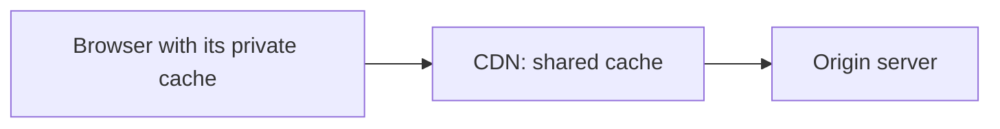
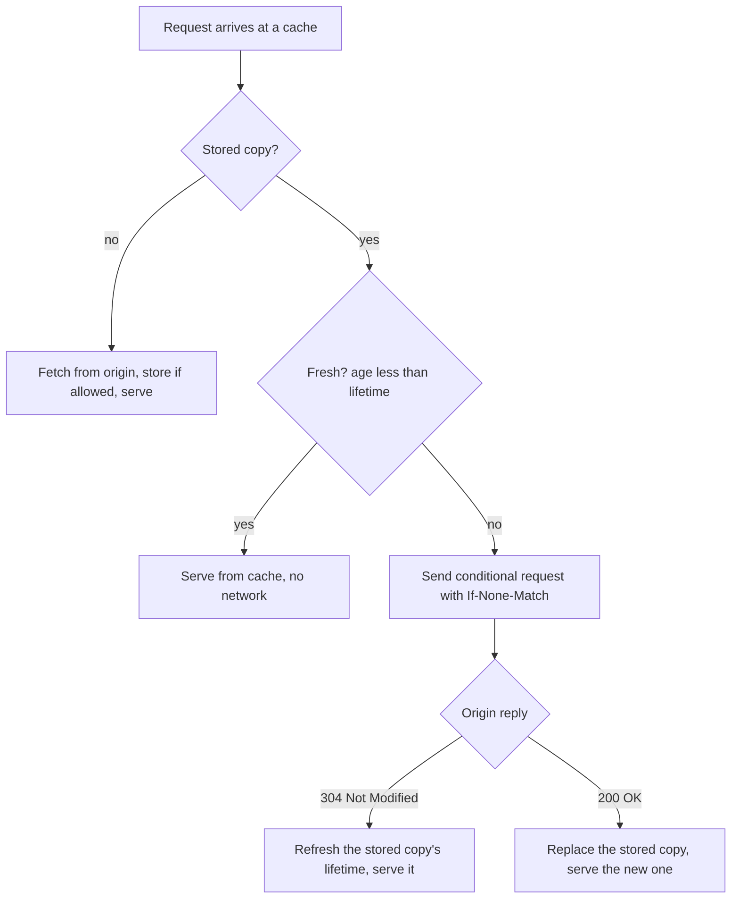

# HTTP caching, cookies and content negotiation

> **Before this lesson:** read [From HTTP/0.9 to HTTP/1.1](#/lesson/networking/http1) for requests, responses, headers, methods and status codes.

## In plain words

Three everyday needs are solved by HTTP headers, and this lesson covers all three.

**Caching: do not fetch the same thing twice.** If you look up a bus timetable in the morning, you write it on a note and read the note for the rest of the day instead of walking to the bus stop each time. You only need to decide how long the note can be trusted, and what to do when you are unsure (walk over and ask "has it changed?"). An HTTP **cache** is that note: a stored copy of a response that can be reused. It is the most effective performance tool the web has, because the fastest request is the one never sent.

**Cookies: being recognised.** HTTP has no memory; each request arrives as if from a stranger. A cloakroom solves this with a numbered ticket: you hand over your coat, receive a ticket, and show the ticket later to be recognised. A **cookie** is that ticket: a small piece of text the server gives the browser, which the browser shows on every later visit.

**Content negotiation: asking for the version that suits you.** A waiter who hears you speak French hands you the French menu. A browser tells the server which formats, compressions and languages it accepts, and the server picks the best match.

Why this matters for a job: wrong cache headers cause the two classic web bugs: users seeing stale content after a release, and one user being served another user's private page. Wrong cookie attributes cause security incidents. Every web engineer is expected to explain `Cache-Control`, `ETag`, and the cookie flags `Secure`, `HttpOnly` and `SameSite`.

## Part 1: Caching

### Who caches

Two kinds of cache sit between a user and your server:

- A **private cache** belongs to one user: the browser's cache. It may store personalised responses.
- A **shared cache** serves many users: a CDN, a company proxy, a reverse proxy in front of your application. It must never store something meant for one person.



The **origin server** is the server that actually owns the content. Its response headers tell every cache along the way what is allowed.

### The two questions every cache asks

For a stored response, a cache needs to know:

1. **Is it still fresh?** If yes, serve it immediately without contacting anyone.
2. **If it is not fresh (stale), is it still correct?** Ask the origin cheaply with a **conditional request**; this is called **revalidation**.

### Freshness: `Cache-Control`

The origin states how long a response may be considered fresh with the `Cache-Control` response header. Its value is a comma-separated list of **directives**.

| Directive | Meaning |
|---|---|
| `max-age=N` | fresh for N seconds from when it was generated |
| `s-maxage=N` | like max-age, but for shared caches only; overrides max-age there |
| `public` | any cache may store it |
| `private` | only the user's own browser may store it; shared caches must not |
| `no-cache` | may be stored, but **must be revalidated before every use** |
| `no-store` | must not be stored anywhere at all |
| `must-revalidate` | once stale, never serve it without successful revalidation |
| `immutable` | the content will never change; do not even revalidate on reload |
| `stale-while-revalidate=N` | for N seconds after going stale, serve the stale copy at once and refresh it in the background |

The two most confused directives deserve a direct statement:

- **`no-cache` does not mean "do not cache".** It means "keep a copy, but check with me before using it".
- **`no-store` is the one that means "do not keep any copy".** Use it for genuinely sensitive data.

How old is a stored response? Its **age** is the time since the origin generated it. Shared caches report it in an `Age` response header. A response is fresh while `age < freshness lifetime`.

If there is no `Cache-Control`, an older header `Expires` (an absolute date) is used. If neither is present, caches are allowed to guess, a behaviour called **heuristic caching**, commonly 10% of the time since the response was last modified. That guess is the source of many "why is the browser showing an old file?" surprises. The cure is to always send an explicit `Cache-Control`.

### Validation: `ETag` and `304 Not Modified`

A stale response is not necessarily wrong. The file may be unchanged. Re-downloading it would waste time, so HTTP lets a cache ask a short question.

The origin attaches a **validator** to the response:

- **`ETag`** (entity tag): an opaque identifier for this exact version of the content, usually a hash, for example `ETag: "a81f3c"`.
- **`Last-Modified`**: the date the content last changed (less precise; an older mechanism).

Later, the cache sends a conditional request quoting the validator:

```
GET /styles/site.css HTTP/1.1
Host: shop.example.com
If-None-Match: "a81f3c"          <- "send it only if its ETag is NOT this one"
```

- If the content is unchanged the origin replies **`304 Not Modified`** with headers and **no body**. The cache marks its copy fresh again and serves it.
- If it changed, the origin replies `200 OK` with the new content and a new `ETag`.

A `304` still costs a round trip, but saves transferring the body, which for a large file is nearly all of the cost.



An annotated revalidation with curl:

```
$ curl -sv https://shop.example.com/styles/site.css -H 'If-None-Match: "a81f3c"' -o /dev/null
> GET /styles/site.css HTTP/2
> if-none-match: "a81f3c"                 <- our stored version
>
< HTTP/2 304                               <- unchanged: no body follows
< etag: "a81f3c"
< cache-control: public, max-age=600       <- fresh for another 10 minutes
< age: 0
```

### Try it: the cache's decision

```python-run
def parse_cache_control(value):
    """'public, max-age=600' -> {'public': '', 'max-age': '600'}"""
    directives = {}
    for part in value.split(","):
        part = part.strip().lower()            # directive names are case-insensitive
        if part:
            name, _, argument = part.partition("=")
            directives[name] = argument
    return directives

def decide(cache_control, age, shared):
    d = parse_cache_control(cache_control)
    if "no-store" in d:
        return "do not store"
    if shared and "private" in d:
        return "do not store (shared cache, private response)"
    if "no-cache" in d:
        return "stored, but revalidate before every use"
    if shared and "s-maxage" in d:
        lifetime = int(d["s-maxage"])          # s-maxage wins in shared caches
    else:
        lifetime = int(d.get("max-age", 0))
    if age < lifetime:
        return f"fresh for {lifetime - age} more seconds: serve from cache"
    if "stale-while-revalidate" in d and age < lifetime + int(d["stale-while-revalidate"]):
        return "stale: serve now and refresh in the background"
    return "stale: revalidate with If-None-Match"

tests = [
    ("public, max-age=600",                          120, False),
    ("public, max-age=600",                          700, False),
    ("private, max-age=300",                          10, True),
    ("private, max-age=300",                          10, False),
    ("no-cache",                                       0, False),
    ("no-store",                                       0, False),
    ("max-age=600, s-maxage=60",                     100, True),
    ("max-age=60, stale-while-revalidate=30",         75, True),
]
for header, age, shared in tests:
    kind = "shared " if shared else "browser"
    print(f"{kind} | {header:40} | age {age:3} -> {decide(header, age, shared)}")
```

Compare the two `private` lines: the same header gives different results in a CDN and in a browser. Compare the `s-maxage` line with what a browser would do: the CDN treats the response as stale after 60 seconds while browsers keep it for 600.

### `Vary`: one URL, several versions

A cache normally stores one response per URL. But the response for a URL can depend on request headers: compressed or not, English or German. The `Vary` response header lists the request headers that influenced the answer:

```
Vary: Accept-Encoding
```

The cache then keeps a separate copy for each distinct value of those headers. Without `Vary`, a cache could hand a compressed response to a client that cannot decompress it. Beware of `Vary: User-Agent` or `Vary: Cookie`: there are so many distinct values that almost nothing is ever reused.

### A caching strategy that works

The dependable recipe for a modern site uses two kinds of URL.

**Fingerprinted static assets.** Build tools put a hash of the file's content in its name: `app.3f9a1c.js`. If the content changes, the name changes. Such a URL can be cached for ever:

```
Cache-Control: public, max-age=31536000, immutable
```

This technique is called **cache busting**: you never need to remove the old file from caches, because nothing refers to it any more.

**The HTML document** (and other URLs whose content changes in place) must always be checked, since it is what points to the current asset names:

```
Cache-Control: no-cache
ETag: "v42-8c1d"
```

Other common cases:

| Content | Suggested header |
|---|---|
| Personalised page or API response | `private, no-cache` (or `private, max-age=0`) |
| Sensitive data (banking, medical) | `no-store` |
| Public API data that may be a few seconds old | `public, max-age=5, stale-while-revalidate=30` |
| Content that a CDN should hold longer than browsers | `public, max-age=60, s-maxage=3600`, plus purging the CDN on change |

> [!WARNING]
> The worst caching bug is a personalised response stored in a shared cache: one user's account page served to the next visitor. Any response that depends on who is asking must be `private` or `no-store`. When putting a CDN in front of an application, check this before anything else.

## Part 2: Cookies

### How a cookie travels

1. The server includes a `Set-Cookie` header in a response.
2. The browser stores the cookie.
3. On every later request **to a matching site**, the browser adds a `Cookie` header with the stored name and value.

```
Response:   Set-Cookie: session=8f2c1e; Path=/; Secure; HttpOnly; SameSite=Lax; Max-Age=3600
Later:      Cookie: session=8f2c1e
```

The most common use is a **session**: after login the server creates a random, unguessable identifier, stores "identifier 8f2c1e belongs to user 77" on its side, and sends the identifier as a cookie. The cookie proves nothing by itself; it is a key to state held on the server. An alternative design puts signed data in the cookie or in a token, so that the server needs no lookup.

### The attributes

| Attribute | Effect | If omitted |
|---|---|---|
| `Max-Age=N` / `Expires=date` | keep the cookie for N seconds / until a date | a **session cookie**: deleted when the browser closes |
| `Domain=example.com` | send to this domain **and all its subdomains** | sent only to the exact host that set it (stricter) |
| `Path=/account` | send only for URLs under this path | a default derived from the URL that set it |
| `Secure` | send only over HTTPS | sent over HTTP too |
| `HttpOnly` | hidden from JavaScript (`document.cookie`) | scripts can read it |
| `SameSite=Strict`/`Lax`/`None` | controls sending on requests that originate from other sites | browsers default to `Lax` |

Matching rules, which the practice problem asks you to implement:

- **Domain.** A cookie with `Domain=example.com` matches `example.com` and `shop.example.com`, but not `badexample.com`: there must be a dot boundary. A cookie with no `Domain` matches only the exact host.
- **Path.** A cookie with `Path=/app` matches `/app` and `/app/settings`, but not `/apple`: there must be a slash boundary.
- **Deletion.** A server deletes a cookie by setting it again with `Max-Age=0` or a past `Expires`.

```python-run
def domain_matches(request_host, cookie_domain, host_only):
    if host_only:                                   # no Domain attribute was given
        return request_host == cookie_domain
    return request_host == cookie_domain or request_host.endswith("." + cookie_domain)

def path_matches(request_path, cookie_path):
    if request_path == cookie_path:
        return True
    if request_path.startswith(cookie_path):
        # the match must end at a "/" boundary
        return cookie_path.endswith("/") or request_path[len(cookie_path)] == "/"
    return False

print("domain rule")
for host in ("example.com", "shop.example.com", "badexample.com"):
    print(f"   {host:18} Domain=example.com -> {domain_matches(host, 'example.com', False)}")
print("   shop.example.com   host-only cookie set by example.com ->",
      domain_matches("shop.example.com", "example.com", True))

print("path rule")
for path in ("/app", "/app/settings", "/apple", "/"):
    print(f"   {path:14} Path=/app -> {path_matches(path, '/app')}")
```

The two `False` lines for `badexample.com` and `/apple` are the cases a naive "ends with" or "starts with" check gets wrong, and both are security bugs.

### The security flags

Two attacks explain why the flags exist.

**Cross-site scripting (XSS).** If an attacker manages to run their JavaScript in your page, the script can read `document.cookie` and send your session identifier to the attacker. `HttpOnly` makes the cookie invisible to scripts, so it cannot be stolen that way.

**Cross-site request forgery (CSRF).** You are logged in to your bank. You visit a malicious page containing a hidden form that submits "transfer money" to the bank. The browser attaches your bank cookie automatically, and the bank sees an authenticated request. `SameSite` controls this:

- `Strict`: the cookie is never sent on requests that originate from another site, not even when you click a link there.
- `Lax` (the default): sent when you navigate to the site by clicking a link, but not on cross-site form posts or background requests.
- `None`: always sent, as cookies used to be. Requires `Secure`. Needed for legitimate embedded third-party content.

A sound default for a session cookie:

```
Set-Cookie: __Host-session=8f2c1e; Path=/; Secure; HttpOnly; SameSite=Lax
```

The `__Host-` prefix in the name is a browser-enforced promise that the cookie was set with `Secure`, with `Path=/`, and without a `Domain` attribute, so a compromised subdomain cannot overwrite it.

### Costs and limits

- Cookies are sent with **every** matching request, including those for images and scripts. A 2 kB cookie on a page with 80 same-site requests uploads 160 kB of repeated text. Keep cookies small, and serve static assets from a separate cookie-free host.
- Browsers limit each cookie to about 4 kB and the number per domain to a few dozen.
- A cookie set by a site other than the one in the address bar is a **third-party cookie**, historically used for tracking across sites. Browsers block or partition these increasingly; do not build on them.

## Part 3: Content negotiation

The same URL can have several **representations**: different formats, compressions or languages of the same resource. The client states its preferences in request headers and the server chooses. This is **content negotiation**.

| Request header | Asks for | Response header naming the choice |
|---|---|---|
| `Accept` | media types (formats) | `Content-Type` |
| `Accept-Encoding` | compression methods | `Content-Encoding` |
| `Accept-Language` | human languages | `Content-Language` |

Preferences can be weighted with a **quality value**, `q`, from 0 to 1 (the default is 1; `q=0` means "never"):

```
Accept-Language: de-CH, de;q=0.9, en;q=0.6, *;q=0.1
```

Read: Swiss German best; any German nearly as good; English acceptable; anything else as a last resort.

```python-run
def parse_preferences(header):
    """'gzip;q=0.8, br, identity;q=0.1' -> [('br', 1.0), ('gzip', 0.8), ('identity', 0.1)]"""
    result = []
    for item in header.split(","):
        pieces = item.strip().split(";")
        value = pieces[0].strip()
        q = 1.0                                    # the default weight
        for extra in pieces[1:]:
            name, _, number = extra.strip().partition("=")
            if name == "q":
                q = float(number)
        result.append((value, q))
    result.sort(key=lambda pair: -pair[1])         # highest quality first; the sort is stable
    return result

def choose(header, available):
    for value, q in parse_preferences(header):
        if q > 0 and value in available:
            return value
    return None

print(parse_preferences("gzip;q=0.8, br, identity;q=0.1"))
print("server has gzip and br       ->", choose("gzip;q=0.8, br, identity;q=0.1", {"gzip", "br"}))
print("server has only gzip         ->", choose("gzip;q=0.8, br, identity;q=0.1", {"gzip"}))
print("server has only zstd         ->", choose("gzip;q=0.8, br, identity;q=0.1", {"zstd"}))
print("language: de-CH, de, en      ->", choose("de-CH, de;q=0.9, en;q=0.6", {"en", "fr", "de"}))
```

In real use:

- **Compression** is the negotiation that matters most. Browsers send `Accept-Encoding: gzip, deflate, br, zstd`; servers answer with `Content-Encoding: br` (Brotli) or `gzip`. Text formats shrink by 60 to 80%.
- **Format**: an API may serve JSON or another format by `Accept`; image services serve newer formats such as AVIF or WebP to browsers that list them.
- **Language** negotiation is a useful first guess, but always let the user override it.

And the link back to caching: whenever the response depends on a request header, say so with `Vary` (for example `Vary: Accept-Encoding`), or caches will serve the wrong representation.

> [!INTERVIEW]
> **"How would you set caching headers for a single-page application?"** Give static assets content-hashed file names and serve them with `Cache-Control: public, max-age=31536000, immutable`; they never need revalidation because any change produces a new URL. Serve the HTML entry point with `no-cache` and an `ETag`, so browsers revalidate it every time and pick up the new asset names at once after a deployment. Mark API responses that depend on the user as `private` or `no-store`. Mention `Vary: Accept-Encoding`, and `s-maxage` plus purging if a CDN is involved.

> [!TIP]
> To see what a cache did, read the response headers: `age` (seconds spent in a shared cache), `etag`, `cache-control`, and the provider-specific hit or miss header that most CDNs add. In browser developer tools the network panel marks responses served from memory or disk cache, and a `304` shows that revalidation succeeded.

## Pitfalls

- **Confusing `no-cache` with `no-store`.**
- **Long `max-age` on a URL whose content changes in place.** Users are stuck with the old version and you cannot recall it. Fingerprint the file name instead.
- **No `Cache-Control` at all.** Caches then guess with heuristics.
- **Caching personalised responses publicly.**
- **Forgetting `Vary`** when the response depends on `Accept-Encoding` or similar.
- **Session cookies without `Secure`, `HttpOnly` and `SameSite`.**
- **Using `Domain=` when it is not needed.** It widens the cookie to every subdomain, including ones you may not control well.
- **Storing large data in cookies.** It is re-uploaded with every request.

## Summary

- A cache serves a stored response while it is fresh (`max-age`, `s-maxage`), and revalidates stale ones with `If-None-Match`; an unchanged resource returns `304` with no body.
- `private` restricts storage to the browser; `no-cache` forces revalidation; `no-store` forbids storage.
- Fingerprinted assets get a year-long `immutable` lifetime; the HTML that references them is always revalidated.
- `Vary` tells caches which request headers select the representation.
- Cookies let a stateless protocol recognise a client; `Domain` and `Path` scope them, `Secure`, `HttpOnly` and `SameSite` protect them.
- Content negotiation uses `Accept`, `Accept-Encoding` and `Accept-Language` with optional `q` weights.

## Glossary

- **Cache**: a store of earlier responses for reuse.
- **Private / shared cache**: one user's browser cache / a cache serving many users.
- **Origin server**: the server that owns the content.
- **Directive**: one instruction inside `Cache-Control`.
- **Fresh / stale**: within / past the freshness lifetime.
- **Age**: time since the response was generated by the origin.
- **Revalidation**: asking the origin whether a stored response is still current.
- **Conditional request**: a request carrying `If-None-Match` or `If-Modified-Since`.
- **Validator / ETag**: an identifier of a specific version of a resource.
- **304 Not Modified**: "your copy is still good", with no body.
- **Heuristic caching**: a cache guessing a lifetime when none was given.
- **Vary**: the header listing request headers that affect the response.
- **Cache busting / fingerprinting**: changing the URL when content changes.
- **Cookie**: a small name-value pair the browser stores and returns.
- **Session / session cookie**: server-side state identified by a cookie / a cookie deleted when the browser closes.
- **XSS**: an attacker's script running in your page.
- **CSRF**: another site causing the browser to send an authenticated request.
- **Third-party cookie**: a cookie for a site other than the one being visited.
- **Representation**: one concrete form (format, encoding, language) of a resource.
- **Content negotiation**: choosing a representation from the client's stated preferences.
- **Quality value (q)**: a weight from 0 to 1 on a preference.

## Check yourself

```quiz
[
  {"q": "What does Cache-Control: no-cache instruct a cache to do?",
   "options": ["Never store the response", "Store it, but revalidate with the origin before each use", "Store it for one year", "Store it only in shared caches"], "answer": 1,
   "explain": "no-cache permits storage but requires revalidation every time. no-store is the directive that forbids storing."},
  {"q": "A response has Cache-Control: max-age=600, s-maxage=60 and has been in a CDN for 100 seconds. Is it fresh there?",
   "options": ["Yes, max-age is 600", "No, s-maxage applies to shared caches and 100 is not less than 60", "Yes, the larger value always wins", "It cannot be stored at all"], "answer": 1,
   "explain": "In a shared cache s-maxage overrides max-age. The response went stale after 60 seconds there, while browsers may keep it for 600."},
  {"q": "A browser revalidates a stale stylesheet and the server answers 304 Not Modified. What happens?",
   "options": ["The browser downloads the full file again", "The browser reuses its stored copy and treats it as fresh again", "The browser shows an error", "The cookie is deleted"], "answer": 1,
   "explain": "304 carries no body. It confirms the stored version is current, saving the transfer of the content."},
  {"q": "Which header is the safest choice for a file named app.3f9a1c.js whose name changes whenever its content changes?",
   "options": ["no-store", "no-cache", "public, max-age=31536000, immutable", "private, max-age=0"], "answer": 2,
   "explain": "A fingerprinted URL never changes content, so it can be cached for a year without revalidation. A new version gets a new URL."},
  {"q": "A user's account page is sent with Cache-Control: public, max-age=300 through a CDN. What is the risk?",
   "options": ["The page loads slowly", "The CDN may serve that user's page to other visitors", "Cookies stop working", "The ETag becomes invalid"], "answer": 1,
   "explain": "public allows shared caches to store and reuse the response for anyone requesting the same URL. Personalised responses must be private or no-store."},
  {"q": "Which cookie attribute prevents JavaScript from reading the cookie?",
   "options": ["Secure", "HttpOnly", "SameSite", "Path"], "answer": 1,
   "explain": "HttpOnly hides the cookie from document.cookie, limiting theft through cross-site scripting. Secure restricts it to HTTPS."},
  {"q": "A cookie is set with Path=/app and no Domain attribute by shop.example.com. To which request is it sent?",
   "options": ["https://shop.example.com/apple", "https://api.shop.example.com/app", "https://shop.example.com/app/cart", "https://example.com/app"], "answer": 2,
   "explain": "Without Domain the cookie is host-only, so the host must be exactly shop.example.com. The path must match at a slash boundary, so /app/cart matches and /apple does not."},
  {"q": "A server compresses responses according to Accept-Encoding. Which response header must it send so caches keep the variants apart?",
   "options": ["Vary: Accept-Encoding", "Content-Length", "ETag", "Set-Cookie"], "answer": 0,
   "explain": "Vary tells caches that the response depends on that request header, so a compressed copy is not served to a client that did not ask for it."}
]
```

> **Source:** Grigorik, *High Performance Browser Networking*, ch. 10 "Primer on Web Performance" and ch. 11 "HTTP/1.X" (caching and cookie overhead as performance topics; coverage only), https://hpbn.co/primer-on-web-performance/ . Facts checked against RFC 9111 (HTTP caching), RFC 5861 (stale-while-revalidate), RFC 6265 (cookies), RFC 9110 §12 (content negotiation), and MDN's pages on HTTP caching and Set-Cookie (https://developer.mozilla.org/en-US/docs/Web/HTTP/Guides/Caching , https://developer.mozilla.org/en-US/docs/Web/HTTP/Reference/Headers/Set-Cookie).
