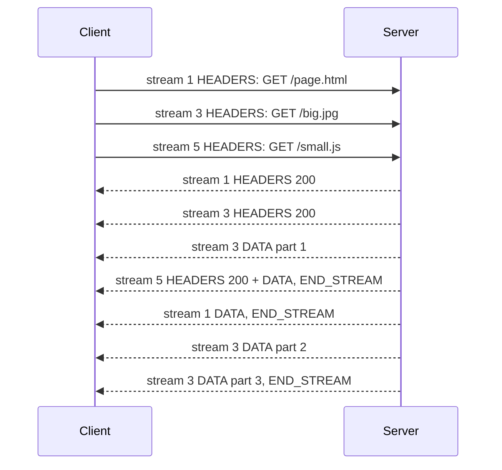

# HTTP/2: streams, multiplexing and HPACK

> **Before this lesson:** read [From HTTP/0.9 to HTTP/1.1](#/lesson/networking/http1), especially the section on its limits (one exchange per connection, six connections per host, repeated headers). TCP head-of-line blocking from [TCP in practice](#/lesson/networking/tcp-tuning) and ALPN from [TLS in practice](#/lesson/networking/tls-in-practice) are referred to.

## In plain words

HTTP/1.1 treats a connection like a single-lane road with one car allowed on it at a time: a request goes out, and nothing else may use the road until its response has come all the way back. To get more done in parallel, browsers build six roads to every destination, which is wasteful.

**HTTP/2** keeps a single road but changes the rules. Every request and response is cut into small labelled pieces. Pieces belonging to different conversations are mixed together on the one connection and sorted out again at the other end using their labels. A large image no longer holds up a small script, because their pieces take turns.

A good everyday picture is a post office that splits several people's large shipments into numbered boxes and loads the boxes onto the same conveyor belt in whatever order is convenient. Each box says which shipment it belongs to, so the receiver reassembles them correctly.

What did *not* change is the meaning: methods, status codes, URLs and headers are exactly as in HTTP/1.1. Applications do not need rewriting. Only the way messages are packed for transport is new.

Why this matters for a job: HTTP/2 is the default for browsers talking to almost any modern site, and it is the transport underneath gRPC, the most common protocol between backend services. It makes several familiar HTTP/1.1 optimisations pointless or harmful. Interviewers ask "what are the differences between HTTP/1.1 and HTTP/2?" at every level of seniority.

## Where HTTP/2 came from: SPDY

HTTP/2 did not appear from nowhere. Around 2009 engineers at Google, frustrated by slow page loads over HTTP/1.1, built an experimental protocol called **SPDY** (pronounced "speedy") that already had the main ideas: many streams multiplexed on one connection, binary framing, header compression, and priorities. Chrome and some big sites started using it in 2010 and 2011, and Firefox and others followed, so it was tested on real traffic at scale before any standard existed. In 2012 the IETF (the body that standardises internet protocols) chose SPDY as the starting draft for HTTP/2 and then reshaped it. The result was published in 2015 as RFC 7540 (since replaced by RFC 9113). One notable change was header compression: SPDY compressed headers with the general-purpose zlib algorithm, which a 2012 attack called CRIME showed could leak secrets such as cookies, so HTTP/2 uses the purpose-built HPACK instead. Once HTTP/2 was available, browsers dropped SPDY (Chrome and Firefox did so in 2016), so you will only meet the name in older articles and in the history of the protocol. The lesson for you: the browser and server vendors proved the design first, then the standard made it interoperable.

## The vocabulary: frames, streams, messages

Three new terms carry the whole design.

- A **frame** is the smallest unit HTTP/2 sends: a small header followed by a payload. Every frame states which stream it belongs to.
- A **stream** is one independent, two-way conversation within the connection, identified by a number. One request and its response travel on one stream.
- A **message** is a complete request or response. It is carried as one or more frames: normally a `HEADERS` frame, then zero or more `DATA` frames.

And one **connection** (a single TCP connection, with TLS) carries any number of streams at the same time.

```
one TCP connection
 ├── stream 1:  HEADERS (GET /index.html)        →   ← HEADERS (200) + DATA + DATA
 ├── stream 3:  HEADERS (GET /app.css)           →   ← HEADERS (200) + DATA
 └── stream 5:  HEADERS (POST /api) + DATA       →   ← HEADERS (201) + DATA
```

### The binary framing layer

HTTP/1.1 is text separated by line breaks. HTTP/2 is **binary**: each frame starts with a fixed 9-byte header whose fields sit at known positions.

```
+-----------------------------------------------+
|                 Length (24 bits)              |   size of the payload
+---------------+---------------+---------------+
|   Type (8)    |   Flags (8)   |
+-+-------------+---------------+-------------------------------+
|R|                 Stream identifier (31 bits)                 |
+-+-------------------------------------------------------------+
|                   Frame payload (Length bytes)                |
+---------------------------------------------------------------+
```

Fixed-position fields are quick and unambiguous to parse: read 9 bytes, learn the length, read that many more. There is no searching for line endings and no doubt about where a message stops, which removes the request-smuggling ambiguities of text framing.

The frame types you should recognise:

| Type | Purpose |
|---|---|
| `HEADERS` | opens a stream and carries the (compressed) headers |
| `DATA` | carries body bytes |
| `SETTINGS` | each side announces its parameters (maximum concurrent streams, window sizes, table size) |
| `WINDOW_UPDATE` | flow control: "you may send me this many more bytes" |
| `RST_STREAM` | cancel one stream without touching the others |
| `PING` | measure round-trip time; check the connection is alive |
| `GOAWAY` | "I am shutting this connection down; streams above number N were not processed" |
| `PUSH_PROMISE` | announces a server-pushed response (see below) |
| `PRIORITY` | the original prioritisation signal (now deprecated) |

Flags modify a frame. The important one is `END_STREAM`: "this is the last frame I will send on this stream".

### Try it: encode and decode a frame header

```python-run
TYPES = {0: "DATA", 1: "HEADERS", 3: "RST_STREAM", 4: "SETTINGS", 6: "PING", 7: "GOAWAY", 8: "WINDOW_UPDATE"}

def encode_header(length, frame_type, flags, stream_id):
    """Pack the four fields into 9 bytes."""
    return (length.to_bytes(3, "big")          # 24-bit length, most significant byte first
            + bytes([frame_type, flags])       # one byte each
            + (stream_id & 0x7FFFFFFF).to_bytes(4, "big"))   # top bit is reserved (always 0)

def decode_header(nine_bytes):
    length = int.from_bytes(nine_bytes[0:3], "big")
    frame_type = nine_bytes[3]
    flags = nine_bytes[4]
    stream_id = int.from_bytes(nine_bytes[5:9], "big") & 0x7FFFFFFF
    return length, TYPES.get(frame_type, "?"), flags, stream_id

header = encode_header(length=1200, frame_type=0, flags=0x1, stream_id=5)
print("bytes on the wire:", header.hex(" "))
length, name, flags, stream = decode_header(header)
print(f"length={length} type={name} stream={stream} END_STREAM={'yes' if flags & 0x1 else 'no'}")
```

The output `00 04 b0 00 01 00 00 00 05` reads as: length `0x0004b0` = 1200, type 0 (`DATA`), flags 1 (`END_STREAM`), stream 5.

## Multiplexing

Sending frames of many streams interleaved on one connection is called **multiplexing**. It is the central feature of HTTP/2.



The small script on stream 5 finished while the large image on stream 3 was still in progress. In HTTP/1.1 it would have waited behind the image or needed another connection.

Rules about streams:

- Streams opened by the client have **odd** numbers (1, 3, 5…). Streams opened by the server have even numbers.
- Numbers only increase and are never reused. When they run out, a new connection is opened.
- Each side declares a limit on concurrent streams in its `SETTINGS` (commonly 100 or more).
- Either side can cancel a single stream with `RST_STREAM`, for example when the user navigates away while an image is loading. In HTTP/1.1 the only way to cancel was to close the whole connection.

### Try it: interleaving versus one at a time

The simulation sends three responses over one connection that can carry one "unit" per tick. Compare when each response *finishes* if they are sent one after another (HTTP/1.1 on one connection) or interleaved in turn (HTTP/2).

```python-run
responses = {"page.html": 4, "big.jpg": 20, "small.js": 2}    # size in units
order = ["big.jpg", "page.html", "small.js"]                  # the big one happens to be first

def sequential(order):
    t, done = 0, {}
    for name in order:
        t += responses[name]          # the whole response is sent before the next starts
        done[name] = t
    return done

def interleaved(order):
    remaining = dict(responses)
    t, done = 0, {}
    while remaining:
        for name in order:            # take turns: one unit per stream per round
            if name in remaining:
                t += 1
                remaining[name] -= 1
                if remaining[name] == 0:
                    done[name] = t
                    del remaining[name]
    return done

seq, mux = sequential(order), interleaved(order)
print("response     sequential  interleaved")
for name in ("small.js", "page.html", "big.jpg"):
    print(f"{name:11}  {seq[name]:10}  {mux[name]:11}")
```

The total (26 ticks) is identical: multiplexing does not create bandwidth. What changes is that the small responses finish at ticks 6 and 10 instead of 26 and 24. Since a page usually becomes usable when its small, critical files arrive, perceived speed improves greatly.

### One connection per origin

Because one connection carries everything, a browser needs only **one connection per origin** (an origin is the combination of scheme, host and port). That is good news in several ways:

- one TCP handshake and one TLS handshake instead of six;
- one congestion window that grows large and stays warm, instead of six small ones competing;
- far less memory and state on servers and on every load balancer in between;
- prioritisation works, because all streams are in one place.

## Flow control

Multiplexing introduces a new risk. If one stream's receiver is slow (say, a video the user has paused), its unread data could fill the shared TCP receive buffer and stall every other stream. HTTP/2 therefore has its own **flow control** on top of TCP's.

- Each stream has a window, and the connection as a whole has one. The default is 65,535 bytes.
- Sending a `DATA` frame consumes window; only `DATA` frames count.
- The receiver grants more with `WINDOW_UPDATE` frames as it processes data.

A receiver can therefore slow one stream down without affecting the rest. The practical caveat: defaults that are too small throttle uploads and downloads on fast connections, so servers and clients raise the windows substantially at start-up.

## Prioritisation

All streams are not equally urgent. The stylesheet that blocks rendering matters more than an image far down the page. HTTP/2 originally let clients describe this with a tree of dependencies and weights. In practice the scheme was complicated, browsers used it inconsistently, and many servers ignored it. It has been deprecated.

Its replacement is simpler: a `Priority` request header (and frame) with an **urgency** from 0 (highest) to 7 and an **incremental** flag saying whether a response benefits from arriving piece by piece. The same scheme is used in HTTP/3.

What to remember: priorities are a *hint* from the client; the server decides the order in which it sends frames; and prioritisation only works well when everything shares one connection.

## Header compression: HPACK

HTTP/1.1 repeats long header lines on every request. A typical browser request carries 400 to 800 bytes of headers, almost all identical to the previous request. With dozens of requests per page, uploads of pure repetition add up, and they can overflow the initial congestion window.

HTTP/2 compresses headers with a scheme called **HPACK**, built from three ideas.

**1. A static table.** A fixed list of 61 very common headers, known to both sides in advance. Entry 2 is `:method: GET`, entry 7 is `:scheme: https`, entry 8 is `:status: 200`. Such a header is sent as a single small number.

**2. A dynamic table.** As headers are sent, both sides add them to a table that lives as long as the connection. The first time a `user-agent` or `cookie` value appears it is sent in full and stored. Every later time it is sent as an index: one or two bytes instead of a hundred. Newer entries push older ones out when the table exceeds its size limit.

**3. Huffman coding.** Text that must be sent literally is encoded with a fixed code that gives short bit patterns to common characters, saving roughly a quarter to a third.

You will notice names beginning with a colon. HTTP/2 has no request line or status line; that information travels as **pseudo-headers**: `:method`, `:scheme`, `:authority` (replacing `Host`), `:path`, and `:status` in responses. Ordinary header names must be lower case.

### Try it: the idea of indexed headers

This toy encoder uses a three-entry static table and a dynamic table. It reports, for each header, whether it was sent as an index or literally, and counts approximate bytes.

```python-run
STATIC = [(":method", "GET"), (":scheme", "https"), (":path", "/")]

def encode_requests(requests):
    dynamic = []                                  # newest entry first
    for number, headers in enumerate(requests, 1):
        sent_bytes = plain_bytes = 0
        notes = []
        for name, value in headers:
            plain_bytes += len(name) + len(value) + 4          # roughly "name: value\r\n"
            table = STATIC + dynamic
            if (name, value) in table:
                index = table.index((name, value)) + 1
                sent_bytes += 1                                # one small number
                notes.append(f"#{index}")
            else:
                sent_bytes += len(name) + len(value) + 2       # sent in full...
                dynamic.insert(0, (name, value))               # ...and remembered by both sides
                notes.append("literal")
        print(f"request {number}: HTTP/1.1 ~{plain_bytes:3} bytes, HPACK-like ~{sent_bytes:3} bytes   {notes}")

common = [(":method", "GET"), (":scheme", "https"),
          ("user-agent", "ExampleBrowser/126.0 (X11; Linux x86_64)"),
          ("cookie", "session=8f2c1e9b77d04a6c; theme=dark")]
encode_requests([
    common + [(":path", "/")],
    common + [(":path", "/styles/site.css")],
    common + [(":path", "/scripts/app.js")],
])
```

The first request sends the long values once. The second and third shrink to a few bytes plus the new path. Real HPACK is more elaborate, but this is the effect: after the first request, headers cost almost nothing.

> [!WARNING]
> Why a special scheme and not ordinary gzip? Compressing secrets (such as cookies) together with attacker-influenced data lets an attacker learn the secret by watching how the compressed size changes; this was the CRIME attack. HPACK's table-based design avoids mixing data that way, and it lets sensitive values be marked "never index".

## Server push, and why it faded

HTTP/2 allowed a server to send responses the client had not asked for yet: when asked for `index.html`, also **push** `site.css` and `app.js`, announcing each with a `PUSH_PROMISE` frame. The aim was to save the round trip in which the browser discovers it needs them.

It did not work out. The server cannot know what is already in the browser's cache, so it often pushed files the client already had, wasting bandwidth. It was hard to configure and its gains were small or negative. Chrome removed support in 2022 and other clients followed.

The replacements are hints that leave the decision with the browser, covered in the browser lesson: `<link rel="preload">`, and the **`103 Early Hints`** status code, with which a server quickly sends "you will need these files" before the real response is ready.

## Starting an HTTP/2 connection

Browsers use HTTP/2 only over TLS. The protocol is selected during the TLS handshake with ALPN: the client offers `h2` and `http/1.1`, and the server picks. No extra round trip is needed. (An unencrypted variant called `h2c` exists and is used between servers inside a private network, for example by gRPC.)

Each side then sends a `SETTINGS` frame, and streams begin.

```
$ curl -v --http2 https://shop.example.com/ -o /dev/null
* ALPN: curl offers h2,http/1.1
* ALPN: server accepted h2                      <- HTTP/2 chosen in the TLS handshake
* using HTTP/2
* [HTTP/2] [1] OPENED stream for https://shop.example.com/     <- stream 1, client-initiated (odd)
* [HTTP/2] [1] [:method: GET]                   <- pseudo-headers replace the request line
* [HTTP/2] [1] [:scheme: https]
* [HTTP/2] [1] [:authority: shop.example.com]   <- replaces Host
* [HTTP/2] [1] [:path: /]
> GET / HTTP/2
>
< HTTP/2 200                                    <- no reason phrase in HTTP/2
< content-type: text/html; charset=utf-8        <- lower-case header names
< content-encoding: br
```

## What changes for developers

Several HTTP/1.1 habits should be reversed.

| HTTP/1.1 practice | Under HTTP/2 |
|---|---|
| Domain sharding | **Harmful.** It splits traffic across connections, defeating multiplexing, prioritisation and the shared congestion window. Consolidate onto one origin. |
| Concatenating everything into huge bundles | **Less necessary.** Many moderate files are cheap to request and cache better individually. (Some bundling still helps compression and avoids very long dependency chains.) |
| Image sprites | **Unnecessary.** |
| Inlining small files into HTML | **Usually counter-productive**, since inlined content cannot be cached separately. |
| Keeping requests few at all costs | Requests are cheap; focus on bytes and on what blocks rendering. |

What stays true: compress, cache, send less, reduce round trips, and keep the connection alive.

## The remaining weakness: TCP head-of-line blocking

HTTP/2 removed head-of-line blocking at the HTTP level. But all streams share **one TCP connection**, and TCP delivers bytes strictly in order. If one packet is lost, TCP holds back everything after it until the retransmission arrives, including frames of streams that have nothing to do with the lost packet.

On a clean network this hardly matters. On a lossy one, such as a poor mobile connection, a single lost packet stalls every stream at once, and HTTP/2 with one connection can perform worse than HTTP/1.1 with six independent ones. This cannot be fixed inside HTTP/2, because the cause is in the transport below it. Fixing it is the reason HTTP/3 exists.

> [!INTERVIEW]
> **"What are the main differences between HTTP/1.1 and HTTP/2?"** HTTP/2 keeps the semantics and changes the framing. It is binary instead of text; it multiplexes many concurrent streams on one connection, eliminating application-level head-of-line blocking and the need for six connections per host; it compresses headers with HPACK using static and dynamic tables; it adds per-stream flow control, stream cancellation and prioritisation hints. Server push existed and has been abandoned. Its limitation is that all streams share one TCP connection, so packet loss still blocks everything, which HTTP/3 addresses with QUIC.

> [!TIP]
> In browser developer tools, enable the "Protocol" column in the network panel to see `h2` or `h3` per request, and the "Connection ID" column to confirm that requests to one origin share a single connection. Many distinct connection IDs for one site usually reveal leftover domain sharding.

## Testing an HTTP/2 or HTTP/3 server

After you enable a new protocol you should *check* that clients really use it. Three questions need answering: does the server advertise it, does a client negotiate it, and does the server follow the rules? Here are the tools, from quick to thorough.

**1. curl.** The simplest check asks for the protocol version after the transfer, using `-w` (write-out) to print a variable:

```bash
$ curl -sI --http2 https://shop.example.com/ -o /dev/null -w '%{http_version}\n'
2
$ curl -sI --http3 https://shop.example.com/ -o /dev/null -w '%{http_version}\n'
3
```

- `--http2` asks for HTTP/2 over TLS and quietly falls back to HTTP/1.1 if the server does not offer it, so always print `%{http_version}` rather than assuming. It prints `1.1`, `2` or `3`.
- `--http2-prior-knowledge` talks HTTP/2 without any negotiation, which is how you test the unencrypted `h2c` variant.
- `--http3` needs a curl built with HTTP/3 support. Run `curl -V` and look for `HTTP3` in the feature list; many distribution builds lack it. `--http3-only` fails instead of falling back. Because HTTP/3 normally begins only after the server advertises it with `Alt-Svc` or a DNS record, a test that must use it from the first request needs `--http3-only`.
- Add `-v` to see ALPN offers and the pseudo-headers, as in the example above.

**2. The ALPN negotiation itself.** `openssl s_client -connect shop.example.com:443 -alpn h2 </dev/null` shows a line such as `ALPN protocol: h2` if the server accepted `h2`. This checks the TLS layer separately from HTTP.

**3. Browser developer tools.** Open the **Network** panel, right-click the column headers, and enable the **Protocol** column (Chrome and Edge call it *Protocol*; Firefox shows it as *Protocol* too). Each row then reads `http/1.1`, `h2` or `h3`. Reload twice: the first load is often `h2`, and later loads switch to `h3` after the browser has seen the `Alt-Svc` header. Mixed values are normal, because third-party hosts have their own settings.

**4. A conformance tool: h2spec.** Checking by hand cannot cover the many rules of the protocol. **h2spec** is an open-source program that connects to your server and sends deliberately awkward but legal and illegal frame sequences, then checks that the server reacts as the specification requires (for example, closing the connection with the right error code when it receives a frame that is too large). A typical run against a TLS server looks like `h2spec -h shop.example.com -p 443 -t` (`-t` means TLS; `-k` skips certificate verification for a test server with a self-signed certificate). The report lists each numbered section of the HTTP/2 and HPACK specifications with pass or fail. Run it against a server you operate, not against other people's servers, because it deliberately sends malformed traffic. For servers that sit behind a load balancer, remember that you are testing the whole chain, not just your application.

A short checklist for rolling out a protocol: confirm negotiation with curl and ALPN, confirm what real browsers use in the Protocol column, run h2spec for rules, and keep HTTP/1.1 available as a fallback.

## Pitfalls

- **Saying HTTP/2 is "faster HTTP".** Be specific: it removes request queuing and header repetition; it does not speed up a single large download.
- **Keeping domain sharding.** It now hurts.
- **Relying on server push.** It is gone from major browsers.
- **Assuming priorities are obeyed.** They are hints; server and CDN behaviour varies.
- **Forgetting stream limits.** A client that needs more concurrent requests than the server's maximum will queue them or need another connection.
- **Leaving flow-control windows at the 64 kB default** for large transfers.
- **Ignoring `GOAWAY`.** A well-behaved client finishes its open streams and retries unprocessed ones on a new connection; one that does not sees spurious errors during server restarts.
- **Believing HTTP/2 removed all head-of-line blocking.** The TCP level remains.

## Summary

- HTTP/2 preserves HTTP semantics and replaces text messages with binary frames.
- Frames carry a 9-byte header with length, type, flags and stream identifier; a stream carries one request and response; many streams share one connection.
- Multiplexing interleaves frames so small responses are not stuck behind large ones; one connection per origin replaces six.
- Flow control operates per stream and per connection with `WINDOW_UPDATE`.
- HPACK compresses headers with a static table, a per-connection dynamic table and Huffman coding.
- Server push and the original priority tree are deprecated; preload hints, `103 Early Hints` and the `Priority` header replace them.
- TCP head-of-line blocking remains and motivates HTTP/3.

## Glossary

- **Frame**: the basic unit of HTTP/2 communication.
- **Stream**: a numbered, two-way sequence of frames carrying one exchange.
- **Message**: a complete request or response made of frames.
- **Binary framing layer**: the part of HTTP/2 that encodes messages as frames.
- **Multiplexing**: interleaving frames of several streams on one connection.
- **Origin**: scheme, host and port together.
- **HEADERS / DATA / SETTINGS / WINDOW_UPDATE / RST_STREAM / GOAWAY**: frame types for headers, body, configuration, flow control, cancelling a stream, and connection shutdown.
- **END_STREAM**: the flag marking a sender's last frame on a stream.
- **Flow control (HTTP/2)**: per-stream and per-connection limits on outstanding DATA.
- **HPACK**: HTTP/2's header compression format.
- **Static / dynamic table**: predefined / connection-specific lists of headers referred to by index.
- **Huffman coding**: a variable-length code giving shorter patterns to frequent characters.
- **Pseudo-header**: a header starting with a colon that carries method, path, authority, scheme or status.
- **Server push**: a server sending responses before they are requested (deprecated).
- **103 Early Hints**: an interim response listing resources to fetch early.
- **h2 / h2c**: the ALPN name for HTTP/2 over TLS / the identifier for unencrypted HTTP/2.
- **SPDY**: Google's experimental protocol, the starting point for HTTP/2; now obsolete.
- **CRIME**: a 2012 attack that exploited compression of secret headers, one reason HTTP/2 uses HPACK instead of zlib.
- **`%{http_version}`**: a curl write-out variable that prints the protocol version actually used.
- **`h2c` (prior knowledge)**: starting HTTP/2 without TLS negotiation, tested with `--http2-prior-knowledge`.
- **h2spec**: a conformance tester that checks an HTTP/2 server's behaviour against the specification.

## Check yourself

```quiz
[
  {"q": "What did HTTP/2 keep unchanged from HTTP/1.1?",
   "options": ["The text-based message format", "The meaning of methods, status codes and headers", "The limit of one request per connection", "Uncompressed headers"], "answer": 1,
   "explain": "HTTP/2 changes how messages are framed and transported. The semantics are the same, so applications need no changes."},
  {"q": "In HTTP/2, what is a stream?",
   "options": ["A TCP connection", "A numbered, independent exchange within one connection", "A compressed header block", "A kind of cookie"], "answer": 1,
   "explain": "Each request and its response use one stream. Many streams are active at once on a single connection."},
  {"q": "How does a receiver know which request a DATA frame belongs to?",
   "options": ["From the order of arrival", "From the stream identifier in the frame header", "From the Host header", "From the TCP port"], "answer": 1,
   "explain": "Every frame header carries a stream identifier, which is what makes interleaving possible."},
  {"q": "A client opens streams on a new HTTP/2 connection. Which stream numbers does it use?",
   "options": ["0, 1, 2, 3", "2, 4, 6", "1, 3, 5", "Random numbers"], "answer": 2,
   "explain": "Client-initiated streams use odd numbers in increasing order. Even numbers are reserved for server-initiated streams."},
  {"q": "How does HPACK make repeated headers cheap?",
   "options": ["By removing cookies", "By referring to entries in static and dynamic tables with small index numbers", "By sending headers only once per day", "By encrypting them"], "answer": 1,
   "explain": "A header seen before on the connection is stored in the dynamic table by both sides and later sent as an index of a byte or two."},
  {"q": "Why is domain sharding harmful with HTTP/2?",
   "options": ["It breaks TLS", "It spreads requests over several connections, losing multiplexing, shared congestion state and prioritisation", "HTTP/2 forbids more than one host name", "It disables HPACK"], "answer": 1,
   "explain": "HTTP/2 works best with a single connection per origin. Extra host names force extra connections with their own handshakes and slow starts."},
  {"q": "A packet is lost on an HTTP/2 connection carrying ten streams. What happens?",
   "options": ["Only the stream that owned the packet waits", "All streams wait until TCP retransmits the packet", "The connection switches to HTTP/1.1", "The lost data is skipped"], "answer": 1,
   "explain": "TCP delivers bytes in order, so data for every stream behind the gap is held back. This transport-level head-of-line blocking is what HTTP/3 removes."},
  {"q": "What is the current status of HTTP/2 server push?",
   "options": ["Required by all browsers", "Deprecated and removed from major browsers, replaced by preload hints and 103 Early Hints", "Replaced by cookies", "Only available over HTTP/1.1"], "answer": 1,
   "explain": "Push often sent resources the client already had cached. Hint-based mechanisms let the browser decide what to fetch."},
  {"q": "What was SPDY's relationship to HTTP/2?", "options": ["It replaced HTTP/2", "It was Google's experimental protocol that became the starting draft for HTTP/2", "It is the name of HTTP/2's header compression", "It is the unencrypted variant of HTTP/2"], "answer": 1, "explain": "SPDY proved multiplexing, framing and header compression on real traffic. The IETF started from it in 2012 and published HTTP/2 in 2015, replacing zlib header compression with HPACK."},
  {"q": "You run `curl --http2 https://site/` and the page loads. How do you know it really used HTTP/2?", "options": ["You cannot", "Print `-w '%{http_version}\\n'` or use -v, because curl falls back to HTTP/1.1 silently", "The page loaded, so it did", "Check the file size"], "answer": 1, "explain": "A fallback is invisible unless you ask. The write-out variable prints 1.1, 2 or 3."},
  {"q": "What does h2spec do?", "options": ["Measures page speed", "Sends legal and illegal HTTP/2 frame sequences and checks the server reacts as the specification requires", "Converts HTTP/1.1 to HTTP/2", "Issues certificates"], "answer": 1, "explain": "It is a conformance tester. Run it only against servers you operate."}
]
```

> **Source:** Grigorik, *High Performance Browser Networking*, ch. 12 "HTTP/2" (topic coverage only; wording, simulations and numbers are original), https://hpbn.co/http2/ . Facts checked against RFC 9113 (HTTP/2), RFC 7541 (HPACK), RFC 9218 (extensible priorities) and RFC 8297 (Early Hints), at https://www.rfc-editor.org/ , and the Chrome announcement on removing server push (https://developer.chrome.com/blog/removing-push).
