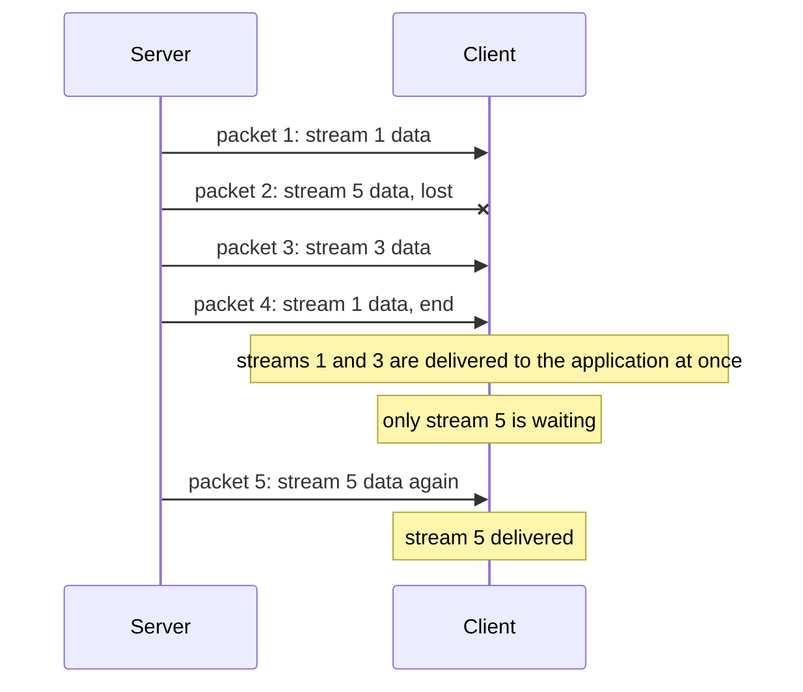
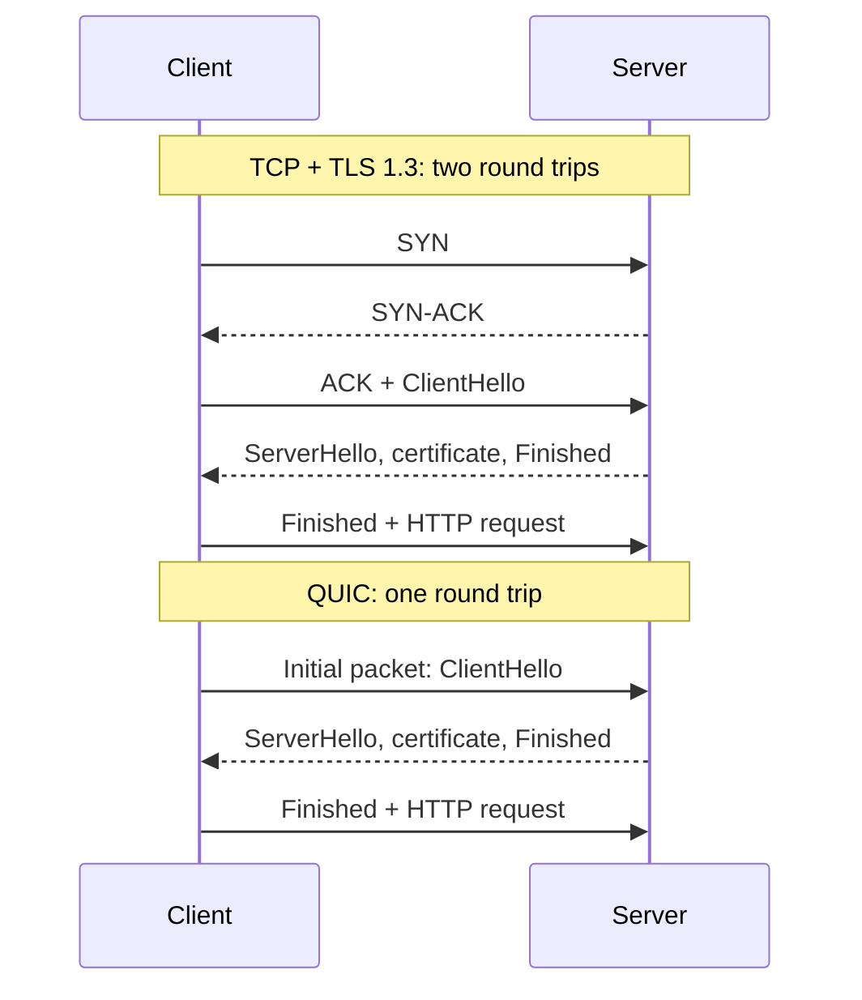

# HTTP/3 and QUIC

> **Before this lesson:** read [HTTP/2: streams, multiplexing and HPACK](#/lesson/networking/http2). You also need the TCP handshake and UDP from [UDP and the TCP connection lifecycle](#/lesson/networking/udp-tcp-lifecycle), loss recovery from [Flow control and congestion control](#/lesson/networking/tcp-flow-congestion), and the TLS 1.3 handshake and 0-RTT from [TLS in practice](#/lesson/networking/tls-in-practice).

## In plain words

HTTP/2 put many conversations onto one TCP connection. That solved queuing at the HTTP level but exposed a deeper limit: TCP sees only one long line of bytes. It does not know that the line contains ten separate conversations. When a single packet goes missing, TCP holds back everything behind it, and all ten conversations freeze until the missing piece is resent.

Imagine a motorway with five lanes that, for historical reasons, passes through a tunnel with one lane. A breakdown in the tunnel stops every car, whatever lane it was in before. HTTP/2 built the five lanes; TCP is the one-lane tunnel.

You cannot widen that tunnel: TCP is implemented inside operating systems and understood by millions of network devices that would reject a changed version. So engineers built a new road next to it. **QUIC** is a new transport protocol that runs on top of UDP. It knows about separate streams, so a lost packet delays only the stream it belonged to. It has encryption built in, starts faster, and survives a phone switching from Wi-Fi to mobile data. **HTTP/3** is HTTP carried over QUIC.

Why this matters for a job: HTTP/3 already carries a large share of traffic to major sites and CDNs, and browsers use it automatically when a server offers it. You need to know when it helps (lossy and mobile networks), what is required to enable it (UDP port 443 open, a way to advertise it), and how to explain why a new transport was necessary. "Why does HTTP/3 use UDP?" is a common senior-level interview question.

## Four problems with TCP that could not be fixed in place

**1. Head-of-line blocking in the transport.** As described above: one lost packet stalls all multiplexed streams.

**2. Slow connection setup.** A new HTTPS connection needs a TCP handshake (one round trip) and then a TLS handshake (one more with TLS 1.3). Two round trips before the first request, on every new connection.

**3. Connections are tied to addresses.** A TCP connection is identified by the two IP addresses and two ports. When a phone leaves Wi-Fi for cellular its address changes, and every connection breaks and must be rebuilt from nothing.

**4. Ossification.** TCP's headers are unencrypted, and many devices in the network (firewalls, NATs, "optimising" proxies) inspect and even rewrite them. Those devices were built against TCP as it existed years ago and drop or mangle anything unfamiliar. As a result, improvements such as TCP Fast Open could not be deployed reliably. A protocol that has become impossible to change because the network depends on its exact shape is said to be **ossified**. Also, TCP lives in the operating system kernel, so even a successful change takes years to reach users.

## QUIC in one picture

```
        HTTP/1.1 and HTTP/2                     HTTP/3
   +-----------------------+          +-----------------------+
   |         HTTP          |          |        HTTP/3         |
   +-----------------------+          +-----------------------+
   |          TLS          |          |  QUIC                 |
   +-----------------------+          |   streams, reliability|
   |          TCP          |          |   congestion control  |
   |  reliability, order,  |          |   + TLS 1.3 built in  |
   |  congestion control   |          +-----------------------+
   +-----------------------+          |          UDP          |
   |          IP           |          +-----------------------+
   +-----------------------+          |          IP           |
                                      +-----------------------+
```

QUIC takes over everything TCP did (reliable delivery, flow control, congestion control) and everything TLS did (encryption and authentication), and adds streams as a built-in concept.

### Why UDP?

Not because UDP is fast. UDP is used because it is the only other transport that the Internet's middleboxes reliably pass, and because it adds almost nothing: ports and a checksum. It is a thin wrapper that lets QUIC packets travel through existing networks. All the reliability that UDP lacks is implemented by QUIC itself, in ordinary application code rather than in the kernel. That means a browser or server can ship an improved QUIC with its next release instead of waiting for operating system upgrades.

## What QUIC does differently

### Independent streams

QUIC delivers data in order **within each stream**, not across the whole connection. Each stream has its own sequence of bytes. If a packet carrying part of stream 5 is lost, streams 1 and 3 continue to be delivered; only stream 5 waits for the retransmission.



### Try it: one lost packet, two transports

The simulation sends packets belonging to three streams. One packet is lost and arrives late as a retransmission. It prints when each stream's data becomes available to the application under TCP-style ordering (one order for the whole connection) and QUIC-style ordering (order per stream).

```python-run
# (packet number, stream, arrival time in ms). Packet 2 was lost; its retransmission arrives at 250.
packets = [(1, "A", 10), (2, "B", 250), (3, "C", 30), (4, "A", 40), (5, "C", 50), (6, "B", 60)]

def tcp_like(packets):
    """All bytes are released strictly in packet order."""
    finished, ready_at = {}, 0
    for number, stream, arrival in sorted(packets):      # in sending order
        ready_at = max(ready_at, arrival)                # cannot be released before earlier packets
        finished[stream] = ready_at                      # the stream's last piece so far
    return finished

def quic_like(packets):
    """Each stream is ordered separately."""
    finished = {}
    for number, stream, arrival in sorted(packets):
        finished[stream] = max(finished.get(stream, 0), arrival)
    return finished

tcp, quic = tcp_like(packets), quic_like(packets)
print("stream  complete (TCP-like)  complete (QUIC-like)")
for stream in "ABC":
    print(f"{stream:6}  {tcp[stream]:13} ms  {quic[stream]:15} ms")
```

Streams A and C lost nothing, yet with one ordered byte stream they are not released until 250 ms. With per-stream ordering they complete at 40 and 50 ms. Stream B waits in both cases, which is unavoidable.

### A faster handshake

QUIC merges the transport handshake and the TLS 1.3 handshake into one exchange. The first packet from the client carries both "I want a connection" and the TLS ClientHello.

| | TCP + TLS 1.2 | TCP + TLS 1.3 | QUIC (first visit) | QUIC (returning, 0-RTT) |
|---|---|---|---|---|
| Round trips before the request | 3 | 2 | 1 | 0 |
| At 100 ms RTT | 300 ms | 200 ms | 100 ms | 0 ms |



On a return visit the client can use **0-RTT**: it sends the request in its very first packets, encrypted with a key from the earlier session. The same warning applies as with TLS 1.3 early data: such data can be replayed by an attacker, so it is restricted to requests that are safe to repeat.

```python-run
def first_byte_ms(rtt, setup_round_trips, server_ms=30):
    return (setup_round_trips + 1) * rtt + server_ms     # setup, then request/response

options = [("HTTP/1.1 or 2: TCP + TLS 1.2", 3), ("HTTP/1.1 or 2: TCP + TLS 1.3", 2),
           ("HTTP/3: QUIC, first visit", 1), ("HTTP/3: QUIC, 0-RTT", 0)]
for rtt in (25, 100, 300):
    print(f"RTT {rtt} ms")
    for label, trips in options:
        print(f"   {label:30} {first_byte_ms(rtt, trips):5} ms to first byte")
```

On a 300 ms connection (a weak mobile signal or an intercontinental path) the gap between the first and last line is nearly a second.

### Connection migration

A QUIC connection is not identified by addresses and ports. Each side chooses **connection IDs**, and every packet carries one. If the client's IP address changes, the server recognises the connection by its ID, checks that the new path really reaches the client (**path validation**), and carries on. Downloads, calls and page loads continue across a move from Wi-Fi to cellular.

Connection IDs help servers too: a load balancer can route by connection ID, so a connection keeps reaching the same backend even when the client's address changes.

### Encryption everywhere

In QUIC, encryption is not an option layered on top; there is no unencrypted mode. TLS 1.3 is built in. And QUIC encrypts far more than TLS over TCP does: not only the payload but almost all of the transport header, including packet numbers and acknowledgements. Only a few fields needed for routing, such as the connection ID, stay visible.

This protects privacy, and it is a deliberate defence against ossification: middleboxes cannot build assumptions around fields they cannot read, so QUIC stays free to evolve.

### Better loss recovery

QUIC's designers fixed several long-standing awkward points of TCP:

- **Packet numbers never repeat.** A retransmission is sent in a new packet with a new number. In TCP a retransmitted segment reuses the same sequence number, so an acknowledgement cannot say which copy it answers, making RTT measurement ambiguous. QUIC always knows.
- **Richer acknowledgements.** QUIC reports many received ranges and includes how long the receiver delayed before acknowledging, giving the sender precise RTT samples.
- **Congestion control is pluggable.** QUIC uses the same family of algorithms as TCP (CUBIC, BBR), but they live in the application and can be updated or chosen per use.

QUIC is not exempt from congestion control: it must share the network fairly with TCP traffic.

## HTTP/3: HTTP mapped onto QUIC

Since QUIC provides streams, HTTP/3 is simpler than HTTP/2 in some respects. HTTP/2's own stream multiplexing and per-stream flow control are gone, because the transport does those jobs.

- Each request and response uses one QUIC stream.
- HTTP/3 has frames, such as `HEADERS` and `DATA`, but they carry no stream identifier: the QUIC stream they arrive on says which exchange they belong to.
- The semantics, once again, are unchanged: same methods, status codes and headers.

### QPACK: header compression without a shared queue

HPACK, HTTP/2's header compression, assumes that both sides process header blocks in exactly the order they were sent, because each block may change the shared dynamic table. That assumption held on TCP's single ordered stream. On QUIC, streams arrive independently; requiring them to be processed in a fixed order would bring head-of-line blocking straight back.

HTTP/3 therefore uses **QPACK**. Changes to the dynamic table travel on a dedicated one-way stream, and each header block states which table state it needs. A decoder can process a block as soon as the entries it refers to have arrived, and an encoder can choose to refer only to entries already acknowledged, so that header blocks are never held up by a lost packet on another stream. It is a trade-off between compression and risk of blocking that the encoder controls.

## How a browser finds HTTP/3

There is a bootstrapping problem. A URL says `https://`, which says nothing about HTTP/3, and HTTP/3 uses UDP while everything else uses TCP. A browser cannot know in advance whether a server speaks it.

Two discovery mechanisms exist:

1. **The `Alt-Svc` response header.** The first connection is made over TCP with HTTP/2 or HTTP/1.1. The server's response includes:

   ```
   alt-svc: h3=":443"; ma=86400
   ```

   meaning "this same service is also available over HTTP/3 on UDP port 443; remember that for 86,400 seconds". The browser uses HTTP/3 for later connections.

2. **The DNS `HTTPS` record.** The site's DNS can state the supported protocols (`alpn="h3,h2"`), so the browser knows before the first connection.

Because some networks block or throttle UDP, browsers do not rely on QUIC alone. They **race** a QUIC attempt against a TCP attempt and use whichever succeeds, and they remember when QUIC has failed on the current network. For the user, HTTP/3 either works or silently is not used.

```
$ curl -sv --http3 https://shop.example.com/ -o /dev/null
* Connected to shop.example.com (203.0.113.80) port 443
* using HTTP/3
* [HTTP/3] [0] OPENED stream for https://shop.example.com/    <- QUIC stream 0
* [HTTP/3] [0] [:method: GET]
* [HTTP/3] [0] [:authority: shop.example.com]
> GET / HTTP/3
>
< HTTP/3 200
< content-type: text/html; charset=utf-8
< alt-svc: h3=":443"; ma=86400                                <- advertised for future visits
```

## The three versions side by side

| | HTTP/1.1 | HTTP/2 | HTTP/3 |
|---|---|---|---|
| Transport | TCP | TCP | QUIC over UDP |
| Message format | text | binary frames | binary frames |
| Concurrent exchanges per connection | 1 | many (multiplexed) | many (multiplexed) |
| Connections per origin (browser) | up to 6 | 1 | 1 |
| Head-of-line blocking | at HTTP and TCP level | at TCP level only | none across streams |
| Header compression | none | HPACK | QPACK |
| Encryption | optional | required by browsers | always (TLS 1.3 built in) |
| Setup round trips (new connection) | 2–3 with TLS | 2–3 | 1, or 0 when resumed |
| Survives a change of IP address | no | no | yes (connection IDs) |
| Protocol selection | default | ALPN `h2` | `Alt-Svc` or DNS `HTTPS` record, ALPN `h3` |

## When HTTP/3 helps, and what it costs

**It helps most** where networks are imperfect: mobile connections, congested Wi-Fi, long-distance paths with high RTT and some loss. The gains show up in the slow tail (the worst few percent of page loads) more than in the median. Users who move between networks benefit from migration.

**It helps little** on fast, clean, low-latency connections, where handshakes are quick and loss is rare.

**Costs and cautions:**

- **CPU.** QUIC runs in user space and encrypts every packet individually. It has traditionally used more CPU per byte than TCP with TLS, which benefits from decades of kernel and hardware optimisation. The gap has narrowed but matters for very high-volume servers.
- **UDP on your own network.** Firewalls, load balancers and security groups must allow UDP port 443, and load balancers need to understand QUIC to keep a connection on one backend.
- **Observability.** Tools that relied on reading TCP headers see almost nothing in QUIC. Debugging uses endpoint logs in a standard format called qlog.
- **Fallback is permanent.** Some networks will always block UDP, so HTTP/2 must keep working.

In practice most teams enable HTTP/3 by switching it on at their CDN or load balancer, which handles all of the above; the application behind it is unchanged.

> [!INTERVIEW]
> **"Why was HTTP/3 built on UDP instead of improving TCP?"** HTTP/2 multiplexes streams over a single TCP byte stream, so one lost packet blocks all of them. Removing that requires a transport that understands streams. TCP could not be changed: it is in kernels and is inspected and rewritten by middleboxes, which makes it ossified. QUIC is a new transport implemented in user space on top of UDP, which passes through existing networks. It offers independent streams, a combined transport and TLS 1.3 handshake of one round trip (zero when resumed), connection migration through connection IDs, and encrypted transport headers. HTTP/3 maps HTTP onto it and replaces HPACK with QPACK so that header compression does not reintroduce ordering dependencies.

> [!TIP]
> To check whether a site offers HTTP/3, look for the `alt-svc` header with `curl -sI https://site/`, or watch the Protocol column in browser developer tools: the first load often shows `h2` and subsequent loads `h3`, which is the `Alt-Svc` upgrade happening.

> [!WARNING]
> "QUIC is unreliable because it uses UDP" is a common misunderstanding. QUIC is fully reliable: it acknowledges, retransmits, orders data within streams, and performs congestion control. It uses UDP only as a carrier.

## Pitfalls

- **Expecting a dramatic gain everywhere.** Measure on real user connections, and look at the tail.
- **Forgetting to open UDP 443** on firewalls and cloud security rules. HTTP/3 then never activates, and nothing reports an error.
- **Enabling 0-RTT for requests with side effects.** Replay risk.
- **Assuming packet loss no longer matters.** The affected stream still waits, and loss still shrinks the congestion window for the whole connection.
- **Removing HTTP/2 support.** HTTP/3 always needs a fallback.
- **Treating the client's IP address as a stable identity.** With migration it can change during a connection.

## Summary

- TCP's single ordered byte stream causes head-of-line blocking across HTTP/2 streams, needs separate transport and TLS handshakes, breaks when addresses change, and cannot be evolved.
- QUIC is a reliable, encrypted, stream-aware transport built on UDP and implemented in user space.
- Streams are ordered independently, so loss affects only the stream concerned.
- The handshake takes one round trip, zero when resuming; connection IDs allow migration between networks; almost the whole packet is encrypted.
- HTTP/3 keeps HTTP semantics, relies on QUIC for multiplexing, and uses QPACK for headers.
- Browsers discover HTTP/3 through `Alt-Svc` or DNS `HTTPS` records and fall back to HTTP/2 when UDP is unavailable.
- Benefits are greatest on lossy, high-latency and mobile networks.

## Glossary

- **QUIC**: a transport protocol over UDP with built-in encryption and streams.
- **HTTP/3**: HTTP semantics carried over QUIC.
- **Ossification**: a protocol becoming unchangeable because deployed devices depend on its exact form.
- **User space**: code that runs as part of an application, as opposed to inside the operating system kernel.
- **Middlebox**: a device in the network path that inspects or modifies traffic.
- **QUIC stream**: an independently ordered sequence of bytes within a connection.
- **Connection ID**: an identifier carried in QUIC packets that names the connection independently of addresses.
- **Connection migration**: keeping a connection alive when a client's address changes.
- **Path validation**: checking that a new address really reaches the peer.
- **0-RTT**: sending application data in the first flight of a resumed connection.
- **Packet number**: QUIC's per-packet counter, never reused.
- **QPACK**: HTTP/3's header compression, designed for out-of-order delivery.
- **Alt-Svc**: a header advertising an alternative protocol endpoint for the same service.
- **HTTPS record**: a DNS record type that can list supported protocols.
- **qlog**: a standard logging format for QUIC endpoints.

## Check yourself

```quiz
[
  {"q": "Which HTTP/2 limitation is the main motivation for HTTP/3?",
   "options": ["Headers are not compressed", "All streams share one TCP byte stream, so a lost packet blocks every stream", "It cannot use TLS", "It allows only six connections"], "answer": 1,
   "explain": "TCP delivers bytes in a single order and is unaware of streams. QUIC orders each stream separately."},
  {"q": "Why does QUIC run over UDP?",
   "options": ["UDP guarantees delivery", "UDP is a minimal transport that existing networks pass, letting QUIC implement its own reliability in user space", "UDP is encrypted", "UDP has built-in congestion control"], "answer": 1,
   "explain": "A brand-new IP-level protocol would be dropped by many devices, and TCP could not be changed. UDP provides ports and little else, leaving QUIC free to do the rest."},
  {"q": "How many round trips does a first-time QUIC connection need before the HTTP request can be sent?",
   "options": ["Zero", "One", "Two", "Three"], "answer": 1,
   "explain": "QUIC combines the transport and TLS 1.3 handshakes into one exchange. A resumed connection can use 0-RTT."},
  {"q": "A phone switches from Wi-Fi to cellular during a download over HTTP/3. What happens?",
   "options": ["The connection breaks, as with TCP", "The connection continues, identified by its connection ID after the new path is validated", "The download restarts over HTTP/1.1", "The server blocks the new address"], "answer": 1,
   "explain": "QUIC connections are named by connection IDs, not by addresses and ports, so they can migrate."},
  {"q": "Why does HTTP/3 use QPACK instead of HPACK?",
   "options": ["HPACK is not secure", "HPACK requires header blocks to be processed in sending order, which would reintroduce blocking across independent streams", "QPACK compresses images", "HPACK only works with HTTP/1.1"], "answer": 1,
   "explain": "HPACK depends on a strictly ordered byte stream. QPACK lets blocks be decoded as soon as the table entries they reference are available."},
  {"q": "How does a browser usually learn that a site supports HTTP/3?",
   "options": ["From the URL scheme h3://", "From an Alt-Svc response header or a DNS HTTPS record", "From the TCP handshake", "From the certificate's subject"], "answer": 1,
   "explain": "The first visit typically uses TCP. The server advertises HTTP/3, and later connections use it."},
  {"q": "Which statement about QUIC is correct?",
   "options": ["It is unreliable because it uses UDP", "It has no congestion control", "It provides reliable, ordered delivery per stream, with encryption always on", "It can run without TLS"], "answer": 2,
   "explain": "QUIC implements acknowledgement, retransmission and congestion control itself, and TLS 1.3 is an integral part."},
  {"q": "On which kind of connection is HTTP/3 likely to show the largest improvement over HTTP/2?",
   "options": ["A wired data-centre link with 1 ms RTT and no loss", "A mobile connection with high RTT and occasional packet loss", "A local loopback connection", "Any connection, equally"], "answer": 1,
   "explain": "Faster handshakes matter most when round trips are long, and independent streams matter most when packets are lost."}
]
```

> **Source:** Grigorik, *High Performance Browser Networking*, ch. 12 "HTTP/2" (for the TCP head-of-line limitation that motivates HTTP/3; coverage only), https://hpbn.co/http2/ . HTTP/3 and QUIC postdate the book; facts checked against RFC 9000 (QUIC transport), RFC 9001 (QUIC and TLS), RFC 9002 (loss detection), RFC 9114 (HTTP/3), RFC 9204 (QPACK) and RFC 7838 (Alt-Svc), at https://www.rfc-editor.org/ , and MDN's HTTP/3 glossary entry (https://developer.mozilla.org/en-US/docs/Glossary/HTTP_3).
