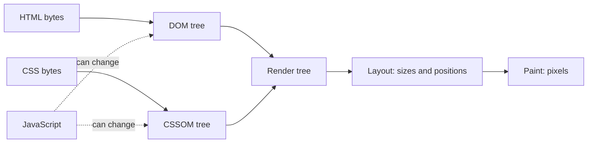

# Browser networking: connections, resource hints and the critical rendering path

> **Before this lesson:** you need the request sequence from [What happens when you type a URL](#/lesson/networking/url-walkthrough), connection reuse and the six-connection limit from [From HTTP/0.9 to HTTP/1.1](#/lesson/networking/http1), and multiplexing from [HTTP/2](#/lesson/networking/http2). A little HTML is shown; each tag is explained.

## In plain words

Loading a web page is not one download. The browser receives an HTML file, and that file is a shopping list: it mentions stylesheets, scripts, fonts and images, and some of those mention still more files. The browser must discover each item, fetch it, and assemble everything into pixels.

Think of cooking a dinner from a recipe you are reading for the first time. You cannot start the sauce until you reach the line that mentions it. Some steps block others: you cannot serve until the main dish is done, however ready the salad is. A good cook reads ahead, puts the water on to boil early, and starts with whatever takes longest.

A browser behaves like that good cook. It keeps connections ready, reads ahead in the HTML to find files early, and decides what to fetch first. As a developer you can help it with **resource hints** ("you will need this soon") and by removing obstacles on the **critical rendering path**: the chain of steps and files that must complete before anything can appear on screen.

Why this matters for a job: front-end and full-stack engineers are measured on page speed. Search ranking, conversion rates and user patience all depend on it. Knowing which resources block rendering and how to prioritise them is a core skill, and "how would you make this page load faster?" is asked in almost every web interview.

## The browser as a network manager

Before any tuning, it helps to know what the browser already does for you.

**Connection pools.** The browser keeps open connections grouped by origin (scheme, host and port) and reuses them. For HTTP/1.1 it opens up to **six connections per host**; requests beyond that wait in a queue. For HTTP/2 and HTTP/3 it uses one connection and multiplexes.

**Prioritisation.** The browser assigns each request a priority by type and position: the HTML document and render-blocking CSS are highest, scripts and fonts high, images inside the visible area medium, and images further down low. With HTTP/2 and HTTP/3 these priorities are passed to the server.

**The preload scanner.** While the main HTML parser is stuck waiting for a script, a second lightweight scanner races ahead through the raw HTML looking for URLs to fetch. This is why resources written directly in the HTML are discovered early, and resources created later by JavaScript are not.

**Speculation.** Browsers learn which hosts a site usually needs and may resolve DNS or open connections to them before the HTML asks.

**Caches.** DNS cache, connection reuse, the HTTP cache and others all avoid work that has been done before.

### Try it: six connections versus multiplexing

A page needs 30 small files from one host; each takes one round trip (100 ms). With HTTP/1.1 only six can be in flight at once. With HTTP/2 all go out together.

```python-run
import math

def http1_ms(resources, rtt, connections=6):
    rounds = math.ceil(resources / connections)      # each connection carries one request at a time
    return rounds * rtt

def http2_ms(resources, rtt):
    return rtt                                        # everything is multiplexed in one round trip

for n in (6, 30, 90):
    print(f"{n:2} resources at 100 ms RTT:  HTTP/1.1 {http1_ms(n, 100):5} ms   HTTP/2 {http2_ms(n, 100):4} ms")
```

This simple model ignores bandwidth and slow start, but it shows where the queuing in an HTTP/1.1 waterfall comes from.

## The critical rendering path

To draw a page, the browser goes through a fixed sequence.



1. **DOM.** The browser parses HTML into the **DOM** (Document Object Model), a tree with one node per element. This happens incrementally as bytes arrive.
2. **CSSOM.** Stylesheets are parsed into the **CSSOM** (CSS Object Model), a tree of style rules.
3. **Render tree.** DOM and CSSOM are combined into the list of visible things and their styles.
4. **Layout.** The browser computes the exact size and position of every box.
5. **Paint.** Pixels are drawn.

Two facts about this pipeline explain most of page-speed work.

### CSS blocks rendering

The browser will not paint until it has the CSSOM. If it drew first and applied styles afterwards, users would see a flash of unstyled content and then a jarring rearrangement. So every stylesheet referenced in the page's head is **render-blocking**: nothing appears until all of them have downloaded and been parsed.

Consequence: keep the CSS required for the first screen small and get it to the browser fast.

### JavaScript blocks parsing

A plain `<script src="app.js"></script>` stops the HTML parser at that point. The script may modify the document, so the browser must download it and run it before continuing. And because a script may ask about styles, the browser also waits for any CSS still being fetched before running it. A script like this is **parser-blocking**.

Two attributes change that:

```html
<script src="app.js"></script>         <!-- blocks parsing while it downloads and runs -->
<script src="app.js" async></script>   <!-- downloads in parallel; runs as soon as it arrives -->
<script src="app.js" defer></script>   <!-- downloads in parallel; runs after parsing, in order -->
```

| | Blocks HTML parsing while downloading? | Runs when | Order kept? | Use for |
|---|---|---|---|---|
| (neither) | yes | immediately | yes | rarely justified |
| `async` | no | whenever it arrives (pausing the parser briefly) | no | independent scripts such as analytics |
| `defer` | no | after the document is parsed | yes | application code |

Scripts loaded as modules (`type="module"`) behave like `defer` by default.

### The critical path, defined

The **critical rendering path** is the minimum set of resources and steps needed for the first meaningful paint: typically the HTML, the render-blocking CSS, any parser-blocking scripts in the head, and often a font and a main image. Its length in round trips sets a floor on how fast the page can appear.

Three numbers summarise it: how many critical resources there are, how many bytes they total, and how long the longest dependency chain is (HTML → CSS → a font named inside that CSS is a chain of three).

### Try it: how a dependency chain delays the first paint

The simulation models discovery. A resource can only start downloading after the resource that mentions it has arrived. Each fetch takes one round trip. Then the same page is loaded with the late-discovered files hinted in advance.

```python-run
RTT = 100   # milliseconds per fetch (connection already open)

# resource -> the resource in which the browser discovers it
PAGE = {
    "index.html": None,
    "site.css":   "index.html",
    "app.js":     "index.html",
    "font.woff2": "site.css",        # mentioned inside the stylesheet
    "hero.jpg":   "app.js",          # inserted into the page by the script
}
BLOCKS_FIRST_PAINT = ["index.html", "site.css", "font.woff2", "hero.jpg"]

def load(page, hinted=()):
    finish = {}
    def done(name):
        if name not in finish:
            parent = page[name]
            if parent is None:
                start = 0
            elif name in hinted:
                start = done("index.html")       # the HTML told the browser about it directly
            else:
                start = done(parent)             # must wait for the parent to arrive first
            finish[name] = start + RTT
        return finish[name]
    for name in page:
        done(name)
    return finish

for label, hinted in (("no hints", ()), ("font and hero image preloaded", ("font.woff2", "hero.jpg"))):
    times = load(PAGE, hinted)
    print(label)
    for name, t in times.items():
        print(f"   {name:11} arrives at {t} ms")
    print("   first full paint at", max(times[n] for n in BLOCKS_FIRST_PAINT), "ms\n")
```

Without hints the font and the main image arrive at 300 ms, because the browser could not know about them until the stylesheet and script had been fetched. With hints they are requested as soon as the HTML arrives and everything is in by 200 ms. Nothing got smaller or faster; the requests started earlier. That is the whole idea behind resource hints.

## Resource hints

A **resource hint** is a line of HTML (or an HTTP header) that tells the browser about something it will need before it would have found out by itself. They go in the document's `<head>`.

```html
<link rel="dns-prefetch" href="https://cdn.example.net">
<link rel="preconnect"   href="https://cdn.example.net" crossorigin>
<link rel="preload"      href="/fonts/body.woff2" as="font" type="font/woff2" crossorigin>
<link rel="preload"      href="/img/hero.avif" as="image" fetchpriority="high">
<link rel="prefetch"     href="/checkout.js">
<link rel="modulepreload" href="/js/app.mjs">
```

| Hint | What the browser does | Cost if unused | Typical use |
|---|---|---|---|
| `dns-prefetch` | resolves the host name | negligible | third-party hosts you might contact |
| `preconnect` | DNS + TCP + TLS: a ready connection | an idle connection (CPU, memory, battery) | the two or three most important other origins |
| `preload` | downloads a specific file now, at high priority, for **this** page | wasted bytes, and it competes with other critical requests | late-discovered critical files: fonts, the main image, a script loaded by another script |
| `prefetch` | downloads a file at low priority for a **future** navigation | wasted bytes on metered connections | the likely next page |
| `modulepreload` | fetches and parses a JavaScript module and its dependencies | wasted bytes | module-based applications |

Related tools:

- **`fetchpriority="high"`** (or `"low"`) on an image, script or link adjusts the browser's default priority. Marking the main image high is one of the most effective single changes for many pages.
- **`103 Early Hints`**: the server sends an interim response containing `Link` headers for preloading or preconnecting *while it is still computing the real response*. The browser uses time that was otherwise idle.
- **`loading="lazy"`** on images and iframes does the opposite of a hint: do not fetch until the element is about to scroll into view, keeping bandwidth for what matters now.

How much does `preconnect` save? Exactly the setup round trips for that origin:

```python-run
def saved_ms(rtt, tls13=True, dns_ms=30):
    tcp = rtt
    tls = rtt if tls13 else 2 * rtt
    return dns_ms + tcp + tls

for rtt in (30, 100, 250):
    print(f"RTT {rtt:3} ms: preconnect removes about {saved_ms(rtt)} ms from the first request to that origin")
```

> [!WARNING]
> Hints are a way of reordering work, and every hint competes with everything else. Preloading ten files makes none of them a priority and can delay the truly critical CSS. Preconnecting to a dozen origins wastes handshakes. Use a small number, and confirm in the browser's network panel that each one was actually used (browsers log a warning for preloaded files that go unused).

## Making the critical path short

A practical checklist, roughly in order of payoff.

1. **Get the first bytes out quickly.** Everything waits for the HTML. Reduce server time, cache HTML at a CDN where possible, and avoid redirects, each of which costs a complete round-trip sequence.
2. **Fit the essentials into the first round trip.** A new connection's initial congestion window is about 14 kB. If the compressed HTML together with the styles needed for the first screen fits in that, the browser can start rendering after the first data round trip. Small **critical CSS** is often inlined in the HTML for this reason, with the remainder loaded without blocking.
3. **Do not let scripts block.** Use `defer` or modules for application code and `async` for independent third-party scripts.
4. **Flatten dependency chains.** Preload fonts and other files that are only discovered inside CSS or JavaScript.
5. **Prioritise the main image.** Reference it directly in the HTML (not from a script), mark it `fetchpriority="high"`, never lazy-load it, and serve an appropriately sized, modern format.
6. **Tame fonts.** Text using a web font may stay invisible until the font arrives. The CSS setting `font-display: swap` shows a fallback font at once and swaps later.
7. **Lazy-load everything below the first screen.**
8. **Audit third parties.** Each external script adds DNS lookups, connections and often blocking work. They are the most common cause of regressions.

## What to measure

A page has no single "load time". These milestones are the ones used in practice:

| Metric | What it marks | Good value |
|---|---|---|
| **TTFB**, time to first byte | from navigation start until the first byte of the HTML arrives | under 0.8 s |
| **FCP**, first contentful paint | the first text or image appears | under 1.8 s |
| **LCP**, largest contentful paint | the largest visible element (often the main image or headline) appears | under 2.5 s |
| **CLS**, cumulative layout shift | how much visible content jumps around while loading (a score, not a time) | under 0.1 |
| **INP**, interaction to next paint | how quickly the page responds visually to clicks and key presses | under 200 ms |

LCP, CLS and INP are Google's **Core Web Vitals**. LCP is the one most directly governed by networking: it is roughly TTFB, plus the delay before the browser discovers the main resource, plus its download time, plus render time. Resource hints attack the discovery delay.

## Reading a waterfall

The network panel in browser developer tools draws one bar per request against time: a **waterfall chart**. A sketch:

```
                    0 ms      200       400       600       800
index.html          |==DNS=TCP=TLS==|#wait#|=dl=|
site.css                                    |#wait#|=dl=|
app.js                                      |#wait#|==dl==|
cdn: lib.js                                 |=DNS=TCP=TLS=|#wait#|=dl=|        <- new origin: full setup
font.woff2                                           |#wait#|=dl=|             <- found only inside site.css
hero.jpg                                                     |#wait#|===dl===| <- found only after app.js ran
                                                                    ^ first paint       ^ LCP
```

What to look for:

- **Long setup segments** (DNS, connect, TLS) on a bar: a new origin. Candidate for `preconnect`, or for moving the file to your own origin.
- **A long "waiting" segment**: the server is slow to respond (high TTFB for that request).
- **Bars that start late** although nothing else was happening: late discovery. Candidate for `preload`, or for putting the reference in the HTML.
- **A staircase of bars starting one after another** on HTTP/1.1: queuing behind the six-connection limit.
- **A long download segment**: a large file. Compress it, resize it or split it.

## A note on origins and CORS

Browsers enforce the **same-origin policy**: a script from one origin may not freely read responses from another. **CORS** (Cross-Origin Resource Sharing) is the mechanism by which a server opts in, using `Access-Control-Allow-Origin` and related response headers.

It has a networking cost worth knowing. For cross-origin requests that are not "simple" (for example a `POST` with a JSON body, or any request with custom headers), the browser first sends a **preflight**: an `OPTIONS` request asking for permission. That is an extra round trip before the real request. Servers can let the browser remember the answer with `Access-Control-Max-Age`, and serving your API from the same origin as your pages avoids preflights altogether.

> [!INTERVIEW]
> **"A page takes four seconds to show its main content. How do you investigate and fix it?"** Open the waterfall and split LCP into its parts. High TTFB: look at server time, caching at the CDN, redirects. Late discovery of the LCP image or font: reference it in the HTML, preload it, set `fetchpriority="high"`. Render-blocking resources: inline critical CSS, defer scripts, remove or async third-party tags. Slow download: compress, resize, modern formats. New origins: preconnect or self-host. Then confirm with field data from real users, not only a lab run on a fast machine.

> [!TIP]
> Always test with throttling. Developer tools can simulate a slow mobile connection and a slower CPU. A page that feels instant on a development laptop with a warm cache can take ten seconds for a real user on a mid-range phone.

## Pitfalls

- **Preloading everything.** Priorities only mean something when few things have them.
- **Lazy-loading the main image.** It delays the very thing LCP measures.
- **Putting critical resources behind JavaScript.** The preload scanner cannot see them.
- **`async` on scripts that depend on each other.** They run in arrival order, which varies.
- **Forgetting `crossorigin` on font preloads.** Fonts are fetched in a special mode; without the attribute the preloaded copy is not reused and the font downloads twice.
- **Counting on the cache.** First-time visitors have an empty one.
- **Optimising the median only.** The slowest tenth of visits is where users give up.

## Summary

- The browser pools and reuses connections, prioritises requests, scans ahead for URLs and caches aggressively.
- Rendering needs the DOM and the CSSOM; CSS is render-blocking, and plain scripts are parser-blocking. `defer` and `async` remove the script block.
- The critical rendering path is the set of resources required for first paint; shorten it by reducing their number, their size and the depth of their dependency chains.
- Resource hints start work early: `dns-prefetch`, `preconnect`, `preload`, `prefetch`, `modulepreload`, plus `fetchpriority` and `103 Early Hints`. Use few.
- Measure TTFB, FCP, LCP, CLS and INP; read waterfalls for late starts, long setups and long waits.
- Cross-origin requests may need a CORS preflight round trip.

## Glossary

- **Origin**: scheme, host and port together.
- **Connection pool**: the browser's set of reusable connections per origin.
- **Preload scanner**: a secondary parser that looks ahead for resources to fetch.
- **DOM / CSSOM**: the tree of document elements / of style rules.
- **Render tree, layout, paint**: the visible elements with styles; computing geometry; drawing pixels.
- **Render-blocking**: must be loaded before anything is painted (CSS).
- **Parser-blocking**: stops HTML parsing until it runs (plain scripts).
- **`async` / `defer`**: script attributes that avoid blocking the parser.
- **Critical rendering path**: the steps and resources required for the first paint.
- **Critical CSS**: the styles needed for the first screen.
- **Resource hint**: an instruction telling the browser about a future need.
- **`preconnect` / `preload` / `prefetch`**: open a connection early / fetch a file for this page / fetch a file for a later page.
- **`fetchpriority`**: an attribute raising or lowering a request's priority.
- **Lazy loading**: postponing a fetch until the content is nearly visible.
- **TTFB, FCP, LCP, CLS, INP**: standard page-performance metrics.
- **Core Web Vitals**: LCP, CLS and INP.
- **Waterfall chart**: a timeline of a page's requests.
- **Same-origin policy / CORS / preflight**: the browser's cross-origin restriction / the opt-in mechanism / the permission request sent beforehand.

## Check yourself

```quiz
[
  {"q": "Why does a stylesheet linked in the head delay the first paint?",
   "options": ["CSS files are always large", "The browser will not render until it has built the CSSOM", "CSS blocks DNS lookups", "Stylesheets cannot be cached"], "answer": 1,
   "explain": "Painting without styles would show unstyled content and then rearrange it, so browsers treat CSS as render-blocking."},
  {"q": "Which script attribute downloads in parallel and runs scripts in document order after parsing has finished?",
   "options": ["async", "defer", "nomodule", "crossorigin"], "answer": 1,
   "explain": "defer keeps execution order and waits for the parser. async runs each script as soon as it arrives, in no fixed order."},
  {"q": "A font is referenced only inside a CSS file. When does the browser discover it without any hint?",
   "options": ["As soon as the HTML arrives", "Only after the CSS has been downloaded and parsed", "After all images have loaded", "During the TLS handshake"], "answer": 1,
   "explain": "The URL is inside the stylesheet, so the browser cannot know about it earlier. A preload hint in the HTML removes that delay."},
  {"q": "What does <link rel=\"preconnect\"> do?",
   "options": ["Downloads a file at high priority", "Performs the DNS lookup, TCP handshake and TLS handshake to an origin in advance", "Caches the page for offline use", "Runs a script early"], "answer": 1,
   "explain": "It prepares a connection so that the first real request to that origin skips the setup round trips."},
  {"q": "What is the difference between preload and prefetch?",
   "options": ["They are identical", "preload is for a resource needed by the current page, at high priority; prefetch is for a likely future navigation, at low priority", "prefetch is only for fonts", "preload works only over HTTP/3"], "answer": 1,
   "explain": "Using prefetch for something needed now makes it arrive late; using preload for something not needed wastes high-priority bandwidth."},
  {"q": "Which metric is defined as the moment the largest visible element finishes rendering?",
   "options": ["TTFB", "FCP", "LCP", "CLS"], "answer": 2,
   "explain": "Largest contentful paint. It is often the main image or headline and is strongly affected by when that resource is discovered and downloaded."},
  {"q": "In a waterfall, a request to a new host shows long DNS, connect and TLS segments before any data. Which change addresses this most directly?",
   "options": ["Add defer to the script", "Add a preconnect hint for that origin, or serve the file from your own origin", "Increase max-age", "Lazy-load the HTML"], "answer": 1,
   "explain": "The time is spent establishing a connection. Preconnect moves that work earlier; self-hosting removes it."},
  {"q": "A page's main image has loading=\"lazy\". What is the likely effect on LCP?",
   "options": ["It improves, because fewer bytes are fetched", "It gets worse, because the browser postpones fetching the element that LCP measures", "No effect", "The image is never shown"], "answer": 1,
   "explain": "Lazy loading delays the fetch until layout confirms the image is near the viewport. The LCP element should load eagerly with high priority."}
]
```

> **Source:** Grigorik, *High Performance Browser Networking*, ch. 10 "Primer on Web Performance" and ch. 14 "Primer on Browser Networking" (topic coverage only; ch. 14 is in the online edition), https://hpbn.co/primer-on-web-performance/ and https://hpbn.co/primer-on-browser-networking/ . Facts checked against MDN "Critical rendering path" (https://developer.mozilla.org/en-US/docs/Web/Performance/Guides/Critical_rendering_path), MDN on `rel=preload` and `preconnect`, and web.dev's Core Web Vitals thresholds (https://web.dev/articles/vitals).
