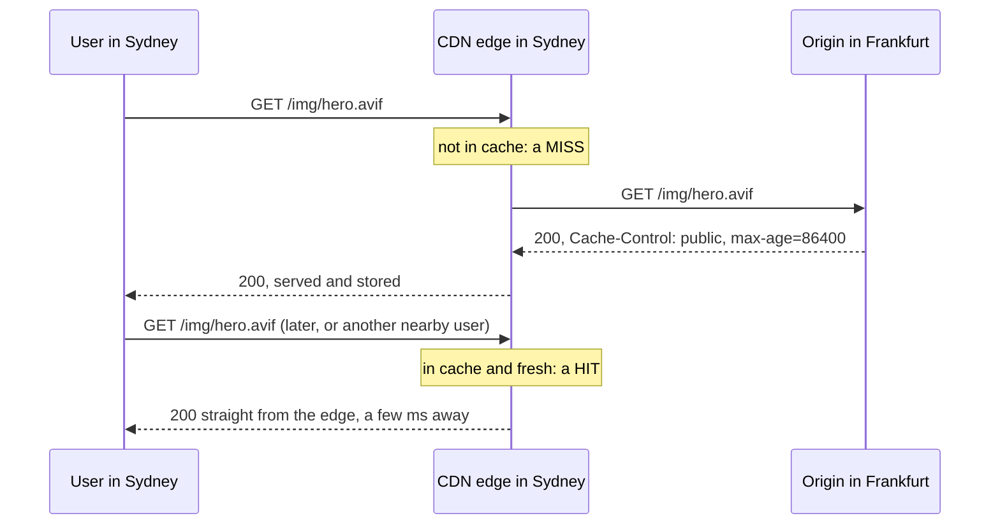
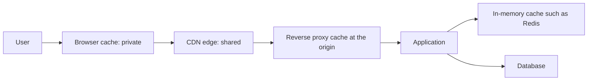

# Measuring performance, CDNs, compression and caching strategy

> **Before this lesson:** read [Browser networking](#/lesson/networking/browser-connections-rendering) for the page-load metrics, [HTTP caching, cookies and content negotiation](#/lesson/networking/http-caching-cookies) for `Cache-Control` and `ETag`, and [Latency and bandwidth](#/lesson/networking/latency-bandwidth) for percentiles and why distance matters.

## In plain words

"The site feels slow" is not something you can fix. "For users in Brazil, the time before the first byte arrives is 900 milliseconds at the 75th percentile, and 600 of those are the connection setup" is. The first half of this lesson is about turning a feeling into numbers, using timing information that every browser records for every page.

The second half covers the three tools that most reliably improve those numbers:

- A **CDN** (content delivery network) is like a chain of local warehouses. A shop that ships every order from one factory makes distant customers wait. Stock the popular items in warehouses near every city and most orders arrive the next morning. A CDN keeps copies of your files on servers near your users.
- **Compression** is like vacuum-packing a duvet before posting it: the same thing, far smaller in transit, restored on arrival.
- A **caching strategy** decides what may be kept where and for how long, so that most requests never reach your servers at all.

Why this matters for a job: performance work without measurement is guesswork, and teams track these exact metrics on dashboards. Almost every production site sits behind a CDN, and configuring one correctly (what to cache, how to invalidate, how to compress) is routine work for web and platform engineers. Interviewers frequently ask "how does a CDN work?" and "how would you measure page performance for real users?".

## Part 1: Measuring

### Lab data and field data

There are two ways to measure, and you need both.

- **Lab** (or **synthetic**) measurement loads the page on a machine you control, with a fixed device and network profile. It is repeatable and ideal for debugging and for catching regressions before release. Tools: Lighthouse, WebPageTest, the browser's developer tools.
- **Field** measurement, also called **RUM** (real user monitoring), collects timings from real visitors' browsers. It shows what people actually experience across all their devices, networks and locations. It is the truth, but noisy, and it tells you *that* something is slow more easily than *why*.

Use field data to find out where you stand and what to prioritise; use the lab to reproduce and fix.

Because experiences differ so much, always summarise with percentiles, not averages. The common convention for web metrics is the 75th percentile (p75): three quarters of visits were at least this fast.

### Navigation Timing: the page's own stopwatch

Browsers expose a set of standard measurement interfaces to JavaScript. **Navigation Timing** records timestamps for each phase of loading the main document. All values are in milliseconds from the start of the navigation.

```
startTime (0)
  │  redirects
fetchStart
  │  (cache check)
domainLookupStart ── domainLookupEnd          DNS
connectStart ─────── connectEnd               TCP (+ TLS)
        secureConnectionStart                  └ TLS begins here
requestStart                                   request sent
  │  server thinks, network latency
responseStart                                  first byte arrives   = TTFB
  │  body downloads
responseEnd
domInteractive                                 HTML parsed
domContentLoadedEventEnd                       deferred scripts have run
loadEventEnd                                   all sub-resources loaded
```

From these timestamps you compute durations by subtraction:

| Phase | Formula |
|---|---|
| Redirect time | `fetchStart − startTime` |
| DNS lookup | `domainLookupEnd − domainLookupStart` |
| TCP connect | `secureConnectionStart − connectStart` (for HTTPS) |
| TLS handshake | `connectEnd − secureConnectionStart` |
| Waiting for the server | `responseStart − requestStart` |
| **TTFB** (time to first byte) | `responseStart − startTime` |
| Download of the HTML | `responseEnd − responseStart` |
| HTML parsing and blocking scripts | `domInteractive − responseEnd` |

In a browser, reading the entry takes one line:

```javascript
const [nav] = performance.getEntriesByType("navigation");
console.log("TTFB:", nav.responseStart - nav.startTime, "ms");
console.log("protocol:", nav.nextHopProtocol);        // "h2", "h3", "http/1.1"
```

### Try it: break a page load into phases

The dictionary below holds the kind of values a browser would report for one visit. The program computes each phase and draws a simple bar chart, so you can see where the time went.

```python-run
entry = {   # milliseconds since the start of the navigation, as reported by a browser
    "startTime": 0, "fetchStart": 310,                 # 310 ms were spent following a redirect
    "domainLookupStart": 312, "domainLookupEnd": 352,
    "connectStart": 352, "secureConnectionStart": 442, "connectEnd": 535,
    "requestStart": 536, "responseStart": 866, "responseEnd": 921,
    "domInteractive": 1410, "loadEventEnd": 2890,
}

phases = [
    ("redirect",        entry["fetchStart"] - entry["startTime"]),
    ("DNS lookup",      entry["domainLookupEnd"] - entry["domainLookupStart"]),
    ("TCP connect",     entry["secureConnectionStart"] - entry["connectStart"]),
    ("TLS handshake",   entry["connectEnd"] - entry["secureConnectionStart"]),
    ("server wait",     entry["responseStart"] - entry["requestStart"]),
    ("HTML download",   entry["responseEnd"] - entry["responseStart"]),
    ("parse + scripts", entry["domInteractive"] - entry["responseEnd"]),
]
for name, ms in phases:
    print(f"{name:16} {ms:5} ms  " + "#" * (ms // 20))

print()
print("TTFB =", entry["responseStart"] - entry["startTime"], "ms")
print("estimated round-trip time (from the TCP connect) =",
      entry["secureConnectionStart"] - entry["connectStart"], "ms")
```

Reading the result as an engineer would: TTFB is 866 ms, which is poor. Of that, 310 ms is a redirect that could be removed (for example with HSTS, or by linking to the final URL), about 180 ms is connection setup at a 90 ms RTT (a nearer server or CDN would shrink it), and 330 ms is server waiting, of which only about 90 is the network round trip, so the server itself spends roughly 240 ms producing the page. Three separate problems, each with a different owner.

A handy trick appears on the last line: the TCP connect time is one round trip, so it gives you the user's RTT to your server for free.

### Resource Timing, Server-Timing and observers

**Resource Timing** records the same phase timestamps for every sub-resource: each script, stylesheet, image and API call. From it you can find slow third parties, see which requests reused a connection (DNS and connect durations of zero), and check transfer sizes (`transferSize` of zero means it came from the browser cache).

One restriction: for resources from another origin, the detailed timestamps are hidden for privacy unless that server sends the response header `Timing-Allow-Origin`. Without it you see only the total duration.

**Server-Timing** lets your backend report its own internal breakdown to the browser in a response header:

```
Server-Timing: db;dur=118, render;dur=64, cache;desc="miss"
```

Those values appear in developer tools and in the timing entry, which connects front-end and back-end measurements for the same request.

For metrics that happen over time, such as LCP, layout shifts and interaction delays, code registers a `PerformanceObserver` that is called whenever a new entry is recorded. RUM libraries are built on it; they gather the values and send them to a collection endpoint when the page is hidden or closed.

## Part 2: Content delivery networks

### The idea

A **CDN** is a network of servers placed in many locations around the world. Each location is a **point of presence** (PoP), also called an **edge**. Your own servers are the **origin**. Users connect to a nearby edge instead of the distant origin.



This is the **pull** model, used by nearly all CDNs: the edge fetches from the origin the first time something is requested, then serves its stored copy. There is nothing to upload in advance.

### How users reach the nearest edge

Two techniques, both met in earlier lessons:

- **DNS-based routing.** Your host name is a `CNAME` to the CDN. The CDN's DNS servers answer each query with the address of an edge chosen for that resolver's location and current load.
- **Anycast.** The CDN announces the same IP addresses from every location with BGP, and Internet routing delivers each user to the nearest site.

### Why it is faster

1. **Distance.** Round trips to an edge 10 ms away replace round trips to an origin 150 ms away. This shortens the TCP handshake, the TLS handshake and every later exchange.
2. **Cached responses** never touch the origin.
3. **Even uncacheable requests benefit.** The user's connection setup is with the nearby edge. The edge keeps long-lived, already warmed-up connections to the origin, often over the CDN's private backbone, so the long-haul leg skips handshakes and slow start.
4. **Modern protocols at the edge.** TLS 1.3, HTTP/2 and HTTP/3 are offered to users even when the origin speaks only HTTP/1.1.

### What else it does

- **Absorbs load and attacks.** Traffic spikes and floods are spread over a huge network and filtered before they reach you.
- **Terminates TLS** and manages certificates.
- **Transforms content**: compression, image resizing and format conversion.
- **Runs code at the edge**: small functions that modify requests and responses, handle redirects or authentication, or assemble pages near the user (**edge computing**).

### The concepts you must manage

**Cache key.** The edge must decide whether two requests are "the same". By default the key is the host plus the path and query string. Whatever varies the response must be part of the key (or declared with `Vary`); whatever does not should be excluded. A tracking parameter such as `?utm_source=...` that changes nothing would otherwise create a separate cache entry for every campaign link.

**Hit ratio.** The share of requests answered from cache. It is the main health indicator of a CDN configuration.

```python-run
def origin_load(requests_per_second, hit_ratio):
    return requests_per_second * (1 - hit_ratio)

def average_latency(hit_ratio, edge_ms, origin_ms):
    return hit_ratio * edge_ms + (1 - hit_ratio) * (edge_ms + origin_ms)

print("hit ratio   origin load (of 10,000 req/s)   average latency")
for hit in (0.0, 0.50, 0.90, 0.95, 0.99):
    print(f"{hit:8.0%}   {origin_load(10_000, hit):12,.0f} req/s"
          f"              {average_latency(hit, 15, 220):6.1f} ms")
```

Look at the step from 90% to 95%: the origin's load halves. And from 95% to 99% it falls by five times again. Small improvements in hit ratio at the top end are worth a lot. The reverse holds too: if a purge or an outage empties the cache, the origin suddenly receives the full 10,000 requests per second. Capacity planning has to consider that.

**TTL and invalidation.** The edge obeys your `Cache-Control` (`s-maxage` applies to it specifically). When content changes before its TTL ends, you have three options: wait; **purge** (ask the CDN to delete specific URLs or everything carrying a given tag); or avoid the issue entirely by using fingerprinted URLs that never change content.

**Origin shield.** With hundreds of edges, a new or expired object could be requested from the origin hundreds of times. A shield is a designated middle layer of cache that all edges ask first, so the origin sees one request.

**Thundering herd.** When a popular object expires, many simultaneous requests may all miss at once and stampede to the origin. CDNs collapse them into a single origin fetch, and `stale-while-revalidate` lets the edge keep serving the old copy while one request refreshes it.

**Serving stale on error.** With `stale-if-error`, an edge may serve an expired copy when the origin is down. Your site stays up, slightly out of date, during an origin outage.

Reading what the CDN did, from response headers (names vary between providers):

```
$ curl -sI https://shop.example.com/img/hero.avif
HTTP/2 200
content-type: image/avif
cache-control: public, max-age=31536000, immutable
age: 5127                      <- seconds this copy has been in the CDN's cache
x-cache: HIT                   <- served from the edge (provider-specific header)
server-timing: cdn-cache;desc=HIT, edge;dur=1
```

`age: 0` with a `MISS` on every request means the object is not being cached; the usual culprits are a `Set-Cookie` header on the response, `Cache-Control: private`, or a cache key polluted by a varying query string or `Vary` header.

## Part 3: Compression

### What it is and where it applies

**Compression** re-encodes data in fewer bytes; the receiver reverses it exactly (**lossless** compression). HTTP negotiates it per response: the browser sends `Accept-Encoding: gzip, br, zstd`, the server replies with `Content-Encoding: br`.

| Algorithm | Token | Notes |
|---|---|---|
| gzip | `gzip` | universal; fast; the baseline |
| Brotli | `br` | 15–25% smaller than gzip on text at high levels; slower to compress at those levels; supported by all modern browsers over HTTPS |
| Zstandard | `zstd` | very fast at good ratios; newer browser support; well suited to compressing on the fly |

Text formats compress extremely well because they are repetitive: HTML, CSS, JavaScript, JSON, SVG and XML typically shrink by 60 to 85%.

```python-run
import zlib, json, random

rng = random.Random(1)

# A JSON API response: many records with the same keys (very repetitive).
records = [{"id": i, "name": f"product-{i}", "price": rng.randint(100, 9999), "in_stock": i % 3 != 0}
           for i in range(500)]
json_bytes = json.dumps(records).encode()

# Random bytes: stand-in for data that is already compressed (JPEG, video, zip).
random_bytes = bytes(rng.randrange(256) for _ in range(len(json_bytes)))

def report(label, data):
    for level in (1, 6, 9):                       # 1 = fastest, 9 = smallest
        packed = zlib.compress(data, level)       # the DEFLATE algorithm used by gzip
        print(f"{label:14} level {level}: {len(data):6} -> {len(packed):6} bytes "
              f"({len(packed) / len(data):5.1%} of original)")

report("JSON", json_bytes)
report("random bytes", random_bytes)
```

The JSON shrinks to a small fraction of its size. The random data does not shrink at all and in fact grows by a few bytes. That is the rule for what to compress:

- **Compress** text: HTML, CSS, JavaScript, JSON, SVG, plain text, XML.
- **Do not compress** formats that are already compressed: JPEG, PNG, WebP, AVIF, video, audio, zip archives, most fonts in WOFF2. It wastes CPU and saves nothing.
- **Do not bother** with very small responses (under roughly a kilobyte): the saving is negligible.

### Practical choices

- **Static files:** compress once at build time at the maximum level (Brotli 11) and serve the stored result. CPU cost is paid once.
- **Dynamic responses:** compress on the fly at a moderate level (Brotli 4–5, gzip 6, or zstd). Higher levels cost more time than they save.
- **Always send `Vary: Accept-Encoding`** so caches keep the variants apart.
- **Minify first.** Minification removes whitespace and comments and shortens names in CSS and JavaScript before compression; the two combine.
- **Images are usually most of a page's bytes**, and they need different treatment: serve dimensions that match the display size, use modern formats (AVIF, WebP), and choose a sensible quality level. These are **lossy** formats: they discard detail the eye barely notices in exchange for much smaller files.

> [!WARNING]
> Compressing a response that mixes a secret (such as a session token) with text an attacker can influence can leak the secret through the response size; this is the BREACH attack. Avoid reflecting user input in the same compressed response as secrets, or mask the secret per request.

## Part 4: Caching strategy across the layers

A request can be answered at several points before it reaches your application code. A deliberate strategy assigns each kind of content to the right layers.



| Content | Browser | CDN | Header |
|---|---|---|---|
| Fingerprinted assets (`app.3f9a1c.js`) | 1 year | 1 year | `public, max-age=31536000, immutable` |
| HTML for anonymous visitors | always revalidate | short, with background refresh | `public, max-age=0, s-maxage=60, stale-while-revalidate=300` |
| Images at stable URLs | hours to days | days | `public, max-age=86400` |
| Public API data that tolerates a few seconds of staleness | seconds | seconds | `public, max-age=5, s-maxage=30, stale-if-error=600` |
| Personalised pages and API responses | revalidate, or not stored | never | `private, no-cache` or `no-store` |

Principles behind the table:

1. **Cache as close to the user as correctness allows.**
2. **Make change explicit.** Either the URL changes when the content does (fingerprinting), or the TTL is short, or you purge. Never rely on a long TTL for a URL whose content changes in place.
3. **Separate what is shared from what is personal.** A page that is 95% identical for everyone can be cached publicly if the personal part is fetched separately by the browser.
4. **Keep the cache key minimal and correct.**
5. **Plan for a cold cache and for failure.** Use request collapsing, `stale-while-revalidate` and `stale-if-error`, and make sure the origin survives a full purge.

Deeper inside the system, the same thinking continues with application caches (for example Redis) in front of databases, which is a topic for backend design.

> [!INTERVIEW]
> **"How does a CDN work, and what would you cache on it?"** Users are directed to a nearby edge by DNS or anycast. The edge terminates TLS and serves from its cache when it holds a fresh copy; otherwise it fetches from the origin over a persistent connection, stores the response according to `Cache-Control`, and returns it. Benefits: shorter round trips for handshakes and data, offloading the origin, absorbing spikes and attacks. Cache static assets with fingerprinted names for a year; cache anonymous HTML and public API responses briefly with `s-maxage` and `stale-while-revalidate`; never cache personalised responses. Mention the cache key, the hit ratio, purging, and what happens to the origin when the cache is cold.

> [!TIP]
> Put `Server-Timing` on your responses from day one. When someone reports a slow page, you can read the split between CDN, application and database directly in their browser's network panel instead of correlating logs by hand.

## Pitfalls

- **Judging by lab results on a fast laptop.** Field data from real devices and networks is what counts.
- **Reporting averages.** Use p75 and higher percentiles.
- **A CDN in front of responses that all set cookies or say `private`.** Nothing is cached and the hit ratio is near zero.
- **Unbounded cache keys.** Random query parameters or `Vary: User-Agent` fragment the cache.
- **Purging everything on each deployment.** The origin then takes the entire load. Prefer fingerprinted URLs.
- **Compressing images and video again**, or forgetting to compress JSON API responses.
- **Maximum compression level on dynamic responses.** CPU time can exceed the transfer time saved.
- **Missing `Timing-Allow-Origin`** on your own CDN-hosted assets, which hides their timing details from your measurements.

## Summary

- Measure in the lab for debugging and in the field for truth; summarise with percentiles.
- Navigation Timing splits a page load into redirect, DNS, connect, TLS, server wait, download and processing; Resource Timing does so per resource; `Server-Timing` adds the backend's view.
- A CDN serves users from nearby edges using a pull-through cache, shortening every round trip and shielding the origin. Manage the cache key, hit ratio, TTLs, purging and cold-cache behaviour.
- Compress text with Brotli, gzip or zstd; do not recompress media; precompress static files; send `Vary: Accept-Encoding`.
- A caching strategy assigns each kind of content to browser and CDN lifetimes, makes change explicit, and keeps personal data out of shared caches.

## Glossary

- **Lab / synthetic measurement**: testing in a controlled environment.
- **Field measurement / RUM**: timings collected from real users' browsers.
- **Navigation Timing / Resource Timing**: browser interfaces exposing phase timestamps for the page / for each resource.
- **TTFB**: time from navigation start to the first response byte.
- **`Timing-Allow-Origin`**: a header permitting detailed cross-origin timing.
- **`Server-Timing`**: a header carrying backend durations to the browser.
- **PerformanceObserver**: a browser interface that notifies code of new performance entries.
- **CDN**: a distributed network of caching servers.
- **Edge / PoP**: a CDN location close to users.
- **Origin**: the servers that own the content.
- **Pull model**: the edge fetches from the origin on the first request.
- **Cache key**: what a cache uses to decide two requests are the same.
- **Hit / miss / hit ratio**: served from cache / fetched from origin / the share of hits.
- **Purge**: explicitly removing content from a cache.
- **Origin shield**: a middle cache layer that protects the origin.
- **Thundering herd**: many simultaneous misses hitting the origin together.
- **`stale-if-error`**: permission to serve expired content when the origin fails.
- **Lossless / lossy compression**: exactly reversible / discarding detail for size.
- **gzip, Brotli, Zstandard**: HTTP content encodings.
- **Minification**: removing unnecessary characters from code.

## Check yourself

```quiz
[
  {"q": "What is the main difference between lab and field measurement?",
   "options": ["Lab data is always slower", "Lab data comes from a controlled test setup; field data comes from real users' devices and networks", "Field data cannot include LCP", "Lab data requires a CDN"], "answer": 1,
   "explain": "Lab runs are repeatable and good for debugging. Field data (RUM) reflects the real spread of user conditions."},
  {"q": "Using Navigation Timing, how is TTFB computed?",
   "options": ["responseEnd minus responseStart", "responseStart minus startTime", "connectEnd minus connectStart", "loadEventEnd minus fetchStart"], "answer": 1,
   "explain": "Time to first byte runs from the start of the navigation to the arrival of the first byte of the response."},
  {"q": "A Resource Timing entry shows DNS and connect durations of zero for a script. What is the most likely reason?",
   "options": ["The measurement is broken", "The request reused an existing connection", "The script was blocked", "The server is on the same machine"], "answer": 1,
   "explain": "No lookup or handshake was needed because a connection to that origin was already open. Zeros can also mean cross-origin details are hidden without Timing-Allow-Origin."},
  {"q": "Why does a CDN speed up even responses it cannot cache?",
   "options": ["It compresses the IP header", "The user's handshakes are with a nearby edge, and the edge reuses warm connections to the origin", "It skips TLS", "It increases the MTU"], "answer": 1,
   "explain": "Connection setup round trips happen over a short distance, and the long-haul leg avoids new handshakes and slow start."},
  {"q": "A CDN's hit ratio rises from 90% to 95%. What happens to origin traffic?",
   "options": ["It falls by 5%", "It halves", "It doubles", "It is unchanged"], "answer": 1,
   "explain": "The origin sees the misses: 10% of requests before, 5% after."},
  {"q": "Which response should NOT be compressed with gzip or Brotli?",
   "options": ["A 200 kB JSON document", "An HTML page", "A JPEG photograph", "A CSS file"], "answer": 2,
   "explain": "JPEG is already compressed. Further lossless compression costs CPU and saves almost nothing."},
  {"q": "What is the usual best practice for compressing static JavaScript bundles?",
   "options": ["Compress on every request at the highest level", "Precompress once at build time at a high level and serve the stored file", "Do not compress them", "Compress them in the browser"], "answer": 1,
   "explain": "Static files do not change between requests, so the expensive high-level compression can be done once in advance."},
  {"q": "Every response from an application carries Set-Cookie and Cache-Control: private. What will a CDN in front of it show?",
   "options": ["A hit ratio near 100%", "A hit ratio near zero", "Automatic purging", "Faster origin processing"], "answer": 1,
   "explain": "Private responses and responses setting cookies are not stored by shared caches, so nearly every request is forwarded to the origin."}
]
```

> **Source:** Grigorik, *High Performance Browser Networking*, ch. 10 "Primer on Web Performance" (Navigation and Resource Timing, synthetic versus real-user measurement, CDN and compression recommendations; coverage only), https://hpbn.co/primer-on-web-performance/ . Facts checked against MDN's PerformanceNavigationTiming and Server-Timing pages (https://developer.mozilla.org/en-US/docs/Web/API/PerformanceNavigationTiming , https://developer.mozilla.org/en-US/docs/Web/HTTP/Reference/Headers/Server-Timing), RFC 5861 (stale-if-error), RFC 7932 (Brotli) and RFC 8878 (Zstandard).
