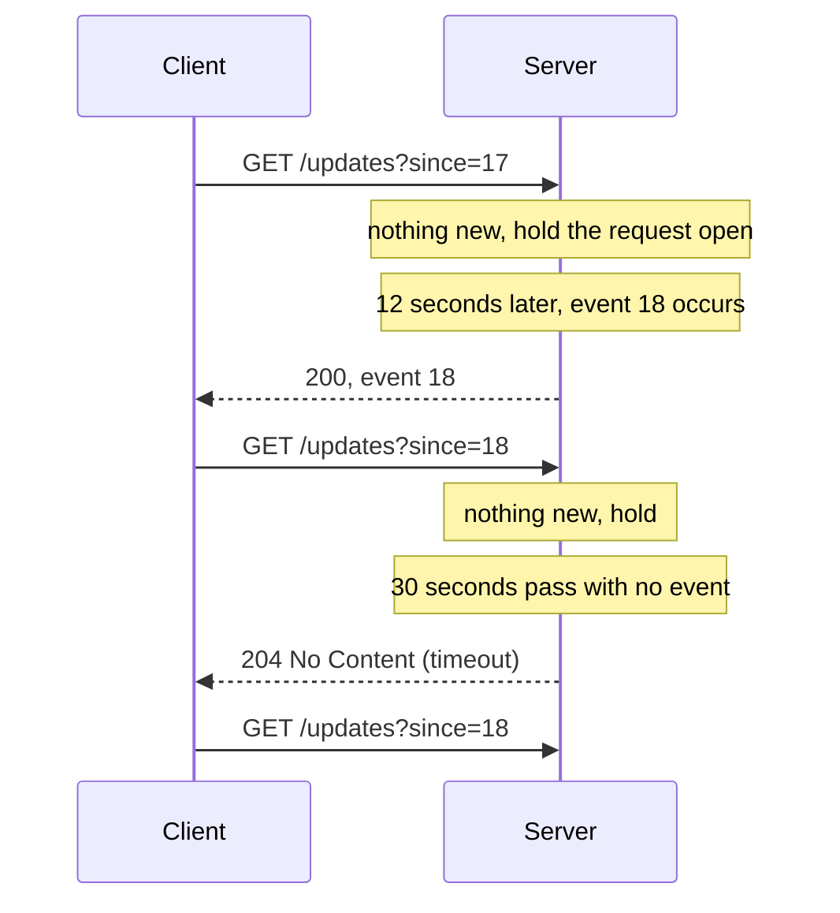

# XHR, fetch, polling, long polling and Server-Sent Events

> **Before this lesson:** read [From HTTP/0.9 to HTTP/1.1](#/lesson/networking/http1) for the request/response model, persistent connections and chunked transfer. Idle timeouts from [TCP in practice](#/lesson/networking/tcp-tuning) and the radio cost of periodic traffic from [Mobile networks](#/lesson/networking/cellular) explain several design choices here. JavaScript snippets are shown and explained line by line; you do not need to know the language.

## In plain words

HTTP has one firm rule: the client asks, the server answers. The server cannot start a conversation. That suits fetching a page. It is awkward for anything **live**: a chat message arriving, a price changing, a build finishing, an AI model writing its answer word by word. In all of those the new information appears on the server, and the server has no way to say "I have news".

Think of waiting for a parcel at a depot that will not phone you. You have a few options:

- **Polling:** phone them every five minutes and ask "is it there yet?". Simple, but most calls are wasted, and you learn of the arrival up to five minutes late.
- **Long polling:** phone once and say "stay on the line and tell me when it arrives". As soon as they answer, you hang up and phone again.
- **A one-way announcement line:** dial in once and listen; they announce every arrival as it happens. This is **Server-Sent Events**.
- **A proper two-way phone call**, where either side can speak at any time. This is **WebSocket**, in the next lesson.

Before the techniques, this lesson covers the tools a web page uses to make requests from code in the first place: the older **XMLHttpRequest** and the modern **fetch**.

Why this matters for a job: notifications, dashboards, collaborative editing and streaming responses from AI models are everyday product features. Choosing the simplest mechanism that works is a real design skill; so is knowing why "poll every second" hurts servers and phone batteries. "How would you push updates from server to browser?" is a classic interview question whose expected answer compares exactly these options.

## Requests from code: XHR and fetch

Early web pages could only talk to a server by loading a whole new page. Around 2000, browsers gained an interface that let JavaScript send an HTTP request in the background and use the result to update part of the page. It was named **XMLHttpRequest**, shortened to **XHR**. (The name is historical: it is not limited to XML.) The style of building pages this way was called **AJAX**, and it made applications such as web mail and online maps possible.

XHR works through callbacks and is clumsy to use. Its modern replacement is **`fetch`**.

```javascript
// Ask the server for JSON and use it.
const response = await fetch("/api/items/42", {       // send the request; wait for the headers
  method: "GET",
  headers: { "Accept": "application/json" },
});
if (!response.ok) {                                   // ok is true for status 200-299
  throw new Error("request failed: " + response.status);
}
const item = await response.json();                   // read the whole body and parse it as JSON
console.log(item.name);
```

Line by line: `fetch(...)` starts the request and returns a **promise**, an object standing for a result that will be available later. `await` pauses this function (without freezing the page) until the response headers have arrived. `response.ok` checks the status code. `response.json()` reads the body, which may take further time, hence the second `await`.

Three things about `fetch` surprise newcomers:

1. **An HTTP error status is not an exception.** `fetch` rejects only when the request could not complete at all (no network, DNS failure, blocked by CORS). A `404` or `500` is a successful exchange from its point of view; you must check `response.ok` yourself.
2. **There is no timeout by default.** A request to an unresponsive server can wait for a very long time. You add a limit with an **AbortController**:

   ```javascript
   const controller = new AbortController();
   const timer = setTimeout(() => controller.abort(), 5000);   // cancel after 5 seconds
   try {
     const response = await fetch("/api/slow", { signal: controller.signal });
     // ... use the response
   } finally {
     clearTimeout(timer);                                      // tidy up the timer
   }
   ```

   The same mechanism cancels requests that are no longer needed, for example when the user types another character into a search box.
3. **Cross-origin rules apply.** A page may call another origin only if that server allows it with CORS headers, and cookies are sent across origins only when the code asks (`credentials: "include"`) and the server permits it.

| | XMLHttpRequest | fetch |
|---|---|---|
| Style | callbacks and events | promises, `async`/`await` |
| Read the response as a stream, piece by piece | awkward | yes, `response.body` is a stream |
| Cancel | `xhr.abort()` | `AbortController` |
| Upload progress events | yes | limited |
| Works in service workers | no | yes |

One more option worth knowing: `fetch(url, { keepalive: true })` and `navigator.sendBeacon(url, data)` let a small request finish even while the page is closing. Analytics code uses them to send final measurements.

## Technique 1: polling

**Polling** means asking on a timer.

```javascript
setInterval(async () => {
  const response = await fetch("/api/notifications?since=" + lastSeenId);
  const news = await response.json();
  if (news.length > 0) show(news);
}, 5000);                                  // every 5,000 ms
```

It needs nothing special from the server or the network, which is its great strength. Its costs:

- **Delay.** News waits, on average, half the polling interval before it is seen, and up to a full interval.
- **Waste.** Most requests return "nothing new". Each still carries headers, takes server time, and on a phone wakes the radio.
- **A bad trade-off.** Shortening the interval to cut the delay multiplies the waste.

A cheap improvement uses caching semantics: the server attaches an `ETag`, the client polls with `If-None-Match`, and an unchanged result costs only a `304` with no body. Polling remains a sound choice when updates are infrequent and a delay of tens of seconds is acceptable.

## Technique 2: long polling

**Long polling** keeps the request/response model and changes when the server replies. The client sends a request; if the server has nothing new, **it does not answer yet**. It holds the request open until something happens or a timeout (say 30 seconds) passes. Then it responds, and the client immediately sends the next request.



Now events arrive almost at once, and there are no empty replies during quiet periods except one per timeout. Details that make it work:

- **A cursor.** The `since=18` parameter tells the server the last event the client has. Events that occur in the gap between a response and the next request are not lost; the next request picks them up.
- **A server timeout shorter than every idle timeout on the path** (proxies, load balancers, NATs), so the server answers before something in the middle cuts the connection.
- **A server built for many open requests.** Thousands of clients each hold a connection open nearly all the time. Servers that dedicate a thread to each connection cope badly; event-driven servers cope well.

Its weaknesses: every event costs a complete request and response with all their headers; bursts of events turn it back into rapid polling; and the logic for ordering and resuming is yours to write. Long polling is the fallback that works everywhere, including through restrictive proxies.

### Try it: polling against long polling

The simulation runs ten minutes in which five events occur at given times. It counts requests and measures how long each event waited before the client learned of it.

```python-run
EVENTS = [37, 121, 122, 300, 512]        # seconds at which something new happens
DURATION = 600

def polling(interval):
    requests, delays = 0, []
    pending = list(EVENTS)
    t = interval
    while t <= DURATION:
        requests += 1                                 # one request per tick
        while pending and pending[0] <= t:            # everything that happened since last time
            delays.append(t - pending.pop(0))
        t += interval
    return requests, delays

def long_polling(timeout=30):
    requests, delays = 0, []
    pending = list(EVENTS)
    t = 0                                             # time the current request was sent
    while t < DURATION:
        requests += 1
        if pending and pending[0] <= t + timeout:     # an event arrives while we are waiting
            now = max(pending[0], t)                  # answered the moment it happens
            while pending and pending[0] <= now:
                delays.append(now - pending.pop(0))
            t = now
        else:
            t += timeout                              # server gave up: empty reply, ask again
    return requests, delays

def show(label, result):
    requests, delays = result
    average = sum(delays) / len(delays)
    print(f"{label:22} {requests:4} requests   average wait {average:5.1f} s   worst {max(delays):3} s")

show("poll every 60 s", polling(60))
show("poll every 5 s", polling(5))
show("long poll, 30 s hold", long_polling())
```

Polling every 60 seconds is cheap (10 requests) and slow to notice things. Polling every 5 seconds notices within a few seconds and costs 120 requests, almost all empty. Long polling delivers every event at once for about two dozen requests.

## Technique 3: streaming and Server-Sent Events

Long polling ends the response after one event. Why not keep the response open and continue writing? HTTP allows a response body of unknown length (chunked transfer in HTTP/1.1, a sequence of DATA frames in HTTP/2), so a server can send a few bytes now and a few more whenever it likes. This is **HTTP streaming**.

**Server-Sent Events** (SSE) is the standard built on that idea: a simple text format for a stream of events, plus a browser interface, `EventSource`, that handles the connection for you.

### The wire format

The server responds with `Content-Type: text/event-stream` and writes events as plain UTF-8 text. Each event is a few `field: value` lines followed by a **blank line**.

```
HTTP/1.1 200 OK
Content-Type: text/event-stream
Cache-Control: no-cache

retry: 5000                       <- on disconnect, wait 5,000 ms before reconnecting

id: 41                            <- this event's identifier
data: {"user": "mei", "text": "hello"}

id: 42
event: typing                     <- a named event type (the default type is "message")
data: {"user": "omar"}

: keep-alive comment              <- a line starting with a colon is ignored by the client

id: 43
data: first line                  <- several data lines are joined with a newline
data: second line

```

Four fields exist: `data` (the payload), `event` (a type name), `id` (an identifier), and `retry` (the reconnection delay in milliseconds).

### The browser side

```javascript
const source = new EventSource("/api/stream");             // opens the connection

source.onmessage = (e) => {                                // events with no "event:" field
  console.log("message", e.lastEventId, e.data);
};
source.addEventListener("typing", (e) => {                 // events named "typing"
  console.log("someone is typing:", e.data);
});
source.onerror = () => console.log("connection lost; the browser will retry by itself");
```

### What SSE gives you for free

- **Automatic reconnection.** If the connection drops, the browser waits the `retry` interval and connects again. You write no reconnection code.
- **Resuming.** On reconnecting, the browser adds the header `Last-Event-ID: 43` with the last `id` it received. A server that keeps a short history can replay what was missed. This is the cursor from long polling, standardised.
- **It is ordinary HTTP.** It works with existing authentication, cookies, compression, load balancers and HTTP/2 multiplexing, and it is easy to inspect with curl:

```
$ curl -N -H "Accept: text/event-stream" https://app.example.com/api/stream
id: 41
data: {"user": "mei", "text": "hello"}

id: 42
event: typing
data: {"user": "omar"}
```

(`-N` tells curl not to buffer its output, so events appear as they arrive.)

### Try it: parse an event stream

This parser follows the rules above: split into lines, collect fields, and dispatch an event on each blank line.

```python-run
stream = (
    "retry: 5000\n"
    "\n"
    "id: 41\n"
    'data: {"user": "mei", "text": "hello"}\n'
    "\n"
    ": this is a comment used as a heartbeat\n"
    "id: 42\n"
    "event: typing\n"
    'data: {"user": "omar"}\n'
    "\n"
    "id: 43\n"
    "data: first line\n"
    "data: second line\n"
    "\n"
)

def parse_sse(text):
    events = []
    event_type, data_lines, last_id, retry = "message", [], None, None
    for line in text.split("\n"):
        if line == "":                                   # a blank line ends an event
            if data_lines:
                events.append({"type": event_type, "id": last_id, "data": "\n".join(data_lines)})
            event_type, data_lines = "message", []       # reset; the id persists
            continue
        if line.startswith(":"):                         # a comment: ignore it
            continue
        field, _, value = line.partition(":")
        value = value[1:] if value.startswith(" ") else value   # drop ONE leading space
        if field == "data":
            data_lines.append(value)
        elif field == "event":
            event_type = value
        elif field == "id":
            last_id = value
        elif field == "retry":
            retry = int(value)
    return events, last_id, retry

events, last_id, retry = parse_sse(stream)
for e in events:
    print(e)
print("reconnect delay:", retry, "ms")
print("on reconnect the browser would send: Last-Event-ID:", last_id)
```

Notice that the first block, containing only `retry`, produces no event because it has no `data`; and that the two `data` lines of the last event are joined with a newline.

### Limits of SSE

- **One direction.** Server to client only. The client sends things with ordinary separate requests, which is often perfectly adequate.
- **Text only.** UTF-8; binary data must be encoded, for example as Base64, which adds about a third to its size.
- **`EventSource` is restricted.** It can only issue `GET` and cannot set custom headers such as `Authorization`. Many applications therefore read the same `text/event-stream` format through `fetch` instead.
- **Connection limits on HTTP/1.1.** Each stream holds one of the six connections per host; a user with several tabs open can exhaust them. Over HTTP/2 or HTTP/3 a stream is one multiplexed stream among many, and the problem disappears.
- **Buffering intermediaries.** Some proxies collect a response before forwarding it, which freezes a stream. Remedies: `Cache-Control: no-cache`, disabling proxy buffering (for nginx, the response header `X-Accel-Buffering: no`), and not compressing the stream in a way that holds data back.
- **Silent death.** If no events flow, an idle timeout in the middle may cut the connection. Servers send a comment line every 15 to 30 seconds as a heartbeat.

### Streaming with fetch

`fetch` can read a response body incrementally. This is how most chat interfaces for AI models show an answer appearing word by word: the request is a `POST` carrying the prompt and an authorisation header (which `EventSource` cannot send), and the response is an event stream read through `fetch`.

```javascript
const response = await fetch("/api/chat", {
  method: "POST",
  headers: { "Content-Type": "application/json", "Authorization": "Bearer " + token },
  body: JSON.stringify({ prompt: "Explain DNS briefly" }),
});
const reader = response.body.getReader();               // a reader over the byte stream
const decoder = new TextDecoder();                      // converts bytes to text
while (true) {
  const { value, done } = await reader.read();          // wait for the next chunk
  if (done) break;                                      // the server finished
  appendToPage(decoder.decode(value, { stream: true }));
}
```

The price of doing it yourself: there is no automatic reconnection or `Last-Event-ID`, and network chunks do not line up with event boundaries, so your code must buffer text until it has seen a complete event ending in a blank line.

## Choosing among the three

| | Polling | Long polling | Server-Sent Events |
|---|---|---|---|
| Delay before the client sees an event | up to one interval | near zero | near zero |
| Requests during quiet periods | one per interval | one per timeout | none (a heartbeat line) |
| Overhead per event | full request and response | full request and response | a few bytes |
| Direction | client pulls | client pulls | server pushes, one way |
| Reconnect and resume | write it yourself | write it yourself | built in |
| Works through any proxy | yes | yes | usually; beware buffering |
| Server must hold connections open | no | yes | yes |

Rules of thumb:

- Data changes rarely and seconds of delay are fine: **poll**, with `ETag`s.
- The server needs to push events or a stream of text to the browser: **SSE**. It is the simplest tool that is properly real-time.
- The environment blocks streaming: **long polling** as a fallback.
- Both sides send frequently, or the data is binary, or latency must be minimal in both directions: **WebSocket**, the subject of the next lesson.

> [!INTERVIEW]
> **"How would you deliver live notifications to a web page?"** Start from requirements: direction, frequency, tolerated delay, scale. For one-way server-to-client updates, Server-Sent Events: a single long-lived HTTP response in `text/event-stream` format, with automatic reconnection and resumption through `Last-Event-ID`, working over standard HTTP infrastructure and multiplexed under HTTP/2. Mention heartbeats against idle timeouts, proxy buffering, and that the server must handle many concurrent open connections. Offer the alternatives: polling when updates are rare, long polling as a fallback, WebSocket when the client also sends frequently.

> [!TIP]
> Always design a real-time feed around a cursor (an event id or timestamp): "give me everything after X". With it, any of the techniques can recover from disconnections without losing or duplicating events, and you can switch technique later without changing the data model.

> [!WARNING]
> On mobile, short-interval polling keeps the cellular radio awake permanently (see the mobile lesson). If you must poll from a phone, use long intervals, stop when the app is in the background, and prefer the platform push service for anything that must arrive while the app is closed.

## Pitfalls

- **Treating a resolved `fetch` as success.** Check `response.ok`.
- **No timeout.** Add an `AbortController` to every request that could hang.
- **Polling faster to feel "real-time".** Cost grows linearly; switch technique instead.
- **A long-poll or SSE timeout longer than the load balancer's idle timeout.** Connections are cut mid-wait.
- **Forgetting the gap between requests in long polling.** Without a cursor, events that occur then are lost.
- **Many SSE connections over HTTP/1.1.** Six per host is the limit across all tabs.
- **Assuming chunks equal events when streaming with `fetch`.** Buffer until the blank line.
- **Thread-per-connection servers for long-lived connections.** They run out of threads.

## Summary

- HTTP is client-initiated; live updates need a technique layered on top.
- `fetch` is the modern request interface: promise-based, streamable, cancellable with `AbortController`. It does not reject on HTTP error statuses and has no default timeout.
- Polling is the simplest and wasteful; delay is tied to the interval.
- Long polling holds each request until news or a timeout; events arrive promptly at the cost of one full exchange per event.
- Server-Sent Events keep one response open and send `text/event-stream` events with `data`, `event`, `id` and `retry` fields; browsers reconnect and resume automatically.
- Use a cursor, send heartbeats, and respect idle timeouts whichever technique you choose.

## Glossary

- **XMLHttpRequest (XHR)**: the original browser interface for background HTTP requests.
- **AJAX**: updating a page with background requests instead of full reloads.
- **fetch**: the modern, promise-based request interface.
- **Promise**: an object representing a result that will be available later.
- **AbortController**: the mechanism for cancelling a `fetch`.
- **Polling**: requesting on a fixed timer.
- **Long polling**: the server holds a request open until it has something to return.
- **Cursor**: a marker (event id or time) saying what the client already has.
- **HTTP streaming**: sending a response body gradually over a long time.
- **Server-Sent Events (SSE)**: a standard text format and browser interface for server-to-client event streams.
- **EventSource**: the browser object that consumes an SSE stream.
- **`text/event-stream`**: the media type of SSE.
- **`Last-Event-ID`**: the header a reconnecting client sends to resume.
- **Heartbeat**: a periodic message that keeps a connection from being considered idle.
- **Proxy buffering**: an intermediary collecting a response before passing it on.

## Check yourself

```quiz
[
  {"q": "Why can a server not send a notification to a browser over plain HTTP whenever it wants?",
   "options": ["Browsers block all incoming data", "HTTP is request/response: the server can only answer a request the client has made", "TLS forbids it", "DNS does not allow it"], "answer": 1,
   "explain": "In HTTP the client always initiates. Real-time techniques work by having the client make a request that the server answers late or over a long time."},
  {"q": "A fetch call receives a 500 response. What does the returned promise do?",
   "options": ["Rejects with an error", "Resolves normally; the code must check response.ok or response.status", "Retries automatically", "Returns null"], "answer": 1,
   "explain": "fetch rejects only on network-level failure. HTTP error statuses are delivered as ordinary responses."},
  {"q": "A page polls every 20 seconds. On average, how long does a new event wait before the page sees it?",
   "options": ["About 0 seconds", "About 10 seconds", "About 20 seconds", "About 40 seconds"], "answer": 1,
   "explain": "Events occur at random points within an interval, so the average wait is half the interval and the worst case is the full interval."},
  {"q": "In long polling, what does the server do when it has no new data?",
   "options": ["Replies immediately with an empty body", "Holds the request open until data is available or a timeout expires", "Closes the TCP connection", "Sends a redirect"], "answer": 1,
   "explain": "Holding the request is what removes the empty replies and the delay of ordinary polling."},
  {"q": "Which Content-Type identifies a Server-Sent Events response?",
   "options": ["application/json", "text/event-stream", "multipart/form-data", "application/octet-stream"], "answer": 1,
   "explain": "The browser's EventSource requires text/event-stream and parses the body as events separated by blank lines."},
  {"q": "An SSE connection drops after the client received the event with id 87. What does the browser do?",
   "options": ["Nothing, the stream is over", "Reconnects after the retry delay and sends Last-Event-ID: 87", "Switches to WebSocket", "Reloads the page"], "answer": 1,
   "explain": "EventSource reconnects automatically and reports the last identifier it saw, so the server can replay missed events."},
  {"q": "Why do SSE servers send a comment line every 20 seconds or so when there are no events?",
   "options": ["To compress the stream", "To stop proxies, load balancers and NATs from closing the connection as idle", "To authenticate the client", "To reset the event id"], "answer": 1,
   "explain": "Intermediaries drop connections that carry no traffic. A harmless comment line acts as a heartbeat."},
  {"q": "Which requirement points away from SSE and toward WebSocket?",
   "options": ["The server pushes a text update a few times per minute", "The client and server both send many small messages per second, some of them binary", "Updates must resume after a disconnect", "The service runs behind HTTP/2"], "answer": 1,
   "explain": "SSE is one-way and text-only. Frequent two-way or binary messaging is what WebSocket is designed for."}
]
```

> **Source:** Grigorik, *High Performance Browser Networking*, ch. 15 "XMLHttpRequest" and ch. 16 "Server-Sent Events" (online edition, topic coverage only; not in the extracted special edition), https://hpbn.co/xmlhttprequest/ and https://hpbn.co/server-sent-events-sse/ . Facts checked against the WHATWG HTML standard's server-sent events section (https://html.spec.whatwg.org/multipage/server-sent-events.html), MDN "Using the Fetch API" (https://developer.mozilla.org/en-US/docs/Web/API/Fetch_API/Using_Fetch) and MDN "Using server-sent events".
