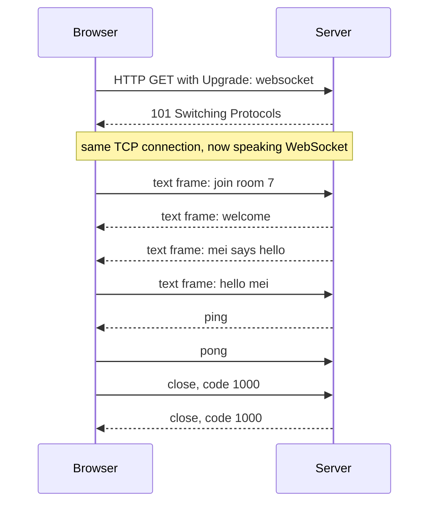
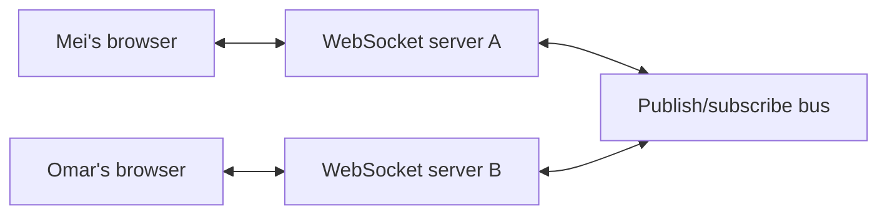
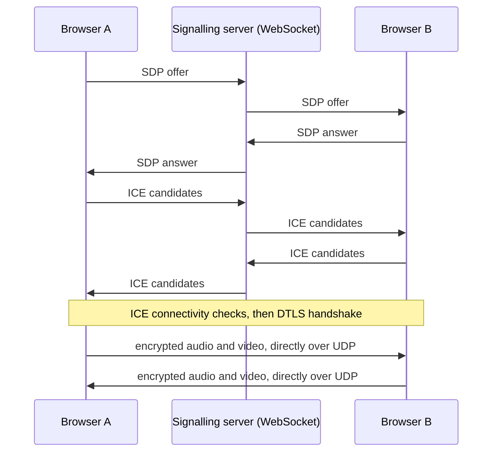
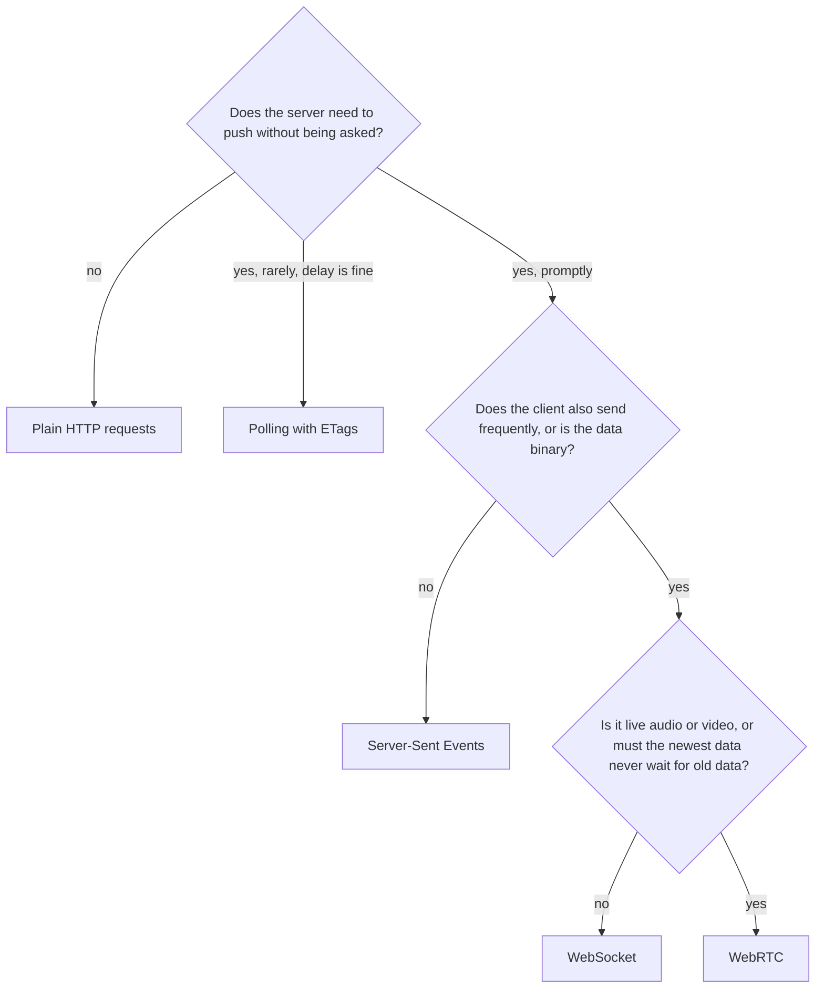

# WebSocket, WebRTC and choosing a transport

> **Before this lesson:** read [XHR, fetch, polling, long polling and Server-Sent Events](#/lesson/networking/xhr-fetch-sse) for the one-way techniques. You also need UDP versus TCP from [UDP and the TCP connection lifecycle](#/lesson/networking/udp-tcp-lifecycle), NAT from [IPv4 addressing, subnets, CIDR and NAT](#/lesson/networking/ipv4-subnets-nat), and head-of-line blocking from [TCP in practice](#/lesson/networking/tcp-tuning).

## In plain words

The previous lesson's techniques let a server send news to a browser. Some applications need more.

A chat room, a multiplayer game or a shared document needs both sides to speak whenever they like, many times per second, without the weight of a full HTTP request each time. For that there is **WebSocket**: after a short introduction over HTTP, the connection turns into an open two-way pipe, like a phone call where either person can talk at any moment.

A video call has a different need again. Sound and pictures must arrive within a fraction of a second, and a late piece is worthless. Sending everything through a central server adds distance and delay. For this there is **WebRTC**, which lets two browsers send audio, video and data **directly to each other**, like two people handing notes across a table instead of posting them through an office mailroom.

Why this matters for a job: collaborative tools, live dashboards, trading screens, games, customer-support chat, video meetings and voice AI assistants are built on these two technologies. They also bring operational questions that plain HTTP does not: thousands of long-lived connections, state held per connection, reconnection storms. A typical system design interview asks "design a chat service" or "design a video call", and choosing and justifying the transport is the first step of a good answer.

## WebSocket

### What it is

**WebSocket** is a protocol that provides a persistent, **full-duplex** channel between a client and a server over a single TCP connection. Full-duplex means both sides can send at the same time, independently. Data is sent as **messages**, each either text or binary, with very little overhead.

URLs use the schemes `ws://` (unencrypted, port 80) and `wss://` (over TLS, port 443). In practice always use `wss://`: it is secure, and encrypted traffic passes through proxies that would otherwise interfere.

### The opening handshake

A WebSocket connection begins as an ordinary HTTP/1.1 request that asks to switch protocols. Starting as HTTP means it uses the same ports and passes through the same firewalls and load balancers as web traffic.

```
GET /chat HTTP/1.1
Host: app.example.com
Upgrade: websocket                                <- "I want to switch to WebSocket"
Connection: Upgrade
Sec-WebSocket-Key: dGhlIHNhbXBsZSBub25jZQ==       <- a random value, Base64-encoded
Sec-WebSocket-Version: 13
Origin: https://app.example.com                   <- which page is asking
```

If the server agrees:

```
HTTP/1.1 101 Switching Protocols                  <- 101: the protocol changes now
Upgrade: websocket
Connection: Upgrade
Sec-WebSocket-Accept: s3pPLMBiTxaQ9kYGzzhZRbK+xOo=   <- derived from the client's key
```

From the next byte on, the connection no longer carries HTTP. It carries WebSocket frames in both directions until it is closed.



The `Sec-WebSocket-Accept` value proves the server really understood the WebSocket request (and is not, say, a cache replaying an old response). The server appends a fixed string defined in the standard to the client's key, computes a SHA-1 hash, and Base64-encodes it.

```python-run
import base64, hashlib

MAGIC = "258EAFA5-E914-47DA-95CA-C5AB0DC85B11"       # a constant written into the WebSocket standard

def accept_value(client_key):
    digest = hashlib.sha1((client_key + MAGIC).encode()).digest()   # 20 raw bytes
    return base64.b64encode(digest).decode()                        # Base64 text

key = "dGhlIHNhbXBsZSBub25jZQ=="                      # the example key used in the standard
print("Sec-WebSocket-Key   :", key)
print("Sec-WebSocket-Accept:", accept_value(key))
```

The printed value matches the response shown above. This is not a security mechanism (no secret is involved); it is only a check that both ends speak the protocol.

Security does matter at this step in another way. Browsers send cookies with the upgrade request, and the same-origin policy does **not** block WebSocket connections to other sites. A server must therefore check the `Origin` header and reject pages it does not trust, or a malicious site could open a socket to your service using the visitor's logged-in session. This attack is called cross-site WebSocket hijacking.

### Frames

After the handshake, each message is carried in one or more **frames**. The frame header is 2 to 14 bytes, compared with hundreds of bytes of HTTP headers.

```
 byte 0                     byte 1
+-+-+-+-+-------+          +-+-------------+
|F|R|R|R| opcode|          |M| payload len |    then: extended length (0, 2 or 8 bytes)
|I|S|S|S|  (4)  |          |A|     (7)     |    then: masking key (4 bytes, if MASK = 1)
|N|V|V|V|       |          |S|             |    then: the payload
| |1|2|3|       |          |K|             |
+-+-+-+-+-------+          +-+-------------+
```

- **FIN**: 1 if this frame is the last (or only) frame of a message.
- **opcode**: what kind of frame it is.

  | Opcode | Meaning |
  |---|---|
  | `0x1` | text (UTF-8) |
  | `0x2` | binary |
  | `0x0` | continuation of a fragmented message |
  | `0x8` | close |
  | `0x9` | ping |
  | `0xA` | pong |

- **MASK**: 1 if the payload is masked. **Every frame from a client must be masked; frames from a server must not be.**
- **Payload length**: a value of 0–125 is the length itself; 126 means the next 2 bytes hold the length; 127 means the next 8 bytes do.
- **Masking key**: 4 random bytes. Each payload byte is combined with the key using XOR: `masked[i] = payload[i] XOR key[i % 4]`. Applying the same operation again restores the original.

Why mask at all? It is not encryption: the key travels in the same frame. Masking exists to protect old proxies. Without it, a malicious script could send bytes that look like an HTTP request inside a WebSocket message and trick a confused caching proxy into storing attacker-chosen content. Randomising the bytes on the wire makes that impossible.

### Try it: build and decode a frame

```python-run
def build_frame(payload, opcode=0x1, mask_key=None):
    """Return a list of byte values for one unfragmented frame."""
    frame = [0x80 | opcode]                      # FIN = 1, plus the opcode
    mask_bit = 0x80 if mask_key else 0x00
    n = len(payload)
    if n <= 125:
        frame.append(mask_bit | n)
    elif n <= 0xFFFF:
        frame += [mask_bit | 126, n >> 8, n & 0xFF]              # 2-byte length
    else:
        frame += [mask_bit | 127] + list(n.to_bytes(8, "big"))   # 8-byte length
    if mask_key:
        frame += mask_key
        payload = [b ^ mask_key[i % 4] for i, b in enumerate(payload)]   # XOR with the key
    return frame + list(payload)

def decode_frame(frame):
    fin = bool(frame[0] & 0x80)                  # top bit of byte 0
    opcode = frame[0] & 0x0F                     # low four bits of byte 0
    masked = bool(frame[1] & 0x80)               # top bit of byte 1
    length = frame[1] & 0x7F                     # low seven bits of byte 1
    position = 2
    if length == 126:
        length = (frame[2] << 8) | frame[3]
        position = 4
    elif length == 127:
        length = int.from_bytes(bytes(frame[2:10]), "big")
        position = 10
    key = []
    if masked:
        key = frame[position:position + 4]
        position += 4
    payload = frame[position:position + length]
    if masked:
        payload = [b ^ key[i % 4] for i, b in enumerate(payload)]        # XOR again to unmask
    return fin, opcode, masked, length, bytes(payload)

client_frame = build_frame(list(b"Hello"), mask_key=[0x37, 0xFA, 0x21, 0x3D])
print("client -> server:", " ".join(f"{b:02x}" for b in client_frame))
print("decoded         :", decode_frame(client_frame))

server_frame = build_frame(list(b"Hello"))
print("server -> client:", " ".join(f"{b:02x}" for b in server_frame))

big = build_frame([0] * 300)
print("300-byte payload header:", " ".join(f"{b:02x}" for b in big[:4]), "(126 marks a 2-byte length)")
```

The client frame is `81 85 37 fa 21 3d 7f 9f 4d 51 58`: `81` is FIN plus text, `85` is MASK plus length 5, then the key, then five masked bytes that look nothing like "Hello". The server frame is `81 05 48 65 6c 6c 6f`, with the letters readable. Seven bytes of framing-and-payload for a five-letter message.

### Control frames

- **Ping and pong.** Either side may send a ping; the other must answer with a pong. They serve as heartbeats: they keep idle-timeout timers in proxies from expiring and detect dead peers. Browsers answer pings automatically, but JavaScript cannot send them, so applications often add their own heartbeat message.
- **Close.** Either side sends a close frame with a status code and optional reason; the other echoes it, and then the TCP connection closes. Useful codes: `1000` normal, `1001` going away (page closed or server shutting down), `1006` abnormal closure (never sent on the wire: it is what the browser reports when the connection vanished without a close frame), `1008` policy violation, `1009` message too big, `1011` server error.

### The browser interface

```javascript
const socket = new WebSocket("wss://app.example.com/chat");

socket.onopen = () => socket.send(JSON.stringify({ type: "join", room: 7 }));   // connected
socket.onmessage = (event) => console.log("received:", event.data);             // a message arrived
socket.onclose = (event) => console.log("closed:", event.code, event.reason);
socket.onerror = () => console.log("error");

socket.send("hello");                       // text message
socket.send(new Uint8Array([1, 2, 3]));     // binary message
```

Notable limits of this interface: you cannot set request headers (authentication is done with cookies, a token in the URL or, better, a first message), and there is no built-in reconnection or backpressure. `socket.bufferedAmount` reports how many bytes are queued and not yet sent; an application that produces data faster than the network carries it must watch this value and slow down.

### Extras

- **Subprotocols.** The client may offer names in `Sec-WebSocket-Protocol` (for example `graphql-transport-ws`, `mqtt`), and the server picks one. This agrees on the message format carried inside the socket.
- **Compression.** The `permessage-deflate` extension compresses each message. It helps for large text messages and costs memory per connection.
- **Over HTTP/2 and HTTP/3.** A WebSocket can also be carried on one stream of an HTTP/2 or HTTP/3 connection, sharing it with ordinary requests.

### What WebSocket does not give you

WebSocket is deliberately minimal. Compared with SSE or plain HTTP you must build:

- **Reconnection**, with increasing, randomised delays so that all clients do not reconnect at the same instant after a server restart;
- **Resuming** after a gap: sequence numbers or a cursor, and replay of missed messages;
- **Request/response matching**, if you need it: message identifiers;
- **Heartbeats** at the application level;
- **Authentication refresh** for connections that outlive a token.

It also inherits TCP's head-of-line blocking: messages arrive in order, and one lost packet delays everything behind it.

### Operating WebSocket at scale

Long-lived connections change how a backend behaves.

- **Connections are stateful.** Each client is attached to one particular server for minutes or hours. A plain HTTP load balancer can send each request anywhere; here the choice is made once at connect time. Load balancers must support the upgrade and long idle timeouts.
- **Fan-out needs a message bus.** If Mei is connected to server A and Omar to server B, a message from Mei must reach server B. Servers subscribe to a shared **publish/subscribe** system (Redis, Kafka, NATS); each server delivers to the clients it holds.



- **Deployments disconnect everyone.** Restarting a server drops its connections, and all those clients reconnect at once (a **thundering herd**). Drain connections gradually and make clients back off with random jitter.
- **Memory, not CPU, is usually the limit.** Each idle connection costs kernel buffers and application state. Hundreds of thousands per machine are achievable with event-driven servers and tuned limits on open files.
- **Slow consumers.** A client on a poor network cannot receive as fast as you send. Bound each connection's outgoing queue and drop or disconnect when it overflows, or one slow client exhausts the server's memory.

## WebRTC

### What it is

**WebRTC** (Web Real-Time Communication) is a set of browser interfaces and protocols for sending audio, video and arbitrary data **directly between two browsers**, **peer to peer**, with very low delay. A peer is either of the two equal participants; there is no client and server role in the media path.

Two design choices follow from the goal of low delay:

- **It runs over UDP.** For live media, a packet that arrives late is useless. WebRTC would rather skip a lost video frame, or conceal a missing 20 ms of audio, than stop everything to retransmit it.
- **It goes direct where possible.** The shortest path between two people is not through a data centre.

Encryption is mandatory: media is protected with **SRTP** (the secure form of RTP, the Real-time Transport Protocol), with keys agreed through **DTLS** (TLS adapted to run over UDP).

### The hard part: finding a path

Both browsers are usually behind NAT, and neither can accept an incoming connection. Three helpers solve this.

- **STUN** (Session Traversal Utilities for NAT). A small public server that answers one question: "what public IP address and port do my packets appear to come from?". It lets a browser learn its own address as seen from outside.
- **TURN** (Traversal Using Relays around NAT). A relay server. When no direct path can be found (strict corporate firewalls, certain types of NAT), both peers send to the TURN server and it forwards the packets. It always works, at the cost of extra delay and bandwidth you pay for. Roughly one call in six to ten needs it.
- **ICE** (Interactive Connectivity Establishment). The procedure that ties it together. Each browser gathers every address it could be reached at, called **candidates**: its local network address, its public address from STUN, a relay address from TURN. The two sides exchange candidates and test pairs of them until one works, preferring direct paths over relayed ones.

### Signalling

Before any of that, the two browsers must exchange their candidates and a description of what they can send and receive (codecs, resolutions, encryption fingerprints), written in a format called **SDP** (Session Description Protocol). One side creates an **offer**, the other replies with an **answer**.

How do they exchange these messages when they are not yet connected? Through a server that both can already reach. This step is called **signalling**, and WebRTC deliberately does not define it: you build it yourself, most often with a WebSocket.



So a real WebRTC system has a signalling server, STUN servers, TURN servers, and then the direct media flow.

### Adapting to the network

Because it runs over UDP, WebRTC performs its own congestion control. It continuously estimates the available bandwidth from delay and loss reports and adjusts the video encoder's bitrate and resolution within a second or two. A small **jitter buffer** smooths uneven arrival. Lost packets are handled by concealment, limited retransmission, or forward error correction (sending a little redundant data so that a lost packet can be reconstructed).

### Data channels

WebRTC can also carry application data through an `RTCDataChannel`. Its distinctive feature is that reliability is configurable per channel:

| Setting | Behaves like | Good for |
|---|---|---|
| ordered and reliable (the default) | TCP or WebSocket | chat, file transfer |
| unordered and reliable | messages without head-of-line blocking | independent updates |
| unordered, with no or limited retransmission | UDP | game state, positions, anything where newer data replaces older |

### More than two participants

Direct connections do not scale to large calls.

| Topology | How it works | Suits |
|---|---|---|
| **Mesh** | every participant sends to every other: $n(n-1)$ streams in total | 2 to 4 people |
| **SFU** (selective forwarding unit) | each participant sends once to a server, which forwards streams to the others, choosing a quality for each receiver | most meeting products; scales to hundreds |
| **MCU** (multipoint control unit) | a server decodes everything and mixes it into one stream per participant | weak clients, telephone bridges; heavy on server CPU |

In a 6-person mesh call each browser encodes and uploads 5 video streams, which overwhelms most home uplinks. With an SFU each uploads 1. Notice that with an SFU the "peer" is a server; WebRTC is used for its low-delay media transport, not for being peer to peer.

## WebTransport, briefly

A newer browser interface, **WebTransport**, exposes HTTP/3's QUIC transport to client-server applications: several independent streams without head-of-line blocking between them, plus unreliable datagrams. It aims at the space between WebSocket (reliable only, one ordered stream) and WebRTC data channels (flexible, but heavy to set up for client-server use). Browser support is still uneven, so treat it as an option to watch.

## Choosing a transport



| | HTTP / fetch | SSE | WebSocket | WebRTC |
|---|---|---|---|---|
| Direction | request then response | server → client | both ways | both ways, peer to peer |
| Transport | TCP or QUIC | TCP or QUIC | TCP | UDP |
| Delivery | reliable, ordered | reliable, ordered | reliable, ordered | configurable; media is lossy |
| Data | anything | UTF-8 text | text and binary | media streams; text and binary |
| Per-message overhead | hundreds of bytes | a few bytes | 2–14 bytes | small |
| Reconnect and resume | not applicable | built in | build it yourself | renegotiate |
| Infrastructure | standard | standard | upgrade-aware proxies, pub/sub | signalling, STUN, TURN, often an SFU |
| Typical uses | APIs, pages | notifications, feeds, AI token streams | chat, collaboration, games, trading | calls, screen sharing, voice assistants |

The guiding rule: **choose the simplest option that meets the requirement.** Each step to the right adds capability and operational burden. Many "real-time" features are perfectly served by SSE plus ordinary POST requests.

> [!INTERVIEW]
> **"Design the real-time layer of a chat application. Why WebSocket?"** Chat needs prompt delivery in both directions and many small messages, so one persistent full-duplex connection beats repeated HTTP requests. The handshake is an HTTP Upgrade answered with `101`, validated with `Sec-WebSocket-Accept`; frames then cost a few bytes each; client frames are masked. For scale: connections are stateful, so servers publish and subscribe through a message bus to reach users on other servers; clients reconnect with exponential backoff and jitter and resume from a last-seen message id; heartbeats detect dead connections; message history is fetched over ordinary HTTP. Add that SSE with POST would also work for a simple version, and that voice or video would use WebRTC with WebSocket signalling.

> [!TIP]
> Send the authentication token as the first message after the socket opens, and close the connection if it does not arrive within a few seconds. Tokens placed in the URL end up in server logs and proxy logs.

> [!WARNING]
> A WebSocket that appears open may have been dead for minutes: if the path fails silently, neither side is told. Without heartbeats, your application will show "connected" while messages vanish. Implement ping/pong (or application heartbeats) with a deadline, and reconnect when it is missed.

## Pitfalls

- **Reaching for WebSocket by reflex.** If only the server pushes, SSE is simpler and more robust.
- **Not validating `Origin`** on the upgrade request.
- **Reconnecting immediately in a loop.** After a server restart, every client does it together. Use backoff with jitter.
- **Assuming no message is lost across a reconnect.** Without sequence numbers and replay, some will be.
- **Unbounded send queues** for slow clients.
- **Load balancer idle timeouts shorter than the heartbeat interval.**
- **Planning WebRTC without TURN.** A meaningful share of users can connect only through a relay.
- **Mesh topology for group calls.** Upload bandwidth and CPU grow with each participant.
- **Using reliable, ordered delivery for live media or fast game state.** Retransmitted old data arrives too late to matter and delays the new data.

## Summary

- WebSocket starts with an HTTP Upgrade (`101 Switching Protocols`, `Sec-WebSocket-Accept`) and becomes a full-duplex, message-based channel over one TCP connection.
- Frames have a 2–14 byte header: FIN, opcode, MASK, a 7-bit length with 16- and 64-bit extensions, and a 4-byte key for client frames, whose payload is XOR-masked.
- Ping/pong keep connections alive; close frames carry status codes; reconnection, resumption and backpressure are the application's job.
- At scale, WebSocket servers are stateful and need a publish/subscribe bus, careful draining and bounded queues.
- WebRTC sends encrypted media and data peer to peer over UDP; ICE finds a path using STUN and falls back to TURN relays; offers and answers travel over a signalling channel you provide; group calls use an SFU.
- Pick the simplest transport that satisfies direction, frequency, data type and latency requirements.

## Glossary

- **WebSocket**: a full-duplex message protocol over one TCP connection, started by an HTTP upgrade.
- **Full-duplex**: both sides can send at the same time.
- **Upgrade / 101 Switching Protocols**: the HTTP mechanism and status that change a connection's protocol.
- **`Sec-WebSocket-Key` / `Sec-WebSocket-Accept`**: the challenge and response confirming both ends speak WebSocket.
- **Frame / opcode**: the unit of WebSocket transmission / its type field.
- **Masking**: XOR-ing client payloads with a random 4-byte key.
- **Ping / pong**: heartbeat control frames.
- **Close code**: the status in a close frame.
- **Subprotocol**: an agreed message format carried inside a WebSocket.
- **Backpressure**: slowing a sender when the receiver or network cannot keep up.
- **Publish/subscribe**: a messaging pattern where senders publish to topics and receivers subscribe.
- **Thundering herd**: many clients acting at the same instant, for example reconnecting.
- **WebRTC**: browser technology for peer-to-peer real-time audio, video and data.
- **Peer to peer**: communication directly between two endpoints.
- **RTP / SRTP**: the protocol for real-time media / its encrypted form.
- **DTLS**: TLS adapted for UDP.
- **STUN**: a service that reveals a client's public address.
- **TURN**: a relay used when no direct path exists.
- **ICE / candidate**: the procedure for finding a working path / one possible address.
- **Signalling**: exchanging session descriptions and candidates through a server.
- **SDP / offer / answer**: the session description format and its two messages.
- **Data channel**: WebRTC's channel for application data with configurable reliability.
- **Mesh / SFU / MCU**: group-call topologies: all-to-all, forwarding server, mixing server.
- **WebTransport**: a browser interface to QUIC streams and datagrams.

## Check yourself

```quiz
[
  {"q": "Which HTTP status code completes a successful WebSocket opening handshake?",
   "options": ["200 OK", "101 Switching Protocols", "204 No Content", "301 Moved Permanently"], "answer": 1,
   "explain": "The client sends an Upgrade request and the server answers 101, after which the connection carries WebSocket frames."},
  {"q": "What is the purpose of Sec-WebSocket-Accept?",
   "options": ["It encrypts the connection", "It proves the server understood the WebSocket handshake, by hashing the client's key with a fixed string", "It authenticates the user", "It sets the frame size"], "answer": 1,
   "explain": "The server derives it from Sec-WebSocket-Key using SHA-1 and Base64. It is a protocol check, not a security feature."},
  {"q": "The second byte of a WebSocket frame is 0xFE. What does it tell you?",
   "options": ["Unmasked, length 126", "Masked, and the payload length is in the next 2 bytes", "Masked, and the payload length is in the next 8 bytes", "A close frame"], "answer": 1,
   "explain": "0xFE is binary 1111 1110: the mask bit is set and the 7-bit length field is 126, meaning a 16-bit extended length follows."},
  {"q": "Which frames must be masked?",
   "options": ["All frames in both directions", "Frames sent by the client", "Frames sent by the server", "Only binary frames"], "answer": 1,
   "explain": "Client-to-server frames are always masked to protect intermediaries from crafted byte sequences. Server-to-client frames are never masked."},
  {"q": "Two users of a chat service are connected to different WebSocket servers. How does a message get from one to the other?",
   "options": ["The browsers connect directly", "The servers exchange it through a shared publish/subscribe system", "The load balancer copies every frame to every server", "It cannot be delivered"], "answer": 1,
   "explain": "Each connection lives on one server, so servers publish messages to a bus and deliver to whichever subscribed clients they hold."},
  {"q": "Why does WebRTC send media over UDP?",
   "options": ["UDP is encrypted by default", "For live media, retransmitting a late packet is useless, and waiting for it would delay newer data", "Browsers cannot use TCP", "UDP guarantees ordering"], "answer": 1,
   "explain": "Real-time audio and video favour timeliness over completeness. TCP's in-order reliability would cause stalls."},
  {"q": "What is the role of a TURN server?",
   "options": ["It reports a client's public address", "It relays traffic when two peers cannot establish a direct path", "It carries the SDP offer", "It mixes audio streams"], "answer": 1,
   "explain": "STUN discovers addresses; TURN relays packets when NATs or firewalls prevent direct connectivity."},
  {"q": "A dashboard needs the server to push a small text update every few seconds; the browser never sends anything back on that channel. What is the simplest suitable choice?",
   "options": ["WebRTC data channel", "WebSocket", "Server-Sent Events", "A new TCP protocol"], "answer": 2,
   "explain": "One-way text pushes are exactly what SSE provides, with automatic reconnection and standard HTTP infrastructure."}
]
```

> **Source:** Grigorik, *High Performance Browser Networking*, ch. 17 "WebSocket" and ch. 18 "WebRTC" (online edition, topic coverage only; not in the extracted special edition), https://hpbn.co/websocket/ and https://hpbn.co/webrtc/ . Facts checked against RFC 6455 (WebSocket, including the handshake example values), RFC 8441 (WebSocket over HTTP/2), RFC 8445 (ICE), RFC 8489 (STUN), RFC 8656 (TURN), and MDN's WebSocket and WebRTC API pages (https://developer.mozilla.org/en-US/docs/Web/API/WebSockets_API , https://developer.mozilla.org/en-US/docs/Web/API/WebRTC_API).
