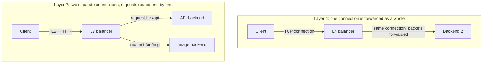

# Load balancers, reverse proxies and health checks

> **Before this lesson:** you need layers 4 and 7 from [Layers and encapsulation](#/lesson/networking/layers-encapsulation), TCP connections from [UDP and the TCP connection lifecycle](#/lesson/networking/udp-tcp-lifecycle), HTTP requests and status codes from [From HTTP/0.9 to HTTP/1.1](#/lesson/networking/http1), and TLS termination from [TLS in practice](#/lesson/networking/tls-in-practice).

## In plain words

One server can only do so much. When a service becomes popular, or when it must stay up even though machines fail, you run several identical copies of it. That immediately raises a question: when a request arrives, which copy handles it?

Picture a busy bank with ten counters. Without organisation, customers crowd around the first counter while others stand idle, and nobody notices that the clerk at counter seven has gone home. So the bank places a greeter at the door who directs each customer to a free counter and never sends anyone to a closed one.

A **load balancer** is that greeter. It receives all incoming traffic and spreads it across a group of servers. To avoid sending customers to a closed counter, it regularly checks that each server is working: a **health check**. A **reverse proxy** is the more general idea: a server that stands in front of your real servers, receives requests on their behalf and passes them on, often doing useful work on the way such as handling encryption or caching.

Why this matters for a job: essentially every production system has a load balancer in front of it, and many have one between every pair of internal services. Deployments, outages and performance problems are constantly traced to load-balancer behaviour: a bad health check, a timeout mismatch, uneven distribution. In system design interviews a load balancer appears in nearly every diagram, and you are expected to say which kind, which algorithm, and how failures are detected.

## Why put something in front?

Running several copies of a service behind a load balancer gives three things.

- **Scalability.** Adding machines to handle more traffic is called **horizontal scaling**. It only works if something spreads the traffic over them.
- **Availability.** If one server fails, the others carry on, and users do not notice. The property of having no single component whose failure brings everything down is called **redundancy**.
- **Operational flexibility.** Servers can be taken out for upgrades one at a time, new versions can receive a small share of traffic first, and clients keep using one stable address throughout.

The servers behind a load balancer are called **backends** (also upstreams, targets or the pool).

## Proxies: forward and reverse

A **proxy** is an intermediary that receives a request and makes a request of its own on someone's behalf. There are two kinds, and the difference is whose side it is on.

| | Forward proxy | Reverse proxy |
|---|---|---|
| Acts for | the clients | the servers |
| Chosen and configured by | the client or its organisation | the service owner |
| The server sees | the proxy's address, not the client's | (it is in front of the server) |
| The client sees | (the proxy is its gateway out) | the proxy's address, not the real server's |
| Typical uses | company web filtering, anonymity, caching for an office | load balancing, TLS termination, caching, security filtering |

A reverse proxy commonly does several jobs at once:

- **Load balancing** across backends.
- **TLS termination**: decrypting HTTPS so that backends handle plain HTTP.
- **Caching** responses and **compressing** them.
- **Buffering**: reading a slow client's request fully before bothering a backend, and absorbing a backend's response so the backend is freed while a slow client downloads it.
- **Routing**: `/api/*` to one service, `/static/*` to another.
- **Protection**: rate limiting, request size limits, blocking malicious patterns (a **web application firewall**, WAF).

Well-known software: nginx, HAProxy, Envoy, Traefik, Caddy; and managed cloud load balancers.

## Layer 4 and layer 7 load balancing

This distinction is the one interviewers ask about most.

### Layer 4: balancing connections

A **layer 4** (transport-level) load balancer looks only at IP addresses and TCP or UDP ports. When a new connection arrives it picks a backend and from then on forwards every packet of that connection to it. It never looks inside the data. It does not know whether the bytes are HTTP, a database protocol or a game.

### Layer 7: balancing requests

A **layer 7** (application-level) load balancer understands the protocol, usually HTTP. It completes the client's TCP and TLS handshakes itself, reads each request, and then decides where to send it. It holds separate connections to the backends. Because it sees requests, it can route by host name, path, header or cookie, and it can balance *each request* individually even when many arrive over one client connection.



| | Layer 4 | Layer 7 |
|---|---|---|
| Decides using | IP addresses and ports | URL, host, headers, cookies, method |
| Unit of balancing | a connection | a request |
| Terminates TLS | no (passes it through) | usually yes |
| Sees content | no | yes |
| Speed and cost | very fast, cheap, millions of connections | more CPU and memory per request |
| Features | few | routing rules, retries, caching, compression, rewriting, authentication |
| Protocols | anything over TCP or UDP | those it understands: HTTP, gRPC, WebSocket |
| Client address seen by backend | often preserved, or via PROXY protocol | passed in the `X-Forwarded-For` header |

Why "unit of balancing" matters: with HTTP/2 or gRPC, a client opens one long-lived connection and sends thousands of requests over it. A layer 4 balancer assigns that connection to one backend, and all those requests land there. One busy client can overload one backend while the others idle. A layer 7 balancer spreads the individual requests. This is the classic gRPC load-balancing trap.

Large systems often use both: a layer 4 tier at the edge for raw capacity and resilience, spreading connections over a fleet of layer 7 proxies that do the smart routing.

### Keeping track of the real client

Behind a layer 7 proxy, the backend sees connections coming from the proxy's address. The original client's details are added as request headers:

```
X-Forwarded-For: 198.51.100.23, 10.0.3.7     <- client address, then each proxy that forwarded it
X-Forwarded-Proto: https                     <- the scheme the client used
X-Forwarded-Host: shop.example.com
```

> [!WARNING]
> `X-Forwarded-For` is an ordinary header, and a client can send any value it likes. Trust only the entries appended by your own proxies: take the address added by the last proxy you control, never the leftmost value. Systems that use the leftmost value for rate limiting or access control can be bypassed by sending a forged header.

For layer 4, where no header can be added, the **PROXY protocol** prepends one short line carrying the original addresses to the connection, which the backend must be configured to expect.

## Balancing algorithms

How does the balancer choose a backend?

| Algorithm | Rule | Good when | Weakness |
|---|---|---|---|
| **Round robin** | each backend in turn | requests cost about the same; backends are equal | ignores how busy a backend is |
| **Weighted round robin** | in turn, proportionally to assigned weights | backends differ in capacity; shifting traffic gradually | still blind to load |
| **Least connections** | the backend with the fewest active requests or connections | request durations vary a lot; long-lived connections | needs accurate counts; a newly added server gets flooded |
| **Least response time** | the fastest recently | backends differ in speed | can oscillate |
| **Random** | pick at random | simple, stateless | uneven in the short run |
| **Power of two choices** | pick two at random, use the less loaded | many balancers with imperfect information | none significant |
| **Hash** (of client IP, a header, the URL) | the same key always goes to the same backend | sticky sessions; caches | plain modulo hashing reshuffles nearly all keys when the pool changes |
| **Consistent hashing** | hashing on a ring so that a change moves only a small share of keys | caches, sharded data, stateful services | more complex; needs virtual nodes for evenness |

Two of these deserve a closer look.

**Power of two choices.** Choosing the single least-loaded backend sounds ideal, but when many independent balancers all see the same slightly stale information they all pick the same "least loaded" server and bury it. Picking two at random and taking the better of the two avoids the herd effect and gets almost all of the benefit.

**Consistent hashing.** Suppose backends are caches and the key is the URL, so the same URL always goes to the cache that already holds it. With `hash(key) % N`, changing N from 4 to 5 changes the result for about 80% of keys: nearly every request misses its cache at once. **Consistent hashing** places both servers and keys on a circle of hash values; a key belongs to the next server clockwise. Adding a server takes over only the arc before it. Each server is placed many times (**virtual nodes**) to even out the arcs.

### Try it: compare the algorithms

Requests arrive one per tick. Most are quick (2 ticks of work) but every sixth is slow (25 ticks). The program tracks how many requests each of three backends is working on at once, and reports the worst pile-up.

```python-run
def simulate(choose, servers=3, requests=300):
    finishing = [[] for _ in range(servers)]     # per server: finish times of requests in progress
    worst = 0
    for tick in range(requests):
        for s in range(servers):                 # remove requests that have finished
            finishing[s] = [f for f in finishing[s] if f > tick]
        active = [len(f) for f in finishing]
        target = choose(tick, active)
        duration = 25 if tick % 6 == 0 else 2    # every sixth request is slow
        finishing[target].append(tick + duration)
        worst = max(worst, len(finishing[target]))
    return worst

def round_robin(tick, active):
    return tick % len(active)

def least_connections(tick, active):
    return active.index(min(active))             # lowest index wins a tie

print("worst number of simultaneous requests on one backend")
print("   round robin      :", simulate(round_robin))
print("   least connections:", simulate(least_connections))
```

With three backends, round robin sends every sixth request to the same backend, so all the slow requests pile up on one machine while the other two stay nearly idle. It only counts turns. Least connections looks at the present load and keeps the pile-ups smaller. When all requests cost the same, the two behave alike and round robin's simplicity wins.

### Try it: why consistent hashing matters for caches

```python-run
import bisect, hashlib

def h(text):
    """A stable hash: the first 8 hex digits of MD5, as an integer."""
    return int(hashlib.md5(text.encode()).hexdigest()[:8], 16)

keys = [f"/img/{i}.png" for i in range(2000)]

def modulo_owner(key, servers):
    return servers[h(key) % len(servers)]

def ring_owner_fn(servers, replicas=100):
    ring = sorted((h(f"{s}#{i}"), s) for s in servers for i in range(replicas))   # virtual nodes
    points = [p for p, _ in ring]
    def owner(key):
        i = bisect.bisect_left(points, h(key))        # first point at or after the key
        return ring[i % len(ring)][1]                 # wrap around at the end
    return owner

four = ["cache-a", "cache-b", "cache-c", "cache-d"]
five = four + ["cache-e"]

moved = sum(modulo_owner(k, four) != modulo_owner(k, five) for k in keys)
print(f"modulo hashing    : {moved / len(keys):.0%} of keys change server when a 5th is added")

before, after = ring_owner_fn(four), ring_owner_fn(five)
moved = sum(before(k) != after(k) for k in keys)
print(f"consistent hashing: {moved / len(keys):.0%} of keys change server")
```

With modulo hashing about four keys in five move; with the ring about one in five moves, which is the minimum possible, since the new server must take its fair share from somewhere.

## Session affinity

Sometimes all requests from one user must reach the same backend, for instance if a backend keeps the user's session in its own memory. Making the balancer do this is called **session affinity** or **sticky sessions**. Methods: hash the client IP (crude: many users share an address behind NAT, and mobile addresses change), or have the balancer set a cookie naming the backend (precise).

Affinity has costs: load becomes uneven, and when a backend dies its users lose their sessions anyway. The better design is **stateless** backends: keep session data in a shared store such as Redis or in a signed token, so any backend can serve any request. Use affinity when you must, for example with WebSocket connections or local caches, and not as a substitute for sharing state.

## Health checks

A balancer that sends traffic to a dead server is worse than none. Health checks keep its list of usable backends accurate.

### Active and passive

- **Active checks.** The balancer sends its own probe to each backend every few seconds: open a TCP connection, or send `GET /healthz` and expect a `200` within a timeout.
- **Passive checks** (also called **outlier detection**). The balancer watches real traffic. A backend that returns repeated `5xx` errors or times out is ejected for a while.

Good setups use both: active checks notice a backend that is down before any user request is sent to it, and passive checks notice one that answers probes but fails real requests.

### Thresholds

One failed probe might be a lost packet. Balancers therefore require several consecutive results before changing their mind:

```
interval:            5 s      a probe every 5 seconds
timeout:             2 s      no answer within 2 s counts as a failure
unhealthy threshold: 3        3 consecutive failures  -> mark DOWN
healthy threshold:   2        2 consecutive successes -> mark UP
```

With these values a dead server is detected after up to 15 seconds, during which roughly one request in N (for N backends) fails. Shorter intervals detect faster and are more likely to eject healthy servers during a brief hiccup. A backend that alternates between up and down is said to be **flapping**; thresholds exist to damp it.

```python-run
def track(results, unhealthy_threshold=3, healthy_threshold=2):
    state, fails, successes = "UP", 0, 0
    for second, ok in enumerate(results):
        if ok:
            successes, fails = successes + 1, 0
        else:
            fails, successes = fails + 1, 0
        if state == "UP" and fails >= unhealthy_threshold:
            state = "DOWN"
        elif state == "DOWN" and successes >= healthy_threshold:
            state = "UP"
        print(f"probe {second:2}: {'ok  ' if ok else 'FAIL'} -> {state}")

# True = the probe succeeded. One blip, then a real outage, then recovery.
track([True, False, True, True, False, False, False, False, True, False, True, True, True])
```

The single failure at probe 1 does not remove the server. Three in a row do. During recovery, the lone success at probe 8 is not enough; two consecutive successes are required before traffic returns.

### What should a health check test?

Two different questions are worth separate endpoints (container platforms such as Kubernetes formalise them):

- **Liveness**: is the process running and able to respond at all? If not, restart it.
- **Readiness**: can it serve traffic right now? A server that is starting up, warming caches, or overloaded is alive but not ready. If not ready, stop sending it traffic, but do not restart it.

And how deep should the check go?

- A **shallow** check ("the process answers") misses a server that is up but cannot reach its database.
- A **deep** check ("I can query the database") catches that, but creates a serious hazard: if the shared database has a brief problem, *every* backend fails its check at once, the balancer ejects them all, and a partial problem becomes a complete outage.

Sensible practice: readiness checks verify what is specific to this instance (it has started, loaded its configuration, its own resources are fine) and are cautious about shared dependencies. Most balancers also have a safety rule: if too large a share of backends looks unhealthy, assume the check is wrong and keep sending traffic to all of them (**fail open**).

> [!TIP]
> Give the health-check endpoint a tiny, fixed cost and no authentication, and keep it off the path of heavy middleware. A health check that takes 800 ms under load will time out exactly when the server is busiest and get a healthy-but-busy server ejected, pushing its load onto the others, which then also fail: a **cascading failure**.

## Draining, slow start and deployments

**Connection draining** (graceful shutdown): before stopping a backend, tell the balancer to send it no *new* requests, let the requests in progress finish, then stop it. Without draining, every deployment cuts off in-flight requests. The clean sequence for a server receiving a stop signal is: start failing the readiness check, wait for the balancer to notice, finish current requests, exit.

**Slow start**: a freshly started backend has cold caches and no warmed-up connections. Under least-connections it also looks like the least loaded and would receive a flood. Balancers can ramp a new backend's share up gradually over some seconds.

These two features are what make **rolling deployments** (replacing backends one at a time) invisible to users. The balancer also enables **blue-green** deployment (switch all traffic from the old set to a complete new set) and **canary** releases (send 1% of traffic to the new version and watch the error rate before going further).

## The balancer must not be the single point of failure

Putting one machine in front of everything concentrates the risk. Remedies:

- **Active-passive pairs.** Two balancers share a **virtual IP address**; a heartbeat protocol moves it to the standby if the active one fails.
- **Several active balancers** behind DNS records, anycast, or routers that spread flows across equal-cost paths.
- **Managed cloud load balancers**, which are fleets of machines across several data centres behind one name.

Across regions, **global load balancing** uses DNS answers or anycast to send each user to a nearby healthy region; within a region, the local balancers take over.

## A minimal configuration, annotated

An nginx reverse proxy balancing two services:

```
upstream api_servers {
    least_conn;                                   # algorithm: least connections
    server 10.0.1.11:8080 max_fails=3 fail_timeout=10s;   # passive check: 3 failures -> out for 10 s
    server 10.0.1.12:8080 max_fails=3 fail_timeout=10s;
    server 10.0.1.13:8080 weight=2;               # twice the share of the others
    keepalive 64;                                 # keep up to 64 idle connections to backends open
}

server {
    listen 443 ssl;                               # TLS is terminated here
    server_name shop.example.com;

    location /api/ {
        proxy_pass http://api_servers;            # layer 7 routing by path
        proxy_http_version 1.1;
        proxy_set_header Connection "";           # needed for backend keep-alive
        proxy_set_header Host $host;
        proxy_set_header X-Forwarded-For $proxy_add_x_forwarded_for;   # append the client address
        proxy_set_header X-Forwarded-Proto $scheme;
        proxy_connect_timeout 2s;                 # give up quickly on a dead backend
        proxy_read_timeout 30s;                   # how long to wait for a response
    }
    location /static/ {
        root /var/www;                            # served directly, never reaches a backend
    }
}
```

The `keepalive` line matters more than it looks: without it the proxy opens a new TCP connection to a backend for every request, paying handshakes and risking port exhaustion under load.

## Reading load-balancer errors

| Status seen by the client | Usual meaning |
|---|---|
| `502 Bad Gateway` | the proxy could not get a valid response: the backend refused the connection, reset it, or sent garbage. Common during deployments without draining, and when the backend closes an idle connection at the moment the proxy reuses it. |
| `503 Service Unavailable` | no healthy backend is available, or a limit was reached |
| `504 Gateway Timeout` | the backend accepted the request and did not answer within the proxy's timeout |

A rule that prevents a notorious source of intermittent `502`s: **the backend's idle keep-alive timeout must be longer than the proxy's**, so that it is always the proxy that closes idle connections, never the backend closing one the proxy is about to reuse.

> [!INTERVIEW]
> **"What is the difference between layer 4 and layer 7 load balancing, and when would you use each?"** Layer 4 balances connections using addresses and ports without reading the payload: fast, protocol-agnostic, cheap, good for raw TCP or UDP and for very high volumes. Layer 7 terminates the connection, parses HTTP and balances individual requests: it can route by path or header, terminate TLS, retry, cache and apply per-request policies, at a higher cost per request. Use layer 7 for web and gRPC traffic, particularly because long-lived multiplexed connections make connection-level balancing uneven; use layer 4 in front of non-HTTP services or as a first tier. Then mention health checks, draining and the balancer's own redundancy.

## Pitfalls

- **Layer 4 balancing for gRPC or HTTP/2.** All requests on a connection go to one backend.
- **Trusting the leftmost `X-Forwarded-For` value.**
- **Deep health checks on shared dependencies** that eject every backend together.
- **No draining on shutdown**, causing `502`s at every deployment.
- **Sticky sessions as a design crutch.** Prefer stateless backends with shared session storage.
- **Mismatched timeouts** between proxy and backend, in either the idle or the request direction.
- **No connection reuse to backends.**
- **Forgetting the balancer itself needs redundancy** and capacity.
- **Health checks that are too slow or too heavy**, failing when the server is merely busy.

## Summary

- Load balancers spread traffic over redundant backends for scale and availability; a reverse proxy fronts servers and can also terminate TLS, cache, compress, buffer and filter.
- Layer 4 balances connections by address and port; layer 7 parses requests and balances each one, enabling content-based routing.
- Algorithms: round robin, weighted, least connections, power of two choices, hashing, and consistent hashing, which limits disruption when the pool changes.
- Health checks are active (probes) and passive (observing traffic), use thresholds to avoid flapping, and should distinguish liveness from readiness.
- Draining and slow start make deployments invisible; the balancer itself needs redundancy.
- `502`, `503` and `504` describe different failures between proxy and backend.

## Glossary

- **Load balancer**: a component that distributes traffic across servers.
- **Backend / upstream / pool**: the servers behind a balancer.
- **Horizontal scaling**: adding more machines.
- **Redundancy**: spare capacity so that one failure is not fatal.
- **Proxy**: an intermediary that forwards requests.
- **Forward / reverse proxy**: acting for clients / for servers.
- **Layer 4 / layer 7 load balancing**: by connection using addresses and ports / by request using application data.
- **TLS termination**: decrypting at the proxy.
- **`X-Forwarded-For`**: the header carrying the original client address.
- **PROXY protocol**: a prefix conveying client addresses at layer 4.
- **Round robin, least connections, power of two choices**: balancing algorithms.
- **Consistent hashing / virtual node**: ring-based key assignment / one of a server's many positions on the ring.
- **Session affinity (sticky sessions)**: sending a user's requests to the same backend.
- **Stateless**: keeping no per-user data inside a server instance.
- **Health check**: a test of whether a backend should receive traffic.
- **Active / passive check**: a dedicated probe / inference from real traffic.
- **Outlier detection**: ejecting backends that misbehave on real requests.
- **Liveness / readiness**: is it running / can it serve now.
- **Flapping**: rapid alternation between healthy and unhealthy.
- **Fail open**: ignoring health results when too many backends look unhealthy.
- **Cascading failure**: one failure overloading others in turn.
- **Connection draining**: finishing in-flight requests before removing a backend.
- **Slow start (balancer)**: ramping traffic to a new backend gradually.
- **Rolling, blue-green, canary**: deployment strategies.
- **Virtual IP**: an address that can move between balancers.
- **WAF**: a web application firewall.

## Check yourself

```quiz
[
  {"q": "Which information does a layer 4 load balancer use to choose a backend?",
   "options": ["URL path and cookies", "IP addresses and TCP or UDP ports", "The HTTP method", "The response status code"], "answer": 1,
   "explain": "Layer 4 balancers work on transport-level information and do not inspect the application payload."},
  {"q": "A gRPC client opens one HTTP/2 connection and sends 10,000 requests over it through a layer 4 balancer with five backends. How are the requests distributed?",
   "options": ["Evenly, 2,000 each", "All to a single backend", "Randomly per request", "Half to the first backend"], "answer": 1,
   "explain": "A layer 4 balancer assigns the connection, not the requests. Everything multiplexed on that connection reaches the same backend."},
  {"q": "Which algorithm suits requests whose processing times vary widely?",
   "options": ["Round robin", "Least connections", "Hash of the client IP", "Always the first server"], "answer": 1,
   "explain": "Least connections takes the current load into account, so a backend occupied with slow requests receives fewer new ones."},
  {"q": "A cache cluster grows from 4 to 5 nodes. Why is consistent hashing preferred to hash(key) % N?",
   "options": ["It is faster to compute", "Only about one fifth of the keys move, instead of most of them", "It encrypts the keys", "It needs no hash function"], "answer": 1,
   "explain": "With modulo hashing changing N remaps nearly every key, emptying the caches in effect. A hash ring moves only the keys the new node takes over."},
  {"q": "A health check is configured with interval 5 s and unhealthy threshold 3. Roughly how long can a crashed backend keep receiving traffic?",
   "options": ["Under 1 second", "Up to about 15 seconds", "Exactly 5 seconds", "Until it is restarted manually"], "answer": 1,
   "explain": "Three consecutive failed probes are needed, and probes are five seconds apart."},
  {"q": "Every backend's health check queries a shared database. The database has a 20-second hiccup. What is the risk?",
   "options": ["Nothing, health checks are independent", "All backends are marked unhealthy at once and the whole service goes down", "The balancer switches to layer 4", "Sessions become sticky"], "answer": 1,
   "explain": "A deep check on a shared dependency fails everywhere simultaneously, turning a partial degradation into a total outage unless the balancer fails open."},
  {"q": "What is connection draining?",
   "options": ["Closing all connections immediately on shutdown", "Stopping new requests to a backend while letting in-flight ones finish before removing it", "Limiting the number of connections per client", "Compressing idle connections"], "answer": 1,
   "explain": "Draining lets a backend leave the pool without cutting off requests in progress, which is essential for clean deployments."},
  {"q": "A client receives 504 Gateway Timeout from a load balancer. What happened?",
   "options": ["The backend refused the connection", "No healthy backend exists", "The backend did not respond within the balancer's timeout", "The client sent a malformed request"], "answer": 2,
   "explain": "504 means the proxy waited too long for a response. A refused or reset connection typically yields 502, and no healthy backend yields 503."}
]
```

> **Source:** written from general systems knowledge (load balancing is outside the chapters of Grigorik, *High Performance Browser Networking*, https://hpbn.co , which touches proxies and TLS termination in ch. 4). Facts checked against the nginx HTTP load balancing documentation (https://nginx.org/en/docs/http/load_balancing.html), the Envoy documentation on load balancing and outlier detection (https://www.envoyproxy.io/docs/envoy/latest/intro/arch_overview/upstream/load_balancing/overview), RFC 7239 (forwarded headers) and the Kubernetes probe documentation (https://kubernetes.io/docs/concepts/configuration/liveness-readiness-startup-probes/).
