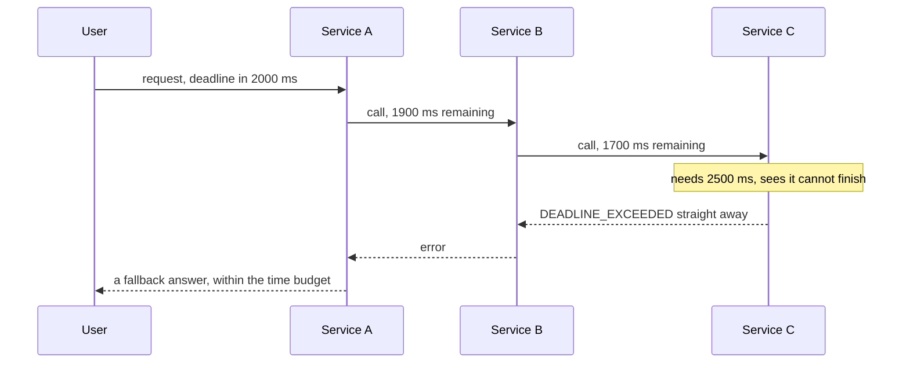
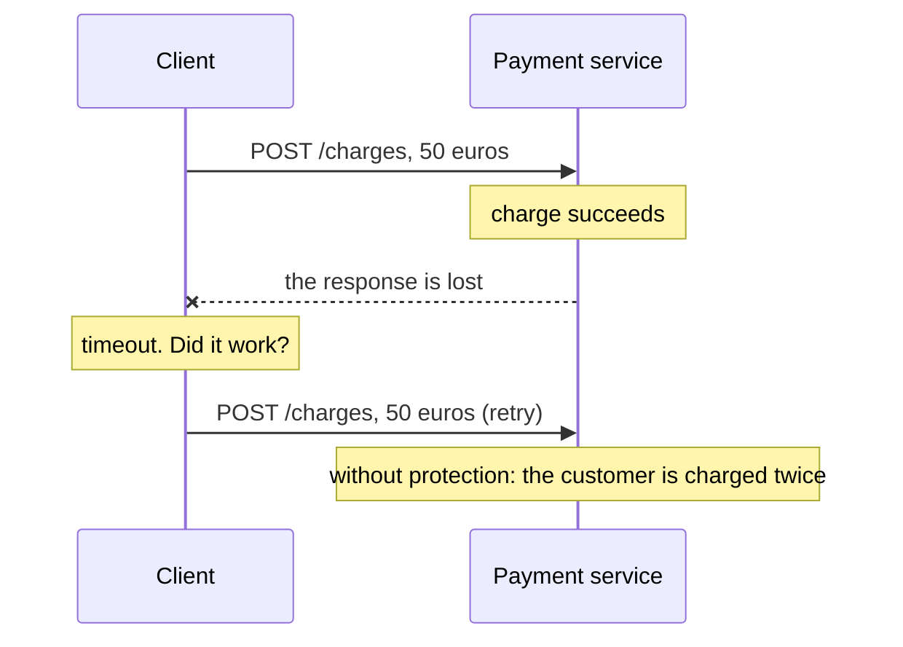
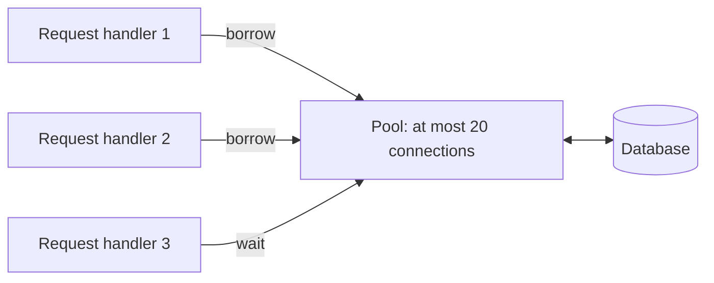
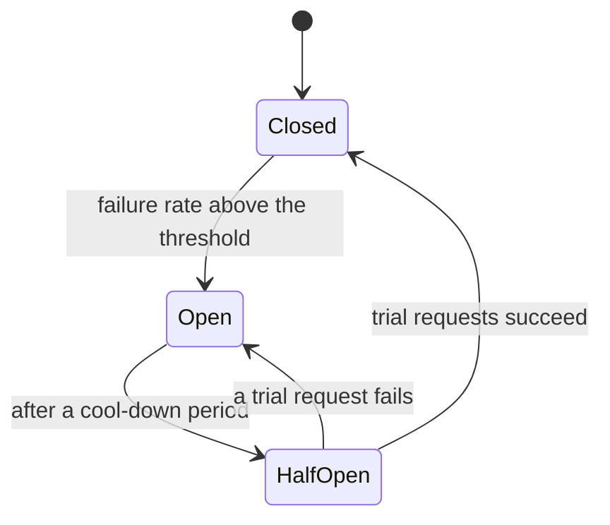

# Timeouts, retries, pools, rate limits and idempotency

> **Before this lesson:** read [Load balancers, reverse proxies and health checks](#/lesson/networking/load-balancers-proxies). You also need connection setup costs from [UDP and the TCP connection lifecycle](#/lesson/networking/udp-tcp-lifecycle), idle timeouts from [TCP in practice](#/lesson/networking/tcp-tuning), and idempotent HTTP methods from [From HTTP/0.9 to HTTP/1.1](#/lesson/networking/http1).

## In plain words

When a function in your own program is called, it either returns or raises an error. When your program calls another program over a network, there is a third outcome: **nothing happens**. The request may have been lost, the other service may be slow, crashed, or busy, or the reply may have been lost on its way back. From the caller's side these all look identical: silence.

Consider ordering a pizza by phone and the line going dead as you finish speaking. Did they hear the order? If you do nothing, you may go hungry. If you phone again and they did hear the first time, two pizzas arrive. And if the pizzeria is overwhelmed and every waiting customer redials every ten seconds, the phone never stops ringing and no pizzas get made at all.

This lesson is the set of habits that deal with that situation:

- **Timeouts**: decide how long you are willing to wait.
- **Retries with backoff and jitter**: try again, but politely, and not all at once.
- **Idempotency**: make a repeated request harmless, so that retrying is safe.
- **Connection pools**: keep connections ready and reuse them.
- **Rate limiting**: refuse work beyond what you can handle, so that overload does not become collapse.
- **Circuit breakers**: stop calling something that is clearly broken.

Why this matters for a job: this is the difference between a system that slows down briefly when one dependency misbehaves and one that falls over completely. Most large outages are not caused by the first failure but by how every other component reacts to it. Backend and machine-learning engineers call other services constantly (databases, model servers, third-party APIs), and interviewers probe these patterns directly: "what happens if that call times out?".

## Timeouts

A **timeout** is a limit on how long an operation may take before the caller gives up. Without one, a caller waits as long as the other side keeps it waiting, which can be for ever. Each waiting caller holds resources: a thread, memory, a connection. Enough of them, and your service is stuck too, although nothing is wrong with it. The slowness has spread upstream.

Set at least two:

- A **connect timeout**: how long to wait for the TCP (and TLS) handshake. A healthy server completes it in a few round trips, so this can be short: 1 to 3 seconds, less inside a data centre.
- A **read** (or **request**) **timeout**: how long to wait for the response once the request is sent. Base it on how long the operation legitimately takes, for example somewhat above its measured 99.9th percentile.

Many libraries ship with no timeout at all by default. Check every client you use.

### Deadlines across services

A user request often passes through a chain: A calls B, B calls C. If each has its own independent 10-second timeout, C may still be working on something that A gave up on long ago. That is wasted work at exactly the moment the system is struggling.

The remedy is a **deadline**: a point in time by which the whole operation must finish, set once at the edge and passed along with every call (**deadline propagation**). Each service checks the time remaining, refuses to start work that cannot finish in time, and gives its own downstream calls only what is left. gRPC has this built in; with plain HTTP, teams pass a header.



A simple rule for chained timeouts: **a caller's timeout should be longer than the timeout of what it calls**, otherwise the caller gives up while the callee is still about to succeed.

## Retries

Many failures are **transient**: a dropped packet, a server that was restarting, a brief overload. Trying again often works. But a retry is extra load placed on a system that may already be in trouble, so retries need rules.

### What to retry

| Outcome | Retry? |
|---|---|
| Could not connect; connection reset before the request was sent | yes: the server never saw it |
| Timeout while waiting for the response | only if the request is idempotent: the server may have done the work |
| `503 Service Unavailable`, `502`, `504` | usually yes, with backoff |
| `429 Too Many Requests` | yes, after the delay given in `Retry-After` |
| `500 Internal Server Error` | sometimes; idempotent requests only |
| `400`, `401`, `403`, `404`, `422` | no: the request itself is wrong, and repeating it changes nothing |

### How to retry: exponential backoff

Retrying immediately, and repeatedly, hits a struggling service again at the worst moment. **Exponential backoff** doubles the wait after each failure, up to a cap:

$$\text{delay}_n = \min(\text{cap},\ \text{base} \times 2^{n})$$

With a base of 100 ms: 100, 200, 400, 800, 1600 ms. This quickly reduces pressure on the failing service.

### Why jitter is essential

Backoff alone has a flaw. Suppose a server restarts and 1,000 clients all fail at the same moment. All wait 100 ms and retry together. All fail (the server is swamped), all wait 200 ms, and retry together again. The clients are synchronised, and the server receives its load as a series of spikes. This is a form of the **thundering herd** problem.

**Jitter** is randomness added to the delay so that clients spread out. Common variants, for attempt ceiling $c = \min(\text{cap}, \text{base} \times 2^n)$:

| Variant | Delay | Character |
|---|---|---|
| No jitter | $c$ | synchronised spikes |
| **Full jitter** | a random value in $[0, c]$ | best spreading; the usual recommendation |
| Equal jitter | $c/2$ plus a random value in $[0, c/2]$ | keeps a guaranteed minimum wait |
| Decorrelated jitter | a random value in $[\text{base}, 3 \times \text{previous delay}]$, capped | spreads without tracking the attempt number |

### Try it: the effect of jitter

A thousand clients fail at time zero and each schedules its first three retries. The program counts how many retries land in each 50 ms slot.

```python-run
import random

BASE, CAP, CLIENTS, ATTEMPTS = 100, 2000, 1000, 3

def retry_times(jitter, rng):
    """Times (ms) at which one client sends its retries."""
    t, times = 0, []
    for attempt in range(ATTEMPTS):
        ceiling = min(CAP, BASE * 2 ** attempt)        # 100, 200, 400
        delay = rng.uniform(0, ceiling) if jitter else ceiling
        t += delay
        times.append(t)
    return times

def histogram(jitter):
    rng = random.Random(42)                            # fixed seed: repeatable output
    buckets = {}
    for _ in range(CLIENTS):
        for t in retry_times(jitter, rng):
            slot = int(t // 50) * 50
            buckets[slot] = buckets.get(slot, 0) + 1
    return buckets

for label, jitter in (("no jitter", False), ("full jitter", True)):
    buckets = histogram(jitter)
    print(f"{label}: busiest 50 ms slot receives {max(buckets.values())} requests")
    for slot in sorted(buckets):
        print(f"   {slot:4} ms {'#' * (buckets[slot] // 20)} {buckets[slot]}")
    print()
```

Without jitter all 1,000 clients arrive in the same three slots: three spikes of a thousand requests. With full jitter the same 3,000 retries are spread over more than a dozen slots and the busiest receives a small fraction of that. The server sees a manageable flow instead of a hammer.

### Retries multiply

Retries stack across layers. If a client retries 3 times, a gateway retries each of those 3 times, and a service retries its database call 3 times, one user action can become $3 \times 3 \times 3 = 27$ database attempts. During an incident that multiplication is what finishes the database off. Defences:

- **Retry at one layer only**, ideally the one closest to the failure or the one with the most context.
- **Limit attempts** (2 or 3 in total is typical).
- **Use a retry budget**: allow retries only up to some percentage of normal traffic, for example 10%. When everything is failing, the budget runs out and retries stop.
- **Honour `Retry-After`** and stop when the deadline has passed.

A related technique for tail latency is the **hedged request**: if a response has not arrived after, say, the 95th-percentile time, send a second copy to another replica and take whichever answers first. It trades a few percent of extra load for a much shorter tail, and like any retry it requires idempotent operations.

## Idempotency

An operation is **idempotent** if performing it several times has the same effect as performing it once. "Set the thermostat to 20 degrees" is idempotent; "raise it by 2 degrees" is not.

Retries are only safe for idempotent operations, because of the uncertainty at the heart of this lesson: after a timeout the caller cannot know whether the work was done.



### Idempotency keys

For operations that are not naturally idempotent, the standard remedy is an **idempotency key**. The client generates a unique identifier for the *intended action* (not for the attempt) and sends it with the request, usually in an `Idempotency-Key` header. Every retry of the same action carries the same key.

The server:

1. looks the key up in a store;
2. if it has seen the key and has a stored result, returns that result **without doing the work again**;
3. otherwise performs the work and saves the result under the key, atomically.

```python-run
import uuid

class PaymentService:
    def __init__(self):
        self.results = {}          # idempotency key -> stored response
        self.charges = []          # what actually happened

    def charge(self, key, customer, amount):
        if key in self.results:                    # this action was already performed
            return self.results[key] + "  (replayed, no new charge)"
        self.charges.append((customer, amount))    # do the real work exactly once
        response = f"charge #{len(self.charges)} of {amount} EUR for {customer}"
        self.results[key] = response               # remember the outcome under the key
        return response

service = PaymentService()

key = str(uuid.uuid4())            # ONE key for one intended payment
print(service.charge(key, "mei", 50))
print(service.charge(key, "mei", 50))      # the retry after a lost response
print(service.charge(key, "mei", 50))      # and another

print(service.charge(str(uuid.uuid4()), "mei", 50))   # a new key: a deliberate second payment
print("charges actually made:", service.charges)
```

Three calls with one key produce one charge. A different key is a different action. In a real system the store is a database table with a unique constraint on the key, entries expire after a day or so, and the server also checks that a repeated key comes with the same request body.

Other ways to obtain idempotency: use `PUT` with a client-chosen identifier (creating order `ord-8812` twice yields one order); make updates conditional ("set status to shipped if it is currently packed"); or deduplicate by a natural unique key.

This is how reliable systems are built on unreliable networks. Messages are delivered **at least once** (retried until acknowledged), and handlers are idempotent, so the *effect* happens exactly once. Delivering a message exactly once across a network is not achievable in general; making duplicates harmless is.

## Connection pools

Opening a connection is expensive: a TCP handshake, usually a TLS handshake, often authentication, and then slow start. A database connection can take tens of milliseconds to establish, which may exceed the time of the query itself.

A **connection pool** keeps a set of open connections and lends them out. A piece of code borrows a connection, uses it, and returns it for the next borrower.



### Settings that matter

| Setting | Purpose | What goes wrong |
|---|---|---|
| **Maximum size** | caps connections to the target | too small: callers queue; too large: the target is overwhelmed |
| **Minimum idle** | connections kept ready | too low: bursts pay setup cost |
| **Acquire timeout** | how long a caller waits for a free connection | missing: callers hang for ever when the pool is exhausted |
| **Idle timeout** | closes connections unused for a while | longer than a load balancer's or firewall's idle timeout: stale connections |
| **Maximum lifetime** | retires connections after some time | missing: clients never notice DNS changes or rebalance after a deployment |
| **Validation / keep-alive** | checks a connection before lending it | missing: a dead connection causes a failed request |

Two failure patterns are worth recognising on sight.

**Pool exhaustion.** Every connection is borrowed and none is returned, either because the downstream is slow or because code forgets to return connections (a leak). New requests wait and then time out, and the service looks down even though its CPU is idle. Always return connections in a `finally` block or a context manager, and always set an acquire timeout.

**Stale connections.** A pooled connection sat idle, and a firewall, NAT or load balancer in the middle silently dropped it. The next request on it fails with a reset or hangs. Cures: an idle timeout shorter than every idle timeout on the path, TCP keep-alive, and validation.

### Sizing

More is not better. A database with 16 CPU cores does not go faster with 500 connections; it spends its time switching between them. And the total matters: 50 application instances with a pool of 20 each present 1,000 connections to the database. A useful estimate is the queueing relationship: connections needed ≈ request rate × time each request holds a connection. At 200 requests per second with 20 ms held per request, about 4 are busy on average, so a pool of 10 to 15 gives ample headroom.

With HTTP/2 and gRPC a single connection multiplexes many requests, so the "pool" may be one or a handful of connections; the limit to watch becomes the maximum concurrent streams per connection.

## Rate limiting

A **rate limiter** restricts how many requests a client, or the whole system, may make in a period. It protects a service from overload, keeps one heavy user from starving the rest, enforces pricing tiers, and blunts abuse.

### Algorithms

**Token bucket.** A bucket holds up to *capacity* tokens and is refilled at a steady *rate*. Each request takes a token; if none is left, the request is rejected (or waits). A full bucket allows a short **burst**; the refill rate sets the long-term average. This is the most widely used algorithm.

**Leaky bucket.** Requests enter a queue and leave at a fixed, steady pace. Bursts are smoothed out completely; if the queue is full, new arrivals are dropped. Used to shape traffic to a constant rate.

**Fixed window.** Count requests per calendar window, for example per minute, and reject above the limit. Very cheap, but with an edge effect: a client can send a full allowance at 12:00:59 and another at 12:01:00, twice the limit within two seconds.

**Sliding window.** Count over the last N seconds measured from now, either exactly (a log of timestamps) or approximately (weighting the previous and current fixed windows). Smooth, at some cost in memory or precision.

| | Allows bursts | Output | Memory per client |
|---|---|---|---|
| Token bucket | yes, up to capacity | bursty within limits | 2 numbers |
| Leaky bucket | no | perfectly smooth | queue length |
| Fixed window | yes, doubled at window edges | bursty | 1 counter |
| Sliding window | limited | smooth | a log, or 2 counters |

### Try it: a token bucket

No timer is needed. When a request arrives, the limiter works out how many tokens *would* have been added since the last request.

```python-run
class TokenBucket:
    def __init__(self, capacity, refill_per_second):
        self.capacity = capacity
        self.rate = refill_per_second
        self.tokens = capacity            # start full
        self.last = 0.0                   # time of the previous request

    def allow(self, now, cost=1):
        elapsed = now - self.last
        self.tokens = min(self.capacity, self.tokens + elapsed * self.rate)   # lazy refill, capped
        self.last = now
        if self.tokens >= cost:
            self.tokens -= cost
            return True
        return False                      # rejected: nothing is deducted

bucket = TokenBucket(capacity=5, refill_per_second=2)

# A burst of 8 requests at t=0, then one request every 0.25 s.
times = [0.0] * 8 + [0.25 * i for i in range(1, 13)]
line = ""
for t in times:
    line += "A" if bucket.allow(t) else "."
print("A = allowed, . = rejected")
print(line)
print("burst of 8: first 5 pass (the bucket's capacity), 3 are rejected;")
print("then at 4 requests/s against a refill of 2/s, every second request passes.")
```

### Telling the client

A limited request should receive `429 Too Many Requests` with guidance:

```
HTTP/1.1 429 Too Many Requests
Retry-After: 12                    <- seconds to wait before trying again
RateLimit-Limit: 100               <- allowance per window (header names vary by service)
RateLimit-Remaining: 0
RateLimit-Reset: 12
```

Well-behaved clients read `Retry-After` and wait; that is cooperative backoff.

### Where and by what key

Limits are applied per API key or user (fairest), per IP address (crude: NAT puts many users behind one address), per endpoint (expensive operations get tighter limits), and globally (to protect the system). With several servers, the counters must be shared, typically in Redis with an atomic update, or approximated by giving each server a share of the limit.

Rejecting excess work deliberately is called **load shedding**. It is the right response to overload: serving 80% of requests well is far better than serving 100% of them too slowly for anyone to succeed.

## Circuit breakers and bulkheads

When a dependency is failing, continuing to call it wastes your resources waiting for timeouts and adds load that keeps it from recovering. A **circuit breaker** wraps calls to a dependency and tracks failures, like an electrical breaker that cuts power when a fault is detected.



- **Closed**: calls pass through; failures are counted.
- **Open**: calls fail immediately without touching the dependency. The caller returns a fallback (cached data, a default, a clear error) in microseconds instead of waiting for a timeout.
- **Half-open**: after a pause, a few trial calls are let through. Success closes the breaker; failure reopens it.

A **bulkhead** (named after the watertight compartments of a ship) isolates resources per dependency: a separate connection pool or concurrency limit for each. If the recommendations service hangs, it can exhaust only its own compartment, and checkout keeps working.

## Putting the patterns together

A robust outbound call, in order:

1. Is the circuit breaker open? If so, fail fast or use a fallback.
2. Is there time left before the deadline? If not, do not start.
3. Borrow a pooled connection, with an acquire timeout.
4. Send the request with connect and read timeouts, an idempotency key if it changes state, and the remaining deadline.
5. On a retryable failure: check the attempt limit and retry budget, wait for a backoff with jitter (or `Retry-After`), and try again, preferably against a different instance.
6. Record success or failure for the breaker and for metrics.

On the receiving side: rate-limit and shed load early, reject requests whose deadline has already passed, and deduplicate by idempotency key.

> [!INTERVIEW]
> **"Your service calls a payment provider and the call times out. What do you do?"** A timeout is ambiguous: the charge may or may not have happened. So the request must carry an idempotency key generated once per payment attempt; then it is safe to retry, with a bounded number of attempts and exponential backoff with jitter, respecting the overall deadline. If retries fail, record the payment as pending and reconcile by querying the provider's status endpoint, never by assuming failure. Around the call: connect and read timeouts, a circuit breaker so that a provider outage does not tie up all workers, and a bulkhead so that it cannot starve other features.

> [!TIP]
> When investigating an incident, ask "which resource ran out?" Threads waiting on a slow dependency, connections in a pool, tokens in a limiter, file descriptors, ephemeral ports. Outages are almost always the exhaustion of something finite, and timeouts, pools and limits are the controls on those quantities.

> [!WARNING]
> Retries without backoff, jitter and a cap are an attack on your own system. A service that recovers from a brief failure is immediately knocked down again by the accumulated retries of all its clients; this self-sustaining state is a **retry storm**, and it can keep a system down long after the original fault has gone.

## Pitfalls

- **No timeout**, or a default that is effectively infinite.
- **A caller's timeout shorter than its callee's**, so that work continues after everyone has stopped waiting.
- **Retrying non-idempotent requests** after a timeout.
- **Retrying at every layer**, multiplying load.
- **Backoff without jitter.**
- **Generating a new idempotency key on each retry**, which defeats its purpose.
- **Pools without an acquire timeout or with leaked connections.**
- **Pool idle timeout longer than the load balancer's.**
- **Rate limiting only by IP address.**
- **Treating `429` and `503` as fatal** instead of as "slow down and try again later".
- **A circuit breaker with no fallback plan**: failing fast is only useful if something sensible happens next.

## Summary

- A network call can fail by silence; a timeout turns silence into a decision. Set connect and read timeouts and propagate a deadline through call chains.
- Retry only transient failures and only idempotent operations, a limited number of times, with exponential backoff and jitter, within a budget.
- Idempotency keys let the server recognise a repeated action and return the stored result, giving an exactly-once effect over at-least-once delivery.
- Connection pools avoid setup costs; bound their size, set acquire, idle and lifetime limits, and watch for exhaustion and stale connections.
- Rate limiters (token bucket, leaky bucket, fixed and sliding windows) cap load and answer `429` with `Retry-After`; shedding excess load keeps the rest healthy.
- Circuit breakers stop calls to a failing dependency; bulkheads confine the damage.

## Glossary

- **Transient failure**: a failure likely to disappear on a later attempt.
- **Timeout**: a limit on waiting for an operation.
- **Connect / read timeout**: limits on establishing a connection / on receiving a response.
- **Deadline / deadline propagation**: an absolute time limit for a whole operation / passing it through each call.
- **Retry**: sending a failed request again.
- **Exponential backoff**: doubling the wait between attempts.
- **Jitter**: randomness added to delays to desynchronise clients.
- **Thundering herd**: many clients acting at the same moment.
- **Retry budget**: a cap on retries as a fraction of traffic.
- **Retry storm**: retries sustaining an overload.
- **Hedged request**: a duplicate sent to another replica to cut tail latency.
- **Idempotent**: safe to repeat; the effect is the same as doing it once.
- **Idempotency key**: a client-generated identifier for one intended action.
- **At-least-once delivery**: retrying until acknowledged, so duplicates are possible.
- **Connection pool**: a managed set of reusable connections.
- **Pool exhaustion**: all connections in use, with callers waiting.
- **Stale connection**: a pooled connection that was silently dropped.
- **Rate limiter**: a control on requests per unit of time.
- **Token bucket / leaky bucket**: a limiter allowing bursts up to a capacity / a queue drained at a constant rate.
- **Fixed / sliding window**: counting per calendar interval / over a moving interval.
- **Burst**: a short run of requests above the average rate.
- **Load shedding**: deliberately rejecting excess work.
- **Circuit breaker**: a guard that stops calls to a failing dependency.
- **Bulkhead**: isolating resources so one failure cannot consume everything.
- **Fallback**: a degraded but useful response when a dependency is unavailable.

## Check yourself

```quiz
[
  {"q": "A call to another service times out. What does the caller know?",
   "options": ["The request was not processed", "The request was processed", "Nothing certain: the request may or may not have been processed", "The server is down"], "answer": 2,
   "explain": "Loss of the request, a slow server and loss of the response all look the same to the caller. That ambiguity is why idempotency matters."},
  {"q": "With base 200 ms and cap 5 s, what is the exponential backoff ceiling before the 5th retry (attempt index 4, counting from 0)?",
   "options": ["800 ms", "1,600 ms", "3,200 ms", "5,000 ms"], "answer": 2,
   "explain": "200 x 2^4 = 3,200 ms, which is below the 5-second cap."},
  {"q": "Why add jitter to backoff delays?",
   "options": ["To make retries faster", "To prevent many clients from retrying at the same instants and overloading the server in waves", "To encrypt retry timing", "To increase the number of retries"], "answer": 1,
   "explain": "Clients that failed together would otherwise retry together. Random delays spread them out."},
  {"q": "A client retries up to 3 times, the API gateway retries each call 3 times, and the service retries its database query 3 times. What is the worst-case number of database attempts for one user action?",
   "options": ["3", "9", "27", "81"], "answer": 2,
   "explain": "Retries multiply across layers: 3 x 3 x 3 = 27. This amplification is why retries should be confined to one layer and budgeted."},
  {"q": "How should an idempotency key be used across retries of the same payment?",
   "options": ["A new random key for each attempt", "The same key for every attempt of that payment", "No key on retries", "The customer's user id as the key"], "answer": 1,
   "explain": "The key identifies the intended action. Reusing it lets the server recognise the repeat and return the original result instead of charging again."},
  {"q": "A service's CPU is idle, yet requests time out waiting for a database connection. What is the most likely cause?",
   "options": ["DNS failure", "Connection pool exhaustion, from slow queries or leaked connections", "Too much jitter", "TLS handshake errors"], "answer": 1,
   "explain": "All pooled connections are checked out, so callers queue for one. An acquire timeout and returning connections reliably are the remedies."},
  {"q": "A token bucket has capacity 10 and refills 5 tokens per second. It is full, then 14 requests arrive at the same instant. How many are allowed?",
   "options": ["5", "10", "14", "0"], "answer": 1,
   "explain": "The bucket holds 10 tokens, so 10 requests pass and 4 are rejected. No time has passed for a refill."},
  {"q": "What does a circuit breaker do in the open state?",
   "options": ["Sends all calls to the dependency", "Fails calls immediately without contacting the dependency", "Doubles the timeout", "Retries indefinitely"], "answer": 1,
   "explain": "Open means the dependency is considered unhealthy. Failing fast frees the caller's resources and gives the dependency room to recover."}
]
```

> **Source:** written from general systems knowledge (outside the chapters of Grigorik, *High Performance Browser Networking*, https://hpbn.co). Facts checked against the AWS Architecture Blog "Exponential Backoff And Jitter" (https://aws.amazon.com/blogs/architecture/exponential-backoff-and-jitter/), the AWS Builders' Library article "Timeouts, retries, and backoff with jitter" (https://aws.amazon.com/builders-library/timeouts-retries-and-backoff-with-jitter/), RFC 6585 (status 429), RFC 9110 §10.2.3 (Retry-After) and the gRPC deadlines guide (https://grpc.io/docs/guides/deadlines/).
