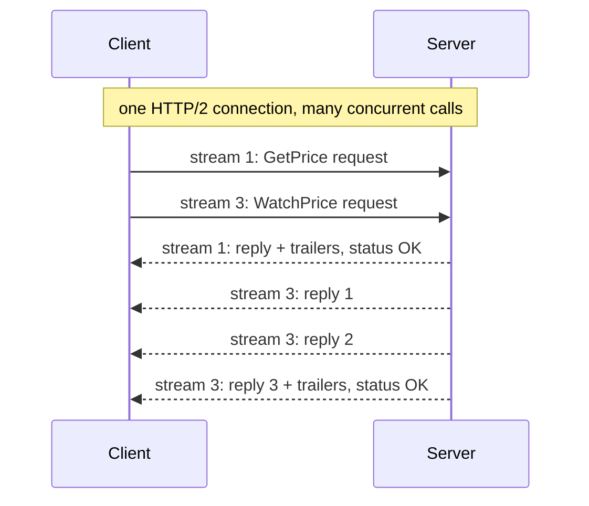
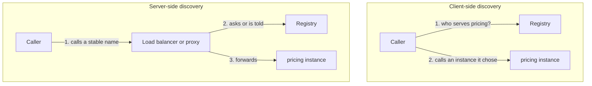
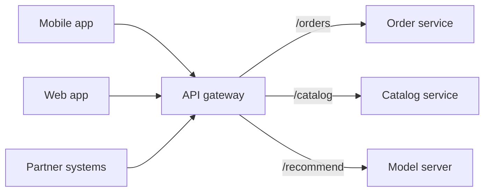
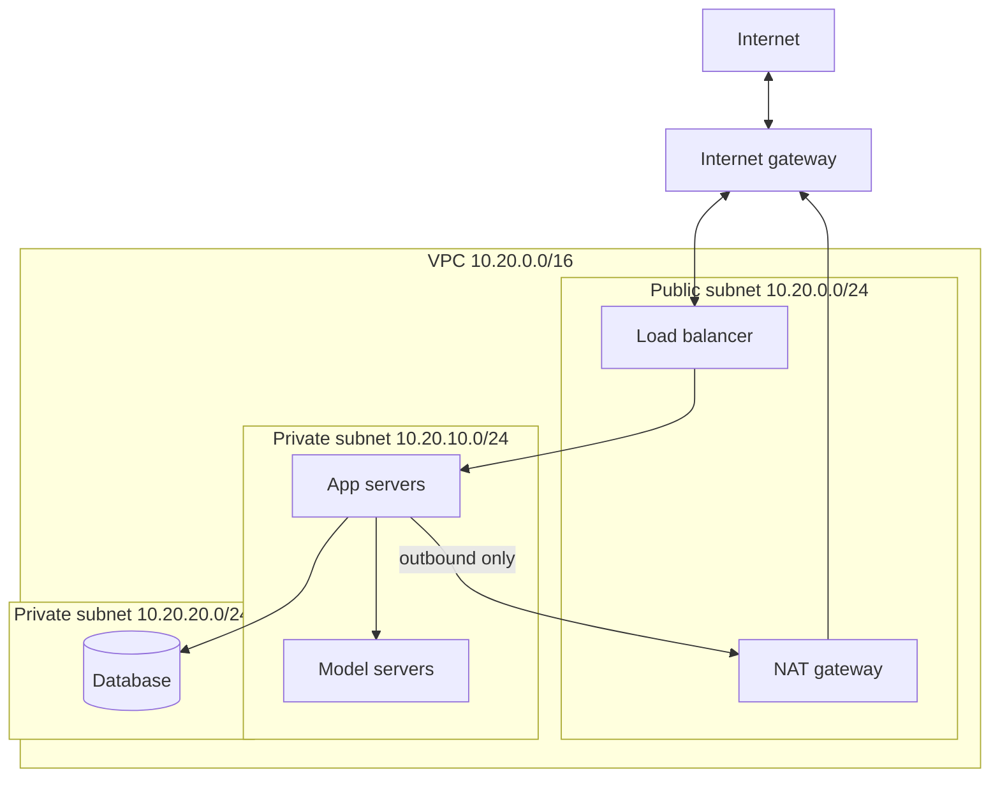

# gRPC, service discovery, API gateways and virtual private clouds

> **Before this lesson:** read [Load balancers, reverse proxies and health checks](#/lesson/networking/load-balancers-proxies) and [Timeouts, retries, pools, rate limits and idempotency](#/lesson/networking/resilience-patterns). You also need HTTP/2 streams from [HTTP/2](#/lesson/networking/http2), CIDR blocks, private addresses and NAT from [IPv4 addressing, subnets, CIDR and NAT](#/lesson/networking/ipv4-subnets-nat), route tables from [The IP packet, IPv6, ICMP, routing and BGP](#/lesson/networking/ipv6-icmp-routing), and DNS from [How DNS resolution works](#/lesson/networking/dns-resolution).

## In plain words

A modern backend is rarely one program. It is dozens or hundreds of small programs, called **services**, each doing one job and calling the others over the network: the order service asks the pricing service, which asks the inventory service, and a machine-learning model server answers requests from several of them. This style is called a **microservice architecture**.

Four practical questions arise as soon as you have more than a handful of services, and this lesson answers each.

1. **How do services talk to each other efficiently?** A company's departments could exchange hand-written letters in free prose, or fill in agreed forms with numbered boxes. Forms are faster to write, faster to read, and harder to get wrong. **gRPC** with **Protocol Buffers** is the agreed-forms approach.
2. **How does a service find another one**, when instances start, stop and move every few minutes? You do not memorise a colleague's desk number; you look them up in a directory that is kept current. That is **service discovery**.
3. **How does the outside world get in?** A large building has one reception desk that checks visitors' badges and directs them, so that not every office needs a guard. That is an **API gateway**.
4. **How is all of this kept private?** The building has walls, locked floors and a rule list at each door. In a cloud, the walls are a **virtual private cloud** (VPC) and the door rules are **security groups**.

Why this matters for a job: these are the daily working concepts of backend, platform and machine-learning engineers. Deploying a model behind an endpoint, debugging "service A cannot reach service B", and reading an architecture diagram all require them. They also make up much of the vocabulary of system design interviews.

## Part 1: gRPC and Protocol Buffers

### Remote procedure calls

A **remote procedure call** (RPC) makes a request to another service look like calling a function: `price = pricing.GetPrice(item_id)`. Generated code handles turning the arguments into bytes, sending them, waiting, and turning the reply back into a value. Converting data structures to bytes is called **serialisation**; the reverse is deserialisation.

Compare this with the common **REST** style, in which you think in terms of resources and HTTP methods (`GET /items/42/price`) and usually exchange **JSON**, a text format.

### Protocol Buffers: the schema

**Protocol Buffers** (protobuf) is a way of describing data and encoding it compactly in binary. You write a **schema** in a `.proto` file: a precise description of each message and each service.

```protobuf
syntax = "proto3";

message PriceRequest {
  int64 item_id = 1;          // the number after "=" is the field NUMBER, not a default value
  string currency = 2;
}

message PriceReply {
  int64 amount_cents = 1;
  string currency = 2;
  repeated string applied_discounts = 3;   // "repeated" means a list
}

service Pricing {
  rpc GetPrice (PriceRequest) returns (PriceReply);                  // one request, one reply
  rpc WatchPrice (PriceRequest) returns (stream PriceReply);         // one request, many replies
}
```

A tool called the protobuf compiler reads this file and generates code in each language you need (Python, Go, Java, and so on): classes for the messages, a client **stub** with a method per RPC, and a server skeleton to fill in. Both sides are built from the same file, so they agree by construction. The schema is the **contract** between teams.

### How protobuf gets small

JSON repeats every field name as text in every message. Protobuf sends only the **field number** and the value, in binary.

Each field is encoded as a **tag** followed by the value. The tag combines the field number and a 3-bit **wire type** saying how to read the value: `tag = (field_number << 3) | wire_type`. The two most common wire types are 0 (a variable-length integer) and 2 (a length followed by that many bytes, used for strings and nested messages).

Integers use a **varint** encoding: 7 bits of the number per byte, least significant group first, with the top bit of each byte set to 1 if another byte follows. Small numbers take one byte.

```python-run
import json

def varint(n):
    """Encode a non-negative integer as a protobuf varint (a list of byte values)."""
    out = []
    while True:
        low7 = n & 0x7F                 # take the lowest 7 bits
        n >>= 7
        if n:
            out.append(low7 | 0x80)     # more bytes follow: set the top bit
        else:
            out.append(low7)            # last byte: top bit clear
            return out

for n in (1, 127, 128, 300, 150000):
    print(f"{n:6} -> {' '.join(f'{b:02x}' for b in varint(n))}")

def int_field(number, value):
    return varint((number << 3) | 0) + varint(value)             # wire type 0: varint

def string_field(number, text):
    data = list(text.encode())
    return varint((number << 3) | 2) + varint(len(data)) + data   # wire type 2: length + bytes

# PriceReply { amount_cents = 1999, currency = "EUR", applied_discounts = ["SPRING"] }
message = int_field(1, 1999) + string_field(2, "EUR") + string_field(3, "SPRING")
as_json = json.dumps({"amount_cents": 1999, "currency": "EUR", "applied_discounts": ["SPRING"]})

print()
print("protobuf:", " ".join(f"{b:02x}" for b in message))
print("protobuf size:", len(message), "bytes")
print("JSON         :", as_json)
print("JSON size    :", len(as_json), "bytes")
```

Take 300 as the worked case: in binary it is `100101100`. The lowest 7 bits are `0101100` (`0x2c`), and more remain, so the first byte is `0xac`. The remaining bits are `10` (`0x02`). Result: `ac 02`. The whole message is 16 bytes against 74 for the JSON, because no field names are sent and numbers are binary.

### Changing a schema safely

Services are deployed independently, so old and new versions of a message must coexist. Protobuf was designed for this. The rules:

- **Field numbers are permanent.** They, not the names, identify a field on the wire. Renaming a field is harmless; changing its number breaks everything.
- **Adding a field is safe.** Old readers skip field numbers they do not know. New readers that do not find the field use a default (zero, empty string, empty list).
- **Never reuse a number** of a deleted field, and never change a field's type. Mark removed numbers `reserved` so that nobody takes them by accident.

Old code reading new messages is **forward compatibility**; new code reading old messages is **backward compatibility**. These rules give you both.

### gRPC: RPC over HTTP/2

**gRPC** is an RPC framework that uses protobuf for messages and **HTTP/2** for transport. Each call is one HTTP/2 stream:

```
:method: POST
:path: /shop.Pricing/GetPrice            <- /package.Service/Method
content-type: application/grpc
grpc-timeout: 800m                        <- the deadline: 800 milliseconds
authorization: Bearer ...
(DATA frames: 1 byte compressed flag + 4 bytes length + the protobuf message)

:status: 200                              <- nearly always 200, even for failures
content-type: application/grpc
(DATA frames: the reply message)
grpc-status: 0                            <- the real result, sent in TRAILERS after the body
grpc-message: ""
```

Two things in that exchange surprise people. The HTTP status is `200` for almost every call; the actual outcome is `grpc-status`, sent as **trailers**: headers that come *after* the body. That allows a server to stream many messages and report an error at the very end. And the `grpc-timeout` header is the deadline propagation described in the previous lesson, built into the protocol.

Because HTTP/2 streams are two-way and long-lived, gRPC offers four call shapes:

| Kind | Client sends | Server sends | Example |
|---|---|---|---|
| **Unary** | one message | one message | get a price |
| **Server streaming** | one | many | watch a price; stream generated tokens from a model |
| **Client streaming** | many | one | upload a file in chunks; send a batch of readings |
| **Bidirectional streaming** | many | many | chat; live speech recognition |



Status codes worth recognising: `OK`, `INVALID_ARGUMENT`, `NOT_FOUND`, `ALREADY_EXISTS`, `PERMISSION_DENIED`, `UNAUTHENTICATED`, `RESOURCE_EXHAUSTED` (rate limited), `DEADLINE_EXCEEDED`, `UNAVAILABLE` (transient: safe to retry), `INTERNAL`.

### gRPC or REST?

| | REST with JSON | gRPC with protobuf |
|---|---|---|
| Format | text, readable by humans | binary, compact |
| Contract | optional (OpenAPI) | required (`.proto`), with generated code |
| Transport | any HTTP version | HTTP/2 |
| Streaming | limited (SSE, chunked responses) | built in, in both directions |
| Browser support | native | needs a proxy (gRPC-Web) |
| Debugging | curl, any browser | special tools (`grpcurl`) |
| Caching by CDNs and proxies | natural for `GET` | not available (everything is `POST`) |
| Typical use | public APIs, web and mobile clients | calls between internal services, low latency, streaming |

A common architecture uses both: REST or GraphQL at the edge for outside clients, gRPC between internal services.

One operational trap, mentioned in the load-balancing lesson and worth repeating: gRPC clients keep one long-lived HTTP/2 connection and send every call over it. A layer 4 load balancer will pin all of a client's calls to one backend. Use a layer 7 balancer that understands HTTP/2, or client-side load balancing.

For machine-learning serving specifically: gRPC suits high-volume, low-latency inference between services and streaming outputs. Keep an eye on message size limits (the default maximum is 4 MB per message; large tensors or images need a raised limit or chunked streaming), and consider whether a simple REST endpoint is the better fit when the callers are browsers or external customers.

## Part 2: Service discovery

### The problem

Instances of a service come and go: autoscaling adds some under load, deployments replace them, failures remove them, and each new instance gets a new IP address. Hard-coding addresses is hopeless. **Service discovery** lets a caller ask for a service by name and receive the current, healthy addresses.

Three parts make it work:

- a **service registry**: a database of "service name → list of live instances" (examples: Consul, etcd, ZooKeeper, or the platform's own, as in Kubernetes);
- **registration**: each instance is added when it starts, either by announcing itself or by the platform doing it;
- **health checking**: instances that stop responding are removed.

### Two patterns



| | Client-side discovery | Server-side discovery |
|---|---|---|
| Who picks the instance | the caller's library | a load balancer or proxy |
| Extra network hop | none | one |
| Client complexity | needs a discovery and balancing library in every language | none: call one name |
| Balancing quality | per request, with full knowledge | depends on the proxy |

### DNS as the directory

The simplest form of discovery is DNS: the service name resolves to the addresses of its instances. It needs no special client. Its weaknesses are the ones from the DNS lessons: answers are cached for their TTL, some clients resolve once and never again, and a plain lookup carries no health or load information. For that reason DNS-based discovery usually returns a *stable* address of a load balancer, not the instances themselves.

### Kubernetes as a worked example

In Kubernetes, the container platform most teams use, the unit that runs is a **pod**, and pods are short-lived with changing IP addresses. A **Service** object gives a set of pods a stable identity:

- a DNS name such as `pricing.shop.svc.cluster.local`;
- a stable virtual address, the **ClusterIP**;
- an automatically maintained list of the ready pods behind it (pods that pass their readiness probe).

A component on every machine (kube-proxy, or a newer equivalent) rewrites packets addressed to the ClusterIP so that they reach one of the pods. That is server-side discovery and layer 4 balancing, done in the kernel.

```
$ kubectl get service pricing -n shop
NAME      TYPE        CLUSTER-IP     PORT(S)    AGE
pricing   ClusterIP   10.96.41.207   50051/TCP  12d        <- the stable virtual address

$ kubectl get endpointslices -n shop -l kubernetes.io/service-name=pricing
NAME            ADDRESSTYPE   PORTS   ENDPOINTS                           AGE
pricing-x7k2p   IPv4          50051   10.244.1.17,10.244.2.9,10.244.3.4   12d    <- the ready pods right now
```

Because this balancing is per connection, gRPC needs more. Options: a **headless** Service (DNS returns the pod addresses directly and the gRPC client balances across them), or a **service mesh**.

### Service mesh

A **service mesh** places a small proxy, called a **sidecar**, next to every service instance. All traffic in and out of the service passes through its sidecar. The sidecars, configured centrally by a **control plane**, provide discovery, per-request load balancing, retries, timeouts, circuit breaking, mutual TLS and detailed metrics, uniformly for every service regardless of programming language. The price is more moving parts, extra latency per hop (typically around a millisecond), and operational complexity. Adopt one when you have enough services that implementing those features consistently in each has become the bigger problem.

## Part 3: API gateways

An **API gateway** is a reverse proxy that serves as the single entry point for clients outside the system. It is a layer 7 load balancer with responsibilities that are about the API as a product.



What it typically handles, so that individual services do not each have to:

- **Authentication**: verifying API keys or tokens, then passing the caller's identity inward.
- **Rate limiting and quotas** per client.
- **Routing** by path, host or version to the right service.
- **Protocol translation**: for example accepting REST and JSON from outside and calling gRPC inside.
- **TLS termination**, request validation, size limits.
- **Observability**: one place for access logs, metrics and request identifiers.
- **Aggregation**: combining several backend calls into one response to save a mobile client round trips. A gateway tailored to one kind of client is called a **backend for frontend** (BFF).

Things belonging to all services, such as checking tokens, are called **cross-cutting concerns**, and the gateway is where they are centralised.

Cautions: the gateway is on the path of every request, so it must be highly available and fast; and it should not accumulate business logic, or it becomes a bottleneck for every team's changes. Inside the system, services should still verify who is calling them (for example with mutual TLS) instead of trusting anything that comes from the gateway's direction.

## Part 4: Virtual private clouds and security groups

### The private network

A **virtual private cloud** (VPC) is your own isolated network inside a cloud provider. You choose its address range as a CIDR block, for example `10.20.0.0/16`, and divide it into **subnets**, each placed in one **availability zone** (a physically separate data centre within a region).

Each subnet is associated with a **route table**, and one route decides the subnet's character:

- A **public subnet** has a default route (`0.0.0.0/0`) to an **internet gateway**. Resources in it that have a public IP address can be reached from, and can reach, the Internet.
- A **private subnet** has no route to the internet gateway. Its resources have only private addresses and cannot be reached from outside. If they need to make outbound connections (to download updates or call an external API), their default route points to a **NAT gateway** sitting in a public subnet, which works like the home router NAT from the IPv4 lesson: outbound connections work, unsolicited inbound ones do not.



This three-tier layout is the standard pattern: only the load balancer is exposed; application and model servers sit in private subnets; the database sits in a subnet that only the application tier can reach. Each tier is repeated in two or three availability zones for resilience.

The route tables for that picture:

```
Public subnet route table
  Destination      Target
  10.20.0.0/16     local               <- everything inside the VPC is reachable directly
  0.0.0.0/0        internet-gateway    <- this line is what makes the subnet "public"

Private subnet route table
  Destination      Target
  10.20.0.0/16     local
  0.0.0.0/0        nat-gateway         <- outbound only, through NAT
```

Routing follows longest-prefix match, as always: traffic for `10.20.20.5` matches the `/16` local route in preference to the default route.

### Security groups and network ACLs

Routing decides where packets *can* go. Firewall rules decide which are *allowed*. Clouds provide two layers.

A **security group** is a firewall attached to an individual resource (a virtual machine, a load balancer, a database). Its rules say which traffic is allowed in (**inbound** or ingress) and out (**outbound** or egress). Its defining properties:

- **Allow rules only.** Anything not explicitly allowed is denied.
- **Stateful.** If an inbound connection is allowed, the replies are automatically allowed out, and the other way round. The firewall tracks connections.
- **Sources can be other security groups**, not only address ranges. "Allow port 5432 from the application servers' group" keeps working as servers are added, removed and renumbered.

A **network ACL** (access control list) is a firewall attached to a subnet. It is **stateless**: it judges each packet on its own, so you must allow both the request direction and the reply direction explicitly (replies return to the client's ephemeral port, in the range roughly 1024 to 65535). It supports explicit deny rules, evaluated in numbered order. Most teams leave network ACLs open and do the real work with security groups, using ACLs for coarse blocks.

| | Security group | Network ACL |
|---|---|---|
| Attached to | a resource | a subnet |
| Stateful | yes: replies allowed automatically | no: both directions need rules |
| Rule types | allow only | allow and deny |
| Evaluation | all rules together | in order, first match wins |
| Can reference | CIDR ranges or other security groups | CIDR ranges |

Security groups for the three-tier example:

| Group | Inbound rule | Meaning |
|---|---|---|
| `sg-lb` | TCP 443 from `0.0.0.0/0` | the world may reach the load balancer over HTTPS |
| `sg-app` | TCP 8080 from `sg-lb` | only the load balancer may reach the application servers |
| `sg-model` | TCP 50051 from `sg-app` | only application servers may call the model servers over gRPC |
| `sg-db` | TCP 5432 from `sg-app` | only application servers may reach the database |

Granting each component only the access it needs is the principle of **least privilege**. Splitting a network into zones with controlled paths between them is **segmentation**, and having several independent layers of protection is **defence in depth**.

### Try it: evaluate a connection against security groups

```python-run
RULES = {      # security group -> list of (protocol, port, allowed source)
    "sg-lb":    [("tcp", 443, "0.0.0.0/0")],
    "sg-app":   [("tcp", 8080, "sg-lb")],
    "sg-model": [("tcp", 50051, "sg-app")],
    "sg-db":    [("tcp", 5432, "sg-app")],
}

def allowed(source, destination_group, port):
    """source is either a security group name or the word 'internet'."""
    for protocol, rule_port, rule_source in RULES[destination_group]:
        if rule_port != port:
            continue
        if rule_source == "0.0.0.0/0" or rule_source == source:
            return True
    return False                 # no matching allow rule: denied by default

attempts = [
    ("internet", "sg-lb", 443),      # a user opens the site
    ("sg-lb", "sg-app", 8080),       # the load balancer forwards the request
    ("sg-app", "sg-db", 5432),       # the application queries the database
    ("sg-app", "sg-model", 50051),   # the application calls the model server
    ("internet", "sg-db", 5432),     # someone on the Internet tries the database
    ("sg-lb", "sg-db", 5432),        # the load balancer tries the database
    ("sg-app", "sg-db", 22),         # SSH from an application server to the database
]
for source, group, port in attempts:
    verdict = "ALLOW" if allowed(source, group, port) else "deny "
    print(f"{verdict}  {source:9} -> {group:9} port {port}")
```

The last three lines are denied without any explicit deny rule: nothing allows them. Note that because security groups are stateful, no rule is needed for the database's replies to the application.

### Connecting beyond the VPC

- **VPC peering** and **transit gateways** connect VPCs so that they route to each other privately. Their CIDR blocks must not overlap, which is why address planning matters from the first day.
- A **VPN** or a dedicated private line connects a VPC to an office or on-premises data centre.
- **Private endpoints** let resources in a private subnet reach the cloud provider's own services (object storage, registries, managed AI services) without going through a NAT gateway or the public Internet.
- A **bastion host** (or a managed session service) is the controlled way for administrators to reach machines in private subnets; nothing private is exposed directly.

### "A cannot reach B": a checklist

Work outward from the symptom:

1. **Name**: does B's name resolve, and to the address you expect?
2. **Timeout or refused?** A timeout means packets are being dropped: almost always a security group, network ACL or route. A refusal means B's machine was reached and nothing is listening on that port, or the process is bound only to `127.0.0.1`.
3. **B's security group**: does it allow A's group (or address) on that port?
4. **A's outbound rules**: is egress restricted?
5. **Network ACLs** on both subnets, in both directions, including ephemeral ports.
6. **Route tables**: does each subnet have a route to the other's range? For Internet access, is there a default route to a NAT or internet gateway?
7. **The service itself**: is it running, healthy and listening on the expected interface and port?

> [!INTERVIEW]
> **"Sketch the network for a web application with an API, a model server and a database on a cloud."** A VPC with a /16 range across two or three availability zones. Public subnets hold only the load balancer and NAT gateways. Private subnets hold the API servers and model servers; a further private subnet holds the database. Route tables give public subnets a default route to the internet gateway and private subnets a default route to the NAT gateway. Security groups chain by reference: the world to the load balancer on 443, the load balancer to the API, the API to the model server and to the database, nothing else. TLS terminates at the load balancer or gateway; internal calls use gRPC with deadlines, discovered by service name. Mention private endpoints for cloud services and non-overlapping CIDR ranges for future peering.

> [!TIP]
> Reference security groups by group, not by IP range, whenever both ends are inside your VPC. Rules written against address ranges go stale as soon as instances are replaced, and they tend to be widened "temporarily" until they allow far more than intended.

> [!WARNING]
> `0.0.0.0/0` as the source for a database port, an administration port (22 for SSH, 3389 for remote desktop) or an internal API is one of the most common causes of data breaches. Automated scanners find such openings within minutes of their creation. Only load balancers intended for the public should accept traffic from everywhere.

## Pitfalls

- **Changing or reusing protobuf field numbers.** Old and new code will silently misread each other's data.
- **Expecting a failed gRPC call to show a non-200 HTTP status.** Look at `grpc-status`.
- **gRPC through a layer 4 balancer**, concentrating load on a few backends.
- **gRPC calls without deadlines.** The default is to wait indefinitely.
- **Relying on DNS for instant discovery.** Caching delays changes; long-lived connections never see them.
- **Putting business logic in the gateway.**
- **Trusting internal traffic because it is internal.** Authenticate between services.
- **Databases or model servers in public subnets.**
- **Forgetting that network ACLs are stateless** and blocking reply traffic.
- **Overlapping CIDR ranges** between VPCs or with the office network.
- **Sending large volumes through a NAT gateway** when a private endpoint exists: slower and charged per gigabyte.

## Summary

- Protobuf defines messages in a schema and encodes them as field number, wire type and value, with varints for integers; field numbers are permanent, adding fields is safe.
- gRPC carries protobuf over HTTP/2 streams with unary and streaming calls, deadlines, and a status sent in trailers. It suits internal service calls; REST with JSON suits public and browser-facing APIs.
- Service discovery maps a service name to healthy instances through a registry, on the client side or through a proxy; DNS, Kubernetes Services and service meshes are the common forms.
- An API gateway is the single entry point that centralises authentication, rate limiting, routing and translation.
- A VPC is a private network divided into public subnets (default route to an internet gateway) and private subnets (outbound through NAT only).
- Security groups are stateful, allow-only firewalls on resources and can reference each other; network ACLs are stateless subnet filters.

## Glossary

- **Service / microservice architecture**: a small independently deployed program / a system built from many of them.
- **RPC**: a remote call presented as a function call.
- **Serialisation**: converting data structures to bytes.
- **REST / JSON**: a resource-oriented API style over HTTP / a text data format.
- **Protocol Buffers (protobuf)**: a schema language and compact binary encoding.
- **Schema / contract**: the formal description of messages and services that both sides rely on.
- **Stub**: generated client code that performs an RPC.
- **Field number / wire type / tag**: a field's permanent identifier / how its value is encoded / the two combined.
- **Varint**: a variable-length integer encoding using 7 bits per byte.
- **Forward / backward compatibility**: old code reading new data / new code reading old data.
- **gRPC**: an RPC framework using protobuf over HTTP/2.
- **Unary / streaming call**: one message each way / many messages in one or both directions.
- **Trailers**: headers sent after the body.
- **Service discovery / registry**: finding live instances by name / the database that holds them.
- **Client-side / server-side discovery**: the caller chooses an instance / a proxy chooses.
- **Pod / Service / ClusterIP**: Kubernetes' running unit / stable identity for a set of pods / its virtual address.
- **Headless Service**: a Service whose DNS returns pod addresses directly.
- **Service mesh / sidecar / control plane**: per-instance proxies managing service traffic / one such proxy / the system configuring them.
- **API gateway**: the single entry point for external clients.
- **Cross-cutting concern**: a need shared by all services, such as authentication.
- **Backend for frontend (BFF)**: a gateway tailored to one client type.
- **VPC**: an isolated virtual network in a cloud.
- **Availability zone**: a physically separate data centre within a region.
- **Public / private subnet**: with / without a route to the internet gateway.
- **Internet gateway / NAT gateway**: the VPC's door to the Internet / outbound-only access for private subnets.
- **Security group**: a stateful, allow-only firewall on a resource.
- **Network ACL**: a stateless filter on a subnet.
- **Ingress / egress**: inbound / outbound traffic.
- **Least privilege, segmentation, defence in depth**: minimum necessary access; dividing a network into zones; several independent protections.
- **VPC peering, private endpoint, bastion host**: private links between VPCs; private access to cloud services; a controlled administrative entry point.

## Check yourself

```quiz
[
  {"q": "In a protobuf message, what identifies a field on the wire?",
   "options": ["Its name", "Its field number", "Its position in the .proto file", "Its default value"], "answer": 1,
   "explain": "Only the field number and wire type are encoded. Names can change freely; numbers must never change or be reused."},
  {"q": "How is the integer 300 encoded as a protobuf varint?",
   "options": ["One byte: 0x2c", "Two bytes: 0xac 0x02", "Four bytes: 0x00 0x00 0x01 0x2c", "Two bytes: 0x01 0x2c"], "answer": 1,
   "explain": "The low 7 bits (0101100) get a continuation bit, giving 0xac; the remaining bits (10) form the final byte 0x02."},
  {"q": "A gRPC call fails with NOT_FOUND. What HTTP status does the response usually carry, and where is the gRPC status?",
   "options": ["404, in the status line", "200, with grpc-status in the trailers", "500, in a JSON body", "204, with no status"], "answer": 1,
   "explain": "gRPC reports its own status in trailers after the body. The HTTP status is normally 200 whenever the transport worked."},
  {"q": "Which gRPC call type fits a model server that returns generated text token by token for one prompt?",
   "options": ["Unary", "Server streaming", "Client streaming", "None; gRPC cannot stream"], "answer": 1,
   "explain": "One request followed by many responses is server streaming."},
  {"q": "In server-side discovery, who chooses the instance that handles a request?",
   "options": ["The calling service's library", "A load balancer or proxy that knows the live instances", "The DNS root servers", "The database"], "answer": 1,
   "explain": "The caller addresses a stable name or address, and an intermediary selects a healthy instance. In client-side discovery the caller chooses."},
  {"q": "What makes a subnet in a VPC 'public'?",
   "options": ["Its CIDR block is from a public range", "Its route table has a default route to an internet gateway", "It has no security groups", "It is in the first availability zone"], "answer": 1,
   "explain": "Public and private are defined by routing. A private subnet's default route, if any, goes to a NAT gateway for outbound-only access."},
  {"q": "A security group allows inbound TCP 5432 from the application servers' group. Do you need a rule for the database's replies?",
   "options": ["Yes, an outbound rule for ephemeral ports", "No, security groups are stateful and allow replies automatically", "Yes, a network ACL deny rule", "Only for IPv6"], "answer": 1,
   "explain": "Stateful firewalls track connections, so return traffic for an allowed connection is permitted. Stateless network ACLs would need explicit rules."},
  {"q": "Service A's connection to service B on port 8080 hangs and then times out. What is the most likely class of cause?",
   "options": ["B's process is not listening on that port", "Packets are being dropped by a security group, network ACL or missing route", "The protobuf schema changed", "The idempotency key is wrong"], "answer": 1,
   "explain": "A timeout means silence: packets or replies are discarded. If the machine were reachable with nothing listening, the connection would be refused immediately."}
]
```

> **Source:** written from general systems knowledge (outside the chapters of Grigorik, *High Performance Browser Networking*, https://hpbn.co , whose HTTP/2 chapter underlies the gRPC transport). Facts checked against the Protocol Buffers encoding guide (https://protobuf.dev/programming-guides/encoding/), the gRPC over HTTP/2 protocol description (https://github.com/grpc/grpc/blob/master/doc/PROTOCOL-HTTP2.md), the Kubernetes Service documentation (https://kubernetes.io/docs/concepts/services-networking/service/) and the AWS VPC user guide on security groups and network ACLs (https://docs.aws.amazon.com/vpc/latest/userguide/vpc-security-groups.html).
