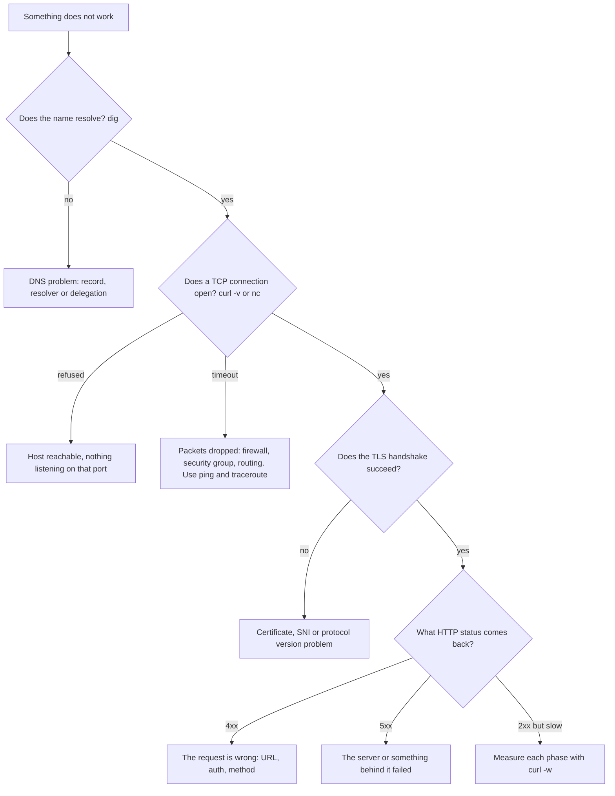

# Network debugging tools: ping, traceroute, dig and curl

> **Before this lesson:** this lesson applies earlier ones. You need ICMP, TTL and traceroute's mechanism from [The IP packet, IPv6, ICMP, routing and BGP](#/lesson/networking/ipv6-icmp-routing), DNS records and `dig` basics from [How DNS resolution works](#/lesson/networking/dns-resolution), the TCP and TLS handshakes from [UDP and the TCP connection lifecycle](#/lesson/networking/udp-tcp-lifecycle) and [TLS: the handshake, certificates and chains of trust](#/lesson/networking/tls-handshake-certificates), and HTTP status codes from [From HTTP/0.9 to HTTP/1.1](#/lesson/networking/http1). Commands are typed into a **terminal** (also called a command line or shell), a text window where you run programs by name.

## In plain words

When something on a network does not work, the worst approach is to change things at random and hope. A good engineer works like a doctor: ask a few precise questions, each of which rules out a whole category of causes, until only one explanation remains.

A plumber faced with "no water from the tap" does the same. Is water reaching the house? Is the main valve open? Is this the only dry tap, or are they all dry? Each answer halves the search.

Networking has a small set of standard instruments for asking such questions, and four of them cover most situations:

- **`ping`** asks: can I reach that machine at all, and how long does the round trip take?
- **`traceroute`** asks: which routers lie between us, and where does the path break or slow down?
- **`dig`** asks: what does DNS say this name points to?
- **`curl`** asks: what happens when I make an actual request, step by step?

Why this matters for a job: these tools are available on every server, in every container and on every engineer's laptop. Being fluent in them is what lets you say "DNS resolves correctly, TCP connects in 30 ms, the TLS handshake fails because the certificate expired yesterday" five minutes into an incident. Interviewers for backend, platform and site-reliability roles often ask "a user says the site is down; what do you do?", and the expected answer is a sequence built from these commands.

## A method before the tools

Recall the journey of a request from the URL lesson: DNS lookup, then a TCP connection, then a TLS handshake, then an HTTP request and response. Debugging follows the same order, because each step depends on the one before it.



Two further habits make the method work:

1. **Change one thing at a time**, and compare a failing case with a working one. Does it fail from another machine? For another host name? Over IPv4 but not IPv6?
2. **Write down exact error text.** "Could not resolve host", "Connection refused", "Connection timed out", "certificate has expired" and "502 Bad Gateway" point at five different layers.

## ping: is it reachable, and how far away?

`ping` sends ICMP echo requests and reports the echo replies. (ICMP is the Internet's control-message protocol; an echo request means "please answer".)

```
$ ping -c 5 203.0.113.80
PING 203.0.113.80 (203.0.113.80): 56 data bytes
64 bytes from 203.0.113.80: icmp_seq=0 ttl=53 time=24.1 ms
64 bytes from 203.0.113.80: icmp_seq=1 ttl=53 time=23.8 ms
64 bytes from 203.0.113.80: icmp_seq=2 ttl=53 time=61.7 ms
64 bytes from 203.0.113.80: icmp_seq=4 ttl=53 time=24.4 ms

--- 203.0.113.80 ping statistics ---
5 packets transmitted, 4 packets received, 20.0% packet loss
round-trip min/avg/max/stddev = 23.8/33.5/61.7/16.3 ms
```

The option `-c 5` means "send five and stop" (on Linux and macOS; Windows sends four by default). Reading each part:

- **`icmp_seq`** numbers the probes. Number 3 is missing: that probe or its reply was lost.
- **`ttl=53`** is the TTL left in the reply when it arrived. Replies commonly start at 64, 128 or 255, so 53 suggests 11 routers on the return path.
- **`time`** is the round-trip time for that probe.
- **The summary** gives the loss percentage and the minimum, average and maximum. The spread between minimum and maximum is a rough indication of jitter.

What ping tells you, and what it does not:

| Result | Meaning |
|---|---|
| Replies arrive | The host is reachable at the IP layer; you know the RTT. It says **nothing** about whether a service on a given port works. |
| No replies | Either the host is unreachable, or ICMP is filtered. Many servers and cloud firewalls drop pings on purpose while serving web traffic normally. |
| Some loss | Possibly a congested or faulty link; possibly routers deprioritising ICMP. Confirm with a real TCP test before concluding. |
| `Destination Host Unreachable` | A router (or your own machine) has no route or got no ARP reply. The problem is close to whoever sent that message. |

A classic trio of pings narrows a local problem quickly:

```
ping 192.168.1.1        # my own router: is my local network working?
ping 1.1.1.1            # a public IP address: is my Internet connection working?
ping example.com        # a name: does DNS work as well?
```

If the first works and the second does not, the problem is beyond your router. If the second works and the third fails with "cannot resolve", the problem is DNS.

### Try it: summarise ping results

```python-run
import statistics

# Round-trip times in ms; None marks a probe that got no reply.
samples = [24.1, 23.8, 61.7, None, 24.4, 23.9, 24.0, None, 95.2, 24.3]

received = [s for s in samples if s is not None]        # keep only the answered probes
loss = 1 - len(received) / len(samples)

print(f"sent {len(samples)}, received {len(received)}, loss {loss:.0%}")
print(f"min {min(received)}  median {statistics.median(received)}  "
      f"mean {statistics.mean(received):.1f}  max {max(received)} ms")

# Jitter: the average change between consecutive answered probes.
changes = [abs(b - a) for a, b in zip(received, received[1:])]
print(f"average jitter {statistics.mean(changes):.1f} ms")
```

The median (24.2 ms) describes the typical round trip far better than the mean, which two slow replies pull up to about 38 ms.

## traceroute: where along the path?

`traceroute` (spelled `tracert` on Windows) lists the routers between you and a destination. It sends probes with TTL 1, 2, 3 and so on; the router at which each probe's TTL reaches zero replies with an ICMP "time exceeded" message, revealing itself.

```
$ traceroute shop.example.com
traceroute to shop.example.com (203.0.113.80), 30 hops max
 1  192.168.1.1 (192.168.1.1)        1.2 ms   1.0 ms   1.1 ms      <- my router
 2  10.44.0.1 (10.44.0.1)            8.9 ms   9.4 ms   8.7 ms      <- provider's first hop
 3  ae12.core1.city.isp.example     10.2 ms  10.0 ms  10.5 ms
 4  * * *                                                           <- no answer from this hop
 5  xe-0.ix.exchange.example        11.8 ms  12.1 ms  11.6 ms
 6  po7.edge3.far.carrier.example   88.4 ms  87.9 ms  88.8 ms      <- +76 ms: a long-distance link
 7  203.0.113.1 (203.0.113.1)       89.0 ms  89.5 ms  88.7 ms
 8  203.0.113.80 (203.0.113.80)     89.3 ms  89.1 ms  89.6 ms      <- the destination
```

Each line is one hop, with the round-trip times of three probes. How to read it correctly:

- **`* * *` in the middle is usually harmless.** That router does not answer probes, yet it forwards packets, as the later hops prove.
- **A jump in latency that persists on all later hops is real.** Between hops 5 and 6 the time rises from 12 ms to 88 ms and stays there: that link is long, probably crossing an ocean or a continent. That is geography, not a fault.
- **A high time at one hop that does not persist is not a problem.** Routers answer these probes with low priority. If hop 4 showed 200 ms and hop 5 showed 12 ms, hop 4 is merely slow at answering.
- **Stars from some hop to the very end** mean probes stop getting through at or after the last hop that answered. Either the destination's firewall blocks the probes (common, and harmless), or the path really breaks there. A TCP test tells the two apart.
- **Router names often contain location hints** (city or airport codes), which help to see where traffic travels.

Useful variations:

```
traceroute -n host          # do not look up router names (faster)
traceroute -T -p 443 host   # probe with TCP SYN to port 443 instead of UDP (Linux, needs root)
mtr host                    # a continuously updating traceroute with loss and latency per hop
```

The TCP variant matters because firewalls often let through only the traffic the service uses. `mtr` is the tool of choice for intermittent problems: it sends probes repeatedly and shows statistics per hop.

One caution: traceroute shows the path *to* the destination. The return path can be completely different, and the times include it. Getting a trace from both ends is the way to investigate a routing problem properly.

### Try it: find where the latency comes from

```python-run
# (hop number, router, list of round-trip times in ms; empty list = no reply)
trace = [
    (1, "192.168.1.1",                 [1.2, 1.0, 1.1]),
    (2, "10.44.0.1",                   [8.9, 9.4, 8.7]),
    (3, "ae12.core1.city.isp.example", [10.2, 10.0, 10.5]),
    (4, "*",                           []),
    (5, "xe-0.ix.exchange.example",    [11.8, 12.1, 11.6]),
    (6, "po7.edge3.far.carrier.example", [88.4, 87.9, 88.8]),
    (7, "203.0.113.1",                 [89.0, 89.5, 88.7]),
    (8, "203.0.113.80",                [89.3, 89.1, 89.6]),
]

previous = 0.0
biggest = (0.0, None)
for hop, router, times in trace:
    if not times:
        print(f"{hop:2}  {router:32} no reply (often normal)")
        continue
    best = min(times)                       # the minimum is the least distorted by queuing
    added = best - previous
    print(f"{hop:2}  {router:32} best {best:5.1f} ms   added {added:+6.1f} ms")
    if added > biggest[0]:
        biggest = (added, router)
    previous = best

print(f"\nLargest increase: {biggest[0]:.1f} ms on the link into {biggest[1]}")
```

The program compares each hop's best time with the previous responding hop and points at the link that contributes most: the one into hop 6.

## dig: what does DNS say?

`dig` asks DNS questions. The earlier lesson explained the full output; here are the commands to reach for when debugging.

```
$ dig +short shop.example.com
shop.cdn-provider.example.            <- a CNAME: the name is an alias
203.0.113.80                          <- the address it finally resolves to

$ dig shop.example.com | grep -E "status|ANSWER SECTION" -A2
;; ->>HEADER<<- opcode: QUERY, status: NOERROR, id: 5121
...
;; ANSWER SECTION:
shop.example.com.          212   IN  CNAME  shop.cdn-provider.example.
shop.cdn-provider.example. 17    IN  A      203.0.113.80
```

The four questions to ask, in order:

| Question | Command |
|---|---|
| What does my configured resolver answer? | `dig shop.example.com` |
| What does a different, public resolver answer? | `dig @1.1.1.1 shop.example.com` |
| What do the domain's own servers say (the truth, no caches)? | `dig NS example.com +short`, then `dig @ns1.example.com shop.example.com` |
| Where does the chain of delegation break? | `dig +trace shop.example.com` |

Interpreting differences:

- Authoritative server correct, public resolver showing the old value with TTL remaining: a cache that has not expired. Wait, or see the DNS caching lesson for how to plan changes.
- `NXDOMAIN`: the name does not exist (or a negative answer is cached). Check for typing mistakes and the record's presence at the authoritative server.
- `SERVFAIL`: the resolver could not obtain an answer: unreachable or misconfigured authoritative servers, or a DNSSEC validation failure.
- A timeout with "no servers could be reached": the resolver itself is unreachable. Try `dig @1.1.1.1`; if that works, your configured resolver is the problem.

Other record types are requested by name: `dig example.com MX`, `dig example.com TXT`, `dig example.com AAAA`, and `dig -x 203.0.113.80` for the reverse lookup.

A trap: `dig` queries DNS directly and ignores the local `hosts` file and operating-system rules. A program on the same machine may resolve a name differently. On Linux, `getent hosts shop.example.com` shows what applications will actually get.

## curl: make the request and watch every step

`curl` transfers data to or from a URL. It speaks HTTP in all versions and is the most valuable single tool for debugging web services, because it performs the complete sequence and can show each stage.

### The verbose flag

```
$ curl -v https://shop.example.com/api/health
* Host shop.example.com:443 was resolved.
* IPv6: (none)
* IPv4: 203.0.113.80                                  <- DNS result
*   Trying 203.0.113.80:443...
* Connected to shop.example.com (203.0.113.80) port 443        <- TCP handshake done
* ALPN: curl offers h2,http/1.1
* TLSv1.3 (OUT), TLS handshake, Client hello (1):
* TLSv1.3 (IN), TLS handshake, Server hello (2):
* TLSv1.3 (IN), TLS handshake, Certificate (11):
* TLSv1.3 (IN), TLS handshake, Finished (20):
* SSL connection using TLSv1.3 / TLS_AES_256_GCM_SHA384         <- version and cipher
* ALPN: server accepted h2                            <- HTTP/2 negotiated
* Server certificate:
*  subject: CN=shop.example.com                       <- who the certificate is for
*  start date: Mar  2 00:00:00 2026 GMT
*  expire date: May 31 23:59:59 2026 GMT              <- when it expires
*  subjectAltName: host "shop.example.com" matched cert's "shop.example.com"
*  SSL certificate verify ok.                         <- the chain was trusted
> GET /api/health HTTP/2                              <- what we sent
> Host: shop.example.com
> User-Agent: curl/8.7.1
> Accept: */*
>
< HTTP/2 200                                          <- what came back
< content-type: application/json
< cache-control: no-store
< server-timing: app;dur=4
<
{"status":"ok"}
* Connection #0 to host shop.example.com left intact
```

Lines beginning with `*` are curl's commentary, `>` marks request headers sent, `<` marks response headers received. The last line of commentary before a failure tells you which stage failed:

| curl's message | Stage | Likely cause |
|---|---|---|
| `Could not resolve host` | DNS | wrong name, missing record, resolver down |
| `Connection refused` | TCP | reached the machine; nothing listening on that port |
| `Connection timed out` / `Failed to connect ... Timeout` | TCP | packets dropped: firewall, security group, wrong address, host down |
| `SSL certificate problem: certificate has expired` | TLS | renew the certificate |
| `SSL: no alternative certificate subject name matches target host name` | TLS | wrong certificate served: name mismatch or missing SNI |
| `unable to get local issuer certificate` | TLS | server did not send the intermediate certificate |
| `Empty reply from server` / `Recv failure: Connection reset by peer` | HTTP | the server closed the connection without answering: crash, proxy, protocol mismatch |
| `HTTP/2 502`, `503`, `504` | HTTP | the proxy reached no healthy or responsive backend |

### The options worth memorising

| Option | Effect |
|---|---|
| `-v` | verbose: show the connection, TLS and headers |
| `-i` / `-I` | include response headers in the output / fetch headers only (a `HEAD` request) |
| `-s` | silent: no progress meter (combine as `-sv`, `-sI`) |
| `-o file` / `-o /dev/null` | write the body to a file / discard it |
| `-L` | follow redirects |
| `-X POST`, `-d '{"a":1}'`, `-H 'Content-Type: application/json'` | choose the method, send a body, add a header |
| `--connect-timeout 3`, `--max-time 10` | limit the connection phase / the whole operation, in seconds |
| `--resolve host:443:203.0.113.99` | use this IP address for that host name, keeping the name for SNI and `Host` |
| `--http1.1`, `--http2`, `--http3` | force a protocol version |
| `-4` / `-6` | use IPv4 only / IPv6 only |
| `-w '...'` | print timing and other variables after the transfer |

`--resolve` deserves emphasis. To test one particular server behind a load balancer, or a new server before DNS points to it, you want to connect to its IP address while still presenting the real host name. Putting the IP address in the URL would break SNI and the `Host` header and produce a misleading certificate error.

```
curl -sv --resolve shop.example.com:443:203.0.113.99 https://shop.example.com/api/health -o /dev/null
```

> [!WARNING]
> `curl -k` (or `--insecure`) turns certificate verification off. It is acceptable for a one-off look at what a misconfigured server returns. It must never go into scripts, health checks or application code: it removes the protection against impersonation that TLS exists to provide.

### Timing every phase with `-w`

curl can print how long each stage took. Put the format in a file or on the command line:

```
$ curl -s -o /dev/null -w 'dns=%{time_namelookup} connect=%{time_connect} tls=%{time_appconnect} \
first_byte=%{time_starttransfer} total=%{time_total} status=%{http_code}\n' https://shop.example.com/
dns=0.031 connect=0.119 tls=0.214 first_byte=0.602 total=0.688 status=200
```

Each value is the time in seconds **from the start** until that milestone, so the duration of a phase is the difference between neighbours.

```python-run
line = "dns=0.031 connect=0.119 tls=0.214 first_byte=0.602 total=0.688 status=200"

values = {}
for part in line.split():                    # "dns=0.031" -> key "dns", value "0.031"
    key, _, value = part.partition("=")
    values[key] = value

t = {k: float(values[k]) * 1000 for k in ("dns", "connect", "tls", "first_byte", "total")}   # to ms

phases = [
    ("DNS lookup",            t["dns"]),
    ("TCP handshake",         t["connect"] - t["dns"]),
    ("TLS handshake",         t["tls"] - t["connect"]),
    ("waiting for first byte", t["first_byte"] - t["tls"]),
    ("downloading the body",  t["total"] - t["first_byte"]),
]
for name, ms in phases:
    print(f"{name:24} {ms:6.0f} ms  " + "#" * int(ms // 10))

rtt = t["connect"] - t["dns"]                # the TCP handshake is one round trip
print(f"\nestimated RTT: {rtt:.0f} ms")
print(f"server think time: about {t['first_byte'] - t['tls'] - rtt:.0f} ms "
      "(first-byte wait minus one round trip)")
print("status:", values["status"])
```

The largest bar is "waiting for first byte": 388 ms, of which one round trip (88 ms) is network and about 300 ms is the server producing the response. The network is not the problem here; the application is. That single measurement redirects the investigation to the right team.

## A few supporting tools

**Test a port without HTTP.** `nc` (netcat) opens a raw TCP connection, which answers "is anything listening and reachable on that port?" for databases and other non-HTTP services.

```
$ nc -vz db.internal.example 5432
Connection to db.internal.example port 5432 [tcp/postgresql] succeeded!
$ nc -vz -w 3 db.internal.example 5433
nc: connect to db.internal.example port 5433 (tcp) failed: Connection refused
```

`-z` means "connect and close, send nothing"; `-v` prints the result; `-w 3` waits at most three seconds. "Refused" versus "timed out" carries the same meaning as with curl.

**Inspect a certificate.** `openssl s_client -connect host:443 -servername host` prints the full chain, as shown in the TLS lesson. Add `</dev/null 2>/dev/null | openssl x509 -noout -dates -subject` to print only the validity dates and subject.

**Look at your own configuration.**

```
ip addr            # my interfaces and addresses   (ipconfig on Windows, ifconfig on older systems)
ip route           # my routing table and default gateway
cat /etc/resolv.conf   # which DNS resolver I use (Linux)
```

**Check where you are testing from.** Results depend on the vantage point. A request from your laptop, from a server inside the private network, and from a container next to the failing service each pass through different DNS, routes and firewalls. Always state where a test was run.

## A worked investigation

Report: "The checkout page fails for some users."

```
$ dig +short checkout.example.com
203.0.113.80
203.0.113.81                                   <- two addresses: two load balancer nodes

$ for ip in 203.0.113.80 203.0.113.81; do
>   curl -s -o /dev/null --max-time 5 --resolve checkout.example.com:443:$ip \
>        -w "$ip status=%{http_code} connect=%{time_connect} total=%{time_total}\n" \
>        https://checkout.example.com/health
> done
203.0.113.80 status=200 connect=0.024 total=0.071
203.0.113.81 status=000 connect=0.000 total=5.001     <- no connection within 5 seconds
```

A status of `000` means no HTTP response was received at all. One of the two addresses does not accept connections. "Some users" are those whose resolver handed them the second address first. A closer look at that one:

```
$ ping -c 3 203.0.113.81
3 packets transmitted, 3 packets received, 0.0% packet loss      <- the machine is alive
$ nc -vz -w 3 203.0.113.81 443
nc: connect to 203.0.113.81 port 443 (tcp) timed out             <- but port 443 is silently dropped
```

The host answers pings but drops TCP on port 443: a firewall or security-group rule on that node is the prime suspect, not the application. Four commands took the problem from "fails for some users" to "inbound 443 is blocked on one load balancer node".

> [!INTERVIEW]
> **"A user reports that your website is down. Walk me through your first five minutes."** Reproduce and scope: is it down for everyone or for some, from where? Then follow the request path. `dig` the name against the authoritative server and a public resolver to confirm it resolves to the expected addresses. `curl -v` the URL to see which stage fails: resolution, TCP connect (refused or timed out), TLS (certificate dates, name), or the HTTP status. Test each address separately with `--resolve`. If connections time out, `ping` and a TCP `traceroute` or `mtr` to see how far packets get. If the request succeeds but slowly, `curl -w` to split the time into DNS, connect, TLS, server wait and download. Meanwhile check dashboards and recent deployments, since most outages follow a change.

> [!TIP]
> Save your favourite `curl -w` format in a file (for example `~/.curl-format`) and use `curl -w "@$HOME/.curl-format" -o /dev/null -s URL`. Having a one-line timing breakdown at your fingertips changes how quickly you can answer "is it the network or the server?".

## Pitfalls

- **Concluding a host is down because ping fails.** ICMP is often blocked. Test the actual port.
- **Concluding a service works because ping succeeds.** Ping never touches TCP or the application.
- **Blaming a traceroute hop that shows stars or one high value.** Look for effects that persist to the end.
- **Trusting one resolver's answer.** Compare with the authoritative server.
- **Testing by IP address in the URL.** It breaks SNI and `Host`; use `--resolve`.
- **Leaving `-k` in a script.**
- **Forgetting timeouts in scripts.** Without `--max-time`, a hung request blocks the script indefinitely.
- **Ignoring the vantage point.** "Works from my laptop" says little about what a server in a private subnet experiences.
- **Not comparing with a working case.** The difference between a good and a bad request is the fastest route to the cause.

## Summary

- Debug in the order a request travels: DNS, TCP, TLS, HTTP. Each tool answers one question.
- `ping`: reachability at the IP layer, RTT and loss; blocked ICMP makes a negative result inconclusive.
- `traceroute` and `mtr`: the routers on the path; trust only changes that persist through later hops.
- `dig`: what DNS returns; compare your resolver, a public resolver and the authoritative servers; `+trace` follows the delegation.
- `curl -v`: the whole exchange with the failing stage visible; `--resolve` targets one server; `-w` splits the time into phases.
- `nc -vz` tests any TCP port; refused and timed out mean different things.

## Glossary

- **Terminal / shell**: a text interface for running commands.
- **`ping`**: a tool that sends ICMP echo requests and measures replies.
- **Packet loss**: the share of probes that received no reply.
- **`traceroute` / `tracert`**: a tool that reveals the routers on a path using increasing TTLs.
- **Hop**: one router along a path.
- **`mtr`**: a continuous traceroute with per-hop statistics.
- **`dig`**: a tool for querying DNS.
- **`getent hosts`**: shows how the operating system (not only DNS) resolves a name.
- **`curl`**: a command-line tool for making requests to URLs.
- **Verbose mode (`-v`)**: output that includes connection, TLS and header details.
- **`--resolve`**: curl's option to pin a host name to a chosen IP address.
- **`-w` (write-out)**: curl's option to print timings and other variables.
- **`time_namelookup`, `time_connect`, `time_appconnect`, `time_starttransfer`, `time_total`**: cumulative times until DNS is done, TCP is connected, TLS is finished, the first response byte arrives, and the transfer ends.
- **`nc` (netcat)**: a tool for opening raw TCP or UDP connections.
- **Vantage point**: the place a test is run from.

## Check yourself

```quiz
[
  {"q": "ping to a web server gets no replies, but the website loads normally in a browser. What is the most likely explanation?",
   "options": ["The server is down", "ICMP echo is being blocked by a firewall while TCP port 443 is allowed", "DNS is broken", "The certificate has expired"], "answer": 1,
   "explain": "Many hosts and cloud firewalls drop ping. A failed ping alone does not prove a host or service is unavailable."},
  {"q": "In a traceroute, hop 6 shows '* * *' but hops 7 to 10 respond normally. What should you conclude?",
   "options": ["Hop 6 is dropping all traffic", "Hop 6 does not answer probes but forwards packets fine", "The destination is unreachable", "DNS failed at hop 6"], "answer": 1,
   "explain": "Later hops could not respond if hop 6 were not forwarding. Routers often decline to send ICMP replies."},
  {"q": "Latency in a traceroute rises from 12 ms at hop 5 to 90 ms at hop 6 and stays near 90 ms for all later hops. What does this indicate?",
   "options": ["Hop 6 is overloaded and should be reported", "The link into hop 6 adds real delay, typically a long-distance link", "Packet loss at hop 5", "A routing loop"], "answer": 1,
   "explain": "An increase that persists through subsequent hops reflects real path delay. A spike at one hop that disappears afterwards would be only slow ICMP handling."},
  {"q": "Which command shows what a domain's own name server says, bypassing resolver caches?",
   "options": ["dig +short shop.example.com", "dig @ns1.example.com shop.example.com", "ping shop.example.com", "curl -I https://shop.example.com"], "answer": 1,
   "explain": "Directing the query to the authoritative server returns the current record rather than a cached copy."},
  {"q": "curl reports 'Connection refused'. What does that tell you?",
   "options": ["DNS could not resolve the name", "The machine was reached, but nothing accepted connections on that port", "A firewall silently dropped the packets", "The TLS certificate is invalid"], "answer": 1,
   "explain": "A refusal is an explicit TCP reset from the target. Silent dropping produces a timeout instead."},
  {"q": "You need to test a new server at 203.0.113.99 for https://shop.example.com before DNS points to it. Which command is correct?",
   "options": ["curl https://203.0.113.99/", "curl -k https://203.0.113.99/", "curl --resolve shop.example.com:443:203.0.113.99 https://shop.example.com/", "ping 203.0.113.99"], "answer": 2,
   "explain": "--resolve connects to the chosen address while keeping the real host name for SNI, the Host header and certificate verification."},
  {"q": "curl -w prints connect=0.080 and time_namelookup=0.020. What is the approximate round-trip time to the server?",
   "options": ["20 ms", "60 ms", "80 ms", "100 ms"], "answer": 1,
   "explain": "The values are cumulative. The TCP handshake took 0.080 - 0.020 = 0.060 seconds, and a handshake is one round trip."},
  {"q": "curl -w shows tls=0.20, first_byte=1.90 and total=1.95 seconds for a small response. Where is most of the time spent?",
   "options": ["DNS resolution", "The TLS handshake", "Waiting for the server to produce the response", "Downloading the body"], "answer": 2,
   "explain": "The gap between the end of TLS and the first byte is 1.7 seconds: one round trip plus server processing. The server is slow, not the network."}
]
```

> **Source:** written from general operations knowledge (tooling is outside the chapters of Grigorik, *High Performance Browser Networking*, https://hpbn.co). Facts checked against the curl manual, in particular the `--write-out` variables and `--resolve` (https://curl.se/docs/manpage.html), the `dig` manual (https://bind9.readthedocs.io/en/latest/manpages.html#dig-dns-lookup-utility), the Linux `ping(8)` and `traceroute(8)` manual pages (https://man7.org/linux/man-pages/man8/ping.8.html), and RFC 792 (ICMP).
