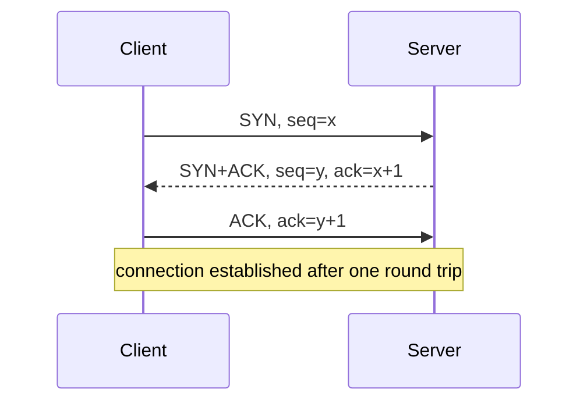

# Networking interview essentials I: fundamentals with worked answers

> **Before this lesson:** this is a revision lesson. It assumes you have worked through the track, in particular [Layers and encapsulation](#/lesson/networking/layers-encapsulation), [IPv4 addressing, subnets, CIDR and NAT](#/lesson/networking/ipv4-subnets-nat), [UDP and the TCP connection lifecycle](#/lesson/networking/udp-tcp-lifecycle), [Flow control and congestion control](#/lesson/networking/tcp-flow-congestion), [How DNS resolution works](#/lesson/networking/dns-resolution), [TLS: the handshake, certificates and chains of trust](#/lesson/networking/tls-handshake-certificates) and the HTTP lessons. Each answer links back to the lesson that teaches the topic in full.

## In plain words

An interview is not an exam where a correct fact earns a point. It is closer to a driving test: the examiner wants to see that you can handle the vehicle, not that you can recite the manual. A networking question such as "what happens in a TCP handshake?" is an invitation to show three things: that you know the mechanism, that you understand *why* it is built that way, and that you can connect it to real engineering consequences.

This lesson collects the fundamentals questions that come up most often, each with a model answer and notes on what the interviewer is listening for. Treat the answers as worked examples to learn the shape from, not as scripts to memorise. An answer you can rebuild from understanding survives a follow-up question; a memorised one does not.

Why this matters for a job: networking fundamentals appear in interviews for backend, full-stack, mobile, platform, site-reliability and machine-learning engineering roles, usually in a phone screen or as part of a system design round. The set of questions is small and stable. Preparing these well is one of the highest-return uses of study time.

## How to shape an answer

A reliable structure for any "explain X" question:

1. **One-sentence definition.** Say what it is and what it is for.
2. **The mechanism, in order.** Three to five steps. Use concrete numbers or names.
3. **The reason.** Why is it designed this way? What would break otherwise?
4. **A consequence or trade-off.** What does it cost? Where does it bite in practice?
5. **Stop, and offer depth.** "I can go further into congestion control or the closing sequence if that is useful."

Step 5 matters more than it seems. It shows you know there is more, and it lets the interviewer steer toward what they care about instead of sitting through a monologue.

Three habits that separate strong candidates:

- **Say numbers.** "One round trip", "20-byte header", "about 14 kilobytes in the first flight", "65,535 ports".
- **Name the layer.** Placing a thing on the right layer shows a mental model.
- **Admit the edge of your knowledge.** "I have not worked with that directly; my understanding is…" is far better than a confident invention.

> [!TIP]
> Practise aloud. Explaining a handshake silently in your head feels fluent; saying it to a wall for the first time reveals every gap. Record yourself answering five of the questions below and listen once.

## The questions

### Q1. Explain the OSI model. How does it relate to TCP/IP?

**Model answer.** "Networking is divided into layers so that each solves one problem and can change independently. OSI describes seven: physical, data link, network, transport, session, presentation, application. The Internet in practice uses four: link, internet, transport and application, where the top three OSI layers collapse into one. Going down the stack each layer wraps the data in its own header, which is encapsulation; going up, each strips its own. Day to day, engineers use the OSI numbers as shorthand: layer 2 is frames and MAC addresses, handled by switches; layer 3 is IP and routers; layer 4 is TCP and UDP with ports; layer 7 is the application protocol such as HTTP. That vocabulary tells you which device and which tool to look at when something breaks."

**What they listen for:** encapsulation, the 2/3/4/7 shorthand, and usefulness for debugging. Do not spend your time reciting all seven names.

**Likely follow-up:** "Where does TLS sit?" Above TCP and below HTTP; it does not map neatly onto one OSI number, and saying so is the right answer. → [Layers and encapsulation](#/lesson/networking/layers-encapsulation)

### Q2. What is the difference between TCP and UDP? When would you choose each?

**Model answer.** "Both are transport protocols that deliver data to a port on a host. TCP is connection-oriented: a three-way handshake, then a reliable, ordered byte stream with flow control and congestion control. UDP is connectionless: each datagram is sent on its own, with no guarantee of delivery or order and no setup, and with an 8-byte header against TCP's 20 or more. I choose TCP when every byte must arrive correctly: web pages, APIs, databases, file transfer. I choose UDP when timeliness beats completeness or when a single small exchange does not justify a handshake: voice and video, games, DNS queries. UDP is also the base for building a custom transport, which is what QUIC does for HTTP/3."

**What they listen for:** the trade-off (reliability against latency), concrete examples, and ideally the mention of head-of-line blocking or QUIC.

**Common mistake:** saying "UDP is faster". It has less overhead and no handshake; whether an application is faster depends on what it needs. → [UDP and the TCP connection lifecycle](#/lesson/networking/udp-tcp-lifecycle)

### Q3. Walk me through the TCP three-way handshake. Why three steps?

**Model answer.** "The client sends a SYN with its initial sequence number, say x. The server replies with SYN-ACK: its own initial sequence number y, and an acknowledgement of x plus one. The client replies with an ACK of y plus one. After that both sides are established. Three messages are the minimum for each side to announce a starting sequence number and have it confirmed; the server combines its acknowledgement with its own SYN. Two would leave the server unsure that the client received its number, and would let a delayed duplicate SYN open a ghost connection. The sequence numbers are random for security, and SYN consumes one sequence number, which is why the acknowledgement is x plus one. Options such as the maximum segment size and window scaling are negotiated here. The cost is one round trip before any data."



**Likely follow-ups:**

- "How does it close?" FIN and ACK in each direction, four segments; the side that closes first waits in TIME_WAIT for twice the maximum segment lifetime so that a lost final ACK can be re-sent and stray old segments expire.
- "What is a SYN flood?" Many SYNs from forged addresses fill the server's queue of half-open connections; SYN cookies defend by encoding the state in the reply's sequence number and storing nothing until the final ACK.

### Q4. How does TCP provide reliability?

**Model answer.** "Every byte has a sequence number. The receiver sends cumulative acknowledgements naming the next byte it expects. The sender keeps unacknowledged data and retransmits it in two cases: when a retransmission timer expires, where the timeout is computed from a smoothed round-trip estimate plus four times its variation; or sooner, on three duplicate acknowledgements, which is fast retransmit. Selective acknowledgements tell the sender exactly which blocks arrived so that it resends only the holes. A checksum detects corruption, and the receiver reorders segments and discards duplicates before handing bytes to the application."

→ [Flow control and congestion control](#/lesson/networking/tcp-flow-congestion)

### Q5. Flow control versus congestion control?

**Model answer.** "Flow control protects the receiver. Each side advertises a receive window, the free space in its buffer, and the sender never has more unacknowledged data outstanding than that. Congestion control protects the network. The sender maintains a congestion window that it infers from feedback, since nobody advertises the network's capacity. The amount in flight is limited by the smaller of the two windows. Congestion control starts with slow start, doubling the window each round trip from about ten segments, switches to adding one segment per round trip after a threshold, halves the window on three duplicate ACKs, and resets it to one segment after a timeout. The practical consequence is that new connections are slow regardless of bandwidth, so connection reuse matters a great deal."

**The one sentence to have ready:** *flow control uses a window the receiver advertises; congestion control uses a window the sender estimates.*

### Q6. How does DNS resolution work?

**Model answer.** "The application asks the operating system's stub resolver, which checks its cache and forwards the question to a recursive resolver. If that resolver has no cached answer it works iteratively: it asks a root server, which refers it to the servers for the top-level domain; those refer it to the domain's authoritative servers; and those return the record. The resolver caches the answer for its TTL and returns it. Queries normally use UDP port 53, with TCP for large responses. Because of caching at the browser, the operating system and the resolver, the full walk is rare; and for the same reason a change to a record is only visible as old cached copies expire."

**Follow-ups to prepare:** record types (A, AAAA, CNAME, MX, NS, TXT); why a CNAME cannot be at the zone apex; how you would plan a DNS change (lower the TTL a full old-TTL period in advance). → [How DNS resolution works](#/lesson/networking/dns-resolution), [DNS caching, TTLs, anycast and failures](#/lesson/networking/dns-caching-failures)

### Q7. What happens in a TLS handshake? How does the browser trust the server?

**Model answer.** "In TLS 1.3 the client sends a ClientHello with its supported versions and cipher suites, a key share for an ephemeral Diffie-Hellman exchange, the server name in SNI and the protocols it speaks in ALPN. The server answers with its choice and its own key share; both now derive the same secret, so the rest is encrypted. The server sends its certificate chain and a signature over the handshake made with its private key, then a Finished message; the client sends its Finished and can include the first request. That is one round trip. For trust, the client checks that the certificate's signature chains through intermediates to a root in its trust store, that the dates are valid, that the requested host name is in the certificate, and that it has not been revoked. The signature over the handshake proves the server holds the private key. Ephemeral key exchange gives forward secrecy."

**What they listen for:** the three guarantees (confidentiality, integrity, authentication), the chain of trust, and the fact that asymmetric cryptography sets up keys for symmetric encryption. → [TLS: the handshake, certificates and chains of trust](#/lesson/networking/tls-handshake-certificates)

### Q8. Compare HTTP/1.1, HTTP/2 and HTTP/3.

**Model answer.** "The semantics are the same across all three: methods, status codes, headers. What changes is how messages are carried. HTTP/1.1 is text over TCP with one request at a time per connection, so browsers open up to six connections per host, and headers are repeated uncompressed. HTTP/2 uses binary frames and multiplexes many streams over one TCP connection, which removes request queuing, and compresses headers with HPACK. Its weakness is that all streams share TCP's single ordered byte stream, so one lost packet stalls every stream. HTTP/3 replaces TCP with QUIC over UDP: streams are delivered independently, the transport and TLS 1.3 handshakes are combined into one round trip or zero when resuming, and connections survive a change of IP address because they are identified by connection IDs."

| | HTTP/1.1 | HTTP/2 | HTTP/3 |
|---|---|---|---|
| Transport | TCP | TCP | QUIC over UDP |
| Format | text | binary frames | binary frames |
| Concurrency per connection | one exchange | many streams | many streams |
| Head-of-line blocking | HTTP and TCP level | TCP level | none across streams |
| Header compression | none | HPACK | QPACK |
| New-connection setup | 2–3 round trips with TLS | 2–3 | 1 (0 on resumption) |

→ [From HTTP/0.9 to HTTP/1.1](#/lesson/networking/http1), [HTTP/2](#/lesson/networking/http2), [HTTP/3 and QUIC](#/lesson/networking/http3-quic)

### Q9. Which HTTP methods are idempotent, and why does it matter?

**Model answer.** "A method is idempotent if repeating the request leaves the same state as doing it once. GET, HEAD, PUT and DELETE are; POST is not, and PATCH is not guaranteed to be. It matters because after a timeout a client cannot know whether the server processed the request. Idempotent requests can be retried safely. For non-idempotent operations such as creating a payment, the client sends an idempotency key so that the server can detect the repeat and return the original result."

**Related:** GET and HEAD are also *safe*: they do not change state at all. → [Timeouts, retries, pools, rate limits and idempotency](#/lesson/networking/resilience-patterns)

### Q10. What do the status code classes mean? Give examples you have dealt with.

**Model answer.** "2xx is success: 200, 201 Created, 204 No Content. 3xx is redirection or cache validation: 301 permanent, 302 temporary, 304 Not Modified. 4xx means the client's request is at fault: 400 malformed, 401 not authenticated, 403 authenticated but not permitted, 404 not found, 429 rate limited. 5xx means the server side failed: 500, and from proxies 502 when the backend gave an invalid response or refused the connection, 503 when no backend is available, 504 when the backend did not answer in time. The distinction drives behaviour: repeating a 4xx unchanged is pointless, while 429 and many 5xx responses are worth retrying with backoff."

### Q11. What is NAT, and what problems does it cause?

**Model answer.** "Network address translation lets many devices with private addresses share one public IPv4 address. The router rewrites the source address and port of outgoing packets and records the mapping so that replies can be translated back. It exists because IPv4 addresses are scarce. Consequences: connections can only be initiated from inside, so peer-to-peer applications need STUN and TURN and servers cannot reach clients directly; mappings expire when idle, which silently kills quiet long-lived connections unless keep-alives are sent; and many users share one address, so per-IP rate limits and blocks are imprecise."

→ [IPv4 addressing, subnets, CIDR and NAT](#/lesson/networking/ipv4-subnets-nat)

### Q12. What is the difference between a switch and a router?

**Model answer.** "A switch works at layer 2. It forwards frames within one local network by destination MAC address, using a table it learns automatically from the source addresses of frames it sees, and floods frames whose destination is unknown. A router works at layer 3. It forwards packets between networks by destination IP address using a routing table and longest-prefix match, decrements the TTL, and rebuilds the frame for the next link. A router is the boundary of a broadcast domain; a switch extends one."

### Q13. What is the difference between latency, bandwidth and throughput?

**Model answer.** "Latency is the time for data to travel from sender to receiver, usually quoted as round-trip time. Bandwidth is the maximum rate a link can carry. Throughput is the rate actually achieved, which is limited by the slowest link on the path and reduced by loss and by TCP's behaviour. They are independent: a satellite link can have high bandwidth and terrible latency. For web pages, which are many small exchanges, the number of round trips multiplied by latency dominates, so reducing round trips or moving closer to users helps more than adding bandwidth."

### Q14. How does HTTPS differ from HTTP?

**Model answer.** "HTTPS is HTTP carried inside a TLS connection, by default on port 443 instead of 80. TLS adds encryption so that others cannot read the traffic, integrity so that it cannot be altered unnoticed, and authentication of the server through its certificate. An observer can still see the IP addresses, the approximate sizes and timing, and usually the host name from SNI. Modern browser features such as HTTP/2, service workers and geolocation require it, and HSTS lets a site instruct browsers to use HTTPS exclusively."

### Q15. What is a CDN and how does it speed things up?

**Model answer.** "A content delivery network is a set of caching servers in many locations. Users are steered to a nearby one by DNS or anycast routing. That edge server terminates TCP and TLS close to the user, which shortens every handshake round trip, and serves cached content without contacting the origin. For uncacheable requests it still helps by reusing warm connections to the origin. It also absorbs traffic spikes and attacks. What is cached and for how long is controlled by Cache-Control headers; the usual strategy is long-lived caching of assets with content-hashed names and short or no caching for HTML and personalised responses."

## The arithmetic questions

Interviewers like a quick calculation because it cannot be bluffed. Three kinds recur.

### Subnetting

The method, every time:

1. Host bits = 32 − prefix length.
2. Block size = $2^{\text{host bits}}$; usable hosts = block size − 2 (for /30 and shorter prefixes).
3. In the byte where the prefix ends, blocks start at multiples of the block size within that byte. The network address is the multiple at or below the address; the broadcast is one below the next multiple.

**Example.** `10.14.203.77/21`. Host bits: 11. Addresses: $2^{11} = 2048$; usable 2046. The prefix ends in the third byte with 3 host bits there, so the block size in that byte is $2^3 = 8$. Multiples of 8 near 203: 200 and 208. Network `10.14.200.0`, broadcast `10.14.207.255`.

### Practise until it is automatic

Run the cell for a fresh set of questions. Work each one out on paper before reading the answer.

```python-run
import ipaddress, random

rng = random.Random()          # no fixed seed: a new set on every run

def question():
    prefix = rng.choice([18, 20, 21, 22, 23, 25, 26, 27, 28, 29, 30])
    address = ".".join(str(rng.randint(1, 254)) for _ in range(4))
    return f"{address}/{prefix}"

for number in range(1, 4):
    cidr = question()
    net = ipaddress.ip_network(cidr, strict=False)     # strict=False accepts host bits
    print(f"Q{number}. For {cidr}: network, broadcast, mask and usable hosts?")
    print(f"     host bits     : {32 - net.prefixlen}")
    print(f"     network       : {net.network_address}")
    print(f"     broadcast     : {net.broadcast_address}")
    print(f"     mask          : {net.netmask}")
    print(f"     usable hosts  : {net.num_addresses - 2}")
    print()

# Membership check, the other common form of the question.
a, block = ipaddress.ip_address("172.20.45.200"), ipaddress.ip_network("172.20.32.0/20")
print(f"Is {a} inside {block}?  {a in block}  "
      f"(the /20 covers {block.network_address} to {block.broadcast_address})")
```

### Latency estimates

**"What is the minimum round-trip time between two cities 5,000 km apart?"** Light in fibre travels about 200,000 km per second. One way: 5,000 ÷ 200,000 = 0.025 s = 25 ms. Round trip: 50 ms at the very least. Real routes are longer, so expect 70 to 100 ms.

**"How long until the first byte of an HTTPS response on a new connection at 80 ms RTT?"** TCP handshake 1 round trip, TLS 1.3 handshake 1, request and first response byte 1: three round trips, 240 ms, plus DNS and server time.

### Slow start

**"How many round trips to deliver 100 kB on a new connection?"** With an initial window of 10 segments of 1,460 bytes, the first round carries 14.6 kB, the second 29.2 kB (total 43.8 kB), the third 58.4 kB (total 102.2 kB). Three round trips of data.

```python-run
def round_trips_to_send(total_bytes, mss=1460, initial_window=10):
    sent, window, rounds = 0, initial_window, 0
    while sent < total_bytes:
        sent += window * mss       # one congestion window per round trip
        window *= 2                # slow start doubles it
        rounds += 1
    return rounds

for size_kb in (10, 14, 15, 50, 100, 500, 2000):
    print(f"{size_kb:5} kB -> {round_trips_to_send(size_kb * 1000)} round trip(s) of data")

rtt = 80
print()
print(f"New HTTPS connection at {rtt} ms RTT, 100 kB response:")
setup = 2 * rtt                                   # TCP + TLS 1.3
data = round_trips_to_send(100_000) * rtt
print(f"  setup {setup} ms + data {data} ms = {setup + data} ms (plus DNS and server time)")
```

Notice the jump between 14 kB and 15 kB: the second needs another round trip. That boundary is why "fit the critical content in the first 14 kB" is a standard web performance rule.

## Numbers worth knowing by heart

| Quantity | Value |
|---|---|
| IPv4 / IPv6 address size | 32 bits / 128 bits |
| MAC address size | 48 bits |
| Port range | 0–65535 (16 bits); well-known ports below 1024 |
| Ports: HTTP, HTTPS, DNS, SSH | 80, 443, 53, 22 |
| Ethernet MTU / typical TCP MSS | 1500 / 1460 bytes |
| IPv4, TCP, UDP header (minimum) | 20, 20, 8 bytes |
| TCP initial congestion window | about 10 segments (roughly 14 kB) |
| Light in fibre | about 200,000 km/s (5 ms per 1,000 km, one way) |
| Private IPv4 ranges | 10.0.0.0/8, 172.16.0.0/12, 192.168.0.0/16 |
| Loopback | 127.0.0.1 and ::1 |
| Browser connections per host (HTTP/1.1) | 6 |
| HTTP/2 frame header | 9 bytes |
| New-connection round trips: TCP; TLS 1.3; TLS 1.2; QUIC | 1; 1; 2; 1 in total (0 resumed) |

## Rapid-fire: one-line answers

- **What is a socket?** A program's endpoint for network communication, identified for TCP by the pair of local and remote address and port.
- **What is the 5-tuple?** Protocol, source address, source port, destination address, destination port.
- **What does ARP do?** Finds the MAC address for an IPv4 address on the local network by broadcasting a request.
- **What is TTL in an IP packet?** A hop counter decremented by each router; at zero the packet is dropped, which prevents infinite loops and powers traceroute.
- **What is ICMP for?** Error and diagnostic messages: echo for ping, time exceeded for traceroute, fragmentation needed for path MTU discovery.
- **What is a default gateway?** The router a host sends packets to when the destination is not on its own subnet.
- **What is head-of-line blocking?** One delayed item holding up everything queued behind it; it occurs in HTTP/1.1 and in TCP.
- **What is Nagle's algorithm?** Holding small writes while earlier data is unacknowledged; disabled with TCP_NODELAY for low-latency traffic.
- **What is anycast?** Announcing one IP address from many locations so that routing delivers each user to the nearest.
- **What does `Cache-Control: no-cache` mean?** Store it, but revalidate before every use. `no-store` means do not store it.
- **What is an ETag?** A version identifier for a response, used with `If-None-Match` to receive `304 Not Modified` when nothing changed.
- **What is CORS?** The mechanism by which a server permits pages from other origins to read its responses.
- **What is SNI?** The host name sent in the TLS ClientHello so that a server with many sites can select the right certificate.
- **What is a reverse proxy?** A server in front of backends that accepts requests on their behalf: load balancing, TLS termination, caching.
- **Layer 4 versus layer 7 load balancing?** By connection using addresses and ports, versus by request using HTTP content.

> [!INTERVIEW]
> When you do not know an answer, reason from what you do know, aloud. "I have not used QPACK, but I know HPACK relies on both sides processing header blocks in the same order, and QUIC delivers streams independently, so I would expect the HTTP/3 version to be designed around out-of-order arrival." That demonstrates exactly the understanding the question was probing for, and interviewers regularly score it above a memorised definition.

> [!WARNING]
> Avoid absolute words unless you are sure: "always", "never", "impossible". Networking is full of exceptions (TCP can carry data on the SYN with Fast Open; DNS does use TCP; HTTP/2 can run unencrypted between servers). "Normally" and "by default" are both more accurate and safer.

## Pitfalls

- **Reciting definitions without the reason behind them.** The "why" is what is being assessed.
- **Starting at too much depth.** Give the overview first, then descend.
- **Mixing up flow control and congestion control**, `no-cache` and `no-store`, `401` and `403`, authentication and authorisation.
- **Forgetting that SYN and FIN consume a sequence number.**
- **Saying a /24 has 256 hosts.** It has 256 addresses and 254 usable hosts.
- **Claiming HTTP/2 removed head-of-line blocking entirely.**
- **Speaking for three minutes without checking in.** Pause and ask whether to go deeper.
- **Bluffing.** One invented detail costs more credibility than ten honest gaps.

## Summary

- Structure answers as definition, mechanism, reason, consequence, then offer depth.
- The core set: layers and encapsulation; TCP versus UDP; the three-way handshake and close; reliability, flow control and congestion control; DNS resolution and caching; the TLS handshake and chain of trust; HTTP versions, methods, status codes and caching; NAT; switch versus router; latency versus bandwidth; CDNs.
- Be ready for arithmetic: subnets from a prefix, minimum RTT from distance, round trips for connection setup and slow start.
- Know the standard numbers, and prefer reasoning aloud to guessing.

## Glossary

- **Model answer**: an example response that shows the expected content and structure.
- **Follow-up question**: a further question probing the depth behind an answer.
- **Phone screen**: a short early-stage interview, usually remote.
- **System design round**: an interview in which the candidate designs a system at a high level.
- **Trade-off**: a choice in which gaining one property costs another.
- **Encapsulation**: each layer wrapping the data of the layer above in its own header.
- **Initial sequence number (ISN)**: the random starting sequence number of a TCP connection.
- **Cumulative acknowledgement**: an acknowledgement naming the next byte expected in order.
- **Receive window / congestion window**: the receiver-advertised limit / the sender-estimated limit on data in flight.
- **Recursive resolver / authoritative server**: the DNS server that finds answers for clients / the one that holds a zone's records.
- **Chain of trust**: the sequence of certificates from a site's certificate up to a trusted root.
- **Forward secrecy**: past traffic stays protected even if a long-term key is later exposed.
- **Idempotent / safe**: repeatable without changing the outcome / not changing state at all.
- **Block size**: the number of addresses in a subnet, $2^{\text{host bits}}$.

## Check yourself

```quiz
[
  {"q": "An interviewer asks you to explain the TCP handshake. Which response structure is strongest?",
   "options": ["List every TCP header field from memory", "Define it, give the three steps with sequence numbers, explain why three, mention the one-round-trip cost, then offer to go deeper", "Say it is like a phone call and stop", "Describe the OSI model first, for five minutes"], "answer": 1,
   "explain": "Definition, mechanism, reason and consequence, followed by an offer of depth, shows understanding and lets the interviewer steer."},
  {"q": "What is the network address of 10.14.203.77/21?",
   "options": ["10.14.203.0", "10.14.200.0", "10.14.192.0", "10.14.208.0"], "answer": 1,
   "explain": "A /21 leaves 3 host bits in the third byte, so blocks are 8 wide there. The multiple of 8 at or below 203 is 200."},
  {"q": "How many usable host addresses are in a /22?",
   "options": ["1,022", "1,024", "510", "2,046"], "answer": 0,
   "explain": "32 - 22 = 10 host bits, 2^10 = 1,024 addresses, minus the network and broadcast addresses leaves 1,022."},
  {"q": "At 60 ms RTT, roughly how long before the first response byte on a brand-new HTTPS connection using TLS 1.3 (ignoring DNS and server time)?",
   "options": ["60 ms", "120 ms", "180 ms", "240 ms"], "answer": 2,
   "explain": "One round trip for TCP, one for TLS 1.3 and one for the request and response: three round trips, 180 ms."},
  {"q": "Which statement about flow control and congestion control is correct?",
   "options": ["Both use a window advertised by the receiver", "Flow control uses a receiver-advertised window; congestion control uses a sender-estimated window", "Flow control protects the network; congestion control protects the receiver", "Only UDP has congestion control"], "answer": 1,
   "explain": "rwnd is advertised to protect the receiver's buffer; cwnd is inferred by the sender to protect the network. The smaller of the two limits transmission."},
  {"q": "Why is 'UDP is faster than TCP' a weak answer?",
   "options": ["Because UDP is actually slower", "Because it ignores the real trade-off: UDP omits the handshake, reliability and ordering, which helps only applications that do not need them", "Because UDP has a larger header", "Because TCP does not use IP"], "answer": 1,
   "explain": "UDP has less overhead and no setup, but the right choice depends on whether the application needs guaranteed, ordered delivery."},
  {"q": "With an initial window of 10 segments of 1,460 bytes, how many round trips of data does a new connection need for a 40 kB response?",
   "options": ["1", "2", "3", "4"], "answer": 1,
   "explain": "The first round carries 14.6 kB and the second 29.2 kB, 43.8 kB in total, which covers 40 kB."},
  {"q": "You are asked about a protocol you have never used. What is the best approach?",
   "options": ["Invent a confident answer", "Say 'I do not know' and stop", "Say you have not used it, then reason aloud from related principles you do know", "Change the subject"], "answer": 2,
   "explain": "Honest reasoning from fundamentals demonstrates the understanding interviewers are looking for, and avoids the credibility cost of a wrong invention."}
]
```

> **Source:** revision of topics from Grigorik, *High Performance Browser Networking*, ch. 1–4 and 9–12 (latency, TCP, UDP, TLS, HTTP/1.x, HTTP/2; topic coverage only), https://hpbn.co , together with the fundamentals taught earlier in this track. Numbers checked against RFC 9293 (TCP), RFC 6928 (initial window), RFC 8446 (TLS 1.3), RFC 9113 (HTTP/2) and RFC 9114 (HTTP/3), at https://www.rfc-editor.org/ .
