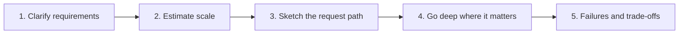
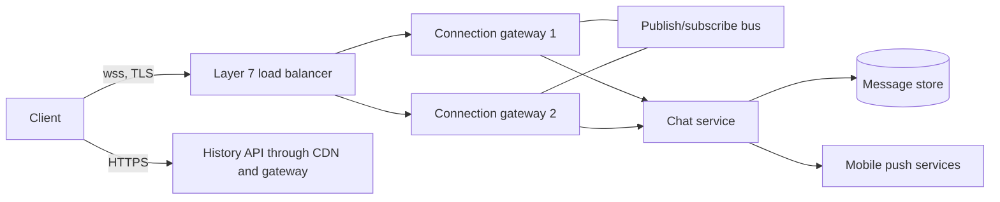
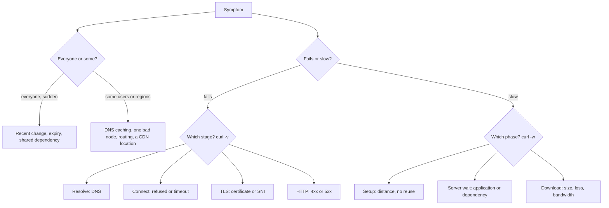

# Networking interview essentials II: design and debugging scenarios

> **Before this lesson:** read [Networking interview essentials I](#/lesson/networking/interview-fundamentals) first. This lesson draws on the backend lessons ([Load balancers, reverse proxies and health checks](#/lesson/networking/load-balancers-proxies), [Timeouts, retries, pools, rate limits and idempotency](#/lesson/networking/resilience-patterns), [gRPC, service discovery, API gateways and virtual private clouds](#/lesson/networking/grpc-discovery-vpc)), the real-time lessons ([XHR, fetch, polling, long polling and Server-Sent Events](#/lesson/networking/xhr-fetch-sse), [WebSocket, WebRTC and choosing a transport](#/lesson/networking/websocket-webrtc)) and the debugging lessons ([Network debugging tools](#/lesson/networking/cli-tools), [Packet captures, socket inspection and common outage patterns](#/lesson/networking/packet-capture-outages)).

## In plain words

The previous lesson covered questions that have an answer: "what is a three-way handshake?". This one covers questions that do not: "design the networking for a chat application", or "users in Asia say the site is slow; what do you do?". There is no single correct response. The interviewer is watching *how you think*.

Imagine asking two builders how they would add a room to your house. One immediately says "brick, three by four metres, done in a month". The other asks what the room is for, how many people will use it, whether you need plumbing, and what your budget is, then proposes a plan and points out its weak spots. You would hire the second. Open-ended interview questions reward the same behaviour: ask, structure, decide, and say what could go wrong.

Two families of open question matter for networking:

- **Design scenarios**: build something, justify the choices, discuss trade-offs.
- **Debugging scenarios**: something is broken; show a method for finding out why.

Why this matters for a job: these are the rounds that decide level and offer for mid-level and senior positions, and they mirror the real work. Nobody is paid to recite the OSI model; people are paid to make sensible choices under uncertainty and to restore service when something breaks.

## A framework for design questions

Use the same five steps every time. It keeps you organised when nervous and makes your reasoning visible.



1. **Clarify requirements.** Who are the clients (browsers, mobile apps, other services)? What must be fast? What must never be lost? Which direction does data flow, and how often? Spend two minutes here. Jumping straight to a solution is the most common way to fail.
2. **Estimate scale.** Rough numbers only: users, requests per second, message sizes, concurrent connections. These decide whether a simple design suffices.
3. **Sketch the request path.** From the client to the data and back: DNS, CDN, load balancer, gateway, services, storage. Name the protocol on each arrow.
4. **Go deep where it matters.** Choose the one or two hard parts and reason about them properly.
5. **Failures and trade-offs.** What happens when each component fails? What did your choices cost? What would you change at ten times the scale?

### Quick estimation

Interviewers do not want precision; they want to see whether you can size a problem. A few conversions cover most cases:

- one day ≈ 86,400 seconds, call it $10^5$;
- 1 million requests per day ≈ 12 per second on average;
- peak traffic is often 2 to 5 times the average;
- concurrent connections ≈ users online at once (for persistent connections).

```python-run
def estimate(daily_users, actions_per_user, bytes_per_action, peak_factor=3, online_share=0.10):
    per_day = daily_users * actions_per_user
    average_rps = per_day / 86_400                      # seconds in a day
    peak_rps = average_rps * peak_factor
    bandwidth_mbps = peak_rps * bytes_per_action * 8 / 1_000_000
    concurrent = daily_users * online_share             # users connected at the same time
    return average_rps, peak_rps, bandwidth_mbps, concurrent

# A chat product: 2 million daily users, 40 messages each, about 300 bytes per message.
avg, peak, mbps, conns = estimate(2_000_000, 40, 300)
print(f"average  {avg:8.0f} messages/s")
print(f"peak     {peak:8.0f} messages/s")
print(f"peak     {mbps:8.1f} Mbps of message traffic")
print(f"about    {conns:8.0f} concurrent connections")

per_server = 50_000                                     # idle-ish persistent connections per machine
servers = -(-conns // per_server)                       # ceiling division
print(f"at {per_server} connections per server: {servers:.0f} servers, plus spare capacity for failures")
```

Read the result the way you would say it in the room: "about a thousand messages per second on average, three thousand at peak, which is small. The hard part is not throughput; it is two hundred thousand connections that stay open, so the design is about connection handling and fan-out, not raw request rate." Identifying *which* number is the hard one is the point of the exercise.

## Design scenario 1: real-time chat

**Prompt:** "Design the networking for a chat application with web and mobile clients."

**Clarify.** One-to-one and group chats? Maximum group size? Must messages be delivered in order, and never lost? Do we need "typing" indicators and online status? Notifications when the app is closed?

Assume: groups up to a few hundred people, ordered and durable messages, typing indicators, mobile push notifications.

**Transport choice.** Both sides send frequently and messages must arrive promptly: a persistent, two-way connection. **WebSocket** over TLS (`wss://`) fits. State the alternative and why not: Server-Sent Events plus POST requests would work for a simple version, but typing indicators and acknowledgements make it chatty in both directions. Polling wastes requests and battery.

**Request path.**



**The deep parts.**

- *Stateful connections.* Each client stays attached to one gateway server. The load balancer must support the WebSocket upgrade and long idle timeouts; heartbeats (ping and pong every 20 to 30 seconds) keep intermediaries from closing quiet connections and detect dead ones.
- *Fan-out.* Sender and recipient are usually on different gateways. Gateways subscribe to a publish/subscribe system keyed by conversation or user; the chat service publishes each message once, and each gateway delivers to the clients it holds.
- *Ordering and loss.* TCP orders bytes within one connection, not across reconnections. Give every message a sequence number per conversation, assigned by the server. On reconnect the client sends the last number it has and the server replays the rest. The client attaches its own unique identifier to each outgoing message so that a retry after a lost acknowledgement is not stored twice: an idempotency key.
- *Offline users.* If the recipient has no open connection, store the message and send a mobile push notification through the platform's push service.
- *History and media.* Old messages and images are fetched over ordinary HTTPS with caching and a CDN, not through the socket.

**Failures.** A gateway crash disconnects its clients; they reconnect elsewhere with exponential backoff and jitter so that a restart does not produce a reconnection stampede. Deployments drain connections gradually. The pub/sub system and the message store need replication.

**Trade-off to state:** WebSocket gives low latency and two-way traffic at the cost of stateful servers, a fan-out layer, and reconnection logic that you must write yourself.

## Design scenario 2: an API rate limiter

**Prompt:** "Design rate limiting for a public API."

**Clarify.** Limit by what: API key, user, IP address? What limits: requests per second, per day, different tiers? Is a small overshoot acceptable? How many API servers?

**Algorithm.** A **token bucket** per client: a refill rate for the sustained limit and a capacity for the allowed burst. It needs two numbers of state per client (tokens and last refill time) and needs no timers, since tokens are computed lazily when a request arrives.

**Placement.** At the API gateway, before requests reach the services, so rejected traffic costs almost nothing.

**The deep part: many gateway instances.** A limit of 100 per second must hold across all of them.

| Approach | How | Trade-off |
|---|---|---|
| Central store | every request updates a counter in Redis with one atomic operation | exact; adds a network round trip per request; the store becomes critical |
| Local with a share | each of N instances enforces limit ÷ N | no dependency; inaccurate when traffic is uneven |
| Local with periodic sync | count locally, reconcile with the store every few hundred milliseconds | fast; allows a small overshoot |

Choose by need: billing-grade quotas want the central store; abuse protection is fine with approximate local limits.

**Client experience.** Reject with `429 Too Many Requests` and a `Retry-After` header, plus headers reporting the limit and what remains, so that well-behaved clients slow down by themselves.

**Failures.** If the central store is unreachable, decide between **failing open** (allow traffic and risk overload) and **failing closed** (reject and cause an outage). For most public APIs, fail open with a conservative local fallback limit.

```python-run
class TokenBucket:
    def __init__(self, capacity, per_second):
        self.capacity, self.rate = capacity, per_second
        self.tokens, self.last = float(capacity), 0.0

    def allow(self, now):
        self.tokens = min(self.capacity, self.tokens + (now - self.last) * self.rate)  # lazy refill
        self.last = now
        if self.tokens >= 1:
            self.tokens -= 1
            return True, 0.0
        wait = (1 - self.tokens) / self.rate          # seconds until one token is available
        return False, wait

buckets = {}                                          # one bucket per API key
def handle(api_key, now, capacity=3, per_second=1):
    bucket = buckets.setdefault(api_key, TokenBucket(capacity, per_second))
    ok, wait = bucket.allow(now)
    return "200 OK" if ok else f"429 Too Many Requests, Retry-After: {wait:.1f}s"

requests = [("key-A", 0.0), ("key-A", 0.1), ("key-A", 0.2), ("key-A", 0.3),
            ("key-B", 0.3), ("key-A", 1.4), ("key-A", 1.5)]
for key, t in requests:
    print(f"t={t:3.1f}s  {key}  ->  {handle(key, t)}")
```

`key-A` uses its burst of three, is refused on the fourth request with a precise `Retry-After`, and is served again once a token has dripped back. `key-B` is unaffected: limits are per client.

## Design scenario 3: serving a machine-learning model

**Prompt:** "Expose a text-generation model to internal services and to a web front end."

**Clarify.** Latency expectations? Are responses streamed token by token? Request and response sizes? How bursty is traffic? Is the endpoint public?

**Design.**

- **Internal callers** use **gRPC** over HTTP/2: a typed contract, deadlines carried with each call, and **server streaming** for tokens as they are generated.
- **Browsers** cannot speak gRPC natively. The gateway exposes an HTTPS endpoint that accepts a POST and streams the answer as **Server-Sent Events** (`text/event-stream`), translating to gRPC behind it.
- **Network placement.** Model servers sit in a private subnet. Only the gateway's security group may reach them, on the gRPC port. Nothing is exposed directly to the Internet.
- **Load balancing.** gRPC keeps one long-lived HTTP/2 connection, so balancing must be per request (layer 7) or the calls pile onto one server. Generation requests are long and vary greatly in cost, so least-loaded balancing beats round robin.
- **Protecting the scarce resource.** Model capacity is limited by accelerators. Rate-limit per client at the gateway, bound the queue in front of the model, and shed load with a clear "busy" response when the queue is full, instead of letting requests wait until they time out.
- **Timeouts and cancellation.** Propagate the deadline. If the user closes the page, the cancelled stream must stop generation on the server, or accelerators burn time producing text nobody reads.
- **Streaming hygiene.** Disable proxy buffering for the stream, send heartbeat comments, and keep idle timeouts longer than the longest silence.

**Trade-off to state:** streaming gives a much better perceived latency (the first words appear in a fraction of a second) but ties up a connection and a slot on the model for the whole generation, so concurrency limits matter more than request rate.

## Design scenario 4: make a global website fast

**Prompt:** "Our site is hosted in one region in Europe. Users in Australia complain that it is slow. What would you do?"

Start by measuring, then go from cheapest and most effective to most involved.

1. **Measure.** Real-user data split by country: time to first byte and largest contentful paint. A `curl -w` breakdown from an Australian vantage point shows which phase dominates.
2. **Round-trip arithmetic.** Sydney to Frankfurt is around 16,000 km; the round trip is at least 160 ms and in practice about 280 ms. A new HTTPS connection costs three of those before the first byte: close to a second of pure waiting. Distance is the problem, so bandwidth will not fix it.
3. **CDN for static assets**, with content-hashed names and a one-year cache lifetime. This is the largest and easiest gain.
4. **Terminate connections at the edge.** With the CDN in front of all traffic, TCP and TLS handshakes happen 10 ms away; the edge reuses warm connections to the origin.
5. **Cache HTML and API responses at the edge** where correctness allows: short `s-maxage` with `stale-while-revalidate`, and personal data fetched separately.
6. **Cut round trips.** TLS 1.3 and HTTP/3; HSTS to remove redirects; fewer origins; preconnect; critical resources discoverable in the HTML.
7. **If dynamic latency still matters**, move computation closer: read replicas or a second region, with routing by geography. This is the costly step because data must be replicated and kept consistent, so it comes last.

```python-run
def first_byte_ms(rtt, new_connection=True, tls_round_trips=1, server_ms=60):
    setup = (1 + tls_round_trips) * rtt if new_connection else 0
    return setup + rtt + server_ms                    # setup, then request/response

print("Sydney user, origin in Frankfurt (RTT 280 ms):")
print("   new connection        :", first_byte_ms(280), "ms")
print("   reused connection     :", first_byte_ms(280, new_connection=False), "ms")
print("Same user through a CDN edge in Sydney (RTT 12 ms to the edge):")
print("   cached at the edge    :", first_byte_ms(12, server_ms=2), "ms")
edge_setup = 2 * 12                                   # handshakes with the nearby edge
origin_fetch = 280 + 60                               # edge reuses a warm connection to the origin
print("   uncached, via the edge:", edge_setup + 12 + origin_fetch, "ms")
```

Even the uncached case improves by more than half, because the expensive handshakes moved to the nearby edge and the long leg reuses an open connection.

## A framework for debugging questions

**Prompt style:** "X is broken (or slow). What do you do?"

The interviewer wants a method, not a lucky guess. Say the steps explicitly.

1. **Scope it.** Who is affected: everyone, one region, one customer, one endpoint? Since when? Constant or intermittent?
2. **Ask what changed.** A deployment, a configuration change, a certificate or token reaching its end date, a traffic surge?
3. **Follow the request path in order**: DNS → TCP → TLS → HTTP → application → dependencies. Find the first stage that fails.
4. **Compare a working case with a failing one.** Different client, region, address, protocol version.
5. **Form one hypothesis, name the evidence that would confirm or refute it, check it.**
6. **Mitigate before perfecting.** Roll back, fail over, or shed load to restore service; investigate root cause afterwards.



## Debugging scenario 1: "The site is down"

**Model walk-through.** "First I scope it: is it down for me, for everyone, in every region? I check our monitoring and whether anything was deployed or changed in the last hour, because most outages follow a change. Then I follow the request. `dig` against a public resolver and against our authoritative servers: does the name resolve to the expected addresses? `curl -v` to the URL: which stage fails? If it cannot resolve, it is DNS: record, delegation, or an expired domain. If the connection times out, packets are being dropped: I test each load-balancer address with `--resolve`, check security rules and whether the nodes are up. If it is refused, the listener is down. If TLS fails, I read the certificate dates and names. If I get a 502 or 503, the load balancer has no healthy backend, so I look at health checks and backend logs; a 504 means the backend is too slow, so I look at its dependencies. While investigating, if a recent deployment is the likely trigger, I roll it back first and analyse afterwards."

**What earns credit:** the order, the distinction between timeout and refusal, the status-code interpretation, and prioritising mitigation.

## Debugging scenario 2: intermittent failures

**Prompt:** "About one request in fifty to our internal API fails with a connection reset. Retrying works."

**Reasoning aloud.** "Intermittent and fixed by a retry suggests a problem with individual connections or individual backends, not with the service as a whole. Two hypotheses.

One: **a bad backend**. If one of fifty instances is broken, about one request in fifty lands on it. Evidence: failures cluster on one backend address in the load balancer's logs. Fix: remove it; add passive health checks.

Two: **stale pooled connections**. The client reuses a connection that a load balancer or firewall dropped for being idle, or that the backend closed at the moment of reuse. Evidence: failures occur on the first request after a quiet period and on connections older than some age; a packet capture shows the request answered by RST. Fix: client idle timeout shorter than every timeout on the path, backend keep-alive timeout longer than the proxy's, keep-alives, validation before reuse.

I would check the per-backend error distribution first, since it takes one query, and then correlate failures with connection age."

**What earns credit:** two concrete hypotheses, each with distinguishing evidence, and the cheaper check first.

## Debugging scenario 3: "It is slow"

**Prompt:** "An endpoint that used to take 100 ms now takes 2 seconds."

**Reasoning aloud.** "I split the time into phases with `curl -w`, from the same network as the callers. If DNS or connection setup grew, something changed in resolution or connections are no longer being reused: maybe keep-alive was disabled or a new proxy was inserted. If the wait for the first byte grew, the time is inside the server or what it calls: I look at `Server-Timing` or traces for the database and downstream calls, and at pool metrics, since waiting for a connection from an exhausted pool looks exactly like a slow dependency. If the download grew, the payload became larger or compression was lost. I also ask whether it is slow for every request or only some: if only the tail is slow, I look for retries hiding a failing instance, timeouts being hit, or garbage-collection pauses. And I ask what changed: a deployment, data growth, a traffic increase."

## Debugging scenario 4: works here, fails there

**Prompt:** "The API works from my laptop but the service in our cluster cannot reach it."

**Reasoning aloud.** "Different vantage points mean different DNS, routes and firewalls. From inside the failing service's environment I run the same checks. Does the name resolve to the same address there? Internal resolvers and split-horizon DNS can differ. Does a TCP connection open? A timeout points to a security group, network ACL, missing route, or an outbound proxy requirement; a private subnet without a NAT gateway cannot reach the Internet at all. Does TLS succeed? A minimal container image may lack the root certificates, or a corporate proxy may be intercepting TLS. Is the destination filtering by source address, with my laptop's address allowed and the cluster's NAT address not? I compare the two cases step by step until they differ."

## Short design prompts and one-line directions

| Prompt | Direction of a good answer |
|---|---|
| Push live scores to a web page | Server-Sent Events: one-way, text, automatic reconnection; a CDN or fan-out layer for scale |
| Video calling for two people | WebRTC over UDP; signalling over WebSocket; STUN to find a direct path, TURN relay as fallback |
| Group video for 50 people | WebRTC to an SFU, not a mesh; adaptive quality per receiver |
| A client must call an unreliable third-party API | timeouts, limited retries with backoff and jitter, idempotency keys, circuit breaker, fallback |
| Session data with many servers behind a balancer | stateless servers with a shared session store or signed tokens; avoid sticky sessions |
| Distribute keys across cache servers | consistent hashing with virtual nodes, so that adding a server moves few keys |
| Zero-downtime deployment | readiness checks, connection draining, rolling or canary release, quick rollback |
| Secure service-to-service calls | mutual TLS with short-lived certificates, least-privilege network rules, authorisation per call |
| Mobile app that syncs data | batch requests, push instead of polling, defer bulk work to Wi-Fi, offline queue with idempotent replay |
| Upload a 2 GB file reliably | split into chunks, upload each idempotently, resume from the last confirmed chunk, verify checksums |

## Communicating under pressure

- **Think aloud.** Silence is unreadable. A wrong idea spoken and then corrected scores better than a long pause.
- **State assumptions.** "I will assume messages must not be lost; tell me if that is wrong."
- **Draw the path.** Boxes and arrows with a protocol on each arrow organise both your thoughts and the conversation.
- **Give a default, then the alternative.** "I would use a token bucket; a sliding window would be more precise at higher memory cost."
- **Quantify.** "Three round trips at 280 ms" persuades where "it is far away" does not.
- **Raise failure cases before you are asked.**
- **Accept hints.** An interviewer's nudge is information about what they want to explore, not a criticism.

> [!INTERVIEW]
> A closing move that works in almost any design round: summarise in three sentences. "The design is X for these requirements. The main risk is Y, which I mitigate with Z. With more time or ten times the scale I would revisit W." It demonstrates that you can hold the whole picture and that you know where your own design is weakest.

> [!TIP]
> Prepare three stories from your own experience (or from study projects, if you have not worked yet): a network problem you diagnosed, a performance improvement you measured, and a failure you learned from. Tell each as situation, what you did, and the measured result. Concrete experience, even small, is more convincing than any amount of theory.

> [!WARNING]
> Do not design for a scale nobody asked about. Proposing a multi-region, service-mesh architecture for an application with a thousand users signals poor judgement. Start with the simplest design that meets the stated requirements and say how it would evolve.

## Pitfalls

- **Solving before clarifying.** The requirements decide the design.
- **Naming technologies without reasons.** Every choice needs a "because".
- **Describing only the happy path.** Failures, timeouts and retries are where the marks are.
- **Guessing in debugging questions.** Give a method and evidence, not "it is probably DNS".
- **Skipping "what changed?"** in an outage scenario.
- **Confusing mitigation with root cause.** Restore service first; explain the cause second; do both.
- **Ignoring the client side.** Mobile radios, browser connection limits and caching are part of the system.
- **Over-engineering.** Complexity is a cost that must be justified by a requirement.

## Summary

- Open-ended questions assess reasoning. For design: clarify, estimate, sketch the path, go deep on the hard part, cover failures and trade-offs.
- Choose transports from requirements: direction, frequency, latency and data type decide between HTTP, SSE, WebSocket and WebRTC.
- Typical deep points: stateful connections and fan-out for real-time systems; distributed counters for rate limiting; per-request balancing, backpressure and streaming for model serving; distance and round trips for global performance.
- For debugging: scope, ask what changed, follow DNS → TCP → TLS → HTTP → application, compare working and failing cases, test one hypothesis at a time, mitigate first.
- Communicate: think aloud, state assumptions, quantify, name alternatives, and summarise with the main risk.

## Glossary

- **Open-ended question**: a question with many acceptable answers, judged on reasoning.
- **Requirements**: what a system must do and the constraints it must satisfy.
- **Back-of-the-envelope estimate**: a rough calculation to size a problem.
- **Request path**: the sequence of components a request passes through.
- **Fan-out**: delivering one message to many recipients.
- **Stateful / stateless service**: keeping per-client state in the instance / keeping none.
- **Fail open / fail closed**: allowing / rejecting traffic when a control cannot decide.
- **Backpressure**: signalling a sender to slow down when the receiver is saturated.
- **Vantage point**: where a measurement or test is taken from.
- **Hypothesis**: a proposed cause that specific evidence can confirm or refute.
- **Mitigation**: an action that restores service without necessarily fixing the cause.
- **Root cause**: the underlying reason an incident occurred.
- **Split-horizon DNS**: giving different answers to internal and external clients.
- **Canary release**: sending a small share of traffic to a new version first.
- **Over-engineering**: adding complexity beyond what the requirements justify.

## Check yourself

```quiz
[
  {"q": "You are asked to 'design the networking for a notifications feature'. What should you do first?",
   "options": ["Propose WebSocket immediately", "Ask who the clients are, how often notifications occur, and how quickly and reliably they must arrive", "Draw a multi-region architecture", "Calculate the bandwidth-delay product"], "answer": 1,
   "explain": "Requirements determine the design. Direction, frequency, latency and reliability decide between polling, SSE, WebSocket and push."},
  {"q": "A product has 5 million daily users, each making 20 requests per day. Roughly what is the average request rate?",
   "options": ["About 12 requests per second", "About 120 requests per second", "About 1,200 requests per second", "About 12,000 requests per second"], "answer": 2,
   "explain": "100 million requests per day divided by 86,400 seconds is about 1,160 per second. Peak load would be a few times higher."},
  {"q": "In a chat system with several WebSocket gateway servers, how does a message reach a recipient connected to a different gateway?",
   "options": ["The sender's browser connects to all gateways", "Gateways subscribe to a publish/subscribe system and deliver to the clients they hold", "The load balancer broadcasts every frame", "DNS routes the message"], "answer": 1,
   "explain": "Connections are pinned to one gateway, so a shared messaging layer is needed to fan messages out across gateways."},
  {"q": "A rate limiter depends on a central Redis store that becomes unreachable. What does 'failing open' mean?",
   "options": ["Rejecting all requests", "Allowing requests without the central check, possibly with a local fallback limit", "Restarting the gateway", "Doubling every client's limit permanently"], "answer": 1,
   "explain": "Failing open keeps the API available at the risk of overload; failing closed protects the backend at the cost of an outage."},
  {"q": "Users far from your single hosting region report slow page loads. Which action usually gives the largest improvement for the least effort?",
   "options": ["Buying more bandwidth at the origin", "Putting a CDN in front so that handshakes and cached content are served near the users", "Increasing the server's CPU", "Raising DNS TTLs"], "answer": 1,
   "explain": "The cost is round trips over a long distance. A CDN shortens connection setup and serves cacheable content locally."},
  {"q": "In an outage, what question should you ask almost immediately?",
   "options": ["Which programming language is the service written in?", "What changed recently?", "How many subnets are there?", "Is IPv6 enabled?"], "answer": 1,
   "explain": "Most incidents follow a change: a deployment, a configuration push, an expiry. Identifying it often points directly to the cause and to a rollback."},
  {"q": "One request in fifty fails with a reset and succeeds on retry. Which pair of hypotheses is most reasonable?",
   "options": ["A BGP hijack or a DNSSEC failure", "One unhealthy backend among fifty, or reuse of stale pooled connections", "An expired certificate or an expired domain", "MTU too large or TTL too small"], "answer": 1,
   "explain": "Both produce intermittent per-connection failures that retries hide. Error distribution by backend and correlation with connection age tell them apart."},
  {"q": "An API works from your laptop but times out from a service in a private subnet. What should you check first?",
   "options": ["Whether the service has a route and firewall rules allowing outbound traffic, for example through a NAT gateway", "The browser cache", "The HTTP/2 priority settings", "The font files"], "answer": 0,
   "explain": "A timeout from one vantage point but not another indicates dropped packets on that path: missing routes, security rules, or no outbound Internet access."}
]
```

> **Source:** a synthesis of this track, with performance reasoning informed by Grigorik, *High Performance Browser Networking*, ch. 10 "Primer on Web Performance" (topic coverage only), https://hpbn.co/primer-on-web-performance/ . Design guidance checked against the AWS Builders' Library articles on timeouts, retries and load shedding (https://aws.amazon.com/builders-library/), the gRPC performance and load-balancing guides (https://grpc.io/docs/guides/) and RFC 6455 and RFC 6585 for WebSocket behaviour and status 429.
