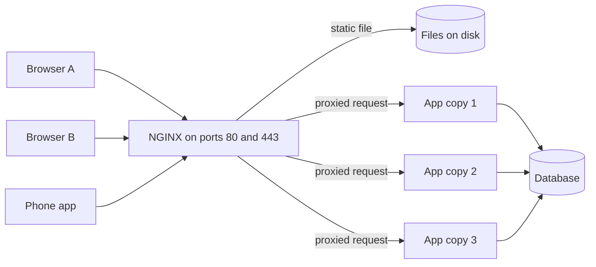
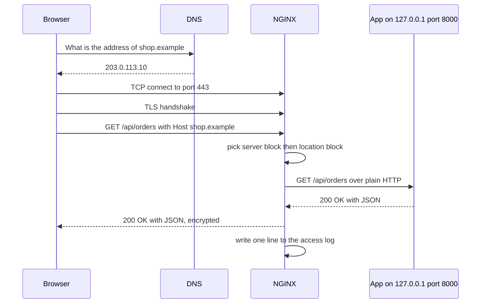
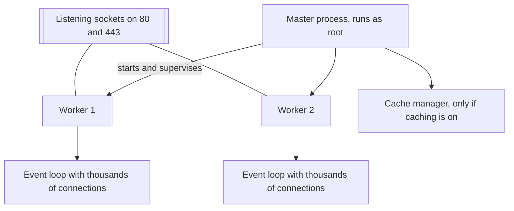

# Web servers, reverse proxies and load balancers from zero

## Before this lesson

You need to know what a URL is (an address such as `https://shop.example/cart`) and that a browser shows web pages. Nothing else is assumed. If words such as "port" or "TCP" are new, that is fine: each one is defined here the first time it appears. For a slower tour of the network underneath, the networking track has [what happens when you type a URL](#/lesson/networking/url-walkthrough).

## In plain words

A **web server** is a program that waits for requests and answers them. A request says "please give me the page at this address"; the answer is the page, a picture, some data, or an error.

Picture a small restaurant.

- The **waiter at the door** greets every guest, hands out bread and water straight from the counter, and carries orders to the kitchen. The guests never walk into the kitchen.
- The **kitchen** is where the slow, complicated work happens.
- When the restaurant gets busy the owner opens a second and a third kitchen, and the waiter decides which kitchen gets each order so that no cook is swamped.

NGINX (said "engine x") plays the waiter. Handing out bread and water is **serving static files**. Carrying orders to a kitchen and bringing the plates back is being a **reverse proxy**. Choosing between several kitchens is **load balancing**. One program does all three, and it does them for tens of thousands of guests at the same moment on modest hardware.

Why this matters for a job: almost every web product has something like NGINX at its front door. Backend, DevOps, site-reliability and platform roles all expect you to read an NGINX configuration, explain why a request got a particular answer, and fix it when the answer is `502 Bad Gateway`.

## The three roles, one at a time

### Role 1: web server

A **static file** is a file that is sent exactly as it sits on disk: an HTML page, a stylesheet, an image, a video. No code runs to produce it. A web server in its plainest form maps an address to a file:

| The browser asks for | The server reads | The server sends |
|---|---|---|
| `/` | `/var/www/site/index.html` | the HTML text |
| `/img/logo.png` | `/var/www/site/img/logo.png` | the image bytes |
| `/nope.html` | nothing, the file is missing | an error with status 404 |

NGINX is extremely good at this job because sending a file is mostly "copy bytes from disk to network", and NGINX asks the operating system to do that copy directly.

### Role 2: reverse proxy

A **dynamic** response is one that a program computes for each request: your account page, a search result, a JSON reply from an API (application programming interface, a set of addresses meant for programs rather than people). That program is the **application server**, sometimes called the **backend** or the **upstream**. Examples are a Python FastAPI app, a Node.js app, or a Java Spring app.

A **proxy** is a go-between. A **reverse proxy** is a go-between that stands in front of servers: the client talks to the proxy, the proxy talks to the application, and the client never learns the application's real address.

Why put a go-between in front of your own application?

- **One front door.** The proxy owns the public address and the encryption certificate; applications stay on a private network.
- **Protection.** The proxy absorbs slow clients, oversized uploads and floods so the application does not have to.
- **Speed.** The proxy can answer static files and cached responses without waking the application.
- **Freedom to change.** You can restart, move or replace an application and the public address stays the same.

The opposite arrangement is a **forward proxy**, which stands in front of clients (an office proxy that all staff browsers go through). A forward proxy hides clients from servers; a reverse proxy hides servers from clients. NGINX is built for the reverse role.

### Role 3: load balancer

One application process can only do so much. To serve more people, or to survive one machine failing, you run several identical copies. A **load balancer** is a reverse proxy with more than one place to send a request, plus a rule for choosing. The rule might be "take turns", "pick the least busy one", or "the same visitor always goes to the same copy".



Read the picture left to right: many clients, one front door, files answered directly, everything else handed to one of three application copies.

## The vocabulary underneath: address, port, socket, process

Four small ideas explain almost everything NGINX does.

**IP address.** Every machine on a network has a numeric address such as `203.0.113.10`. It is like a building's street address.

**Port.** One machine runs many network programs, so each program claims a number from 1 to 65535 called a port. The address finds the building; the port finds the apartment. By convention, plain web traffic (HTTP) uses port **80** and encrypted web traffic (HTTPS) uses port **443**. An application server commonly uses a higher number such as 8000 or 3000.

**Process.** A process is a running program. The operating system gives each one its own memory and a number called a PID (process identifier).

**Socket.** A socket is the operating system's object for one end of a network conversation. There are two kinds you will meet:

- A **listening socket** is a doorbell. A program says "tell me when anyone connects to port 80".
- A **connected socket** is one actual conversation between this server and one client. A busy server holds thousands of them at once.

**TCP** (Transmission Control Protocol) is the set of rules that turns the unreliable internet into a reliable two-way stream of bytes between two sockets. **HTTP** (Hypertext Transfer Protocol) is the text format of web requests and responses that travels over that stream. **TLS** (Transport Layer Security) is the encryption wrapped around HTTP to make HTTPS.

You can see listening sockets on a Linux machine:

```bash
$ sudo ss -ltnp | grep -E ':(80|443|8000)\s'
LISTEN 0  511   0.0.0.0:80     0.0.0.0:*  users:(("nginx",pid=912,fd=6),("nginx",pid=911,fd=6))
LISTEN 0  511   0.0.0.0:443    0.0.0.0:*  users:(("nginx",pid=912,fd=7),("nginx",pid=911,fd=7))
LISTEN 0  2048  127.0.0.1:8000 0.0.0.0:*  users:(("uvicorn",pid=1403,fd=5))
```

Line by line:

- `ss` is the "socket statistics" tool. `-l` shows listening sockets, `-t` TCP only, `-n` numbers instead of names, `-p` the owning process. `grep` keeps the three ports of interest.
- `0.0.0.0:80` means "port 80 on every network interface of this machine", so the outside world can reach it. NGINX owns it.
- `127.0.0.1:8000` means "port 8000, but only from this same machine". `127.0.0.1` is the **loopback** address, a machine's name for itself. The application (`uvicorn`, a Python server) listens there, so nobody outside can reach it except through NGINX. That is the reverse-proxy pattern in one line of output.

## One request, start to finish

Suppose someone opens `https://shop.example/api/orders`.



1. **Name lookup.** DNS (Domain Name System) is the internet's phone book. The browser asks it for the numeric address behind `shop.example`.
2. **Connection.** The browser opens a TCP connection to that address on port 443. NGINX's listening socket accepts it and a connected socket now exists.
3. **Encryption.** The **TLS handshake** agrees on keys. NGINX proves its identity with a certificate. From here on the bytes are unreadable to anyone in between.
4. **Request.** The browser sends the HTTP request: a **method** (`GET` means "read"), a path (`/api/orders`), and **headers**, which are `Name: value` lines of extra information. The `Host` header carries the site name.
5. **Routing inside NGINX.** NGINX chooses which site definition applies (using the port and the `Host` header) and then which rule inside that site matches the path. Lessons 3 and 4 cover these two choices in detail.
6. **Proxying.** The rule says "pass to the application", so NGINX opens (or reuses) a connection to `127.0.0.1:8000` and forwards the request.
7. **Response.** The application answers with a **status code** (a three-digit result number), headers and a body. NGINX relays it to the browser.
8. **Logging.** NGINX appends one line describing the request to its access log.

You can watch a request and response with `curl`, a command-line web client. The `-i` flag prints the response headers as well as the body.

```bash
$ curl -i http://shop.example/hello.txt
HTTP/1.1 200 OK
Server: nginx/1.28.0
Date: Sat, 21 Nov 2026 09:14:02 GMT
Content-Type: text/plain
Content-Length: 13
Last-Modified: Fri, 20 Nov 2026 17:40:11 GMT
Connection: keep-alive
ETag: "691f5a2b-d"
Accept-Ranges: bytes

Hello, world
```

- `HTTP/1.1 200 OK` is the **status line**. `200` means success.
- `Server` names the software that answered.
- `Content-Type` tells the browser what kind of data follows, here plain text.
- `Content-Length` is the body size in bytes (12 letters and punctuation plus a line ending).
- `Connection: keep-alive` says the TCP connection stays open for another request, which saves the cost of reconnecting.
- `ETag` and `Last-Modified` are fingerprints that let a browser ask later "has this changed?".
- After the blank line comes the **body**.

Status codes come in families, and you will read them every day:

| Family | Meaning | Common members |
|---|---|---|
| 2xx | it worked | 200 OK, 204 No Content |
| 3xx | look elsewhere | 301 Moved Permanently, 302 Found, 304 Not Modified |
| 4xx | the client's request is the problem | 400, 401, 403, 404, 413, 429 |
| 5xx | the server side is the problem | 500, 502 Bad Gateway, 503, 504 Gateway Timeout |

## How NGINX is built: a master and its workers

When NGINX starts it creates one **master process** and several **worker processes**.

- The **master** reads the configuration, opens the listening sockets (ports below 1024 need administrator rights, so the master runs as the `root` user), starts workers, and replaces them when you ask for a reload. It never touches a client request.
- Each **worker** accepts connections and does all the request handling. Workers run as an unprivileged user (often `www-data` or `nginx`), so a bug in request handling cannot take over the machine. A common setting is one worker per CPU core.

```bash
$ ps -o pid,ppid,user,cmd -C nginx
    PID    PPID USER     CMD
    911       1 root     nginx: master process /usr/sbin/nginx -g daemon on; master_process on;
    912     911 www-data nginx: worker process
    913     911 www-data nginx: worker process
```

`ps` lists processes; `-C nginx` selects those named nginx and `-o` picks the columns. The `PPID` column is the parent's PID: both workers (912 and 913) have parent 911, the master. The master's own parent is 1, the system's first process.



### The event-driven model

Here is the idea that made NGINX famous.

An older style of server gives every connection its own process or **thread** (a thread is a lightweight strand of execution inside a process). If a visitor on a slow phone takes ten seconds to receive a page, one thread sits idle for ten seconds, holding memory. Ten thousand slow visitors need ten thousand threads, and the machine spends its effort switching between them rather than working.

NGINX turns this around. A worker is a single thread running an **event loop**:

1. Ask the operating system: "of all my thousands of sockets, which ones have something for me to do right now?" On Linux the mechanism for this question is called **epoll**.
2. For each ready socket do a small, quick step: read the bytes that arrived, or write the bytes that fit.
3. Never wait on any one socket. Go back to step 1.

This style is called **non-blocking** or **asynchronous** input and output (I/O). A slow client costs a few kilobytes of memory for its connection record, not a whole thread.

Back in the restaurant: the old model hires one waiter per table who stands beside it for the whole meal. The event model has one waiter who circulates, attends whichever table raised a hand, and moves on. One good waiter covers a large room, as long as no single task makes them stand still.

That last condition matters. Anything that makes a worker wait (a slow disk, a blocking piece of custom code) stalls every connection that worker owns. It is why NGINX hands heavy computation to application servers instead of running it inside the worker.

The simulation below compares the two models on the same workload. It is plain Python and involves no real network; it counts how long clients wait.

```python-run
import heapq

# 8 clients. Each needs 1 ms of CPU work and is slow to receive: 200 ms of network waiting.
CLIENTS, CPU_MS, WAIT_MS = 8, 1, 200

def thread_per_connection(pool_size):
    """Each client occupies one thread for CPU + waiting. Extra clients queue for a thread."""
    free_at = [0] * pool_size            # the time each thread becomes free
    heapq.heapify(free_at)
    finish = []
    for _ in range(CLIENTS):             # all clients arrive at time 0
        start = heapq.heappop(free_at)   # earliest free thread
        end = start + CPU_MS + WAIT_MS   # the thread is stuck for the whole exchange
        heapq.heappush(free_at, end)
        finish.append(end)
    return max(finish)

def event_loop():
    """One worker. CPU steps happen one after another; the waiting overlaps."""
    t, finish = 0, []
    for _ in range(CLIENTS):
        t += CPU_MS                      # do this client's quick step
        finish.append(t + WAIT_MS)       # the waiting is the network's job, not ours
    return max(finish)

print("2 threads, blocking :", thread_per_connection(2), "ms until the last client is done")
print("8 threads, blocking :", thread_per_connection(8), "ms (needs 8 threads of memory)")
print("1 event-loop worker :", event_loop(), "ms with a single thread")
```

With two blocking threads the last client finishes after about 800 ms because clients queue for a free thread. One event-loop worker finishes everyone in about 208 ms, since the waiting overlaps. Change `CPU_MS` to 100 and run it again: the event loop gets much worse, because now each step makes the single worker stand still. That is the trade-off in miniature.

> [!INTERVIEW]
> "How does NGINX handle so many connections?" A strong answer names three things: a small fixed number of worker processes, each running a non-blocking event loop driven by the operating system's readiness notification (epoll on Linux, kqueue on BSD), so idle or slow connections cost memory but no thread. Add that the limit per worker is `worker_connections` and that blocking work inside a worker hurts every connection it holds.

## What NGINX is not

- **It is not an application server for Python, Node or Java.** It does not run your FastAPI code. It forwards requests to a separate process that does. (It can run small scripts in njs or Lua, covered in the programmability module, but those are for gluing, not for applications.)
- **It is not a database or a session store.** It keeps a little shared memory for counters and caches, and an optional on-disk cache of responses.
- **It is not magic for slow applications.** If the application takes five seconds, NGINX relays a five-second answer, unless a cached copy exists.

## Two editions: open source and Plus

**NGINX Open Source** is free and is what `apt install nginx` gives you. **NGINX Plus** is a paid edition from F5 that adds features such as active health checks, a live dashboard, a configuration API and built-in JSON Web Token validation. Throughout this track anything that needs Plus is labelled, and an open-source way to get a similar result is given next to it. Feature boundaries move: several items that were Plus-only for years, such as the `sticky` session directive, have been moved into recent open-source releases, so always check the documentation page for the version you run.

> [!TIP]
> Run `nginx -v` before following any tutorial. Distribution packages can lag years behind, and directive availability depends on the version.

## Pitfalls for newcomers

- **Confusing the proxy with the application.** A `502` or `504` status is produced by NGINX about the application: "I could not get a valid answer from the thing behind me." The fix is rarely in the page the browser shows.
- **Binding the application to `0.0.0.0`.** That exposes it directly and bypasses every protection in the proxy. Bind it to `127.0.0.1` or a private address.
- **Assuming one worker means one request at a time.** A single worker juggles thousands of connections.
- **Forgetting the firewall.** A listening socket is useless if the cloud firewall does not allow ports 80 and 443 in.

> [!WARNING]
> Port 80 traffic is plain text. Anyone on the path can read and change it. Real sites redirect port 80 to HTTPS on 443; the security module shows how.

## Cheat sheet

| Term | One-line meaning |
|---|---|
| Web server | Program that answers HTTP requests, often with files |
| Static file | Sent as stored, no code runs |
| Application server / upstream | The program that computes dynamic responses |
| Reverse proxy | Go-between in front of servers |
| Forward proxy | Go-between in front of clients |
| Load balancer | Reverse proxy that chooses among several servers |
| Port 80 / 443 | Defaults for HTTP / HTTPS |
| Master process | Reads config, owns sockets, supervises workers |
| Worker process | Handles all connections in an event loop |
| epoll | Linux call that reports which sockets are ready |
| `curl -i URL` | Fetch a URL and show response headers |
| `ss -ltnp` | Show listening TCP sockets and their owners |

## Summary

- NGINX is one program with three everyday jobs: serve files, forward requests to applications, and spread requests across several application copies.
- A request reaches it through DNS, a TCP connection to a port, usually a TLS handshake, then HTTP text.
- A root-owned master supervises unprivileged workers; each worker is a single-threaded event loop that never waits on one client.
- The event model wins when work is mostly waiting on the network, and loses if a worker is made to block.
- The open-source edition covers most needs; Plus-only features are labelled in this track with free alternatives.

## Glossary

- **API**: addresses and formats that programs use to talk to a service.
- **Backend / upstream / application server**: the program behind the proxy that produces dynamic responses.
- **DNS**: the system that turns names into numeric addresses.
- **Event loop**: a repeat-forever cycle of "find ready sockets, do a small step on each".
- **Header**: a `Name: value` line in a request or response.
- **Loopback (127.0.0.1)**: the address a machine uses to talk to itself.
- **Non-blocking I/O**: reading and writing without waiting when the other side is not ready.
- **PID**: the number that identifies a process.
- **Socket**: one end of a network conversation, or a "doorbell" waiting for conversations.
- **Status code**: the three-digit result of a request.
- **TLS**: the encryption layer that turns HTTP into HTTPS.

## Check yourself

```quiz
[
  {"q": "A company runs NGINX on a public address and its Python app on 127.0.0.1:8000. Which role is NGINX playing for requests to /api/?",
   "options": ["Forward proxy", "Reverse proxy", "Database", "DNS server"], "answer": 1,
   "explain": "It stands in front of the server side and forwards client requests to an application the client cannot reach directly."},
  {"q": "Which process accepts a client connection and produces the response?",
   "options": ["The master process", "A worker process", "The cache manager", "The systemd process"], "answer": 1,
   "explain": "The master only reads configuration, owns listening sockets and supervises. Workers handle every connection."},
  {"q": "Why does the master process usually run as root while workers do not?",
   "options": ["Root processes are faster", "Binding ports below 1024 needs privileges, while request handling is safer without them", "Workers cannot read files as root", "It is required by HTTP"], "answer": 1,
   "explain": "Ports 80 and 443 are privileged. Keeping request-handling code unprivileged limits the damage a bug can do."},
  {"q": "What status code family tells you the fault is on the server side?",
   "options": ["2xx", "3xx", "4xx", "5xx"], "answer": 3,
   "explain": "5xx codes such as 500, 502, 503 and 504 mean the server or something behind it failed."},
  {"q": "NGINX has no location that proxies anything and the requested file does not exist on disk. What status code is returned?",
   "options": ["200", "301", "404", "502"], "answer": 2,
   "explain": "A missing static file is 404 Not Found. 502 needs an upstream that failed, and there is none here."},
  {"q": "What does a worker's event loop do when one client is slow to read its response?",
   "options": ["Waits for that client before serving others", "Starts a new thread for it", "Moves on to other ready connections and returns when that socket is writable", "Closes the connection immediately"], "answer": 2,
   "explain": "Non-blocking I/O means the worker never waits on one socket; the OS reports readiness later."},
  {"q": "An application listens on 0.0.0.0:8000 on a public server that also runs NGINX. What is the main risk?",
   "options": ["NGINX cannot connect to it", "Clients can reach the app directly and bypass TLS, limits and logging in NGINX", "The app will use more CPU", "Port 8000 conflicts with port 80"], "answer": 1,
   "explain": "0.0.0.0 means every interface, including the public one. Bind to 127.0.0.1 or a private address instead."}
]
```

> **Source:** DeJonghe, NGINX Cookbook, ch. 1 (introduction and installation context). Docs: https://nginx.org/en/docs/beginners_guide.html, https://nginx.org/en/docs/control.html
