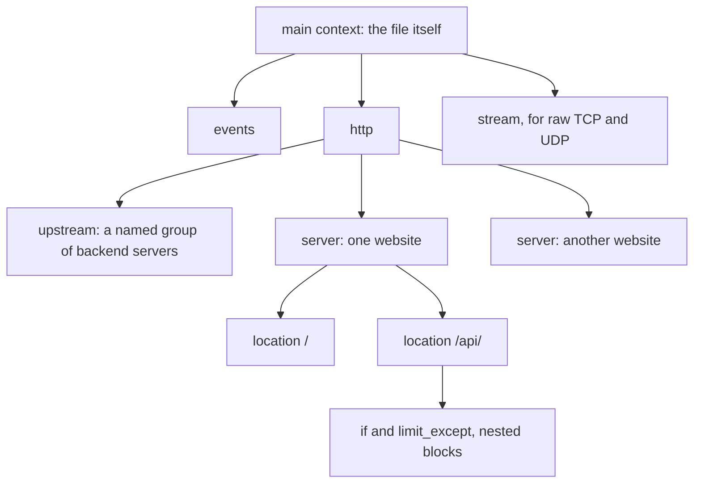
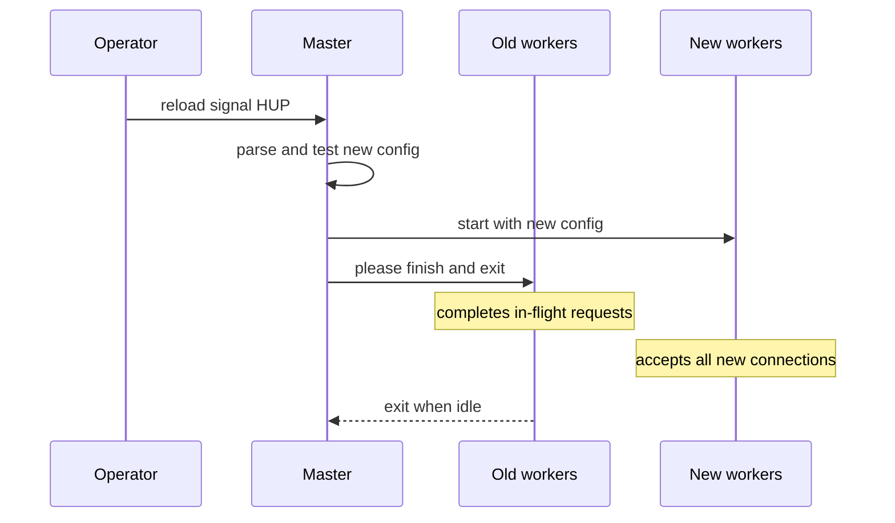

# Installing NGINX and reading nginx.conf

## Before this lesson

Read [Web servers, reverse proxies and load balancers from zero](#/lesson/nginx/what-nginx-is) first: you should know what a port, a process, the master and the workers are. You also need a Linux terminal. Commands here are for Ubuntu or Debian, with the Red Hat family noted where it differs. If the terminal itself is new, see the Linux CLI track.

## In plain words

Installing NGINX puts three things on the machine: the program, a folder of text files that tell it what to do, and a service entry so the operating system starts it at boot.

Those text files are the **configuration**. Think of a company handbook. There are company-wide rules at the front, a chapter for each office, and inside each office chapter a section for each department. A department follows the company rule unless its own section says otherwise. NGINX configuration works the same way: general settings on the outside, one block per website, and inside each website one block per group of addresses. Almost every NGINX task in a job is "find the right block and add the right line", so learning to read this structure pays off in every later lesson.

## Step 1: install

```bash
$ sudo apt update
$ sudo apt install -y nginx
$ nginx -v
nginx version: nginx/1.28.0
```

- `sudo` runs a command with administrator rights.
- `apt update` refreshes the list of available packages; `apt install -y nginx` downloads and installs NGINX, answering "yes" to the prompt.
- `nginx -v` prints the version. Your number may differ.

On Red Hat, CentOS Stream, Rocky or Amazon Linux the equivalent is `sudo dnf install -y nginx`.

Distribution packages can be old. The NGINX project publishes its own repository with two lines of releases: **stable** (even second number such as 1.28, receives only important fixes) and **mainline** (odd second number such as 1.29, receives new features first). Either is fine for production; mainline is what the project itself recommends for most users. NGINX Plus is installed from F5's private repository using a certificate and key that come with the subscription; the steps are otherwise the same.

Now check that it is running.

```bash
$ systemctl status nginx --no-pager | head -4
● nginx.service - A high performance web server and a reverse proxy server
     Loaded: loaded (/usr/lib/systemd/system/nginx.service; enabled; preset: enabled)
     Active: active (running) since Sat 2026-11-21 09:02:11 UTC; 40s ago
   Main PID: 911 (nginx)

$ curl -I http://localhost
HTTP/1.1 200 OK
Server: nginx/1.28.0
Content-Type: text/html
Content-Length: 615
```

- **systemd** is the Linux service manager: the program that starts other programs at boot and restarts them if asked. `systemctl` is its command. `enabled` means "start at boot"; `active (running)` means it is up now.
- `curl -I` asks for the headers only. `200 OK` from `localhost` (this same machine) proves a worker answered. The 615-byte body is the "Welcome to nginx!" page.

If `curl` says `Connection refused`, nothing is listening: start the service with `sudo systemctl start nginx` and read `sudo journalctl -u nginx -n 20` for the reason it did not start.

## Step 2: know where everything lives

| Path | What it is |
|---|---|
| `/usr/sbin/nginx` | the program (the **binary**) |
| `/etc/nginx/nginx.conf` | the main configuration file, the one NGINX opens first |
| `/etc/nginx/conf.d/*.conf` | extra configuration files pulled in by the main file |
| `/etc/nginx/sites-available/` and `sites-enabled/` | Debian and Ubuntu convention: one file per site, switched on by a link |
| `/etc/nginx/mime.types` | table mapping file endings to content types |
| `/etc/nginx/modules-enabled/` | lines that load optional modules |
| `/var/log/nginx/access.log` | one line per request served |
| `/var/log/nginx/error.log` | problems, warnings and start-up messages |
| `/var/www/html` or `/usr/share/nginx/html` | default folder of files to serve |
| `/run/nginx.pid` | a file holding the master's PID |
| `/var/cache/nginx/` | temporary and cache files (location varies) |

A word on the two Debian folders, since they confuse newcomers. `sites-available` holds every site file you have written. `sites-enabled` holds **symbolic links** (shortcuts) to the ones you want active. The main file only reads `sites-enabled`. To disable a site you delete the link, not the file. The Red Hat packages and the official NGINX packages skip this and use `conf.d/` alone. Both are conventions; NGINX itself only knows about files it is told to include.

The commands you will type most:

| Command | Effect |
|---|---|
| `nginx -t` | check the configuration for errors, change nothing |
| `nginx -T` | check, then print the whole configuration with every included file expanded |
| `nginx -V` | version plus the build options and compiled-in modules |
| `nginx -s reload` | ask the master to reload configuration |
| `nginx -s quit` | finish current requests, then stop |
| `nginx -s stop` | stop at once |
| `systemctl reload nginx` | same as `-s reload`, through the service manager |
| `systemctl restart nginx` | stop fully, then start again |

## Step 3: read the main file

Here is a trimmed but complete main file, close to what a fresh install contains. Every line is explained below it.

```nginx
user  www-data;
worker_processes  auto;
error_log  /var/log/nginx/error.log  warn;
pid  /run/nginx.pid;

events {
    worker_connections  1024;
}

http {
    include       /etc/nginx/mime.types;
    default_type  application/octet-stream;

    log_format  main  '$remote_addr - $remote_user [$time_local] "$request" '
                      '$status $body_bytes_sent "$http_referer" "$http_user_agent"';
    access_log  /var/log/nginx/access.log  main;

    sendfile  on;
    keepalive_timeout  65;

    include /etc/nginx/conf.d/*.conf;
}
```

- `user www-data;` The workers run as this unprivileged account.
- `worker_processes auto;` Start one worker per CPU core that NGINX detects.
- `error_log ... warn;` Where to write problems, and the minimum seriousness to record. Levels from chattiest to quietest are `debug`, `info`, `notice`, `warn`, `error`, `crit`, `alert`, `emerg`.
- `pid /run/nginx.pid;` Where the master records its process number so that `nginx -s reload` can find it.
- `events { ... }` Settings for connection handling. `worker_connections 1024;` lets each worker hold up to 1,024 connections at the same moment. That count includes connections to upstream applications, not only clients.
- `http { ... }` Everything about web traffic lives inside this block.
- `include /etc/nginx/mime.types;` Paste in the table that says, for example, `.css` is `text/css`. **MIME type** is the older name for the `Content-Type` value.
- `default_type application/octet-stream;` For a file ending that is not in the table, tell the browser "unknown binary data", which makes it download rather than display.
- `log_format main '...';` Defines a named recipe for an access-log line. The words starting with `$` are **variables**: placeholders that NGINX fills in for each request, such as `$remote_addr` (the client's address) and `$status` (the response code).
- `access_log ... main;` Write the access log to this file using the `main` recipe.
- `sendfile on;` Let the operating system copy file bytes to the network directly, skipping a round trip through NGINX's memory.
- `keepalive_timeout 65;` Keep an idle client connection open for 65 seconds in case the browser sends another request.
- `include /etc/nginx/conf.d/*.conf;` Paste in every file in that folder whose name ends in `.conf`. This is where your sites go.

## The grammar: directives and contexts

The file is made of two kinds of thing.

A **simple directive** is a name, one or more values separated by spaces, and a semicolon:

```nginx
worker_connections 1024;
```

A **block directive** has a name, optional values, and a pair of braces holding more directives:

```nginx
location /images/ {
    expires 30d;
}
```

The inside of a block is called a **context**. A directive is only legal in certain contexts, and the documentation for every directive lists them on a line beginning "Context:". Writing `worker_processes` inside `http` is an error; NGINX refuses to start and tells you so.

Other grammar rules worth knowing early:

- `#` starts a comment that runs to the end of the line.
- Sizes take suffixes `k`, `m`, `g` (`client_max_body_size 10m;`). Times take `ms`, `s`, `m`, `h`, `d` (`expires 30d;`). A bare number of time is seconds.
- A value with spaces or special characters needs quotes: `add_header X-Note "hello there";`.
- Every simple directive ends in `;`. A missing semicolon is the most common error message you will ever see, and it usually points at the line *after* the mistake.

The contexts nest like this:



| Context | What belongs there |
|---|---|
| main | process-wide settings: `user`, `worker_processes`, `error_log`, `load_module` |
| `events` | connection handling: `worker_connections` |
| `http` | defaults for all websites: logging, compression, shared zones for limits and caches |
| `server` | one website (a **virtual server**): which port and names it answers |
| `location` | rules for a set of paths inside one website |
| `upstream` | a named pool of application servers |
| `stream` | load balancing for non-HTTP protocols such as databases |

A request travels inward through this structure: the `http` block applies, then exactly one `server` block is chosen, then exactly one `location` block inside it handles the request.

## Inheritance: the rule that explains most surprises

A directive set in an outer context is inherited by the contexts inside it. An inner context can set the same directive again, and then the inner value wins for that context.

```nginx
http {
    gzip on;                         # A: compress responses everywhere
    client_max_body_size 1m;         # B: uploads up to 1 megabyte everywhere

    server {
        listen 80;
        server_name files.example;
        client_max_body_size 50m;    # C: this site allows 50 megabytes

        location /avatars/ {
            client_max_body_size 2m; # D: but avatars are capped at 2 megabytes
        }

        location /reports/ {
            gzip off;                # E: reports are already compressed
        }
    }
}
```

| Request path | `gzip` | `client_max_body_size` | Why |
|---|---|---|---|
| `/avatars/me.png` | on (A) | 2m (D) | D overrides C overrides B |
| `/reports/q3.zip` | off (E) | 50m (C) | E overrides A; the size comes from the server |
| `/anything/else` | on (A) | 50m (C) | nothing more specific is set |

That is the easy half. The other half catches experienced people.

**Array-type directives are replaced as a set, not merged.** Some directives can appear several times at one level to build a list: `add_header`, `proxy_set_header`, `access_log`, `error_page`, `limit_req`. For these, an inner context inherits the outer list **only if it declares none of its own**. Declare a single one inside, and the entire outer list is dropped for that context.

```nginx
server {
    add_header X-Frame-Options "DENY";
    add_header X-Content-Type-Options "nosniff";

    location /downloads/ {
        add_header Cache-Control "public, max-age=3600";
        # Requests here get Cache-Control ONLY.
        # The two security headers from the server level are gone.
    }
}
```

The fix is to repeat the outer headers inside the location, or put shared headers in a small file and `include` it in both places. Some recent NGINX releases add an `add_header_inherit` directive to opt in to merging; do not assume it exists on the server in front of you.

> [!WARNING]
> Adding one `add_header` or one `proxy_set_header` in a location silently discards all of the inherited ones for that location. Check with `curl -i` after every change to headers.

The short program below models both rules so you can try cases.

```python-run
# Each context is a dict of directive -> value. Lists model array-type directives.
ARRAY_TYPE = {"add_header", "proxy_set_header"}

http     = {"gzip": "on", "client_max_body_size": "1m"}
server   = {"client_max_body_size": "50m",
            "add_header": ["X-Frame-Options DENY", "X-Content-Type-Options nosniff"]}
location = {"add_header": ["Cache-Control public"]}      # try making this {} and rerun

def effective(*contexts):
    """Walk from outermost to innermost; an inner setting replaces the outer one wholesale."""
    result = {}
    for ctx in contexts:
        for name, value in ctx.items():
            result[name] = value        # same rule for both kinds: REPLACE, never merge
    return result

for name, value in sorted(effective(http, server, location).items()):
    kind = "array" if name in ARRAY_TYPE else "plain"
    print(f"{name:22} ({kind}) -> {value}")
```

The output shows `add_header` holding only the `Cache-Control` entry. Empty the `location` dictionary and run again: the two security headers come back, because the location now inherits the server's list.

## include: splitting the file

`include` pastes the text of other files at that point, as if you had typed it there. It accepts a single file or a pattern with `*`.

```nginx
http {
    include /etc/nginx/conf.d/*.conf;          # one file per site
}
```

```nginx
# /etc/nginx/conf.d/blog.conf
server {
    listen 80;
    server_name blog.example;
    include /etc/nginx/snippets/security-headers.conf;   # shared lines
    root /var/www/blog;
}
```

Two consequences follow from "paste the text here". First, an included file must make sense in the context where it lands: a file of `server` blocks can only be included inside `http`. Second, files matching a pattern load in alphabetical order, which matters when order matters (it does for choosing a default site, next lesson). When an error says `blog.conf:14`, it means line 14 of that file; when you cannot find where a setting comes from, `nginx -T` prints the fully assembled configuration with a `# configuration file ...` marker before each file.

## Reload versus restart

You changed a file. NGINX does not notice by itself; it read the configuration once at start-up. You have two ways to apply the change, and choosing well is the difference between zero dropped requests and a brief outage.

**Reload** (`systemctl reload nginx` or `nginx -s reload`) sends the master a signal called `HUP`. The master then:

1. reads and checks the new configuration;
2. if it is broken, logs the error and keeps running with the old one;
3. if it is good, starts new workers with the new configuration;
4. tells the old workers to stop accepting new connections, finish what they are doing, then exit.



No connection is cut and the listening sockets never close. This is called a **graceful reload**.

**Restart** stops every process and starts fresh. Requests in flight are dropped and, for a moment, nobody is listening. You need it only when something outside the reloadable configuration changes: a new NGINX binary after an upgrade, or (on some setups) newly loaded modules.

The safe habit is always the same two commands:

```bash
$ sudo nginx -t && sudo systemctl reload nginx
nginx: the configuration file /etc/nginx/nginx.conf syntax is ok
nginx: configuration file /etc/nginx/nginx.conf test is successful
```

`&&` means "run the second command only if the first succeeded", so a typo never reaches the running server. Here is what a failure looks like:

```bash
$ sudo nginx -t
nginx: [emerg] unexpected "}" in /etc/nginx/conf.d/blog.conf:9
nginx: configuration file /etc/nginx/nginx.conf test failed
```

`[emerg]` is the severity. The message names the file and line. An unexpected `}` nearly always means the line above it lacks its semicolon.

> [!TIP]
> Long-lived connections such as WebSockets or large downloads keep old workers alive after a reload. Seeing a few `nginx: worker process is shutting down` entries in `ps` for a while is normal. The setting `worker_shutdown_timeout 30s;` puts a limit on how long they may linger.

> [!INTERVIEW]
> "What happens during `nginx -s reload`?" The master re-reads the configuration, validates it, starts new workers and gracefully retires the old ones, so existing connections finish and no listening socket closes. If validation fails the old configuration stays in force. Contrast with restart, which drops connections.

## Pitfalls

- **Editing a file that is not included.** A file in `sites-available` without a link in `sites-enabled`, or a file not ending in `.conf` inside `conf.d`, is ignored without complaint. Confirm with `nginx -T | grep server_name`.
- **Reloading without testing.** A failed reload leaves the old configuration running, and you may believe the change is live.
- **`nginx -t` passes but behaviour is wrong.** The test checks grammar and file existence, not intent. It cannot tell that you put a directive in the wrong location.
- **Running `nginx` by hand next to systemd.** Starting a second copy fails with `bind() to 0.0.0.0:80 failed (98: Address already in use)`. Use `systemctl`.
- **Permissions.** Workers run as `www-data` or `nginx`. If that user cannot read your site folder (and every folder above it), requests fail with 403.

## Cheat sheet

| Need | Do |
|---|---|
| Install | `sudo apt install nginx` or `sudo dnf install nginx` |
| Version and modules | `nginx -v`, `nginx -V` |
| Test config | `sudo nginx -t` |
| Show full merged config | `sudo nginx -T` |
| Apply change without dropping traffic | `sudo nginx -t && sudo systemctl reload nginx` |
| Start at boot | `sudo systemctl enable nginx` |
| Why did it not start | `sudo journalctl -u nginx -n 30`, `tail /var/log/nginx/error.log` |
| Site files | `/etc/nginx/conf.d/*.conf` or `sites-enabled/` |
| Inheritance | inner overrides outer; array directives are replaced as a set |

## Summary

- Installation gives you a binary, `/etc/nginx/`, log files and a systemd service.
- Configuration is directives ending in `;` and blocks in `{ }`. Blocks create contexts: main, `events`, `http`, `server`, `location`, `upstream`, `stream`.
- Settings flow inward. An inner context overrides an outer one, and list-building directives such as `add_header` are replaced wholesale, not merged.
- `include` pastes files in; `nginx -T` shows the assembled result.
- Test, then reload. Reload is graceful; restart drops connections.

## Glossary

- **Binary**: the compiled program file.
- **Context**: the inside of a block; it decides which directives are legal there.
- **Directive**: one configuration instruction.
- **Graceful reload**: applying new configuration while old workers finish their requests.
- **Inheritance**: inner contexts receiving outer settings unless they set their own.
- **Mainline / stable**: the two release lines of NGINX Open Source.
- **MIME type**: the label for a kind of content, sent in `Content-Type`.
- **Symbolic link**: a file that points at another file.
- **systemd**: the Linux service manager.
- **Variable**: a `$name` placeholder filled in per request.
- **Virtual server**: one `server` block, that is, one website on a shared NGINX.

## Check yourself

```quiz
[
  {"q": "Which command applies a configuration change without dropping in-flight requests?",
   "options": ["systemctl restart nginx", "nginx -s stop", "nginx -s reload", "kill -9 on the master"], "answer": 2,
   "explain": "Reload starts new workers and lets old ones finish their requests. Restart and stop cut connections."},
  {"q": "http sets `gzip on;`. A server sets nothing about gzip. One location sets `gzip off;`. A request lands in a different location of that server. Is the response eligible for gzip?",
   "options": ["Yes, it inherits on from http", "No, off from the sibling location applies", "No, gzip must be set in server", "It depends on file order"], "answer": 0,
   "explain": "Settings flow inward from http to server to location. A sibling location's override does not affect other locations."},
  {"q": "A server block has two add_header lines. A location inside it has one add_header line. How many of those three headers does a request to that location receive?",
   "options": ["Three", "Two", "One", "None"], "answer": 2,
   "explain": "add_header is array-type: declaring any at the inner level discards the inherited set, leaving only the location's own header."},
  {"q": "You run `nginx -s reload` with a syntax error in a site file. What happens?",
   "options": ["NGINX stops", "NGINX keeps serving with the old configuration and logs the error", "Half the workers use the new config", "The broken file is skipped"], "answer": 1,
   "explain": "The master validates first. On failure it does not replace the workers, so the previous configuration remains active."},
  {"q": "Where is `worker_connections` legal?",
   "options": ["http", "server", "events", "location"], "answer": 2,
   "explain": "Each directive lists its allowed contexts; worker_connections belongs to the events context."},
  {"q": "A new file /etc/nginx/conf.d/shop.txt contains a valid server block, the main file includes conf.d/*.conf, and you reload. What does a request for that site get?",
   "options": ["The new site", "Whatever the default server returns, since the file was never included", "A 500 error", "NGINX refuses to reload"], "answer": 1,
   "explain": "The pattern only matches names ending in .conf. The file is ignored silently, so the default server answers."},
  {"q": "`nginx -t` reports: unexpected \"}\" in blog.conf:9. What is the most likely cause?",
   "options": ["Line 9 has an extra space", "A directive on the line before the brace is missing its semicolon", "The file has wrong permissions", "The server_name is duplicated"], "answer": 1,
   "explain": "Without a semicolon the parser keeps reading values and trips over the closing brace."}
]
```

> **Source:** DeJonghe, NGINX Cookbook, ch. 1 (installation, key files and commands, graceful reload) and ch. 17 (includes, debugging configs). Docs: https://nginx.org/en/docs/beginners_guide.html, https://nginx.org/en/docs/control.html, https://nginx.org/en/docs/ngx_core_module.html
