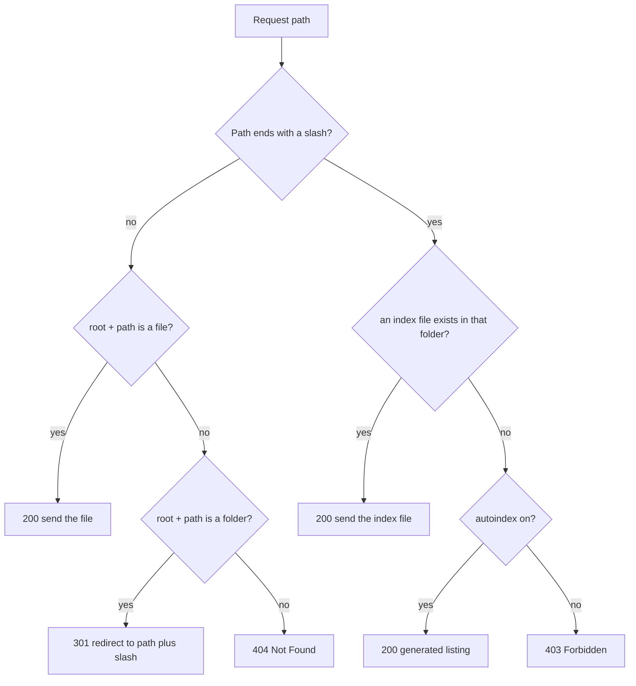

# Serving a first static site and choosing a server block

## Before this lesson

You should be able to install NGINX, find `/etc/nginx/conf.d/`, and run `nginx -t` followed by a reload. Those are covered in [Installing NGINX and reading nginx.conf](#/lesson/nginx/install-and-config). You should also know that an HTTP request carries headers, from [lesson 1](#/lesson/nginx/what-nginx-is).

## In plain words

One NGINX can host many websites on one machine and one address. Think of a shared office building with a single front desk. A courier arrives and says "parcel for Tidepool Books". The receptionist looks at the name on the parcel and sends the courier to the right office. If the name is not on the list, the parcel goes to whichever office was nominated to take unknown deliveries.

In NGINX each office is a `server` block, the name on the parcel is the request's `Host` header, and the nominated office is the **default server**. Once the right office is found, a second, smaller decision picks the right shelf inside it; that is the `location` block and it gets a whole lesson next.

This matters at work because "my change did nothing" and "the wrong site answers" are, nine times out of ten, a request landing in a different `server` block from the one you edited.

## Step 1: the smallest site that works

Make a folder with one page in it.

```bash
$ sudo mkdir -p /var/www/tidepool
$ echo '<h1>Tidepool Books</h1>' | sudo tee /var/www/tidepool/index.html
<h1>Tidepool Books</h1>
```

`mkdir -p` creates the folder (and any missing parents). `tee` writes what it receives to the named file and also echoes it to the screen; it is used here because the folder belongs to root and a plain `>` redirect would not have the rights.

Now the configuration. Save this as `/etc/nginx/conf.d/tidepool.conf`.

```nginx
server {
    listen 80;
    server_name tidepool.test www.tidepool.test;

    root /var/www/tidepool;
    index index.html;
}
```

- `server { ... }` declares one website.
- `listen 80;` This site answers connections that arrive on port 80, on any of the machine's addresses.
- `server_name ...;` The names this site answers to, compared with the `Host` header. (`.test` is a name ending reserved for testing, so it can never clash with a real site.)
- `root /var/www/tidepool;` The folder that request paths are looked up in. NGINX builds a file path by gluing the request path onto the root: a request for `/about/team.html` reads `/var/www/tidepool/about/team.html`.
- `index index.html;` When the path names a folder (it ends in `/`), serve this file from inside it.

Test, reload, and try it. The name `tidepool.test` does not exist in DNS, so tell `curl` which `Host` header to send with `-H` while connecting to the local machine:

```bash
$ sudo nginx -t && sudo systemctl reload nginx
$ curl -i -H 'Host: tidepool.test' http://127.0.0.1/
HTTP/1.1 200 OK
Server: nginx/1.28.0
Content-Type: text/html
Content-Length: 24
Last-Modified: Sat, 21 Nov 2026 09:31:40 GMT
ETag: "69203934-18"
Accept-Ranges: bytes

<h1>Tidepool Books</h1>
```

The path `/` is a folder, `index` named `index.html`, the file exists, and its `.html` ending was translated to `Content-Type: text/html` by the `mime.types` table.

## Step 2: what happens for other paths

Three more requests show the three other outcomes you will meet with static files.

```bash
$ curl -i -H 'Host: tidepool.test' http://127.0.0.1/missing.html
HTTP/1.1 404 Not Found
Content-Type: text/html
Content-Length: 153

$ sudo mkdir /var/www/tidepool/catalogue
$ curl -i -H 'Host: tidepool.test' http://127.0.0.1/catalogue
HTTP/1.1 301 Moved Permanently
Location: http://tidepool.test/catalogue/

$ curl -i -H 'Host: tidepool.test' http://127.0.0.1/catalogue/
HTTP/1.1 403 Forbidden
```

- **404 Not Found.** `/var/www/tidepool/missing.html` does not exist.
- **301 Moved Permanently.** `/catalogue` is a folder but the request lacks the trailing slash. NGINX answers with a **redirect**: a response that says "ask again at this other address", given in the `Location` header. The browser follows it automatically.
- **403 Forbidden.** `/catalogue/` is a folder with no `index.html` in it. NGINX will not list a folder's contents unless told to with `autoindex on;`, so it refuses. A 403 on a folder almost always means "no index file", and a 403 on a file almost always means "the worker user cannot read it".



## Step 3: root versus alias

`root` glues the **whole** request path onto the folder. Sometimes the files live somewhere that does not mirror the URL. `alias` handles that: it **replaces the matched location prefix** with the folder.

```nginx
server {
    listen 80;
    server_name tidepool.test;
    root /var/www/tidepool;

    location /covers/ {
        alias /srv/media/book-covers/;
    }

    location /downloads/ {
        root /srv/files;
    }
}
```

| Request | Directive in force | File read |
|---|---|---|
| `/covers/dune.jpg` | `alias /srv/media/book-covers/` | `/srv/media/book-covers/dune.jpg` |
| `/downloads/list.pdf` | `root /srv/files` | `/srv/files/downloads/list.pdf` |
| `/index.html` | `root /var/www/tidepool` | `/var/www/tidepool/index.html` |

With `alias`, `/covers/` vanished from the file path. With `root`, `/downloads/` stayed in it.

> [!WARNING]
> Match the trailing slashes when you use `alias`: `location /covers/` pairs with `alias /srv/media/book-covers/;`. Writing `location /covers` with an alias ending in `/` lets a request for `/covers../secret` climb out of the folder, a well-known path traversal mistake.

## Step 4: your own error pages

The built-in error pages are plain. `error_page` swaps in your own.

```nginx
server {
    listen 80;
    server_name tidepool.test;
    root /var/www/tidepool;

    error_page 404 /errors/not-found.html;
    error_page 500 502 503 504 /errors/unavailable.html;

    location /errors/ {
        internal;
    }
}
```

- `error_page 404 /errors/not-found.html;` When a 404 is about to be sent, NGINX performs an **internal redirect**: it quietly restarts processing with the new path, inside the server, without telling the browser. The visitor still receives status 404, but with your page as the body.
- The second `error_page` line maps four server-side codes to one page.
- `internal;` marks the location as reachable only through internal redirects. Someone typing `/errors/not-found.html` directly gets a 404 instead of a 200 copy of the error page.

```bash
$ curl -i -H 'Host: tidepool.test' http://127.0.0.1/nope
HTTP/1.1 404 Not Found
Content-Type: text/html
Content-Length: 61

<h1>We could not find that page</h1><a href="/">Home</a>
```

## Step 5: how NGINX chooses the server block

Add a second and a third site and the selection question becomes real. The choice happens in two stages.

**Stage A: the listening address.** The connection arrived on some IP address and port. Only `server` blocks whose `listen` matches that address and port stay in the running. A `listen` that names a specific address (`listen 203.0.113.10:80;`) is a closer match than one that names only a port (`listen 80;`, which means every address), and when at least one specific match exists, the port-only blocks are out of the running for that address.

**Stage B: the name.** Among the survivors, NGINX compares the `Host` header with every `server_name`, in this strict order of preference:

1. an **exact** name: `shop.tidepool.test`
2. the longest **wildcard at the start**: `*.tidepool.test`
3. the longest **wildcard at the end**: `shop.tidepool.*`
4. the first **regular expression** that matches, in the order they appear in the files. A regular expression (regex) is a pattern language for text; in `server_name` one starts with `~`.
5. if nothing matches, or the request has no `Host` header at all, the **default server** for that address and port.

The default server is the block whose `listen` line carries the `default_server` flag. If no block has the flag, it is whichever block for that address and port appears **first** in the assembled configuration, which with `include conf.d/*.conf` means alphabetical file order. Relying on that accident is fragile, so declare the default on purpose.

A special form, `server_name .tidepool.test;` with a leading dot, is shorthand for the exact name `tidepool.test` plus the wildcard `*.tidepool.test`.

```nginx
server {                                   # block 1
    listen 80 default_server;
    server_name _;
    return 444;
}

server {                                   # block 2
    listen 80;
    server_name tidepool.test www.tidepool.test;
    root /var/www/tidepool;
}

server {                                   # block 3
    listen 80;
    server_name *.tidepool.test;
    root /var/www/tidepool-subsites;
}

server {                                   # block 4
    listen 80;
    server_name ~^(?<tenant>[a-z0-9]+)\.shops\.test$;
    root /var/www/shops/$tenant;
}
```

- **Block 1** is a deliberate catch-all. `server_name _;` is not a magic wildcard; `_` is an ordinary name that no real request will ever send. What makes this block catch everything unmatched is `default_server`. `return 444;` is an NGINX-only code meaning "close the connection without sending any response", a cheap way to ignore scanners that probe by IP address.
- **Block 2** has two exact names.
- **Block 3** has a leading wildcard, which covers any subdomain.
- **Block 4** uses a regex. `^` and `$` pin the start and end, `[a-z0-9]+` means one or more lowercase letters or digits, `\.` is a literal dot, and `(?<tenant>...)` captures the matching part into a variable `$tenant` that the `root` line then uses.

| `Host` header | Chosen block | Rule that decided |
|---|---|---|
| `tidepool.test` | 2 | exact name |
| `www.tidepool.test` | 2 | exact name beats the wildcard in block 3 |
| `blog.tidepool.test` | 3 | leading wildcard |
| `rosa.shops.test` | 4 | regex, with `$tenant` = `rosa` |
| `203.0.113.10` | 1 | no name matches, so the default |
| (no Host header) | 1 | default |
| `TIDEPOOL.TEST` | 2 | names are compared without regard to letter case |

The following program implements stage B so you can test your own cases. Problem `nginx-server-block-select` asks you to write the complete version, including stage A.

```python-run
import re

SERVERS = [   # (label, names, is_default)
    ("block1 catch-all", ["_"], True),
    ("block2 main site", ["tidepool.test", "www.tidepool.test"], False),
    ("block3 subsites",  ["*.tidepool.test"], False),
    ("block4 tenants",   [r"~^(?P<tenant>[a-z0-9]+)\.shops\.test$"], False),
]

def choose(host):
    host = (host or "").lower().split(":")[0]            # ignore case and any :port
    exact = [(lbl) for lbl, names, _ in SERVERS if host in names and host]
    if exact:
        return exact[0], "exact"
    best = None                                          # longest leading wildcard
    for lbl, names, _ in SERVERS:
        for n in names:
            if n.startswith("*.") and host.endswith(n[1:]) and (best is None or len(n) > len(best[1])):
                best = (lbl, n)
    if best:
        return best[0], "wildcard at start"
    best = None                                          # longest trailing wildcard
    for lbl, names, _ in SERVERS:
        for n in names:
            if n.endswith(".*") and host.startswith(n[:-1]) and (best is None or len(n) > len(best[1])):
                best = (lbl, n)
    if best:
        return best[0], "wildcard at end"
    for lbl, names, _ in SERVERS:                        # regexes in file order
        for n in names:
            if n.startswith("~") and re.search(n[1:], host):
                return lbl, "regex"
    for lbl, _, is_default in SERVERS:
        if is_default:
            return lbl, "default_server"
    return SERVERS[0][0], "first block (implicit default)"

for h in ["tidepool.test", "www.tidepool.test", "blog.tidepool.test", "rosa.shops.test", "203.0.113.10", None]:
    print(f"{str(h):22} -> {choose(h)}")
```

> [!INTERVIEW]
> "A request for an unknown hostname reaches NGINX. Which server block answers?" The default server for the address and port the connection arrived on: the block marked `default_server`, or failing that the first one defined for that `listen`. Follow up by saying a good configuration defines an explicit catch-all that returns 444 or a redirect, so that an arbitrary site is never served to an unknown name.

## Step 6: variables you now have

Inside a `server` or `location` block you can read facts about the current request through variables. These are worth memorising because logs, redirects and proxy settings are all written with them.

| Variable | Value for `GET /catalogue/list?page=2&sort=asc` sent to `tidepool.test` from `198.51.100.7` |
|---|---|
| `$host` | `tidepool.test` (the `Host` header lowercased, without the port; falls back to the server name) |
| `$http_host` | the `Host` header exactly as sent, port included |
| `$uri` | `/catalogue/list` (the path, decoded and normalised, without the query string) |
| `$args` | `page=2&sort=asc` (the **query string**: everything after `?`) |
| `$arg_page` | `2` (one query parameter by name) |
| `$request_uri` | `/catalogue/list?page=2&sort=asc` (the original, exactly as sent) |
| `$request_method` | `GET` |
| `$scheme` | `http` or `https` |
| `$remote_addr` | `198.51.100.7` (the address of whoever connected to NGINX) |
| `$server_name` | the first name of the chosen `server` block |
| `$http_user_agent` | any request header: `$http_` plus the header name in lowercase with `-` turned into `_` |

The difference between `$uri` and `$request_uri` is examined in the next two lessons: `$uri` can change while NGINX processes a request (an internal redirect rewrites it), whereas `$request_uri` never changes.

A quick way to see variables is a throwaway location that prints them:

```nginx
location = /whoami {
    default_type text/plain;
    return 200 "host=$host uri=$uri args=$args from=$remote_addr\n";
}
```

```bash
$ curl -H 'Host: tidepool.test' 'http://127.0.0.1/whoami?x=1'
host=tidepool.test uri=/whoami args=x=1 from=127.0.0.1
```

`return 200 "text";` sends that text as the body with status 200. `default_type text/plain;` labels it as plain text.

## Pitfalls

- **Two blocks with the same name on the same port.** NGINX starts, prints `conflicting server name "tidepool.test" on 0.0.0.0:80, ignored`, and uses the first one. That warning explains many "my edit is ignored" mysteries.
- **Two `default_server` flags for the same address and port.** This is a hard error (`a duplicate default server`), and NGINX will not start.
- **The distribution's default site.** Ubuntu ships `sites-enabled/default` with `listen 80 default_server;`. It can answer requests you expected your new site to receive if the name does not match.
- **`root` inside `location /`.** Putting `root` only inside one location leaves other locations without it. Set `root` at `server` level and override where needed.
- **Testing by IP address in a browser.** That sends `Host: 203.0.113.10`, which matches no name, so you see the default server and not your site.
- **Permissions on parent folders.** The worker needs "execute" permission on every folder in the path, not only read permission on the file. `namei -l /var/www/tidepool/index.html` prints the permissions of each step.

## Cheat sheet

| Goal | Configuration |
|---|---|
| Serve a folder | `root /var/www/site;` and `index index.html;` |
| Map a URL prefix to a different folder | `location /p/ { alias /srv/x/; }` |
| Folder listing | `autoindex on;` |
| Custom error page | `error_page 404 /404.html;` |
| Hide a location from direct requests | `internal;` |
| Catch unknown hosts | `listen 80 default_server; server_name _; return 444;` |
| Name plus all subdomains | `server_name .example.com;` |
| Name precedence | exact, then longest `*.` prefix wildcard, then longest `.*` suffix wildcard, then first regex, then default |
| Test a name without DNS | `curl -i -H 'Host: name' http://127.0.0.1/` |

## Summary

- A static site needs `listen`, `server_name`, `root` and `index`.
- File path equals `root` plus the request path; `alias` replaces the location prefix instead.
- Missing file gives 404, a folder without a slash gives 301, a folder without an index gives 403.
- The server block is chosen first by listening address and port, then by `Host`: exact, leading wildcard, trailing wildcard, regex in order, default.
- Declare a catch-all `default_server` on purpose.

## Glossary

- **alias**: directive that swaps the matched location prefix for a folder path.
- **autoindex**: generated folder listing.
- **default server**: the block that answers when no `server_name` matches.
- **Host header**: request header naming the site the client wants.
- **index**: the file served for a path that names a folder.
- **Internal redirect**: NGINX restarting request processing with a new path, invisible to the client.
- **Query string**: the part of a URL after `?`.
- **Redirect (301/302)**: a response telling the client to request a different address.
- **Regular expression (regex)**: a pattern for matching text.
- **root**: the folder to which the request path is appended.
- **Wildcard name**: a `server_name` with `*` at its start or end.

## Check yourself

```quiz
[
  {"q": "root is /var/www/tidepool and the request is GET /img/a.png. Which file is read?",
   "options": ["/var/www/tidepool/a.png", "/var/www/tidepool/img/a.png", "/img/a.png", "/var/www/img/a.png"], "answer": 1,
   "explain": "root appends the complete request path to the folder."},
  {"q": "location /covers/ { alias /srv/media/; } and the request is /covers/x.jpg. Which file is read?",
   "options": ["/srv/media/covers/x.jpg", "/srv/media/x.jpg", "/covers/x.jpg", "/srv/x.jpg"], "answer": 1,
   "explain": "alias replaces the matched prefix /covers/ with /srv/media/."},
  {"q": "The folder /var/www/tidepool/catalogue/ exists and is empty, autoindex is off. What status code does GET /catalogue/ return?",
   "options": ["200", "301", "403", "404"], "answer": 2,
   "explain": "The folder exists but has no index file and listing is disabled, so NGINX answers 403 Forbidden."},
  {"q": "Same folder. What status code does GET /catalogue (no trailing slash) return?",
   "options": ["200", "301", "403", "404"], "answer": 1,
   "explain": "A path that names a folder without the trailing slash gets a 301 redirect to the path with the slash."},
  {"q": "Server blocks on port 80: A has server_name *.tidepool.test; B has server_name www.tidepool.test; C is default_server. Which handles Host: www.tidepool.test?",
   "options": ["A", "B", "C", "Whichever is first in the file"], "answer": 1,
   "explain": "An exact name always beats a wildcard, regardless of order."},
  {"q": "Same three blocks. Which handles a request with Host: 203.0.113.10?",
   "options": ["A", "B", "C", "The request is rejected with 400"], "answer": 2,
   "explain": "No name matches an IP address, so the default server for that listen address and port answers."},
  {"q": "No block carries default_server. Files a.conf and z.conf each define one server on port 80. Which is the default?",
   "options": ["The one in z.conf", "The one in a.conf, because it is first in the assembled configuration", "Neither, the request fails", "The one with the shortest name"], "answer": 1,
   "explain": "Without the flag, the first server defined for that address and port is the default; wildcard includes load alphabetically."},
  {"q": "For GET /catalogue/list?page=2, what is $uri?",
   "options": ["/catalogue/list?page=2", "/catalogue/list", "page=2", "catalogue/list"], "answer": 1,
   "explain": "$uri is the normalised path without the query string. $request_uri includes the query and $args is the query alone."}
]
```

> **Source:** DeJonghe, NGINX Cookbook, ch. 1 (serving static content). Docs: https://nginx.org/en/docs/http/request_processing.html, https://nginx.org/en/docs/http/server_names.html, https://nginx.org/en/docs/http/ngx_http_core_module.html
