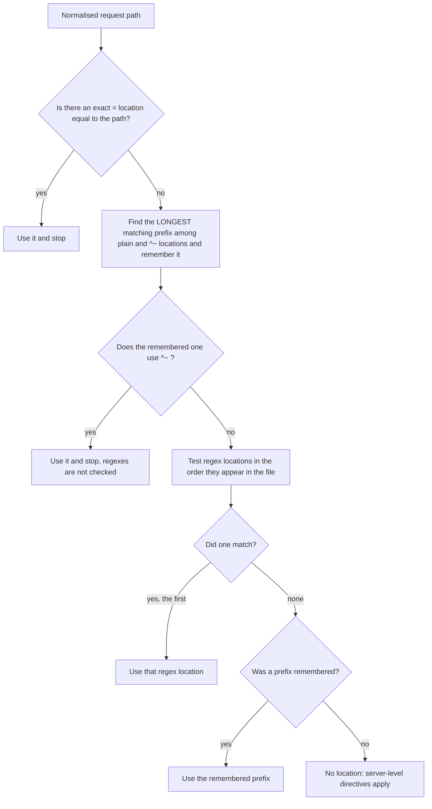

# How NGINX picks a location block

## Before this lesson

You should be able to write a `server` block with `root`, and know how NGINX picks the `server` block from the `Host` header. Both are in [Serving a first static site](#/lesson/nginx/first-static-site). You should know the variable `$uri` from the same lesson. No knowledge of regular expressions is assumed; the small amount needed is taught here.

## In plain words

After NGINX has found the right website, it must decide which set of rules applies to this particular address. Those sets of rules are `location` blocks, and **exactly one** of them ends up handling each request.

Think of a mail room with a sorting procedure pinned to the wall:

1. If there is a pigeonhole with exactly this name on it, use it. Done.
2. Otherwise find the pigeonhole whose label matches the longest beginning of the name. Keep it in mind.
3. If that pigeonhole has a red "final" sticker, use it. Done.
4. Otherwise run down the list of special pattern rules in the order they are written. The first rule that fits wins.
5. If no pattern rule fits, use the pigeonhole you kept in mind in step 2.

Nearly everyone guesses that NGINX reads locations top to bottom and takes the first match. It does not, and that wrong guess is behind a large share of real configuration bugs and of interview questions. Learn the five steps and you can predict any case.

## The five kinds of location

A `location` line has an optional **modifier** (a symbol before the path) that decides what kind it is.

| Written as | Kind | Matches when |
|---|---|---|
| `location = /path` | exact | the request path is exactly `/path` |
| `location /path` | prefix | the request path starts with `/path` |
| `location ^~ /path` | preferential prefix | the path starts with `/path`, and if this is the longest matching prefix, pattern rules are skipped |
| `location ~ pattern` | regex, case-sensitive | the pattern is found in the path |
| `location ~* pattern` | regex, ignoring letter case | the pattern is found in the path, upper or lower case |
| `location @name` | named | never matched by a request; only reached from `try_files` or `error_page` |

Two facts about what is being compared:

- The comparison uses the **normalised path** (`$uri`): percent-codes such as `%20` are decoded, `.` and `..` segments are resolved, and repeated slashes are merged into one. The **query string is not part of it**. `/search?q=/admin/` is matched as `/search`.
- Prefix matching is plain text comparison, character by character. `location /app` matches `/app`, `/app/`, `/app/x` and also `/apple` and `/application.js`, because all of them start with those four characters. If you mean "the folder", write `location /app/`.

## Enough regular expressions to read locations

A regular expression (regex) describes a set of strings. These are the pieces that appear in NGINX configurations:

| Piece | Meaning | Example |
|---|---|---|
| `^` | start of the path | `^/api` means "begins with /api" |
| `$` | end of the path | `\.png$` means "ends with .png" |
| `.` | any one character | `a.c` matches `abc`, `a-c` |
| `\.` | a literal dot | `\.css` |
| `*`, `+`, `?` | zero or more, one or more, zero or one of the previous thing | `/v[0-9]+/` |
| `[abc]`, `[0-9]` | one character from a set | `[a-z]` |
| `(a\|b)` | a or b; also captures the text as `$1`, `$2`, ... | `\.(png\|jpg)$` |
| `(?<name>...)` | capture into the variable `$name` | `^/u/(?<id>[0-9]+)$` |

A regex location matches if the pattern is found **anywhere** in the path unless you anchor it. `location ~ /admin` matches `/admin`, `/x/admin/y` and `/not-admin-at-all/admin`. Anchors (`^` and `$`) are how you say where.

## The selection algorithm, exactly



Things to notice:

- **Order in the file matters only among regex locations.** Exact and prefix locations can be written in any order and the result is identical.
- **A regex beats a longer plain prefix.** This surprises people: a carefully specific `location /downloads/reports/` loses to a general `location ~ \.pdf$` for `/downloads/reports/q3.pdf`.
- **`^~` is how a prefix defends itself against regexes**, but only when it is the longest matching prefix. If a longer plain prefix also matches, that longer one is remembered instead, it has no `^~`, and regexes are tested.
- **`=` is the fastest path.** NGINX checks exact matches first and stops. For very hot addresses such as `/` or `/healthz` it saves the rest of the search.

## A worked server

```nginx
server {
    listen 80;
    server_name shop.test;
    root /var/www/shop;

    location = / {                       # A
        return 200 "A exact root\n";
    }
    location / {                         # B
        return 200 "B catch-all prefix\n";
    }
    location /docs/ {                    # C
        return 200 "C docs prefix\n";
    }
    location ^~ /assets/ {               # D
        return 200 "D assets, regex-proof\n";
    }
    location ~* \.(png|jpg|gif)$ {       # E
        return 200 "E image regex\n";
    }
    location ~ ^/docs/private/ {         # F
        return 200 "F private docs regex\n";
    }
    location /docs/private/keys/ {       # G
        return 200 "G keys prefix\n";
    }
}
```

Each block returns a line of text naming itself, which is a handy trick for experiments: you can see which block handled the request.

```bash
$ for p in / /index.html /docs/guide.html /docs/logo.PNG /assets/logo.png \
           /docs/private/plan.txt /docs/private/keys/a.pem /docs/private/shot.png; do
    printf '%-28s ' "$p"; curl -s -H 'Host: shop.test' "http://127.0.0.1$p"; done
/                            A exact root
/index.html                  B catch-all prefix
/docs/guide.html             C docs prefix
/docs/logo.PNG               E image regex
/assets/logo.png             D assets, regex-proof
/docs/private/plan.txt       F private docs regex
/docs/private/keys/a.pem     F private docs regex
/docs/private/shot.png       E image regex
```

The loop runs `curl -s` (silent, body only) for each path and prints the path beside the answer. Now the reasoning for each line:

| Path | Step-by-step | Winner |
|---|---|---|
| `/` | exact `= /` equals the path | A |
| `/index.html` | no exact; longest prefix is `/` (B); B has no `^~`; neither regex matches; fall back | B |
| `/docs/guide.html` | longest prefix `/docs/` (C); regex E no, F no; fall back | C |
| `/docs/logo.PNG` | longest prefix C; regex E matches because `~*` ignores case | E |
| `/assets/logo.png` | longest prefix `/assets/` (D) has `^~`; stop | D |
| `/docs/private/plan.txt` | longest prefix C; E no; F matches | F |
| `/docs/private/keys/a.pem` | longest prefix is G; G has no `^~`; E no; **F matches**, so the regex wins over the longer prefix | F |
| `/docs/private/shot.png` | longest prefix C; regexes in file order: **E is written before F** and matches | E |

The last two rows are the ones to study. Block G can never win while F exists, because any path starting with `/docs/private/keys/` also matches F's pattern. To make G win, write it as `location ^~ /docs/private/keys/`. And the last row shows that between two matching regexes, position in the file decides: swap E and F in the file and the answer becomes F.

> [!INTERVIEW]
> A favourite puzzle: "`location /images/ { ... }` and `location ~ \.jpg$ { ... }`. Which handles `/images/cat.jpg`?" The regex. The prefix is remembered, then regexes are tried, and the first matching regex wins over a plain prefix. Then say how to change it: `^~ /images/`.

## Simulate it

The function below is a direct translation of the flowchart. Edit the list or the paths and run it to check your predictions. Problem `nginx-location-match` asks you to write this yourself.

```python-run
import re

LOCATIONS = [            # (modifier, pattern, label) in file order
    ("=",  "/",                     "A"),
    ("",   "/",                     "B"),
    ("",   "/docs/",                "C"),
    ("^~", "/assets/",              "D"),
    ("~*", r"\.(png|jpg|gif)$",     "E"),
    ("~",  r"^/docs/private/",      "F"),
    ("",   "/docs/private/keys/",   "G"),
]

def pick(path, locations=LOCATIONS):
    trace = []
    # Step 1: exact match
    for mod, pat, label in locations:
        if mod == "=" and pat == path:
            return label, ["exact match"]
    # Step 2: longest prefix among plain and ^~ locations
    best = None
    for mod, pat, label in locations:
        if mod in ("", "^~") and path.startswith(pat):
            if best is None or len(pat) > len(best[1]):
                best = (mod, pat, label)
    trace.append(f"longest prefix: {best[2] if best else None}")
    # Step 3: ^~ on the remembered prefix stops the search
    if best and best[0] == "^~":
        return best[2], trace + ["^~ so regexes are skipped"]
    # Step 4: regexes in file order, first match wins
    for mod, pat, label in locations:
        if mod in ("~", "~*"):
            flags = re.IGNORECASE if mod == "~*" else 0
            if re.search(pat, path, flags):
                return label, trace + [f"first matching regex: {label}"]
    # Step 5: fall back to the remembered prefix
    return (best[2] if best else None), trace + ["no regex matched, use the prefix"]

for p in ["/", "/index.html", "/docs/logo.PNG", "/assets/logo.png",
          "/docs/private/keys/a.pem", "/docs/private/shot.png"]:
    label, why = pick(p)
    print(f"{p:28} -> {label}   ({'; '.join(why)})")
```

## Nested and named locations

**Nested locations.** A location may contain other locations. The outer one is chosen by the algorithm above; then the same algorithm runs once more among its children. Nesting a regex inside a prefix is the cleanest way to restrict a pattern to one area:

```nginx
location /uploads/ {
    root /srv/data;

    location ~ \.(php|py|sh)$ {
        return 403;
    }
}
```

The outer `location /uploads/` handles everything under `/uploads/`, reading from `/srv/data/uploads/`. The inner regex applies only to requests that already matched `/uploads/` and refuses scripts with 403. One subtlety: a server-level regex such as `location ~ \.php$` would still be tested before falling back to `/uploads/`, since `/uploads/` has no `^~`. Nesting scopes the inner rule; it does not shield the outer prefix.

**Named locations.** `location @fallback { ... }` cannot be reached by any request path. It is a labelled destination for an internal redirect from `try_files` or `error_page`:

```nginx
location / {
    try_files $uri $uri/ @app;
}
location @app {
    proxy_pass http://127.0.0.1:8000;
}
```

`try_files` is the topic of the next lesson; read this as "serve a file if one exists, otherwise hand the request to the application".

## What a matched location actually inherits

Choosing a location does not merge other locations into it. The request gets the directives written in the chosen location plus what is inherited from the `server` and `http` levels, and nothing from sibling locations. A frequent mistake:

```nginx
location / {
    proxy_set_header Host $host;
    proxy_pass http://127.0.0.1:8000;
}
location /api/ {
    proxy_pass http://127.0.0.1:8000;      # no Host header forwarding here!
}
```

Requests to `/api/...` do **not** pass through `location /` first. The `proxy_set_header` in `location /` has no effect on them. Shared settings belong at `server` level or in an included snippet.

## Internal redirects run the search again

Several directives change the path and restart location selection inside NGINX without telling the client: `index` (adding `index.html` to a folder path), `try_files` falling through to its last argument, `error_page`, and `rewrite ... last`. After each such **internal redirect** the five steps run again with the new path.

So for `GET /` with `index index.html;` the sequence is: `location = /` is selected; `index` turns the path into `/index.html`; the search runs again and now `location /` (or a regex for `\.html$`) handles the request. If you add headers in `location = /` and wonder why they are missing from the home page, this is the reason. NGINX gives up with a 500 error and the log message `rewrite or internal redirection cycle` after 10 internal redirects, which is what a loop looks like.

## Pitfalls

- **Assuming first match wins.** Only regexes are ordered.
- **Prefix without trailing slash.** `location /admin` also covers `/administrator` and `/admin.bak`. Decide whether you mean `= /admin`, `/admin/`, or both.
- **Unanchored regex.** `location ~ /api` matches `/static/api-docs.html`. Write `~ ^/api/`.
- **Forgetting to escape the dot.** `~ .php$` matches `/xphp` because `.` is "any character". Write `\.php$`.
- **Case.** `~` is case-sensitive, so `\.jpg$` misses `PHOTO.JPG`. Use `~*` for file endings. Prefix and exact locations are case-sensitive on Linux.
- **Regex with braces.** A pattern containing `{` or `;` must be quoted: `location ~ "^/[a-z]{2}/"`.
- **Matching on the query string.** Locations cannot see it. Use `$arg_name` in a `map` or an `if` for that, covered in the traffic management module.
- **Expecting the 301 slash redirect everywhere.** When a prefix location ends in `/` and its content comes from `proxy_pass` (or a similar pass directive), a request for the same path without the slash gets a 301 to the slashed form. Add `location = /user { ... }` if the unslashed address must behave differently.

> [!TIP]
> To find out which location handles a request on a real server, temporarily add `add_header X-Location "docs-prefix" always;` inside each candidate and look at `curl -i`. Remove them afterwards. The `always` flag makes the header appear on error responses too.

## Cheat sheet

| Modifier | Kind | Priority |
|---|---|---|
| `=` | exact | 1, wins immediately |
| `^~` | preferential prefix | 2, wins if it is the longest matching prefix |
| `~` / `~*` | regex | 3, first one in file order that matches |
| none | prefix | 4, longest match, used when no regex matched |
| `@name` | named | never matched by a path |

| Want | Write |
|---|---|
| Only the home page | `location = / { }` |
| Everything under a folder, immune to regexes | `location ^~ /static/ { }` |
| File endings, any case | `location ~* \.(css\|js\|png)$ { }` |
| Fallback for all else | `location / { }` |
| See which block ran | `return 200 "label\n";` or a temporary `add_header` |

## Summary

- One location handles each request, chosen by a fixed five-step procedure, not by reading top to bottom.
- Exact first; then remember the longest prefix; `^~` on it ends the search; otherwise the first matching regex in file order; otherwise the remembered prefix.
- Matching uses the normalised path without the query string.
- Regexes beat longer plain prefixes; `^~` is the defence.
- Locations do not combine with their siblings, and internal redirects restart the search.

## Glossary

- **Anchor**: `^` or `$`, pinning a regex to the start or end of the path.
- **Exact location**: `location = /x`, matches one path only.
- **Internal redirect**: restarting location selection with a changed path, unseen by the client.
- **Modifier**: the symbol (`=`, `^~`, `~`, `~*`, `@`) before a location's path.
- **Named location**: `location @name`, a jump target.
- **Normalised path**: the request path after decoding and tidying, without the query string.
- **Preferential prefix**: `^~`, a prefix that suppresses the regex check.
- **Prefix location**: matches paths that start with the given text.
- **Regex location**: matches paths by a regular expression.

## Check yourself

```quiz
[
  {"q": "Locations: `location /images/ {}` and `location ~ \\.jpg$ {}`. Which location block handles /images/cat.jpg?",
   "options": ["/images/ because it is longer", "The regex, because a matching regex beats a plain prefix", "Whichever is first in the file", "Neither, 404"], "answer": 1,
   "explain": "The prefix is only remembered; regexes are then tested and the first match wins."},
  {"q": "Locations: `location ^~ /images/ {}` and `location ~ \\.jpg$ {}`. Which location block handles /images/cat.jpg?",
   "options": ["The ^~ prefix", "The regex", "Both, merged", "The server default"], "answer": 0,
   "explain": "The longest matching prefix carries ^~, so regex locations are not checked."},
  {"q": "Locations in this order: `~ ^/api/` then `~ ^/api/v2/`. Which handles /api/v2/users?",
   "options": ["^/api/v2/ since it is more specific", "^/api/ since it is the first matching regex in the file", "The longest regex", "It is a configuration error"], "answer": 1,
   "explain": "Regex locations are tested in file order and the first match wins. Specificity is ignored."},
  {"q": "Locations: `= /login` returns 200 and `/` returns 404. What status code does GET /login/ (with a trailing slash) receive?",
   "options": ["200", "301", "404", "403"], "answer": 2,
   "explain": "The exact location matches only /login. /login/ falls to the prefix /, which returns 404."},
  {"q": "Locations: `/app` returns 200 and `/` returns 404. What status code does GET /apple.png receive?",
   "options": ["404", "200", "301", "400"], "answer": 1,
   "explain": "Prefix matching is plain text: /apple.png starts with /app, and that is the longest matching prefix."},
  {"q": "Locations: `^~ /static/`, plain `/static/img/`, and `~* \\.png$`. Which handles /static/img/a.png?",
   "options": ["^~ /static/", "/static/img/", "The regex", "None"], "answer": 2,
   "explain": "The longest matching prefix is /static/img/, which has no ^~, so regexes are checked and the png regex matches."},
  {"q": "Does `location /search` see the query string in GET /search?q=/admin/?",
   "options": ["Yes, the whole request line is matched", "No, only the normalised path /search is matched", "Only with ~*", "Only after a rewrite"], "answer": 1,
   "explain": "Location matching ignores the query string entirely."},
  {"q": "With `index index.html;`, GET / is first matched by `location = /`. Which location finally serves the file if the others are `location /` and nothing else?",
   "options": ["location = /", "location /, after an internal redirect to /index.html", "No location", "A named location"], "answer": 1,
   "explain": "index performs an internal redirect to /index.html and location selection runs again; = / no longer matches."}
]
```

> **Source:** beyond the cookbook; grounded in DeJonghe, NGINX Cookbook, ch. 1 (location basics). Docs: https://nginx.org/en/docs/http/ngx_http_core_module.html#location, https://nginx.org/en/docs/http/request_processing.html
