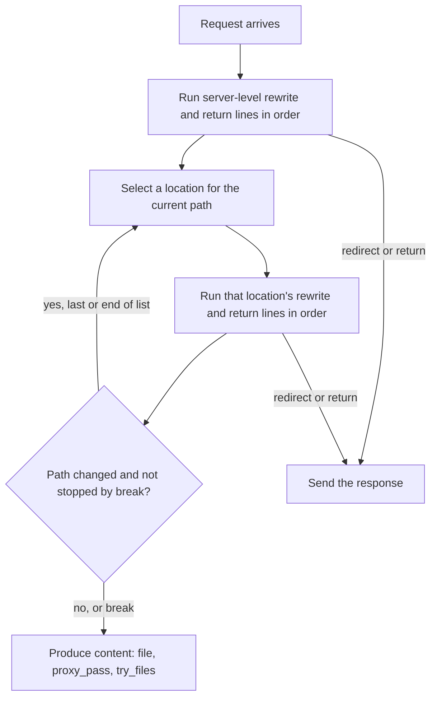

# try_files, return, rewrite and the proxy_pass slash

## Before this lesson

You need the location selection algorithm from [How NGINX picks a location block](#/lesson/nginx/location-matching), including what an internal redirect is, and the variables `$uri`, `$args` and `$request_uri` from [Serving a first static site](#/lesson/nginx/first-static-site). The short regular-expression table in the previous lesson is enough for the patterns used here.

## In plain words

Selecting a location answers "which rules apply?". This lesson is about what those rules can then do with the address itself.

Imagine a hotel reception. A guest asks for "room 12".

- The clerk may check a list of possibilities in order: "is there a room 12? a suite 12? no? then send them to the manager." That is `try_files`.
- The clerk may say "we moved, go to the building across the road". The guest walks there. That is `return` with a redirect: the client is told a new address and makes a new request.
- The clerk may silently look up that "room 12" is now called "room 2B" and take the guest there, without the guest learning that anything was renamed. That is `rewrite`: the address changes inside NGINX.
- When passing the guest to another building's staff (an application), the clerk must decide what room number to tell them: the original one or a translated one. That is the trailing-slash behaviour of `proxy_pass`.

These four mechanisms cover single-page applications, moved pages, clean URLs and mounting an application under a path. They are also where most "works on my machine" proxy bugs come from, so the rules are spelled out precisely.

## try_files: check for files in order

```nginx
location / {
    root /var/www/shop;
    try_files $uri $uri/ /index.html;
}
```

`try_files` takes a list. For every item except the last, NGINX builds a file path (`root` plus the item) and checks whether it exists:

- `$uri` checks for a **file** with the request's path.
- `$uri/` (with a trailing slash) checks for a **folder**; if it exists, the `index` directive then takes over.
- The first item that exists is served, and processing stays in the current location.

The **last item is different**. It is never checked on disk. It is the fallback, and it has three possible forms:

| Last item | Meaning |
|---|---|
| `/index.html` (a path) | internal redirect to that path, so location selection runs again |
| `@app` (a named location) | jump to that named location |
| `=404` (equals sign and a code) | answer with that status code |

Trace the configuration above with these files on disk: `/var/www/shop/index.html`, `/var/www/shop/app.js`, `/var/www/shop/help/index.html`.

| Request | `$uri` exists? | `$uri/` exists? | Result |
|---|---|---|---|
| `/app.js` | yes, a file | not checked | serves `app.js` |
| `/help/` | no (it is a folder, not a file) | yes | serves `help/index.html` through `index` |
| `/orders/42` | no | no | internal redirect to `/index.html`, which is served with status 200 |

The third row is the **single-page application** pattern. A single-page application (SPA) is a site where JavaScript in the browser draws every screen and invents addresses such as `/orders/42` that do not exist as files. The server must answer every unknown path with the same `index.html` so the JavaScript can start and read the address.

The other everyday pattern is "static file if present, otherwise the application":

```nginx
location / {
    root /var/www/shop/public;
    try_files $uri @app;
}

location @app {
    proxy_pass http://127.0.0.1:8000;
}
```

```bash
$ curl -i -H 'Host: shop.test' http://127.0.0.1/robots.txt
HTTP/1.1 200 OK
Content-Type: text/plain
Content-Length: 23

$ curl -i -H 'Host: shop.test' http://127.0.0.1/api/cart
HTTP/1.1 200 OK
Content-Type: application/json
Content-Length: 31

{"items": [], "total": "0.00"}
```

`robots.txt` exists in the public folder so NGINX served it itself. `/api/cart` is not a file, so the request jumped to `@app` and the application produced JSON.

> [!WARNING]
> If the fallback path does not exist either, you get a loop. `try_files $uri /index.html;` with no `index.html` on disk redirects to `/index.html`, which is not found, which redirects to `/index.html` again. After 10 rounds NGINX returns 500 and logs `rewrite or internal redirection cycle`. Ending the list with `=404` is the loop-proof form.

## return: answer immediately

`return` stops processing and sends a response. It is the simplest, fastest and most predictable tool in this lesson.

```nginx
server {
    listen 80;
    server_name old-shop.test;
    return 301 https://shop.test$request_uri;
}
```

- `return 301 URL;` sends a redirect. The client receives status 301 and a `Location` header, and makes a brand new request to that address.
- `$request_uri` is the original path and query string exactly as sent, so `/sale?ref=mail` on the old name becomes `/sale?ref=mail` on the new one.

```bash
$ curl -i -H 'Host: old-shop.test' 'http://127.0.0.1/sale?ref=mail'
HTTP/1.1 301 Moved Permanently
Location: https://shop.test/sale?ref=mail
Content-Type: text/html
Content-Length: 169
```

The four redirect codes differ in two ways: whether the move is permanent, and whether the browser must keep the method (a redirected `POST` staying a `POST`).

| Code | Permanent? | Method preserved? | Use for |
|---|---|---|---|
| 301 | yes, browsers cache it for a long time | no, POST may become GET | a page or site that moved for good |
| 302 | no | no | temporary detours |
| 307 | no | yes | temporary, for APIs and forms |
| 308 | yes | yes | permanent, for APIs and forms |

Other forms: `return 404;` (a status alone), `return 200 "ok\n";` (status with a body, handy for health checks), and `return https://shop.test/;` (a URL alone means 302).

> [!TIP]
> Test with 302 first. Browsers remember a 301 stubbornly, so a wrong permanent redirect keeps haunting your own browser long after you fix the server.

## rewrite: change the path with a pattern

`rewrite` has three parts and an optional flag:

```nginx
rewrite  regex  replacement  [flag];
```

If the regex matches the current path (`$uri`), the path becomes the replacement. Text captured by parentheses in the regex is available as `$1`, `$2` and so on.

```nginx
server {
    listen 80;
    server_name shop.test;
    root /var/www/shop;

    rewrite ^/product/([0-9]+)$ /items/view.html?id=$1 last;            # 1
    rewrite ^/blog/(.*)$ https://blog.shop.test/$1 permanent;          # 2

    location /downloads/ {
        rewrite ^/downloads/(.*)\.zip$ /archive/$1.tar.gz break;        # 3
    }
}
```

1. `/product/731` becomes `/items/view.html` with the query `id=731`, internally. `last` says "stop rewriting and select a location for the new path". The browser's address bar still shows `/product/731`.
2. `/blog/hello` produces a 301 to `https://blog.shop.test/hello`. `permanent` means 301. A plain `return` would do this job more clearly; it is shown because you will meet it in existing configurations.
3. Inside `/downloads/`, a request for `x.zip` is served from the file `/var/www/shop/archive/x.tar.gz`. `break` says "stop rewriting and **stay in this location**"; no new location search happens.

### The four flags and no flag

| Flag | Client sees | What NGINX does next |
|---|---|---|
| `last` | nothing | stops the rewrite directives and runs location selection again with the new path |
| `break` | nothing | stops the rewrite directives and continues in the current location with the new path |
| `redirect` | 302 with `Location` | ends the request |
| `permanent` | 301 with `Location` | ends the request |
| (none) | nothing yet | keeps going to the next `rewrite` line with the changed path; when the list ends, behaves like `last` if the path changed |

Three more rules complete the picture:

- If the replacement starts with `http://`, `https://` or `$scheme`, it is always a redirect to the client (302 unless `permanent` is given), whatever the flag.
- The original query string is appended to the result automatically. End the replacement with `?` to drop it: `rewrite ^/old$ /new? permanent;`.
- `rewrite` lines at `server` level run before a location is chosen. Lines inside a location run after it is chosen.



> [!WARNING]
> `rewrite ... last` inside the very location that the new path matches again creates a loop: `location /app/ { rewrite ^/app/(.*)$ /app/v2/$1 last; }` rewrites, re-selects `/app/`, rewrites again. Use `break` when the new path should be handled where you are, and `last` when it belongs to a different location.

### return or rewrite?

Use `return` whenever the destination does not need a piece captured from the path by a regex, and often even then (a regex `location` or a `map` can capture the piece). `return` is evaluated without running a regex against every request and cannot loop. Reach for `rewrite` when you must change the path internally, without the client knowing.

## if: the block with a warning label

`if` tests a condition and applies directives when it holds.

```nginx
if ($request_method = POST)     { return 405; }
if ($http_user_agent ~* "curl") { return 403; }
if ($arg_debug)                 { return 200 "debug on\n"; }
if (-f $request_filename)       { break; }
```

Conditions available: a variable alone (true unless empty or `"0"`), `=` and `!=` for text comparison, `~` and `~*` for regex (negated with `!~`, `!~*`), and file tests such as `-f` (file exists), `-d` (folder exists) and `-e` (either). There is no `else`, no `and`, no `or`.

The trouble: `if` belongs to the rewrite module, which runs in an early phase, and inside a `location` it behaves like a hidden nested location. Directives that are not part of the rewrite module can act strangely inside it: settings may fail to inherit, `try_files` in the surrounding location may be ignored, and two `if` blocks that are both true do not combine (only the last one's settings apply). The community summary is the phrase "if is evil".

A safe rule that covers real work:

> Inside `if` within a `location`, use only `return ...;` and `rewrite ... last;`. At `server` level, `if` with `return` is fine.

For anything else, there is a better tool:

| You want | Use instead of `if` |
|---|---|
| serve a file when it exists | `try_files` |
| a value that depends on another value | `map` (traffic management module) |
| different handling by path | another `location` |
| redirect one hostname to another | a separate `server` block with `return` |

```nginx
# Fragile: if with a non-rewrite directive inside a location
location / {
    if ($http_x_beta) { proxy_pass http://127.0.0.1:9000; }
    proxy_pass http://127.0.0.1:8000;
}

# Robust: compute the target with map, use it once
map $http_x_beta $backend {
    default "127.0.0.1:8000";
    "~."    "127.0.0.1:9000";
}
server {
    location / { proxy_pass http://$backend; }
}
```

The `map` block reads: "set `$backend` from the header `X-Beta`: when the header has at least one character (`~.` is a regex for any character) use port 9000, otherwise port 8000."

## proxy_pass and the trailing slash

`proxy_pass` forwards the request to another server. Which path that server receives depends on one detail: whether the `proxy_pass` address has **a path part after the host and port**. Even a single `/` counts as a path part.

**Rule 1: no path part.** The request path is forwarded untouched.

```nginx
location /api/ {
    proxy_pass http://127.0.0.1:8000;
}
# /api/users?page=2  ->  upstream receives  /api/users?page=2
```

**Rule 2: a path part is present.** The portion of the request path that matched the `location` prefix is **cut off and replaced** by that path part.

```nginx
location /api/ {
    proxy_pass http://127.0.0.1:8000/;
}
# /api/users?page=2  ->  upstream receives  /users?page=2
```

Work it by hand: the request path is `/api/users`; the location prefix `/api/` is removed, leaving `users`; the path part `/` is put in front, giving `/users`. The query string is always carried along.

The full table, for a request to `/api/users`:

| `location` | `proxy_pass` | Upstream receives | Comment |
|---|---|---|---|
| `/api/` | `http://app:8000` | `/api/users` | unchanged |
| `/api/` | `http://app:8000/` | `/users` | prefix stripped |
| `/api/` | `http://app:8000/v1/` | `/v1/users` | prefix swapped |
| `/api/` | `http://app:8000/v1` | `/v1users` | missing slash glues the words together |
| `/api` | `http://app:8000/` | `//users` | location lacks the slash, so `/users` remains and `/` is added |
| `/api` | `http://app:8000` | `/api/users` | unchanged |

The habit that avoids rows four and five: **give the location and the proxy_pass path matching trailing slashes**, both with or both without.

```python-run
def upstream_path(location_prefix, proxy_pass, request_path, query=""):
    """Apply the two proxy_pass rules for a prefix location."""
    rest = proxy_pass.split("://", 1)[1]          # drop the scheme
    slash = rest.find("/")
    if slash == -1:                               # Rule 1: no path part
        new_path = request_path
    else:                                         # Rule 2: replace the matched prefix
        path_part = rest[slash:]
        new_path = path_part + request_path[len(location_prefix):]
    return new_path + ("?" + query if query else "")

cases = [("/api/", "http://app:8000"), ("/api/", "http://app:8000/"),
         ("/api/", "http://app:8000/v1/"), ("/api/", "http://app:8000/v1"),
         ("/api",  "http://app:8000/"),   ("/api",  "http://app:8000")]
for loc, pp in cases:
    print(f"location {loc:6} proxy_pass {pp:24} -> {upstream_path(loc, pp, '/api/users', 'page=2')}")
```

Special cases that follow from the rules:

- **Regex locations, named locations and `if` blocks** have no fixed prefix to cut off, so `proxy_pass` there must be written **without** a path part (NGINX refuses to start otherwise), and the path is forwarded unchanged.
- **After `rewrite ... break` in the same location**, the rewritten path is forwarded as is and the path part of `proxy_pass` is ignored. This is the usual way to strip a prefix in a regex location:

```nginx
location ~ ^/svc/(?<name>[a-z]+)/ {
    rewrite ^/svc/[a-z]+/(.*)$ /$1 break;
    proxy_pass http://127.0.0.1:8000;
}
# /svc/cart/items/3  ->  upstream receives  /items/3
```

- **Variables in `proxy_pass`** (`proxy_pass http://$backend;`) change the game: if a path part is given it is used as the complete path, with no prefix replacement, and a hostname in the variable is looked up at request time, which requires a `resolver` directive naming a DNS server.

To see what the upstream received without touching the application, run a one-line listener and read what arrives:

```bash
$ nc -l 127.0.0.1 8000 &
$ curl -s -m 1 -H 'Host: shop.test' 'http://127.0.0.1/api/users?page=2' >/dev/null
GET /users?page=2 HTTP/1.0
Host: 127.0.0.1:8000
Connection: close
```

`nc -l` (netcat) listens on a port and prints whatever is sent to it. The first line shows the path after NGINX's translation. It also reveals that, with no other settings, NGINX sent `Host: 127.0.0.1:8000` and not the original `shop.test`; the load-balancing lesson shows the `proxy_set_header` lines that fix that.

> [!INTERVIEW]
> "What is the difference between `proxy_pass http://backend;` and `proxy_pass http://backend/;` in `location /app/`?" Without the slash the upstream sees `/app/...` unchanged. With it, the matched `/app/` prefix is replaced by `/`, so the upstream sees `/...`. Mention that in regex locations a path part is not allowed, and that a mismatched slash produces `//` or glued-together paths.

## Pitfalls

- **`try_files` with a missing fallback file**, causing the 500 redirection cycle.
- **`try_files $uri $uri/ =404` for an SPA.** Deep links such as `/orders/42` then return 404 on refresh. An SPA needs `/index.html` as the fallback.
- **`$uri` in a redirect target.** `return 301 https://$host$uri;` uses the decoded path, so an encoded line break (`%0d%0a`) in the request becomes a real line break in your `Location` header, letting an attacker inject headers. Use `$request_uri` in redirects.
- **Regex written against the wrong text.** `rewrite` matches the path only, never the query string.
- **Forgetting `?`** and getting the old query string appended to the new one.
- **Expecting `last` inside `if` at location level to keep location settings.** It restarts selection; settings from the old location are gone.
- **Using `rewrite` to add a slash or move a site** when `return 301` says it in one readable line.

## Cheat sheet

| Goal | Directive |
|---|---|
| File if it exists, else the application | `try_files $uri @app;` |
| Single-page application | `try_files $uri $uri/ /index.html;` |
| File or a clean 404 | `try_files $uri $uri/ =404;` |
| Move a whole site | `return 301 https://new.example$request_uri;` |
| Health check without a file | `location = /healthz { return 200 "ok\n"; }` |
| Internal path change, re-select a location | `rewrite ^/a/(.*)$ /b/$1 last;` |
| Internal path change, stay here | `rewrite ^/a/(.*)$ /b/$1 break;` |
| Drop the old query string | end the replacement with `?` |
| Strip a prefix when proxying | `location /api/ { proxy_pass http://app/; }` |
| Keep the path when proxying | `location /api/ { proxy_pass http://app; }` |

## Summary

- `try_files` checks items in order and falls back to its last argument, which is a path, a named location or `=code`.
- `return` answers at once; use it for redirects, with `$request_uri` to keep path and query.
- `rewrite` changes the path by regex. `last` re-selects a location, `break` stays put, `redirect` and `permanent` tell the client.
- Keep `if` to `return` and `rewrite ... last`; prefer `map`, `try_files` and separate blocks.
- A path part on `proxy_pass`, even `/`, replaces the matched location prefix. No path part forwards the path unchanged.

## Glossary

- **break / last**: rewrite flags; stay in the current location, or select a location again.
- **Fallback**: the last argument of `try_files`, used when nothing earlier exists.
- **Flag**: the optional fourth word of `rewrite` that decides what happens after the change.
- **Named location**: `location @x`, reachable only by internal jump.
- **Path part**: whatever follows host and port in a `proxy_pass` address.
- **Redirect**: a 3xx response that sends the client to another address.
- **Rewrite**: changing the request path inside NGINX.
- **Single-page application**: a site whose screens are drawn by browser JavaScript from one HTML file.

## Check yourself

```quiz
[
  {"q": "location /api/ { proxy_pass http://127.0.0.1:8000/; } What path does the upstream receive for GET /api/orders/7?",
   "options": ["/api/orders/7", "/orders/7", "//orders/7", "/7"], "answer": 1,
   "explain": "A path part (the single slash) is present, so the matched prefix /api/ is replaced by /."},
  {"q": "location /api { proxy_pass http://127.0.0.1:8000/; } What path does the upstream receive for GET /api/orders/7?",
   "options": ["/orders/7", "/api/orders/7", "//orders/7", "/apiorders/7"], "answer": 2,
   "explain": "Only /api is cut, leaving /orders/7, and the path part / is put in front, producing a double slash."},
  {"q": "Files on disk: /index.html only. Config: location / { try_files $uri $uri/ =404; }. What status code does GET /orders/42 return?",
   "options": ["200", "301", "404", "500"], "answer": 2,
   "explain": "Neither the file nor the folder exists and the fallback is =404."},
  {"q": "Files on disk: none. Config: location / { try_files $uri /index.html; }. What status code does GET /x return?",
   "options": ["404", "500", "200", "302"], "answer": 1,
   "explain": "The fallback redirects internally to /index.html, which is missing, which falls back again. After 10 cycles NGINX returns 500."},
  {"q": "Which flag makes rewrite change the path and continue in the current location without a new location search?",
   "options": ["last", "break", "redirect", "permanent"], "answer": 1,
   "explain": "break stops rewrite processing and stays; last triggers a new location selection."},
  {"q": "server level: rewrite ^/old/(.*)$ /new/$1 permanent; What does a client requesting /old/a?x=1 receive?",
   "options": ["200 with the content of /new/a", "301 with Location ending in /new/a?x=1", "302 with Location ending in /new/a", "404"], "answer": 1,
   "explain": "permanent sends a 301, and the original query string is appended because the replacement does not end with a question mark."},
  {"q": "Why prefer $request_uri over $uri in `return 301 https://$host...`?",
   "options": ["$uri is slower", "$uri is decoded and normalised, losing the query string and allowing header injection through encoded line breaks", "$request_uri is shorter", "$uri is empty at server level"], "answer": 1,
   "explain": "$request_uri is the raw original path and query, so nothing decoded ends up in the Location header."},
  {"q": "Which use of if inside a location is considered safe?",
   "options": ["if (...) { proxy_pass ...; }", "if (...) { try_files ...; }", "if (...) { return 403; }", "if (...) { add_header ...; }"], "answer": 2,
   "explain": "return and rewrite ... last belong to the rewrite module and behave predictably inside if; other directives may not."}
]
```

> **Source:** beyond the cookbook. Docs: https://nginx.org/en/docs/http/ngx_http_rewrite_module.html, https://nginx.org/en/docs/http/ngx_http_core_module.html#try_files, https://nginx.org/en/docs/http/ngx_http_proxy_module.html#proxy_pass
