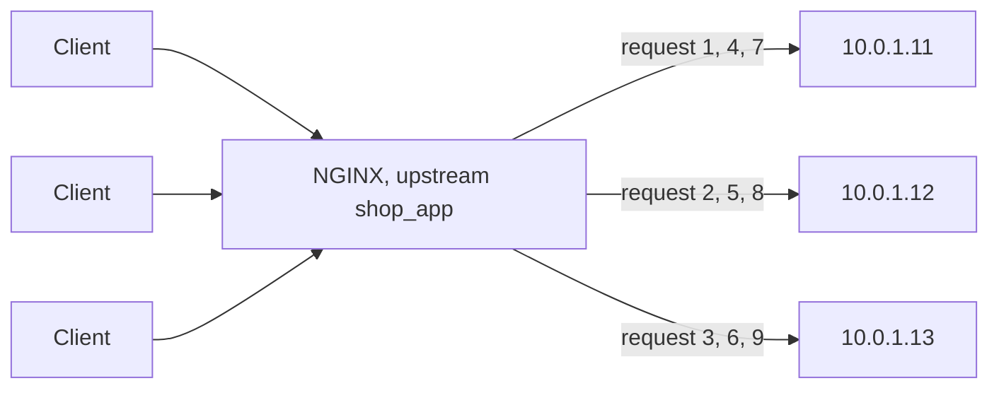

# HTTP load balancing and the balancing methods

## Before this lesson

You should know what a reverse proxy and an upstream are ([lesson 1](#/lesson/nginx/what-nginx-is)), how contexts nest in the configuration ([lesson 2](#/lesson/nginx/install-and-config)), and how `proxy_pass` treats the path ([try_files, return, rewrite and the proxy_pass slash](#/lesson/nginx/try-files-rewrite-return)). The networking track has a protocol-neutral introduction in [load balancers and proxies](#/lesson/networking/load-balancers-proxies).

## In plain words

A supermarket with one checkout has a queue out of the door. Opening five checkouts helps only if somebody directs shoppers sensibly: not everyone to checkout 1, not a new shopper to the cashier who went on a break. That somebody is a **load balancer**.

In NGINX terms, the checkouts are copies of your application, the group of checkouts is an `upstream` block, and the directing rule is the **balancing method**. Running several copies buys two things. **Capacity**: five copies serve roughly five times the traffic. **Availability**: when one copy crashes or is being upgraded, the others keep answering, so users notice nothing.

In a job you will be asked to add a server to a pool, take one out for maintenance, and explain why one server is getting far more traffic than its siblings. All three come down to the handful of directives in this lesson.

## Step 1: proxy to one server, properly

Start with a single application and the headers every proxy should forward.

```nginx
server {
    listen 80;
    server_name shop.test;

    location / {
        proxy_pass http://127.0.0.1:8000;
        proxy_set_header Host              $host;
        proxy_set_header X-Real-IP         $remote_addr;
        proxy_set_header X-Forwarded-For   $proxy_add_x_forwarded_for;
        proxy_set_header X-Forwarded-Proto $scheme;
    }
}
```

- `proxy_pass http://127.0.0.1:8000;` forwards the request to the application over plain HTTP.
- `proxy_set_header NAME VALUE;` sets a request header on the forwarded copy. Four are standard:
  - `Host $host` passes the site name the visitor asked for. Without this line NGINX sends the name from the `proxy_pass` address (`127.0.0.1:8000`), and an application that builds links or picks a tenant from `Host` gets it wrong.
  - `X-Real-IP $remote_addr` passes the visitor's address. From the application's point of view every connection comes from NGINX, so this header is how it learns who the real client is.
  - `X-Forwarded-For $proxy_add_x_forwarded_for` is the standard list form of the same idea: any list that arrived, with the connecting address appended. Each proxy in a chain adds one entry.
  - `X-Forwarded-Proto $scheme` says whether the visitor used `http` or `https`, so the application can generate correct links and redirects.

## Step 2: a pool of servers

Now run three copies and tell NGINX about all of them.

```nginx
upstream shop_app {
    server 10.0.1.11:8000;
    server 10.0.1.12:8000;
    server 10.0.1.13:8000;
}

server {
    listen 80;
    server_name shop.test;

    location / {
        proxy_pass http://shop_app;
        proxy_set_header Host            $host;
        proxy_set_header X-Forwarded-For $proxy_add_x_forwarded_for;
    }
}
```

- `upstream shop_app { ... }` lives in the `http` context, beside `server` blocks, not inside one. It names a group.
- Each `server address:port;` line is one member. (Unfortunate naming: `server` inside `upstream` is a backend machine, while a `server { }` block is a website.)
- `proxy_pass http://shop_app;` uses the group's name where a hostname would go.



Have each application copy reply with its own name and you can watch the distribution:

```bash
$ for i in 1 2 3 4 5 6; do curl -s -H 'Host: shop.test' http://127.0.0.1/whoami; done
app-11
app-12
app-13
app-11
app-12
app-13
```

With no method named, NGINX uses **round robin**: each server in turn.

### Parameters on a server line

```nginx
upstream shop_app {
    server 10.0.1.11:8000 weight=3;
    server 10.0.1.12:8000;
    server 10.0.1.13:8000 max_conns=200;
    server 10.0.1.14:8000 backup;
    server 10.0.1.15:8000 down;
}
```

| Parameter | Meaning |
|---|---|
| `weight=3` | this server gets three shares of traffic for every one share of a default server (default weight is 1) |
| `max_conns=200` | never hold more than 200 simultaneous connections to it; 0, the default, means no limit |
| `backup` | receives traffic only when all the non-backup servers are unavailable |
| `down` | marked as permanently out; kept in the file so hash-based mappings do not shift |
| `max_fails`, `fail_timeout` | failure detection, covered in the health-check lesson |

## Step 3: the balancing methods

A method is one line at the top of the `upstream` block. Each answers the question "which server gets this request?" differently.

### Round robin (the default) and weights

Servers take turns. With weights, NGINX uses **smooth weighted round robin**, which spreads a heavy server's turns out instead of bunching them. The procedure for each request:

1. add each server's weight to its running score;
2. pick the server with the highest score;
3. subtract the total of all weights from the picked server's score.

For weights 3, 1, 1 that produces the order A, A, B, A, C, then repeats: three turns for A in every five, never three in a row.

**Use it when** servers are similar and requests cost roughly the same. It needs no knowledge of the request and is hard to get wrong.

### least_conn

```nginx
upstream shop_app {
    least_conn;
    server 10.0.1.11:8000;
    server 10.0.1.12:8000;
}
```

The next request goes to the server with the fewest active connections (divided by its weight, when weights are set). Ties are broken by weighted round robin.

**Use it when** request durations vary a lot: some answers take 10 ms and others 30 s (reports, uploads, long polling). Round robin can stack several long requests on one server by bad luck; `least_conn` notices the pile and routes around it.

### ip_hash

```nginx
upstream shop_app {
    ip_hash;
    server 10.0.1.11:8000;
    server 10.0.1.12:8000;
}
```

A **hash** is a function that turns some input into a number, always the same number for the same input. `ip_hash` hashes the client's address (the first three of the four numbers of an IPv4 address, or the whole IPv6 address) and uses the result to pick a server. The same client lands on the same server every time, a property called **session persistence** or **stickiness**.

**Use it when** the application keeps per-user state in its own memory and you cannot move that state to a shared store yet. Weaknesses: many users behind one office or mobile gateway share an address and all land on one server, and if NGINX sits behind another proxy every request appears to come from that proxy.

### hash (generic hash)

```nginx
upstream cache_pool {
    hash $request_uri consistent;
    server 10.0.2.21:8080;
    server 10.0.2.22:8080;
    server 10.0.2.23:8080;
}
```

`hash KEY;` hashes any text you build from variables: the URL, a cookie (`$cookie_sessionid`), a header, or a combination. Requests with the same key go to the same server.

The optional word `consistent` switches to **consistent hashing**. With the plain method, adding or removing one server changes the destination of most keys, because the arithmetic is "number modulo server count" and the count changed. Consistent hashing arranges servers on a ring so that removing one of five servers moves only about one fifth of the keys.

**Use it when** the servers hold something that should not be duplicated or lost on reshuffle: a pool of caches (same URL to the same cache keeps hit rates high), or sessions keyed by a cookie.

### random

```nginx
upstream shop_app {
    random two least_conn;
    server 10.0.1.11:8000;
    server 10.0.1.12:8000;
    server 10.0.1.13:8000;
}
```

`random;` picks a server at random, respecting weights. `random two least_conn;` picks two at random and sends the request to whichever of the two has fewer connections, a technique known as "power of two choices".

**Use it when** several NGINX instances balance to the same pool. Each instance only knows about its own connections, so several of them using plain `least_conn` can all rush to the same apparently idle server. Random selection breaks that herd behaviour.

### least_time

```nginx
upstream shop_app {
    least_time header;
    server 10.0.1.11:8000;
    server 10.0.1.12:8000;
}
```

Chooses the server with the lowest average response time combined with the fewest active connections. `header` measures time to the first byte of the response; `last_byte` measures time to the complete response.

> [!NOTE]
> **NGINX Plus.** `least_time` was a Plus-only method for most of its life. The nginx.org documentation lists it as available in open source starting with the newest mainline releases, so check `nginx -v` and the upstream module page. **Open-source alternative on older versions:** `least_conn`, or `random two least_conn`, which react to slow servers indirectly because a slow server accumulates connections.

**Use it when** servers differ in speed (mixed hardware, or some in a farther data centre).

### Choosing

| Situation | Method |
|---|---|
| Identical servers, similar requests | round robin |
| Unequal servers | round robin with `weight` |
| Request durations vary widely | `least_conn` |
| Must keep a user on one server, simplest option | `ip_hash` |
| Stick by cookie, or route by URL to caches | `hash KEY consistent` |
| Several load balancers share one pool | `random two least_conn` |
| Servers differ in latency | `least_time` |

## Simulate the methods

The program below implements four of the methods and replays the same twelve requests through each. Read the output column by column.

```python-run
import zlib

SERVERS = [("A", 3), ("B", 1), ("C", 1)]          # (name, weight)

def smooth_wrr(n):
    score = {name: 0 for name, _ in SERVERS}
    total = sum(w for _, w in SERVERS)
    out = []
    for _ in range(n):
        for name, w in SERVERS:
            score[name] += w                       # 1. add weights
        best = max(SERVERS, key=lambda s: score[s[0]])[0]   # 2. highest score (first wins ties)
        score[best] -= total                       # 3. subtract the total
        out.append(best)
    return out

def least_conn(durations):
    """durations[i] = how many 'ticks' request i stays open. One request arrives per tick."""
    active = {name: [] for name, _ in SERVERS}     # remaining ticks of open requests
    weight = dict(SERVERS)
    out = []
    for d in durations:
        for name in active:                        # time passes: finish old requests
            active[name] = [t - 1 for t in active[name] if t > 1]
        best = min(SERVERS, key=lambda s: len(active[s[0]]) / s[1])[0]
        active[best].append(d)
        out.append(best)
    return out

def ip_hash(ips):
    names = [name for name, w in SERVERS for _ in range(w)]   # weights as repeated slots
    out = []
    for ip in ips:
        h = 89
        for octet in ip.split(".")[:3]:            # only the first three numbers
            h = (h * 113 + int(octet)) % 6271
        out.append(names[h % len(names)])
    return out

def generic_hash(keys):
    names = [name for name, w in SERVERS for _ in range(w)]
    return [names[zlib.crc32(k.encode()) % len(names)] for k in keys]

print("smooth weighted rr :", " ".join(smooth_wrr(10)))
print("least_conn         :", " ".join(least_conn([9, 1, 1, 9, 1, 1, 1, 1, 9, 1])))
print("ip_hash            :", " ".join(ip_hash(["198.51.100.7", "198.51.100.99", "203.0.113.5", "198.51.100.7"])))
print("hash $request_uri  :", " ".join(generic_hash(["/a.css", "/b.js", "/a.css", "/c.png"])))
```

- The first line shows A appearing six times in ten, spaced out.
- The second shows `least_conn` steering away from whichever server is holding the long (9-tick) requests.
- In the third, the first, second and fourth addresses share their first three numbers, so they share a server.
- In the fourth, both requests for `/a.css` go to the same server.

## Upstream connection settings worth knowing now

```nginx
upstream shop_app {
    zone shop_app 64k;
    least_conn;
    server 10.0.1.11:8000;
    server 10.0.1.12:8000;
    keepalive 32;
}

server {
    location / {
        proxy_pass http://shop_app;
        proxy_http_version 1.1;
        proxy_set_header Connection "";
        proxy_connect_timeout 3s;
        proxy_read_timeout 30s;
    }
}
```

- `zone shop_app 64k;` puts the group's run-time state (connection counts, failure counts) into **shared memory** that all workers can see. Without it, each worker keeps its own private counts, so `least_conn` with eight workers is really eight separate, less accurate balancers.
- `keepalive 32;` lets each worker keep up to 32 idle connections to the upstream servers open for reuse, saving a TCP handshake per request. It must come after the method line. On older versions it only works together with the two lines `proxy_http_version 1.1;` and `proxy_set_header Connection "";`, since reuse needs HTTP/1.1 and no `Connection: close` header. The performance module returns to this.
- `proxy_connect_timeout 3s;` gives up on a server that does not accept a connection within 3 seconds (default 60).
- `proxy_read_timeout 30s;` gives up when the upstream sends nothing for 30 seconds (default 60). Exceeding it produces status **504 Gateway Timeout**.

```bash
$ curl -i -H 'Host: shop.test' http://127.0.0.1/whoami
HTTP/1.1 200 OK
Server: nginx/1.28.0
Content-Type: text/plain
Content-Length: 7
Connection: keep-alive

app-12
```

To see which upstream served a request without changing the application, log or expose `$upstream_addr`: `add_header X-Upstream $upstream_addr always;` adds a response header such as `X-Upstream: 10.0.1.12:8000` (useful in testing, remove it in production since it reveals internal addresses).

> [!INTERVIEW]
> "Which load-balancing algorithm would you choose and why?" Do not answer with one favourite. Say round robin for uniform workloads, `least_conn` when durations vary, a hash on a session key or URL when affinity or cache locality matters (with `consistent` so that resizing the pool moves few keys), and random-two-choices when multiple balancers share a pool. Then mention the state problem: stickiness is a workaround for in-memory sessions, and moving sessions to a shared store such as Redis removes the need for it.

## Pitfalls

- **Forgetting `Host` and `X-Forwarded-*` headers.** The application sees the wrong hostname, every user appears to be `10.0.0.5`, and redirects point to `http://` on an HTTPS site.
- **Declaring one `proxy_set_header` in a location** and losing the server-level ones (the array-inheritance rule from lesson 2).
- **`ip_hash` behind another proxy or cloud load balancer.** All traffic has the same source address and goes to one server. Use `hash` on the real client address or a cookie.
- **`backup` with hash-style methods.** `backup` cannot be combined with `hash`, `ip_hash` or `random`.
- **No `zone`** with `least_conn` and many workers, giving uneven distribution at low traffic.
- **A hostname in `server` resolved once.** `server app.internal:8000;` is looked up when the configuration loads. If the address changes later, NGINX keeps using the old one until a reload. The cloud and containers lessons show the `resolve` parameter that fixes this.
- **Weights that do not match reality.** A weight of 10 on a machine only twice as large overloads it.

> [!WARNING]
> A method line such as `least_conn;` must be written before `keepalive` in the block. In the other order, older versions silently reset the method to round robin.

## Cheat sheet

| Directive | Purpose |
|---|---|
| `upstream NAME { server A; server B; }` | define a pool |
| `proxy_pass http://NAME;` | send requests to the pool |
| `weight=N` | proportional share |
| `backup` / `down` | standby server / removed server |
| `max_conns=N` | cap simultaneous connections |
| `least_conn;` | fewest active connections |
| `ip_hash;` | stick by client address |
| `hash $var consistent;` | stick by any key, minimal reshuffle |
| `random two least_conn;` | two random picks, less busy wins |
| `least_time header;` | fastest responder (Plus, or recent open source) |
| `zone NAME 64k;` | share state between workers |
| `keepalive N;` | reuse upstream connections |
| `$upstream_addr` | which server handled the request |

## Summary

- An `upstream` block names a pool; `proxy_pass http://name` sends requests to it.
- Always forward `Host`, the client address and the original scheme.
- Round robin is the default. `least_conn` suits uneven request durations, `ip_hash` and `hash` give stickiness, `random two` suits multiple balancers, `least_time` suits uneven server speed.
- Smooth weighted round robin interleaves a heavy server's turns.
- A shared `zone` makes counters accurate across workers; `keepalive` reuses connections.

## Glossary

- **Balancing method**: the rule for choosing a server.
- **Consistent hashing**: a hashing scheme in which changing the pool moves only a small share of keys.
- **Hash**: a function mapping input to a repeatable number.
- **Pool / upstream group**: the set of servers a request may go to.
- **Round robin**: taking turns in order.
- **Session persistence (stickiness)**: sending one client to the same server each time.
- **Shared memory zone**: memory visible to all worker processes.
- **Weight**: a server's relative share of traffic.
- **X-Forwarded-For**: header listing the client address and each proxy passed through.

## Check yourself

```quiz
[
  {"q": "Upstream with servers A weight=2 and B weight=1, default method. Out of 300 requests, about how many reach A?",
   "options": ["100", "150", "200", "300"], "answer": 2,
   "explain": "Weights are shares: A has 2 of 3 shares, so about 200 of 300."},
  {"q": "Some requests take 20 seconds and most take 20 ms. Which method best avoids piling long requests onto one server?",
   "options": ["round robin", "least_conn", "ip_hash", "hash $request_uri"], "answer": 1,
   "explain": "least_conn looks at active connections, so a server busy with long requests receives fewer new ones."},
  {"q": "NGINX is behind a cloud load balancer and uses ip_hash. Nearly all traffic reaches one upstream server. Why?",
   "options": ["ip_hash ignores weights", "Every connection comes from the cloud balancer's few addresses, so the hash input barely varies", "The servers are marked backup", "ip_hash needs a zone"], "answer": 1,
   "explain": "ip_hash uses the connecting address, which is now the other balancer. Hash on the real client address or a cookie instead."},
  {"q": "What does the word consistent add to `hash $request_uri consistent;`?",
   "options": ["Encryption of the key", "Removing or adding a server remaps only a small fraction of keys", "Equal weights", "Automatic health checks"], "answer": 1,
   "explain": "Consistent (ketama) hashing limits reshuffling when pool membership changes."},
  {"q": "location / has proxy_pass to a pool and no proxy_set_header lines. What Host header does the application receive?",
   "options": ["The visitor's original Host", "The name or address written in proxy_pass", "No Host header", "localhost always"], "answer": 1,
   "explain": "The default is the proxy_pass host ($proxy_host). Set `proxy_set_header Host $host;` to forward the original."},
  {"q": "A pool has two normal servers and one marked backup. Both normal servers are healthy. How much traffic does the backup get?",
   "options": ["One third", "None", "Only POST requests", "Only when weight is set"], "answer": 1,
   "explain": "A backup server is used only when all primary servers are unavailable."},
  {"q": "The upstream does not send any data for longer than proxy_read_timeout. What status code does the client receive?",
   "options": ["499", "502", "503", "504"], "answer": 3,
   "explain": "A timeout waiting for the upstream is 504 Gateway Timeout. 502 is for a refused, reset or invalid response."}
]
```

> **Source:** DeJonghe, NGINX Cookbook, ch. 2 (HTTP load balancing, load-balancing methods). Docs: https://nginx.org/en/docs/http/ngx_http_upstream_module.html, https://nginx.org/en/docs/http/load_balancing.html, https://nginx.org/en/docs/http/ngx_http_proxy_module.html
