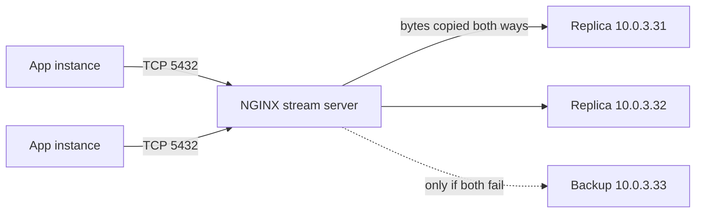
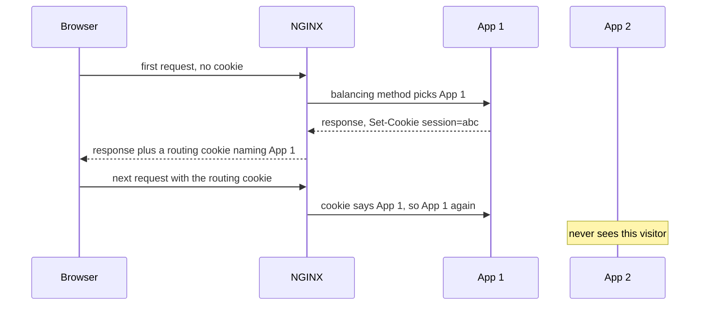

# TCP and UDP load balancing and sticky sessions

## Before this lesson

You need `upstream` blocks and the balancing methods from [HTTP load balancing and the balancing methods](#/lesson/nginx/lb-http-upstreams), and the terms socket, port and TCP from [lesson 1](#/lesson/nginx/what-nginx-is). If the difference between TCP and UDP is unfamiliar, the networking track covers it in [UDP and the TCP lifecycle](#/lesson/networking/udp-tcp-lifecycle); the short version is given below.

## In plain words

So far NGINX has opened every letter, read it, and decided what to do: it understood HTTP. Sometimes the traffic is not HTTP at all. A database conversation, an email delivery, a game's position updates and a DNS lookup each use their own formats.

For those, NGINX can act like a **telephone switchboard operator** who connects a caller to one of several lines without listening to the conversation. It picks a destination, joins the two ends, and copies bytes in both directions. This is done by a separate part of NGINX called the **stream module**.

The second half of this lesson is about a different problem that appears once there are several servers: a shopper who put items in a basket at checkout 3 and is then sent to checkout 5, where nobody has seen the basket. Keeping a visitor on the server that knows them is called a **sticky session**.

Both topics come up when a team moves from one server to several, which is the moment many engineers first need to understand what the balancer is really doing.

## Layers: why two kinds of load balancing exist

Networking is described in numbered layers. Two matter here.

- **Layer 4, transport.** TCP and UDP. At this level a balancer sees addresses, ports and a stream of bytes or a set of packets. It cannot see URLs, headers or cookies.
- **Layer 7, application.** HTTP and friends. A balancer here reads the request, so it can route by path, add headers, cache and compress.

**TCP** sets up a connection and guarantees that bytes arrive complete and in order. **UDP** (User Datagram Protocol) sends independent packets called **datagrams** with no connection and no guarantee; it is used where speed matters more than perfection or where each exchange is one question and one answer (DNS, voice, games, metrics).

| | `http` context (layer 7) | `stream` context (layer 4) |
|---|---|---|
| Understands | HTTP requests and responses | bytes and datagrams only |
| Can route by | host, path, header, cookie | client address, port, TLS server name |
| Can add headers, cache, compress | yes | no |
| Typical traffic | websites, APIs | PostgreSQL, MySQL, Redis, MQTT, SMTP, DNS, syslog |
| Unit balanced | each request | each connection (TCP) or session (UDP) |

## Step 1: TCP load balancing

Suppose three read-only PostgreSQL replicas. Applications should connect to one address and be spread across them. PostgreSQL uses port 5432.

```nginx
# /etc/nginx/nginx.conf, at the top level, NOT inside http { }
stream {
    upstream pg_read {
        least_conn;
        server 10.0.3.31:5432;
        server 10.0.3.32:5432;
        server 10.0.3.33:5432 backup;
    }

    server {
        listen 5432;
        proxy_pass pg_read;
        proxy_connect_timeout 2s;
        proxy_timeout 10m;
    }
}
```

- `stream { ... }` is a sibling of `http { ... }` in the main context. A very common first error is to include a stream file from inside `http`, which fails with `"stream" directive is not allowed here`. Many setups add a line `include /etc/nginx/stream.d/*.conf;` at the top level to keep stream files separate.
- `upstream pg_read { ... }` works as in HTTP, with the same `least_conn`, `hash`, `random`, weights and `backup`.
- `server { listen 5432; ... }` accepts TCP connections on port 5432. There is no `server_name` and there are no `location` blocks: with no HTTP there is no host or path to inspect.
- `proxy_pass pg_read;` has **no `http://`**. It names the upstream directly.
- `proxy_connect_timeout 2s;` how long to wait for the chosen replica to accept the connection before trying another.
- `proxy_timeout 10m;` close the pairing if no bytes move in either direction for 10 minutes. The default is also 10 minutes; long-lived idle connections such as connection pools may need more.

On Debian and Ubuntu the stream module may be a separate package (`libnginx-mod-stream`). `nginx -V 2>&1 | grep -o with-stream` tells you whether it is available.

```bash
$ sudo nginx -t && sudo systemctl reload nginx
$ psql -h 127.0.0.1 -p 5432 -U reader -c 'select inet_server_addr();'
 inet_server_addr
------------------
 10.0.3.31
$ psql -h 127.0.0.1 -p 5432 -U reader -c 'select inet_server_addr();'
 inet_server_addr
------------------
 10.0.3.32
```

`psql` is the PostgreSQL client. Each run opens a new connection to NGINX, and the query asks the database which machine it is. Two runs, two replicas.



Two properties of layer-4 balancing to keep in mind:

- **Balancing is per connection.** A client that opens one connection and sends ten thousand queries through it stays on one replica. Applications with connection pools spread load only as well as their pool spreads connections.
- **The backend sees NGINX's address.** There is no header to carry the client address. The fix is the **PROXY protocol**: a one-line preface NGINX adds at the start of the connection saying "the real client is 198.51.100.7". Turn it on with `proxy_protocol on;` in the stream server, and only if the backend is configured to expect it, since otherwise that line looks like garbage to it.

### TLS without decrypting: routing by server name

A TLS connection begins with a message from the client called ClientHello, which carries the hostname it wants in a field named **SNI** (Server Name Indication). That field is readable before any decryption. The stream module can peek at it and choose a backend while leaving the encrypted bytes untouched, which is called **TLS passthrough**.

```nginx
stream {
    map $ssl_preread_server_name $tls_backend {
        db.shop.test     10.0.3.31:5432;
        mqtt.shop.test   10.0.4.41:8883;
        default          10.0.9.99:443;
    }

    server {
        listen 443;
        ssl_preread on;
        proxy_pass $tls_backend;
    }
}
```

- `ssl_preread on;` tells NGINX to read the ClientHello without terminating TLS.
- `$ssl_preread_server_name` is the SNI hostname.
- `map A B { ... }` builds variable `$tls_backend` from it: a lookup table with a default row. `map` gets a full explanation in the traffic management module.

## Step 2: UDP load balancing

Two internal DNS servers, balanced on port 53:

```nginx
stream {
    upstream dns_pool {
        server 10.0.5.51:53;
        server 10.0.5.52:53;
    }

    server {
        listen 53 udp reuseport;
        proxy_pass dns_pool;
        proxy_responses 1;
        proxy_timeout 2s;
    }
}
```

- `listen 53 udp` accepts datagrams instead of TCP connections. `reuseport` gives each worker its own socket so the kernel spreads datagrams across workers, which UDP workloads benefit from.
- `proxy_responses 1;` says "expect one reply datagram per query, then the session is over". DNS is one question, one answer. Without this, NGINX keeps the session open until the timeout because UDP has no "goodbye" message.
- `proxy_timeout 2s;` how long a session may sit idle before it is forgotten.

Since UDP has no connections, NGINX invents a **session**: datagrams from the same client address and port within the timeout belong together and go to the same backend.

```bash
$ dig @127.0.0.1 -p 53 api.internal.shop.test +short
10.0.1.11
```

`dig` is a DNS lookup tool. `@127.0.0.1` sends the question to NGINX, which forwards it to one of the two DNS servers and relays the answer.

If a service uses both protocols on one port (DNS does), write two `listen` lines in the same server: `listen 53;` and `listen 53 udp;`.

> [!WARNING]
> Passive failure detection is weaker for UDP. A dead UDP server does not refuse anything; packets vanish. NGINX can only notice a missing reply when `proxy_responses` is set, so always set it for request-and-reply protocols.

## Step 3: sticky sessions

### The problem

HTTP is **stateless**: each request stands alone, and the server recognises a returning visitor only through something the browser sends back, normally a **cookie** (a small named value the server asks the browser to store and return on later requests). The application looks up that cookie in its **session** data: who is logged in, what is in the basket.

If session data lives in the memory of one application process, a request that reaches a different process finds nothing: the user appears logged out. There are two cures.

1. **Make servers interchangeable.** Store sessions in a shared place every copy can reach, such as Redis or a database, or put the data inside a signed token the client carries. Then any server can handle any request. This is the better design and makes the balancer's job trivial.
2. **Make the balancer sticky.** Route each visitor to the same server every time. Quicker to adopt, but a server's death still loses its visitors' sessions, and load can become uneven.



### Open-source options

**By client address.** `ip_hash;`, from the previous lesson. Works with no cookies but fails behind shared addresses and upstream proxies.

**By an existing cookie.** Hash the application's own session cookie:

```nginx
upstream shop_app {
    hash $cookie_sessionid consistent;
    server 10.0.1.11:8000;
    server 10.0.1.12:8000;
    server 10.0.1.13:8000;
}
```

- `$cookie_sessionid` is the value of the request cookie named `sessionid` (any cookie is available as `$cookie_` plus its name).
- All requests with the same session id reach the same server; `consistent` keeps most visitors in place when the pool changes.
- A visitor with no cookie yet has an empty key, and every empty key hashes to the same server. To avoid that hot spot, fall back to another value with `map`:

```nginx
map $cookie_sessionid $sticky_key {
    ""      $remote_addr$http_user_agent;
    default $cookie_sessionid;
}
upstream shop_app {
    hash $sticky_key consistent;
    server 10.0.1.11:8000;
    server 10.0.1.12:8000;
}
```

The `map` reads: when the cookie is empty use the client address plus browser name as the key; otherwise use the cookie.

**By an explicit route.** The application adds its own server label to the cookie (for example `sessionid=abc.app2`), and a `map` with a regex turns that label into a backend address used in `proxy_pass http://$backend;`. This is full control at the price of more configuration.

### The `sticky` directive

> [!NOTE]
> **NGINX Plus.** The `sticky` directive was a Plus feature for many years. The nginx.org upstream documentation now marks `sticky cookie`, `sticky route` and `sticky learn` as available in recent open-source mainline releases (the 1.29 line onward), with only cross-instance synchronisation of the learn table left as a commercial option. On the stable and distribution packages most servers run, assume it is absent and use the `hash` approach above.

It comes in three modes.

```nginx
upstream shop_app {
    server 10.0.1.11:8000;
    server 10.0.1.12:8000;
    sticky cookie srv_id expires=1h path=/ httponly secure;
}
```

- **`sticky cookie`**: NGINX itself adds a cookie (here named `srv_id`) to the first response, identifying the chosen server. Later requests carrying it go to that server. `expires` sets its lifetime, `httponly` hides it from page JavaScript, `secure` restricts it to HTTPS. The application needs no changes.

```nginx
upstream shop_app {
    server 10.0.1.11:8000;
    server 10.0.1.12:8000;
    sticky learn create=$upstream_cookie_sessionid
                 lookup=$cookie_sessionid
                 zone=client_sessions:1m timeout=1h;
}
```

- **`sticky learn`**: NGINX watches responses for the application's own cookie (`create=` names where a new session id appears, here the upstream's `Set-Cookie: sessionid=...`), remembers "this id belongs to that server" in a shared memory zone, and consults the table when a request brings the id back (`lookup=`). No extra cookie is added. `zone=client_sessions:1m` is the table (1 megabyte holds several thousand sessions) and `timeout=1h` forgets idle entries.

```nginx
map $cookie_jsessionid $route_cookie {
    ~.+\.(?P<route>\w+)$ $route;
}
upstream shop_app {
    server 10.0.1.11:8000 route=a;
    server 10.0.1.12:8000 route=b;
    sticky route $route_cookie;
}
```

- **`sticky route`**: each server has a `route=` label; a variable (here extracted by regex from the end of a cookie such as `...xyz.b`) says which label to use. This suits application servers that already append a node name to their session id.

### Checking stickiness

```bash
$ curl -s -c jar.txt -o /dev/null -D - -H 'Host: shop.test' http://127.0.0.1/login | grep -i set-cookie
Set-Cookie: sessionid=7f3c9a; Path=/; HttpOnly
$ for i in 1 2 3 4; do curl -s -b jar.txt -H 'Host: shop.test' http://127.0.0.1/whoami; done
app-12
app-12
app-12
app-12
```

- `-c jar.txt` saves cookies the server sets into a file; `-D -` prints response headers; `-o /dev/null` discards the body.
- `-b jar.txt` sends the saved cookies back. Four requests, one server: sticky. Run the loop without `-b` and the answers rotate.

> [!INTERVIEW]
> "How would you handle user sessions behind a load balancer?" Lead with the stateless design: keep session data in a shared store or a signed token so any server can serve any request. Offer stickiness as a fallback, name the mechanisms (address hash, cookie hash, balancer-issued cookie), and state the costs: uneven load, and sessions lost when a server dies or is drained.

## Pitfalls

- **`stream` inside `http`.** It must be at the top level.
- **Writing `proxy_pass http://name` in a stream server.** There is no scheme in stream.
- **Expecting HTTP features in stream.** No `location`, no headers, no `access_log` in the HTTP format (stream has its own `log_format` variables such as `$remote_addr`, `$upstream_addr`, `$bytes_sent`, `$session_time`).
- **One port, two contexts.** An `http` server and a `stream` server cannot both listen on the same address and port.
- **Idle database connections cut after 10 minutes** by the default `proxy_timeout`. Raise it or enable TCP keepalive with `proxy_socket_keepalive on;`.
- **Enabling `proxy_protocol` when the backend does not expect it**, which breaks every connection.
- **Stickiness hiding a design problem.** Deployments log everyone on the restarted server out. Plan to externalise sessions.
- **Hashing an empty cookie**, sending every anonymous visitor to one server.

## Cheat sheet

| Goal | Configuration |
|---|---|
| Balance TCP | `stream { upstream u { server a:5432; } server { listen 5432; proxy_pass u; } }` |
| Balance UDP | `listen 53 udp; proxy_responses 1;` |
| Idle timeout for a connection or session | `proxy_timeout 10m;` |
| Tell the backend the client address at layer 4 | `proxy_protocol on;` |
| Route TLS by hostname without decrypting | `ssl_preread on;` with `map $ssl_preread_server_name` |
| Sticky by address | `ip_hash;` |
| Sticky by application cookie (open source) | `hash $cookie_sessionid consistent;` |
| Sticky by balancer cookie | `sticky cookie name expires=1h;` (Plus, or recent open source) |
| Sticky by learned session id | `sticky learn create=... lookup=... zone=...;` |
| Test stickiness | `curl -c jar.txt` then `curl -b jar.txt` |

## Summary

- The `stream` context balances raw TCP connections and UDP sessions without understanding their content.
- A stream server has `listen` and `proxy_pass` and nothing path-related; UDP adds `udp` and `proxy_responses`.
- Layer-4 balancing is per connection; the client address is lost unless the PROXY protocol is used.
- `ssl_preread` routes encrypted connections by SNI without decrypting.
- Sticky sessions keep a visitor on one server by address, cookie or learned id. Shared session storage is the more robust design.

## Glossary

- **Cookie**: a small value a server asks the browser to store and send back.
- **Datagram**: one self-contained UDP packet.
- **Layer 4 / layer 7**: the transport level (TCP, UDP) and the application level (HTTP).
- **PROXY protocol**: a short preface on a connection that carries the original client address.
- **Session (application)**: per-user data a server keeps between requests.
- **Session (UDP in NGINX)**: datagrams from one client address and port grouped together.
- **SNI**: the hostname a client names at the start of a TLS handshake.
- **Stateless**: needing no memory of earlier requests.
- **Sticky session**: routing a client to the same backend each time.
- **Stream module**: the part of NGINX that proxies TCP and UDP.
- **TLS passthrough**: forwarding encrypted traffic without decrypting it.

## Check yourself

```quiz
[
  {"q": "Where must the stream block be written?",
   "options": ["Inside http", "Inside a server block", "At the top level of nginx.conf, beside http", "Inside events"], "answer": 2,
   "explain": "stream is a main-context block and a sibling of http."},
  {"q": "An application opens one TCP connection through a stream server and sends 5,000 queries over it. How many backends serve them?",
   "options": ["All of them in turn", "One", "Two", "It depends on the weights"], "answer": 1,
   "explain": "Layer-4 balancing chooses a backend per connection, not per query."},
  {"q": "What does proxy_responses 1; tell NGINX for a UDP server?",
   "options": ["Retry once on failure", "Expect one reply datagram per client datagram, then end the session", "Use one worker", "Send one health check"], "answer": 1,
   "explain": "UDP has no close message, so NGINX needs to know how many replies end a session."},
  {"q": "Which of these can a stream server use to choose a backend?",
   "options": ["The URL path", "The Cookie header", "The TLS SNI hostname read with ssl_preread", "The User-Agent header"], "answer": 2,
   "explain": "Without decrypting or parsing HTTP, only connection-level facts and the unencrypted SNI field are visible."},
  {"q": "`hash $cookie_sessionid consistent;` is in use. Many first-time visitors have no cookie. Where do their requests go?",
   "options": ["They are spread evenly", "All to the same server, since the empty key always hashes to one place", "They are rejected with 400", "To the backup server"], "answer": 1,
   "explain": "An empty key is still a key. Use a map to substitute another value when the cookie is missing."},
  {"q": "Which design removes the need for sticky sessions?",
   "options": ["Using ip_hash", "Storing session data in a shared store such as Redis", "Increasing worker_processes", "Using HTTP/2"], "answer": 1,
   "explain": "When every server can read the session, any server can handle any request."},
  {"q": "A stream server proxies to a backend and nothing else is configured. Which client address does the backend see?",
   "options": ["The original client address", "The NGINX machine's address", "127.0.0.1 always", "No address"], "answer": 1,
   "explain": "NGINX opens a new connection to the backend. The PROXY protocol is needed to pass the original address."}
]
```

> **Source:** DeJonghe, NGINX Cookbook, ch. 2 (TCP load balancing, UDP load balancing, sticky cookie, sticky learn, sticky routing). Docs: https://nginx.org/en/docs/stream/ngx_stream_core_module.html, https://nginx.org/en/docs/stream/ngx_stream_proxy_module.html, https://nginx.org/en/docs/stream/ngx_stream_ssl_preread_module.html, https://nginx.org/en/docs/http/ngx_http_upstream_module.html#sticky
