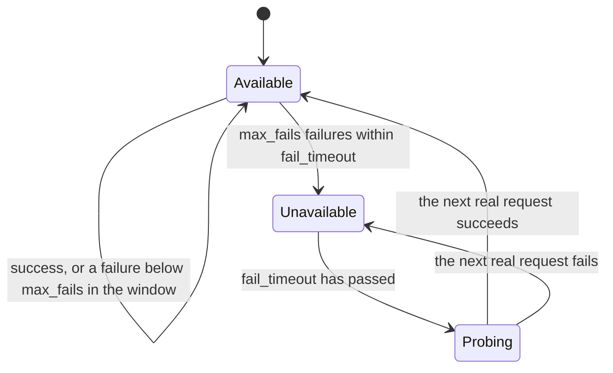

# Health checks, retries, draining and slow start

## Before this lesson

You need `upstream` pools, server parameters such as `weight` and `backup`, and the shared-memory `zone` from [HTTP load balancing and the balancing methods](#/lesson/nginx/lb-http-upstreams). You should know the 5xx status family from [lesson 1](#/lesson/nginx/what-nginx-is).

## In plain words

A switchboard operator who keeps putting callers through to a line that nobody answers is worse than no operator. A load balancer has the same duty: notice which servers are not answering and stop sending people there.

There are two ways to notice.

- **Learn from real calls.** If several callers in a row get no answer on line 4, stop using line 4 for a while, then carefully try it again. This is a **passive health check**: it costs nothing extra, but some real callers must hit the failure before it is detected.
- **Ring each line yourself every few seconds.** If the test call fails, take the line out before any customer is affected. This is an **active health check**.

Two neighbouring ideas complete the picture. When you want to take a healthy server out for maintenance, you let its current conversations finish while sending it nothing new; that is **draining**. When a server comes back, you give it traffic gradually so that a cold application is not flattened at once; that is **slow start**.

On call, these settings decide whether one crashed container is invisible to users or becomes a page full of 502 errors.

## What counts as a failure

When NGINX forwards a request, things can go wrong in several ways. Each has its own keyword, used by the directives in this lesson.

| Keyword | What happened |
|---|---|
| `error` | could not connect, or the connection broke while sending the request or reading the response header |
| `timeout` | connecting, sending or reading took longer than the configured timeout |
| `invalid_header` | the upstream replied with something that is not valid HTTP |
| `http_500`, `http_502`, `http_503`, `http_504`, `http_429` | the upstream answered, with that status |
| `http_403`, `http_404` | answered with that status; these are never counted as server failures |
| `non_idempotent` | permission to retry methods that are not safe to repeat |
| `off` | never try another server |

Two different questions use this list:

1. **Should this request be retried on another server?** Controlled by `proxy_next_upstream`.
2. **Should this count against the server's health?** The conditions listed in `proxy_next_upstream` are the ones counted, except that `http_403` and `http_404` never count.

By default only `error` and `timeout` qualify. A server that returns `500 Internal Server Error` in two milliseconds is, by default, considered healthy and is not retried.

## Passive health checks

Passive checks are built in to open-source NGINX and are always on. Two parameters on each `server` line tune them.

```nginx
upstream shop_app {
    zone shop_app 64k;
    server 10.0.1.11:8000 max_fails=3 fail_timeout=30s;
    server 10.0.1.12:8000 max_fails=3 fail_timeout=30s;
    server 10.0.1.13:8000 max_fails=3 fail_timeout=30s;
}
```

- `max_fails=3`: the number of failed attempts that marks the server unavailable. The default is 1. Setting 0 turns failure counting off for that server.
- `fail_timeout=30s` does **two jobs**, and that double meaning is the part people forget:
  1. it is the **window** in which the `max_fails` failures must occur;
  2. it is also **how long the server then stays out**.
  The default is 10 seconds.
- `zone` makes the failure counters shared, so all workers agree on which server is out. Without a zone each worker must discover the failure for itself, multiplying the number of user requests that hit the dead server.

The life of one server under these settings:



After the time-out period NGINX does not send a special test. It lets **one live request** try the server. If that works, the server is back in rotation; if not, it is out for another period. There are two edge cases: when a pool has a single server, these parameters are ignored and it is never marked unavailable; and when every server in a pool is marked unavailable, NGINX answers `502` and logs `no live upstreams`, then gives all of them another chance.

The following simulation applies exactly these rules to a timeline of results for one server.

```python-run
MAX_FAILS, FAIL_TIMEOUT = 3, 30      # seconds

class Peer:
    def __init__(self):
        self.fails = 0               # failures counted in the current window
        self.checked = 0             # time of the most recent failure
        self.down_until = None       # when the server may be tried again

    def available(self, now):
        return self.down_until is None or now >= self.down_until

    def report(self, now, ok):
        if ok:
            self.fails, self.down_until = 0, None        # success clears the record
            return
        if now - self.checked > FAIL_TIMEOUT:            # old failures have expired
            self.fails = 0
        self.fails += 1
        self.checked = now
        if self.fails >= MAX_FAILS or self.down_until is not None:
            self.down_until = now + FAIL_TIMEOUT          # (re)start the time-out

peer = Peer()
events = [(0, True), (5, False), (8, False), (50, False), (52, False), (55, False),
          (60, None), (86, True), (90, True)]            # None = someone wants to use it
for t, result in events:
    if not peer.available(t):
        print(f"t={t:3}s  skipped: unavailable until t={peer.down_until}")
        continue
    if result is None:
        print(f"t={t:3}s  available"); continue
    peer.report(t, result)
    state = "available" if peer.available(t) else f"OUT until t={peer.down_until}"
    print(f"t={t:3}s  {'ok  ' if result else 'FAIL'} fails={peer.fails} -> {state}")
```

Read the output: the failures at 5 s and 8 s do not reach three within 30 seconds, and by 50 s they have expired, so counting starts again; three failures at 50, 52 and 55 take the server out until 85 s; the request at 86 s is the probe, it succeeds, and the record is clean.

### Retrying on another server

```nginx
location / {
    proxy_pass http://shop_app;
    proxy_connect_timeout 2s;
    proxy_read_timeout 15s;

    proxy_next_upstream error timeout http_502 http_503;
    proxy_next_upstream_tries 3;
    proxy_next_upstream_timeout 10s;
}
```

- `proxy_next_upstream error timeout http_502 http_503;` when the chosen server fails in one of these ways, quietly pass the same request to the next server instead of showing the error to the user.
- `proxy_next_upstream_tries 3;` at most three servers in total for one request. Zero, the default, means "as many as the pool has".
- `proxy_next_upstream_timeout 10s;` stop retrying once 10 seconds have been spent overall, so a user is not kept waiting through a chain of timeouts.
- `proxy_connect_timeout 2s;` matters more than it looks: a server whose machine has vanished does not refuse the connection, it leaves it hanging. With the default of 60 seconds, every request sent to it waits a minute before the retry.

```bash
$ sudo ssh 10.0.1.12 systemctl stop shop-app        # break one server
$ for i in 1 2 3 4 5 6; do curl -s -o /dev/null -w '%{http_code} ' -H 'Host: shop.test' http://127.0.0.1/; done; echo
200 200 200 200 200 200
$ sudo tail -n 2 /var/log/nginx/error.log
2026/11/21 10:02:17 [error] 912#912: *4821 connect() failed (111: Connection refused) while connecting to upstream, client: 127.0.0.1, server: shop.test, request: "GET / HTTP/1.1", upstream: "http://10.0.1.12:8000/", host: "shop.test"
2026/11/21 10:02:17 [warn] 912#912: *4821 upstream server temporarily disabled while connecting to upstream, client: 127.0.0.1, server: shop.test, request: "GET / HTTP/1.1", upstream: "http://10.0.1.12:8000/", host: "shop.test"
```

`-w '%{http_code} '` makes `curl` print only the status code. Every request succeeded even though a server was down: the failed attempt was retried elsewhere. The error log tells the real story, including the line `upstream server temporarily disabled`, which is the passive check taking 10.0.1.12 out.

> [!WARNING]
> Retrying is only safe for requests that can be repeated without harm. A request is **idempotent** when doing it twice has the same effect as doing it once (`GET`, `PUT`, `DELETE`). `POST` usually is not: retrying "place order" can place two orders. NGINX therefore does not retry `POST`, `PATCH` or `LOCK` once the request has been sent to a server, unless you add `non_idempotent`. Leave that off unless the application deduplicates requests itself.

## Active health checks

> [!NOTE]
> **NGINX Plus.** The `health_check` directive is a commercial feature. Open-source alternatives are listed after the example.

```nginx
upstream shop_app {
    zone shop_app 64k;
    server 10.0.1.11:8000;
    server 10.0.1.12:8000;
}

match app_ok {
    status 200;
    header Content-Type ~ "application/json";
    body ~ '"status":\s*"ok"';
}

server {
    location / {
        proxy_pass http://shop_app;
        health_check interval=5s fails=2 passes=3 uri=/healthz match=app_ok;
    }
}
```

- `health_check` makes NGINX send its own request to every server in the pool on a schedule, independent of user traffic.
- `interval=5s` how often; `fails=2` consecutive failures that mark a server unhealthy; `passes=3` consecutive successes needed to mark it healthy again.
- `uri=/healthz` the path to request. A **health endpoint** is an address the application provides for exactly this purpose.
- `match=app_ok` names a `match` block that defines "healthy": status 200, a JSON content type, and a body containing `"status": "ok"`. Without a match block, any 2xx or 3xx status passes.
- A `zone` is required, since health state must be shared between workers.
- In the `stream` context the same directive checks TCP or UDP services, optionally sending bytes and expecting a reply with `send` and `expect` in the match block.

What makes a good health endpoint? It should be cheap, and it should fail when this instance cannot do useful work. Checking only "the process is up" misses an instance that has lost its database connection. Checking every dependency deeply can take all instances out together when a shared dependency blips, leaving nothing to serve even a friendly error page. A common compromise: the endpoint verifies what is specific to this instance and its own connection pool.

**Open-source alternatives to active checks:**

- **Tight passive checks**: `max_fails=2 fail_timeout=10s`, a short `proxy_connect_timeout`, and `proxy_next_upstream` so that the few requests that discover the failure are retried rather than failed.
- **An outside checker that edits the pool.** A scheduler or service-discovery tool (Consul with consul-template, or the orchestrator itself) probes the instances and regenerates the `upstream` block, then reloads NGINX. The automation lesson covers templating.
- **Let the platform do it.** In Kubernetes, readiness probes remove unready pods from a Service's endpoints, and the Ingress controller updates NGINX. See the Kubernetes track's [Ingress lesson](#/lesson/kubernetes/ingress).
- **Third-party modules** such as `nginx_upstream_check_module`, which need a custom build.

| | Passive | Active |
|---|---|---|
| Edition | open source and Plus | Plus |
| Detects by | real requests failing | scheduled test requests |
| Users affected before detection | a few | none, if the check catches it |
| Detects "200 but wrong content" | no | yes, with a match block |
| Recovery | one live request is risked | proven by test requests first |
| Extra load | none | a little, per interval per server |

## Connection draining

You need to patch `10.0.1.12`. Stopping it abruptly cuts requests in flight and breaks sticky sessions.

**With the `drain` parameter** (long a Plus feature set through its API; the documentation lists it in recent open-source releases as well):

```nginx
upstream shop_app {
    zone shop_app 64k;
    server 10.0.1.11:8000;
    server 10.0.1.12:8000 drain;
    sticky cookie srv_id;
}
```

A draining server receives no new sessions. Requests that are bound to it by stickiness continue to reach it until those sessions end. With Plus the flag can be set at run time through the API without editing files.

**Open-source procedure that works everywhere:**

```nginx
upstream shop_app {
    server 10.0.1.11:8000;
    server 10.0.1.12:8000 down;
    server 10.0.1.13:8000;
}
```

```bash
$ sudo nginx -t && sudo systemctl reload nginx
$ watch -n 2 "ss -tn state established '( dport = :8000 )' | grep -c 10.0.1.12"
0
```

1. Mark the server `down` and reload. The reload is graceful: old workers finish the requests already running on that server, new workers send it nothing.
2. Watch the established connections to it fall to zero. The `ss` filter lists established TCP connections to port 8000; `grep -c` counts those to the server in question; `watch` repeats every two seconds.
3. Do the maintenance, remove `down`, reload.

Using `down` in place of deleting the line keeps `ip_hash` and `hash` mappings for the other servers stable.

## Slow start

> [!NOTE]
> **NGINX Plus.** `slow_start` is a commercial parameter.

```nginx
upstream shop_app {
    zone shop_app 64k;
    least_conn;
    server 10.0.1.11:8000 slow_start=30s;
    server 10.0.1.12:8000 slow_start=30s;
}
```

When a server returns from being unavailable or unhealthy, its effective weight climbs from zero to its normal value over 30 seconds. Applications often start "cold": caches empty, database connections not yet open, code not yet optimised by the runtime. With `least_conn`, a server with zero connections would otherwise be handed nearly all new requests at once, which may knock it over again. `slow_start` cannot be combined with `hash`, `ip_hash` or `random`.

**Open-source alternatives:** warm the application before it joins (have its start-up script call its own key endpoints, and only then open the port or pass its readiness check); or re-introduce it with a small `weight` and raise the weight with a second reload a minute later.

> [!INTERVIEW]
> "How does NGINX know a backend is down?" Open-source NGINX uses passive checks: failed attempts are counted per server, and `max_fails` failures within `fail_timeout` take the server out for `fail_timeout`, after which one live request probes it. Failures are, by default, connection errors and timeouts only. `proxy_next_upstream` retries the failed request on another server. Active checks with scheduled probes are an NGINX Plus feature, or come from the platform, for example Kubernetes readiness probes.

## Pitfalls

- **Thinking 500 responses trigger failover.** They do not unless you add `http_500` to `proxy_next_upstream`, and adding it can hide application bugs and double the load during an incident.
- **Long default timeouts.** A black-holed server with a 60-second connect timeout turns each affected request into a one-minute wait.
- **`max_fails=1` on a flaky network.** One lost packet removes a server for 10 seconds. Two or three is calmer.
- **Retry storms.** If every server is slow, retries multiply the load on an already struggling pool. Cap them with `proxy_next_upstream_tries` and `proxy_next_upstream_timeout`.
- **No `zone`.** Each worker learns of the failure separately.
- **Health endpoint behind authentication or a redirect**, so the active check always fails or always passes on a 302.
- **Assuming a single-server upstream fails fast.** With one server, health parameters are ignored; every request is attempted.

## Cheat sheet

| Goal | Configuration |
|---|---|
| Passive detection | `server a:8000 max_fails=3 fail_timeout=30s;` |
| Disable failure counting | `max_fails=0` |
| Retry on another server | `proxy_next_upstream error timeout http_502 http_503;` |
| Cap retries | `proxy_next_upstream_tries 3; proxy_next_upstream_timeout 10s;` |
| Fail fast on dead hosts | `proxy_connect_timeout 2s;` |
| Active check (Plus) | `health_check interval=5s fails=2 passes=3 uri=/healthz;` |
| Define healthy (Plus) | `match name { status 200; body ~ "ok"; }` |
| Take a server out gracefully | `down` then reload; or `drain` |
| Ramp a recovered server (Plus) | `slow_start=30s` |
| Log line for an ejected server | `upstream server temporarily disabled` |
| Log line when all are out | `no live upstreams` |

## Summary

- Passive checks count real failures: `max_fails` within `fail_timeout` ejects a server for `fail_timeout`, then one live request probes it.
- Only errors and timeouts count by default; `proxy_next_upstream` widens the list and controls retries.
- Non-idempotent requests are not retried once sent.
- Active checks, `slow_start` and run-time changes are Plus features, with open-source substitutes in tight passive settings, external checkers and orchestrator probes.
- Drain before maintenance: `down` plus a graceful reload works on every edition.

## Glossary

- **Active health check**: a scheduled test request from the balancer to each server.
- **Draining**: letting existing work on a server finish while sending it nothing new.
- **Failover**: moving work to another server when one fails.
- **Health endpoint**: an application address that reports whether the instance can serve.
- **Idempotent**: safe to repeat; doing it twice equals doing it once.
- **Passive health check**: judging a server from the outcome of real requests.
- **Probe**: a request used to test whether a server has recovered.
- **Retry storm**: retries piling extra load on servers that are already struggling.
- **Slow start**: gradually raising a recovered server's share of traffic.

## Check yourself

```quiz
[
  {"q": "server a:8000 max_fails=2 fail_timeout=20s; Two connection failures occur 5 seconds apart. What happens?",
   "options": ["Nothing, the default threshold is 3", "The server is unavailable for 20 seconds, then a live request probes it", "The server is removed until the next reload", "NGINX restarts the server"], "answer": 1,
   "explain": "Two failures inside the 20-second window reach max_fails; the same fail_timeout value is the time-out length."},
  {"q": "With default settings, an upstream server answers every request quickly with 500. Is it marked unavailable?",
   "options": ["Yes, after one response", "Yes, after max_fails responses", "No, a 500 response is not counted as a failure by default", "Only with ip_hash"], "answer": 2,
   "explain": "Only error and timeout count unless http_500 is added to proxy_next_upstream."},
  {"q": "A pool has two servers. The first refuses the connection; the second answers 200. With default proxy_next_upstream, what status code does the client get for a GET?",
   "options": ["502", "504", "200", "503"], "answer": 2,
   "explain": "A connection error triggers a retry on the next server by default, so the client sees the successful answer."},
  {"q": "Every server in the pool is currently marked unavailable. What status code does the client receive?",
   "options": ["404", "502", "504", "499"], "answer": 1,
   "explain": "NGINX returns 502 Bad Gateway and logs no live upstreams."},
  {"q": "Why is a POST not retried on another server after it was sent to the first one?",
   "options": ["POST bodies are too large", "It is not idempotent, so a retry could perform the action twice", "POST cannot be proxied", "The second server would return 405"], "answer": 1,
   "explain": "NGINX avoids duplicating side effects unless non_idempotent is set."},
  {"q": "Which feature needs NGINX Plus?",
   "options": ["max_fails and fail_timeout", "proxy_next_upstream", "health_check with a match block", "The down parameter"], "answer": 2,
   "explain": "Active health checks are commercial. The others exist in open-source NGINX."},
  {"q": "What is the open-source way to take a server out without cutting its in-flight requests?",
   "options": ["Kill the NGINX master", "Mark it down and do a graceful reload", "Set weight=0", "Delete the upstream block and restart"], "answer": 1,
   "explain": "Old workers finish current requests during a reload while new workers skip the down server."}
]
```

> **Source:** DeJonghe, NGINX Cookbook, ch. 2 (connection draining, passive health checks, active health checks, slow start). Docs: https://nginx.org/en/docs/http/ngx_http_upstream_module.html, https://nginx.org/en/docs/http/ngx_http_proxy_module.html#proxy_next_upstream, https://nginx.org/en/docs/http/ngx_http_upstream_hc_module.html
