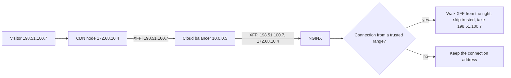

# A/B testing, map, geo and finding the real client

## Before this lesson

You should be comfortable with variables such as `$remote_addr` and `$http_user_agent` ([Serving a first static site](#/lesson/nginx/first-static-site)), with `upstream` pools and `proxy_pass` ([HTTP load balancing](#/lesson/nginx/lb-http-upstreams)), and with the reasons to avoid `if` ([try_files, return, rewrite](#/lesson/nginx/try-files-rewrite-return)).

## In plain words

Load balancing answers "which copy of the same thing should serve this request?". **Traffic management** answers a wider question: "given who is asking and what they ask for, what should happen at all?".

A theatre usher makes this kind of decision constantly. Ticket colour decides the entrance. Every tenth visitor is handed a survey. Guests from the sponsor's list go to the lounge. The usher does not improvise each time; there is a table on a clipboard: "if this, then that".

NGINX has three clipboard tables, each producing a new variable that the rest of the configuration can use:

- `map`: look up one value to produce another ("this browser name, therefore this label").
- `geo`: look up an address range ("this network, therefore this region").
- `split_clients`: divide visitors into percentage groups ("10% see the new design").

They all work only if NGINX knows who the visitor really is, which stops being true the moment another proxy stands in front. The last part of the lesson restores that knowledge.

Product teams ask for these features by name: gradual rollouts, experiments, country rules, internal-only pages. They are standard work for anyone who owns the front door.

## map: a lookup table

```nginx
map $http_user_agent $device {
    default        desktop;
    ~*iphone       phone;
    ~*android      phone;
    ~*ipad         tablet;
}

server {
    listen 80;
    server_name shop.test;
    location = /device {
        return 200 "you look like a $device\n";
    }
}
```

- `map SOURCE $RESULT { ... }` must be written in the `http` context, outside any `server`. It declares a new variable, here `$device`.
- Each row is `pattern value;`. The source value (the `User-Agent` request header, which names the browser) is compared with the patterns.
- `default desktop;` is the value when no row matches. Without a `default` row the result is an empty string.
- A pattern beginning `~` is a case-sensitive regex; `~*` ignores case. Other patterns are compared as whole strings, ignoring case.

```bash
$ curl -H 'Host: shop.test' -A 'Mozilla/5.0 (iPhone; CPU iPhone OS 18_1)' http://127.0.0.1/device
you look like a phone
$ curl -H 'Host: shop.test' -A 'Mozilla/5.0 (X11; Linux x86_64)' http://127.0.0.1/device
you look like a desktop
```

`-A` sets the `User-Agent` header.

### The matching order inside a map

1. An **exact string** match wins outright.
2. If the `hostnames` keyword is present in the block, wildcard names are tried next: the longest `*.example.com` form, then the longest `www.example.*` form.
3. Then **regex rows in the order written**; the first match wins.
4. Otherwise the `default`.

So rows can be listed in any order except regex rows relative to each other. Regex captures work: `~^/u/(?<uid>\d+) $uid;` returns the captured digits.

Two properties make `map` cheap and safe. It is **lazy**: nothing is computed until the result variable is used, so a hundred maps cost nothing on requests that use none of them. And it is **declarative**: it has none of the surprises of `if`.

### What maps are used for

```nginx
# 1. Choose a pool by path prefix
map $uri $pool {
    default        web_pool;
    ~^/api/        api_pool;
    ~^/reports/    batch_pool;
}

# 2. Switch a feature on for some clients
map $http_x_debug $loggable {
    default 0;
    "trace" 1;
}

# 3. Combine two inputs by joining them into one string
map "$request_method:$cookie_logged_in" $skip_cache {
    default      0;
    "~^POST:"    1;
    "~:yes$"     1;
}
```

The third shows the standard trick for "A or B" logic: build one string from several variables and match patterns against it. Row `~^POST:` is true for any POST; row `~:yes$` is true for any request with the cookie `logged_in=yes`.

> [!TIP]
> When a value in a map row contains spaces or special characters, quote it. When a pattern must begin with a literal `~`, `*` or the word `default`, put a backslash in front.

## geo: a lookup table for addresses

`map` compares text. Addresses need range logic: "is `10.3.7.200` inside `10.0.0.0/8`?". The notation `10.0.0.0/8` is **CIDR** (Classless Inter-Domain Routing): the number after the slash says how many leading bits are fixed, so `/8` covers every address starting with `10.`, `/24` covers 256 addresses, `/32` is a single address.

```nginx
geo $network {
    default          public;
    127.0.0.1/32     local;
    10.0.0.0/8       office;
    192.168.0.0/16   office;
    203.0.113.0/24   partner;
}

server {
    listen 80;
    server_name shop.test;

    location /internal/ {
        if ($network = public) { return 403; }
        root /var/www/shop;
    }
}
```

- `geo $network { ... }` looks at `$remote_addr` unless another source variable is given as a first argument (`geo $some_var $network { ... }`).
- When several ranges contain the address, the **most specific** (longest prefix) wins, as in a routing table. Order in the file is irrelevant.
- The `if` with `return` is the safe form from the earlier lesson.

`geo` suits allow-lists of your own networks, labelling data centres, and exempting monitoring systems from limits.

## Country and city: GeoIP

`geo` holds the ranges you type. Deciding by **country** needs a database that maps every public address range to a location. The usual source is MaxMind's GeoLite2 (free with registration) or GeoIP2 (paid, more accurate).

There are two modules, and the difference matters when you read older tutorials:

- `ngx_http_geoip_module` ships with NGINX but reads the legacy `.dat` database format, which MaxMind no longer updates.
- `ngx_http_geoip2_module` is a third-party open-source module that reads the current `.mmdb` format. Distributions package it (`libnginx-mod-http-geoip2` on Debian and Ubuntu). NGINX Plus offers the same module as a supported dynamic module.

```nginx
load_module modules/ngx_http_geoip2_module.so;      # main context, top of nginx.conf

http {
    geoip2 /var/lib/GeoIP/GeoLite2-Country.mmdb {
        auto_reload 60m;
        $geo_country_code default=ZZ country iso_code;
    }

    map $geo_country_code $country_allowed {
        default 0;
        NZ 1;
        AU 1;
        ZZ 1;
    }

    server {
        listen 80;
        server_name shop.test;
        if ($country_allowed = 0) { return 403; }

        location / {
            proxy_pass http://127.0.0.1:8000;
            proxy_set_header X-Country $geo_country_code;
        }
    }
}
```

- `load_module` loads a module built as a separate file. It must be at the very top level.
- `geoip2 FILE { ... }` opens the database. `auto_reload 60m;` re-reads the file hourly so that updated databases are picked up.
- `$geo_country_code default=ZZ country iso_code;` defines a variable from the database field path `country` then `iso_code` (two-letter codes such as `NZ`), with `ZZ` for addresses that are not in the database, such as private ones.
- The `map` turns the country into a yes or no. Listing `ZZ` as allowed keeps internal clients working.
- `proxy_set_header X-Country ...` passes the result to the application, which can use it for currency or language.

> [!WARNING]
> Location by address is approximate. Mobile networks, corporate gateways and VPN services routinely place users in the wrong country. Treat it as a hint for defaults or as one layer of defence, not as proof of where someone is.

## split_clients: percentage groups for A/B tests

An **A/B test** shows two versions of something to different groups of visitors and compares the outcomes. A **canary release** is the same mechanism used for safety: send a small share of traffic to a new version and watch for errors before sending the rest.

```nginx
split_clients "${remote_addr}${http_user_agent}" $variant {
    10%     canary;
    *       stable;
}

upstream stable { server 10.0.1.11:8000; server 10.0.1.12:8000; }
upstream canary { server 10.0.1.21:8000; }

server {
    listen 80;
    server_name shop.test;

    location / {
        proxy_pass http://$variant;
        proxy_set_header Host $host;
        add_header X-Variant $variant always;
    }
}
```

- `split_clients KEY $RESULT { ... }` goes in the `http` context.
- The key string is hashed (with an algorithm called MurmurHash2) into a number from 0 to about 4.29 billion. Picture a ruler of that length.
- `10% canary;` claims the first tenth of the ruler. `* stable;` claims whatever is left. Rows are applied in order, each taking the next slice.
- A visitor whose hash lands in the first tenth gets `$variant = canary`.
- `proxy_pass http://$variant;` uses the variable as the upstream name. Because both names are defined as `upstream` blocks, no DNS lookup is involved.
- The `X-Variant` response header lets you and your analytics see which group a response came from.

The choice of key decides how "sticky" the assignment is:

| Key | Behaviour |
|---|---|
| `$remote_addr` | same network address, same group; people sharing an address share a group |
| `"${remote_addr}${http_user_agent}"` | finer-grained; separates devices behind one address |
| `$cookie_uid` | follows the user across networks, if the application sets such a cookie |
| `$request_id` | a random value per request: each request is assigned independently, so one user flips between versions |

The same key always hashes to the same number, so a visitor stays in their group for as long as the percentages and the key are unchanged. Raising 10% to 25% keeps the original 10% in the canary and adds the next 15% of the ruler.

```python-run
import zlib

def bucket(key, rules):
    """rules: list of (percent or '*', value). Uses crc32 as a stand-in for NGINX's MurmurHash2."""
    h = zlib.crc32(key.encode())            # a number from 0 to 4294967295
    position = h / 0xFFFFFFFF * 100         # where on a 0-100 ruler this key sits
    edge = 0.0
    for percent, value in rules:
        if percent == "*":
            return value
        edge += percent
        if position < edge:
            return value
    return ""                               # no '*' row and past all slices

rules = [(10, "canary"), ("*", "stable")]
visitors = [f"198.51.100.{i}" for i in range(1, 201)]
groups = [bucket(v, rules) for v in visitors]
print("canary share:", groups.count("canary") / len(groups))
print("same visitor twice:", bucket("198.51.100.7", rules), bucket("198.51.100.7", rules))

wider = [(25, "canary"), ("*", "stable")]
moved_back = [v for v in visitors if bucket(v, rules) == "canary" and bucket(v, wider) == "stable"]
print("visitors who left the canary after widening to 25%:", len(moved_back))
```

The share comes out near 0.10, the same visitor always gets the same answer, and nobody leaves the canary when it is widened.

```bash
$ for ip in 7 8 9 10 11; do curl -s -o /dev/null -D - -H 'Host: shop.test' \
    -H "User-Agent: test-$ip" http://127.0.0.1/ | grep X-Variant; done
X-Variant: stable
X-Variant: stable
X-Variant: canary
X-Variant: stable
X-Variant: stable
```

For testing, people often want to force a group. A `map` layered on top does it:

```nginx
map $cookie_force_variant $final_variant {
    default  $variant;
    canary   canary;
    stable   stable;
}
```

Use `$final_variant` in `proxy_pass`. A tester who sets the cookie `force_variant=canary` always gets the canary; everyone else gets the hashed assignment.

## Finding the original client

Everything above keys on `$remote_addr`, the address of whoever opened the TCP connection to NGINX. Put a cloud load balancer or a content delivery network (CDN, a company's network of caches close to users) in front and `$remote_addr` becomes that device's address for every visitor. Limits, `geo`, `ip_hash`, logs and experiments all break at once.

Proxies solve this by convention: each one appends the address it received the connection from to the `X-Forwarded-For` header. A request that passed a CDN and a cloud balancer arrives with

```text
X-Forwarded-For: 198.51.100.7, 172.68.10.4
```

meaning "the visitor is 198.51.100.7; the CDN node 172.68.10.4 forwarded it" (the cloud balancer added that second entry, and the balancer itself is the `$remote_addr` NGINX sees).

The **realip module** rewrites `$remote_addr` from that header, but only when the connection comes from a proxy you have declared trustworthy.

```nginx
http {
    set_real_ip_from 10.0.0.0/8;          # our cloud load balancers
    set_real_ip_from 172.68.0.0/16;       # the CDN's published range
    real_ip_header X-Forwarded-For;
    real_ip_recursive on;
}
```

- `set_real_ip_from RANGE;` names a network whose statements about the client you trust. Repeat it for each range.
- `real_ip_header X-Forwarded-For;` the header to read. Some providers use their own, such as `CF-Connecting-IP`. The value `proxy_protocol` reads the address from a PROXY protocol preface instead.
- `real_ip_recursive on;` walk the list **from the right**, skipping every address that is one of your trusted proxies, and take the first one that is not. With `off`, the rightmost entry is taken, which in a two-proxy chain is the CDN and not the visitor.

After this, `$remote_addr` is the visitor's address everywhere, and the original connection address remains available as `$realip_remote_addr`.



> [!WARNING]
> `X-Forwarded-For` is a request header, and anyone can type one. If you trust it from everybody (`set_real_ip_from 0.0.0.0/0;`), a client sends `X-Forwarded-For: 10.0.0.1` and becomes an "office" address, slipping past allow-lists and per-address limits. Trust only the ranges of proxies you control or whose ranges the provider publishes, and keep the leftmost entries from the outside world at arm's length.

```python-run
import ipaddress

TRUSTED = [ipaddress.ip_network(n) for n in ("10.0.0.0/8", "172.68.0.0/16")]
trusted = lambda ip: any(ipaddress.ip_address(ip) in n for n in TRUSTED)

def real_ip(connection_addr, xff, recursive=True):
    if not trusted(connection_addr) or not xff:
        return connection_addr                       # header ignored
    chain = [p.strip() for p in xff.split(",")]
    if not recursive:
        return chain[-1]
    for addr in reversed(chain):                     # right to left
        if not trusted(addr):
            return addr
    return chain[0]                                  # everything was trusted

print(real_ip("10.0.0.5", "198.51.100.7, 172.68.10.4"))                 # visitor
print(real_ip("10.0.0.5", "198.51.100.7, 172.68.10.4", recursive=False)) # the CDN, wrong
print(real_ip("203.0.113.66", "10.0.0.1"))                               # spoof attempt ignored
print(real_ip("10.0.0.5", "10.0.0.1, 198.51.100.7, 172.68.10.4"))        # forged left entry skipped
```

The last case is the important one: a forged entry on the left does not win, because the walk stops at the first untrusted address from the right.

> [!INTERVIEW]
> "Behind a load balancer every request shows the balancer's IP. How do you get the client's?" Use the realip module: `set_real_ip_from` for the balancer's ranges, `real_ip_header X-Forwarded-For`, `real_ip_recursive on`. Explain why the trust list matters: the header is client-controlled, so only entries appended by your own proxies are believable, which is why you read from the right.

## Pitfalls

- **`map` inside `server`.** It belongs in `http`. The error is `"map" directive is not allowed here`.
- **Regex order in a map.** Among regex rows the first match wins, so put the specific pattern before the general one.
- **`split_clients` on `$request_id`** when the experiment needs users to stay in a group.
- **Percentages that exceed 100%**, which is a configuration error; and forgetting `*`, which leaves the remainder with an empty value and a `proxy_pass` to nowhere.
- **Variables in `proxy_pass` with a name that is not an upstream.** NGINX then tries DNS at request time and needs a `resolver`.
- **Country blocking as security.** It reduces noise; it does not stop a determined visitor with a VPN.
- **`real_ip_recursive off` with two proxies**, logging the CDN's address for everyone.
- **Caches and variants.** If a cache sits in front, both variants must not share one cache entry. The caching module covers cache keys.

## Cheat sheet

| Goal | Directive |
|---|---|
| Value from another value | `map $src $dst { default x; pattern y; }` |
| Value from an address range | `geo $dst { default x; 10.0.0.0/8 y; }` |
| Percentage groups | `split_clients "$key" $dst { 10% a; * b; }` |
| Country code | `geoip2 file.mmdb { $cc country iso_code; }` |
| Route by a variable | `proxy_pass http://$dst;` with matching `upstream` names |
| "A or B" logic | `map "$a:$b" $out { ... }` with regex rows |
| Trust a proxy's client header | `set_real_ip_from range; real_ip_header X-Forwarded-For; real_ip_recursive on;` |
| Original connection address | `$realip_remote_addr` |

## Summary

- `map`, `geo` and `split_clients` each build a variable from a table in the `http` context, lazily, without `if`.
- `map` matches exact strings first, then regexes in order, then the default; `geo` picks the most specific address range.
- `split_clients` hashes a key onto a ruler and slices it by percentage; the key decides whether assignment is per address, per user or per request.
- Country decisions need the GeoIP2 database and module, and are approximate.
- Behind other proxies, restore the client address with the realip module, trusting only your own proxies and reading `X-Forwarded-For` from the right.

## Glossary

- **A/B test**: showing different versions to different visitor groups and comparing results.
- **Canary release**: sending a small share of traffic to a new version first.
- **CDN**: a content delivery network, caches run by a provider close to users.
- **CIDR**: notation such as `10.0.0.0/8` for a range of addresses.
- **GeoIP**: a database mapping address ranges to places.
- **Lazy evaluation**: computing a value only when it is used.
- **MurmurHash2**: the hash function `split_clients` uses.
- **realip module**: replaces `$remote_addr` with the client address reported by a trusted proxy.
- **User-Agent**: request header naming the client software.
- **X-Forwarded-For**: header listing the client and the proxies a request passed.

## Check yourself

```quiz
[
  {"q": "map $uri $pool { default web; ~^/api/ api; ~^/api/v2/ apiv2; } What is $pool for /api/v2/users?",
   "options": ["apiv2", "api", "web", "empty"], "answer": 1,
   "explain": "Regex rows are tested in order and the first match wins; ~^/api/ comes first."},
  {"q": "geo $net { default public; 10.0.0.0/8 office; 10.9.0.0/16 lab; } What is $net for 10.9.3.4?",
   "options": ["office", "lab", "public", "It is an error"], "answer": 1,
   "explain": "geo picks the most specific range containing the address, regardless of order."},
  {"q": "split_clients \"$remote_addr\" $v { 20% new; * old; } A visitor from one address makes 50 requests. How many go to new?",
   "options": ["About 10", "Either all 50 or none", "Exactly 20", "25"], "answer": 1,
   "explain": "The same key always hashes to the same position, so the visitor is entirely in one group."},
  {"q": "A map has no default row and no pattern matches. What is the resulting variable?",
   "options": ["The source value", "An empty string", "0", "NGINX returns 500"], "answer": 1,
   "explain": "Without a default the result is empty."},
  {"q": "set_real_ip_from 10.0.0.0/8; real_ip_header X-Forwarded-For; real_ip_recursive on; Connection from 10.0.0.5 with X-Forwarded-For: 1.1.1.1, 198.51.100.7, 10.0.0.9. What is $remote_addr?",
   "options": ["1.1.1.1", "198.51.100.7", "10.0.0.9", "10.0.0.5"], "answer": 1,
   "explain": "Walking from the right, 10.0.0.9 is trusted and skipped; 198.51.100.7 is the first untrusted address. The leftmost entry could be forged."},
  {"q": "Same settings, but the connection comes from 203.0.113.66 with X-Forwarded-For: 10.0.0.1. What is $remote_addr?",
   "options": ["10.0.0.1", "203.0.113.66", "empty", "127.0.0.1"], "answer": 1,
   "explain": "The connecting address is not a trusted proxy, so the header is ignored."},
  {"q": "server-level: if ($country_allowed = 0) { return 403; } and a visitor from a disallowed country requests /. What status code is returned?",
   "options": ["200", "302", "403", "451 automatically"], "answer": 2,
   "explain": "The server-level if with return answers 403 before any location is used."}
]
```

> **Source:** DeJonghe, NGINX Cookbook, ch. 3 (A/B testing, the GeoIP module and database, restricting access by country, finding the original client). Docs: https://nginx.org/en/docs/http/ngx_http_map_module.html, https://nginx.org/en/docs/http/ngx_http_geo_module.html, https://nginx.org/en/docs/http/ngx_http_split_clients_module.html, https://nginx.org/en/docs/http/ngx_http_realip_module.html
