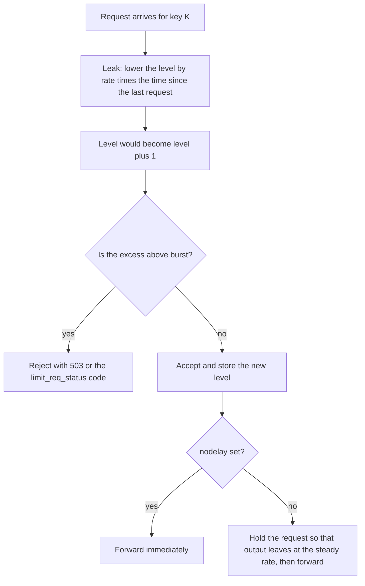

# Limiting request rate, connections and bandwidth

## Before this lesson

You need `map` and `geo` from [A/B testing, map, geo and finding the real client](#/lesson/nginx/split-geo-map), because limits are counted per key and exemptions are written with those tables. You should know what a shared memory zone is ([HTTP load balancing](#/lesson/nginx/lb-http-upstreams)) and the 4xx and 5xx status families ([lesson 1](#/lesson/nginx/what-nginx-is)).

## In plain words

A popular bakery has one till. Three different rules keep it fair:

- **"One customer served every ten seconds per person, however many times you rejoin the queue."** That limits how *often* someone may be served: a **rate limit**.
- **"At most two members of the same family inside the shop at once."** That limits how many are being served *at the same moment*: a **connection limit**.
- **"We hand over at most five loaves a minute per customer."** That limits how *fast* goods flow to one person: a **bandwidth limit**.

NGINX has one directive family for each: `limit_req`, `limit_conn` and `limit_rate`. They protect a login form from password guessing, stop one buggy script from eating a whole API, keep a download server from being drained by a handful of clients, and blunt simple floods. Interviewers like this topic because the main algorithm, the leaky bucket, has parameters (`burst`, `nodelay`) that most people use without understanding.

## Limiting request rate with limit_req

### The two-step pattern

Every limit in NGINX is set up in two steps: define a **zone** (the memory where counters live and the key they are counted by) in the `http` context, then **apply** it where needed.

```nginx
http {
    limit_req_zone $binary_remote_addr zone=per_ip:10m rate=5r/s;

    server {
        listen 80;
        server_name shop.test;

        location /api/ {
            limit_req zone=per_ip;
            proxy_pass http://127.0.0.1:8000;
        }
    }
}
```

- `limit_req_zone KEY zone=NAME:SIZE rate=RATE;`
  - `$binary_remote_addr` is the key: the client address in compact binary form (4 bytes for IPv4, 16 for IPv6). Each distinct key gets its own counter. Smaller keys mean more counters fit in the zone.
  - `zone=per_ip:10m` names the zone and gives it 10 megabytes of shared memory. One megabyte holds on the order of 8,000 to 16,000 counters, so 10m covers roughly a hundred thousand addresses. When the zone fills, the least recently used counters are dropped.
  - `rate=5r/s` allows five requests per second per key. Rates below one per second are written per minute: `30r/m` is one every two seconds.
- `limit_req zone=per_ip;` applies the limit in this location.

### What "5 requests per second" really means

NGINX does not count requests in one-second boxes. It tracks time in milliseconds and treats `5r/s` as **one request every 200 ms**. Two requests arriving 50 ms apart break the limit even if they are the only two that second.

```bash
$ for i in 1 2 3 4; do curl -s -o /dev/null -w '%{http_code} ' -H 'Host: shop.test' http://127.0.0.1/api/ping; done; echo
200 503 503 503
```

Four requests fired back to back: the first passes, the rest are refused because they came sooner than 200 ms after it. That is far stricter than most people intend, and it is why `burst` exists.

The default refusal status is **503 Service Unavailable**. Most APIs prefer **429 Too Many Requests**, set with `limit_req_status 429;`.

### The leaky bucket

The algorithm is called a **leaky bucket**. Picture a bucket with a small hole in the bottom.

- Each request pours one cup of water in.
- Water drips out through the hole at the configured rate (5 cups per second).
- The bucket's size is `burst`. If a cup would make it overflow, that request is refused.



NGINX's bookkeeping, precisely: for each key it stores a number called **excess**, the count of requests currently "over the line". On each request it computes

$$\text{excess}_{new} = \max(0,\ \text{excess}_{old} - \text{rate} \times \Delta t + 1)$$

where $\Delta t$ is the time since that key's last accepted request. If the new excess is greater than `burst`, the request is rejected and the stored value is left alone. Otherwise it is stored. The very first request from a key stores an excess of 0.

### burst: allow short spikes

```nginx
location /api/ {
    limit_req zone=per_ip burst=10;
    limit_req_status 429;
    proxy_pass http://127.0.0.1:8000;
}
```

`burst=10` makes the bucket ten cups deep. A page that fires twelve API calls at once now gets: one accepted at once, ten placed in the bucket, and one refused. But without further options the ten queued requests are **delayed** so that they reach the application one every 200 ms. The tenth waits two seconds. The application sees a perfectly smooth 5 requests per second; the user sees a slow page.

### nodelay: spikes pass at full speed

```nginx
limit_req zone=per_ip burst=10 nodelay;
```

`nodelay` forwards every accepted request immediately. The bucket still fills by one for each request and still drains at 5 per second, so the long-run rate is unchanged: after a burst of eleven, the client must wait for the bucket to drain before more are accepted. The burst becomes a *credit* that refills over time.

This is the setting most public APIs want: brief bursts are served instantly and sustained abuse is refused.

### delay: a middle path

```nginx
limit_req zone=per_ip burst=10 delay=4;
```

The first four excess requests pass without delay, the next six are slowed to the rate, and anything beyond ten is refused. This "two-stage" limit suits web pages that legitimately load a handful of resources at once but should be throttled after that.

| Setting | A burst of 12 instant requests at 5r/s |
|---|---|
| no burst | 1 served, 11 rejected |
| `burst=10` | 1 served at once, 10 served one per 200 ms, 1 rejected |
| `burst=10 nodelay` | 11 served at once, 1 rejected |
| `burst=10 delay=4` | 5 served at once, 6 served one per 200 ms, 1 rejected |

### Simulate it

This class follows the formula above, including the millisecond arithmetic. Problem `nginx-limit-req` asks you to write it.

```python-run
class LimitReq:
    def __init__(self, rate_per_sec, burst=0, nodelay=False):
        self.rate, self.burst, self.nodelay = rate_per_sec, burst, nodelay
        self.state = {}                         # key -> (excess, last_ms)

    def request(self, key, now_ms):
        if key not in self.state:               # first sight of this key
            self.state[key] = (0.0, now_ms)
            return "pass", 0
        excess, last = self.state[key]
        excess = max(0.0, excess - self.rate * (now_ms - last) / 1000 + 1)
        if excess > self.burst:
            return "reject", 0                  # state is NOT updated
        self.state[key] = (excess, now_ms)
        delay_ms = 0 if self.nodelay else round(excess * 1000 / self.rate)
        return "pass", delay_ms

def run(title, limiter, times):
    print(title)
    for t in times:
        verdict, delay = limiter.request("198.51.100.7", t)
        note = f" (forwarded after {delay} ms)" if delay else ""
        print(f"  t={t:5} ms  {verdict}{note}")

burst_at_zero = [0, 1, 2, 3, 4, 5, 6, 7]
run("5r/s, burst=0",            LimitReq(5),                        burst_at_zero[:4])
run("5r/s, burst=3 (delayed)",  LimitReq(5, burst=3),               burst_at_zero[:6])
run("5r/s, burst=3 nodelay",    LimitReq(5, burst=3, nodelay=True), burst_at_zero[:6] + [400, 401, 402])
```

In the last run the bucket fills with the first four requests, the fifth and sixth are rejected, and at 400 ms two units have leaked away, so two more requests pass and the third is rejected again.

### Choosing the key

| Key | Each counter belongs to | Good for |
|---|---|---|
| `$binary_remote_addr` | a client address | anonymous traffic, login pages |
| `$http_authorization` or `$http_x_api_key` | an API credential | fair use per customer |
| `$server_name` | a whole site | capping total load on a fragile backend |
| `"$binary_remote_addr$uri"` | an address and a path together | limiting repeated hits on one endpoint |

A request whose key is the **empty string is not counted at all**. That rule is the tool for exemptions:

```nginx
geo $limit_exempt {
    default        0;
    10.0.0.0/8     1;        # internal services
    203.0.113.5    1;        # the monitoring probe
}
map $limit_exempt $limit_key {
    0  $binary_remote_addr;
    1  "";
}
limit_req_zone $limit_key zone=per_ip:10m rate=5r/s;
```

The `geo` labels trusted networks with 1; the `map` gives them an empty key and everyone else their address.

### Several limits at once, and a realistic set

```nginx
http {
    limit_req_zone $binary_remote_addr zone=general:10m rate=20r/s;
    limit_req_zone $binary_remote_addr zone=login:10m   rate=10r/m;
    limit_req_status 429;
    limit_req_log_level warn;

    server {
        listen 80;
        server_name shop.test;

        limit_req zone=general burst=40 nodelay;

        location = /api/login {
            limit_req zone=login burst=5 nodelay;
            limit_req zone=general burst=40 nodelay;
            proxy_pass http://127.0.0.1:8000;
        }

        location / {
            proxy_pass http://127.0.0.1:8000;
        }
    }
}
```

- Two zones: a generous one for everything and a strict one for the login endpoint (10 per minute makes password guessing slow).
- The server-level `limit_req` is inherited by `location /`.
- `location = /api/login` declares its own `limit_req`, so the array-inheritance rule drops the server-level one; it is therefore repeated. When several limits apply, **all must pass**, and the strictest decides.
- `limit_req_log_level warn;` controls the severity of the error-log line written for each rejection (delays are logged one level lower).

```bash
$ for i in $(seq 1 8); do curl -s -o /dev/null -w '%{http_code} ' -X POST -H 'Host: shop.test' http://127.0.0.1/api/login; done; echo
200 200 200 200 200 200 429 429
$ sudo tail -n 1 /var/log/nginx/error.log
2026/11/21 11:20:03 [warn] 912#912: *5102 limiting requests, excess: 5.998 by zone "login", client: 127.0.0.1, server: shop.test, request: "POST /api/login HTTP/1.1", host: "shop.test"
```

Six pass (one plus a burst of five) and the rest receive 429. The log names the zone and shows the excess that was over the burst.

> [!TIP]
> Introduce a limit without risk using `limit_req_dry_run on;`. NGINX counts and logs what it would have rejected but lets everything through. The variable `$limit_req_status` (values such as `PASSED`, `REJECTED_DRY_RUN`) can be added to the access log to measure the effect before enforcing.

## Limiting connections with limit_conn

A rate limit does nothing against a client that opens 500 connections and sends one slow request on each. `limit_conn` caps how many requests from one key are **in progress at the same time**.

```nginx
http {
    limit_conn_zone $binary_remote_addr zone=conn_per_ip:10m;
    limit_conn_zone $server_name        zone=conn_per_site:1m;
    limit_conn_status 429;

    server {
        listen 80;
        server_name files.test;

        location /downloads/ {
            limit_conn conn_per_ip 3;
            limit_conn conn_per_site 500;
            root /srv/files;
        }
    }
}
```

- `limit_conn_zone KEY zone=NAME:SIZE;` has no rate, only a key and memory.
- `limit_conn conn_per_ip 3;` at most three simultaneous requests from one address in this location.
- `limit_conn conn_per_site 500;` at most 500 simultaneous downloads for the whole site.
- A request over either cap is refused at once with 503, or 429 here because of `limit_conn_status`.

A connection is counted once NGINX has read its complete request header and is processing it. With HTTP/2 and HTTP/3, each request stream on a connection counts separately, so one browser connection carrying ten parallel requests counts as ten.

```bash
$ for i in 1 2 3 4 5; do curl -s -o /dev/null -w '%{http_code}\n' -H 'Host: files.test' \
    http://127.0.0.1/downloads/big.iso & done; wait
200
200
200
429
429
```

`&` starts each `curl` in the background so that all five run at once; `wait` pauses until they finish. Three downloads proceed and two are refused.

## Limiting bandwidth with limit_rate

```nginx
location /downloads/ {
    root /srv/files;
    limit_rate_after 5m;
    limit_rate 500k;
}
```

- `limit_rate 500k;` sends the response at no more than 500 kilobytes per second.
- `limit_rate_after 5m;` applies the cap only after the first 5 megabytes, so small files and the start of large ones are fast.

The limit is **per request, not per client**. Someone running four parallel downloads receives four times 500k. To cap a client's total, pair it with `limit_conn`: three connections at 500k each is a ceiling of 1.5 megabytes per second per address.

`limit_rate` can take a variable, which allows tiers:

```nginx
map $cookie_plan $download_speed {
    default  200k;
    premium  5m;
}
server {
    location /downloads/ { limit_rate $download_speed; }
}
```

To throttle traffic towards the upstream rather than the client, there is `proxy_limit_rate`.

## Putting the three side by side

| | `limit_req` | `limit_conn` | `limit_rate` |
|---|---|---|---|
| Limits | requests per unit of time | simultaneous requests | bytes per second of one response |
| Counted per | key, in a zone | key, in a zone | each request separately |
| When exceeded | delay, then reject | reject | slow down, never reject |
| Default reject status | 503 | 503 | none |
| Stops | brute force, scraping, floods | connection hoarding, slow clients | bandwidth hogging |

> [!INTERVIEW]
> "Explain `limit_req zone=x burst=20 nodelay`." The zone defines a rate per key, tracked with a leaky bucket in shared memory. `burst=20` lets up to 20 requests beyond the rate be accepted. Without `nodelay` they are queued and released at the rate; with `nodelay` they are forwarded at once while still occupying burst slots that free up at the rate. Requests beyond the burst get 503 unless `limit_req_status` says 429. Mention that the rate is enforced per millisecond, so `10r/s` means one per 100 ms.

## Pitfalls

- **No burst.** Normal browsers send several requests at once; a bare `limit_req` rejects most of them.
- **Burst without `nodelay` on user-facing pages**, producing mysterious multi-second waits rather than errors.
- **Limiting by `$remote_addr` behind a proxy.** Every user shares the proxy's address and one bucket. Configure the realip module first.
- **Shared addresses.** A university or mobile carrier may put thousands of users behind one address. Limits per address must leave room for that, or use a per-user key.
- **Forgetting that a location's own `limit_req` replaces inherited ones.**
- **Returning 503** and tripping monitoring that treats 5xx as an outage. Use 429.
- **Rate limits are per NGINX instance.** Three instances each allowing 5r/s allow 15r/s in total. Sharing counters between instances needs NGINX Plus zone synchronisation or enforcement elsewhere, for instance in the application with Redis.
- **Expecting `limit_rate` to cap a client.** It caps each response.

## Cheat sheet

| Goal | Configuration |
|---|---|
| Define a rate zone | `limit_req_zone $binary_remote_addr zone=z:10m rate=10r/s;` |
| Apply with instant bursts | `limit_req zone=z burst=20 nodelay;` |
| Two-stage limit | `limit_req zone=z burst=20 delay=8;` |
| Use 429 | `limit_req_status 429; limit_conn_status 429;` |
| Try without enforcing | `limit_req_dry_run on;` |
| Exempt some clients | make their key the empty string with `geo` and `map` |
| Define a connection zone | `limit_conn_zone $binary_remote_addr zone=c:10m;` |
| Cap simultaneous requests | `limit_conn c 10;` |
| Throttle a response | `limit_rate 500k; limit_rate_after 5m;` |
| Rejection log line | `limiting requests, excess: ... by zone "z"` |

## Summary

- Limits are a zone (key, memory, and for requests a rate) plus a directive that applies it.
- `limit_req` is a leaky bucket measured in milliseconds; `burst` is its depth; `nodelay` forwards accepted excess at once; `delay=` mixes both.
- `limit_conn` caps concurrent requests per key; `limit_rate` slows individual responses.
- An empty key is exempt, which is how allow-lists are built.
- Prefer status 429, test with dry-run mode, and get the real client address before limiting by address.

## Glossary

- **Bandwidth limit**: a cap on bytes per second.
- **Burst**: the number of requests above the rate that may be accepted.
- **Connection limit**: a cap on requests in progress at once.
- **Dry run**: evaluating a rule and logging its verdict without enforcing it.
- **Excess**: NGINX's stored count of requests above the rate for a key.
- **Key**: the value that requests are grouped by for counting.
- **Leaky bucket**: an algorithm in which requests fill a bucket that drains at a fixed rate.
- **nodelay**: forward accepted burst requests immediately.
- **Rate limit**: a cap on requests per unit of time.
- **429 Too Many Requests**: the status that tells a client to slow down.

## Check yourself

```quiz
[
  {"q": "limit_req_zone ... rate=10r/s; and `limit_req zone=z;` with no burst. Two requests from one address arrive 20 ms apart. What status code does the second get by default?",
   "options": ["200", "429", "503", "504"], "answer": 2,
   "explain": "10r/s means one per 100 ms. The second is excess with no burst, and the default rejection status is 503."},
  {"q": "rate=1r/s, burst=5, no nodelay. Six requests arrive at the same instant. What happens?",
   "options": ["All six are forwarded at once", "One is forwarded at once and five are forwarded one per second", "One passes and five are rejected", "All are rejected"], "answer": 1,
   "explain": "The burst queues five excess requests and releases them at the configured rate."},
  {"q": "rate=1r/s, burst=5, nodelay. Eight requests arrive at the same instant. How many are rejected?",
   "options": ["0", "2", "3", "7"], "answer": 1,
   "explain": "One plus a burst of five are accepted, six in total; the remaining two are rejected."},
  {"q": "The zone key evaluates to an empty string for a request. What does limit_req do?",
   "options": ["Rejects it", "Counts it under a shared empty key", "Does not count or limit it", "Returns 400"], "answer": 2,
   "explain": "Requests with an empty key are not accounted, which is the standard way to exempt clients."},
  {"q": "limit_conn per address is 2 with limit_conn_status 429. One client starts three long downloads together. What status code does the third receive?",
   "options": ["200", "429", "503", "It waits"], "answer": 1,
   "explain": "limit_conn rejects immediately when the cap is exceeded; it never queues. The configured status is 429."},
  {"q": "limit_rate 100k; A client opens five parallel downloads of one large file. What is the total speed it can receive?",
   "options": ["100 KB/s", "500 KB/s", "20 KB/s", "Unlimited"], "answer": 1,
   "explain": "limit_rate applies to each response separately. Combine with limit_conn to cap a client."},
  {"q": "A server has `limit_req zone=general burst=40;`. A location inside declares `limit_req zone=login burst=5;` only. Which limits apply in that location?",
   "options": ["Both", "Only login", "Only general", "Neither"], "answer": 1,
   "explain": "limit_req directives are inherited only when the inner level declares none of its own."}
]
```

> **Source:** DeJonghe, NGINX Cookbook, ch. 3 (limiting connections, limiting rate, limiting bandwidth). Docs: https://nginx.org/en/docs/http/ngx_http_limit_req_module.html, https://nginx.org/en/docs/http/ngx_http_limit_conn_module.html, https://nginx.org/en/docs/http/ngx_http_core_module.html#limit_rate
