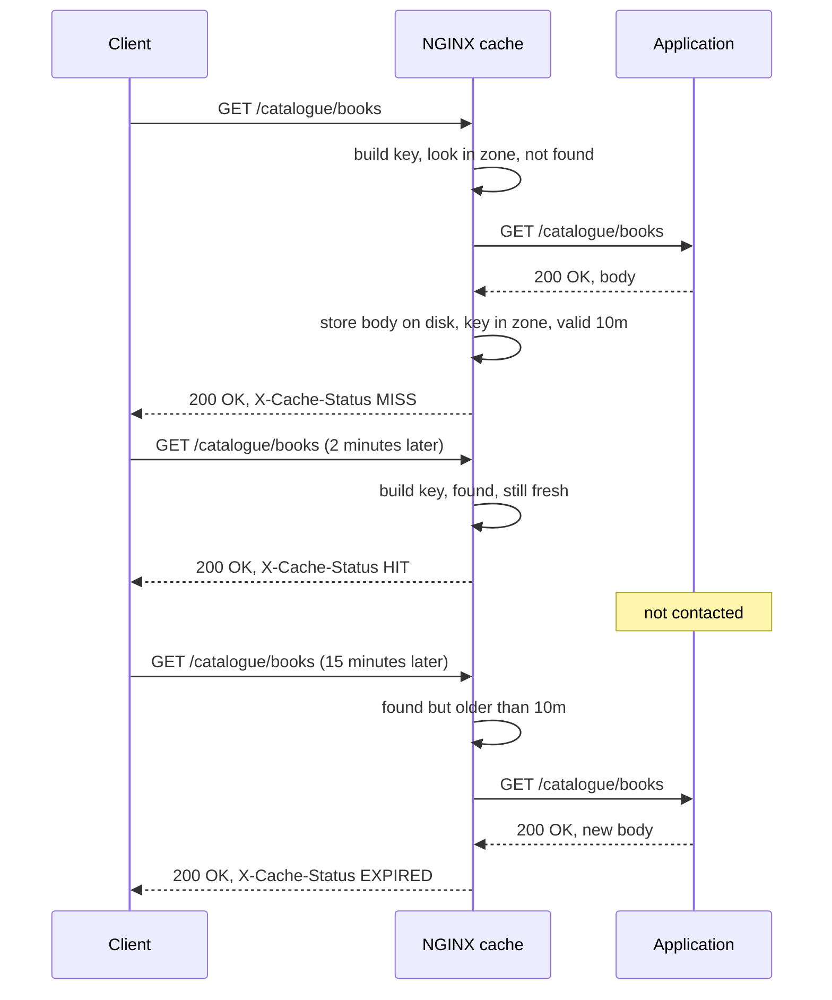
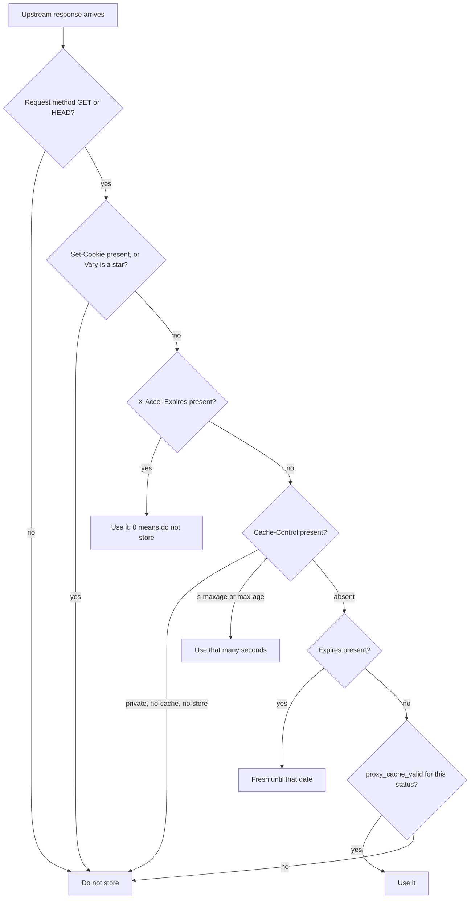

# Proxy caching: zones, keys and validity

## Before this lesson

You need reverse proxying with `proxy_pass` ([HTTP load balancing](#/lesson/nginx/lb-http-upstreams)), the idea of a shared memory zone (same lesson), and `map` ([A/B testing, map, geo](#/lesson/nginx/split-geo-map)). The networking track's [HTTP caching and cookies](#/lesson/networking/http-caching-cookies) explains the browser side of the same headers.

## In plain words

A librarian is asked the same question fifty times a day: "what are the opening hours over the holidays?". The first time, the librarian phones head office, waits on hold, and writes the answer on a sticky note. For the other forty-nine people the answer is read off the note. At some point the note is too old to trust and is thrown away, and the next question means another phone call.

A **cache** is that sticky note. NGINX stores responses it has fetched from the application and hands the stored copy to later visitors who ask for the same thing. The application is not contacted at all.

Three decisions define any cache, and they are the three things you configure:

1. **Where are the notes kept?** The cache path and zone.
2. **How do I know two questions are the same question?** The cache key.
3. **How long may a note be trusted?** The validity time.

Caching is the cheapest performance gain available: a page that costs the application 300 ms can be served from the cache in under a millisecond, and a traffic spike that would topple the application is absorbed by NGINX. The risk is equally real. A badly chosen key can show one user's private page to another user. Both sides are covered here.

## Step 1: where the cache lives

```nginx
http {
    proxy_cache_path /var/cache/nginx/shop
                     levels=1:2
                     keys_zone=shop_cache:10m
                     max_size=2g
                     inactive=60m
                     use_temp_path=off;
}
```

`proxy_cache_path` is written once in the `http` context. It does not turn caching on; it defines a store.

- `/var/cache/nginx/shop` is the folder where cached response bodies are written, one file per response. The worker user must be able to write there.
- `levels=1:2` spreads the files over two levels of subfolders (a file might be stored as `.../c/29/b7f54b2df7773722d382f4809d65029c`). Thousands of files in a single folder make file systems slow; this avoids it.
- `keys_zone=shop_cache:10m` creates a shared memory zone named `shop_cache` of 10 megabytes. It holds the **index**: the keys and facts about each entry (when it expires, how often it was used), so that every worker can tell in memory whether something is cached without touching the disk. One megabyte indexes about 8,000 entries.
- `max_size=2g` caps the disk space. When the cap is passed, a helper process called the **cache manager** deletes the least recently used entries.
- `inactive=60m` removes any entry that nobody has requested for 60 minutes, **even if it has not expired**. The default is 10 minutes. This is about usage, not freshness, and it is commonly confused with the validity time.
- `use_temp_path=off` writes each new response straight into the cache folder. Otherwise it is first written to a temporary area and then moved, which costs a copy when the two are on different disks.

Besides the cache manager, a **cache loader** process runs once after start-up, walks the folder and rebuilds the in-memory index from the files, so the cache survives a restart.

## Step 2: turn caching on

```nginx
server {
    listen 80;
    server_name shop.test;

    location /catalogue/ {
        proxy_pass http://127.0.0.1:8000;
        proxy_set_header Host $host;

        proxy_cache shop_cache;
        proxy_cache_valid 200 10m;
        proxy_cache_valid 404 1m;
        add_header X-Cache-Status $upstream_cache_status always;
    }
}
```

- `proxy_cache shop_cache;` use the zone defined above for responses from this location.
- `proxy_cache_valid 200 10m;` a response with status 200 may be reused for 10 minutes. `proxy_cache_valid 404 1m;` remembers "not found" answers for one minute, which protects the application from repeated requests for things that do not exist. Written without a status (`proxy_cache_valid 5m;`) it covers 200, 301 and 302; `any` covers every status.
- `add_header X-Cache-Status $upstream_cache_status always;` exposes what the cache did, the single most useful debugging aid for caching.

```bash
$ curl -s -o /dev/null -D - -H 'Host: shop.test' http://127.0.0.1/catalogue/books | grep -iE 'HTTP|X-Cache'
HTTP/1.1 200 OK
X-Cache-Status: MISS
$ curl -s -o /dev/null -D - -H 'Host: shop.test' http://127.0.0.1/catalogue/books | grep -iE 'HTTP|X-Cache'
HTTP/1.1 200 OK
X-Cache-Status: HIT
```

The first request was a **miss**: nothing stored, so NGINX asked the application and saved the answer. The second was a **hit**: served from the store.



The values of `$upstream_cache_status`:

| Value | Meaning |
|---|---|
| `MISS` | not in the cache; fetched from the upstream and (if allowed) stored |
| `HIT` | served from the cache, upstream not contacted |
| `EXPIRED` | an entry existed but was too old; fetched afresh |
| `BYPASS` | the cache was deliberately skipped for this request |
| `STALE` | an expired entry was served anyway, because the upstream failed or is slow |
| `UPDATING` | an expired entry was served while another request refreshes it |
| `REVALIDATED` | the upstream confirmed with a 304 that the old entry is still good |
| (empty) | the request did not go through a cached location at all |

The last four belong to the next lesson.

## Step 3: the cache key

The **key** is the text that identifies "the same request". Two requests with the same key share a cache entry. The default is

```nginx
proxy_cache_key $scheme$proxy_host$request_uri;
```

that is, `http` or `https`, then the host named in `proxy_pass`, then the original path with its query string. NGINX hashes this text with MD5 (a function that reduces any text to 32 hexadecimal characters) and uses the result as the file name.

Consequences of the default worth noticing:

- **The request method is not in it.** NGINX caches only `GET` and `HEAD` by default (`proxy_cache_methods`), and a `HEAD` is answered from a cached `GET`.
- **The visitor's `Host` header is not in it**; `$proxy_host` is the upstream name. If several sites proxy to the same upstream with the same cache zone, `/index.html` of one site and of another collide. Include `$host` when a zone serves more than one site.
- **Cookies and headers are not in it.** `/account` requested by Alice and by Bob have the same key.
- **The whole query string is in it**, in the order sent. `/list?a=1&b=2` and `/list?b=2&a=1` are different entries, and tracking parameters such as `utm_source` fragment the cache into near-duplicates.

A key should contain **everything that changes the response, and nothing else**. Too little in the key serves wrong content. Too much leaves every request with its own entry and a hit rate near zero.

```nginx
# Several sites, one zone
proxy_cache_key "$scheme$host$request_uri";

# Different content per language header
proxy_cache_key "$scheme$host$request_uri|$http_accept_language";

# Per-user cache for a personal but expensive page
proxy_cache_key "$scheme$host$request_uri|$cookie_sessionid";

# Ignore the query string entirely for a static-like path
proxy_cache_key "$scheme$host$uri";
```

> [!WARNING]
> Caching a response that depends on who is logged in, under a key that does not include who is logged in, leaks private data to strangers. This is the classic caching incident. Either put the identity in the key, or (better for most pages) do not cache personalised responses at all. The next lesson shows how to skip the cache for logged-in users.

To see what is stored, look at a cache file: the key is written in clear text near its top.

```bash
$ sudo grep -ar --max-count=1 '^KEY:' /var/cache/nginx/shop | head -3
/var/cache/nginx/shop/c/29/b7f54b2df7773722d382f4809d65029c:KEY: http127.0.0.1:8000/catalogue/books
/var/cache/nginx/shop/1/4e/0a9c5a61f0b9d6d7c1a3b7e2d8f3c4e1:KEY: http127.0.0.1:8000/catalogue/books?page=2
```

`grep -a` treats the binary file as text and `-r` searches the folder. Each stored file begins with a small header containing `KEY:` and the key string, here the default one.

## Step 4: who decides how long? The header rules

`proxy_cache_valid` is only the fallback. The application can state its own wishes in response headers, and NGINX obeys them in this order of priority:

1. `X-Accel-Expires: seconds`, an NGINX-specific header. `0` forbids caching. It is consumed by NGINX and not passed to the client.
2. `Cache-Control`, the standard header. `max-age=300` means "fresh for 300 seconds"; `s-maxage=600` is the same but addressed to shared caches such as NGINX and wins over `max-age`; `no-cache`, `no-store` or `private` forbid caching here.
3. `Expires: <date>`, the older form: fresh until that moment. A date in the past forbids caching.
4. If none of these is present, `proxy_cache_valid` for the response's status.
5. If that is absent too, the response is **not cached**.

Two more rules prevent accidents:

- A response with a `Set-Cookie` header is **never cached** by default. That header usually hands out a session, and replaying it to other visitors would log them in as someone else.
- A response with `Vary: *` is not cached. Other `Vary` values (for example `Vary: Accept-Encoding`) are honoured: NGINX stores a separate variant per value of the named request header.



When an application sends headers you disagree with, `proxy_ignore_headers` overrides them:

```nginx
location /catalogue/ {
    proxy_pass http://127.0.0.1:8000;
    proxy_cache shop_cache;
    proxy_ignore_headers Cache-Control Expires Set-Cookie;
    proxy_hide_header Set-Cookie;
    proxy_cache_valid 200 5m;
}
```

- `proxy_ignore_headers Cache-Control Expires Set-Cookie;` do not let these headers influence caching. Many frameworks send `Cache-Control: no-cache` and a session cookie on every page by default, public or not.
- `proxy_hide_header Set-Cookie;` do not pass the header to clients either. Ignoring `Set-Cookie` for caching while still forwarding it would hand the first visitor's cookie to everyone served from that entry. **These two lines go together.**

## Simulate a cache

The program models a zone with keys, per-status validity, header rules and inactivity. Change the request list and watch the statuses.

```python-run
class Cache:
    def __init__(self, valid, inactive):
        self.valid, self.inactive = valid, inactive      # {status: seconds}, seconds
        self.store = {}                                  # key -> dict(expires, last_used, body)

    def ttl(self, status, headers):
        """Seconds of freshness, or None for 'do not store'. Follows the priority order."""
        if "Set-Cookie" in headers:
            return None
        cc = headers.get("Cache-Control", "")
        parts = dict((p.strip().split("=") + [""])[:2] for p in cc.split(",") if p.strip())
        if {"private", "no-cache", "no-store"} & set(parts):
            return None
        for name in ("s-maxage", "max-age"):
            if name in parts:
                return int(parts[name]) or None
        return self.valid.get(status)

    def get(self, now, key, upstream):
        entry = self.store.get(key)
        if entry and now - entry["last_used"] > self.inactive:
            del self.store[key]; entry = None            # the cache manager removed it
        if entry and now < entry["expires"]:
            entry["last_used"] = now
            return "HIT", entry["body"]
        status, headers, body = upstream(key)
        seconds = self.ttl(status, headers)
        if seconds:
            self.store[key] = dict(expires=now + seconds, last_used=now, body=body)
        return ("EXPIRED" if entry else "MISS"), body

calls = 0
def app(key):
    global calls; calls += 1
    if "account" in key:
        return 200, {"Cache-Control": "private"}, f"private page #{calls}"
    if "missing" in key:
        return 404, {}, "not found"
    return 200, {}, f"catalogue rendering #{calls}"

cache = Cache(valid={200: 600, 404: 60}, inactive=3600)
for now, key in [(0, "http|shop|/catalogue/books"), (120, "http|shop|/catalogue/books"),
                 (700, "http|shop|/catalogue/books"), (701, "http|shop|/account"),
                 (702, "http|shop|/account"), (703, "http|shop|/missing"), (720, "http|shop|/missing"),
                 (800, "http|shop|/missing")]:
    status, body = cache.get(now, key, app)
    print(f"t={now:4}s {key.split('|')[-1]:18} {status:8} {body}")
print("application was called", calls, "times for 8 requests")
```

`/account` is a miss every time because the application marked it private. `/missing` is cached for 60 seconds, then expires.

## Cache only what is requested more than once

```nginx
proxy_cache_min_uses 3;
```

An entry is written only after its key has been requested three times. On sites with a long tail of pages that are each visited once (search results, old articles), this stops the disk from filling with entries that will never be hit.

## Measuring

The fraction of requests served from the cache is the **hit ratio**. Add the status to the access log and count:

```nginx
log_format cache '$remote_addr "$request" $status cache=$upstream_cache_status rt=$request_time';
access_log /var/log/nginx/shop-cache.log cache;
```

```bash
$ awk '{for(i=1;i<=NF;i++) if($i ~ /^cache=/) c[$i]++} END {for(k in c) print c[k], k}' \
    /var/log/nginx/shop-cache.log | sort -rn
8412 cache=HIT
1630 cache=MISS
 377 cache=EXPIRED
  95 cache=BYPASS
```

The `awk` program walks the fields of each line, counts those beginning `cache=`, and prints the totals. Here hits are 8,412 of 10,514 requests, a hit ratio of 80%. `$request_time`, the total time NGINX spent on the request, shows the payoff: hits typically log `rt=0.000`.

> [!INTERVIEW]
> "How does NGINX decide whether to cache a response and for how long?" Only GET and HEAD by default; never when the response sets a cookie or is marked private, no-cache or no-store; the lifetime comes from `X-Accel-Expires`, then `Cache-Control` (`s-maxage` before `max-age`), then `Expires`, then `proxy_cache_valid` for that status. The entry is filed under `proxy_cache_key`, by default scheme, proxy host and request URI. Close with the danger: personalised content under a key without the user's identity.

## Pitfalls

- **Expecting `proxy_cache_path` alone to cache.** It defines a store; `proxy_cache` in a location uses it.
- **Nothing is cached and every request says MISS.** The usual causes: the application sends `Set-Cookie` or `Cache-Control: no-cache` on every response, or there is no `proxy_cache_valid` and no caching header.
- **Confusing `inactive` with validity.** `inactive=10m` with `proxy_cache_valid 200 1h` removes an entry that sat unrequested for ten minutes, long before the hour.
- **`add_header` without `always`**, so the debug header is missing on 404 and 5xx responses.
- **`keys_zone` too small.** When the index is full, entries are evicted regardless of `max_size`.
- **Ignoring `Set-Cookie` without hiding it.**
- **Caching responses to `POST`.** It can be enabled with `proxy_cache_methods`, but then the request body must be part of the key, and it almost never should be.
- **A cache folder on a slow or shared disk**, turning cache hits into disk waits.

## Cheat sheet

| Goal | Configuration |
|---|---|
| Define a cache store | `proxy_cache_path /path levels=1:2 keys_zone=name:10m max_size=1g inactive=60m use_temp_path=off;` |
| Use it | `proxy_cache name;` |
| Fallback lifetime | `proxy_cache_valid 200 301 10m; proxy_cache_valid 404 1m;` |
| Key | `proxy_cache_key "$scheme$host$request_uri";` |
| Show the outcome | `add_header X-Cache-Status $upstream_cache_status always;` |
| Override application headers | `proxy_ignore_headers Cache-Control Expires;` |
| Cache after N requests | `proxy_cache_min_uses 3;` |
| Lifetime priority | `X-Accel-Expires`, `Cache-Control`, `Expires`, `proxy_cache_valid` |
| Never cached by default | non-GET/HEAD methods, `Set-Cookie`, `private`, `no-cache`, `no-store`, `Vary: *` |

## Summary

- `proxy_cache_path` creates a disk store plus an in-memory index; `proxy_cache` switches it on per location.
- The key decides which requests share an entry: include everything that changes the response and nothing more.
- Freshness comes from response headers first and `proxy_cache_valid` last; `inactive` separately removes unused entries.
- `$upstream_cache_status` reports MISS, HIT, EXPIRED and friends; expose and log it.
- Responses with cookies or private markers are skipped, for good reason.

## Glossary

- **Cache**: a store of earlier responses reused for later requests.
- **Cache key**: the text identifying which requests share an entry.
- **Cache loader / cache manager**: helper processes that rebuild the index at start-up and delete old or excess entries.
- **Cache-Control**: the standard header that states caching rules.
- **Fresh / expired**: within, or past, the time an entry may be reused.
- **Hit / miss**: a request answered from the cache, or one that had to go to the upstream.
- **Hit ratio**: hits divided by all cacheable requests.
- **inactive**: the unused time after which an entry is removed.
- **keys_zone**: the shared memory index of a cache.
- **MD5**: the hash that turns a key into a file name.
- **s-maxage**: a `Cache-Control` lifetime addressed to shared caches.

## Check yourself

```quiz
[
  {"q": "proxy_cache_valid 200 10m; A page was cached at 12:00 and is requested at 12:04. What is $upstream_cache_status?",
   "options": ["MISS", "HIT", "EXPIRED", "BYPASS"], "answer": 1,
   "explain": "Four minutes is within the ten-minute validity, so the stored copy is served."},
  {"q": "Same page requested again at 12:15, assuming it was requested in between so it is still on disk. What is the status?",
   "options": ["HIT", "MISS", "EXPIRED", "STALE"], "answer": 2,
   "explain": "The entry exists but is older than its validity, so NGINX fetches a new copy and reports EXPIRED."},
  {"q": "The upstream responds 200 with `Set-Cookie: sid=abc` and no caching headers; proxy_cache_valid 200 10m is set. Is the response stored?",
   "options": ["Yes, for 10 minutes", "No, responses that set cookies are not cached by default", "Yes, but without the cookie", "Only for HEAD requests"], "answer": 1,
   "explain": "Set-Cookie blocks caching unless you both ignore and hide the header."},
  {"q": "The upstream sends `Cache-Control: max-age=60` and the location has proxy_cache_valid 200 1h. How long is the entry fresh?",
   "options": ["1 hour", "60 seconds", "61 minutes", "It is not cached"], "answer": 1,
   "explain": "Response headers take priority over proxy_cache_valid unless proxy_ignore_headers lists them."},
  {"q": "With the default key, /list?a=1&b=2 and /list?b=2&a=1 are requested. How many cache entries result?",
   "options": ["One", "Two", "None", "It depends on the method"], "answer": 1,
   "explain": "The default key includes $request_uri verbatim, so a different parameter order is a different key."},
  {"q": "inactive=10m and proxy_cache_valid 200 1h. An entry is stored at 12:00 and not requested again until 12:30. What is the status at 12:30?",
   "options": ["HIT", "MISS", "EXPIRED", "REVALIDATED"], "answer": 1,
   "explain": "The entry was removed after 10 unused minutes, so nothing is found: a MISS."},
  {"q": "Two different sites proxy to the same upstream name and share one cache zone with the default key. A visitor to site B requests /index.html shortly after site A's was cached. What does the visitor receive?",
   "options": ["Site B's page", "Site A's cached page, because the default key uses the proxy host and not the visitor's Host", "A 502", "A redirect to site A"], "answer": 1,
   "explain": "$proxy_host is the upstream name, identical for both. Add $host to the key."}
]
```

> **Source:** DeJonghe, NGINX Cookbook, ch. 4 (caching zones, caching hash keys, cache performance). Docs: https://nginx.org/en/docs/http/ngx_http_proxy_module.html#proxy_cache_path, https://nginx.org/en/docs/http/ngx_http_proxy_module.html#proxy_cache_valid, https://nginx.org/en/docs/http/ngx_http_proxy_module.html#proxy_cache_key
