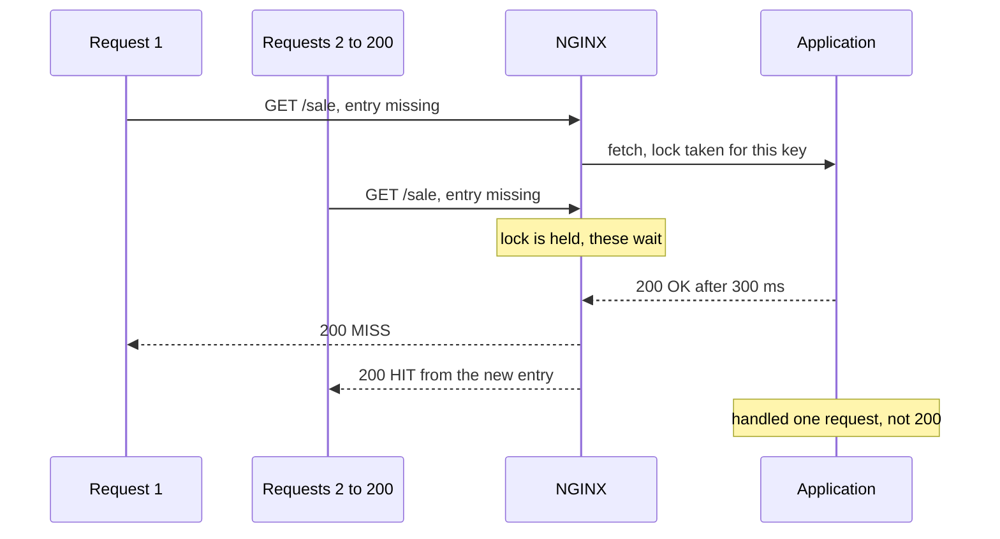

# Bypass, purge, locking, stale content and slicing

## Before this lesson

You need everything in [Proxy caching: zones, keys and validity](#/lesson/nginx/cache-basics): `proxy_cache_path`, `proxy_cache`, the cache key, `proxy_cache_valid` and the meaning of HIT, MISS and EXPIRED. `map` from [A/B testing, map, geo](#/lesson/nginx/split-geo-map) is used for conditions.

## In plain words

The previous lesson's librarian with sticky notes now meets real life.

- A staff member calls and says "ignore your note, I need the answer straight from head office". That is a **bypass**.
- Head office rings to say "the hours changed, tear up that note now". That is a **purge**.
- The note has expired and thirty people ask at the same moment. Thirty simultaneous phone calls to head office would be absurd; one call should be made while the others wait for its result. That is **cache locking**.
- Head office does not pick up. Reading out yesterday's note with a caveat beats saying "no idea". That is serving **stale** content.
- Someone wants one chapter of a thousand-page manual. Fetching and storing the manual in chapters, on demand, beats photocopying all of it. That is **slicing**.

These five features turn a basic cache into one that is safe to put in front of a busy site. They are also what distinguishes a rehearsed answer from an experienced one when an interviewer asks "what happens when a popular cache entry expires?".

## Bypass: skipping the cache on purpose

Two directives look alike and do different halves of the job.

| Directive | Question it answers |
|---|---|
| `proxy_cache_bypass VALUE...;` | "Should this request skip *reading* from the cache?" |
| `proxy_no_cache VALUE...;` | "Should this response be kept out of the cache, that is, not *written*?" |

Each takes one or more values. If any value is non-empty and not `0`, the answer is yes.

```nginx
map $cookie_sessionid $logged_in {
    default 1;
    ""      0;
}

server {
    listen 80;
    server_name shop.test;

    location / {
        proxy_pass http://127.0.0.1:8000;
        proxy_cache shop_cache;
        proxy_cache_key "$scheme$host$request_uri";
        proxy_cache_valid 200 5m;

        proxy_cache_bypass $logged_in $http_x_refresh;
        proxy_no_cache     $logged_in;

        add_header X-Cache-Status $upstream_cache_status always;
    }
}
```

- The `map` sets `$logged_in` to 0 when the session cookie is empty and 1 otherwise.
- `proxy_cache_bypass $logged_in $http_x_refresh;` a logged-in visitor, or any request carrying an `X-Refresh` header, is not answered from the cache.
- `proxy_no_cache $logged_in;` the personalised response produced for a logged-in visitor is not stored.

Notice the asymmetry: a request with `X-Refresh: 1` from an anonymous visitor bypasses the read **but its response is still written**. That overwrites the stored entry with a new copy, a handy way to refresh one page by hand:

```bash
$ curl -s -o /dev/null -D - -H 'Host: shop.test' http://127.0.0.1/sale | grep X-Cache
X-Cache-Status: HIT
$ curl -s -o /dev/null -D - -H 'Host: shop.test' -H 'X-Refresh: 1' http://127.0.0.1/sale | grep X-Cache
X-Cache-Status: BYPASS
$ curl -s -o /dev/null -D - -H 'Host: shop.test' http://127.0.0.1/sale | grep X-Cache
X-Cache-Status: HIT
```

The third request is a hit on the copy stored by the second.

> [!WARNING]
> Using only `proxy_cache_bypass` for logged-in users, without `proxy_no_cache`, stores their personal page, and the next anonymous visitor receives it. For anything personalised the two directives go together. And if anyone on the internet can send your refresh header, they can force every request to the application; restrict it to trusted addresses.

## Purge: removing an entry before it expires

Content changed and five more minutes of the old version is unacceptable.

> [!NOTE]
> **NGINX Plus.** The `proxy_cache_purge` directive is commercial.

```nginx
map $request_method $purge_method {
    default 0;
    PURGE   1;
}

server {
    location / {
        proxy_pass http://127.0.0.1:8000;
        proxy_cache shop_cache;
        proxy_cache_key "$scheme$host$request_uri";
        proxy_cache_purge $purge_method;
    }
}
```

With Plus, a request using the invented HTTP method `PURGE` (`curl -X PURGE http://shop.test/sale`) deletes the entry with the matching key and answers 204. A trailing `*` in the request path purges by prefix when the cache path has `purger=on`. Purge access must be restricted to trusted addresses.

**Open-source alternatives**, from most to least convenient:

1. **Overwrite with a bypass request**, as shown above. It refreshes one key and needs no modules.
2. **Version the key.** Put a version into the cache key and bump it to invalidate everything at once:

```nginx
map $host $cache_version { default "v42"; }
proxy_cache_key "$cache_version|$scheme$host$request_uri";
```

   Changing `v42` to `v43` and reloading makes every old entry unreachable. They age out through `inactive`. The same idea applied per file ("cache busting", such as `app.3f9a1c.js`) is how static assets are invalidated.
3. **Delete the file.** The file name is the MD5 of the key, so it can be computed:

```bash
$ key='httpshop.test/sale'
$ hash=$(printf '%s' "$key" | md5sum | cut -d' ' -f1)
$ echo "$hash"
5f0b6ebc4bea10285ba60b8a6ce36ec1
$ sudo rm -f "/var/cache/nginx/shop/${hash: -1}/${hash: -3:2}/$hash"
```

   With `levels=1:2` the first folder is the last character of the hash and the second is the two characters before it. `${hash: -1}` and `${hash: -3:2}` are shell expressions extracting those characters. NGINX notices the file is gone on the next request and treats it as a miss.
4. **The third-party `ngx_cache_purge` module**, which adds a purge location and needs a custom build or a distribution package.
5. **Short lifetimes.** If entries live for 10 seconds, the need to purge mostly disappears. Caching dynamic pages for one to ten seconds is called **microcaching**, and it is remarkably effective: at 500 requests per second for one page, a one-second lifetime sends the application one request and the cache answers the other 499.

## Cache locking: one request refills, the rest wait

A popular page expires. In the few hundred milliseconds it takes the application to render it, two hundred requests arrive. Without protection every one of them is a miss and all two hundred go to the application at once. This pile-up is known as a **cache stampede** or **thundering herd**, and it can knock over the very application the cache was protecting.

```nginx
location / {
    proxy_pass http://127.0.0.1:8000;
    proxy_cache shop_cache;
    proxy_cache_valid 200 1m;

    proxy_cache_lock on;
    proxy_cache_lock_timeout 5s;
    proxy_cache_lock_age 5s;
}
```

- `proxy_cache_lock on;` when several requests miss on the same key, only the first is sent to the upstream. The others wait for the entry to appear and are then served from it.
- `proxy_cache_lock_timeout 5s;` a waiting request gives up after 5 seconds and goes to the upstream itself, but its response is not cached.
- `proxy_cache_lock_age 5s;` if the request that holds the lock has not finished after 5 seconds, one more request is allowed through to try.



The lock applies to populating a **missing** entry. For an **expired** entry, the smoother tool is `updating`, described next, which serves the old copy to everyone while a single request refreshes it.

The simulation counts application calls for a burst arriving while a page renders.

```python-run
RENDER_MS = 300                      # how long the application takes
arrivals = list(range(0, 400, 2))    # 200 requests, one every 2 ms

def stampede(lock):
    ready_at = None                  # when the entry will be in the cache
    upstream_calls, waited = 0, 0
    for t in arrivals:
        if ready_at is not None and t >= ready_at:
            continue                 # plain HIT
        if ready_at is None or not lock:
            upstream_calls += 1      # goes to the application
            if ready_at is None:
                ready_at = t + RENDER_MS
        else:
            waited += 1              # held by the lock, served from the entry later
    return upstream_calls, waited

for lock in (False, True):
    calls, waited = stampede(lock)
    print(f"proxy_cache_lock {'on ' if lock else 'off'}: application calls = {calls:3}, requests that waited = {waited}")
```

Without the lock the application receives 150 near-simultaneous requests for the same page; with it, one.

## Stale content: an old answer beats no answer

```nginx
location / {
    proxy_pass http://127.0.0.1:8000;
    proxy_cache shop_cache;
    proxy_cache_valid 200 1m;

    proxy_cache_use_stale error timeout updating http_500 http_502 http_503 http_504;
    proxy_cache_background_update on;
    proxy_cache_revalidate on;
}
```

- `proxy_cache_use_stale ...;` lists the situations in which an **expired** entry may still be served:
  - `error`, `timeout`, `http_500` ... `http_504`: the upstream failed or returned that status. The visitor gets the old copy with `X-Cache-Status: STALE` instead of an error page. An outage of the application becomes invisible for every page that is in the cache.
  - `updating`: another request is already refreshing this entry, so serve the old copy now (`UPDATING`) rather than waiting.
- `proxy_cache_background_update on;` goes one step further: even the request that triggers the refresh is answered from the old copy at once, and the refresh happens in a background subrequest. No visitor ever waits for the application. It requires `updating` in the list above.
- `proxy_cache_revalidate on;` when refreshing an expired entry, NGINX sends a **conditional request**: "send it only if it changed since this date" (`If-Modified-Since`) or "only if its fingerprint is no longer this one" (`If-None-Match`, using the stored `ETag`). If nothing changed, the upstream replies `304 Not Modified` with no body, NGINX marks the entry fresh again, and the status is `REVALIDATED`. It saves bandwidth and upstream work for large responses.

```bash
$ sudo ssh 10.0.1.11 systemctl stop shop-app          # the application is down
$ curl -i -H 'Host: shop.test' http://127.0.0.1/sale
HTTP/1.1 200 OK
Content-Type: text/html
X-Cache-Status: STALE

<h1>Winter sale</h1>
$ curl -i -H 'Host: shop.test' http://127.0.0.1/never-cached
HTTP/1.1 502 Bad Gateway
X-Cache-Status: MISS
```

A cached page survives the outage; a page that was never cached cannot.

Applications can request the same behaviour per response with the standard extensions `Cache-Control: max-age=60, stale-while-revalidate=30, stale-if-error=600`, which NGINX honours: fresh for 60 seconds, then usable for 30 more while a refresh runs, and for 10 minutes if the upstream is failing.

How long stale entries remain available depends on `inactive` in `proxy_cache_path`: an entry that is still requested stays on disk past its expiry until it has gone unrequested for that long.

> [!TIP]
> A robust default for public pages is the trio `proxy_cache_lock on;`, `proxy_cache_use_stale error timeout updating http_500 http_502 http_503 http_504;` and `proxy_cache_background_update on;`. Misses are collapsed, refreshes are invisible, and failures are masked.

## Slicing: caching large files in pieces

Video players and download managers rarely fetch a whole file. They send **range requests**: `Range: bytes=0-999999` means "the first megabyte only", and the server replies `206 Partial Content`. A plain cache handles this badly: the first range request makes NGINX download the entire multi-gigabyte file before it can cache anything, and until then every range request is a miss.

The **slice module** cuts the file into fixed-size pieces and caches each piece as its own entry.

```nginx
proxy_cache_path /var/cache/nginx/media levels=1:2 keys_zone=media:20m max_size=50g inactive=7d;

server {
    listen 80;
    server_name media.test;

    location /videos/ {
        slice 1m;
        proxy_cache media;
        proxy_cache_key "$scheme$host$uri$is_args$args|$slice_range";
        proxy_set_header Range $slice_range;
        proxy_http_version 1.1;
        proxy_cache_valid 200 206 7d;
        proxy_pass http://10.0.6.61:9000;
    }
}
```

- `slice 1m;` the piece size. Every request is translated into one or more 1-megabyte subrequests.
- `$slice_range` is the byte range of the current piece, for example `bytes=3145728-4194303`.
- It appears in **two places and both are required**: in `proxy_cache_key`, so each piece has its own entry; and in the `Range` header sent upstream, so only that piece is fetched.
- `$is_args` is `?` when a query string is present and empty otherwise.
- `proxy_cache_valid 200 206 7d;` status 206 must be listed, since pieces arrive as partial content.
- `proxy_http_version 1.1;` range requests to the origin behave reliably with HTTP/1.1.

A request for bytes 2,500,000 to 3,600,000 touches pieces 2 and 3 (counting from zero). NGINX fetches or reads those two entries and assembles the exact range the client asked for. A later viewer who seeks to the same part of the video is served from the cache.

Choosing the size is a trade-off: small slices mean many files and many subrequests; large slices mean more unwanted bytes fetched per seek. One megabyte is a common start, with larger values for very big files. The module assumes the file does not change while it is being fetched in pieces; if the origin's `ETag` changes mid-way, the transfer is aborted. Build option: the slice module is included in official packages but is optional in custom builds (`--with-http_slice_module`).

## The other cache: the visitor's browser

Everything so far is NGINX's own cache. Browsers and CDNs keep caches too, and NGINX tells them what to do through response headers. For static files:

```nginx
location ~* \.(css|js|woff2|png|jpg|svg)$ {
    root /var/www/shop;
    expires 30d;
    add_header Cache-Control "public, immutable";
}

location = /index.html {
    root /var/www/shop;
    expires -1;
}
```

- `expires 30d;` adds `Expires` (a date 30 days ahead) and `Cache-Control: max-age=2592000`. The browser does not ask again for a month.
- `add_header Cache-Control "public, immutable";` adds two hints: any cache may store it, and it will never change, so do not even revalidate on reload. That is safe only when file names change with content (`app.3f9a1c.js`).
- `expires -1;` produces `Cache-Control: no-cache`, meaning "check with the server each time". The HTML page that names the versioned files must itself stay fresh.
- `expires max;` (ten years), `expires off;` and `expires epoch;` (a date in the past) also exist.

```bash
$ curl -sI -H 'Host: shop.test' http://127.0.0.1/app.3f9a1c.js | grep -iE 'cache-control|expires|etag'
ETag: "691f5a2b-1c2f"
Expires: Mon, 21 Dec 2026 12:10:44 GMT
Cache-Control: max-age=2592000
Cache-Control: public, immutable
```

NGINX also answers browser revalidation by itself for static files: a request with `If-None-Match: "691f5a2b-1c2f"` receives `304 Not Modified` and no body.

> [!INTERVIEW]
> "A hot cached page expires under heavy traffic. What happens and how do you prevent a problem?" Without protection every concurrent request misses and hits the origin: a stampede. Mitigations in NGINX: `proxy_cache_lock` so one request populates a missing entry, `proxy_cache_use_stale updating` with `proxy_cache_background_update` so expired entries are served while one request refreshes them, and stale-on-error to ride out origin failures. Add jittered lifetimes at the application if many keys expire together.

## Pitfalls

- **Bypass without no-cache** for personalised responses.
- **A public refresh or purge trigger**, letting anyone flush or flood.
- **`proxy_cache_background_update` without `updating`** in `proxy_cache_use_stale`; it then has no effect.
- **Expecting stale entries to exist forever.** `inactive` still removes unrequested ones.
- **Serving stale on `http_404` or `http_403`** by accident, hiding legitimate removals and permission changes.
- **Slicing without `$slice_range` in the key**: every piece overwrites the same entry and clients receive corrupt files.
- **Forgetting 206 in `proxy_cache_valid`** with slicing: nothing is cached.
- **`immutable` on files whose names do not change**, pinning an old script in browsers for a month.
- **Lock timeouts longer than users will wait.** A waiting request is a hanging page; keep `proxy_cache_lock_timeout` to a few seconds.

## Cheat sheet

| Goal | Configuration |
|---|---|
| Skip reading from the cache | `proxy_cache_bypass $cond;` |
| Skip writing to the cache | `proxy_no_cache $cond;` |
| Purge one entry (Plus) | `proxy_cache_purge $purge_method;` then `curl -X PURGE` |
| Purge without Plus | refresh by bypass, bump a key version, or delete the MD5-named file |
| Collapse concurrent misses | `proxy_cache_lock on;` |
| Serve old content on failure | `proxy_cache_use_stale error timeout http_502 http_504;` |
| Serve old content while refreshing | add `updating`, plus `proxy_cache_background_update on;` |
| Cheap refresh with 304 | `proxy_cache_revalidate on;` |
| Cache big files in pieces | `slice 1m;` with `$slice_range` in the key and the `Range` header, and `206` in validity |
| Browser caching for assets | `expires 30d;` plus `Cache-Control "public, immutable"` |
| Microcaching | `proxy_cache_valid 200 1s;` with lock and stale-while-updating |

## Summary

- `proxy_cache_bypass` skips the read and `proxy_no_cache` skips the write; personalised traffic needs both.
- Purging is a Plus directive; open-source setups refresh by bypass, version their keys, delete files, or rely on short lifetimes.
- `proxy_cache_lock` prevents stampedes on missing entries; `updating` with background update does the same for expired ones.
- Stale-on-error keeps cached pages available while the application is down.
- The slice module caches large files piece by piece for range requests.
- `expires` and `Cache-Control` steer browser caches; version file names so assets can be cached for a long time.

## Glossary

- **Background update**: refreshing an expired entry after the response has already been sent from the old copy.
- **Bypass**: answering from the upstream even though a cached copy may exist.
- **Cache busting**: changing a file's name or a key version to force fresh content.
- **Cache stampede (thundering herd)**: many simultaneous misses for one key overwhelming the origin.
- **Conditional request**: a request that asks for content only if it has changed.
- **Microcaching**: caching dynamic content for a second or a few.
- **Origin**: the server a cache fetches from.
- **Purge**: deleting a cache entry before it expires.
- **Range request**: asking for part of a file by byte positions.
- **Revalidation**: confirming with the origin that an expired entry is still correct.
- **Slice**: a fixed-size piece of a file cached on its own.
- **Stale**: expired but still stored.

## Check yourself

```quiz
[
  {"q": "A location has proxy_cache_bypass $http_x_refresh; and no proxy_no_cache. A request arrives with X-Refresh: 1 for a page that is in the cache. What is X-Cache-Status and is the new response stored?",
   "options": ["HIT, not stored", "BYPASS, and the fresh response replaces the stored entry", "MISS, not stored", "BYPASS, not stored"], "answer": 1,
   "explain": "Bypass only skips the read. Without proxy_no_cache the response is written, refreshing the entry."},
  {"q": "proxy_cache_use_stale error timeout http_502; A page is cached but expired, and the upstream refuses connections. What status code does the client receive?",
   "options": ["502", "504", "200, served from the stale entry", "404"], "answer": 2,
   "explain": "The error condition is listed, so the expired copy is served with cache status STALE."},
  {"q": "Same settings, but the requested page was never cached. What status code does the client receive?",
   "options": ["200", "502", "304", "503"], "answer": 1,
   "explain": "There is no stale copy to fall back on, so the gateway error is returned."},
  {"q": "What does proxy_cache_lock on; change when 100 requests miss on the same key at once?",
   "options": ["All 100 are rejected", "One goes upstream and the others wait for its result", "All 100 go upstream but only one is stored", "The key is purged"], "answer": 1,
   "explain": "The lock collapses concurrent misses for a key into a single upstream request."},
  {"q": "With slicing, which two places must contain $slice_range?",
   "options": ["server_name and root", "proxy_cache_key and the Range header sent upstream", "proxy_pass and listen", "expires and add_header"], "answer": 1,
   "explain": "The key separates pieces into distinct entries and the Range header makes the upstream return only that piece."},
  {"q": "proxy_cache_revalidate on; and the upstream answers a refresh with 304 Not Modified. What is $upstream_cache_status?",
   "options": ["EXPIRED", "REVALIDATED", "STALE", "BYPASS"], "answer": 1,
   "explain": "The stored body is kept and marked fresh again."},
  {"q": "A static location sets expires 30d; What does a browser do on the next visit two days later, without a forced reload?",
   "options": ["Requests the file and gets 200", "Uses its own copy without contacting the server", "Requests and gets 404", "Always sends a PURGE"], "answer": 1,
   "explain": "max-age of 30 days tells the browser the copy is fresh, so no request is made."}
]
```

> **Source:** DeJonghe, NGINX Cookbook, ch. 4 (cache locking, cache bypass, cache purging, cache slicing, cache performance). Docs: https://nginx.org/en/docs/http/ngx_http_proxy_module.html#proxy_cache_use_stale, https://nginx.org/en/docs/http/ngx_http_proxy_module.html#proxy_cache_lock, https://nginx.org/en/docs/http/ngx_http_slice_module.html, https://nginx.org/en/docs/http/ngx_http_headers_module.html
