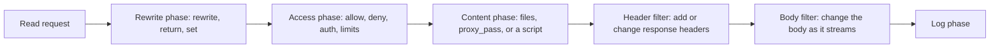

# Extending NGINX with njs and Lua

## Before this lesson

You should be able to read `server` and `location` blocks, use variables and `map` ([A/B testing, map, geo](#/lesson/nginx/split-geo-map)), and proxy to an upstream ([HTTP load balancing](#/lesson/nginx/lb-http-upstreams)). Reading a few lines of JavaScript helps; every line used here is explained. The JavaScript track starts from zero if you want more.

## In plain words

Configuration directives are like the settings dial on a washing machine: a fixed menu of programmes somebody else designed. Most days the menu is enough. Now and then you need something that is not on the dial: "check this signature", "pick the backend by looking at the third segment of a token", "merge two API answers into one".

For those cases NGINX lets you attach a small **script** to a request. Instead of choosing from the menu you write the few steps yourself. Two scripting systems are in common use:

- **njs**, a JavaScript engine written by the NGINX team for this exact purpose. It ships as an official module.
- **Lua**, a small scripting language, through the `lua-nginx-module`. It is the heart of **OpenResty**, a widely used distribution that bundles NGINX with Lua and a library collection.

Why it matters for a job: scripted gateways are everywhere (API gateways such as Kong and the popular Kubernetes ingress-nginx controller are built on NGINX with Lua), and "we need NGINX to do one small custom thing" is a request every platform team receives. Knowing what is possible, and when to refuse and put the logic in an application instead, is the skill.

## Where scripts plug in: request phases

NGINX processes a request in a fixed series of **phases**. Directives you already know each belong to one: `rewrite` and `return` run in the rewrite phase, `allow`/`deny` and `auth_basic` in the access phase, `proxy_pass` produces content, `add_header` runs while the response headers pass back, and logging comes last.



A script is attached at one of these points. The attachment directive names the phase:

| I want to... | njs directive | Lua directive |
|---|---|---|
| compute a variable | `js_set` | `set_by_lua_block` |
| allow or refuse a request | `auth_request` pointing at a `js_content` location (the stream module has `js_access`) | `access_by_lua_block` |
| produce the whole response | `js_content` | `content_by_lua_block` |
| change response headers | `js_header_filter` | `header_filter_by_lua_block` |
| change the response body | `js_body_filter` | `body_filter_by_lua_block` |
| run something on a timer | `js_periodic` | `ngx.timer.every` |

The single most important rule comes from lesson 1: a worker is one event loop serving thousands of connections. **A script must never wait.** No sleeping, no slow loops over large data, no blocking network or file calls. Both systems provide non-blocking ways to call other services, shown below.

## njs step by step

### Install and load

```bash
$ sudo apt install -y nginx-module-njs      # from the nginx.org repository
$ ls /usr/lib/nginx/modules/ | grep js
ngx_http_js_module.so
ngx_stream_js_module.so
```

The package installs **dynamic modules**: separate files that NGINX loads at start-up when told to. One is for HTTP, one for the stream context. (On distribution packages the name is `libnginx-mod-http-js`.)

```nginx
# top of /etc/nginx/nginx.conf, main context
load_module modules/ngx_http_js_module.so;
```

### A first handler: produce a response

Create the script file `/etc/nginx/njs/hello.js`:

```javascript
function hello(r) {
    r.headersOut['Content-Type'] = 'text/plain';
    r.return(200, `Hello ${r.args.name || 'stranger'}, you asked for ${r.uri}\n`);
}

export default { hello };
```

- `function hello(r)` defines a handler. NGINX calls it with one argument, `r`, the **request object**.
- `r.headersOut[...] = ...` sets a response header.
- `r.args.name` is the query parameter `name`; `|| 'stranger'` supplies a fallback when it is missing.
- `r.return(200, text)` sends the response and finishes the request.
- `export default { hello };` makes the function visible to NGINX under the name `hello`.

Wire it up:

```nginx
http {
    js_path "/etc/nginx/njs/";
    js_import main from hello.js;

    server {
        listen 80;
        server_name shop.test;

        location = /hello {
            js_content main.hello;
        }
    }
}
```

- `js_path` is the folder where scripts are looked for.
- `js_import main from hello.js;` loads the file and calls it `main` in the configuration.
- `js_content main.hello;` in this location, the response is produced by that function.

```bash
$ sudo nginx -t && sudo systemctl reload nginx
$ curl -i -H 'Host: shop.test' 'http://127.0.0.1/hello?name=Rosa'
HTTP/1.1 200 OK
Content-Type: text/plain
Content-Length: 39

Hello Rosa, you asked for /hello
```

Script files are read at start-up and on reload, like configuration. Editing a `.js` file has no effect until you reload.

### Compute a variable with js_set

A common small need: a value that no `map` can express. Here, a short fingerprint of the client used to group requests.

```javascript
import crypto from 'crypto';

function clientTag(r) {
    const raw = r.remoteAddress + '|' + (r.headersIn['User-Agent'] || '');
    return crypto.createHash('sha256').update(raw).digest('hex').slice(0, 12);
}

export default { clientTag };
```

```nginx
js_import tags from tags.js;
js_set $client_tag tags.clientTag;

server {
    location / {
        proxy_set_header X-Client-Tag $client_tag;
        proxy_pass http://127.0.0.1:8000;
    }
}
```

- `import crypto from 'crypto';` loads njs's built-in hashing library.
- `r.remoteAddress` and `r.headersIn[...]` read the client address and a request header.
- The function builds a string, hashes it with SHA-256 (a function that turns any input into a fixed-length fingerprint), and keeps the first 12 characters.
- `js_set $client_tag tags.clientTag;` declares a variable whose value is the function's return value. Like `map`, it is evaluated only when used. A `js_set` function must return at once; it cannot perform network calls.

### Call another service without blocking

A handler that asks an internal service a question and combines the answer:

```javascript
async function priceWithStock(r) {
    const [price, stock] = await Promise.all([
        r.subrequest('/_internal/price', { args: r.variables.args }),
        r.subrequest('/_internal/stock', { args: r.variables.args }),
    ]);
    if (price.status !== 200 || stock.status !== 200) {
        r.return(502, 'upstream trouble\n');
        return;
    }
    const body = { ...JSON.parse(price.responseText), ...JSON.parse(stock.responseText) };
    r.headersOut['Content-Type'] = 'application/json';
    r.return(200, JSON.stringify(body) + '\n');
}

export default { priceWithStock };
```

```nginx
location = /api/product-summary { js_content agg.priceWithStock; }

location /_internal/price { internal; proxy_pass http://10.0.1.31:8000/price; }
location /_internal/stock { internal; proxy_pass http://10.0.1.32:8000/stock; }
```

- `r.subrequest(path, options)` makes NGINX process another location on behalf of this request and hands back the result. It returns a **promise**, a placeholder for a result that will arrive later.
- `await Promise.all([...])` starts both subrequests together and resumes the function when both are done. While they are in flight the worker serves other connections; nothing blocks.
- The two `internal` locations exist only as subrequest targets and proxy to the real services.
- `{ ...a, ...b }` merges two objects into one.

This pattern, combining several backend calls into one client-facing response, is called **API aggregation**. For calls to arbitrary URLs there is also `ngx.fetch(url)`, njs's non-blocking HTTP client.

```bash
$ curl -s -H 'Host: shop.test' 'http://127.0.0.1/api/product-summary?id=731'
{"id":731,"price":"19.90","currency":"NZD","in_stock":12}
```

### What njs is and is not

njs implements a large part of modern JavaScript (ECMAScript 5.1 with many later additions such as arrow functions, `async`/`await`, template strings and modules), but it is **not Node.js**. There is no `npm install`, no `require('express')`, no access to Node's libraries. A new, small virtual machine is created for each request and thrown away afterwards, which keeps requests isolated and memory bounded. Shared state between requests goes through `js_shared_dict_zone`, a shared-memory dictionary. Recent releases can alternatively run scripts on the QuickJS engine for fuller language support.

## Lua and OpenResty

The Lua approach is older and has the larger ecosystem. Plain NGINX does not include it; you obtain it by installing **OpenResty** (NGINX plus LuaJIT, a fast Lua implementation, plus libraries) or a distribution's `libnginx-mod-http-lua` package.

```nginx
http {
    lua_shared_dict counters 1m;

    server {
        listen 80;
        server_name shop.test;

        location = /hello-lua {
            content_by_lua_block {
                local name = ngx.var.arg_name or "stranger"
                ngx.header["Content-Type"] = "text/plain"
                ngx.say("Hello ", name, ", you asked for ", ngx.var.uri)
            }
        }

        location /api/ {
            access_by_lua_block {
                local key = ngx.req.get_headers()["X-Api-Key"]
                if not key then
                    return ngx.exit(ngx.HTTP_UNAUTHORIZED)
                end
                local hits = ngx.shared.counters:incr(key, 1, 0, 60)
                if hits > 100 then
                    return ngx.exit(429)
                end
            }
            proxy_pass http://127.0.0.1:8000;
        }
    }
}
```

- `lua_shared_dict counters 1m;` creates a 1-megabyte dictionary in shared memory, visible to all workers.
- `content_by_lua_block { ... }` the block's Lua code produces the response. `ngx.var.arg_name` reads the NGINX variable `$arg_name`; `or "stranger"` is the fallback; `ngx.say` writes a line of output.
- `access_by_lua_block { ... }` runs in the access phase, before `proxy_pass`.
  - It reads the `X-Api-Key` request header and answers 401 if there is none.
  - `ngx.shared.counters:incr(key, 1, 0, 60)` adds 1 to that key's counter, creating it at 0 with a 60-second lifetime if absent. This is a simple "100 requests per minute per API key" limit in four lines.
  - `ngx.exit(429)` ends the request with that status. If the block ends without exiting, processing continues to `proxy_pass`.

For network calls, Lua in NGINX offers **cosockets**: sockets that look like ordinary blocking calls in the code but yield to the event loop underneath. Libraries built on them (`lua-resty-http`, `lua-resty-redis`, `lua-resty-jwt`) cover most gateway needs.

### njs or Lua?

| | njs | Lua (OpenResty) |
|---|---|---|
| Maintained by | the NGINX project | the OpenResty community |
| Works with stock NGINX packages | yes, official dynamic module | needs OpenResty or a third-party module |
| Language | JavaScript subset | Lua, with LuaJIT speed |
| Libraries | small built-in set | large (`lua-resty-*`) |
| State between requests | shared dict zones | shared dicts, per-worker globals, timers |
| Typical users | teams on NGINX or NGINX Plus wanting light glue | API gateways, ingress controllers, heavy customisation |

There is also an older embedded Perl module (`ngx_http_perl_module`). It works, but its calls can block a worker, and new work should choose njs or Lua.

## A model of what a script does

The request object and phases can feel abstract. This Python model mimics an access-phase script followed by a content handler, including the shared counter. It is an illustration of the control flow, not of real njs.

```python-run
shared = {}                                    # like a shared dict: visible to every request

def access_phase(req):
    """Return None to continue, or (status, body) to stop the request here."""
    key = req["headers"].get("X-Api-Key")
    if not key:
        return 401, "missing key"
    minute = req["time"] // 60
    shared[(key, minute)] = shared.get((key, minute), 0) + 1
    if shared[(key, minute)] > 3:              # tiny quota so the demo shows a refusal
        return 429, "slow down"
    return None

def content_phase(req):
    return 200, f"hello {req['args'].get('name', 'stranger')}"

def handle(req):
    for phase in (access_phase, content_phase):
        result = phase(req)
        if result is not None:                 # a phase produced the final answer
            return result

requests = [dict(time=t, headers=h, args={"name": "Rosa"})
            for t, h in [(1, {}), (2, {"X-Api-Key": "k1"}), (3, {"X-Api-Key": "k1"}),
                         (4, {"X-Api-Key": "k1"}), (5, {"X-Api-Key": "k1"}), (61, {"X-Api-Key": "k1"})]]
for r in requests:
    print(f"t={r['time']:3}s key={r['headers'].get('X-Api-Key')!s:5} -> {handle(r)}")
```

The first request stops in the access phase with 401, the fifth with 429, and the one in the next minute passes again because the counter is per minute.

## When not to script

> [!WARNING]
> Every line of script runs inside the process that serves all your traffic. A bug or a slow loop there affects every site on the machine. Keep scripts short, test them like application code, and set limits (`js_fetch_timeout`, sensible `proxy_read_timeout` on subrequest targets).

A practical checklist before writing a script:

1. Can a directive do it? `map`, `split_clients`, `limit_req`, `auth_request`, `sub_filter` and `return` cover a surprising range and are faster and safer.
2. Is it business logic? Pricing rules, permissions and data validation belong in an application with tests, deployments and owners.
3. Does it need a database or a big library? Then it is an application.
4. Is it small glue at the edge: header manipulation, token checks, routing decisions, response shaping? That is the right place for njs or Lua.

> [!INTERVIEW]
> "How can you add custom logic to NGINX?" Name the options in order of weight: built-in directives and `map`; the njs module (`js_set` for variables, `js_content` for handlers, filters for responses); Lua through OpenResty with `access_by_lua` and friends; or writing a C module. Stress the constraint that code runs inside the event loop and must be non-blocking, which is why both systems offer subrequests, fetch APIs or cosockets.

## Pitfalls

- **Forgetting `load_module`**, giving `unknown directive "js_import"`.
- **Editing a script without reloading.**
- **Blocking work**: heavy cryptography in pure script, big JSON parsing on every request, synchronous file reads in the request path.
- **Assuming Node.js APIs exist** in njs.
- **Network calls from `js_set`.** Variable handlers must be synchronous.
- **Per-worker state in Lua globals.** Each worker has its own copy; use a shared dict for anything that must agree across workers.
- **Trusting input.** A script that puts request data into headers, redirects or subrequest paths can be tricked exactly as an application can.
- **Version drift.** njs gains features quickly; a script written for a new release may fail on a distribution's older package. Check `njs -v`.

## Cheat sheet

| Goal | njs | Lua |
|---|---|---|
| Load | `load_module modules/ngx_http_js_module.so;` `js_import m from f.js;` | OpenResty, or load `ngx_http_lua_module` |
| Respond | `js_content m.fn;` and `r.return(200, body)` | `content_by_lua_block { ngx.say(...) }` |
| Variable | `js_set $v m.fn;` | `set_by_lua_block $v { return ... }` |
| Gate a request | `auth_request` to a `js_content` location | `access_by_lua_block { ngx.exit(403) }` |
| Read a header | `r.headersIn['X-Y']` | `ngx.req.get_headers()["X-Y"]` |
| Read an NGINX variable | `r.variables.name` | `ngx.var.name` |
| Call a backend | `await r.subrequest('/x')`, `ngx.fetch(url)` | `ngx.location.capture('/x')`, `lua-resty-http` |
| Shared state | `js_shared_dict_zone` | `lua_shared_dict` |

## Summary

- Scripts attach to request phases: computing variables, gating access, producing content, filtering responses.
- njs is the official JavaScript module: `js_import`, then `js_set`, `js_content` and filters; network calls use promises and never block.
- Lua through OpenResty offers the same hooks with a larger library ecosystem and shared dictionaries.
- Code runs inside the event loop, so it must be short and non-blocking.
- Reach for directives first, scripts for edge glue, and applications for business logic.

## Glossary

- **API aggregation**: combining several backend responses into one.
- **Cosocket**: a Lua socket in NGINX that yields to the event loop while waiting.
- **Dynamic module**: a module in a separate file loaded with `load_module`.
- **Lua / LuaJIT**: a small scripting language and its fast implementation.
- **njs**: the NGINX project's JavaScript engine and module.
- **OpenResty**: a distribution of NGINX bundled with Lua and libraries.
- **Phase**: a stage of request processing at which directives and scripts run.
- **Promise**: a value representing a result that will arrive later.
- **Request object**: the `r` (njs) or `ngx` (Lua) handle to the current request.
- **Shared dict**: a key-value table in shared memory, visible to all workers.
- **Subrequest**: an internal request NGINX makes on behalf of the current one.

## Check yourself

```quiz
[
  {"q": "Which njs directive makes a JavaScript function generate the whole response for a location?",
   "options": ["js_set", "js_content", "js_import", "js_path"], "answer": 1,
   "explain": "js_content runs the function as the content handler. js_set computes a variable and js_import loads a file."},
  {"q": "A location has an access_by_lua_block that ends with ngx.exit(403) when a header is missing, followed by proxy_pass. A request arrives without the header. What status code is returned?",
   "options": ["200 from the upstream", "403", "502", "500"], "answer": 1,
   "explain": "The access phase runs before the content phase; exiting there ends the request and proxy_pass never runs."},
  {"q": "Why must a script never sleep or run a long loop?",
   "options": ["It would use too much disk", "It runs inside a worker's event loop, so every connection on that worker stalls", "NGINX kills scripts after 1 ms", "JavaScript cannot loop"], "answer": 1,
   "explain": "A worker is single-threaded. Blocking it blocks all the requests it is handling."},
  {"q": "You edit /etc/nginx/njs/hello.js. When does the change take effect?",
   "options": ["Immediately", "On the next request", "After a reload", "Never, it must be recompiled"], "answer": 2,
   "explain": "Scripts are loaded with the configuration at start-up and on reload."},
  {"q": "Which statement about njs is true?",
   "options": ["It is Node.js embedded in NGINX", "It can install npm packages at run time", "It is a separate JavaScript engine with its own small standard library", "It only works in NGINX Plus"], "answer": 2,
   "explain": "njs is its own engine and is available for open-source NGINX as a dynamic module."},
  {"q": "A Lua script stores a counter in a plain global variable. With 4 workers, what do clients observe?",
   "options": ["One consistent counter", "Up to four separate counters, depending on which worker serves the request", "An error at start-up", "The counter is stored on disk"], "answer": 1,
   "explain": "Each worker has its own Lua state. lua_shared_dict gives a counter shared by all workers."},
  {"q": "A location with js_content calls r.subrequest to an internal location whose upstream is down, and the script returns 502 when a subrequest fails. Which component produced the 502 the client sees?",
   "options": ["The upstream application", "The script running in NGINX", "The browser", "The DNS server"], "answer": 1,
   "explain": "The upstream never answered; the script inspected the failed subrequest and chose to return 502."}
]
```

> **Source:** DeJonghe, NGINX Cookbook, ch. 5 (extending NGINX with a common programming language). Docs: https://nginx.org/en/docs/njs/, https://nginx.org/en/docs/http/ngx_http_js_module.html, https://nginx.org/en/docs/njs/reference.html, https://github.com/openresty/lua-nginx-module
