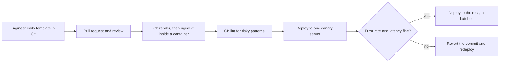

# Configuration management, templating and the API

## Before this lesson

You should know the layout of `/etc/nginx`, `include`, and the test-then-reload habit from [Installing NGINX and reading nginx.conf](#/lesson/nginx/install-and-config), and `upstream` blocks from [HTTP load balancing](#/lesson/nginx/lb-http-upstreams). Familiarity with Git is useful; the Git track covers it.

## In plain words

Editing a configuration file by hand on one server works for a hobby site. Now picture six NGINX servers, three environments (development, staging, production), and application servers that appear and disappear every time the system scales. Hand editing fails in three ways: servers drift apart, nobody remembers who changed what, and the files are always a little out of date.

A restaurant chain solves the same problem with a recipe book kept at head office. Each kitchen receives the same recipe, with a few blanks filled in locally ("serves ___ people"). Nobody improvises on site, and a change to the book reaches every kitchen.

For NGINX the recipe book is a **Git repository**, the recipe with blanks is a **template**, the person delivering identical copies is a **configuration management tool**, and for changes too frequent for the delivery round there is a telephone line straight into the running kitchen: an **API** (application programming interface, a way for programs to give instructions over HTTP).

This is daily work in DevOps and platform roles. "How do you roll out an NGINX change safely to twenty servers?" is a standard interview question, and the answer is this lesson.

## Layer 1: organise files so they can be automated

Automation works on files, so structure comes first. A layout that scales:

```text
/etc/nginx/
  nginx.conf                 # main settings, http block, includes only
  conf.d/
    00-defaults.conf         # catch-all default_server
    shop.conf                # one file per site
    blog.conf
  upstreams/
    shop_app.conf            # generated: one upstream block per file
  snippets/
    proxy-headers.conf       # proxy_set_header lines used everywhere
    security-headers.conf
    tls-params.conf
```

```nginx
# /etc/nginx/snippets/proxy-headers.conf
proxy_set_header Host              $host;
proxy_set_header X-Real-IP         $remote_addr;
proxy_set_header X-Forwarded-For   $proxy_add_x_forwarded_for;
proxy_set_header X-Forwarded-Proto $scheme;
```

```nginx
# /etc/nginx/conf.d/shop.conf
server {
    listen 80;
    server_name shop.test;

    location / {
        include snippets/proxy-headers.conf;
        proxy_pass http://shop_app;
    }
}
```

- Shared lines live once, in `snippets/`, and are pulled in with `include`. A relative path in `include` is resolved from the folder of the main configuration file, so `snippets/proxy-headers.conf` means `/etc/nginx/snippets/proxy-headers.conf`.
- Files that machines generate (`upstreams/`) are kept apart from files that people write, so a generator never overwrites a human's work.
- The numeric prefix `00-` makes the default server load first under alphabetical inclusion.

Remember the array-inheritance rule from lesson 2: because `proxy_set_header` lines are replaced, not merged, including the snippet inside each proxying location is more reliable than setting the headers once at `http` level and hoping no location adds its own.

## Layer 2: templates

A **template** is a file with placeholders; a **rendering** step replaces the placeholders with values and writes the real file.

### The smallest tool: envsubst

`envsubst` replaces `${NAME}` with the value of the environment variable `NAME`.

```nginx
# shop.conf.template
server {
    listen ${LISTEN_PORT};
    server_name ${SITE_NAME};

    location / {
        proxy_pass http://${APP_HOST}:${APP_PORT};
        proxy_set_header Host $host;
    }
}
```

```bash
$ export LISTEN_PORT=80 SITE_NAME=shop.test APP_HOST=10.0.1.11 APP_PORT=8000
$ envsubst '${LISTEN_PORT} ${SITE_NAME} ${APP_HOST} ${APP_PORT}' \
    < shop.conf.template | sudo tee /etc/nginx/conf.d/shop.conf > /dev/null
$ grep -E 'listen|proxy_pass|Host' /etc/nginx/conf.d/shop.conf
    listen 80;
        proxy_pass http://10.0.1.11:8000;
        proxy_set_header Host $host;
```

- `export` sets environment variables for this shell session.
- The quoted list given to `envsubst` names the only variables it may replace. This matters: NGINX's own variables also start with `$`. Without the list, `$host` would be replaced by an empty string and the configuration would break without any warning. With the list, `$host` survives, as the last output line shows.

The official Docker image runs this step for you: any file placed in `/etc/nginx/templates/` ending in `.template` is rendered into `/etc/nginx/conf.d/` at container start. The containers lesson returns to it.

### Loops and conditions: Jinja2, ERB, Go templates

`envsubst` cannot repeat a line per server. Real templating languages can. Jinja2 (used by Ansible) looks like this:

```nginx
# templates/upstream.conf.j2
upstream {{ name }} {
    zone {{ name }} 64k;
    least_conn;

    server {{ s.host }}:{{ s.port }} weight={{ s.weight }};

    keepalive 32;
}
```

`{{ ... }}` prints a value; `` repeats a block for each item of a list; `` includes text conditionally. Given a list of three servers, the output is an ordinary `upstream` block with three `server` lines.

The same idea in plain Python, runnable here, with a sanity check before "deploying":

```python-run
servers = [
    {"host": "10.0.1.11", "port": 8000, "weight": 3},
    {"host": "10.0.1.12", "port": 8000},
    {"host": "10.0.1.13", "port": 8000},
]

def render_upstream(name, servers, method="least_conn"):
    lines = [f"upstream {name} {{", f"    zone {name} 64k;", f"    {method};"]
    for s in servers:
        extra = f" weight={s['weight']}" if "weight" in s else ""
        lines.append(f"    server {s['host']}:{s['port']}{extra};")
    lines += ["    keepalive 32;", "}"]
    return "\n".join(lines) + "\n"

def sanity_check(text):
    """A stand-in for `nginx -t`: cheap structural checks before a file is installed."""
    problems = []
    if text.count("{") != text.count("}"):
        problems.append("unbalanced braces")
    if "    server " not in text:
        problems.append("upstream has no servers: every request would get 502")
    for n, line in enumerate(text.splitlines(), 1):
        stripped = line.strip()
        if stripped and not stripped.endswith(("{", "}", ";")):
            problems.append(f"line {n} lacks a semicolon")
    return problems

conf = render_upstream("shop_app", servers)
print(conf)
print("problems:", sanity_check(conf) or "none")
print("problems with an empty pool:", sanity_check(render_upstream("shop_app", [])))
```

The second check illustrates a real hazard of generated configuration: when the source of truth briefly returns an empty list, a naive generator writes an upstream with no servers. NGINX rejects that file (`no servers are inside upstream`), which is the good outcome; a generator that then gives up, leaving the last good file in place, is the behaviour you want.

### Templates driven by service discovery

In dynamic environments the list of servers comes from a **service registry**: a database of "which instances of which service are alive right now". Consul is a common one. Its companion `consul-template` watches the registry, re-renders a template when the list changes, and runs a command afterwards:

```bash
$ consul-template \
    -template "/etc/nginx/templates/shop_app.ctmpl:/etc/nginx/upstreams/shop_app.conf:nginx -t && nginx -s reload"
```

The argument has three parts separated by colons: the template to read, the file to write, and the command to run after writing. The command tests before reloading, so a bad render does not take effect. Since a reload is graceful, frequent reloads are safe, though each one briefly doubles the worker count, and long-lived connections keep old workers around. Past a few reloads per minute, look at the dynamic options in layer 4.

## Layer 3: configuration management tools

A **configuration management tool** brings many servers to a described state and keeps them there. The description is code in a repository. The four classic tools differ in language and mechanics more than in purpose.

| Tool | Description language | How it reaches servers |
|---|---|---|
| Ansible | YAML playbooks | pushes over SSH, nothing to install on the servers |
| Puppet | its own declarative language | an agent on each server pulls from a central server |
| Chef | Ruby recipes | agent pulls |
| Salt | YAML states | agent, push or pull over a message bus |

All four express the same three steps for NGINX: install the package, place rendered files, make sure the service runs and reloads when files change. In Ansible:

```yaml
# nginx.yml
- hosts: web
  become: true
  vars:
    app_servers:
      - { host: 10.0.1.11, port: 8000 }
      - { host: 10.0.1.12, port: 8000 }
  tasks:
    - name: Install nginx
      ansible.builtin.package:
        name: nginx
        state: present

    - name: Render the upstream file
      ansible.builtin.template:
        src: templates/upstream.conf.j2
        dest: /etc/nginx/upstreams/shop_app.conf
        validate: "nginx -t -c %s"
      notify: Reload nginx

    - name: Ensure nginx is running and starts at boot
      ansible.builtin.service:
        name: nginx
        state: started
        enabled: true

  handlers:
    - name: Reload nginx
      ansible.builtin.service:
        name: nginx
        state: reloaded
```

- `hosts: web` applies the play to the group of machines named `web` in the inventory. `become: true` uses administrator rights.
- `vars` holds the data that fills the template.
- Each task names a desired state. The `package` task installs NGINX only if it is missing. Running the playbook twice changes nothing the second time, a property called **idempotence**.
- The `template` task renders the Jinja2 file. `notify` flags a **handler**, a task that runs once at the end and only if something changed; here it reloads NGINX. The `validate` line is shown to make the point that validation belongs before installation; in practice a fragment such as an upstream file cannot be tested alone, so real playbooks render to a staging folder and run `nginx -t` on the whole tree, or run the test as a separate task before the handler.

```bash
$ ansible-playbook -i inventory.ini nginx.yml --check --diff     # preview only
$ ansible-playbook -i inventory.ini nginx.yml --limit web1       # one server first
$ ansible-playbook -i inventory.ini nginx.yml                    # everyone
```

`--check --diff` shows what would change without changing it. `--limit web1` applies to one machine, a canary for configuration.

### The pipeline around the tool



**CI** (continuous integration) is the automation that runs checks on every proposed change. Two cheap checks catch most mistakes:

```bash
$ docker run --rm -v "$PWD/rendered:/etc/nginx:ro" nginx:stable nginx -t
nginx: the configuration file /etc/nginx/nginx.conf syntax is ok
nginx: configuration file /etc/nginx/nginx.conf test is successful
```

This starts a throwaway container from the official image with the rendered files mounted read-only and runs only the test. A **linter**, a program that looks for known bad patterns, adds a second opinion: tools such as `gixy` flag things like `$uri` in redirects or regexes without anchors. Problem `nginx-config-lint` has you build a small one.

Rollback is `git revert` followed by the same pipeline. Since configuration is code, the history answers "what changed at 14:05 yesterday?".

## Layer 4: changing a running NGINX through an API

Templates plus reload handle changes every few minutes. Some environments change every few seconds.

> [!NOTE]
> **NGINX Plus.** The REST API for run-time changes and the key-value store are commercial features.

```nginx
upstream shop_app {
    zone shop_app 64k;
    state /var/lib/nginx/state/shop_app.conf;
}

server {
    listen 127.0.0.1:8080;

    location /api {
        api write=on;
        allow 127.0.0.1;
        deny all;
    }
}
```

- `zone` is required: servers added at run time live in shared memory.
- `state FILE;` saves run-time changes so they survive a restart. With `state`, `server` lines are not written in the block; the file is the list.
- `api write=on;` exposes the API in this location, with changes allowed. `allow` and `deny` restrict it to the local machine; an open write API would let anyone redirect your traffic.

```bash
$ curl -s -X POST -d '{"server":"10.0.1.14:8000","weight":2}' \
    http://127.0.0.1:8080/api/9/http/upstreams/shop_app/servers
{"id":3,"server":"10.0.1.14:8000","weight":2,"max_conns":0,"max_fails":1,"fail_timeout":"10s","slow_start":"0s","backup":false,"down":false}

$ curl -s -X PATCH -d '{"drain":true}' http://127.0.0.1:8080/api/9/http/upstreams/shop_app/servers/3
$ curl -s -X DELETE http://127.0.0.1:8080/api/9/http/upstreams/shop_app/servers/3
```

`POST` adds a server and returns its record with an `id`; `PATCH` changes one field (here, start draining); `DELETE` removes it. No reload occurs and no connection is disturbed. The number `9` in the path is the API version. The same API returns live metrics, used in the monitoring lesson.

The **key-value store** is a second run-time lever: a shared-memory table that the API can write and the configuration can read as a variable.

```nginx
keyval_zone zone=denylist:1m state=/var/lib/nginx/state/denylist.json;
keyval $remote_addr $blocked zone=denylist;

server {
    if ($blocked) { return 403; }
}
```

`keyval_zone` creates the table; `keyval KEY $VAR zone=...` looks the key up for each request. Posting `{"198.51.100.7":"1"}` to `/api/9/http/keyvals/denylist` blocks that address at once on every worker.

**Open-source alternatives for run-time change:**

- **DNS-based membership.** List one hostname and let DNS carry the changing set: `server app.internal:8000 resolve;` with a `resolver` directive and a `zone`. NGINX re-resolves the name as its records expire, without reload. The `resolve` parameter was commercial for years and is in open-source NGINX from version 1.27.3.
- **Frequent graceful reloads** from `consul-template` or a similar watcher.
- **Scripting.** OpenResty's `balancer_by_lua_block` chooses an upstream address in code from a shared dictionary that another endpoint updates; njs offers shared dictionaries for deny-lists and flags.
- **A platform that already does it**, such as a Kubernetes Ingress controller, which watches the cluster and updates NGINX for you.

## Managing a fleet: from NGINX Controller to today

The cookbook describes **NGINX Controller**, a separate commercial product that provided a central screen and API for many NGINX Plus instances: push configuration, view traffic analytics, and enable a web application firewall per application. Each instance ran an agent that registered with the controller. F5 has since retired Controller; its role is filled by **NGINX Instance Manager** and the hosted **NGINX One** console, with the same idea: an agent on every instance, a central inventory, configuration pushed and validated from one place, and metrics collected. The open-source equivalent is the pipeline in this lesson: Git as the inventory and history, a configuration management tool as the delivery mechanism, and a metrics stack (covered in the monitoring module) for visibility.

### The lifecycle of NGINX Controller, and three similar names

Product names around NGINX are confusing, so here is the timeline in plain steps. Treat the dates as the ones F5 published when this was written, and confirm them in F5's current notices before basing a decision on them.

- **What it was.** NGINX Controller was a paid management console for NGINX Plus. A small agent on every NGINX Plus machine reported to it, and from one screen you could see traffic, push configuration and apply policies. Variants of it handled application delivery, an API management module, and security.
- **What happened.** F5 announced the **end of sale** of the Controller products from 1 January 2024 (no new purchases), stopped licence renewals after 30 September 2024 (both stated in F5's Controller release notes), and announced an **end of software development and end of technical support** that is widely reported as 30 September 2025 (check F5's own notice for the exact dates that apply to you). After support ends there are no fixes and no help from F5, so a Controller still running is an unsupported leftover that should be planned out of production.
- **What took over.** F5's fleet management now goes through **NGINX Instance Manager**, which you install yourself and which uses the same agent idea, and **NGINX One**, a hosted console and package that F5 positions as the main direction. A third product, NGINX Amplify (a monitoring service), was retired as well, with its users pointed towards NGINX One; F5 says NGINX One's console is a new system, so you rebuild your views there instead of importing old ones. The exact feature mapping between these products has changed over time, and I could not confirm every detail, so read F5's current product pages for the one you plan to adopt.

**Three names that sound the same:**

| Name | What it is | Status |
|---|---|---|
| NGINX Controller | the paid fleet console for NGINX Plus described above | end of sale 2024; support end reported as 2025 |
| NGINX Ingress Controller (from F5) | software that configures NGINX from Kubernetes Ingress objects | a separate, current product |
| `ingress-nginx` (Kubernetes community) | a different community Kubernetes controller | announced for retirement in 2026, as noted in the containers lesson |

The word "controller" appears in all three, but only the first is a management console for many servers; the other two translate Kubernetes objects into NGINX configuration. In an interview, name which one you mean.

**What to do if you inherit Controller.** Export the configuration you need into files kept in Git (the approach of this lesson), choose a successor, and move instance by instance with each change tested using `nginx -t` first. Because the configuration of the NGINX processes themselves is ordinary NGINX configuration, nothing is trapped inside the console.

> [!INTERVIEW]
> "How do you deploy NGINX configuration changes safely?" Configuration lives in Git and is rendered from templates; CI renders it and runs `nginx -t` in a container plus a linter; a tool such as Ansible deploys to a canary host, validates, then rolls out in batches with a graceful reload; rollback is a revert through the same pipeline. For membership that changes faster than deploys, mention DNS re-resolution, the Plus API, or an orchestrator's controller.

## Pitfalls

- **`envsubst` without a variable list**, erasing every NGINX `$variable`.
- **Reloading without testing** in automation. A handler should always be "test, then reload".
- **Generated empty upstreams** during a registry outage. Keep the last good file.
- **Editing servers by hand "for a minute".** The next automated run silently reverts it, or worse, does not and the fleet has drifted. Stop the automation deliberately or change the source.
- **Restart in a handler** where reload was meant, dropping connections on every deployment.
- **An unprotected API or dashboard port.**
- **Secrets in templates** committed to Git: TLS private keys and passwords belong in a secrets manager or the tool's vault.
- **Reload storms.** Dozens of reloads per minute with long-lived connections pile up old workers and memory.

## Cheat sheet

| Need | Tool |
|---|---|
| Share lines between sites | `include snippets/x.conf;` |
| Fill a few blanks | `envsubst '${A} ${B}' < x.template > x.conf` |
| Loops and conditions | Jinja2 (Ansible), ERB (Puppet, Chef), Go templates (consul-template) |
| Same state on many servers | Ansible, Puppet, Chef or Salt |
| Preview a change | `ansible-playbook --check --diff` |
| Validate in CI | `docker run --rm -v ...:/etc/nginx:ro nginx nginx -t` |
| Follow a service registry | `consul-template "tpl:dest:nginx -t && nginx -s reload"` |
| Change servers with no reload | Plus API, or `server name resolve;` with a `resolver` |
| Run-time flags and lists | Plus `keyval`, or njs and Lua shared dictionaries |
| Fleet console | NGINX Instance Manager, NGINX One (successors of Controller) |

## Summary

- Structure files for automation: one site per file, shared snippets, generated files in their own folder.
- Templates turn data into configuration; protect NGINX's `$variables` when using `envsubst`.
- Configuration management tools apply the same described state everywhere, idempotently, with reload handlers.
- A pipeline of review, render, `nginx -t`, lint, canary and batches makes changes safe and reversible.
- For membership that changes constantly, use run-time mechanisms: the Plus API and key-value store, DNS re-resolution, scripting, or an orchestrator.

## Glossary

- **API**: an interface programs use to give instructions, here over HTTP.
- **Canary (deployment)**: applying a change to one server first.
- **CI**: continuous integration, automatic checks on each change.
- **Configuration management tool**: software that brings servers to a described state.
- **Drift**: servers that should be identical becoming different.
- **Handler**: a task that runs only when something changed.
- **Idempotence**: running the same automation twice gives the same result as once.
- **Key-value store**: a table of names and values, here in shared memory.
- **Linter**: a program that flags risky patterns.
- **Rendering**: producing a real file from a template and data.
- **Service registry / discovery**: a live list of running instances, and the act of consulting it.
- **Template**: a file with placeholders.
- **End of sale / end of support**: the dates after which a vendor stops selling a product / stops fixing and helping with it.
- **NGINX One**: F5's hosted console and package for managing NGINX instances, positioned as the successor direction to Controller.

## Check yourself

```quiz
[
  {"q": "A template contains `proxy_set_header Host $host;` and is rendered with plain `envsubst < t > out` with no variable list. What ends up in the file?",
   "options": ["proxy_set_header Host $host;", "proxy_set_header Host ;", "An error message", "proxy_set_header Host localhost;"], "answer": 1,
   "explain": "envsubst replaces every $name it sees with the environment value, which is empty for host. Pass an explicit list of variables to replace."},
  {"q": "What does idempotent mean for an Ansible task?",
   "options": ["It runs faster the second time", "Running it again when the state is already correct changes nothing", "It can only run once", "It needs no SSH"], "answer": 1,
   "explain": "Tasks describe a desired state and act only when reality differs."},
  {"q": "A generator briefly receives an empty server list and writes an upstream block with no server lines, then runs nginx -t && nginx -s reload. What happens to live traffic?",
   "options": ["All requests get 502", "Nothing changes: the test fails, so the reload is skipped and the old configuration keeps serving", "NGINX stops", "Requests go to the default server"], "answer": 1,
   "explain": "An upstream without servers is a configuration error. Because the test gates the reload, the running configuration is untouched."},
  {"q": "Which of these changes upstream membership without a reload in open-source NGINX 1.27.3 or later?",
   "options": ["Editing the file and waiting", "A server line with the resolve parameter, a zone, and a resolver", "The api write=on directive", "The keyval directive"], "answer": 1,
   "explain": "resolve makes NGINX re-resolve the hostname periodically. The API and keyval are NGINX Plus features."},
  {"q": "Why should the Plus API location with write=on be restricted with allow and deny?",
   "options": ["It is slow", "Anyone who can reach it could add, drain or remove upstream servers", "It only works on localhost anyway", "It disables logging"], "answer": 1,
   "explain": "A writable API is control of your traffic routing; expose it only to trusted addresses."},
  {"q": "In a deployment handler, which command pair is correct?",
   "options": ["systemctl restart nginx", "nginx -s reload, then nginx -t", "nginx -t, and only if it passes, reload", "kill the workers"], "answer": 2,
   "explain": "Test first so a broken render never reaches the running server; reload so connections are not dropped."},
  {"q": "What replaced NGINX Controller for central management of instances?",
   "options": ["The stream module", "NGINX Instance Manager and the NGINX One console", "consul-template", "stub_status"], "answer": 1,
   "explain": "Controller was retired; F5's management plane is now Instance Manager and NGINX One."},
  {"q": "Which of these is a management console for many NGINX Plus servers that F5 has retired?", "options": ["NGINX Controller", "NGINX Ingress Controller", "ingress-nginx", "nginx -t"], "answer": 0, "explain": "NGINX Controller was the fleet console. The two Ingress controllers translate Kubernetes objects into NGINX configuration and are different products."},
  {"q": "A team still runs NGINX Controller after the vendor's end-of-support date. What is a sound plan?", "options": ["Keep it forever", "Keep the NGINX configuration as files in Git, pick a supported successor and migrate instance by instance with nginx -t before each change", "Delete all NGINX servers", "Switch to ingress-nginx"], "answer": 1, "explain": "The NGINX configuration itself is ordinary files, so it can be moved. Only the management layer needs replacing."}
]
```

> **Source:** DeJonghe, NGINX Cookbook, ch. 5 (the NGINX Plus API, the key-value store, installing with Puppet, Chef, Ansible and SaltStack, Consul templating), ch. 16 (NGINX Controller) and ch. 17 (includes for clean configs). Docs: https://nginx.org/en/docs/http/ngx_http_api_module.html, https://nginx.org/en/docs/http/ngx_http_keyval_module.html, https://nginx.org/en/docs/http/ngx_http_upstream_module.html#resolve, https://docs.nginx.com/nginx-instance-manager/
