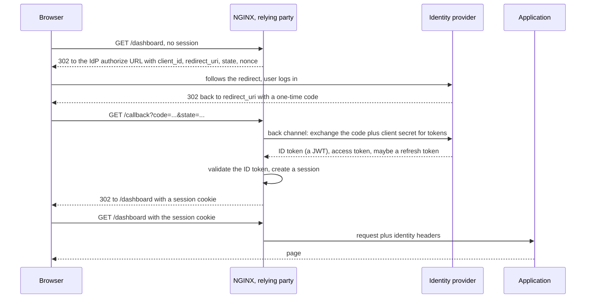

# JSON Web Tokens and OpenID Connect

## Before this lesson

Read [HTTP basic authentication and auth subrequests](#/lesson/nginx/basic-auth-subrequests) first: this lesson builds on the `Authorization` header, on Base64 and on `auth_request`. `map` from [A/B testing, map, geo](#/lesson/nginx/split-geo-map) and njs from [Extending NGINX with njs and Lua](#/lesson/nginx/njs-lua) appear in the open-source examples.

## In plain words

With a password list or an auth service, the guard at the door must look something up for every visitor. There is a third way: give each visitor a **signed pass**.

Think of a festival wristband. The ticket office checks your ticket once and fastens a band printed with your access level and the date, stamped with a seal that is hard to forge. After that, any gate can admit you by looking at the band: is the seal genuine, is today's date on it, does it say "backstage"? No gate needs to phone the ticket office.

A **JSON Web Token (JWT**, pronounced "jot") is that wristband in digital form: a small piece of text stating facts about a user, plus a signature that proves who issued it and that nobody altered it. **OpenID Connect (OIDC)** is the standard procedure by which a user obtains such a token from a central login service, the "ticket office", such as Okta, Microsoft Entra ID, Auth0, Google or Keycloak.

NGINX's part is the gate: validate the token at the edge and refuse bad requests before they reach any application. Token-based authentication is how nearly all modern APIs and single sign-on systems work, so reading a JWT and explaining how it is validated is a baseline expectation for backend and platform roles.

## Anatomy of a JWT

A JWT is three pieces of text joined by dots:

```text
eyJhbGciOiJIUzI1NiIsInR5cCI6IkpXVCJ9.eyJpc3MiOiJodHRwczovL2xvZ2luLnNob3AudGVzdCIsInN1YiI6InJvc2EiLCJhdWQiOiJzaG9wLWFwaSIsImV4cCI6MTc5NTUwMDAwMCwicm9sZSI6InN0YWZmIn0.3q1c...signature...
```

| Part | Contains | Decoded example |
|---|---|---|
| header | which algorithm signed it, and optionally a key id | `{"alg":"HS256","typ":"JWT"}` |
| payload | the **claims**: statements about the user and the token | `{"iss":"https://login.shop.test","sub":"rosa","aud":"shop-api","exp":1795500000,"role":"staff"}` |
| signature | proof computed over the first two parts with a key | binary |

Each part is encoded in **Base64url**, a variant of Base64 that is safe inside URLs (it uses `-` and `_` in place of `+` and `/`, and drops the `=` padding). As with basic authentication, encoding is not secrecy: **anyone holding a token can read its payload**. Never put a password or other secret in one.

The standard claims you will meet:

| Claim | Name | Meaning |
|---|---|---|
| `iss` | issuer | who created the token |
| `sub` | subject | who the token is about, usually a user id |
| `aud` | audience | which service the token is meant for |
| `exp` | expiry | the moment after which it is invalid, in seconds since 1 January 1970 |
| `nbf` | not before | the moment before which it is not yet valid |
| `iat` | issued at | when it was created |

Anything else (`role`, `email`, `tenant`) is a custom claim.

### Two families of signature

- **Symmetric, such as HS256.** One shared secret both signs and verifies (HMAC with SHA-256). It is easy to set up, but every service that can verify can also forge, so it only suits a single team that owns both ends.
- **Asymmetric, such as RS256 or ES256.** The issuer signs with a **private key** that never leaves it. Everyone else verifies with the matching **public key**, which can be published freely. A stolen public key cannot create tokens. This is what identity providers use.

Public keys are published in a format called **JWK** (JSON Web Key), and a list of them is a **JWKS** (JWK Set), served at a well-known URL. Each key has an id (`kid`); the token's header names the `kid` that signed it, so keys can be rotated without downtime: publish the new key, start signing with it, retire the old one once its tokens have expired.

### What "validating" a token means

A gate must check all of the following, in order:

1. The text has three parts and decodes properly.
2. The algorithm in the header is one you accept. A token claiming `"alg":"none"` (no signature) must be rejected; accepting it is a famous vulnerability.
3. **The signature is correct** for the header and payload using your key.
4. `exp` is in the future and `nbf`, if present, is in the past.
5. `iss` is the issuer you trust and `aud` names your service.
6. Any claims your rule needs (`role` is `staff`) are present.

Build and check a real HS256 token with the standard library to see every step:

```python-run
import base64, hashlib, hmac, json

b64url = lambda raw: base64.urlsafe_b64encode(raw).rstrip(b"=").decode()
def unb64url(text):
    return base64.urlsafe_b64decode(text + "=" * (-len(text) % 4))     # restore the padding

def sign(claims, secret):
    header = b64url(json.dumps({"alg": "HS256", "typ": "JWT"}, separators=(",", ":")).encode())
    payload = b64url(json.dumps(claims, separators=(",", ":")).encode())
    mac = hmac.new(secret, f"{header}.{payload}".encode(), hashlib.sha256).digest()
    return f"{header}.{payload}.{b64url(mac)}"

def validate(token, secret, now, issuer, audience):
    parts = token.split(".")
    if len(parts) != 3:
        return "401: not three parts"
    header, payload, signature = parts
    if json.loads(unb64url(header)).get("alg") != "HS256":
        return "401: algorithm not accepted"
    expected = hmac.new(secret, f"{header}.{payload}".encode(), hashlib.sha256).digest()
    if not hmac.compare_digest(expected, unb64url(signature)):
        return "401: bad signature"
    claims = json.loads(unb64url(payload))
    if claims.get("exp", 0) <= now:
        return "401: expired"
    if claims.get("nbf", 0) > now:
        return "401: not yet valid"
    if claims.get("iss") != issuer or claims.get("aud") != audience:
        return "401: wrong issuer or audience"
    return f"200: hello {claims['sub']} (role {claims.get('role')})"

SECRET, NOW = b"correct-horse-battery", 1_795_000_000
token = sign({"iss": "https://login.shop.test", "sub": "rosa", "aud": "shop-api",
              "exp": NOW + 900, "role": "staff"}, SECRET)
print(token[:60] + "...")
print(validate(token, SECRET, NOW, "https://login.shop.test", "shop-api"))
print(validate(token, SECRET, NOW + 3600, "https://login.shop.test", "shop-api"))
print(validate(token, b"wrong-secret", NOW, "https://login.shop.test", "shop-api"))

# An attacker edits the payload to become admin but cannot recompute the signature:
h, p, s = token.split(".")
forged = json.loads(unb64url(p)); forged["role"] = "admin"
print(validate(f"{h}.{b64url(json.dumps(forged, separators=(',', ':')).encode())}.{s}",
               SECRET, NOW, "https://login.shop.test", "shop-api"))
```

The four results are: accepted, expired, bad signature, bad signature. The last line is the whole point of signing: changing one character of the payload invalidates the token. Problem `nginx-jwt-check` asks you to write the validator.

## Validating JWTs in NGINX Plus

> [!NOTE]
> **NGINX Plus.** The `auth_jwt` directives are commercial. Open-source approaches follow in the next section.

```nginx
server {
    listen 443 ssl;
    server_name api.shop.test;
    ssl_certificate     /etc/nginx/tls/api.crt;
    ssl_certificate_key /etc/nginx/tls/api.key;

    location /api/ {
        auth_jwt          "shop api";
        auth_jwt_key_file /etc/nginx/keys/issuer.jwks;

        auth_jwt_require  $jwt_claim_iss_ok $jwt_claim_aud_ok error=403;

        proxy_set_header  X-User $jwt_claim_sub;
        proxy_set_header  X-Role $jwt_claim_role;
        proxy_pass http://127.0.0.1:8000;
    }
}

map $jwt_claim_iss $jwt_claim_iss_ok { "https://login.shop.test" 1; default 0; }
map $jwt_claim_aud $jwt_claim_aud_ok { "shop-api" 1; default 0; }
```

- `auth_jwt "shop api";` requires a valid JWT here. By default the token is taken from the `Authorization: Bearer <token>` request header. To read it from elsewhere add `token=$cookie_auth_token` or `token=$arg_access_token`.
- `auth_jwt_key_file` names a file of keys in JWKS format, used to verify the signature. NGINX also checks `exp` and `nbf` automatically.
- `$jwt_claim_NAME` variables expose any claim, and `$jwt_header_NAME` any header field.
- `auth_jwt_require` adds your own conditions: each listed variable must be non-empty and not `0`. The two `map` blocks (which belong in the `http` context) turn "is the issuer ours?" and "is the audience ours?" into 1 or 0. `error=403` selects the status for a failed condition; a missing or invalid token gets 401.
- The verified subject and role are passed to the application in headers.

Keeping the key file up to date by hand does not survive key rotation, so Plus can fetch the key set from the issuer and cache it:

```nginx
proxy_cache_path /var/cache/nginx/jwks keys_zone=jwks:1m;

location /api/ {
    auth_jwt "shop api";
    auth_jwt_key_request /_jwks;
    proxy_pass http://127.0.0.1:8000;
}

location = /_jwks {
    internal;
    proxy_cache jwks;
    proxy_cache_valid 200 12h;
    proxy_pass https://login.shop.test/.well-known/jwks.json;
}
```

`auth_jwt_key_request /_jwks;` obtains keys through a subrequest to an internal location, which proxies to the issuer's JWKS address and caches the result for twelve hours so that validation does not depend on the issuer being reachable for every request. (`auth_jwt_key_cache` similarly keeps parsed keys in memory.)

```bash
$ curl -i https://api.shop.test/api/orders
HTTP/1.1 401 Unauthorized
WWW-Authenticate: Bearer realm="shop api"

$ curl -i -H "Authorization: Bearer $TOKEN" https://api.shop.test/api/orders
HTTP/1.1 200 OK
Content-Type: application/json

$ curl -i -H "Authorization: Bearer $EXPIRED_TOKEN" https://api.shop.test/api/orders
HTTP/1.1 401 Unauthorized
WWW-Authenticate: Bearer realm="shop api", error="invalid_token"
```

To create a JWK for a symmetric secret by hand (the cookbook's "creating JSON Web Keys" task), Base64url-encode the secret and wrap it:

```bash
$ printf 'correct-horse-battery' | base64 | tr '+/' '-_' | tr -d '='
Y29ycmVjdC1ob3JzZS1iYXR0ZXJ5
$ cat /etc/nginx/keys/issuer.jwks
{"keys":[{"kty":"oct","kid":"2026-11","k":"Y29ycmVjdC1ob3JzZS1iYXR0ZXJ5"}]}
```

`tr` swaps the two characters that differ between Base64 and Base64url and removes padding. `kty` is the key type (`oct` for a symmetric secret, `RSA` or `EC` for public keys), `kid` the key id, `k` the secret.

## Validating JWTs with open-source NGINX

**Option 1: `auth_request` to a validator.** The pattern from the previous lesson. A small service (your own, or oauth2-proxy and similar) validates the token and answers 2xx or 401. This is the most common production choice because the validator can use a mature JWT library and handle key rotation.

```nginx
location /api/ {
    auth_request /_jwt_check;
    auth_request_set $jwt_sub $upstream_http_x_jwt_sub;
    proxy_set_header X-User $jwt_sub;
    proxy_pass http://127.0.0.1:8000;
}
location = /_jwt_check {
    internal;
    proxy_pass http://127.0.0.1:9000/verify;
    proxy_pass_request_body off;
    proxy_set_header Content-Length "";
}
```

**Option 2: validate in njs.** For HS256, or RS256 with a locally stored public key, a short script does the same checks as the Python demo above.

```javascript
import crypto from 'crypto';

function check(r) {
    const auth = r.headersIn['Authorization'] || '';
    const parts = auth.replace(/^Bearer /, '').split('.');
    if (parts.length !== 3) { r.return(401); return; }

    const expected = crypto.createHmac('sha256', process.env.JWT_SECRET)
                           .update(parts[0] + '.' + parts[1]).digest('base64url');
    const header = JSON.parse(Buffer.from(parts[0], 'base64url').toString());
    const claims = JSON.parse(Buffer.from(parts[1], 'base64url').toString());
    const now = Math.floor(Date.now() / 1000);

    if (header.alg !== 'HS256' || expected !== parts[2] || !(claims.exp > now)
        || claims.iss !== 'https://login.shop.test' || claims.aud !== 'shop-api') {
        r.return(401);
        return;
    }
    r.headersOut['X-Jwt-Sub'] = claims.sub;
    r.return(204);
}

export default { check };
```

```nginx
env JWT_SECRET;                                  # main context: let workers see the variable
js_import jwt from jwt.js;

location = /_jwt_check { internal; js_content jwt.check; }
```

- The script takes the header's token, recomputes the HMAC over the first two parts with a secret read from an environment variable, and compares.
- It then checks algorithm, expiry, issuer and audience, and answers 204 with the subject in a response header, or 401.
- It is used as the target of `auth_request`, so the main location looks the same as in option 1, but no separate service runs.

**Option 3: Lua.** In OpenResty, `lua-resty-jwt` and `lua-resty-openidc` provide validation and full OIDC flows inside `access_by_lua_block`.

> [!WARNING]
> Do not write signature checks casually. The classic mistakes are accepting `alg: none`, accepting whatever algorithm the token names (letting an attacker switch RS256 to HS256 and sign with the public key as the secret), skipping `aud`, and comparing signatures with a normal string comparison that leaks timing. Prefer an audited library or the built-in module, and pin the accepted algorithm.

## OpenID Connect, conceptually

A JWT has to come from somewhere. **OAuth 2.0** is a standard for letting one service obtain limited access on a user's behalf; **OpenID Connect** adds a standard identity layer on top of it. The party that logs users in is the **identity provider (IdP)**. The service that relies on it, here NGINX acting for your applications, is the **relying party**.

The flow used for browser logins is the **authorization code flow**:



1. An unauthenticated browser is redirected to the IdP with a description of who is asking (`client_id`), where to return (`redirect_uri`), and two random values: `state`, which ties the response to this browser and blocks forged callbacks, and `nonce`, which ties the eventual token to this login.
2. The user authenticates **at the IdP**. Your application never sees the password, and the IdP can demand a second factor.
3. The IdP sends the browser back with a short-lived, single-use **authorization code**.
4. NGINX exchanges that code for tokens over a direct server-to-server connection, proving its own identity with a **client secret**. Tokens never pass through the browser's address bar.
5. NGINX validates the **ID token**, a JWT describing the user, exactly as in the first half of this lesson, then stores a session and sets a cookie.
6. Later requests carry the cookie. NGINX looks up the session and forwards identity to the application.

The IdP publishes everything a relying party needs (endpoint addresses, the JWKS location, supported algorithms) in a **discovery document** at `/.well-known/openid-configuration`.

How to get this with NGINX:

| Edition | Approach |
|---|---|
| NGINX Plus, older releases | F5's reference implementation: njs code driving `auth_jwt`, with sessions in the key-value store |
| NGINX Plus, recent releases | a native OIDC module: an `oidc_provider` block holding issuer, client id and secret, and `auth_oidc` in the protected location |
| Open source | `auth_request` to **oauth2-proxy**, Vouch or Authelia, which run the whole flow and answer 2xx or 401; or OpenResty with `lua-resty-openidc` |

The open-source arrangement with oauth2-proxy is the `auth_request` pattern of the previous lesson plus one location that hands the login and callback paths to the proxy:

```nginx
location /oauth2/ {
    proxy_pass http://127.0.0.1:4180;
    proxy_set_header Host $host;
    proxy_set_header X-Forwarded-Proto $scheme;
}

location / {
    auth_request /oauth2/auth;
    error_page 401 = @start_login;
    auth_request_set $user_email $upstream_http_x_auth_request_email;
    proxy_set_header X-User-Email $user_email;
    proxy_pass http://127.0.0.1:8000;
}

location @start_login {
    return 302 /oauth2/start?rd=$scheme://$host$request_uri;
}
```

`/oauth2/auth` answers 202 when the session cookie is valid and 401 otherwise; `/oauth2/start` begins the redirect to the IdP; the proxy handles `/oauth2/callback` itself.

> [!INTERVIEW]
> "How does a gateway validate a JWT, and what are the trade-offs against sessions?" Describe the three parts, the signature check with the issuer's key (public key from a JWKS for RS256), then `exp`, `nbf`, `iss`, `aud` and required claims. Trade-offs: validation needs no lookup, so it scales and works across services; but a token cannot easily be revoked before it expires, so keep lifetimes short (minutes) and use refresh tokens or a deny-list for emergencies.

## Pitfalls

- **Treating the payload as secret.** It is readable by anyone.
- **Long-lived tokens.** A stolen token works until `exp`. Fifteen minutes is typical for access tokens.
- **Not checking `aud`.** A token issued for another service of the same IdP is otherwise accepted by yours.
- **Clock differences.** A gateway whose clock runs fast rejects fresh tokens. Keep clocks synchronised with NTP; Plus has `auth_jwt_leeway` for a tolerance.
- **Stale keys after rotation.** A hand-copied JWKS file breaks every login on rotation day. Fetch and cache.
- **Tokens in query strings.** They end up in access logs, browser history and `Referer` headers. Use the `Authorization` header or a cookie marked `HttpOnly` and `Secure`.
- **Forwarding the raw token and identity headers without care.** Decide whether applications re-validate the token (defence in depth) or trust NGINX's headers, and make them unreachable by any other path.
- **Missing `state` or `nonce` checks** in a home-made OIDC flow. Use an established implementation.

## Cheat sheet

| Item | Meaning or configuration |
|---|---|
| JWT shape | `base64url(header).base64url(payload).base64url(signature)` |
| HS256 / RS256 | shared secret / private key signs and public key verifies |
| JWKS | the issuer's published list of public keys |
| Must check | signature, algorithm, `exp`, `nbf`, `iss`, `aud`, needed claims |
| Plus: require a token | `auth_jwt "realm"; auth_jwt_key_file keys.jwks;` |
| Plus: remote keys | `auth_jwt_key_request /_jwks;` with a cached internal location |
| Plus: claim variable | `$jwt_claim_sub`, `$jwt_claim_role` |
| Plus: extra conditions | `auth_jwt_require $var error=403;` |
| Open source | `auth_request` to a validator, njs, or Lua |
| OIDC browser flow | authorization code: redirect, login at IdP, code, back-channel exchange, session |
| OIDC with open source | `auth_request` plus oauth2-proxy |
| Bearer header | `Authorization: Bearer <token>` |

## Summary

- A JWT is three Base64url parts; the payload carries readable claims and the signature proves origin and integrity.
- Validation is signature first, then time, issuer, audience and any required claims, with the algorithm pinned.
- NGINX Plus validates tokens natively with `auth_jwt` and can fetch and cache the issuer's keys; open-source NGINX delegates through `auth_request`, njs or Lua.
- OpenID Connect's authorization code flow sends the user to an identity provider and returns a code that NGINX, or a helper such as oauth2-proxy, exchanges for tokens.
- Short lifetimes, audience checks and key rotation handling are what separate a safe deployment from a fragile one.

## Glossary

- **Access token / ID token**: a token granting access to an API / a JWT describing the logged-in user.
- **Authorization code flow**: the OIDC procedure using a one-time code exchanged server to server.
- **Base64url**: URL-safe Base64 without padding.
- **Bearer token**: a token that grants access to whoever presents it.
- **Claim**: one statement in a JWT's payload.
- **Client id / client secret**: the relying party's identifier and password at the IdP.
- **HMAC**: a keyed hash used as a signature with a shared secret.
- **Identity provider (IdP)**: the service that authenticates users and issues tokens.
- **JWK / JWKS**: a key in JSON form / a set of them.
- **JWT**: a signed token of claims.
- **Nonce / state**: random values that bind a login response to its request.
- **OAuth 2.0 / OpenID Connect**: delegated-access standard / the identity layer on top of it.
- **Relying party**: the service that trusts the IdP's tokens.

## Check yourself

```quiz
[
  {"q": "Someone intercepts a JWT. What can they do without the signing key?",
   "options": ["Nothing, it is encrypted", "Read every claim in the payload, but not alter them undetected", "Change the role claim freely", "Extend the expiry"], "answer": 1,
   "explain": "The payload is only Base64url-encoded. The signature prevents modification, not reading."},
  {"q": "A token's exp claim is 60 seconds in the past and its signature is valid. What status code does a JWT-protected location return?",
   "options": ["200", "401", "403", "500"], "answer": 1,
   "explain": "An expired token is invalid, so the request is unauthenticated: 401."},
  {"q": "With auth_jwt_require ... error=403, a token is valid and unexpired but its aud claim names another service. What status code is returned?",
   "options": ["200", "401", "403", "404"], "answer": 2,
   "explain": "The token itself is acceptable, but the extra requirement fails, and the configuration chose 403 for that case."},
  {"q": "Why do identity providers sign with RS256 or ES256 instead of HS256?",
   "options": ["They are faster", "Verifiers only need the public key, which cannot be used to forge tokens", "HS256 tokens are larger", "HS256 cannot carry claims"], "answer": 1,
   "explain": "With a shared secret every verifier could also sign. Asymmetric keys keep signing power with the issuer alone."},
  {"q": "What is the purpose of the kid field in a JWT header?",
   "options": ["It names the user", "It identifies which key in the issuer's key set signed the token, allowing rotation", "It encrypts the payload", "It sets the expiry"], "answer": 1,
   "explain": "Verifiers pick the matching key from the JWKS by its id."},
  {"q": "In the authorization code flow, why is the code exchanged for tokens over a direct server-to-server call?",
   "options": ["Browsers cannot parse JSON", "So tokens and the client secret never pass through the browser's address bar or history", "To make login slower", "Because cookies are disabled"], "answer": 1,
   "explain": "Only the short-lived single-use code travels through the browser; the exchange is authenticated with the client secret."},
  {"q": "Which open-source arrangement gives NGINX OIDC login?",
   "options": ["auth_basic with a JWKS file", "auth_request pointing at oauth2-proxy, with error_page 401 redirecting to its start URL", "limit_req with nodelay", "split_clients on the cookie"], "answer": 1,
   "explain": "The helper runs the OIDC flow and reports 2xx or 401 to NGINX through the subrequest."}
]
```

> **Source:** DeJonghe, NGINX Cookbook, ch. 6 (validating JWTs, creating JSON Web Keys, obtaining and caching JSON Web Key Sets, authenticating users via OpenID Connect SSO). Docs: https://nginx.org/en/docs/http/ngx_http_auth_jwt_module.html, https://nginx.org/en/docs/http/ngx_http_oidc_module.html, https://openid.net/specs/openid-connect-core-1_0.html, https://datatracker.ietf.org/doc/html/rfc7519
