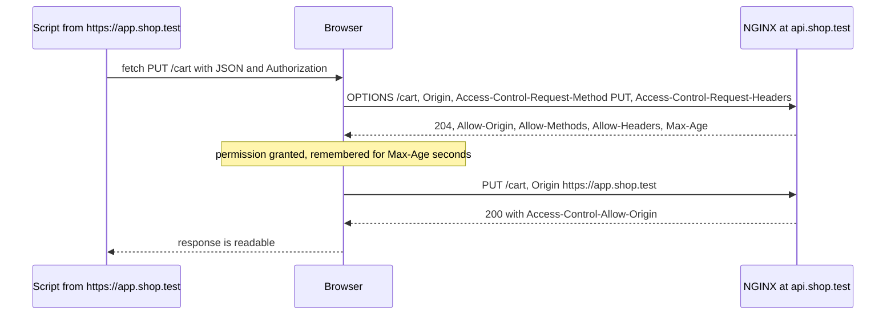

# Access rules, satisfy, CORS and secure links

## Before this lesson

You need location matching and inheritance ([How NGINX picks a location block](#/lesson/nginx/location-matching)), `map` and CIDR ranges ([A/B testing, map, geo](#/lesson/nginx/split-geo-map)), and basic authentication ([HTTP basic authentication and auth subrequests](#/lesson/nginx/basic-auth-subrequests)). The web security track explains the browser's same-origin policy at length; the part needed here is restated.

## In plain words

A club has several door policies, each for a different problem.

- **"Only people coming from these streets."** A rule about where the visitor comes from: access by **IP address**.
- **"Members' street OR a membership card will do"** versus **"you need both"**. How rules combine: `satisfy any` versus `satisfy all`.
- **"We will tell other clubs' doormen which of their guests may borrow our equipment."** A permission slip that a *browser* checks before letting one website's script talk to another website: **CORS**.
- **"This ticket admits one to the cloakroom and is void after 9 pm."** A link that carries its own unforgeable permission and expiry date: a **secure link**.

None of these replaces login. They are the supporting controls that every production site layers around it. All four are also common places for subtle mistakes: a rule in the wrong order, a CORS header that grants the whole internet access with cookies, a secure link whose secret leaks.

## Access by IP address: allow and deny

```nginx
location /admin/ {
    allow 10.0.0.0/8;
    allow 203.0.113.5;
    allow 2001:db8:42::/48;
    deny  all;
    proxy_pass http://127.0.0.1:8000;
}
```

- `allow` and `deny` each take an address, a CIDR range, or the word `all`.
- The rules are checked **from top to bottom and the first one that matches decides**. Later rules are not consulted.
- If no rule matches, access is allowed. That is why lists that are meant to be allow-lists end with `deny all;`.
- A denied request receives **403 Forbidden**.

Order changes meaning completely:

```nginx
# A: blocks one bad address inside an otherwise trusted range
deny  10.0.5.77;
allow 10.0.0.0/8;
deny  all;

# B: the first line matches 10.0.5.77 and allows it; the deny below is never reached
allow 10.0.0.0/8;
deny  10.0.5.77;
deny  all;
```

The rules inherit like array-type directives: a location that declares any `allow` or `deny` of its own ignores the ones from the server level.

```bash
$ curl -s -o /dev/null -w '%{http_code}\n' https://shop.test/admin/          # from 198.51.100.7
403
$ ssh office-host curl -s -o /dev/null -w '%{http_code}\n' https://shop.test/admin/   # from 10.0.4.2
200
```

The address tested is `$remote_addr`. Behind a load balancer that is the balancer's address unless the realip module is configured ([lesson 9](#/lesson/nginx/split-geo-map)). An allow-list written against the wrong address either admits everyone or nobody.

For long or frequently changing lists, a `geo` block plus one `if` scales better than hundreds of `allow` lines, because `geo` uses a fast lookup structure:

```nginx
geo $admin_allowed {
    default 0;
    include /etc/nginx/allowlists/office.conf;     # lines such as "10.0.0.0/8 1;"
}
server {
    location /admin/ {
        if ($admin_allowed = 0) { return 403; }
        proxy_pass http://127.0.0.1:8000;
    }
}
```

To restrict by HTTP method instead of path, `limit_except` wraps access rules that apply to every method other than those listed:

```nginx
location /api/products {
    limit_except GET HEAD {
        allow 10.0.0.0/8;
        deny  all;
    }
    proxy_pass http://127.0.0.1:8000;
}
```

Anyone may read (`GET` and `HEAD`); only the internal network may write.

## satisfy: combining access methods

NGINX has several access-phase checks: `allow`/`deny`, `auth_basic`, `auth_request`, and in Plus `auth_jwt`. When a location uses more than one, `satisfy` says how they combine.

| Directive | Meaning |
|---|---|
| `satisfy all;` (default) | every configured check must pass |
| `satisfy any;` | one passing check is enough |

```nginx
location /reports/ {
    satisfy any;

    allow 10.0.0.0/8;
    deny  all;

    auth_basic           "Reports";
    auth_basic_user_file /etc/nginx/.htpasswd;

    proxy_pass http://127.0.0.1:8000;
}
```

With `satisfy any`, staff on the office network walk straight in, and everyone else is asked for a password. Change the one word to `all` and the meaning becomes "on the office network **and** with a password".

| Client | Credentials | `satisfy any` | `satisfy all` |
|---|---|---|---|
| 10.0.4.2 (office) | none | 200 | 401 |
| 10.0.4.2 (office) | valid | 200 | 200 |
| 198.51.100.7 (outside) | none | 401 | 403 |
| 198.51.100.7 (outside) | valid | 200 | 403 |
| 198.51.100.7 (outside) | wrong | 401 | 403 |

Two details in that table are worth understanding. Under `any`, an outside client without credentials gets **401, not 403**: the address check failed, but the password check can still succeed, so NGINX issues the challenge. Under `all`, an outside client gets 403 immediately, since the address check runs first and nothing can rescue it.

```python-run
import ipaddress

RULES = [("allow", "10.0.0.0/8"), ("deny", "all")]
USERS = {"rosa": "tidepool"}

def ip_check(addr):
    for action, target in RULES:                       # first match wins
        if target == "all" or ipaddress.ip_address(addr) in ipaddress.ip_network(target):
            return action == "allow"
    return True                                        # no rule matched: allowed

def access(addr, creds, satisfy):
    ip_ok = ip_check(addr)
    auth_ok = creds is not None and USERS.get(creds[0]) == creds[1]
    if satisfy == "all":
        if not ip_ok:
            return 403
        return 200 if auth_ok else 401
    if ip_ok or auth_ok:                               # satisfy any
        return 200
    return 401                                         # a password could still succeed

for addr in ("10.0.4.2", "198.51.100.7"):
    for creds in (None, ("rosa", "tidepool"), ("rosa", "wrong")):
        print(f"{addr:13} creds={str(creds):22} any={access(addr, creds, 'any')}  all={access(addr, creds, 'all')}")
```

## CORS: letting another site's scripts call you

### The problem being solved

An **origin** is the combination of scheme, host and port: `https://shop.test` and `https://api.shop.test` are different origins. Browsers enforce the **same-origin policy**: JavaScript loaded from one origin may send requests to another origin, but may not **read the response** unless that other server says it is allowed. Without this rule, any page you visit could quietly read your webmail using your logged-in cookies.

**CORS** (Cross-Origin Resource Sharing) is how a server gives that permission, through response headers. Two things to hold on to:

- CORS is enforced **by browsers, to protect users**. `curl`, mobile apps and other servers ignore it entirely. It is not a way to keep clients out of your API.
- The server does not block anything. It announces a policy and the browser obeys it.

### Simple requests and preflights

For some requests (a `GET`, or a `POST` with a plain form content type and no custom headers) the browser sends the request with an `Origin` header and afterwards checks the response for `Access-Control-Allow-Origin`.

For anything more involved (JSON content type, an `Authorization` header, `PUT` or `DELETE`), the browser first asks permission with a **preflight**: an `OPTIONS` request describing what it intends to do.



| Response header | Says |
|---|---|
| `Access-Control-Allow-Origin` | which origin may read the response: one exact origin, or `*` for any |
| `Access-Control-Allow-Methods` | methods permitted, answered on the preflight |
| `Access-Control-Allow-Headers` | request headers the script may send |
| `Access-Control-Allow-Credentials: true` | cookies and HTTP authentication may be included |
| `Access-Control-Max-Age` | seconds the browser may remember the preflight answer |
| `Access-Control-Expose-Headers` | response headers the script may read beyond the basic set |

### A correct configuration with an allow-list

```nginx
map $http_origin $cors_origin {
    default                      "";
    "https://app.shop.test"      $http_origin;
    "https://admin.shop.test"    $http_origin;
    "~^https://[a-z0-9-]+\.preview\.shop\.test$"  $http_origin;
}

server {
    listen 443 ssl;
    server_name api.shop.test;
    ssl_certificate     /etc/nginx/tls/api.crt;
    ssl_certificate_key /etc/nginx/tls/api.key;

    location /api/ {
        if ($request_method = OPTIONS) {
            add_header Access-Control-Allow-Origin      $cors_origin always;
            add_header Access-Control-Allow-Methods     "GET, POST, PUT, DELETE, OPTIONS" always;
            add_header Access-Control-Allow-Headers     "Authorization, Content-Type" always;
            add_header Access-Control-Allow-Credentials "true" always;
            add_header Access-Control-Max-Age           86400 always;
            add_header Vary                             "Origin" always;
            return 204;
        }

        add_header Access-Control-Allow-Origin      $cors_origin always;
        add_header Access-Control-Allow-Credentials "true" always;
        add_header Vary                             "Origin" always;

        proxy_pass http://127.0.0.1:8000;
    }
}
```

- The `map` is the policy. It echoes the request's `Origin` back only if it is on the list; for any other origin the variable is empty. An `add_header` with an empty value sends no header at all, and the browser then refuses the script access. The third row uses an anchored regex for preview deployments.
- The `if` block answers preflights directly with 204 and never bothers the application. This is one of the safe uses of `if` in a location, because the block ends in `return`.
- `add_header` lines are repeated outside the `if`, because the block does not inherit them (the array rule again), and actual responses need the origin header too.
- `always` attaches the headers to error responses as well. Without it, a 401 from the application arrives with no CORS header, and the browser reports a confusing CORS failure in place of the real error.
- `Vary: Origin` tells caches that the response differs by origin, so a response cached for one origin is not replayed to another.
- `Access-Control-Max-Age 86400` lets browsers reuse a preflight answer for up to a day (browsers apply their own lower caps).

```bash
$ curl -i -X OPTIONS https://api.shop.test/api/cart \
    -H 'Origin: https://app.shop.test' -H 'Access-Control-Request-Method: PUT'
HTTP/1.1 204 No Content
Access-Control-Allow-Origin: https://app.shop.test
Access-Control-Allow-Methods: GET, POST, PUT, DELETE, OPTIONS
Access-Control-Allow-Headers: Authorization, Content-Type
Access-Control-Allow-Credentials: true
Access-Control-Max-Age: 86400
Vary: Origin

$ curl -i -X OPTIONS https://api.shop.test/api/cart \
    -H 'Origin: https://evil.example' -H 'Access-Control-Request-Method: PUT'
HTTP/1.1 204 No Content
Access-Control-Allow-Methods: GET, POST, PUT, DELETE, OPTIONS
Access-Control-Allow-Headers: Authorization, Content-Type
Access-Control-Allow-Credentials: true
Access-Control-Max-Age: 86400
Vary: Origin
```

The second response has no `Access-Control-Allow-Origin`, so a browser running a script from `evil.example` stops there.

> [!WARNING]
> `Access-Control-Allow-Origin: *` together with `Access-Control-Allow-Credentials: true` is invalid, and browsers reject it. The tempting workaround, echoing back whatever `Origin` arrived while allowing credentials, is worse: it lets every website on the internet make authenticated requests as your logged-in users and read the answers. Echo only origins on an allow-list. Use `*` solely for public, credential-free resources such as fonts or open data.

Decide where CORS lives. If the application already sends these headers, adding them in NGINX too produces duplicates (`Access-Control-Allow-Origin` appearing twice is an error to browsers). Pick one place; `proxy_hide_header Access-Control-Allow-Origin;` removes the application's copy if NGINX is to own the policy.

## Secure links: URLs that carry their own permission

You sell a video course. The files sit on a download server, and you want only buyers to fetch them, only for a while, without the download server keeping any session or database. The trick: the application and NGINX share a **secret**. The application generates a URL containing a hash of the path, an expiry time and the secret. NGINX recomputes the hash and serves the file only if it matches. Nobody without the secret can produce a valid URL, and editing the path or the expiry breaks the hash.

```nginx
server {
    listen 443 ssl;
    server_name files.shop.test;
    ssl_certificate     /etc/nginx/tls/files.crt;
    ssl_certificate_key /etc/nginx/tls/files.key;

    location /courses/ {
        secure_link     $arg_md5,$arg_expires;
        secure_link_md5 "$secure_link_expires$uri$remote_addr s3cr3t-change-me";

        if ($secure_link = "")  { return 403; }
        if ($secure_link = "0") { return 410; }

        root /srv/protected;
    }
}
```

- `secure_link $arg_md5,$arg_expires;` says where the URL carries the hash and the expiry: in the query parameters `md5` and `expires`.
- `secure_link_md5 "..."` is the recipe for the text to hash. Here it is the expiry time, the path, the client address and the secret. Including `$remote_addr` binds the link to one network address; leave it out if buyers switch networks. **The recipe must be identical in the application and in NGINX**, character for character, including the space before the secret.
- After evaluation, `$secure_link` is one of three values: an empty string when the hash is wrong, `"0"` when the hash is right but the time has passed, and `"1"` when all is well.
- The two `if` lines turn those into **403 Forbidden** (invalid) and **410 Gone** (expired), a distinction that lets the application show "this link has expired, request a new one".

The hash is MD5, written in Base64url. Generating a link on the command line:

```bash
$ expires=$(date -d '+1 hour' +%s)
$ printf '%s' "${expires}/courses/intro.mp4198.51.100.7 s3cr3t-change-me" \
    | openssl md5 -binary | openssl base64 | tr '+/' '-_' | tr -d '='
kq4Zf0b1pS1mF0oYtQeZ9g
$ curl -I "https://files.shop.test/courses/intro.mp4?md5=kq4Zf0b1pS1mF0oYtQeZ9g&expires=$expires"
HTTP/1.1 200 OK
Content-Type: video/mp4

$ curl -I "https://files.shop.test/courses/OTHER.mp4?md5=kq4Zf0b1pS1mF0oYtQeZ9g&expires=$expires"
HTTP/1.1 403 Forbidden
```

- `date -d '+1 hour' +%s` prints the time one hour from now in seconds since 1970, the format NGINX expects.
- `openssl md5 -binary` computes the raw hash; `openssl base64` encodes it; the two `tr` commands convert to Base64url and strip padding.
- The same hash on a different path fails, because the path is part of the hashed text.

The application side in Python, with a verifier that mirrors NGINX:

```python-run
import base64, hashlib

SECRET = "s3cr3t-change-me"

def token(expires, uri, client_ip):
    raw = f"{expires}{uri}{client_ip} {SECRET}"                     # same recipe as secure_link_md5
    return base64.urlsafe_b64encode(hashlib.md5(raw.encode()).digest()).decode().rstrip("=")

def make_link(uri, client_ip, now, ttl):
    expires = now + ttl
    return f"https://files.shop.test{uri}?md5={token(expires, uri, client_ip)}&expires={expires}"

def nginx_verdict(uri, md5, expires, client_ip, now):
    if md5 != token(expires, uri, client_ip):
        return 403            # $secure_link is empty
    if now > expires:
        return 410            # $secure_link is "0"
    return 200                # $secure_link is "1"

NOW = 1_795_000_000
link = make_link("/courses/intro.mp4", "198.51.100.7", NOW, ttl=3600)
print(link)
md5, expires = link.split("md5=")[1].split("&expires=")
expires = int(expires)
print("valid link            :", nginx_verdict("/courses/intro.mp4", md5, expires, "198.51.100.7", NOW + 60))
print("after it expired      :", nginx_verdict("/courses/intro.mp4", md5, expires, "198.51.100.7", NOW + 7200))
print("expiry edited by hand :", nginx_verdict("/courses/intro.mp4", md5, expires + 99999, "198.51.100.7", NOW + 7200))
print("different file        :", nginx_verdict("/courses/exam.mp4", md5, expires, "198.51.100.7", NOW + 60))
print("different client      :", nginx_verdict("/courses/intro.mp4", md5, expires, "203.0.113.9", NOW + 60))
```

There is an older, simpler mode, `secure_link_secret word;`, where the URL has the form `/prefix/<md5 hex>/<path>` and there is no expiry. It still appears in tutorials; the form above is the one to use because links expire.

The module is optional at build time (`--with-http_secure_link_module`) and is included in official and distribution packages. Two cautions about strength: MD5 is an old hash, adequate here only because the secret is unknown to the attacker and links are short-lived, so use a long random secret and rotate it; and object stores (S3 pre-signed URLs) or a CDN's signed URLs provide the same idea with stronger algorithms if you need more.

> [!INTERVIEW]
> "A front-end at one domain cannot call your API at another; the console says CORS. What do you check?" Whether the response to the actual request carries `Access-Control-Allow-Origin` matching the page's origin (and `Allow-Credentials` if cookies are sent), whether the `OPTIONS` preflight returns 2xx with the methods and headers requested, and whether the headers are present on error responses (`always`). Then state the principle: CORS protects browser users, is not an access control for the API itself, and must never reflect arbitrary origins with credentials.

## Pitfalls

- **Rule order** in `allow`/`deny`: the first match decides.
- **No final `deny all;`**, leaving an "allow-list" that allows everyone.
- **Address rules behind a proxy** without the realip module.
- **Expecting `satisfy any` to return 403** to outsiders; they get the 401 challenge.
- **CORS headers only on success**, hiding real errors behind CORS messages.
- **Duplicate CORS headers** from NGINX and the application.
- **Reflecting any origin with credentials.**
- **Forgetting that `add_header` in a location or `if` replaces inherited headers**, dropping security headers or CORS headers in one branch.
- **A secure-link recipe that differs by one space** between application and NGINX: every link is 403.
- **Server clocks out of step**: links expire early or late. Synchronise with NTP.
- **Secure-link URLs in a shared cache.** The query string is part of the key by default, which is correct; do not strip it.

## Cheat sheet

| Goal | Configuration |
|---|---|
| Allow-list by address | `allow 10.0.0.0/8; deny all;` |
| Block one address | `deny 198.51.100.7;` placed before broader `allow` lines |
| Restrict writes only | `limit_except GET HEAD { allow ...; deny all; }` |
| Address OR password | `satisfy any;` with `allow`/`deny` and `auth_basic` |
| Address AND password | `satisfy all;` (the default) |
| CORS allow-list | `map $http_origin $cors_origin { ... }` and `add_header Access-Control-Allow-Origin $cors_origin always;` |
| Answer preflights | `if ($request_method = OPTIONS) { add_header ...; return 204; }` |
| Cache correctness with CORS | `add_header Vary "Origin" always;` |
| Expiring signed link | `secure_link $arg_md5,$arg_expires; secure_link_md5 "$secure_link_expires$uri secret";` |
| Link outcome | `$secure_link` is empty (bad), `0` (expired) or `1` (good) |

## Summary

- `allow` and `deny` are evaluated in order, first match wins, and an allow-list must end with `deny all`.
- `satisfy all` requires every access check; `satisfy any` accepts one, which changes the status outsiders see from 403 to 401.
- CORS is a browser-enforced permission system expressed in response headers; answer preflights with 204, echo only listed origins, add `Vary: Origin` and use `always`.
- Secure links embed an MD5 of path, expiry and a shared secret; NGINX recomputes it and answers 200, 403 or 410 without any stored state.

## Glossary

- **Allow-list**: a list of who is permitted, with everyone else refused.
- **CORS**: Cross-Origin Resource Sharing, headers by which a server lets other origins' scripts read its responses.
- **Credentials (CORS)**: cookies and HTTP authentication attached to a cross-origin request.
- **Origin**: scheme, host and port together.
- **Preflight**: the `OPTIONS` request a browser sends to ask permission before certain cross-origin requests.
- **Same-origin policy**: the browser rule that scripts may not read responses from other origins without permission.
- **satisfy**: the directive that combines access checks with all or any.
- **Secure link**: a URL containing a hash that proves it was issued by someone holding a secret.
- **Vary**: a response header naming request headers that change the response, for caches.
- **403 / 410**: forbidden / gone.

## Check yourself

```quiz
[
  {"q": "location has, in order: `allow 10.0.0.0/8; deny 10.0.5.77; deny all;`. What status code does a request from 10.0.5.77 receive?",
   "options": ["403", "200", "401", "404"], "answer": 1,
   "explain": "Rules are checked top to bottom and the first match decides. The allow for 10.0.0.0/8 matches first."},
  {"q": "A location has only `allow 203.0.113.5;` and nothing else. What does a request from 198.51.100.7 receive?",
   "options": ["403", "The normal response, since no rule matched and the default is to allow", "401", "444"], "answer": 1,
   "explain": "Without a closing deny all, unmatched addresses are permitted."},
  {"q": "satisfy any; allow 10.0.0.0/8; deny all; plus auth_basic. A client from 198.51.100.7 sends no credentials. What status code is returned?",
   "options": ["403", "401", "200", "407"], "answer": 1,
   "explain": "The address check failed but authentication could still satisfy the requirement, so NGINX challenges with 401."},
  {"q": "Same location but satisfy all;. The same client sends valid credentials. What status code is returned?",
   "options": ["200", "401", "403", "500"], "answer": 2,
   "explain": "Under all, every check must pass. The address rule denies, so the result is 403 whatever the password."},
  {"q": "A script on https://evil.example calls your API with the allow-list map shown in the lesson. What does NGINX send and what happens?",
   "options": ["403, request blocked by NGINX", "A normal response without Access-Control-Allow-Origin; the browser refuses to let the script read it", "A redirect", "The header with value *"], "answer": 1,
   "explain": "The map yields an empty value, so no header is added. CORS is enforced by the browser, not by the server."},
  {"q": "Why add `always` to CORS add_header lines?",
   "options": ["To make headers faster", "So they are also sent on 4xx and 5xx responses, letting scripts see real errors", "To cache them", "It is required for OPTIONS"], "answer": 1,
   "explain": "Without always, add_header applies only to a set of success and redirect codes."},
  {"q": "With the secure-link location shown, a link has a correct hash but its expires time has passed. What status code is returned?",
   "options": ["403", "404", "410", "200"], "answer": 2,
   "explain": "$secure_link is \"0\" for a valid but expired link, and the configuration maps that to 410 Gone."},
  {"q": "A user changes the expires value in a secure link to a later time. What status code is returned?",
   "options": ["200", "403", "410", "302"], "answer": 1,
   "explain": "The expiry is part of the hashed text, so the hash no longer matches and $secure_link is empty: 403."}
]
```

> **Source:** DeJonghe, NGINX Cookbook, ch. 7 (access based on IP address, allowing cross-origin resource sharing, securing a location, generating secure and expiring links, satisfying any number of security methods). Docs: https://nginx.org/en/docs/http/ngx_http_access_module.html, https://nginx.org/en/docs/http/ngx_http_core_module.html#satisfy, https://nginx.org/en/docs/http/ngx_http_secure_link_module.html, https://developer.mozilla.org/en-US/docs/Web/HTTP/CORS
